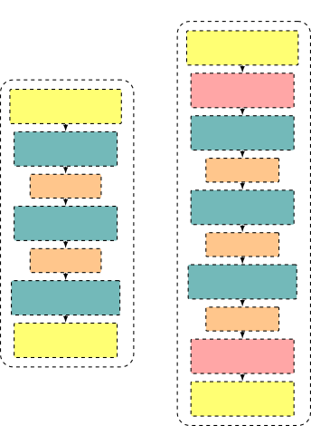

# Spiking Neural Beamforming for Multichannel Speech Enhancement on the Edge

###### Abstract

Speech enhancement with wearable and edge devices requires architectures
that balance enhancement quality against power and memory resources.
Spiking Neural Networks (SNNs) offer a promising path towards this goal
through sparse, event-driven computation, but existing SNN-based speech
enhancement methods are largely restricted to single-channel processing
and therefore cannot exploit the spatial diversity available from
microphone arrays. In this work, we propose a fully SNN framework for
multichannel speech enhancement based on a fully connected architecture
(FC-SNN) with sequential spike encoding, derived from a compact
artificial neural network (ANN) baseline via leaky integrate-and-fire
neurons. We characterize how enhancement performance scales with model
size and spike-train length relative to ANN and classical beamforming
baselines, and report the resulting parameter counts and computational
complexity. We further compare direct and rate spike encoding, revealing
a clear trade-off between event-driven computation and enhancement
performance, and use these results to identify favorable configurations
for edge devices.

| Hanan Beit-On¹   Eli Shapira²   Boaz Rafaely¹                                              |
| ------------------------------------------------------------------------------------------ |
| ¹School of Electrical and Computer Engineering, Ben-Gurion University of the Negev, Israel |
| ²Neuromorphic Lab, Israel                                                                  |

Index Terms—  spiking neural networks, multichannel speech enhancement,
beamforming, edge computing, neuromorphic computing

## 1 Introduction

Speech enhancement aims to recover clean target speech from noisy
acoustic environments and is a fundamental component in communication
systems \[26\], hearing assistive devices \[14\], teleconferencing
\[3\], and emerging wearable platforms such as augmented reality (AR)
glasses \[6, 13\]. While single-channel methods have achieved impressive
progress with deep learning \[24, 17, 28\], they rely mainly on
spectro-temporal cues, and their performance may degrade in challenging
multi-speaker scenarios.

Multichannel speech enhancement addresses this by exploiting the spatial
diversity of microphone arrays, enabling significantly improved
performance in reverberant and multi-speaker environments compared to
single-channel approaches \[2, 23, 20\]. Recent deep neural network
(DNN)-based spatial filtering and neural beamforming techniques \[12,
32, 25, 8, 16, 39, 21\] have established the state of the art in
multichannel speech enhancement. Representative approaches include
mask-based beamforming \[8, 16\], all-neural spatial filtering \[12,
39\], and direct masking in the time-frequency (TF) domain \[20, 21\].
However, these performance gains often come at the cost of increased
computational and memory requirements, which can constrain their
deployment on power- and resource-limited edge devices.

Spiking Neural Networks (SNNs) offer an energy-efficient alternative to
conventional Artificial Neural Networks (ANNs) \[4, 34, 38\], through
sparse, event-driven computation. Early neuromorphic approaches explored
spike-based speech denoising by converting acoustic signals into spike
trains and applying biologically inspired auditory processing mechanisms
such as cochlear filtering and lateral inhibition \[35, 37\]. However,
these methods relied primarily on handcrafted auditory processing stages
and fixed network dynamics rather than data-driven training of neural
network parameters, and were limited to single-channel denoising.

More recently, trainable SNN architectures for speech enhancement have
been explored \[7, 15, 30, 1, 27, 22\], demonstrating the feasibility of
spike-based processing for denoising tasks; however, they primarily
address single-channel speech enhancement and therefore do not exploit
spatial information available in multichannel recordings. In addition,
some architectures combine spiking and conventional neural network
components, limiting the potential energy benefits of fully event-driven
computation. Furthermore, in these methods, features are typically
represented using high-dimensional spike representations rather than
sequential spike trains, resulting in relatively large architectures.

In this work, we address these limitations by developing a spiking
neural network framework for multichannel speech enhancement that
exploits spatial information while targeting efficient edge deployment.
The proposed approach employs sequential spike encoding within a fully
spiking architecture.

The main contributions of this work are summarized as follows:

- •
  We introduce a fully spiking framework for multichannel speech
  enhancement that exploits spatial information from microphone-array
  recordings, extending SNN-based speech enhancement beyond the
  single-channel setting considered in previous work and providing, to
  our knowledge, the first exploration of multichannel speech
  enhancement using a fully spiking neural network.
- •
  We employ sequential spike encoding within a fully spiking
  architecture, yielding models with roughly an order-of-magnitude fewer
  parameters than the high-dimensional spike representations and hybrid
  spiking–ANN designs used in prior work.
- •
  Through a comparative study, we characterize how enhancement
  performance scales with model size and spike-train length relative to
  ANN baselines and traditional beamforming, identifying favorable
  operating points for resource-constrained deployment.

## 2 Problem Formulation

Consider a $`C`$-microphone array observing a target speaker in the
presence of interfering speakers and background noise. The microphone
signals representing the noisy observation are stacked into
$`C`$-dimensional vectors
$`\mathbf{x}[n]=[x_{1}[n],\dots,x_{C}[n]]^{T}`$, with
$`\mathbf{s}[n]=[s_{1}[n],\dots,s_{C}[n]]^{T}`$ and
$`\mathbf{v}[n]=[v_{1}[n],\dots,v_{C}[n]]^{T}`$, denoting the
direct-path (anechoic) target speech, and the interference-plus-noise,
respectively. The latter includes interfering speakers, background
noise, and the target’s own reverberation. The noisy observation is then
given by

```math
\mathbf{x}[n]=\mathbf{s}[n]+\mathbf{v}[n]. \tag{1}
```

As speech enhancement is commonly performed in the time–frequency
domain, we further define the representations $`\mathbf{X}[k,\ell]`$,
$`\mathbf{S}[k,\ell],\mathbf{V}[k,\ell]\in\mathbb{C}^{C}`$, obtained via
the short-time Fourier transform (STFT) with $`k`$ and $`\ell`$ the
frequency-bin and time-frame indices, satisfying

```math
\mathbf{X}[k,\ell]=\mathbf{S}[k,\ell]+\mathbf{V}[k,\ell]. \tag{2}
```

The goal is to learn a mapping
$`\mathcal{F}:\mathbf{x}[n]\rightarrow\hat{s}[n]`$ that recovers the
target speech at a reference microphone. Enhancement quality is
evaluated using the scale-invariant signal-to-distortion ratio
(SI-SDR) \[19\], PESQ \[29\], and STOI \[31\], with SI-SDR used as the
training objective.

## 3 Baseline Methods

### 3.1 Baseline Beamforming Method

An oracle minimum-variance distortionless response (MVDR) beamformer
using the true steering vector and interference-plus-noise covariance
matrix is used here as a baseline, with weight vector
$`\mathbf{w}_{\mathrm{MVDR}}[k,\ell]\in\mathbb{C}^{C}`$ given by

```math
\mathbf{w}_{\mathrm{MVDR}}[k,\ell]=\frac{\mathbf{\Phi}_{vv}^{-1}[k,\ell]\mathbf{d}[k,\ell]}{\mathbf{d}^{H}[k,\ell]\mathbf{\Phi}_{vv}^{-1}[k,\ell]\mathbf{d}[k,\ell]}, \tag{3}
```

where $`\mathbf{\Phi}_{vv}[k,\ell]\in\mathbb{C}^{C\times C}`$ is the
interference-plus-noise spatial covariance matrix and
$`\mathbf{d}[k,\ell]\in\mathbb{C}^{C}`$ is the target steering vector.

### 3.2 Baseline Neural Network Masking Methods

Two DNN-based masking methods are used as baselines in this work. Both
methods take as input the stacked real and imaginary STFT channels
across microphones ($`2C`$ channels), and estimate the real and
imaginary parts of a complex mask $`M[k,\ell]`$ as two separate output
channels. The first method is based on FT-JNF \[32\], which is a
recurrent ANN that applies two bidirectional LSTM layers, the first
across frequency and the second across time. The estimated mask is
applied to the STFT of a reference microphone as

```math
\hat{S}[k,\ell]=M[k,\ell]X_{\mathrm{ref}}[k,\ell]. \tag{4}
```

The second method is a compact fully connected (FC) network (Fig. 1)
that estimates the same mask by processing each TF bin independently
through two ReLU hidden layers. Its input is additionally normalized per
TF bin by the maximum magnitude over the channels,

```math
\tilde{x}_{c}[k,\ell]=\frac{x_{c}[k,\ell]}{2\,\eta[k,\ell]}+0.5,\hskip 9.24994pt\eta[k,\ell]=\max_{c}|x_{c}[k,\ell]|, \tag{5}
```

mapping the input to the $`[0,1]`$ range required for the
Bernoulli-based rate encoding of its spiking counterpart (Section 4.1).
The input is further augmented with two normalized per-bin features, a
frequency index and $`\eta[k,\ell]`$, yielding a ($`2C+2`$)-dimensional
input shared by the FC network and its spiking counterpart (Section 4).
Unlike FT-JNF, the FC architecture does not exploit temporal or
cross-frequency dependencies, but its simple per-bin structure
facilitates direct adaptation to a spiking implementation, as described
next.

## 4 Proposed Spiking Neural Network Framework

The FC baseline is adapted to a spiking implementation, FC-SNN, by
replacing ReLU activations with leaky integrate-and-fire (LIF) neurons
and encoding the continuous-valued input into a spike-based
representation, as illustrated in Fig. 1.

### 4.1 Spike Encoding

We consider two spike encoding schemes for converting the
continuous-valued STFT features into spike-based representations. Under
direct encoding, \[36, 18\] each input feature $`x`$ (one of the
$`2C{+}2`$ components defined in Section 3) is held constant and
repeated identically at every spike timestep:

```math
z[t]=x\hskip 9.24994pt\text{for all }t=1,\dots,N. \tag{6}
```

Because the input does not vary across timesteps, the first (input)
linear layer is computed densely; only the downstream LIF layers are
spike-driven. Under rate encoding, each input value is instead converted
into a stochastic spike train via a Bernoulli process with firing
probability proportional to the normalized input:

```math
z[t]\sim\mathrm{Bernoulli}(x),\hskip 9.24994ptt=1,\dots,N, \tag{7}
```

making every layer, including the first, genuinely spike-driven, at the
cost of requiring substantially longer spike trains and introducing
additional quantization noise. We report results under both schemes
(Section 5) to characterize the resulting trade-off between the encoding
scheme and enhancement performance.

### 4.2 LIF Neurons

The leaky integrate-and-fire (LIF) neuron is a computationally efficient
spiking neuron model that integrates its input current over time, with a
leak term causing this integrated potential to decay in the absence of
input, and emits a spike once the potential crosses a threshold \[11\].
The input current of each LIF neuron $`I[t]`$ is obtained by linearly
transforming the output of the preceding layer; for the first LIF layer,
the output of the preceding layer is the encoded input $`z[t]`$ from
Section 4.1. The membrane potential evolves as

```math
u[t]=\beta u[t-1]+I[t], \tag{8}
```

where $`\beta\in[0,1]`$ is the leak factor. A spike is emitted whenever
the membrane potential exceeds a threshold $`\theta`$:

```math
o[t]=\begin{cases}1,&u[t]\geq\theta,\\
0,&\text{otherwise},\end{cases} \tag{9}
```

after which the membrane is reset by subtracting $`\theta`$ from
$`u[t]`$. Since the spiking function is non-differentiable, the network
is trained via surrogate gradient learning \[10\], implemented using the
snnTorch package \[9\].

### 4.3 Spike Decoding

The spikes $`o[t]`$ from the network’s final layer are averaged over the
$`N`$ timesteps and mapped to an unbounded estimate via the logit
function,

```math
\bar{o}=\mathrm{logit}\left(\frac{1}{N}\sum_{t=1}^{N}o[t]\right). \tag{10}
```

The averaged output is clipped to $`[\epsilon,1-\epsilon]`$ before the
logit. This is applied to each of the network’s two output channels to
form the complex mask estimate $`M[k,\ell]`$ of Section 3.



Fig. 1: FC-ANN baseline architecture and its equivalent SNN
implementation (FC-SNN). The SNN architecture replaces ReLU activations
with leaky integrate-and-fire (LIF) neurons and includes spike encoding
and decoding stages. $`C`$ denotes the number of microphones, $`H`$ and
$`H/2`$ denote hidden feature dimensions, and $`N`$ denotes the number
of spike timesteps.

## 5 Experimental Evaluation

This section evaluates FC-SNN’s performance and compares it against the
baselines of Section 3.

### 5.1 Experimental Setup

Dataset. Following the simulation methodology of \[32\], we simulate a
semi-circular 6-microphone array (8 cm radius) spanning microphone
angles $`-180^{\circ}`$ to $`0^{\circ}`$, recording one target speaker
fixed at a $`0^{\circ}`$ azimuth relative to the array (arbitrary target
directions could be supported via target-direction conditioning \[33\]),
and five interfering speakers positioned around the array, with room
impulse responses generated via the image-source method (gpuRIR \[5\]).
The dataset comprises 6000 training, 1000 validation, and 600 test
mixtures (up to 600 per epoch for training/validation), each cropped to
a fixed 6-second segment starting from the onset of the target speech.
Additional parameters are given in Table 1.

Training. All models are trained with Adam (batch size 1, learning rate
$`10^{-3}`$) for 250 epochs to minimize
$`\mathcal{L}=-\mathrm{SI\text{-}SDR}(\hat{s},s)`$; the checkpoint with
the lowest validation loss is retained for evaluation.

Metrics. We report SI-SDR, PESQ, and STOI, together with parameter count
and computational complexity: multiply-accumulate operations (MACs) for
densely-computed ANN and non-spiking layers, and spike-driven synaptic
operations (SynOps) for genuinely spike-driven layers. MACs and SynOps
reflect different underlying hardware operations and are not directly
comparable as an energy metric without a target hardware implementation;
they are reported separately as complexity indicators rather than
converted to a common energy unit. Under direct encoding, the first
layer computes an identical output at every one of the $`N`$ timesteps,
since its input does not vary; we therefore additionally report an
effective MAC rate, obtained by dividing the as-implemented MAC rate by
$`N`$, reflecting the cost of an implementation that computes this layer
once and reuses the result rather than recomputing it $`N`$ times.

|                                 |                                                       |
| ------------------------------- | ----------------------------------------------------- |
| Parameter                       | Value                                                 |
| Speech corpus                   | WSJ0                                                  |
| Sampling frequency              | 16 kHz                                                |
| Interfering speakers            | 5                                                     |
| Array geometry                  | Semi-circular                                         |
| Number of microphones           | 6                                                     |
| Array radius                    | 8 cm                                                  |
| Room dimensions                 | $`2.5`$–$`5.0\times 3.0`$–$`9.0\times 2.2`$–$`3.5`$ m |
| Reverberation time ($`T_{60}`$) | $`0.2`$–$`0.5`$ s                                     |
| STFT                            | 512 FFT, 32 ms window, 16 ms hop                      |

Table 1: Experimental parameters.

### 5.2 Model Size Scaling

Table 2 reports SI-SDR, PESQ, and STOI as a function of hidden width
$`H`$ and encoding scheme for FC-SNN (direct: $`N=20`$; rate:
$`N=100`$), alongside the FC-ANN/FT-JNF baselines. FT-JNF peaks at
$`H=128`$, with lower performance on either side, motivating its use as
the compact reference point in Table 4. Direct encoding does not
converge at $`H=512`$, while rate encoding converges across all model
sizes. At $`H=128`$ rate encoding falls behind direct encoding by
2.07 dB in SI-SDR, 0.124 in PESQ, and 0.036 in STOI. Overall,
performance improves only moderately with increasing model size under
both encoding schemes.

| Architecture | Enc.   | $`H`$ | Params | SI-SDR (dB)         | PESQ  | STOI  |
| ------------ | ------ | ----- | ------ | ------------------- | ----- | ----- |
| FC-SNN       | direct | 64    | 3.1K   | 2.79                | 1.538 | 0.797 |
| FC-SNN       | direct | 128   | 10.3K  | 3.14                | 1.550 | 0.805 |
| FC-SNN       | direct | 256   | 37.0K  | 3.42                | 1.607 | 0.813 |
| FC-SNN       | direct | 512   | –      | convergence failure |       |       |
| FC-SNN       | rate   | 64    | 3.1K   | 0.78                | 1.408 | 0.763 |
| FC-SNN       | rate   | 128   | 10.3K  | 1.07                | 1.426 | 0.769 |
| FC-SNN       | rate   | 256   | 37.0K  | 1.21                | 1.425 | 0.774 |
| FC-SNN       | rate   | 512   | 139.5K | 1.28                | 1.423 | 0.775 |
| FC-ANN       | –      | 64    | 3.1K   | 3.95                | 1.557 | 0.819 |
| FC-ANN       | –      | 128   | 10.3K  | 4.80                | 1.626 | 0.836 |
| FC-ANN       | –      | 256   | 37.0K  | 5.07                | 1.657 | 0.843 |
| FC-ANN       | –      | 512   | 139.5K | 5.39                | 1.678 | 0.848 |
| FT-JNF       | –      | 64    | 81.5K  | 6.67                | 1.843 | 0.879 |
| FT-JNF       | –      | 128   | 310.5K | 7.83                | 2.019 | 0.900 |
| FT-JNF       | –      | 256   | 1.21M  | 7.59                | 1.995 | 0.896 |

Table 2: Enhancement performance as a function of model size (hidden
width $`H`$) and encoding scheme (direct: fixed $`N=20`$; rate: fixed
$`N=100`$).

| $`N`$ | Enc.   | SI-SDR (dB) | PESQ  | STOI  | GMAC/s | Eff. GMAC/s | GSynOp/s |
| ----- | ------ | ----------- | ----- | ----- | ------ | ----------- | -------- |
| 10    | direct | 2.89        | 1.544 | 0.800 | 0.577  | 0.058       | 0.685    |
| 20    | direct | 3.42        | 1.607 | 0.813 | 1.154  | 0.058       | 1.311    |
| 50    | direct | 4.03        | 1.629 | 0.826 | 2.886  | 0.058       | 3.373    |
| 10    | rate   | -1.92       | 1.259 | 0.693 | –      | –           | 0.87     |
| 100   | rate   | 1.21        | 1.425 | 0.774 | –      | –           | 10.18    |
| 200   | rate   | 1.88        | 1.459 | 0.784 | –      | –           | 22.61    |

Table 3: Enhancement performance and computational complexity as a
function of spike-train length $`N`$ and encoding scheme, for fixed
model size $`H=256`$.

|                 |             |       |       |        |        |             |          |
| --------------- | ----------- | ----- | ----- | ------ | ------ | ----------- | -------- |
| Method          | SI-SDR (dB) | PESQ  | STOI  | Params | GMAC/s | Eff. GMAC/s | GSynOp/s |
| Unprocessed     | -7.18       | 1.14  | 0.576 | –      | –      | –           | –        |
| MVDR (oracle)   | 2.06        | 1.326 | 0.827 | –      | –      | –           | –        |
| FT-JNF          | 7.83        | 2.019 | 0.900 | 310.5K | 4.95   | –           | –        |
| FC-ANN          | 5.07        | 1.657 | 0.843 | 37.0K  | 0.59   | –           | –        |
| FC-SNN (direct) | 4.03        | 1.629 | 0.826 | 37.0K  | 2.89   | 0.058       | 3.37     |
| FC-SNN (rate)   | 1.21        | 1.425 | 0.774 | 37.0K  | –      | –           | 10.18    |

Table 4: Performance and computational complexity comparison of the
proposed SNN architecture against baseline methods.

### 5.3 Spike-Train Length Scaling

Fixing $`H=256`$, Table 3 reports performance and computational
complexity as a function of spike-train length $`N`$ for both encoding
schemes. Under direct encoding, the first layer is computed densely
(non-zero GMAC/s); its effective MAC rate (Section 5.1) is constant at
0.058 GMAC/s regardless of $`N`$, since the as-implemented cost scales
linearly with $`N`$ while the underlying computation does not. Under
rate encoding every layer is genuinely spike-driven, so no MAC
operations occur at all (GMAC/s and effective GMAC/s are both not
applicable). Spike-train length has a substantial effect on enhancement
quality under both schemes: at $`N=10`$, direct encoding outperforms
rate encoding substantially, and rate encoding’s SI-SDR increases
monotonically with $`N`$ across the full range tested (10 through 200),
requiring roughly an order of magnitude more timesteps ($`N=200`$:
1.88 dB) yet still not matching direct encoding’s $`N=10`$ result
(2.89 dB).

### 5.4 Operating Point Selection

Combining the model-size and spike-train-length results across both
encoding schemes, we select $`H=256`$ as the representative model size
for both. Direct encoding at $`N=50`$ provides the best enhancement
quality among the configurations considered (4.03 dB SI-SDR), while rate
encoding at $`N=100`$ provides full spike-driven computation at moderate
complexity. These two operating points, carried forward to the baseline
comparison in Table 4, illustrate the core trade-off of this work:
direct encoding when raw performance is the priority, rate encoding when
full spike-driven computation is required.

### 5.5 Comparison with Baseline Methods

Table 4 compares the selected direct- and rate-encoded FC-SNN operating
points against the unprocessed mixture, oracle MVDR, FT-JNF, and FC-ANN.
As-implemented, direct-encoding FC-SNN’s 2.89 GMAC/s exceeds FC-ANN’s
0.59 GMAC/s; under the effective-MAC accounting (Section 5.1), however,
its MAC rate drops to 0.058 GMAC/s, roughly 10 times lower than FC-ANN.
While both SNN variants substantially reduce parameter count relative to
FT-JNF, recent SNN-based speech enhancement models are substantially
larger: Spiking-S4 \[7\] uses 530K parameters, Spiking-FullSubNet \[15\]
965K, and DPSNN \[30\] up to 1.4M, all at least an order of magnitude
larger than FC-SNN’s 37.0K ($`H=256`$). Overall, these results highlight
FC-SNN as a compact approach for spike-based multichannel speech
enhancement.

## 6 Conclusion

We presented a fully spiking framework for multichannel speech
enhancement based on a fully connected SNN architecture, derived from a
compact ANN baseline via leaky integrate-and-fire neurons. We
characterized how enhancement performance scales with model size and
spike-train length relative to ANN and classical beamforming baselines,
reporting parameter counts and computational complexity. Comparing
direct and rate spike encoding revealed a clear trade-off: direct
encoding achieves substantially higher enhancement quality per timestep,
while rate encoding trades this for full spike-driven computation across
every layer of the network.

## References

- \[1\] M. A. Alohali, N. Saleem, D. Rhouma, M. Medani, H. Elmannai,
  and S. Bourouis (2024) Temporally dynamic spiking transformer network
  for speech enhancement. IEEE Access 12, pp. 146513–146526. Cited by:
  §1.
- \[2\] J. Barker, R. Marxer, E. Vincent, and S. Watanabe (2015) The
  third ‘chime’speech separation and recognition challenge: dataset,
  task and baselines. In 2015 IEEE workshop on automatic speech
  recognition and understanding (ASRU), pp. 504–511. Cited by: §1.
- \[3\] H. Beit-On, M. Lugasi, L. Madmoni, A. Menon, A. Kumar, J.
  Donley, V. Tourbabin, and B. Rafaely (2022) Audio signal processing
  for telepresence based on wearable array for noisy and dynamic scenes.
  In IEEE International Conference on Acoustics, Speech and Signal
  Processing (ICASSP), pp. . Cited by: §1.
- \[4\] M. Davies, A. Wild, G. Orchard, Y. Sandamirskaya, G. A. F.
  Guerra, P. Joshi, P. Plank, and S. R. Risbud (2021) Advancing
  neuromorphic computing with loihi: a survey of results and outlook.
  Proceedings of the IEEE 109 (5), pp. 911–934. Cited by: §1.
- \[5\] D. Diaz-Guerra, A. Miguel, and J. R. Beltran (2021) GpuRIR: a
  python library for room impulse response simulation with gpu
  acceleration. Multimedia Tools and Applications 80 (4), pp. 5653–5671.
  Cited by: §5.1.
- \[6\] J. Donley, V. Tourbabin, J. Lee, M. Broyles, H. Jiang, J.
  Shen, M. Pantic, V. K. Ithapu, and R. Mehra (2021) EasyCom: an
  augmented reality dataset to support algorithms for easy communication
  in noisy environments. arXiv preprint arXiv:2107.04174. Cited by: §1.
- \[7\] Y. Du, X. Liu, and Y. Chua (2024) Spiking structured state space
  model for monaural speech enhancement. In ICASSP 2024-2024 IEEE
  International Conference on Acoustics, Speech and Signal Processing
  (ICASSP), pp. 766–770. Cited by: §1, §5.5.
- \[8\] H. Erdogan, J. R. Hershey, S. Watanabe, M. I. Mandel, and J. Le
  Roux (2016) Improved mvdr beamforming using single-channel mask
  prediction networks.. In Interspeech, pp. 1981–1985. Cited by: §1.
- \[9\] J. K. Eshraghian, M. Ward, E. Neftci, X. Wang, G. Lenz, G.
  Dwivedi, M. Bennamoun, D. S. Jeong, and W. D. Lu (2023) Training
  spiking neural networks using lessons from deep learning. Proceedings
  of the IEEE 111 (9), pp. 1016–1054. Cited by: §4.2.
- \[10\] W. Fang, Z. Yu, Y. Chen, T. Huang, T. Masquelier, and Y.
  Tian (2021) Deep residual learning in spiking neural networks.
  Advances in neural information processing systems 34, pp. 21056–21069.
  Cited by: §4.2.
- \[11\] W. Gerstner, W. M. Kistler, R. Naud, and L. Paninski (2014)
  Neuronal dynamics: from single neurons to networks and models of
  cognition. Cambridge University Press. Cited by: §4.2.
- \[12\] R. Gu, S. Zhang, Y. Zou, and D. Yu (2022) Towards unified
  all-neural beamforming for time and frequency domain speech
  separation. IEEE/ACM Transactions on Audio, Speech, and Language
  Processing 31, pp. 849–862. Cited by: §1.
- \[13\] P. Guiraud, S. Hafezi, P. A. Naylor, A. H. Moore, J. Donley, V.
  Tourbabin, and T. Lunner (2022) An introduction to the speech
  enhancement for augmented reality (spear) challenge. In 2022
  International Workshop on Acoustic Signal Enhancement (IWAENC),
  pp. 1–5. Cited by: §1.
- \[14\] C. Han, Y. Luo, and N. Mesgarani (2020) Real-time binaural
  speech separation with preserved spatial cues. In ICASSP 2020-2020
  IEEE International Conference on Acoustics, Speech and Signal
  Processing (ICASSP), pp. 6404–6408. Cited by: §1.
- \[15\] X. Hao, C. Ma, Q. Yang, J. Wu, and K. C. Tan (2025) Toward
  ultralow-power neuromorphic speech enhancement with
  spiking-fullsubnet. IEEE transactions on neural networks and learning
  systems. Cited by: §1, §5.5.
- \[16\] J. Heymann, L. Drude, C. Boeddeker, P. Hanebrink, and R.
  Haeb-Umbach (2017) Beamnet: end-to-end training of a
  beamformer-supported multi-channel asr system. In 2017 IEEE
  International Conference on Acoustics, Speech and Signal Processing
  (ICASSP), pp. 5325–5329. Cited by: §1.
- \[17\] Y. Hu, Y. Liu, S. Lv, M. Xing, S. Zhang, Y. Fu, J. Wu, B.
  Zhang, and L. Xie (2020) DCCRN: deep complex convolution recurrent
  network for phase-aware speech enhancement. arXiv preprint
  arXiv:2008.00264. Cited by: §1.
- \[18\] Y. Kim, H. Park, A. Moitra, A. Bhattacharjee, Y. Venkatesha,
  and P. Panda (2022) Rate coding or direct coding: which one is better
  for accurate, robust, and energy-efficient spiking neural networks?.
  In ICASSP 2022-2022 IEEE International Conference on Acoustics, Speech
  and Signal Processing (ICASSP), pp. 71–75. Cited by: §4.1.
- \[19\] J. Le Roux, S. Wisdom, H. Erdogan, and J. R. Hershey (2019)
  SDR–half-baked or well done?. In ICASSP 2019-2019 IEEE International
  Conference on Acoustics, Speech and Signal Processing (ICASSP),
  pp. 626–630. Cited by: §2.
- \[20\] D. Lee and J. Choi (2024) DeFTAN-aa: array geometry agnostic
  multichannel speech enhancement.. In INTERSPEECH, Cited by: §1.
- \[21\] D. Lee and J. Choi (2024) DeFTAN-ii: efficient multichannel
  speech enhancement with subgroup processing. IEEE/ACM Transactions on
  Audio, Speech, and Language Processing 32, pp. 4850–4866. Cited by:
  §1.
- \[22\] E. Liu, A. Li, C. Fan, C. Zheng, J. Yi, R. Fu, X. Li, J. Zhou,
  and Z. Lv (2026) SSE-net: toward low-power-consumption spiking neural
  network for monaural speech enhancement. IEEE Transactions on Audio,
  Speech and Language Processing 34, pp. 2077–2089. Cited by: §1.
- \[23\] Y. Luo, C. Han, N. Mesgarani, E. Ceolini, and S. Liu (2019)
  FaSNet: low-latency adaptive beamforming for multi-microphone audio
  processing. In 2019 IEEE automatic speech recognition and
  understanding workshop (ASRU), pp. 260–267. Cited by: §1.
- \[24\] Y. Luo and N. Mesgarani (2019) Conv-tasnet: surpassing ideal
  time–frequency magnitude masking for speech separation. IEEE/ACM
  transactions on audio, speech, and language processing 27 (8),
  pp. 1256–1266. Cited by: §1.
- \[25\] A. Pandey and J. Azcarreta (2025) Ultra low-compute complex
  spectral masking for multichannel speech enhancement. In ICASSP
  2025-2025 IEEE International Conference on Acoustics, Speech and
  Signal Processing (ICASSP), pp. 1–5. Cited by: §1.
- \[26\] A. Pandey, C. Liu, Y. Wang, and Y. Saraf (2021) Dual
  application of speech enhancement for automatic speech recognition. In
  2021 IEEE spoken language technology workshop (SLT), pp. 223–228.
  Cited by: §1.
- \[27\] A. Riahi and É. Plourde (2023) Single channel speech
  enhancement using u-net spiking neural networks. In 2023 IEEE Canadian
  Conference on Electrical and Computer Engineering (CCECE),
  pp. 111–116. Cited by: §1.
- \[28\] J. Richter, S. Welker, J. Lemercier, B. Lay, and T.
  Gerkmann (2023) Speech enhancement and dereverberation with
  diffusion-based generative models. IEEE/ACM Transactions on Audio,
  Speech, and Language Processing 31, pp. 2351–2364. Cited by: §1.
- \[29\] A. W. Rix, J. G. Beerends, M. P. Hollier, and A. P.
  Hekstra (2001) Perceptual evaluation of speech quality (PESQ)-a new
  method for speech quality assessment of telephone networks and codecs.
  In 2001 IEEE international conference on acoustics, speech, and signal
  processing. Proceedings (Cat. No. 01CH37221), Vol. 2, pp. 749–752.
  Cited by: §2.
- \[30\] T. Sun and S. Bohté (2024) DPSNN: spiking neural network for
  low-latency streaming speech enhancement. Neuromorphic Computing and
  Engineering 4 (4), pp. 044008. Cited by: §1, §5.5.
- \[31\] C. H. Taal, R. C. Hendriks, R. Heusdens, and J. Jensen (2011)
  An algorithm for intelligibility prediction of time–frequency weighted
  noisy speech. IEEE Transactions on audio, speech, and language
  processing 19 (7), pp. 2125–2136. Cited by: §2.
- \[32\] K. Tesch and T. Gerkmann (2022) Insights into deep non-linear
  filters for improved multi-channel speech enhancement. IEEE/ACM
  Transactions on Audio, Speech, and Language Processing 31,
  pp. 563–575. Cited by: §1, §3.2, §5.1.
- \[33\] K. Tesch and T. Gerkmann (2023) Multi-channel speech separation
  using spatially selective deep non-linear filters. IEEE/ACM
  Transactions on Audio, Speech, and Language Processing 32,
  pp. 542–553. Cited by: §5.1.
- \[34\] J. Timcheck, S. B. Shrestha, D. Ben Dayan Rubin, A.
  Kupryjanow, G. Orchard, L. Pindor, T. Shea, and M. Davies (2023) The
  intel neuromorphic dns challenge. Neuromorphic Computing and
  Engineering 3 (3), pp. 034005. Cited by: §1.
- \[35\] J. Wall, C. Glackin, N. Cannings, G. Chollet, and N.
  Dugan (2016) Recurrent lateral inhibitory spiking networks for speech
  enhancement.. 2016 International Joint Conference on Neural Networks
  (IJCNN). Cited by: §1.
- \[36\] Y. Wu, L. Deng, G. Li, J. Zhu, Y. Xie, and L. Shi (2019) Direct
  training for spiking neural networks: faster, larger, better. In
  Proceedings of the AAAI conference on artificial intelligence, Vol.
  33, pp. 1311–1318. Cited by: §4.1.
- \[37\] Y. Xing, W. Ke, G. Di Caterina, and J. Soraghan (2019) Noise
  reduction using neural lateral inhibition for speech enhancement.
  International Journal of Machine Learning and Computing (2019). Cited
  by: §1.
- \[38\] K. Yamazaki, V. Vo-Ho, D. Bulsara, and N. Le (2022) Spiking
  neural networks and their applications: a review. Brain sciences 12
  (7), pp. 863. Cited by: §1.
- \[39\] Z. Zhang, Y. Xu, M. Yu, S. Zhang, L. Chen, and D. Yu (2021)
  ADL-mvdr: all deep learning mvdr beamformer for target speech
  separation. In ICASSP 2021-2021 IEEE international conference on
  acoustics, speech and signal processing (ICASSP), pp. 6089–6093. Cited
  by: §1.
