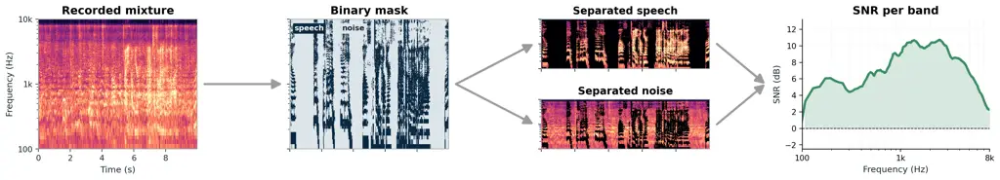
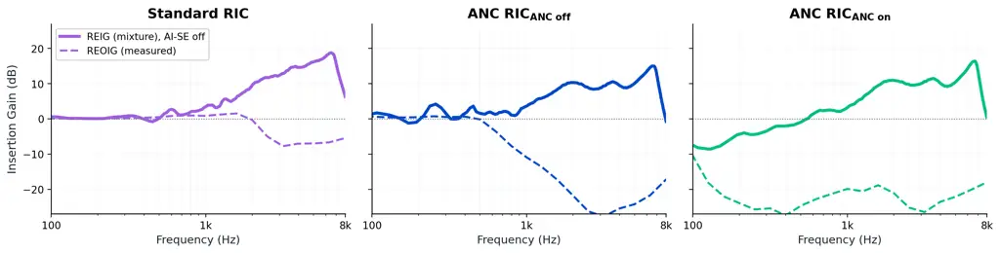
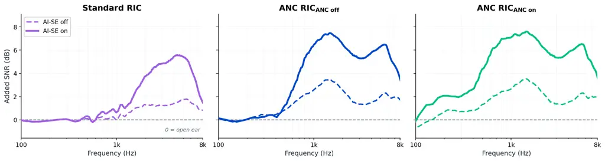
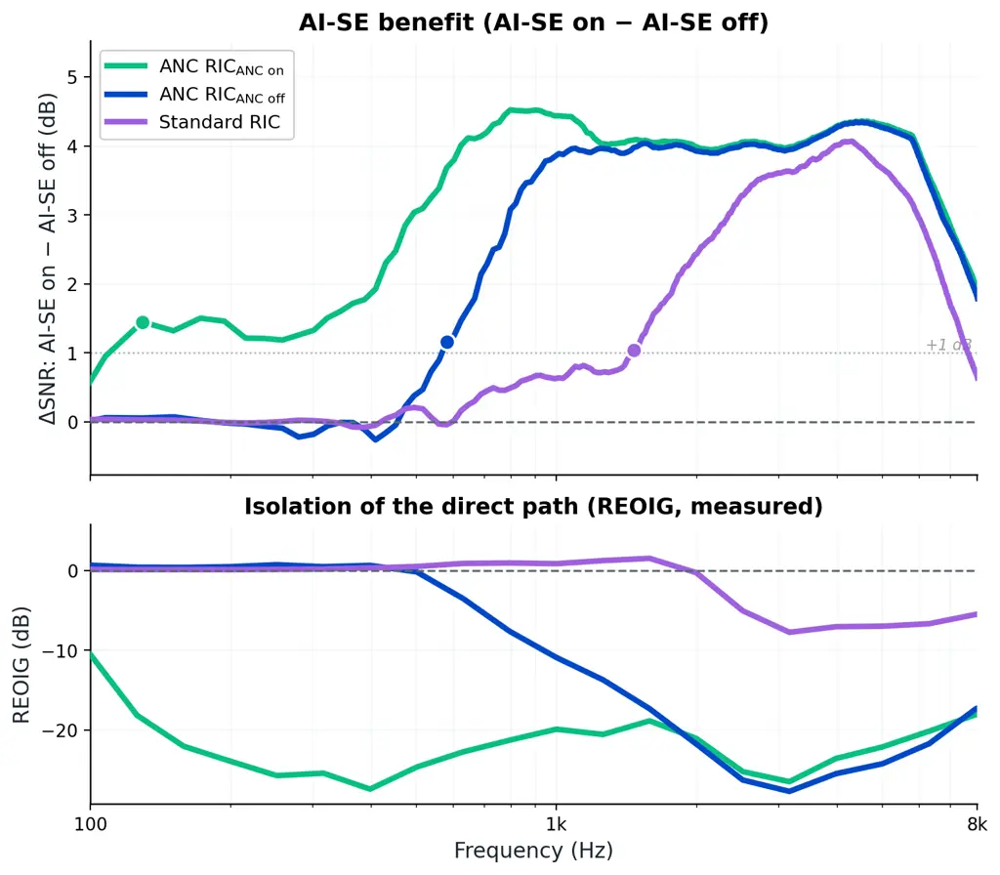
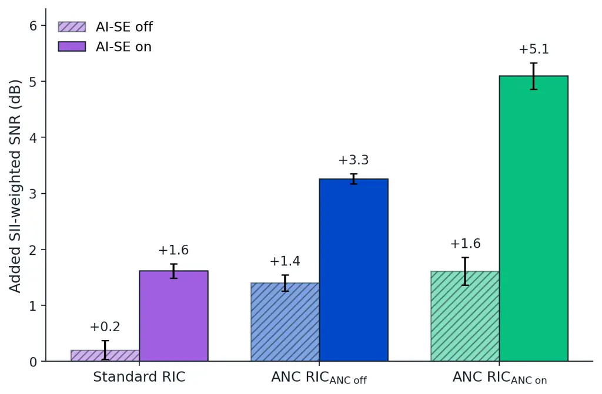

 

Active noise cancellation extends the benefit of  
AI speech enhancement in real hearing-aid recordings

 

|                                                   |                                               |
| ------------------------------------------------- | --------------------------------------------- |
| Andrew T. Sabin^(\*)                              | Linkai Li                                     |
| Bose Corporation                                  | Orka                                          |
| [Andy_Sabin@bose.com](mailto:Andy_Sabin@bose.com) | [linkai@hiorka.com](mailto:linkai@hiorka.com) |

A preprint – October 12, 2026

^(\*)Corresponding author

Abstract

> Active noise cancellation (ANC) is common in headphones but rare in
> hearing aids, and its value for understanding speech in noise is not
> established. Algorithms that improve signal-to-noise ratio (SNR) act
> only on the hearing aid’s amplified path, while unprocessed sound also
> reaches the eardrum directly through the vent, limiting the SNR
> improvement that is realized. Our earlier simulations \[1\] predicted
> that attenuating this direct path with ANC would substantially
> increase the benefit of such processing. We tested that prediction in
> three hardware conditions: a standard receiver-in-canal (RIC) hearing
> aid, and an ANC-capable RIC with ANC off and on. Each was fit to
> NAL-NL2 targets for an N3 hearing loss and recorded on KEMAR with an
> AI speech-enhancement algorithm (AI-SE) off and on, in seven realistic
> scenes above $`70\text{\,}\mathrm{d}\mathrm{B}`$ SPL. Speech and noise
> spectra were estimated from each recording with a binary
> time–frequency mask derived from the clean speech. AI-SE produced a
> similar peak benefit of about $`4\text{\,}\mathrm{d}\mathrm{B}`$ in
> the high frequencies in all three conditions, but that benefit stayed
> at or above $`1\text{\,}\mathrm{d}\mathrm{B}`$ only above 1500, 600,
> and $`130\text{\,}\mathrm{H}\mathrm{z}`$ for the Standard RIC, ANC
> RIC$`{}_{\text{ANC off}}`$, and ANC RIC$`{}_{\text{ANC on}}`$,
> respectively, closely tracking the measured attenuation of the direct
> path. With AI-SE on, ANC RIC$`{}_{\text{ANC on}}`$ improved
> SII-weighted SNR by $`5.1\text{\,}\mathrm{d}\mathrm{B}`$ relative to
> the open ear, compared with $`3.3\text{\,}\mathrm{d}\mathrm{B}`$ for
> ANC RIC$`{}_{\text{ANC off}}`$ and
> $`1.6\text{\,}\mathrm{d}\mathrm{B}`$ for the Standard RIC. With AI-SE
> off, enabling ANC added only $`0.2\text{\,}\mathrm{d}\mathrm{B}`$. ANC
> is therefore an enabling technology: on its own it added little, but
> by attenuating the direct path it allowed SNR-enhancing processing to
> deliver substantially greater benefit at the eardrum, extending that
> benefit to much lower frequencies.

Keywords hearing aids $`\cdot`$ active noise cancellation $`\cdot`$
speech enhancement $`\cdot`$ deep learning $`\cdot`$ signal-to-noise
ratio $`\cdot`$ direct path

## 1  Introduction

Hearing aids improve speech understanding in noise by applying a wide
range of algorithms to the signal delivered by the receiver. Any SNR
improvement these algorithms create exists in that signal. The sound at
the eardrum, however, is the sum of the amplified path and a direct
path: sound that enters the ear canal through the vent or around the ear
coupling without passing through the hearing aid \[1, 2\]. As processing
reduces the noise in the amplified path, the unprocessed direct-path
noise becomes an increasingly large fraction of the total noise at the
eardrum and sets a ceiling on the SNR that can be realized at the
eardrum \[1, 3\]. This ceiling is most consequential at lower
frequencies, where venting is most transparent and prescribed gain is
typically smallest.

Active noise cancellation (ANC) offers a way to raise that ceiling.
Throughout this paper, ANC refers specifically to attenuation of
direct-path sound by destructive interference, not to the gain-based
“noise reduction” algorithms common in hearing aid amplified paths. ANC
has been used in hearing devices to reduce the occlusion effect \[4\]
and has been analyzed in integrated ANC and noise-reduction systems \[3,
5\]. Two properties of ANC matter here. First, ANC attenuates speech and
noise arriving through the direct path alike, so it does not by itself
change the direct-path SNR. Second, by attenuating the direct path it
allows an SNR improvement created in the amplified path to dominate at
the eardrum over a wider frequency range. Any intelligibility benefit of
ANC in noise is therefore expected to be indirect and to depend on the
level of gain and the performance level of SNR-enhancing processing.

Our previous simulation study formalized this mechanism \[1\]. Modeled
ANC benefit increased with environmental sound level, with the SNR
improvement the device could generate, with ANC strength, and with
better hearing sensitivity. For a moderate hearing loss, the model
predicted substantial gains in intelligibility metrics in environments
above $`70\text{\,}\mathrm{d}\mathrm{B}`$ SPL when the device improved
SNR by more than about $`4\text{\,}\mathrm{d}\mathrm{B}`$ SNR. Those
simulations isolated ANC from every other device property but did not
involve physical hardware.

The present study evaluates this mechanism in recordings of commercial
receiver-in-canal (RIC) hearing aids. We compared a standard RIC (Orka
O1) with the Orka O1 Pro, an ANC-capable RIC, recorded with ANC disabled
and enabled. Each hardware condition was recorded with a proprietary AI
speech-enhancement algorithm (AI-SE) off and on. We asked (1) how much
SNR each condition added at the eardrum relative to the open ear,
(2) whether ANC extended the AI-SE benefit to lower frequencies, and
(3) how these acoustic changes translated into SII-weighted SNR.

## 2  Methods

### 2.1  Design and device conditions

The design consisted of three hardware conditions each with two
processing states. The hardware conditions were a standard RIC hearing
aid (“Standard RIC”; Orka O1) and an ANC-capable RIC hearing aid (Orka
O1 Pro) with ANC disabled (“ANC RIC$`{}_{\text{ANC off}}`$”) or enabled
(“ANC RIC$`{}_{\text{ANC on}}`$”). Within each hardware condition, AI-SE
was off or on, giving six total aided conditions. Both devices ran the
same hearing-aid signal-processing suite and were programmed to the same
targets (see below), so differences among hardware conditions are
attributable to the receiver, its acoustic coupling, or the ANC state.

The two devices differ in the acoustics of the receiver and its coupling
to the ear. The Standard RIC uses a balanced-armature receiver with a
tulip dome. The ANC-capable RIC uses a custom moving-coil receiver with
a closed dome and a vent in the plastic housing of the ear-canal
component. Comparisons between Standard RIC and ANC
RIC$`{}_{\text{ANC off}}`$ therefore reflect combined differences in
transducer and coupling. In contrast, ANC RIC$`{}_{\text{ANC off}}`$ and
ANC RIC$`{}_{\text{ANC on}}`$ were recorded with the same device,
fitting, prescribed gain, and signal-processing settings, so ANC state
was the only intended difference between them. Differences in direct
paths were quantified via real-ear occluded insertion gain (REOIG),
measured with the device in place and its amplified path muted.

All aided conditions were programmed for the Bisgaard N3 standard
audiogram \[6\] using experienced user NAL-NL2 targets \[7\], so that
differences among conditions were not attributable to different
prescribed gains. Real-ear insertion gain (REIG) was estimated from the
recordings as the across-recording mean ratio of aided to open-ear
mixture spectra, smoothed over one-half octave.

### 2.2  Acoustic scenes and recordings

Recordings were made on a KEMAR manikin placed at the center of a ring
of eight loudspeakers in a quiet room, following the HearAdvisor
laboratory protocol \[8\]. Background scenes were drawn from the
Ambisonic Recordings of Typical Environments (ARTE) database \[9\]. This
report uses the seven ARTE scenes with overall noise levels above
$`70\text{\,}\mathrm{d}\mathrm{B}`$ SPL (Table 1), the environments in
which the modeled ANC benefit is expected to be largest \[1\]. In each
scene, six talker conditions (2 versions of scenes with 1, 2, or 3
talkers) were presented at the scene’s nominal SNR, giving 42 recordings
(7 scenes $`\times`$ 6 talker conditions) per condition. Recordings were
two-channel (left and right ear simulators) at
$`44.1\text{\,}\mathrm{k}\mathrm{H}\mathrm{z}`$. Each aided recording
had a corresponding open-ear recording and clean speech signal.

| Scene          | Level (dB SPL) | Nominal SNR (dB) |
| -------------- | -------------- | ---------------- |
| Cafe 1         | $`71`$         | $`2.9`$          |
| Cafe 2         | $`72`$         | $`3.4`$          |
| Dinner Party   | $`73`$         | $`2.2`$          |
| Street Balcony | $`74`$         | $`1.1`$          |
| Train Station  | $`77`$         | $`0.1`$          |
| Food Court 1   | $`78`$         | $`-0.4`$         |
| Food Court 2   | $`80`$         | $`-1.1`$         |
| Mean           | $`75`$         | $`1.2`$          |

Note. Levels are the ARTE scene levels. Nominal SNR is the presentation
SNR of the talker relative to the scene measured in the ring center with
a reference mic; it is not the SNR estimated at the manikin’s ears.

Table 1: Acoustic scenes used in the analysis.

### 2.3  Estimation of speech and noise spectra

Signal-to-noise ratio at the manikin ear was estimated via the method
summarized in Fig. 1. Each ear channel was analyzed separately with a
short-time Fourier transform (2048-sample Hann window, 512-sample hop).
Each recording was first aligned to its clean speech reference.

A binary time–frequency mask was derived from the clean speech
reference. For each frequency bin, the 40th percentile of the clean
reference’s log power over time served as a frequency-specific floor,
and a time–frequency bin was labeled “speech” when the clean reference
exceeded that floor by at least $`12\text{\,}\mathrm{d}\mathrm{B}`$; all
other bins were labeled “noise.” The mask was then applied to the
aligned device recording. For each frequency bin, the noise power was
the mean recorded power over noise-labeled frames, and the speech power
was the mean recorded power over speech-labeled frames minus that noise
power. Speech and noise spectra were averaged across the two ears. Note
that this decomposition is simply an analysis tool applied to the
recordings; it is unrelated to the algorithm running inside the hearing
aids.

Figure 1: Estimation of speech and noise spectra from a recording. A
binary mask derived from the latency-aligned clean speech reference
labels each time–frequency bin of the recorded mixture as speech or
noise. Power spectra of the two components yield SNR as a function of
frequency. The example is one ANC RIC$`{}_{\text{ANC on}}`$, AI-SE-on
recording from the Food Court 1 scene.

### 2.4  Outcome measures

SNR per frequency band was computed by taking the ratio of the estimated
speech and noise power spectra. For display, curves were smoothed over
one octave. _Added SNR_ was the aided SNR minus the SNR of the matched
open-ear recording; positive values indicate that the device improved
relative to the open ear. _AI-SE benefit_ was the AI-SE-on SNR minus the
AI-SE-off SNR within a hardware condition. The lower-frequency edge of
the AI-SE benefit was defined as the lowest frequency above which the
across-recording mean AI-SE benefit stayed at or above
$`1\text{\,}\mathrm{d}\mathrm{B}`$.

For a broadband summary, SNR band levels were weighted by the ANSI
S3.5-1997 one-third-octave band-importance function for average
speech \[10\], interpolated to the Fourier bins and normalized to unit
sum. _Added SII-weighted SNR_ is the broadband value for the aided
recording minus that for the matched open-ear recording. This quantity
summarizes any increase to SNR weighted by the frequency regions that
matter most for speech. All summary outcomes were computed per recording
and are reported as the mean and standard error of the mean (SEM) over
the 42 recordings.

## 3  Results

### 3.1  Gain and attenuation of the direct path

Average REIG was computed across all recordings and ears and is shown in
Fig. 2 (solid lines). For all three hardware conditions, REIG rose from
near $`0\text{\,}\mathrm{d}\mathrm{B}`$ at low frequencies to peaks of
about 15–$`19\text{\,}\mathrm{d}\mathrm{B}`$ near
$`7\text{\,}\mathrm{k}\mathrm{H}\mathrm{z}`$, consistent with the target
NAL-NL2 prescription for the N3 audiogram. While the gain profiles
largely matched, the conditions differed a bit at low frequencies: ANC
RIC$`{}_{\text{ANC on}}`$ showed negative REIG below roughly
$`550\text{\,}\mathrm{H}\mathrm{z}`$, where little gain is prescribed
and ANC removed part of the direct-path sound that would otherwise reach
the eardrum.

The direct path (measured via REOIG) differed markedly across conditions
(Fig. 2, dashed curves). For the Standard RIC, REOIG remained near
$`0\text{\,}\mathrm{d}\mathrm{B}`$ up to about
$`2\text{\,}\mathrm{k}\mathrm{H}\mathrm{z}`$. This REOIG indicates that
the tulip dome was quite open as it transmitted low and mid frequencies
essentially unattenuated. The closed coupling of the ANC-capable RIC
attenuated the direct path even with ANC off, with REOIG falling below
$`0\text{\,}\mathrm{d}\mathrm{B}`$ above about
$`500\text{\,}\mathrm{H}\mathrm{z}`$ and reaching about
$`-27\text{\,}\mathrm{d}\mathrm{B}`$ near
$`3.5\text{\,}\mathrm{k}\mathrm{H}\mathrm{z}`$. Enabling ANC added
attenuation at the lowest frequencies: REOIG was
$`-10\text{\,}\mathrm{d}\mathrm{B}`$ at
$`100\text{\,}\mathrm{H}\mathrm{z}`$ and $`-20`$ to
$`-28\text{\,}\mathrm{d}\mathrm{B}`$ from
$`200\text{\,}\mathrm{H}\mathrm{z}`$ to
$`1\text{\,}\mathrm{k}\mathrm{H}\mathrm{z}`$. The three hardware
conditions therefore provided progressively stronger and broader
isolation of the eardrum from the direct path.

Figure 2: Amplified and direct paths by hardware condition. Solid
curves: across-recording mean real-ear insertion gain (REIG) with AI-SE
off averaged across all recordings and ears. Dashed curves: measured
real-ear occluded insertion gain (REOIG) with the amplified path muted,
an estimate of direct-path transmission. Each hardware condition is
shown in one color.

### 3.2  Added SNR across frequency

Added SNR (aided minus open-ear SNR per band) depended on both hardware
and AI-SE state (Fig. 3). Even with AI-SE off, all three conditions
added SNR above $`1\text{\,}\mathrm{k}\mathrm{H}\mathrm{z}`$ relative to
the open ear (peaks of about $`1.8\text{\,}\mathrm{d}\mathrm{B}`$ for
the Standard RIC and $`3.5\text{\,}\mathrm{d}\mathrm{B}`$ for both ANC
RIC conditions), presumably reflecting traditional device processing
(e.g., beamforming and traditional noise suppression). Turning AI-SE on
increased added SNR in every condition, but over different frequency
ranges. For the Standard RIC, the increase appeared mainly above about
$`1\text{\,}\mathrm{k}\mathrm{H}\mathrm{z}`$ and peaked near
$`5.5\text{\,}\mathrm{d}\mathrm{B}`$ at
4–$`5\text{\,}\mathrm{k}\mathrm{H}\mathrm{z}`$. For ANC
RIC$`{}_{\text{ANC off}}`$, the increase extended down to about
$`500\text{\,}\mathrm{H}\mathrm{z}`$ and peaked near
$`7.5\text{\,}\mathrm{d}\mathrm{B}`$ at
$`1.5\text{\,}\mathrm{k}\mathrm{H}\mathrm{z}`$. For ANC
RIC$`{}_{\text{ANC on}}`$, positive added SNR extended across nearly the
full plotted range, with a similar $`7.5\text{\,}\mathrm{d}\mathrm{B}`$
peak.

Figure 3: Added SNR relative to the open ear. Across-recording means of
the aided-minus-open-ear SNR spectrum in the seven loud scenes, one
panel per hardware condition. Dashed: AI-SE off; solid: AI-SE on. Curves
are octave smoothed.

### 3.3  ANC extended the frequency range of the AI-SE benefit

Subtracting the AI-SE-off from the AI-SE-on spectrum within each
hardware condition isolates the SNR change attributable to AI-SE
(Fig. 4, top). Each curve reached a similar peak of about
$`4\text{\,}\mathrm{d}\mathrm{B}`$ between 4 and
$`6\text{\,}\mathrm{k}\mathrm{H}\mathrm{z}`$, indicating that the
algorithm itself produced a comparable improvement in the amplified path
in each device. What differed was how far down in frequency that
improvement was realized at the eardrum. The lower-frequency edge,
defined as the lowest frequency above which the mean AI-SE benefit
stayed at or above $`1\text{\,}\mathrm{d}\mathrm{B}`$, was
$`1500\text{\,}\mathrm{H}\mathrm{z}`$ for Standard RIC,
$`600\text{\,}\mathrm{H}\mathrm{z}`$ for ANC RIC$`{}_{\text{ANC off}}`$,
and $`130\text{\,}\mathrm{H}\mathrm{z}`$ for ANC
RIC$`{}_{\text{ANC on}}`$. Weighted by the ANSI band-importance
function, the bands at and above these edges carry approximately 53%,
84%, and 100% of the importance of the speech spectrum.

The lower-frequency edges aligned well with the direct-path measurements
(Fig. 4, bottom). Where REOIG was near
$`0\text{\,}\mathrm{d}\mathrm{B}`$, unprocessed direct sound reached the
eardrum and prevented the AI-SE improvement from appearing in the total
signal. The closed coupling of the ANC-capable RIC lowered that
boundary, and ANC lowered it further.

Figure 4: AI-SE benefit and direct-path attenuation. Top:
across-recording mean AI-SE-on minus AI-SE-off SNR spectrum for each
hardware condition. Dots mark the lowest frequency above which each
curve stayed at or above $`1\text{\,}\mathrm{d}\mathrm{B}`$ (dotted
line). Bottom: measured REOIG, replotted from Fig. 2 on the same
frequency axis. The lower-frequency reach of the AI-SE benefit extended
as the direct path was more strongly attenuated.

### 3.4  Broadband summary

Figure 5 summarizes the broadband outcome. Added SII-weighted SNR
increased monotonically from Standard RIC to ANC
RIC$`{}_{\text{ANC off}}`$ to ANC RIC$`{}_{\text{ANC on}}`$, and AI-SE
added more in each successive hardware condition (1.4, 1.9, and
$`3.5\text{\,}\mathrm{d}\mathrm{B}`$). With AI-SE on, the Standard RIC
added $`1.6\text{\,}\mathrm{d}\mathrm{B}`$ of SII-weighted SNR, whereas
ANC RIC$`{}_{\text{ANC on}}`$ added
$`5.1\text{\,}\mathrm{d}\mathrm{B}`$, more than three times as much.
About half of that $`3.5\text{\,}\mathrm{d}\mathrm{B}`$ difference
($`1.7\text{\,}\mathrm{d}\mathrm{B}`$) came from the closed coupling
alone (ANC RIC$`{}_{\text{ANC off}}`$ with AI-SE on:
$`3.3\text{\,}\mathrm{d}\mathrm{B}`$), and the remainder
($`1.8\text{\,}\mathrm{d}\mathrm{B}`$) came from enabling ANC. With
AI-SE off, by contrast, enabling ANC changed added SII-weighted SNR by
only $`0.2\text{\,}\mathrm{d}\mathrm{B}`$ (1.4 vs.
$`1.6\text{\,}\mathrm{d}\mathrm{B}`$).

Figure 5: Broadband summary outcomes. Mean added SII-weighted SNR
relative to the matched open-ear recording for each hardware $`\times`$
AI-SE condition. Hatched: AI-SE off; solid: AI-SE on. Error bars: SEM
over 42 recordings.

## 4  Discussion

The central finding is that ANC was valuable only in combination with
SNR-enhancing processing. With AI-SE off, enabling ANC changed added
SII-weighted SNR by just $`0.2\text{\,}\mathrm{d}\mathrm{B}`$. With
AI-SE on, the same change added $`1.8\text{\,}\mathrm{d}\mathrm{B}`$,
and the full ANC-plus-AI-SE condition delivered
$`5.1\text{\,}\mathrm{d}\mathrm{B}`$ relative to the open ear, more than
three times the $`1.6\text{\,}\mathrm{d}\mathrm{B}`$ delivered by the
Standard RIC running the same algorithm. ANC is therefore not an
SNR-improving technology in its own right but an enabling one. Because
it attenuates speech and noise in the direct path equally, it can raise
the SNR at the eardrum only when the amplified path carries a better SNR
than the direct path it displaces.

The spectral data show this pattern clearly. AI-SE produced nearly the
same improvement in the amplified path of every device, about
$`4\text{\,}\mathrm{d}\mathrm{B}`$ in the mid and high frequencies, but
that improvement reached the eardrum only where the device output
dominated the direct path. The benefit extended down to
$`1.5\text{\,}\mathrm{k}\mathrm{H}\mathrm{z}`$ with the tulip dome, to
$`600\text{\,}\mathrm{H}\mathrm{z}`$ with the closed coupling of the
ANC-capable RIC, and to $`130\text{\,}\mathrm{H}\mathrm{z}`$ once ANC
was enabled, tracking the measured REOIG at each step. Because
frequencies below $`1.5\text{\,}\mathrm{k}\mathrm{H}\mathrm{z}`$ carry
nearly half of the band importance for speech, extending the benefit
downward increased its broadband value from 1.4 to
$`3.5\text{\,}\mathrm{d}\mathrm{B}`$. This is the behavior predicted by
our earlier model \[1\] and by theoretical treatments of integrated ANC
and noise reduction \[3, 5\], now observed in commercial hardware.

The practical implication is that the value of ANC in a hearing aid
scales with the strength of its SNR-enhancing processing. Conventional
processing produced modest added SNR here, leaving little for ANC to
unlock; the additional improvement from AI-SE made the direct path the
limiting factor. This is consistent with our model, which predicted
substantial ANC benefit only when the device improves SNR by more than
about $`4\text{\,}\mathrm{d}\mathrm{B}`$ \[1\]. As enhancement
algorithms improve, the direct path will account for a growing share of
the residual noise at the eardrum, and the benefit of attenuating it
should grow accordingly. Conversely, evaluations of ANC in hearing aids
without strong SNR-enhancing processing will understate its potential.

While these results validate a mechanism by which ANC can benefit
speech-in-noise listening, the approach has several limitations. First,
SII-weighted SNR at the eardrum is not equivalent to speech
intelligibility. The mask-based SNR estimate does not characterize the
artifacts or distortions that deep-learning enhancement can
introduce \[11\], and whether the added SNR yields a corresponding
improvement in speech recognition for listeners with hearing loss is an
empirical question that only behavioral testing can answer. Second, this
work used a single prescriptive target for a moderate sloping loss (N3).
Our prior modeling \[1\] showed that ANC benefit decreases as prescribed
gain increases, so we would expect smaller benefits for more severe
losses and larger benefits for milder ones. Third, measurements were
made on a single manikin; direct-path attenuation in real ears will vary
with ear-canal geometry and the fit of the ear coupling.

## 5  Conclusions

In realistic loud-scene recordings on a manikin wearing commercial
hearing aids, the SNR improvement produced by an AI speech-enhancement
algorithm reached the eardrum only in the frequency range where the
hearing aid’s output dominated the direct path. Closed coupling widened
that range relative to a vented fitting, and ANC widened it further, to
the lowest frequencies measured. ANC by itself added almost no SNR
($`0.2\text{\,}\mathrm{d}\mathrm{B}`$), but in combination with AI-SE it
added $`1.8\text{\,}\mathrm{d}\mathrm{B}`$. The full ANC-plus-AI-SE
condition improved SII-weighted SNR by
$`5.1\text{\,}\mathrm{d}\mathrm{B}`$ relative to the open ear, compared
with $`1.6\text{\,}\mathrm{d}\mathrm{B}`$ for the Standard RIC with the
same algorithm. These results provide physical-device evidence for the
mechanism predicted by earlier modeling and motivate behavioral studies
of integrated ANC and speech enhancement in hearing aids.

## Competing interests

A.T.S. is an employee of Bose Corporation and a scientific advisor to
HearAdvisor. L.L. is an employee of Orka. Bose and Orka collaborated on
manufacturing the hearing aids evaluated in this study.

## References

- \[1\] Sabin AT, McElhone DI, Gauger D, Rabinowitz W. Modeling the
  intelligibility benefit of active noise cancelation in hearing devices
  that improve signal-to-noise ratio. _Trends in Hearing_.
  2024;28:23312165241260029.
  [doi:10.1177/23312165241260029](https://doi.org/10.1177/23312165241260029).
- \[2\] Winkler A, Latzel M, Holube I. Open versus closed hearing-aid
  fittings: A literature review of both fitting approaches. _Trends in
  Hearing_. 2016;20:2331216516631741.
  [doi:10.1177/2331216516631741](https://doi.org/10.1177/2331216516631741).
- \[3\] Serizel R, Moonen M, Wouters J, Jensen SH. Integrated active
  noise control and noise reduction in hearing aids. _IEEE Transactions
  on Audio, Speech, and Language Processing_. 2010;18(6):1137–1146.
  [doi:10.1109/TASL.2009.2030948](https://doi.org/10.1109/TASL.2009.2030948).
- \[4\] Mejia J, Dillon H, Fisher M. Active cancellation of occlusion:
  An electronic vent for hearing aids and hearing protectors. _Journal
  of the Acoustical Society of America_. 2008;124(1):235–240.
  [doi:10.1121/1.2908279](https://doi.org/10.1121/1.2908279).
- \[5\] Serizel R, Moonen M, Wouters J, Jensen SH. Binaural integrated
  active noise control and noise reduction in hearing aids. _IEEE
  Transactions on Audio, Speech, and Language Processing_.
  2013;21(5):1113–1118.
  [doi:10.1109/TASL.2012.2234111](https://doi.org/10.1109/TASL.2012.2234111).
- \[6\] Bisgaard N, Vlaming MSMG, Dahlquist M. Standard audiograms for
  the IEC 60118-15 measurement procedure. _Trends in Amplification_.
  2010;14(2):113–120.
  [doi:10.1177/1084713810379609](https://doi.org/10.1177/1084713810379609).
- \[7\] Keidser G, Dillon H, Flax M, Ching T, Brewer S. The NAL-NL2
  prescription procedure. _Audiology Research_. 2011;1(1):e24.
  [doi:10.4081/audiores.2011.e24](https://doi.org/10.4081/audiores.2011.e24).
- \[8\] Sabin AT. HearAdvisor whitepaper 1.0: Laboratory methods. _OSF
  Preprints_. 2023.
  [doi:10.31219/osf.io/trnga](https://doi.org/10.31219/osf.io/trnga).
- \[9\] Weisser A, Buchholz JM, Oreinos C, Badajoz-Davila J, Galloway J,
  Beechey T, Keidser G. The Ambisonic Recordings of Typical Environments
  (ARTE) database. _Acta Acustica united with Acustica_.
  2019;105(4):695–713.
  [doi:10.3813/AAA.919349](https://doi.org/10.3813/AAA.919349).
- \[10\] American National Standards Institute. _ANSI S3.5-1997 (R2017):
  Methods for Calculation of the Speech Intelligibility Index_. New
  York: Acoustical Society of America; 1997.
- \[11\] Wang D. Deep learning reinvents the hearing aid. _IEEE
  Spectrum_. 2017;54(3):32–37.
  [doi:10.1109/MSPEC.2017.7864754](https://doi.org/10.1109/MSPEC.2017.7864754).
