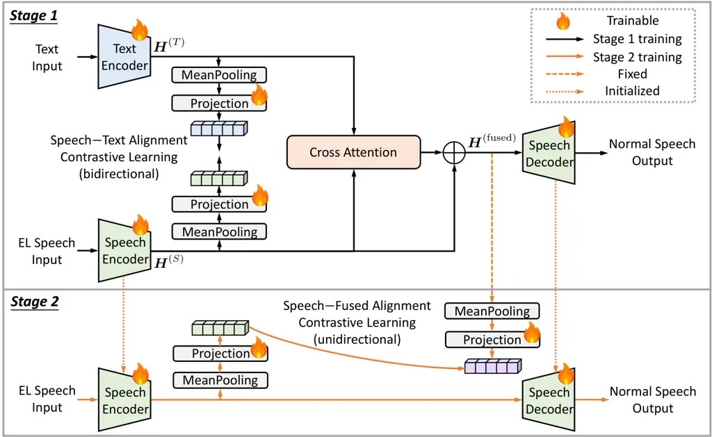
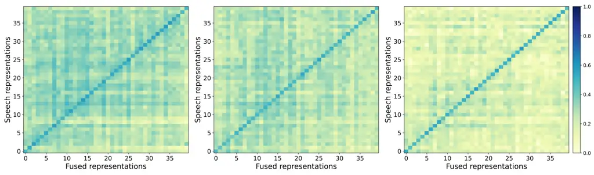

# Multimodal Contrastive Representation Learning Based Voice Conversion for Electrolaryngeal Speech Enhancement

Ding Ma^(1,\*), Jinyi Mi^(1,\*), Jiajun He^(1,2), Kazuhiro
Kobayashi^(1,3), Naoki Nishio⁴, and Tomoki Toda⁵ ¹Graduate School of
Informatics, Nagoya University, Nagoya, Japan ²Alibaba Token Foundry,
Alibaba Group, Hangzhou, China ³Headquarters, TARVO, Inc., Nagoya, Japan
⁴Department of Otorhinolaryngology, Graduate School of Medicine, Nagoya
University, Nagoya, Japan ⁵Information Technology Center, Nagoya
University, Nagoya, Japan E-mail: ding.ma@g.sp.m.is.nagoya-u.ac.jp

###### Abstract

Electrolaryngeal (EL) speech suffers from severe acoustic mismatches
with normal speech, resulting in degraded naturalness and
intelligibility. These mismatches also make sequence-to-sequence voice
conversion struggle to learn robust intermediate representations,
hindering EL-speech-to-normal-speech conversion (EL2SP) performance. To
address this, we propose a novel multimodal contrastive representation
learning framework to 1) achieve richer multimodal-representation
learning, and 2) facilitate the transferability of multimodal
representations to speech-only EL2SP. First, EL speech and text
representations are fused to learn multimodal representations for target
speech generation, during which cross-modal contrastive learning is
employed to encourage a semantically consistent speech–text
representation space. Next, the fused representations are treated as a
fixed target to guide speech-only representation learning through
cross-stage contrastive learning, enabling multimodal knowledge to be
transferred to the EL2SP task while preserving architectural and
inference simplicity. Experimental results demonstrate that the proposed
method consistently outperforms both the speech-only and
multimodal-based baselines.

###### Index Terms: 

electrolaryngeal speech, sequence-to-sequence voice conversion,
EL-speech-to-normal-speech conversion, multimodal representation,
contrastive learning.

¹¹footnotetext: These authors contributed equally to this work.

## I Introduction

Laryngectomy is a surgical treatment for laryngeal cancer \[1\],
involving the removal of vocal folds. To speak without using vocal-fold
vibration, laryngectomees commonly rely on portable electrolarynx as an
external artificial excitation source. Its simulated vibration is
transmitted into vocal tract to produce electrolaryngeal (EL)
speech \[2, 3, 4\]. Nevertheless, EL speech is far from normal speech.
The artificial excitation cannot reproduce dynamic characteristics of
vocal-fold vibration, including rich fundamental frequency (F0)
variation \[5\], voiced/unvoiced cues \[6\], and prosodic
expressiveness. Consequently, EL speech sounds unnatural and has reduced
phonetic clarity \[7\]. Meanwhile, high-energy artificial excitation
inevitably radiates outside as noise, further degrading sound quality
and intelligibility \[8\]. Furthermore, the compensatory speaking styles
for these inherent limitations, such as slower articulation, would lead
to abnormal speech duration and temporal structure. These factors result
in substantial mismatches between EL and normal speech, causing
communication burdens for both EL speakers and listeners.

Voice conversion (VC) \[9, 10\] originally aimed to convert speaker
identity of speech from one speaker to another without changing
linguistic content. VC can be used for EL-speech-to-normal-speech
conversion (EL2SP). Sequence-to-sequence (seq2seq) modeling \[11\] is
more suitable for EL2SP than conventional methods using strict
frame-wise alignment \[12, 13, 14, 15\]. Seq2seq VC performs
sequence-level, implicit mapping. It encodes linguistically intermediate
representations from input sequence and then decodes them into target
speech features. Thus, seq2seq VC can learn complex mappings and adjust
the duration of converted speech to better match that of normal speech,
which are essential for EL2SP.

To enhance seq2seq VC with limited EL2SP data in practice, Ma et
al. \[16\] introduced a pretraining and two-stage fine-tuning strategy
with low-quality synthetic data, achieving then state-of-the-art
performance. Nevertheless, this method faces performance bottlenecks due
to large EL–normal mismatches, which introduce accumulated errors and
unstable mappings.



Fig. 1: Overview of the proposed two-stage multimodal contrastive
representation learning VC framework, MCRL-VC.

Incorporating text information provides a promising direction to improve
the current approach. A direct approach is multimodal fusion, where
additional modalities like text are explicitly integrated with speech
representations. In VC tasks, Niu et al. \[17\] combined text and audio
prompts for style VC, while Li et al. \[18\] introduced similar rhythm
cues to enhance speech-to-singing conversion. Multimodal fusion
strategies have also been investigated in broader speech processing
tasks, such as speech emotion recognition \[19\], speech
enhancement \[20\], and automatic speech recognition \[21\]. While these
studies demonstrate the effectiveness of integrating auxiliary
modalities, they usually increase model complexity and data
requirements, and often rely on additional modalities or prompts at run
time. Such settings are not well aligned with practical EL2SP scenarios.

Motivated by these observations, this study exploits the text modality
to enrich representation learning while preserving a simple architecture
and inference pipeline. It focuses on two challenges. (1) Multimodal
fusion: speech and text representations are heterogeneous, and EL speech
contains degraded acoustic cues; thus, basic fusion is expected to be
insufficient to capture fine-grained cross-modal correspondences. (2)
Knowledge transfer: in EL2SP, multimodal knowledge should be transferred
to a unimodal speech model for text-free inference.

We propose a novel two-stage Multimodal Contrastive Representation
Learning VC (MCRL-VC) framework. First, paired speech and text
representations are aligned into a shared semantic space, facilitating
the multimodal fusion and mapping towards speech decoder. The learned
fused representations are then effectively transferred to final EL2SP
under contrastive learning guidance. We build different systems and
conduct a comparative evaluation.

The main contributions are as follows:

- •
  We propose a two-stage multimodal contrastive representation learning
  framework for EL2SP. It enhances speech–text representation fusion and
  the transfer of multimodal representations.
- •
  Experimental results shows that the proposed method outperforms both a
  speech-only method \[16\] and a multimodal method with the same
  modalities \[22\].
- •
  We demonstrate the effectiveness of each stage in the proposed method.

## II Proposed Method

### II-A Framework Overview

In this work, we extend the concept of contrastive learning into a
two-stage representation-guided learning framework, designed to improve
the EL2SP task under a speech-only inference setting. Our method,
MCRL-VC, first exploits the complementary information between the speech
and text modalities, through cross-modal contrastive learning to get
more effective representation fusion. Then, using cross-stage
contrastive learning, the fused knowledge is transferred back to a
standalone speech encoder.

Following the above concept, as illustrated in Fig. 1, Stage 1 focuses
on aligning acoustic information from EL speech with linguistic
information from text, and integrating them through cross-attention
mechanism (Section II-B). Stage 2 aims to transfer the integrated
knowledge learned in Stage 1 into a speech encoder. During this process,
the integrated representations learned in Stage 1 serves as a teacher,
guiding the speech encoder and enabling speech-only reconstruction
(Section II-C).

### II-B Stage 1: Cross-modal Text-guided Representation Learning

The first stage involves a joint network consisting of a speech encoder,
a text encoder, a speech decoder, and a cross-attention layer. Let
$`\{(X^{(S)}_{i},X^{(T)}_{i})\}_{i=1}^{N}`$ denote paired EL speech and
text samples, where $`N`$ is the batch size, $`S`$ and $`T`$ indicate
the speech and text modalities, respectively. The speech and text
encoders extract modality-specific representations as

```math
\displaystyle\boldsymbol{H}^{(S)}=\mathrm{SpeechEnc}(\boldsymbol{X}^{(S)})\in\mathbb{R}^{N\times F\times D}, \tag{1}
```

```math
\displaystyle\boldsymbol{H}^{(T)}=\mathrm{TextEnc}(\boldsymbol{X}^{(T)})\in\mathbb{R}^{N\times L\times D}, \tag{2}
```

where $`F`$ and $`L`$ denote the number of speech frames and
text-sequence length, respectively, and $`D`$ is the hidden dimension.

To facilitate effective cross-modal fusion, we utilize the cross-modal
contrastive learning to align the representations from EL speech and
text. Specifically, the contrastive objective encourages paired speech
and text representations to be close in the latent space, while pushing
unmatched pairs apart. We separately process the speech representation
$`\boldsymbol{H}^{(S)}`$ and the text representation
$`\boldsymbol{H}^{(T)}`$ by applying mean pooling along the temporal
dimension to obtain utterance-level representations. The pooled
representations are then fed into modality-specific projection blocks,
which map them into a shared contrastive space with the same
dimensionality. This enables the computation of a cross-modal similarity
matrix between $`\boldsymbol{H}^{(S)}`$ and $`\boldsymbol{H}^{(T)}`$.
These processes are formulated as

```math
\displaystyle{\boldsymbol{Z}^{(S)}=\mathrm{Proj}(\mathrm{MeanPooling}({\boldsymbol{H}^{(S)}))}}\in\mathbb{R}^{N\times D}, \tag{3}
```

```math
\displaystyle{\boldsymbol{Z}^{(T)}=\mathrm{Proj}(\mathrm{MeanPooling}({\boldsymbol{H}^{(T)}))}}\in\mathbb{R}^{N\times D}, \tag{4}
```

where $`\mathrm{Proj}(\cdot)`$ denotes trainable projection modules,
each consisting of a linear layer followed by layer normalization. The
cross-modal similarity matrices for speech-to-text and text-to-speech
matching are then computed as

```math
\displaystyle\boldsymbol{M}^{(S\rightarrow T)}=\hat{\boldsymbol{Z}}^{(S)}(\hat{\boldsymbol{Z}}^{(T)})^{\top}/\tau\in\mathbb{R}^{N\times N}, \tag{5}
```

```math
\displaystyle\boldsymbol{M}^{(T\rightarrow S)}=\hat{\boldsymbol{Z}}^{(T)}(\hat{\boldsymbol{Z}}^{(S)})^{\top}/\tau\in\mathbb{R}^{N\times N}, \tag{6}
```

where $`\tau`$ is a temperature parameter,
$`\hat{\boldsymbol{Z}}^{(S)}`$ and $`\hat{\boldsymbol{Z}}^{(T)}`$ denote
the L2-normalized $`\boldsymbol{Z}^{(S)}`$ and $`\boldsymbol{Z}^{(T)}`$,
respectively. The speech-to-text and text-to-speech contrastive losses
are based on a common InfoNCE-style objective \[23\] and are defined as

```math
\displaystyle\mathcal{L}_{S\rightarrow T} \displaystyle=-\frac{1}{N}\sum_{i=1}^{N}\log\frac{\exp(\boldsymbol{M}^{(S\rightarrow T)}_{i,i})}{\sum_{j=1}^{N}\exp(\boldsymbol{M}^{(S\rightarrow T)}_{i,j})}, \tag{7}
```

```math
\displaystyle\mathcal{L}_{T\rightarrow S} \displaystyle=-\frac{1}{N}\sum_{i=1}^{N}\log\frac{\exp(\boldsymbol{M}^{(T\rightarrow S)}_{i,i})}{\sum_{j=1}^{N}\exp(\boldsymbol{M}^{(T\rightarrow S)}_{i,j})}, \tag{8}
```

where $`\boldsymbol{M}^{(S\rightarrow T)}_{i,j}`$ measures the
similarity between the $`i`$-th speech representation and the $`j`$-th
text representation, while $`\boldsymbol{M}^{(T\rightarrow S)}_{i,j}`$
measures the similarity between the $`i`$-th text representation and the
$`j`$-th speech representation. The final cross-modal contrastive (CMC)
loss is obtained by averaging the two directional losses:

```math
\mathcal{L}_{\mathrm{CMC}}=\frac{1}{2}\left(\mathcal{L}_{S\rightarrow T}+\mathcal{L}_{T\rightarrow S}\right). \tag{9}
```

Meanwhile, we utilize a multi-head cross-attention block to incorporate
linguistic information from $`\boldsymbol{H}^{(T)}`$ into the speech
representation $`\boldsymbol{H}^{(S)}`$, where $`\boldsymbol{H}^{(S)}`$
is used as the query, and $`\boldsymbol{H}^{(T)}`$ serves as the key and
value. A residual connection is then applied to reintegrate the original
speech representation $`\boldsymbol{H}^{(S)}`$ for information
integrity. This process is formulated as

```math
\displaystyle\boldsymbol{H}^{(\mathrm{fused})} \displaystyle=\mathrm{CrossAttention}\big(\boldsymbol{H}^{(S)},\boldsymbol{H}^{(T)},\boldsymbol{H}^{(T)}\big)+\boldsymbol{H}^{(S)} \tag{10}
```

```math
\displaystyle\in\mathbb{R}^{N\times F\times D}.
```

### II-C Stage 2: Cross-stage Multimodal Representation Transfer

In the second stage, we remove the text encoder and construct a
speech-only EL2SP model by initializing the speech encoder and decoder
with their corresponding parameters trained in the first stage. To this
end, the text-enhanced representation
$`\boldsymbol{H}^{(\mathrm{fused})}`$ from the first stage is frozen and
used as a representation-level teacher to construct the contrastive
loss, thus guiding the speech-only EL2SP training.

Given the EL speech input $`\boldsymbol{X}^{(S)}`$, the speech encoder
extracts the student speech representation as

```math
\boldsymbol{H}^{(\mathrm{stu})}=\mathrm{SpeechEnc}(\boldsymbol{X}^{(S)})\in\mathbb{R}^{N\times F\times D}. \tag{11}
```

To perform cross-stage representation transfer, both student and teacher
representations are mean-pooled along the temporal dimension and then
mapped into a shared contrastive space through a trainable projection
block:

```math
\displaystyle\boldsymbol{Z}^{(\mathrm{stu})} \displaystyle=\mathrm{Proj}(\mathrm{MeanPooling}(\boldsymbol{H}^{(\mathrm{stu})}))\in\mathbb{R}^{N\times D}, \tag{12}
```

```math
\displaystyle\boldsymbol{Z}^{(\mathrm{fused})} \displaystyle=\mathrm{Proj}(\mathrm{MeanPooling}(\boldsymbol{H}^{(\mathrm{fused})}))\in\mathbb{R}^{N\times D}. \tag{13}
```

The cross-stage similarity matrix is computed as

```math
\boldsymbol{M}^{(\mathrm{stu}\rightarrow\mathrm{fused})}=\hat{\boldsymbol{Z}}^{(\mathrm{stu})}(\hat{\boldsymbol{Z}}^{(\mathrm{fused})})^{\top}/\tau\in\mathbb{R}^{N\times N}, \tag{14}
```

where $`\hat{\boldsymbol{Z}}^{(\mathrm{stu})}`$ and
$`\hat{\boldsymbol{Z}}^{(\mathrm{fused})}`$ denote the L2-normalized
$`{\boldsymbol{Z}}^{(\mathrm{stu})}`$ and
$`{\boldsymbol{Z}}^{(\mathrm{fused})}`$, respectively. Then, we apply a
unidirectional cross-stage contrastive (CSC) loss from the student
speech representation to the teacher representation:

```math
\mathcal{L}_{\mathrm{CSC}}=-\frac{1}{N}\sum_{i=1}^{N}\log\frac{\exp(\boldsymbol{M}^{(\mathrm{stu}\rightarrow\mathrm{fused})}_{i,i})}{\sum_{j=1}^{N}\exp(\boldsymbol{M}^{(\mathrm{stu}\rightarrow\mathrm{fused})}_{i,j})}. \tag{15}
```

This CSC loss encourages the speech encoder in the second stage to
approximate the fused representation learned in the first stage without
requiring text input. Some related contrastive distillation strategies
have been explored in \[24, 25\].

### II-D Training Loss

The model is typically optimized using three types of losses: the L1
loss for target speech reconstruction, the weighted binary cross-entropy
(BCE) loss for stop token prediction, and the guided attention (GA) loss
for encouraging a more effective diagonal alignment between the input
and output sequences. In our framework, we further introduce the CMC
loss and CSC loss in the first and second stages, respectively. The
overall losses for the two stages are formulated as

```math
\displaystyle\mathcal{L}_{\mathrm{Stage1}}=\mathcal{L}_{\mathrm{L1}}+\mathcal{L}_{\mathrm{BCE}}+\mathcal{L}_{\mathrm{GA}}+\alpha\mathcal{L}_{\mathrm{CMC}}, \tag{16}
```

```math
\displaystyle\mathcal{L}_{\mathrm{Stage2}}=\mathcal{L}_{\mathrm{L1}}+\mathcal{L}_{\mathrm{BCE}}+\mathcal{L}_{\mathrm{GA}}+\beta\mathcal{L}_{\mathrm{CSC}}, \tag{17}
```

where $`\alpha`$ and $`\beta`$ control the contributions of the two
contrastive objectives.

## III Experimental Settings

### III-A System Building

We compare the proposed system, MCRL-VC, with two baselines: a
Speech-only VC (S-VC), and a Multimodal-Representation-based VC (MR-VC).
We also construct a variant of MCRL-VC, referred to as MCRL-VC-Rec.

- •
  S-VC follows the VC pretraining and two-stage fine-tuning method as
  in \[16\]. In VC pretraining, a pretrained TTS model serves as the
  source model: its decoder is transferred to VC, and a speech encoder
  is pretrained via fixed-decoder speech autoencoding \[26\]. The first
  fine-tuning stage incorporates data augmentation with parallel
  synthetic data (SD), together with the original speech data. The SD
  are generated by feeding an external text set into EL and normal TTS
  models, both initialized from the same source TTS model and fine-tuned
  separately. The second stage further refines model parameters using
  only the original speech data.
- •
  MR-VC follows the speech–text representation learning method
  in \[22\]. In the first training stage, a joint network is initialized
  with the pretrained VC and normal TTS modules prepared in S-VC, and
  trained using the same SD and original speech data, as well as paired
  text. EL-speech and text representations are fused through
  cross-attention mechanism for normal speech generation. In the second
  stage, the text encoder is removed, and direct speech-only
  reconstruction training is performed using original speech data to
  obtain the final VC model.
- •
  MCRL-VC follows the proposed method in Section II. It uses the same
  training data settings, pretrained VC and normal TTS modules as MR-VC.
- •
  MCRL-VC-Rec retains the first-stage contrastive learning of MCRL-VC,
  but follows the reconstruction training of MR-VC in the second stage
  without introducing the cross-stage contrastive learning.

### III-B Datasets

Two types of Japanese datasets were used to construct the proposed
systems.

#### III-B1 TTS Database

The JSUT corpus \[27\] was used for VC pretraining. It contains 7296
training utterances, totaling approximately 10 hours. In addition, the
JSUT transcriptions and the SD generated using them both contributed to
the first-stage training.

#### III-B2 EL2SP Datasets

We used two small-scale EL2SP datasets, referred to as the Patient 1 and
Patient 2 datasets.

- •
  Patient 1 dataset is a parallel corpus containing 300 EL and normal
  speech utterances, with a total duration of roughly 15 minutes. The
  normal and EL speech were recorded from a patient before and after
  total laryngectomy, respectively.
- •
  Patient 2 dataset is a semi-parallel corpus containing 200 EL speech
  utterances of less than 10 minutes and 413 normal speech utterances of
  about 20 minutes. The EL speech was recorded from a patient who
  underwent total laryngectomy. Since the corresponding preoperative
  normal speech was unavailable, a healthy speaker provided the normal
  speech utterances under the same recording conditions. This dataset
  simulates a practical scenario where the patient’s own normal speech
  cannot be obtained.

For both datasets, 20 parallel utterances were used the development set
and 40 as the test set, while the remaining utterances were used for
training. Specifically, for the first-stage fine-tuning of S-VC and the
joint network training of MR-VC, MCRL-VC, and MCRL-VC-Rec, besides the
original parallel pairs (240 for Patient 1 and 140 for Patient 2), we
incorporated external parallel SD (7296). For semi-parallel Patient 2
dataset, since the normal speech contained additional utterances without
real EL counterparts, corresponding EL SD were generated for them,
enabling all normal speech data (353) to be used in these stages. In
their final stages, only the original parallel data were reused for
training.

### III-C Implementations

The experimental systems were implemented using the ESPnet
toolkit \[28\]. All speech signals were resampled at 24 kHz, and
80-dimensional mel-filterbank features were extracted with 2048 FFT
points and a 300-point frame shift. The input text feature sequences for
the text encoders consisted of Japanese phonemes and pause symbols. The
encoders and decoders used six-layer Transformer blocks with four
attention heads and a reduction factor of 3. The cross-attention block
in the joint network also used four attention heads. The learning rate
was set to 0.001, and the Lamb \[29\] and Noam \[30\] optimizers were
used for VC and TTS-related training, respectively. For MCRL-VC, we set
$`\alpha=0.1`$ and $`\beta=0.01`$ in Eqs. (16) and (17), respectively.
To reconstruct waveforms of the SD and EL2SP outputs, four
speech-dependent Parallel WaveGAN vocoders \[31\] were trained following
the original configurations, separately for EL and normal speech in the
Patients 1 and 2 datasets.

### III-D Evaluation Metrics

We used four objective metrics: Mel-cepstral distortion (MCD) measures
spectral distortion between converted and normal speech. Character error
rate (CER, in %) was calculated using an EL- and normal-speech adapted
ASR engine \[32\] to evaluate intelligibility. Speaker embedding cosine
similarity (SECS) was measured between converted and reference speech
embeddings extracted using a speaker verification tool from
SpeechBrain \[33\]. Subjective speech quality assessment (SSQA) was used
through a mean opinion score (MOS) predictor \[34\] to automatically
estimate perceived naturalness on a five-point scale. For subjective
evaluation, twelve utterances from each system were randomly selected,
and 26 native Japanese listeners were recruited to assess the
naturalness with MOS (NMOS). Audio samples are available online¹¹ 1
https://muginekoo.github.io/slt2026-demo/.

|                        |                      |                      |                     |                     |                     |
| ---------------------- | -------------------- | -------------------- | ------------------- | ------------------- | ------------------- |
| Systems                | MCD ($`\downarrow`$) | CER ($`\downarrow`$) | SECS ($`\uparrow`$) | SSQA ($`\uparrow`$) | NMOS ($`\uparrow`$) |
| S-VC                   | 7.42                 | 37.0                 | 0.587               | 3.80                | 2.64 $`\pm`$ 0.09   |
| MR-VC                  | 7.35                 | 35.5                 | 0.630               | 3.83                | 3.04 $`\pm`$ 0.10   |
| MCRL-VC (proposed)     | 7.20                 | 32.7                 | 0.647               | 3.84                | 3.15 $`\pm`$ 0.09   |
| MCRL-VC-Rec (proposed) | 7.25                 | 33.9                 | 0.644               | 3.88                | –                   |
| EL                     | 13.28                | 41.8                 | 0.014               | 2.12                | 1.08 $`\pm`$ 0.04   |
| NL (ground truth)      | –                    | 15.1                 | –                   | 4.48                | 4.62 $`\pm`$ 0.07   |

TABLE I: Objective and subjective evaluation results on the comparable
systems, original EL, and normal (NL) speech for Patient 1, with 95%
confidence intervals shown for NMOS.

|                        |                      |                      |                     |                     |                     |
| ---------------------- | -------------------- | -------------------- | ------------------- | ------------------- | ------------------- |
| Systems                | MCD ($`\downarrow`$) | CER ($`\downarrow`$) | SECS ($`\uparrow`$) | SSQA ($`\uparrow`$) | NMOS ($`\uparrow`$) |
| S-VC                   | 6.24                 | 23.3                 | 0.734               | 3.91                | 2.56 $`\pm`$ 0.09   |
| MR-VC                  | 6.04                 | 22.1                 | 0.738               | 3.93                | 2.86 $`\pm`$ 0.09   |
| MCRL-VC (proposed)     | 5.87                 | 20.1                 | 0.743               | 3.95                | 3.28 $`\pm`$ 0.10   |
| MCRL-VC-Rec (proposed) | 5.96                 | 21.6                 | 0.739               | 3.99                | –                   |
| EL                     | 12.40                | 25.1                 | 0.047               | 2.76                | 1.18 $`\pm`$ 0.05   |
| NL (ground truth)      | –                    | 10.9                 | –                   | 4.22                | 4.41 $`\pm`$ 0.09   |

TABLE II: Objective and subjective evaluation results on the comparable
systems, original EL, and normal (NL) speech for Patient 2, with 95%
confidence intervals shown for NMOS.



(a) MR-VC (b) MCRL-VC-Rec (c) MCRL-VC

Fig. 2: Heatmaps of cosine similarity matrices between the second-stage
speech representations and the corresponding first-stage fused
representations within each system: (a) MR-VC, (b) MCRL-VC-Rec, and (c)
MCRL-VC, using the test set from the Patient 1 dataset.

## IV Experimental Results

### IV-A Comparison of MCRL-VC and Baselines

Tables I and II summarize the objective and subjective results for
Patients 1 and 2, respectively. For the comparison between the two
baselines, MR-VC consistently outperforms S-VC across all objective and
subjective evaluations, indicating that speech–text representation
learning is more effective than relying on speech-only representation
learning.

Next, we compare MCRL-VC and MR-VC in objective results. MCRL-VC
achieves better overall performance than MR-VC. Specifically, compared
with MR-VC, MCRL-VC reduces MCD by 0.15 and CER by 2.8% on Patient 1,
and reduces MCD by 0.17 and CER by 2.0% on Patient 2. A similar trend
can be observed in the subjective results. Especially, on the Patient 2
dataset, MCRL-VC obtains a significantly higher NMOS than MR-VC, showing
the closest naturalness to the ground truth speech. We expect that this
improvement comes from two aspects. First, through cross-modal
contrastive learning, MCRL-VC can capture more fine-grained cross-modal
information during multimodal fusion than the basic fusion strategy used
in MR-VC. Second, the cross-stage contrastive learning strategy provides
more robust guidance for transferring multimodal knowledge to the final
VC model, thereby improving the overall conversion performance.

### IV-B Stage-wise Validation of Contrastive Learning

To further verify the above expectations, we analyze the contribution of
the stage-wise design. As shown in Tables I and II, we first compare
MCRL-VC-Rec with MR-VC. MCRL-VC-Rec clearly outperforms MR-VC. Since
MCRL-VC-Rec additionally introduces cross-modal contrastive learning in
the first stage, this result supports our expectation that this strategy
can enhance the effectiveness of multimodal fusion. We then compare
MCRL-VC-Rec with MCRL-VC. MCRL-VC achieves better performance than
MCRL-VC-Rec on three out of the four evaluation metrics, further
verifying the effectiveness of the cross-stage contrastive learning in
the second stage. We also notice that MCRL-VC performs slightly worse
than MCRL-VC-Rec in SSQA, showing a potential trade-off on speech
quality.

Furthermore, we visualized representation-level alignment for the three
systems in Fig 2, by computing cosine similarity matrices between
mean-pooled, L2-normalized speech representations (second stage) and
fused representations (first stage). Compared with MR-VC, MCRL-VC-Rec
exhibits a clearer diagonal pattern and weaker off-diagonal
similarities, suggesting that cross-modal contrastive learning produces
fused representations that are more compatible with second-stage speech
representations. This enables smoother transfer to speech-only
reconstruction. MCRL-VC shows the strongest diagonal dominance and the
lowest off-diagonal similarities among the three systems. This indicates
that teacher guidance via cross-stage contrastive learning further
encourages speech-only representations to align more closely with the
fused representations. These trends are similar with those in Table I,
showing the effectiveness of such stage-wise design.

## V Conclusion

In the work, we proposed MCRL-VC, a novel two-stage multimodal
contrastive representation learning VC framework, involving cross-modal
and cross-stage contrastive learning, to realize enhanced EL2SP without
requiring text input. Specifically, the proposed method addressed the
two key challenges in EL2SP tasks: how to achieve more effective
multimodal fusion and more reliable knowledge transfer. Experimental
results showed that the proposed method outperformed both speech-only
and multimodal-based VC baselines. Moreover, the stage-wise variant
analysis further confirmed the contribution of each stage. Future work
will focus on more practical real-world applications, including (1)
incorporating additional modalities, and (2) developing low-latency
EL2SP systems.

## Acknowledgment

This work was supported in part by the BRIDGE Program (R7-H05),
implemented by the Cabinet Office, Government of Japan, and in part by
JSPS KAKENHI under Grant 25K02788, Japan.

The authors used generative AI tools (ChatGPT) for grammar checking and
correction, and improvement of clarity and readability of the
manuscript.

## References

- \[1\] C. G. Tang and C. F. Sinclair (2015) Voice restoration after
  total laryngectomy. Otolaryngologic Clinics of North America 48 (4),
  pp. 687–702. Cited by: §I.
- \[2\] M. I. Singer and E. D. Blom (1980) An endoscopic technique for
  restoration of voice after laryngectomy. Annals of Otology, Rhinology
  & Laryngology 89 (6), pp. 529–533. Cited by: §I.
- \[3\] M. Hashiba, N. Vemi, M. Oikawa, Y. Yamaguchi, Y. Sugai, and T.
  Ifukube (2001) Industrialization of the electrolarynx with a pitch
  control function and its evaluation. IEICE Transactions Information
  and Systems J84-D2 (6), pp. 1240–1247. Cited by: §I.
- \[4\] S. E. Williams and J. B. Watson (1985) Differences in speaking
  proficiencies in three laryngectomee groups. Archives of
  Otolaryngology 111 (4), pp. 216–219. Cited by: §I.
- \[5\] K. Ma, P. Demirel, C. Y. Espy-Wilson, and J. MacAuslan (1999)
  Improvement of electrolaryngeal speech by introducing normal
  excitation information. In EUROSPEECH, pp. 323–326. Cited by: §I.
- \[6\] P. Stanislav, J. V. Psutka, and J. Psutka (2017) Recognition of
  the electrolaryngeal speech: comparison between human and machine. In
  TSD, pp. 509–517. Cited by: §I.
- \[7\] L. P. Violeta, D. Ma, W. Huang, and T. Toda (2024) Pretraining
  and adaptation techniques for electrolaryngeal speech recognition.
  IEEE/ACM Transactions on Audio, Speech, and Language Processing 32,
  pp. 2777–2789. Cited by: §I.
- \[8\] K. Kobayashi and T. Toda (2018) Electrolaryngeal speech
  enhancement with statistical voice conversion based on CLDNN. In
  EUSIPCO, pp. 2115–2119. Cited by: §I.
- \[9\] T. Toda, A. W. Black, and K. Tokuda (2007) Voice conversion
  based on maximum-likelihood estimation of spectral parameter
  trajectory. IEEE Transactions on Audio, Speech, and Language
  Processing 15 (8), pp. 2222–2235. Cited by: §I.
- \[10\] Y. Stylianou, O. Cappé, and E. Moulines (1998) Continuous
  probabilistic transform for voice conversion. IEEE Transactions on
  Speech and Audio Processing 6 (2), pp. 131–142. Cited by: §I.
- \[11\] I. Sutskever, O. Vinyals, and Q. V. Le (2014) Sequence to
  sequence learning with neural networks. Advances in Neural Information
  Processing Systems 27, pp. 3104–3112. Cited by: §I.
- \[12\] H. Doi, T. Toda, K. Nakamura, H. Saruwatari, and K.
  Shikano (2013) Alaryngeal speech enhancement based on one-to-many
  eigenvoice conversion. IEEE/ACM Transactions on Audio, Speech, and
  Language Processing 22 (1), pp. 172–183. Cited by: §I.
- \[13\] K. Tanaka, T. Toda, G. Neubig, S. Sakti, and S. Nakamura (2014)
  A hybrid approach to electrolaryngeal speech enhancement based on
  noise reduction and statistical excitation generation. IEICE
  Transactions on Information and Systems E97-D (6), pp. 1429–1437.
  Cited by: §I.
- \[14\] K. Nakamura, T. Toda, H. Saruwatari, and K. Shikano (2012)
  Speaking-aid systems using GMM-based voice conversion for
  electrolaryngeal speech. Speech Communication 54 (1), pp. 134–146.
  Cited by: §I.
- \[15\] Z. Qian, H. Niu, L. Wang, K. Kobayashi, S. Zhang, and T.
  Toda (2021) Mandarin electro-laryngeal speech enhancement based on
  statistical voice conversion and manual tone control. In APSIPA ASC,
  pp. 546–552. Cited by: §I.
- \[16\] D. Ma, L. P. Violeta, K. Kobayashi, and T. Toda (2025)
  Pretraining and fine-tuning techniques for electrolaryngeal speech
  enhancement based on sequence-to-sequence voice conversion. IEEE
  Transactions on Audio, Speech and Language Processing 33,
  pp. 3189–3201. Cited by: 2nd item, §I, 1st item.
- \[17\] X. Niu, J. Zhang, and C. P. Martin (2024) HybridVC: efficient
  voice style conversion with text and audio prompts. In Interspeech,
  pp. 4368–4372. Cited by: §I.
- \[18\] R. Li, R. Huang, L. Zhang, J. Liu, and Z. Zhao (2023) AlignSTS:
  speech-to-singing conversion via cross-modal alignment. In Findings of
  ACL, pp. 7074–7088. Cited by: §I.
- \[19\] F. Li, J. Luo, and W. Xia (2025) WavFusion: towards wav2vec 2.0
  multimodal speech emotion recognition. In MMM, pp. 325–336. Cited by:
  §I.
- \[20\] J. Lv, W. Boulila, S. Rani, and H. Jiang (2025) Enhanced
  multimodal speech processing for healthcare applications: a deep
  fusion approach. IEEE Journal of Selected Topics in Signal Processing
  19 (4), pp. 600–612. Cited by: §I.
- \[21\] U. Cappellazzo, M. Kim, H. Chen, P. Ma, S. Petridis, D.
  Falavigna, A. Brutti, and M. Pantic (2025) Large language models are
  strong audio-visual speech recognition learners. In ICASSP, pp. 1–5.
  Cited by: §I.
- \[22\] D. Ma, J. Mi, F. Li, L. P. Violeta, K. Kobayashi, and T.
  Toda (2025) Improving electrolaryngeal speech enhancement via a
  representation learning method based on integrated text and speech
  representations. In EMBC, pp. 1–6. Cited by: 2nd item, 2nd item.
- \[23\] R. Ye, M. Wang, and L. Li (2022) Cross-modal contrastive
  learning for speech translation. In NAACL-HLT, pp. 5099–5113. Cited
  by: §II-B.
- \[24\] Y. Tian, D. Krishnan, and P. Isola (2020) Contrastive
  representation distillation. In ICLR, Cited by: §II-C.
- \[25\] T. Afouras, J. S. Chung, and A. Zisserman (2020) ASR is all you
  need: cross-modal distillation for lip reading. In ICASSP,
  pp. 2143–2147. Cited by: §II-C.
- \[26\] W. Huang, T. Hayashi, Y. Wu, H. Kameoka, and T. Toda (2021)
  Voice Transformer Network: Sequence-to-sequence voice conversion using
  Transformer with text-to-speech pretraining. In Interspeech,
  pp. 4676–4680. Cited by: 1st item.
- \[27\] R. Sonobe, S. Takamichi, and H. Saruwatari (2017) JSUT corpus:
  free large-scale Japanese speech corpus for end-to-end speech
  synthesis. arXiv preprint arXiv:1711.00354. Cited by: §III-B1.
- \[28\] S. Watanabe, T. Hori, S. Karita, T. Hayashi, J. Nishitoba, Y.
  Unno, N. E. Y. Soplin, J. Heymann, M. Wiesner, N. Chen, A.
  Renduchintala, and T. Ochiai (2018) ESPnet: end-to-end speech
  processing toolkit. In Interspeech, pp. 2207–2211. Cited by: §III-C.
- \[29\] Y. You, J. Li, S. Reddi, J. Hseu, S. Kumar, S. Bhojanapalli, X.
  Song, J. Demmel, K. Keutzer, and C. Hsieh (2020) Large batch
  optimization for deep learning: training bert in 76 minutes. In ICLR,
  Cited by: §III-C.
- \[30\] A. Vaswani, N. Shazeer, N. Parmar, J. Uszkoreit, L.
  Jones, A. N. Gomez, Ł. Kaiser, and I. Polosukhin (2017) Attention is
  all you need. In Adv. Neural Inf. Process. Syst., pp. 5998–6008. Cited
  by: §III-C.
- \[31\] R. Yamamoto, E. Song, and J. Kim (2020) Parallel WaveGAN: a
  fast waveform generation model based on generative adversarial
  networks with multi-resolution spectrogram. In ICASSP, pp. 6199–6203.
  Cited by: §III-C.
- \[32\] L. P. Violeta, W. Huang, and T. Toda (2022) Investigating
  self-supervised pretraining frameworks for pathological speech
  recognition. In Interspeech, pp. 41–45. Cited by: §III-D.
- \[33\] M. Ravanelli, T. Parcollet, P. Plantinga, A. Rouhe, S.
  Cornell, L. Lugosch, C. Subakan, N. Dawalatabad, A. Heba, J. Zhong, J.
  Chou, S. Yeh, S. Fu, C. Liao, E. Rastorgueva, F. Grondin, W. Aris, H.
  Na, Y. Gao, R. D. Mori, and Y. Bengio (2021) SpeechBrain: a
  general-purpose speech toolkit. Note: arXiv:2106.04624 External Links:
  2106.04624 Cited by: §III-D.
- \[34\] W. Huang, E. Cooper, and T. Toda (2026) MOS-Bench: benchmarking
  generalization abilities of subjective speech quality assessment
  models. IEEE Transactions on Audio, Speech and Language Processing 34
  (), pp. 2385–2397. Cited by: §III-D.
