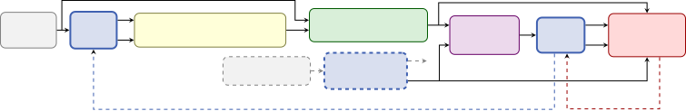

# SNOAR: Self-training with Noise filtering, Observation adding, and Remixing for Speech Denoising Without Clean References

Samuele Cornell Affiliation: Carnegie Mellon University, USA    Matthew
Maciejewski Affiliation: Johns Hopkins University, USA

###### Abstract

Unsupervised speech denoising methods such as MixIT and noisy-target
training can be trained directly on noisy recordings, avoiding the
sim-to-real gap of synthetic training data, but remain well below
supervised performance. Teacher–student self-training, as in RemixIT,
narrows this gap by remixing a teacher’s estimates into new mixtures
that supervise a student; however, since the student is trained only
toward the teacher’s estimates, teacher errors, in particular
over-suppressed speech, are never recovered and propagate as the teacher
is updated from the student. We propose SNOAR, a self-training framework
that corrects the teacher’s estimates before use: the noise leaked into
its speech estimate is removed by differential noise filtering (DNF),
and part of the noisy observation is added back in to restore suppressed
speech and attenuate artifacts. We show that the two corrections depend
on each other, as without DNF the loop collapses to the identity
mapping. Compared to RemixIT, SNOAR is more stable along training and
outperforms it in signal-based, perceptual, and word error rate metrics,
reaching 97% of the SI-SDR improvement of a fully-supervised topline on
WHAM!; on real CHiME-3 recordings, it improves every metric of three
different teachers, while RemixIT degrades their perceptual quality.

###### Index Terms: 

speech enhancement, denoising, self-training, self-supervised learning,
unsupervised learning

## 1 Introduction

Supervised speech denoising models are trained on pairs of noisy and
clean speech, but for real-world recordings no such pair exists: the
clean signal is precisely what the model is asked to produce. These
systems are therefore trained on synthetic mixtures, built by adding
separately recorded noise to clean speech captured under controlled
conditions. This restricts training to domains where studio-quality
clean speech is available, which in practice often means read speech in
high-resource languages. As a consequence, the inherent mismatch between
such synthetic mixtures and real “speech-in-the-wild” recordings, the
so-called “sim-to-real gap”, is known to degrade performance at
deployment \[12, 13\].

In recent years, in order to circumvent this issue, several methods have
been proposed to learn directly from noisy recordings alone. Generative
approaches leverage a clean-speech prior \[3, 5, 15, 10, 30\] and thus
still need an unpaired studio-quality clean speech corpus. Predictive
approaches, on the other hand, such as noisy-target training (NyTT) \[6,
7\], mixture invariant training (MixIT) \[29\] and NyTT with
differential noise filtering (DNF) \[14\], need only in-domain noisy
speech and noise-only clips. We argue that this approach is more
scalable, as noise-only clips can be obtained from the same recordings
by manual labeling and/or automatic voice activity detection \[29\].
Although these methods narrow sim-to-real generalization gap \[12\],
they still fall well short of what we know we can currently achieve with
supervised training on synthetic data, where perfectly clean references
are available \[14, 24\].

Self-training pseudo-labeling frameworks such as RemixIT \[23, 24\] have
been proposed to close more of this gap. RemixIT remixes a teacher
model’s speech and noise estimates across recordings into mixtures whose
targets are now known pseudo-labels, trains a student on them, and
periodically replaces the teacher with the student or updates it by an
exponential moving average \[22\]. The teacher can be trained in any of
three ways: supervised, on synthetic mixtures with clean references;
unsupervised, on real recordings alone, as with MixIT; or jointly, on
synthetic mixtures and real recordings together, as with DNF. RemixIT
was originally validated on synthetic mixtures with clean
references \[24, 23\]. On real recordings, its record is less favorable:
as the baseline of the CHiME-7 UDASE task \[12, 13\], its student
reduced the background noise but ended below its own teacher in
perceived speech and overall quality. We argue that this follows from
how RemixIT constructs its pseudo-labels: the student is trained toward
the teacher’s estimates, so whatever speech the teacher suppresses or
distorts is reproduced by the student and, once the teacher is updated
from it, passed on to the next generation. This is the regression
analogue of confirmation bias in pseudo-labelling for
classification \[2, 1\], where teacher errors are reinforced unless the
pseudo-labels are corrected beforehand, which RemixIT never does.

Motivated by this, we propose self-training with noise filtering,
observation adding and remixing (SNOAR), a self-training framework in
which the teacher’s errors are corrected before its estimates are used
as self-supervision. A speech estimate departs from the clean speech in
three ways: the noise it retains, the speech it suppresses, and the
artifacts it introduces \[9\], and SNOAR addresses them with two
operations. The teacher’s noise estimate is first rescaled and
subtracted from its speech estimate, thus removing the retained noise
residual using differential noise filtering. The result is then combined
with the original noisy observation, which restores part of the
suppressed speech and attenuates the artifacts, as in observation adding
(OA) \[9\]. We show both experimentally and analytically that the two
operations depend on each other: without DNF, OA drives the loop to
collapse towards the identity mapping.

We compare SNOAR and RemixIT initialized from the same teachers with the
same training budget. On WHAM! \[27\], SNOAR improves a MixIT teacher
from 8.3 to 13.3 dB SI-SDR \[11\], within 0.43 dB of a supervised
topline trained on the same mixtures, and obtains the lowest word error
rate (WER) and the highest perceptual scores of all unsupervised
systems. Our analysis on WHAM! shows that both methods remove the
teacher’s residual noise equally well and that the advantage of SNOAR
comes from retaining more speech and introducing fewer artifacts; along
training, RemixIT peaks early and then degrades, whereas SNOAR plateaus
stably. On real CHiME-3 recordings \[4\], SNOAR lowers the WER of three
different teachers by 1.3 to 3.7 points and raises their UTMOS \[19\] by
0.5 to 0.8, with the largest gain for the teacher trained without any
clean speech, whereas RemixIT degrades the perceptual scores of every
teacher. Audio examples are available online¹¹ 1
[popcornell.github.io/SNOAR-demo/](https://popcornell.github.io/SNOAR-demo/).

## 2 Method

### 2.1 Speech denoising without clean references

We consider a recording $`{\mathbf{x}}={\mathbf{s}}+{\mathbf{n}}_{1}`$,
where $`{\mathbf{s}}`$ is clean speech and $`{\mathbf{n}}_{1}`$ is real
noise, neither observed separately, and a model $`f_{\theta}`$ that maps
a mixture to a speech estimate $`\hat{\mathbf{s}}`$ and a noise estimate
$`\hat{\mathbf{n}}`$. NyTT \[6, 7\], MixIT \[29\] and NyTT+DNF \[14\]
train $`f_{\theta}`$ without clean references by adding a second noise
$`{\mathbf{n}}_{2}`$ from the same domain and supervising it on
$`{\mathbf{x}}+{\mathbf{n}}_{2}`$ with $`{\mathbf{x}}`$ and
$`{\mathbf{n}}_{2}`$ as targets. As shown in \[14\], a network can
separate speech from noise but not $`{\mathbf{n}}_{1}`$ from
$`{\mathbf{n}}_{2}`$, as the two come from the same distribution: the
supervision asks for part of the inseparable noise mixture in one output
and another part in the other, with the end result being that the
trained network outputs the noise mixture in both outputs at some
attenuation. For inference on $`{\mathbf{x}}`$, where no noise is added,
such a network outputs

```math
\hat{\mathbf{s}}={\mathbf{s}}+\lambda\,{\mathbf{n}}_{1},\qquad\hat{\mathbf{n}}=\mu\,{\mathbf{n}}_{1}, \tag{1}
```

for a residual fraction $`\lambda`$ and a noise gain $`\mu`$.

Differential noise filtering \[14\] removes this residual using the
model’s own noise estimate: $`\hat{\mathbf{n}}`$ is rescaled to the
magnitude of the residual in $`\hat{\mathbf{s}}`$ and subtracted from
it,

```math
\hat{\mathbf{s}}^{\,\mathrm{dnf}}=\hat{\mathbf{s}}-\frac{\langle\hat{\mathbf{n}},\hat{\mathbf{s}}\rangle}{\|\hat{\mathbf{n}}\|^{2}}\,\hat{\mathbf{n}}, \tag{2}
```

where $`\hat{\mathbf{s}}^{\,\mathrm{dnf}}`$ denotes the DNF-filtered
speech estimate, which under Eq. (1) is free of
$`\lambda{\mathbf{n}}_{1}`$, since the two outputs carry the same noise
up to a scalar. The system evaluated in \[14\], which trains with the
NyTT objective and applies DNF at inference, is denoted NyTT+DNF in the
rest of this paper.

MixIT separates $`{\mathbf{x}}+{\mathbf{n}}_{2}`$ into three outputs,
one for speech ($`\hat{\mathbf{s}}`$) and two for noise
($`\hat{\mathbf{n}}_{1}`$ and $`\hat{\mathbf{n}}_{2}`$), and since only
$`{\mathbf{n}}_{1}+{\mathbf{n}}_{2}`$ is separable from the speech, the
two noise outputs together carry the same noise as the single noise
output above: Eq. (1) holds also for MixIT with $`\hat{\mathbf{n}}`$
being now their sum. As in \[24\], we train all our MixIT models with a
mixture consistency layer \[28\], so that the outputs sum to the input
and $`\hat{\mathbf{n}}={\mathbf{x}}-\hat{\mathbf{s}}`$. MixIT has no
DNF-like operation at inference, so its speech output retains whatever
fraction $`\lambda`$ the converged network produces.

### 2.2 SNOAR: self-training with noise filtering, observation adding and remixing

RemixIT. RemixIT \[24\] trains a student $`f_{\theta}`$ from the
estimates of a teacher $`f_{\bar{\theta}}`$. For a batch of $`B`$ noisy
speech recordings $`\{{\mathbf{x}}_{i}\}`$, with
$`{\mathbf{x}}_{i}={\mathbf{s}}_{i}+{\mathbf{n}}_{i}`$, the teacher
produces $`(\hat{\mathbf{s}}_{i},\hat{\mathbf{n}}_{i})`$; the speech
estimate of recording $`i`$ is remixed with the noise estimate of a
_different_ recording $`j`$, obtained by a circular shift of the batch,
into
$`{\mathbf{x}}^{\prime}_{i}=\hat{\mathbf{s}}_{i}+\hat{\mathbf{n}}_{j}`$;
and the student is trained on $`{\mathbf{x}}^{\prime}_{i}`$ toward the
targets $`(\hat{\mathbf{s}}_{i},\hat{\mathbf{n}}_{j})`$, which sum to
its input. The teacher is either replaced by the student every $`K`$
steps or tracks it using an EMA of its weights.

Self-supervision correction. SNOAR keeps the remixing step and the loss
of RemixIT and replaces the speech target by a corrected one, in two
steps (Fig. 1). First, the teacher’s speech estimate is filtered against
the teacher’s own noise estimate by DNF: Eq. (2) is applied to
$`(\hat{\mathbf{s}}_{i},\hat{\mathbf{n}}_{i})`$, giving
$`\hat{\mathbf{s}}^{\,\mathrm{dnf}}_{i}`$. For a NyTT+DNF teacher this
is already its inference rule; for a MixIT teacher
$`\hat{\mathbf{n}}_{i}`$ is the sum of the two noise outputs. In both
cases, under Eq. (1), this removes the leaked
$`\lambda{\mathbf{n}}_{i}`$ from the self-supervision (at the cost of
increased artifacts). Second, the filtered estimate is combined with the
original noisy speech observation,

```math
\hat{\mathbf{s}}^{\,\mathrm{oa}}_{i}=(1-\gamma)\,\hat{\mathbf{s}}^{\,\mathrm{dnf}}_{i}+\gamma\,{\mathbf{x}}_{i}, \tag{3}
```

referred to as observation adding (OA) \[9\], originally proposed as an
inference-time post-processing technique to improve speech recognition.
We instead apply it here to the self-supervision. Any speech estimate
can be decomposed as
$`\hat{\mathbf{s}}=\alpha{\mathbf{s}}+\lambda{\mathbf{n}}+\mathbf{a}`$,
with $`\alpha{\mathbf{s}}`$ the retained speech, $`\lambda{\mathbf{n}}`$
the residual noise, and $`\mathbf{a}`$ the component orthogonal to the
subspace spanned by $`{\mathbf{s}}`$ and $`{\mathbf{n}}`$, i.e. the
nonlinear distortion introduced by the model itself \[25\]. Unlike the
residual noise, $`\mathbf{a}`$ has no counterpart in the input, so the
only way to reduce it is to add back a part of the input itself. Since
$`{\mathbf{x}}_{i}={\mathbf{s}}_{i}+{\mathbf{n}}_{i}`$ contains all of
the speech and no distortion, Eq. (3) attenuates $`\mathbf{a}_{i}`$ and
$`1-\alpha_{i}`$ by $`1-\gamma`$, at the cost of returning a fraction
$`\gamma`$ of the recording’s noise to the self-supervision. In vanilla
RemixIT, the self-supervision is the teacher’s estimate itself, so
$`\alpha_{i}`$ and $`\mathbf{a}_{i}`$ pass to the student unchanged and
propagate across training, which makes RemixIT susceptible to the
confirmation bias problem discussed in Sec. 1.



Figure 1: The SNOAR self-training framework. From a real recording
$`{\mathbf{x}}_{i}`$ the EMA teacher produces a speech and a noise
estimate; the speech estimate is filtered against the noise estimate by
DNF (Eq. 2) and combined with the observation by OA (Eq. 3), giving the
corrected self-supervision $`\hat{\mathbf{s}}^{\,\mathrm{oa}}_{i}`$.
This is remixed with the noise estimate of another recording
$`{\mathbf{x}}_{j}`$ to form the student input. The student is trained
to reconstruct $`\hat{\mathbf{s}}^{\,\mathrm{oa}}_{i}`$ and
$`\hat{\mathbf{n}}_{j}`$, and the teacher is updated from the student
weights by EMA.

OA noise propagation. One of the challenges with teacher-student
training is the propagation of behaviors: if the teacher model starts to
do something bad, the student learns from it, which then becomes the
teacher, so the behavior propagates and can even be exacerbated. This
behavior could be observed with $`\lambda`$, the scaling of the noise
residual. Assuming mixture consistency (i.e. $`\mu=1-\lambda`$) and that
the noise recordings have approximately the same energy (i.e.
$`||{\mathbf{n}}_{1}||^{2}\approx||{\mathbf{n}}_{2}||^{2}`$), when the
student model is trained with the teacher outputs
$`{\mathbf{s}}_{i}+\lambda{\mathbf{n}}_{i}`$ and
$`(1-\lambda){\mathbf{n}}_{j}`$, the optimal new $`\lambda^{\prime}`$
is:

```math
\lambda^{\prime}=\frac{\lambda^{2}}{\lambda^{2}+(1-\lambda)^{2}}\text{,} \tag{4}
```

i.e. the Wiener gain for $`\lambda{\mathbf{n}}_{i}`$ in the presence of
$`(1-\lambda){\mathbf{n}}_{j}`$.

If we consider the equilibrium points of Eq. (4), where
$`\lambda^{\prime}=\lambda`$, there are three points: $`0`$, $`0.5`$,
and $`1`$. Both $`0`$ and $`1`$ are stable, while $`0.5`$ is not,
meaning that for $`\lambda\in[0,0.5)`$, over iterations it will converge
to $`0`$, and for $`\lambda\in(0.5,1]`$, it will converge to $`1`$. So,
it is critical to keep $`\lambda`$ under $`0.5`$.

With the addition of OA, the equation instead becomes:

```math
\lambda^{\prime}=\frac{(\lambda+\gamma)^{2}}{(\lambda+\gamma)^{2}+(1-\lambda)^{2}}\text{,} \tag{5}
```

which shifts the $`0.5`$ transition point to
$`\tfrac{1}{4}(1-2\gamma+\sqrt{1-4\gamma-4\gamma^{2}})`$. For example,
for $`\gamma=0.2`$, this requires $`\lambda`$ to be less than $`0.2`$,
which corresponds to a noise reduction of at least $`\approx 14`$ dB by
the teacher model. As a result, there is a large risk of the model
collapsing to $`\lambda=1`$, i.e. no denoising and simply outputting the
noisy speech.

With the introduction of DNF, since the residual noise is canceled,
$`\lambda^{\prime}`$ no longer scales from previous values of
$`\lambda`$, only the OA parameter:

```math
\lambda^{\prime}=\frac{\gamma^{2}}{\gamma^{2}+(1-\lambda)^{2}}\text{,} \tag{6}
```

which has a transition point at
$`\lambda=\frac{1}{2}(1+\sqrt{1-4\gamma^{2}})`$ and stable equilibria at
$`\lambda=\frac{1}{2}(1-\sqrt{1-4\gamma^{2}})`$ and $`\lambda=1`$. For
$`\gamma=0.2`$, the transition point is at $`\approx 0.958`$ and lower
equilibrium is at $`\approx 0.042`$. This is almost certain to converge
to the lower value, and although it is not $`0`$, it would correspond to
a noise reduction of $`\approx 27.6`$ dB, which is far more than any of
our teachers achieves.

Training objective and teacher update. The student input is
$`{\mathbf{x}}^{\prime}_{i}=\hat{\mathbf{s}}^{\,\mathrm{oa}}_{i}+\hat{\mathbf{n}}_{j}`$,
its targets are $`\hat{\mathbf{s}}^{\,\mathrm{oa}}_{i}`$ and
$`\hat{\mathbf{n}}_{j}`$, and it is trained with the negative
SI-SDR \[11\] on both heads,
$`\mathcal{L}=\ell(\hat{\mathbf{s}}^{\text{stu}}_{i},\hat{\mathbf{s}}^{\,\mathrm{oa}}_{i})+\ell(\hat{\mathbf{n}}^{\text{stu}}_{i},\hat{\mathbf{n}}_{j})`$,
followed by the EMA update
$`\bar{\theta}\leftarrow\eta\bar{\theta}+(1-\eta)\theta`$. At inference,
the student is used as its teacher was, i.e., with Eq. (2) for a
two-output (speech + noise) model, or by taking the speech output alone
for a three-output MixIT-derived model. Both SNOAR and RemixIT are
agnostic to how the teacher was trained: fully supervised on synthetic
mixtures, fully unsupervised (NyTT, MixIT, NyTT+DNF), or a hybrid of the
two.

## 3 Experimental setup

Data. We train on WHAM! \[27\] at 16 kHz, the official anechoic
single-speaker mixtures of clean speech and real ambient noise, using
the tr split. To simulate a real world application, the noise clips of
tr are divided into two disjoint pools, one providing the noise
$`{\mathbf{n}}_{1}`$ inside the recordings and the other the added noise
$`{\mathbf{n}}_{2}`$, so that no clip is ever both the unobserved noise
of one example and a known target of another. We test on tt, both
microphones, on the untruncated max version. As such, results are not
directly comparable with \[14\].

We also use CHiME-3 \[4\], which provides real recordings with no clean
reference: we adapt on tr05*real (channel 5), select checkpoints on the
real development set dt05_real, and test on et05_real. The added noise
$`{\mathbf{n}}*{2}`$ is drawn from the official background pool used to
build the simulated partitions (tr05_simu), which contains no speech and
was recorded in sessions separate from the speech utterances.

Model and training. We use TF-GridNet \[26\] as the architecture for
every system, in the configuration of \[14\] (512-point short-time
Fourier transform, hop size 128, 4 blocks, 24 channels, 192 hidden
units, 4.0 M parameters). Every system is trained with negative
SI-SDR \[11\] loss, and MixIT-based systems additionally use a
mixture-consistency layer \[28\]. On WHAM!, teachers are trained for
150k steps with Adam, a learning rate of $`10^{-3}`$, batch size 8 and
$`\ell_{2}`$ gradient-norm clipping at 5, saving a checkpoint every 10k
steps, and self-training SNOAR and RemixIT runs are warm-started from
the teacher and run for 150k steps with $`\gamma=0.2`$ and a checkpoint
every 10k steps. Both use an EMA teacher, updated every step with decay
$`0.999`$. On CHiME-3, since the amount of data is less, self-training
runs instead for 7.5k steps with a checkpoint every 1000 steps. We do
not use early-stopping: each is trained to its full budget and the
reported checkpoint is chosen afterwards among those saved using UTMOS
(on cv for WHAM! and dt05_real for CHiME-3) which is reference free.
Hyperparameters were tuned using UTMOS on each dataset respective
development set. The only exception is the WHAM! supervised topline,
whose checkpoint and hyperparameters are chosen by oracle SI-SDR.

Evaluation. All outputs are normalised to $`-26`$ dBov
(decibel-to-overload signal level) before scoring, since DNSMOS and
UTMOS are sensitive to the level and the output scale. We report
SI-SDR \[11\], STOI \[21\], wideband PESQ \[18\], DNSMOS P.835 \[17\]
(D-SIG, D-BAK and D-OVRL), UTMOS \[19\], and the WER of the OWSM
v4 \[16\] base model, computed with VERSA \[20\].

## 4 Experimental Results

|                          |            |           |          |          |          |          |
| ------------------------ | ---------- | --------- | -------- | -------- | -------- | -------- |
| System                   | SI-SDR     | STOI      | PESQ     | D-OVRL   | UTMOS    | WER      |
| Unprocessed              | $`-1.48`$  | $`0.751`$ | $`1.10`$ | $`1.46`$ | $`1.38`$ | $`19.8`$ |
| Clean                    | $`\infty`$ | $`1.000`$ | $`4.64`$ | $`3.33`$ | $`4.22`$ | 4.7      |
| Supervised topline       | $`13.68`$  | $`0.952`$ | $`2.26`$ | $`3.21`$ | $`3.60`$ | 9.5      |
| NyTT \[6\]               | 0.20       | $`0.776`$ | $`1.13`$ | $`1.60`$ | $`1.36`$ | $`18.1`$ |
| NyTT+DNF \[14\], teacher | 4.87       | $`0.847`$ | $`1.32`$ | $`2.43`$ | $`2.05`$ | $`17.7`$ |
| RemixIT(NyTT+DNF)        | 9.32       | $`0.913`$ | $`1.56`$ | $`2.61`$ | $`2.67`$ | $`13.1`$ |
| SNOAR(NyTT+DNF)          | $`10.03`$  | $`0.932`$ | $`1.77`$ | $`3.05`$ | $`3.09`$ | $`12.6`$ |
| MixIT \[29\], teacher    | 8.32       | $`0.872`$ | $`1.54`$ | $`2.54`$ | $`2.26`$ | $`15.3`$ |
| RemixIT(MixIT)           | $`12.10`$  | $`0.926`$ | $`1.61`$ | $`2.98`$ | $`3.15`$ | $`13.3`$ |
| SNOAR(MixIT)             | 13.25      | 0.942     | 2.02     | 3.15     | 3.45     | 10.9     |

Table 1: Results on the WHAM! test set. SNOAR and RemixIT are listed
under the teacher they were initialised from (MixIT or DNF). For SI-SDR,
the 95% confidence interval obtained via paired bootstrap over the test
utterances has a half-width of at most $`0.08`$ dB for every system.

Figure 2: SNOAR(MixIT) and RemixIT(MixIT) at every training checkpoint,
scored on a randomly selected subset of 500 WHAM! cv utterances.

### 4.1 Results on WHAM!

Table 1 reports both self-training methods from the same two teachers.
From the MixIT teacher, SNOAR reaches 13.25 dB SI-SDR against 12.10 dB
for RemixIT, i.e. within 0.43 dB of the supervised topline trained on
the same mixtures with clean targets, and it attains the lowest WER of
all systems trained without clean references (10.9%, against 9.5% for
the topline). Its UTMOS, 3.45, is likewise within 0.15 of the topline’s
3.60, against 2.26 for the teacher it started from. The ordering is the
same from the weaker NyTT+DNF teacher, with a smaller margin. RemixIT
improves every metric over both teachers, but its gains in PESQ and WER
are markedly smaller than those of SNOAR while the two methods are much
closer in SI-SDR. RemixIT thus removes noise about as well as SNOAR
does, but at a higher cost to the speech itself.

Table 2 reports the decomposition of Sec. 2 for the MixIT teacher and
its two students, and confirms this interpretation. We report the
least-squares fit
$`\hat{\mathbf{s}}\approx\alpha{\mathbf{s}}+\beta{\mathbf{n}}`$ on each
test utterance, with $`\lambda=\beta/\alpha`$ the noise coefficient
relative to the speech one and
$`r=\|\hat{\mathbf{s}}-\alpha{\mathbf{s}}-\beta{\mathbf{n}}\|^{2}/\|\hat{\mathbf{s}}\|^{2}`$
the artifact energy as a fraction of the estimate’s, averaged over
utterances. Both students reduce the teacher’s residual noise from
$`\lambda=0.218`$ to about $`0.03`$, as the fixed points of Sec. 2.2
predict: from this teacher, Eq. (4) converges to $`0`$ for RemixIT and
Eq. (6) to $`0.042`$ for SNOAR with $`\gamma=0.2`$. Remixing thus
filters the noise of the self-supervision whether it was leaked by the
teacher or reintroduced by OA. The speech and artifact terms behave
differently. RemixIT lowers the artifact fraction from the teacher’s
$`r=0.085`$ to $`0.062`$, whereas SNOAR reaches $`0.048`$, and it
retains more of the speech ($`\alpha=0.949`$ against $`0.939`$). The
gain of SNOAR over RemixIT is thus not obtained by removing more noise,
but by preserving more speech and introducing less distortion. The two
methods also differ along training (Fig. 2): RemixIT peaks after a few
tens of thousands of steps and degrades thereafter on all three metrics,
so that the results in Table 1 are only attained by selecting its
checkpoint, whereas SNOAR generally increase and plateaus.

The bottom block of Table 2 ablates the two corrections and the choice
of $`\gamma`$. The $`\gamma=0.2`$ self-supervision carries a fifth of
the recording’s noise and the $`\gamma=0`$ one carries none, yet the two
students end at $`\lambda=0.031`$ and $`0.018`$, against the $`0.042`$
and $`0`$ predicted by Eq. (6). OA acts instead on the remaining two
terms, raising $`\alpha`$ from $`0.944`$ to $`0.949`$ and lowering $`r`$
from $`0.059`$ to $`0.048`$, which is worth 0.9 dB SI-SDR and 0.3 WER
points. With DNF alone ($`\gamma=0`$) the student ends close to the
selected RemixIT checkpoint on every metric (12.33 against 12.10 dB,
$`r=0.059`$ against $`0.062`$), so most of the gain of SNOAR over
RemixIT is due to OA, while DNF is what makes OA usable: without it,
Eq. (5) leaves the teacher at the edge of the basin of its non-collapsed
fixed point, and the student indeed ends at $`\lambda=0.697`$ and
$`\alpha=0.979`$, i.e. reproducing its input, with the highest artifact
fraction of the table. Annealing $`\gamma`$ from 0.2 to 0.05 yields the
same $`\alpha`$, $`\lambda`$ and $`r`$ as the fixed value, so we keep
$`\gamma`$ fixed. Finally, $`\gamma=0.5`$ diverges, as Eq. (6) predicts:
for $`\gamma\geq 0.5`$ its only stable fixed point is $`\lambda=1`$.

|                                        |           |          |          |          |            |             |           |
| -------------------------------------- | --------- | -------- | -------- | -------- | ---------- | ----------- | --------- |
| Arm                                    | SI-SDR    | PESQ     | UTMOS    | WER      | $`\alpha`$ | $`\lambda`$ | $`r`$     |
| MixIT teacher                          | 8.32      | $`1.54`$ | $`2.26`$ | $`15.3`$ | $`0.912`$  | $`0.218`$   | $`0.085`$ |
| SNOAR(MixIT), $`\gamma{=}0.2`$         | 13.25     | 2.02     | $`3.45`$ | 10.9     | $`0.949`$  | $`0.031`$   | $`0.048`$ |
| RemixIT(MixIT)                         | $`12.10`$ | $`1.61`$ | $`3.15`$ | $`13.3`$ | $`0.939`$  | $`0.026`$   | $`0.062`$ |
| $`\gamma{=}0.5`$                       | $`-0.82`$ | $`1.11`$ | $`1.38`$ | $`19.9`$ | $`0.998`$  | $`0.899`$   | $`0.033`$ |
| $`\gamma{=}0.1`$                       | $`13.14`$ | $`1.87`$ | 3.47     | $`11.1`$ | $`0.946`$  | $`0.020`$   | $`0.050`$ |
| $`\gamma{=}0`$ (no OA)                 | $`12.33`$ | $`1.84`$ | $`3.27`$ | $`11.2`$ | $`0.944`$  | $`0.018`$   | $`0.059`$ |
| $`\gamma`$ annealed $`0.2\!\to\!0.05`$ | $`13.23`$ | $`1.84`$ | $`3.43`$ | $`11.6`$ | $`0.945`$  | $`0.020`$   | $`0.048`$ |
| no DNF, Eq. (2)                        | $`0.23`$  | $`1.13`$ | $`1.38`$ | $`17.6`$ | $`0.979`$  | $`0.697`$   | $`0.135`$ |

Table 2: Ablation of SNOAR(MixIT) on the WHAM! tt set. The first row is
the method as described ($`\gamma=0.2`$). $`\alpha`$, $`\lambda`$ and
$`r`$ are the speech, noise and artifact terms of the decomposition of
Sec. 2, with $`r`$ the artifact energy as a fraction of the estimate’s.

|                 |             |          |          |          |          |          |
| --------------- | ----------- | -------- | -------- | -------- | -------- | -------- |
| Teacher         | System      | D-SIG    | D-BAK    | D-OVRL   | UTMOS    | WER      |
|                 | Unprocessed | $`2.05`$ | $`1.50`$ | $`1.48`$ | $`1.38`$ | $`22.0`$ |
| MixIT (real)    | Teacher     | $`2.77`$ | $`2.01`$ | $`1.94`$ | $`1.62`$ | $`22.1`$ |
|                 | RemixIT     | $`2.67`$ | $`1.95`$ | $`1.87`$ | $`1.57`$ | $`20.3`$ |
|                 | SNOAR       | 3.09     | 2.37     | 2.19     | 2.10     | 18.4     |
| Mix+sup (WSJ)   | Teacher     | $`3.13`$ | $`2.46`$ | $`2.28`$ | $`2.03`$ | $`17.1`$ |
|                 | RemixIT     | $`2.70`$ | $`2.01`$ | $`1.91`$ | $`1.69`$ | $`18.4`$ |
|                 | SNOAR       | 3.41     | 3.14     | 2.68     | 2.75     | 15.4     |
| Mix+sup (Libri) | Teacher     | $`3.06`$ | $`2.33`$ | $`2.19`$ | $`1.87`$ | $`17.9`$ |
|                 | RemixIT     | $`2.81`$ | $`2.09`$ | $`1.98`$ | $`1.74`$ | $`17.5`$ |
|                 | SNOAR       | 3.35     | 2.89     | 2.53     | 2.63     | 16.6     |

Table 3: Results on CHiME-3 et05_real, channel 5. No clean reference
exists for these recordings, so only reference-free scores are reported.
Each block is one in-domain teacher, trained without clean in-domain
speech but allowed out-of-domain clean speech from WHAM! or LibriSpeech,
followed by SNOAR and RemixIT adapted from it with the same budget of
7.5k steps.

### 4.2 Results on CHiME-3 real noisy speech

Table 3 repeats the comparison on real recordings, for three teachers
differing in the clean speech they were allowed. The first is trained
with MixIT on CHiME-3 real data only and uses no clean speech at all.
The other two are trained jointly on the same real data and on synthetic
mixtures built from out-of-domain studio recordings, either the
WSJ \[8\] speech of WHAM! or LibriSpeech read audiobooks. The former
matches the speech domain of CHiME-3, whose utterances are also read WSJ
excerpts, and is the strongest of the three teachers on every metric.

SNOAR improves every metric of every teacher, reducing WER by 3.7, 1.7
and 1.3 points and raising UTMOS by 0.48, 0.72 and 0.76. Its largest
gain is on the teacher trained without any clean speech, which is the
setting the method targets. RemixIT falls below its teacher on every
reference-free metric for all three, and lowers WER only for the two
weaker ones; replacing the EMA update with the periodic teacher
replacement of \[24\] did not help. This matches the CHiME-7 UDASE
baseline \[12, 13\], whose RemixIT student reduced the background noise
but ended below its teacher in perceived quality, and the WHAM!
decomposition of Sec. 4.1, where RemixIT removed the noise as well as
SNOAR but retained less speech and more distortion, to which the
reference-free metrics are sensitive. On CHiME-3 the teachers are weaker
to begin with, since the recordings are noisier and the noise more
diverse than on WHAM!, so their errors are larger and the confirmation
bias of RemixIT is enough to cancel the benefit of self-training: the
speech the teacher suppresses is absent from its self-supervision and
each generation inherits the loss, whereas SNOAR corrects the
self-supervision before use.

## 5 Conclusion

We introduced SNOAR, a self-training framework for speech denoising
without clean references in which the teacher’s estimates are corrected
before they are used as self-supervision: DNF removes the noise the
teacher leaks, and OA restores part of the speech it suppresses while
attenuating its artifacts. We showed that the two corrections are not
independent, by analysing the equilibrium points of $`\lambda`$, the
noise left in the speech estimate, across self-training generations.
Without DNF, the student’s $`\lambda`$ depends on the teacher’s, and OA
lowers the threshold above which the loop collapses to the identity
mapping; with DNF, it depends only on the OA coefficient $`\gamma`$ and
the loop converges from any teacher to a residual of $`\approx 27`$ dB
below the input noise, far below what any teacher achieves on its own.
On WHAM!, SNOAR comes within 0.43 dB of a supervised topline starting
from a MixIT teacher 5 dB below it, and on real CHiME-3 recordings it
improves WER and reference-free metric of three different teachers,
whereas RemixIT falls below each of its teachers on all of them.

## References

- \[1\] M. Amini, V. Feofanov, L. Pauletto, L. Hadjadj, E. Devijver,
  and Y. Maximov (2025) Self-training: a survey. Neurocomputing. Cited
  by: §1.
- \[2\] E. Arazo, D. Ortego, P. Albert, N. E. O’Connor, and K.
  McGuinness (2020) Pseudo-labeling and confirmation bias in deep
  semi-supervised learning. In Proc. IJCNN, Cited by: §1.
- \[3\] Y. Bando, M. Mimura, K. Itoyama, K. Yoshii, and T.
  Kawahara (2018) Statistical speech enhancement based on probabilistic
  integration of variational autoencoder and non-negative matrix
  factorization. In Proc. ICASSP, Cited by: §1.
- \[4\] J. Barker, R. Marxer, E. Vincent, and S. Watanabe (2015) The
  third ‘CHiME’ speech separation and recognition challenge: dataset,
  task and baselines. In Proc. ASRU, Cited by: §1, §3.
- \[5\] X. Bie, S. Leglaive, X. Alameda-Pineda, and L. Girin (2022)
  Unsupervised speech enhancement using dynamical variational
  autoencoders. IEEE/ACM Trans. Audio, Speech, Lang. Process.. Cited by:
  §1.
- \[6\] T. Fujimura, Y. Koizumi, K. Yatabe, and R. Miyazaki (2021)
  Noisy-target training: a training strategy for DNN-based speech
  enhancement without clean speech. In Proc. EUSIPCO, Cited by: §1,
  §2.1, Table 1.
- \[7\] T. Fujimura and T. Toda (2023) Analysis of noisy-target training
  for DNN-based speech enhancement. In Proc. ICASSP, Cited by: §1, §2.1.
- \[8\] J. S. Garofolo, D. Graff, J. M. Baker, D. Paul, and D.
  Pallett (1993) CSR-I (WSJ0) complete LDC93S6A. Note: Web Download, LDC
  Cited by: §4.2.
- \[9\] K. Iwamoto, T. Ochiai, M. Delcroix, R. Ikeshita, H. Sato, S.
  Araki, and S. Katagiri (2022) How bad are artifacts?: analyzing the
  impact of speech enhancement errors on ASR. In Proc. Interspeech,
  Cited by: §1, §2.2.
- \[10\] W. Jiang, F. Wen, Y. Zhang, and K. Yu (2023) UnSE: unsupervised
  speech enhancement using optimal transport. In Proc. Interspeech,
  Cited by: §1.
- \[11\] J. Le Roux, S. Wisdom, H. Erdogan, and J. R. Hershey (2019)
  SDR–half-baked or well done?. In Proc. ICASSP, Cited by: §1, §2.2, §3,
  §3.
- \[12\] S. Leglaive, L. Borne, E. Tzinis, M. Sadeghi, M. Fraticelli, S.
  Wisdom, M. Pariente, D. Pressnitzer, and J. R. Hershey (2023) The
  CHiME-7 UDASE task: unsupervised domain adaptation for conversational
  speech enhancement. In Proc. CHiME 7, Cited by: §1, §1, §1, §4.2.
- \[13\] S. Leglaive, M. Fraticelli, H. ElGhazaly, L. Borne, M.
  Sadeghi, S. Wisdom, M. Pariente, J. R. Hershey, D. Pressnitzer,
  and J. P. Barker (2025) Objective and subjective evaluation of speech
  enhancement methods in the UDASE task of the 7th CHiME challenge.
  Comput. Speech Lang.. Cited by: §1, §1, §4.2.
- \[14\] M. Maciejewski and S. Cornell (2026) Exploiting noise
  inseparability for weakly-supervised discriminative speech denoising
  using noisy targets. Proc. IWAENC. Cited by: §1, §2.1, §2.1, §2.1, §3,
  §3, Table 1.
- \[15\] B. Nortier, M. Sadeghi, and R. Serizel (2024) Unsupervised
  speech enhancement with diffusion-based generative models. In Proc.
  ICASSP, Cited by: §1.
- \[16\] Y. Peng, S. Muhammad, Y. Sudo, W. Chen, J. Tian, C. Lin, and S.
  Watanabe (2025) OWSM v4: improving open Whisper-style speech models
  via data scaling and cleaning. In Proc. Interspeech, Cited by: §3.
- \[17\] C. K. Reddy, V. Gopal, and R. Cutler (2021) DNSMOS: a
  non-intrusive perceptual objective speech quality metric to evaluate
  noise suppressors. In Proc. ICASSP, Cited by: §3.
- \[18\] A. W. Rix, J. G. Beerends, M. P. Hollier, and A. P.
  Hekstra (2001) Perceptual evaluation of speech quality (PESQ)-a new
  method for speech quality assessment of telephone networks and codecs.
  In Proc. ICASSP, Cited by: §3.
- \[19\] T. Saeki, D. Xin, W. Nakata, T. Koriyama, S. Takamichi, and H.
  Saruwatari (2022) UTMOS: UTokyo-SaruLab system for VoiceMOS challenge 2022. In Proc. Interspeech, Cited by: §1, §3.
- \[20\] J. Shi, H. Shim, J. Tian, S. Arora, H. Wu, D. Petermann, J. Q.
  Yip, Y. Zhang, Y. Tang, W. Zhang, et al. (2025) VERSA: a versatile
  evaluation toolkit for speech, audio, and music. In Proc. NAACL-HLT,
  Cited by: §3.
- \[21\] C. H. Taal, R. C. Hendriks, R. Heusdens, and J. Jensen (2011)
  An algorithm for intelligibility prediction of time–frequency weighted
  noisy speech. IEEE Trans. Audio, Speech, Lang. Process.. Cited by: §3.
- \[22\] A. Tarvainen and H. Valpola (2017) Mean teachers are better
  role models: weight-averaged consistency targets improve
  semi-supervised deep learning results. In Proc. NeurIPS, Cited by: §1.
- \[23\] E. Tzinis, Y. Adi, V. K. Ithapu, B. Xu, and A. Kumar (2022)
  Continual self-training with bootstrapped remixing for speech
  enhancement. In Proc. ICASSP, Cited by: §1.
- \[24\] E. Tzinis, Y. Adi, V. K. Ithapu, B. Xu, P. Smaragdis, and A.
  Kumar (2022) RemixIT: continual self-training of speech enhancement
  models via bootstrapped remixing. IEEE J. Sel. Top. Signal Process..
  Cited by: §1, §1, §2.1, §2.2, §4.2.
- \[25\] E. Vincent, R. Gribonval, and C. Févotte (2006) Performance
  measurement in blind audio source separation. IEEE Trans. Audio,
  Speech, Lang. Process.. Cited by: §2.2.
- \[26\] Z. Wang, S. Cornell, S. Choi, Y. Lee, B. Kim, and S.
  Watanabe (2023) TF-GridNet: integrating full-and sub-band modeling for
  speech separation. IEEE/ACM Trans. Audio, Speech, Lang. Process..
  Cited by: §3.
- \[27\] G. Wichern, J. Antognini, M. Flynn, L. R. Zhu, E. McQuinn, D.
  Crow, E. Manilow, and J. Le Roux (2019) WHAM!: extending speech
  separation to noisy environments. In Proc. Interspeech, Cited by: §1,
  §3.
- \[28\] S. Wisdom, J. R. Hershey, K. Wilson, J. Thorpe, M. Chinen, B.
  Patton, and R. A. Saurous (2019) Differentiable consistency
  constraints for improved deep speech enhancement. In Proc. ICASSP,
  Cited by: §2.1, §3.
- \[29\] S. Wisdom, E. Tzinis, H. Erdogan, R. Weiss, K. Wilson,
  and J. R. Hershey (2020) Unsupervised sound separation using mixture
  invariant training. In Proc. NeurIPS, Cited by: §1, §2.1, Table 1.
- \[30\] Y. Xiang and C. Bao (2020) A parallel-data-free speech
  enhancement method using multi-objective learning cycle-consistent
  generative adversarial network. IEEE/ACM Trans. Audio, Speech, Lang.
  Process.. Cited by: §1.
