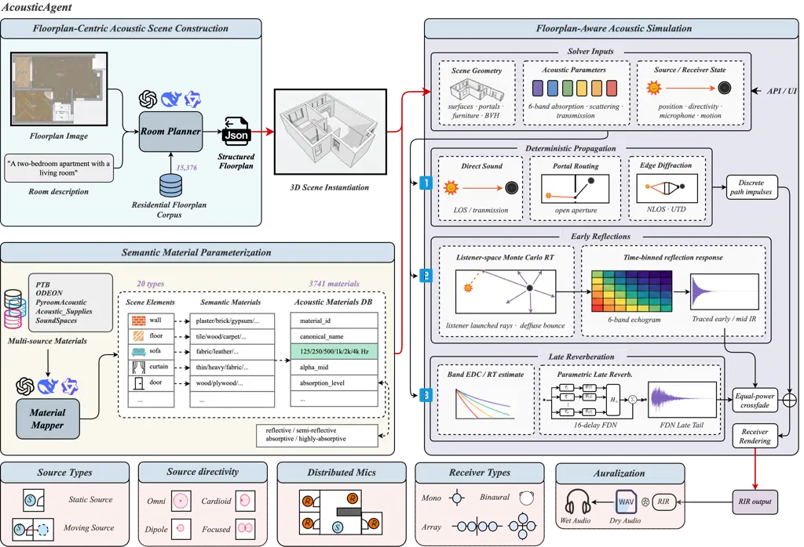
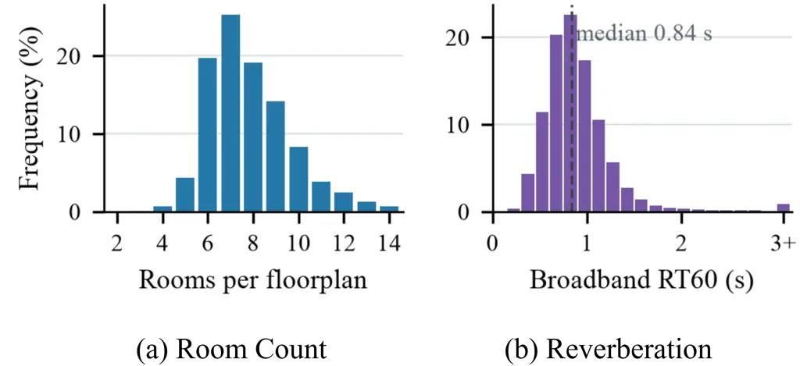
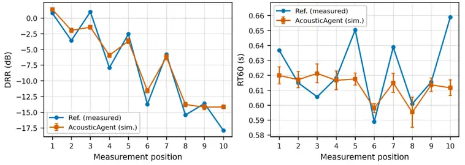
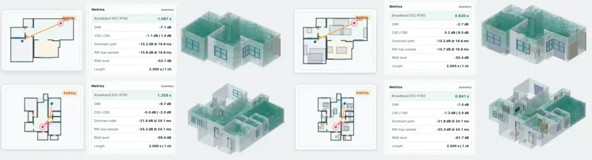
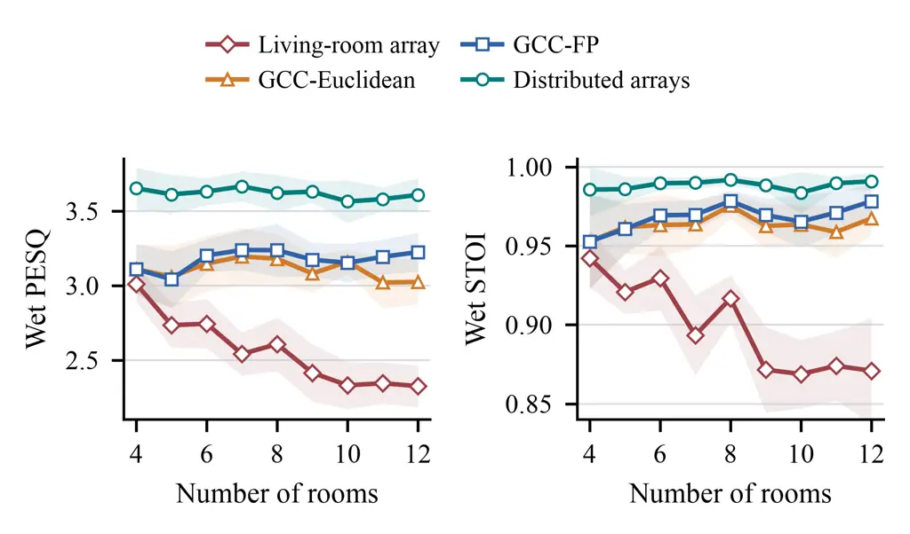
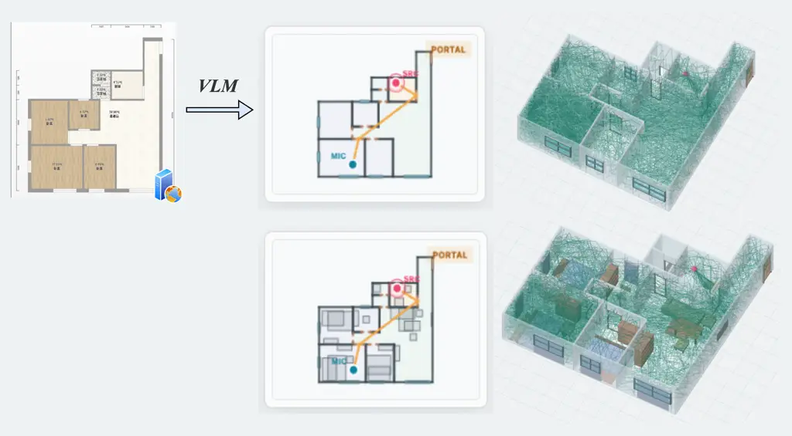
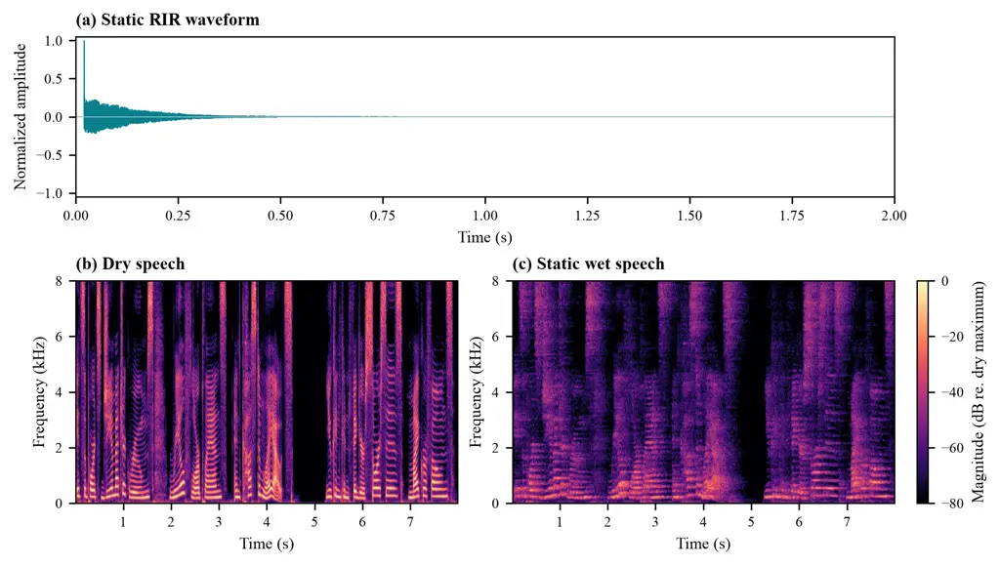
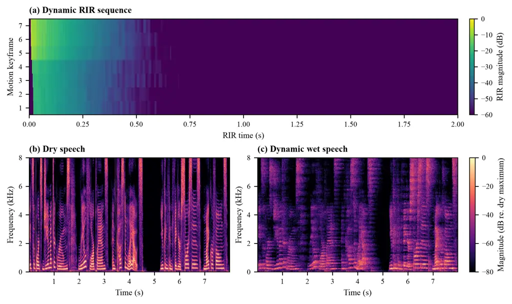
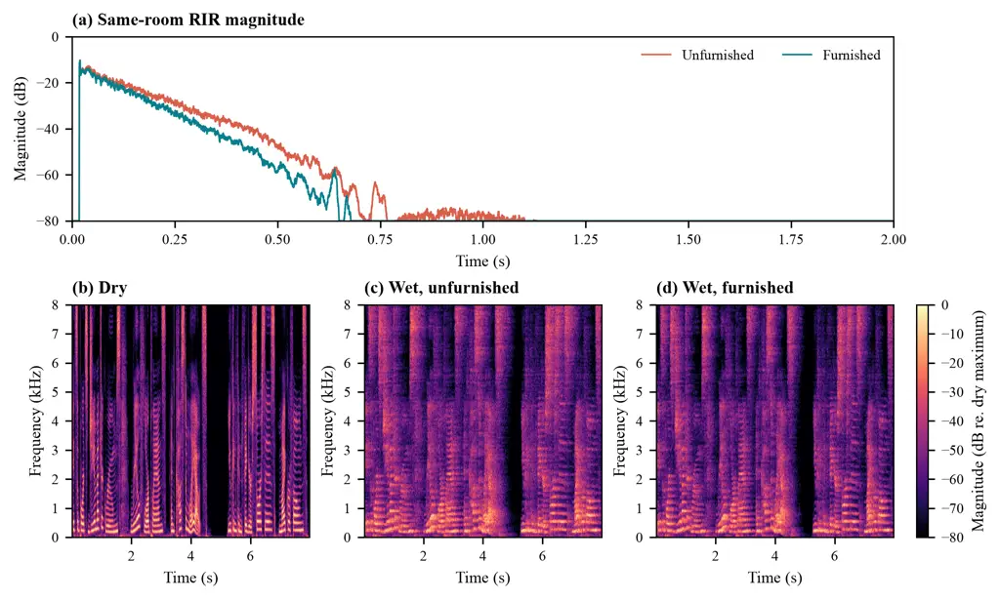
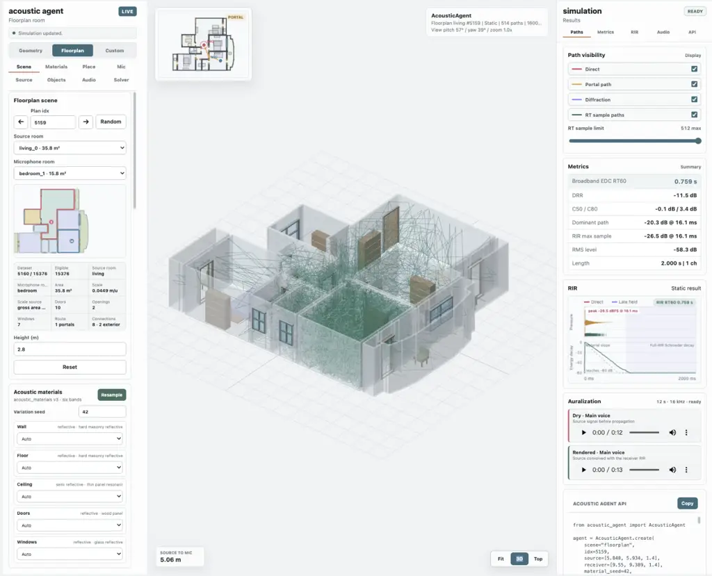

# AcousticAgent: A Floorplan-Centric Simulation Platform for Distributed Multi-Room Speech Processing

Zhiqi Ai    Han Cheng    Shiyi Mu    Yongjin Zhou    Shugong Xu
^(†)^(†)thanks: ^(\*)Corresponding authors

###### Abstract

Existing acoustic simulation tools either generate room impulse
responses (RIRs) efficiently in parameterized rooms or rely on
preconstructed three-dimensional scenes, making it difficult to build
large numbers of editable residential multi-room environments. We
present AcousticAgent, a floorplan-centric acoustic simulation platform
that converts structured floorplans into editable, acoustically
connected multi-room scenes. AcousticAgent jointly models room geometry
and connectivity, furniture, materials, sound sources, and microphone
configurations. A scene-oriented Acoustic Materials Database maps
semantic elements to acoustic parameters, while a floorplan-aware hybrid
geometrical-acoustics solver generates multichannel RIRs and reverberant
audio. The platform also supports directional and moving sources,
distributed microphones, and VLM-assisted scene construction from
floorplan images and text. Using AcousticAgent, we construct FP-RIR, a
dataset covering 15,376 residential floorplans with diverse room
topologies, propagation conditions, and source–receiver configurations.
We validate its acoustic fidelity against real-world measurements and
evaluate whole-home source localization, speech enhancement, and
far-field speech processing under single-device and distributed
microphone settings. The results demonstrate the effectiveness of
floorplan-aware modeling for large-scale residential acoustic simulation
and the benefits of distributed spatial processing in multi-room
environments. AcousticAgent and FP-RIR provide scalable and configurable
resources for developing and evaluating residential speech systems.

###### Index Terms: 

speech large language models, contextual biasing, phoneme CTC, temporal
competition, post-decoding correction

^(†)^(†)address: ¹Shanghai University, Shanghai, China  
²Xi’an Jiaotong-Liverpool University, Suzhou, China

## 1 Introduction

Residential speech interfaces often operate under far-field and
cross-room conditions, where sound sources and microphones may be far
apart, obstructed by furniture, or separated by intervening walls. The
received signal therefore varies with room topology, source–receiver
geometry, inter-room connectivity, and the acoustic properties of
surrounding surfaces \[31, 36\]. This spatial variability makes it
difficult for a single microphone to provide uniform coverage throughout
a home. Distributed microphone systems alleviate this limitation by
combining spatially complementary observations and have been studied for
source localization, distributed beamforming, speech enhancement, and
multi-device speech processing \[4, 15, 12, 7\].

Developing and evaluating such systems requires acoustic data spanning
diverse residential layouts, material properties, and source–microphone
configurations. Measured corpora preserve real propagation effects, but
each recording campaign is tied to a finite set of physical spaces and
device deployments; broader coverage requires additional deployment and
data collection \[30, 28, 13\]. Room impulse response (RIR) simulation
provides a scalable means of varying these factors, but its practical
scalability depends not only on propagation computation, but also on how
efficiently acoustic scenes can be specified. Parameterized simulators
often require room geometry, materials, and device positions to be
explicitly defined, which becomes cumbersome when many irregular
multi-room layouts must be instantiated. Mesh-based platforms can
represent richer three-dimensional environments, but rely on
preconstructed scene assets \[10, 32, 5, 19\]. Large-scale residential
simulation therefore calls for a scene representation that is both
acoustically meaningful and easy to construct, edit, and vary.

Structured floorplans provide a compact representation of room geometry,
semantics, and connectivity. They can be parsed from raster images or
generated from structural constraints and natural-language descriptions
without requiring complete three-dimensional assets \[17, 8, 1, 11,
22\]. To form a computational acoustic scene, however, they must be
augmented with furniture, acoustic materials, source and microphone
configurations, and models of within-room and cross-room propagation.
Although floorplans are widely used for visual parsing, layout
generation, and embodied scene construction, their use as the core
representation for large-scale acoustic simulation remains
underexplored.

To address this gap, we present AcousticAgent, a floorplan-centric
platform for multi-room acoustic simulation. AcousticAgent converts
structured floorplans into editable, acoustically connected scenes that
jointly represent room geometry and connectivity, furniture, materials,
sound sources, and microphone configurations. A scene-oriented Acoustic
Materials Database maps semantic scene elements to acoustic properties,
while a floorplan-aware hybrid geometrical-acoustics solver models
within-room and cross-room sound propagation to generate multichannel
RIRs and reverberant audio. The platform further supports directional
and moving sources, microphone arrays, distributed microphones, and
VLM-assisted scene construction from floorplan images and textual
descriptions.

Using AcousticAgent, we construct FP-RIR, a large-scale dataset spanning
15,376 residential floorplans with diverse room topologies, within-room
and cross-room propagation conditions, and flexible source–receiver and
distributed-microphone layouts. We validate the simulated acoustic
characteristics against measured RIRs and establish a distributed
multi-room speech-processing benchmark covering whole-home source
localization, speech enhancement, and far-field speech processing under
single-device and distributed microphone settings.

Our main contributions are summarized as follows:

- •
  Floorplan-centric multi-room acoustic simulation. We introduce
  AcousticAgent, which converts structured floorplans into editable,
  acoustically connected multi-room scenes through semantic
  acoustic-material assignment and floorplan-aware geometrical-acoustics
  simulation.
- •
  Large-scale FP-RIR dataset. We construct FP-RIR spanning 15,376
  residential floorplans with diverse room topologies, within-room and
  cross-room propagation conditions, and flexible source–receiver and
  distributed-microphone layouts.
- •
  Distributed multi-room speech-processing benchmark. We establish a
  benchmark for whole-home source localization, speech enhancement, and
  far-field speech processing under single-device and distributed
  microphone settings.

## 2 Related Work

### 2.1 Acoustic Simulation and RIR Generation

Indoor acoustic simulation generates room impulse responses (RIRs) or
reverberant audio by modeling sound propagation according to scene
geometry, material properties, and source–receiver configurations.
Existing approaches are commonly categorized into wave-based and
geometrical-acoustics methods  \[34, 31\]. Wave-based methods, such as
finite-element and finite-difference methods, solve the acoustic wave
equation and accurately capture interference, diffraction, and room
modes, but their computational cost increases rapidly with scene size
and frequency range  \[34\]. Geometrical-acoustics methods approximate
propagation using geometric paths and provide efficient alternatives
through image-source methods, ray tracing, and path tracing  \[3, 31,
36\].

Existing simulation tools mainly target either efficient parameterized
room simulation or detailed three-dimensional scene rendering.
RIR-Generator and gpuRIR provide image-source-based simulation for
parameterized rooms, while FRAM-RIR and Pyroomacoustics support
efficient multichannel RIR generation and microphone-array
processing \[14, 10, 23, 32\]. For more general environments, Steam
Audio, SoundSpaces 2.0, and SonicSim enable geometry-based acoustic
rendering over three-dimensional scene representations  \[35, 5, 19\].
These systems provide powerful acoustic rendering capabilities, but
constructing large numbers of editable residential multi-room scenes
remains challenging, particularly when layouts, materials, and
source–receiver configurations need to be varied systematically.

### 2.2 Floorplan Representation and Scene Construction

Structured floorplans compactly encode architectural geometry, room
semantics, and spatial connectivity. CubiCasa5K supports
architectural-element parsing from annotated raster floorplans, while
FloorplanVLM converts raster images into structured vector
representations  \[17, 22\]. ResPlan provides large-scale residential
layouts with explicit semantic and connectivity information  \[1\].
ArchiText and ProcTHOR further explore layout generation and procedural
residential scene construction  \[11, 8\]. While structured layouts are
widely used in visual understanding and embodied environment
construction, acoustic simulation additionally requires material
properties, source and microphone configurations, and cross-room
propagation modeling. Their use as a central representation for
large-scale acoustic scene construction remains underexplored.



Figure 1: Overview of AcousticAgent. AcousticAgent transforms floorplan
images, natural-language descriptions, or sampled residential layouts
into editable multi-room acoustic scenes with explicit geometry,
connectivity, furniture, and semantic material parameters. Its
floorplan-aware hybrid solver combines deterministic propagation, Monte
Carlo ray tracing, and parametric late reverberation to generate
multichannel RIRs for static or moving sources and flexible microphone
configurations.

### 2.3 Distributed Multi-Room Speech Processing

Distributed microphone systems exploit spatially separated observations
for sound source localization, beamforming, speech enhancement, and
speech separation \[4, 15, 12, 37\]. Recent work further combines
multi-device acoustic front ends with downstream tasks such as keyword
spotting, speaker verification, and automatic speech recognition  \[39,
21, 20, 7\]. Measured corpora are essential for evaluating real-world
propagation and device effects. DIRHA-English provides distant-speech
recordings in domestic environments, FFSVC 2020 targets far-field
speaker verification with distributed microphone arrays, and
Libri-adhoc40 contains synchronized recordings from 40 microphones in a
real office  \[30, 28, 13\]. However, such datasets cover only a limited
number of environments, room topologies, and sensor layouts. Large-scale
controllable simulation is therefore needed to complement real
recordings and support systematic evaluation across diverse residential
floorplans and microphone configurations.

## 3 AcousticAgent

As shown in Fig. 1, AcousticAgent transforms residential floorplans into
editable, acoustically connected multi-room scenes for multichannel room
impulse response (RIR) generation. Its key design is to decouple
reusable scene content—including geometry, connectivity, furniture, and
materials—from dynamic source and receiver configurations. Once a scene
has been constructed, it can be reused across different source
positions, trajectories, directivities, and microphone layouts.
AcousticAgent comprises four components: floorplan-centric acoustic
scene construction, semantic material parameterization, floorplan-aware
acoustic simulation, and flexible source and microphone configurations.

### 3.1 Floorplan-Centric Acoustic Scene Construction

AcousticAgent accepts structured floorplans, raster floorplan images,
natural-language descriptions, or layouts sampled from a residential
floorplan corpus. Image- and text-based inputs may be processed with
optional LLM/VLM assistance, after which all inputs are normalized into
the same explicit and editable scene representation.

A structured floorplan is represented as

```math
\mathcal{P}=(\mathcal{R},\mathcal{W},\mathcal{O},\mathcal{F}), \tag{1}
```

where $`\mathcal{R}`$ denotes rooms, $`\mathcal{W}`$ denotes walls and
other boundary elements, $`\mathcal{O}`$ denotes doors, windows, and
wall-free openings, and $`\mathcal{F}`$ denotes furniture. Each room is
associated with its polygonal boundary, semantic type, and height.
Interior openings connect adjacent rooms and induce a room-connectivity
graph $`\mathcal{G}_{\mathrm{room}}`$, which explicitly represents both
within-room and cross-room relationships.

The two-dimensional layout is then instantiated as an editable
three-dimensional acoustic scene. Walls, ceilings, floors, and
architectural openings are constructed from the floorplan geometry,
while furniture is inserted as semantic geometry that may participate in
occlusion and reflection. This representation preserves the compactness
and editability of the original floorplan while providing the geometric
structure required for multi-room acoustic simulation.

### 3.2 Semantic Material Parameterization

To connect scene semantics with acoustic simulation, AcousticAgent
introduces a scene-oriented Acoustic Materials Database with 3,741
normalized records across 20 scene-element categories. It consolidates
octave-band acoustic data from the PTB absorption database, the ODEON
material library, Pyroomacoustics, SoundSpaces 2.0, and Acoustic
Supplies  \[27, 25, 32, 5, 2\]. The database covers common residential
elements, including walls, floors, doors, glazing, curtains, and
upholstered furniture. Each record stores a canonical material name,
provenance, octave-band absorption coefficients, and auxiliary
descriptors. Measured scattering and transmission parameters are
retained when available; otherwise, editable category-level presets are
used.

For scene element $`e_{i}`$ and frequency band $`b`$, its acoustic
properties are represented as

```math
\boldsymbol{\theta}_{i,b}=\left(\alpha_{i,b},\sigma_{i,b},\tau_{i,b}\right),\qquad b\in\mathcal{B}, \tag{2}
```

where $`\alpha_{i,b}`$, $`\sigma_{i,b}`$, and $`\tau_{i,b}`$ denote
absorption, scattering, and transmission coefficients, respectively, and
$`\mathcal{B}=\{125,250,500,1000,\\
2000,4000\}\,\mathrm{Hz}`$.

Material candidates are constrained by scene-element semantics and may
be further refined through optional LLM/VLM-assisted matching. The
selected assignments are stored explicitly with the scene and remain
manually editable, allowing semantic scene descriptions to be converted
into deterministic acoustic parameters without coupling the solver to a
specific recognition model.

### 3.3 Floorplan-Aware Acoustic Simulation

Given the scene geometry, material parameters, and a source–receiver
configuration, AcousticAgent employs a hybrid geometrical-acoustics
solver that combines deterministic propagation, Monte Carlo ray tracing,
and parametric late reverberation. The room-connectivity graph guides
the search for cross-room routes, while the three-dimensional scene is
used to validate visibility, occlusion, and geometric interactions.

Deterministic propagation models perceptually important arrivals,
including line-of-sight direct sound, transmission through surfaces,
propagation through doors and wall-free openings, and edge-diffraction
paths in non-line-of-sight conditions. Portal sequences connecting the
source and receiver rooms are enumerated on
$`\mathcal{G}_{\mathrm{room}}`$ and validated against the scene
geometry. Diffraction is approximated using a UTD-inspired formulation
 \[18\].

Early and mid reflections are modeled using receiver-centered Monte
Carlo ray tracing. At each surface interaction, frequency-dependent
absorption and transmission reduce the propagated energy, while
scattering controls its specular and diffuse components. The resulting
arrivals are accumulated into bandwise echograms. Late reverberation is
synthesized using a feedback delay network whose decay is conditioned on
band-dependent reverberation estimates obtained through Schroeder
backward integration  \[33, 16\].

For receiver $`q`$, source state $`k`$, and frequency band $`b`$, the
hybrid response is written as

```math
\begin{split}h_{q,k,b}[n]={}&h^{\mathrm{det}}_{q,k,b}[n]+w_{\mathrm{rt}}[n]h^{\mathrm{rt}}_{q,k,b}[n]\\
&+w_{\mathrm{late}}[n]h^{\mathrm{late}}_{q,k,b}[n],\end{split} \tag{3}
```

where $`h^{\mathrm{det}}`$, $`h^{\mathrm{rt}}`$, and
$`h^{\mathrm{late}}`$ denote deterministic arrivals, ray-traced
reflections, and the parametric late tail, respectively. The transition
weights satisfy $`w_{\mathrm{rt}}^{2}[n]+w_{\mathrm{late}}^{2}[n]=1`$
within the overlap region, providing an equal-power transition between
the traced and synthesized responses. The bandwise responses are finally
reconstructed into a full-band multichannel RIR. This decomposition
preserves important geometric arrivals without requiring dense
high-order path tracing throughout the complete reverberation
decay \[31, 36\].

### 3.4 Flexible Source and Microphone Configurations

Source and receiver configurations are specified independently of the
static acoustic scene. A source state contains its position,
orientation, directivity, emitted signal, and optional motion
trajectory. AcousticAgent supports omnidirectional and directional
sources, including common first-order patterns and focused radiation
patterns. Moving sources are represented by acoustic keyframes sampled
along a user-defined trajectory.

Receiver configurations specify microphone positions, orientations, and
directional or binaural responses. The same interface supports a single
microphone, a binaural receiver, a compact microphone array, or
distributed microphones placed independently across different rooms.
Array elements share a common local coordinate system, whereas
distributed microphones can have arbitrary positions and orientations,
enabling both conventional array processing and household-scale
multi-device sensing.

For a trajectory containing $`K`$ source states and a receiver
configuration with $`Q`$ channels, AcousticAgent generates

```math
\mathcal{H}=\left\{h_{q,k}[n]\right\}\in\mathbb{R}^{K\times Q\times L}, \tag{4}
```

where $`L`$ denotes the RIR length. Static-source simulation is the
special case $`K=1`$. Because the scene geometry, materials, and room
connectivity remain unchanged, only source–receiver-dependent
propagation needs to be recomputed when varying source trajectories or
microphone layouts. The generated RIRs can subsequently be convolved
with task-specific dry signals to synthesize static or time-varying
multichannel reverberant audio.



Figure 2: Structural and acoustic statistics of FP-RIR. (a) Distribution
of the number of rooms per residential floorplan. (b) Distribution of
broadband $`RT_{60}`$ values estimated from the generated RIRs; values
exceeding $`3.0\,\mathrm{s}`$ are grouped into the final bin.

### 3.5 FP-RIR Dataset

Using AcousticAgent, we construct FP-RIR, a floorplan-based multichannel
RIR dataset for far-field and multi-room speech processing. FP-RIR
contains 15,376 validated residential floorplans from ResPlan \[1\],
comprising 120,150 rooms and 107,595 open interior portals. For each
floorplan, six-band acoustic materials are assigned according to scene
semantics, and source and receiver positions are sampled from
collision-free regions. For each floorplan, we generate two within-room
monophonic configurations and up to three cross-room configurations
recorded by four-channel circular microphone arrays. Cross-room
source–receiver pairs cover different topological distances and are
retained only when they are connected through valid sequences of open
portals.

As shown in Fig. 2, FP-RIR covers residential floorplans containing 2–14
rooms, with a median of 7 rooms. The broadband $`RT_{60}`$ estimated
from the generated RIRs has a median of 0.84 s and a 95th percentile of
1.48 s, reflecting acoustic diversity arising from variations in room
geometry, material assignment, and cross-room connectivity.

## 4 Experiments

We evaluate AcousticAgent in terms of acoustic fidelity and simulation
efficiency, distributed whole-home source localization, and distributed
speech enhancement. We further examine the downstream effects of the
distributed front ends using frozen ASR and speaker verification models.

### 4.1 Acoustic Simulation Validation

Agreement with measured acoustics. We validate AcousticAgent against
dEchorate measurements  \[9\] using ten source–microphone configurations
selected through distance-stratified sampling. The documented room
geometry is reconstructed, and a fixed material configuration is applied
across all positions. We compare the direct-to-reverberant ratio (DRR)
and reverberation time ($`RT_{60}`$), averaged over 500 Hz–4 kHz, to
evaluate spatial energy balance and reverberation decay.



Figure 3: Validation against dEchorate measurements. Position-wise
comparison of simulated and measured (a) DRR and (b) $`RT_{60}`$.
Simulated results are averaged over three independent runs, with error
bars indicating one standard deviation.

As shown in Fig. 3, AcousticAgent closely follows the measured
position-dependent DRR variation, achieving an MAE of 1.638 dB and a
Pearson correlation of $`r=0.971`$. For $`RT_{60}`$, the simulator
obtains an MAE of 0.016 s and a mean relative error of 2.46%. The close
agreement in both metrics indicates that AcousticAgent captures the
direct-to-reverberant energy balance and overall reverberation decay
under matched scene conditions.

Simulation efficiency. We evaluate the end-to-end RIR-generation
throughput of the Numba and CUDA backends on four furnished and
unfurnished floorplan scenes with five or ten rooms. The three settings
range from 8,192 rays and 32 bounces to 131,072 rays and 96 bounces, and
runtime includes ray tracing, response construction, and
post-processing. Experiments are conducted using an Intel Xeon Gold 6346
CPU and a single NVIDIA RTX 4090 GPU. Across the evaluated settings,
Numba achieves 5.80–12.86 RIRs per second, while CUDA achieves
12.29–14.47 RIRs per second, supporting efficient large-scale RIR
generation.

Qualitative scene analysis. Figure 4 presents furnished and unfurnished
variants of two residential layouts. Within each layout, the source and
receiver configurations are kept fixed to isolate the acoustic effects
of furniture and scene geometry. The examples illustrate how
AcousticAgent jointly models room connectivity, three-dimensional
geometry, and material-dependent surface interactions. Cross-room
propagation follows valid portal routes, while furniture introduces
additional occlusion, reflection, scattering, and absorption. These
changes alter both the spatial distribution of propagation paths and the
resulting broadband reverberation characteristics.



Figure 4: Qualitative examples of floorplan-aware acoustic propagation.
For each residential layout, the 2-D view shows the source and receiver
locations together with a valid cross-room portal sequence. The
corresponding 3-D views illustrate sampled propagation rays in the
unfurnished and furnished scenes, highlighting the effects of room
connectivity, geometry, and furniture on acoustic propagation.

### 4.2 Distributed Whole-Home Acoustic Processing

We investigate whether spatially distributed microphones provide more
consistent whole-home coverage than a fixed single-room array. We
consider two tasks: source localization and speech enhancement, both
evaluated on held-out residential floorplans with different numbers of
rooms.

#### 4.2.1 Floorplan-Aware Source Localization

Experimental setup. We evaluate 90 floorplans, with ten layouts for each
room count from 4 to 12. Three source positions are sampled in every
room, resulting in 2,160 cases per acoustic condition. A disjoint set of
45 floorplans is used only for hyperparameter calibration.

For each source position, AcousticAgent generates an RIR to every
microphone channel in the whole-home deployment, producing a globally
synchronized multichannel observation across all rooms. A configuration
with one microphone per room therefore contains $`R`$ channels, whereas
deploying a four-channel array in each room contains $`4R`$ channels,
where $`R`$ is the number of rooms.

Far-field speech is mixed with a spatially positioned MUSAN interference
source at SNRs of 20, 10, and 5 dB. The target and interference signals
are propagated to all microphone channels using their corresponding
RIRs. Independent device noise with an equivalent sound pressure level
of 30 dB is then added to each channel. We report source-room
classification accuracy.

Baselines. The _living-room array_ applies SRP-PHAT using a single
four-channel circular array placed in the living room. _GCC-Euclidean_
and _GCC-FP_ deploy one microphone per room and match GCC-PHAT delay
estimates using Euclidean and floorplan-aware propagation distances,
respectively. _SRP-Euclidean_ and _SRP-FP_ use the corresponding
steering models within the broadband SRP-PHAT objective.

The higher-channel _distributed arrays_ baseline places a four-channel
array in every room and combines inter-array TDOA estimates with DOA
estimates from the three arrays receiving the strongest signals.

Floorplan-aware steering. Euclidean steering assumes unobstructed
free-field propagation and can be inaccurate when walls block the direct
path. We therefore construct a visibility graph from the room polygons
and open portals. The floorplan-aware distance between candidate
position $`\mathbf{x}`$ and microphone $`\mathbf{m}_{i}`$ is defined as

```math
d_{i}^{\mathrm{FP}}(\mathbf{x})=\min_{\pi\in\mathcal{P}(\mathbf{x},\mathbf{m}_{i})}L(\pi), \tag{5}
```

where $`\mathcal{P}(\mathbf{x},\mathbf{m}_{i})`$ denotes the set of
geometrically valid portal paths and $`L(\pi)`$ is the length of path
$`\pi`$. The corresponding TDOA is

```math
\tau_{ij}^{\mathrm{FP}}(\mathbf{x})=\frac{d_{i}^{\mathrm{FP}}(\mathbf{x})-d_{j}^{\mathrm{FP}}(\mathbf{x})}{c}, \tag{6}
```

where $`c`$ is the speed of sound. GCC-FP matches the estimated delays
to Eq. (6), while SRP-FP uses the same delays in the broadband SRP-PHAT
objective.

| Method             | Mics           | 20 dB | 10 dB | 5 dB |
| ------------------ | -------------- | ----- | ----- | ---- |
| Living-room array  | $`1{\times}4`$ | 18.9  | 20.1  | 18.1 |
| GCC-Euclidean      | $`R{\times}1`$ | 81.9  | 80.6  | 76.5 |
| GCC-FP             | $`R{\times}1`$ | 92.5  | 89.9  | 84.0 |
| SRP-Euclidean      | $`R{\times}1`$ | 77.7  | 75.0  | 70.6 |
| SRP-FP             | $`R{\times}1`$ | 81.8  | 80.0  | 76.8 |
| Distributed arrays | $`R{\times}4`$ | 94.4  | 90.0  | 85.2 |

Table 1: Whole-home source-room localization under spatial music
interference. $`R`$ denotes the number of rooms. Results are reported as
room classification accuracy (%).

Results. As shown in Table 1, the fixed living-room array performs
poorly for whole-home source-room localization. With one microphone per
room, GCC-FP achieves 92.5%, 89.9%, and 84.0% accuracy at 20, 10, and
5 dB, respectively, approaching the distributed-array baseline while
using only one quarter of the channels. Floorplan-aware propagation
consistently outperforms Euclidean steering, demonstrating the benefit
of incorporating room connectivity and valid portal paths.

#### 4.2.2 Whole-Home Speech Enhancement

Experimental setup. We follow the floorplan, source, interference, and
microphone-deployment settings used in the localization experiment. The
main difference is the signal-mixing protocol: before RIR convolution,
target speech, spatial MUSAN music, and independent device noise are
calibrated to nominal source levels of 65, 55, and 30 dB SPL,
respectively. The receiver-side SNR is not normalized and therefore
varies naturally with room geometry, source distance, and cross-room
connectivity.

We compare a fixed $`1{\times}4`$ living-room array, four channels
selected from the $`R{\times}1`$ deployment using GCC-Euclidean or
GCC-FP, and twelve channels from the three selected arrays in the
$`R{\times}4`$ deployment. All configurations use the same
reference-channel multichannel Wiener filter (MWF). The target and noise
covariance matrices are estimated from simulator-separated signal
components; the results therefore represent a target-aware upper bound
for comparing microphone deployments rather than a blind enhancement
system. Wet PESQ and STOI are computed against the reverberant target at
the reference channel and macro-averaged over floorplans.

Results. As shown in Table 2, distributed arrays achieve the best
overall performance, with a PESQ of 3.619 and a STOI of 0.988. Selecting
distributed microphones with GCC-FP also consistently outperforms the
fixed living-room array and provides a modest improvement over
GCC-Euclidean. Figure 5 further shows that the fixed array degrades as
floorplan size increases, whereas distributed arrays maintain stable
enhancement performance across different numbers of rooms.

| Method             | Mics                          | PESQ  | STOI  |
| ------------------ | ----------------------------- | ----- | ----- |
| Living-room array  | $`1{\times}4`$                | 2.561 | 0.899 |
| GCC-Euclidean      | $`R{\times}1{\rightarrow}4`$  | 3.109 | 0.963 |
| GCC-FP             | $`R{\times}1{\rightarrow}4`$  | 3.175 | 0.968 |
| Distributed arrays | $`R{\times}4{\rightarrow}12`$ | 3.619 | 0.988 |

Table 2: Whole-home speech enhancement with calibrated source levels.
$`R`$ denotes the number of rooms, and $`\rightarrow K`$ indicates that
$`K`$ channels are selected for multichannel Wiener filtering (MWF).



Figure 5: Whole-home speech enhancement across residential floorplan
sizes. Wet PESQ (left) and Wet STOI (right) are reported as functions of
the number of rooms. Lines denote floorplan-level macro averages, and
shaded regions indicate 95% confidence intervals over ten floorplans per
group.

| Model         | Living array | GCC FP | Distributed arrays |
| ------------- | ------------ | ------ | ------------------ |
| Whisper Tiny  | 70.33        | 22.93  | 19.91              |
| Whisper Small | 34.84        | 9.27   | 7.63               |

Table 3: ASR performance after whole-home speech enhancement. Word error
rates (WER, %) are reported for frozen Whisper models with different MWF
front ends. Lower is better.

| Model    | Living array | GCC FP      | Distributed arrays |
| -------- | ------------ | ----------- | ------------------ |
| CAM++    | 4.8 / 0.330  | 2.2 / 0.086 | 1.8 / 0.064        |
| ERes2Net | 6.2 / 0.278  | 1.8 / 0.158 | 1.6 / 0.146        |

Table 4: Speaker-verification performance after whole-home speech
enhancement using frozen models and clean enrollment utterances. Results
are reported as EER (%) / minDCF, with $`P_{\mathrm{tar}}=0.01`$ and
$`C_{\mathrm{miss}}=C_{\mathrm{fa}}=1`$. Lower is better.

### 4.3 Downstream Benefits of Distributed Front Ends

Experimental setup. We reuse the test scenes, source-level-calibrated
mixtures, microphone deployments, and MWF front ends from the whole-home
speech enhancement experiment. The enhanced signals are evaluated using
frozen Whisper Tiny and Whisper Small models for ASR \[29\], and frozen
CAM++ \[38\] and ERes2Net \[6\] models for speaker verification. We use
1,000 LibriSpeech \[26\] test-clean utterances for ASR and construct
1,000 VoxCeleb1 \[24\] verification trials with clean enrollment.

Results.

Distributed arrays achieve the lowest WER for both ASR models (Table 3),
reducing WER by 71.7–78.1% relative to the fixed living-room array.
GCC-FP also provides substantial improvements under the smaller
four-channel budget, showing that floorplan-aware microphone selection
benefits downstream recognition.

For speaker verification, both distributed configurations substantially
reduce EER and minDCF compared with the fixed array (Table 4).
Distributed arrays obtain the best overall results, indicating that
spatially distributed capture improves both speech recognition and
speaker verification without downstream-model adaptation.

## 5 Conclusion

In this paper, we present AcousticAgent, a floorplan-centric platform
for constructing editable multi-room acoustic scenes, together with
FP-RIR, a large-scale multichannel RIR dataset. AcousticAgent combines
semantic material parameterization, portal-aware propagation, Monte
Carlo ray tracing, and parametric late reverberation under flexible
source and microphone configurations. Validation against measured RIRs
demonstrates reliable estimation of DRR and reverberation
characteristics. Distributed benchmarks show that one microphone per
room can approach the source-room localization performance of
array-per-room systems with fewer channels, while distributed arrays
provide the most consistent performance in speech enhancement and
downstream ASR and speaker verification. Together, AcousticAgent and
FP-RIR provide a scalable and reproducible testbed for residential
distributed speech processing. Future work will investigate measured
multi-room calibration, asynchronous devices, dynamic portal states, and
moving speakers.

## References

- \[1\] M. Abouagour and E. Garyfallidis (2025) ResPlan: A Large-Scale
  Vector-Graph Dataset of 17,000 Residential Floor Plans. External
  Links: 2508.14006 Cited by: §1, §2.2, §3.5.
- \[2\] Acoustic Supplies (2026) Sound absorption coefficient chart.
  Note:
  [https://www.acoustic-supplies.com/absorption-coefficient-chart/](https://www.acoustic-supplies.com/absorption-coefficient-chart/)Accessed:
  2026-07-29 Cited by: §3.2.
- \[3\] J. B. Allen and D. A. Berkley (1979) Image method for
  efficiently simulating small-room acoustics. The Journal of the
  Acoustical Society of America 65 (4), pp. 943–950. External Links:
  [Document](https://dx.doi.org/10.1121/1.382599) Cited by: §2.1.
- \[4\] A. Bertrand and M. Moonen (2010) Distributed Adaptive
  Node-Specific Signal Estimation in Fully Connected Sensor
  Networks—Part I: Sequential Node Updating. IEEE Transactions on Signal
  Processing 58 (10), pp. 5277–5291. External Links:
  [Document](https://dx.doi.org/10.1109/TSP.2010.2052612) Cited by: §1,
  §2.3.
- \[5\] C. Chen, C. Schissler, S. Garg, P. Kobernik, A. Clegg, P.
  Calamia, D. Batra, P. W. Robinson, and K. Grauman (2022) SoundSpaces
  2.0: A Simulation Platform for Visual-Acoustic Learning. In Advances
  in Neural Information Processing Systems 35, Vol. 35, Red Hook, New
  York, pp. 8896–8911. Cited by: §1, §2.1, §3.2.
- \[6\] Y. Chen, S. Zheng, H. Wang, L. Cheng, Q. Chen, and J. Qi (2023)
  An enhanced Res2Net with local and global feature fusion for speaker
  verification. In Proceedings of Interspeech 2023, pp. 2228–2232.
  External Links:
  [Document](https://dx.doi.org/10.21437/Interspeech.2023-1294) Cited
  by: §4.3.
- \[7\] G. Ciccarelli, J. Barber, A. Nair, I. Cohen, and T. Zhang (2022)
  Challenges and Opportunities in Multi-Device Speech Processing. In
  Proceedings of the 23rd Annual Conference of the International Speech
  Communication Association (INTERSPEECH 2022), Incheon, Republic of
  Korea, pp. 709–713. External Links:
  [Document](https://dx.doi.org/10.21437/Interspeech.2022-119) Cited by:
  §1, §2.3.
- \[8\] M. Deitke, E. VanderBilt, A. Herrasti, L. Weihs, J. Salvador, K.
  Ehsani, W. Han, E. Kolve, A. Farhadi, A. Kembhavi, and R.
  Mottaghi (2022) ProcTHOR: Large-Scale Embodied AI Using Procedural
  Generation. In Advances in Neural Information Processing Systems, Vol.
  35, Red Hook, New York, pp. 5982–5994. Cited by: §1, §2.2.
- \[9\] D. Di Carlo, P. Tandeitnik, C. Foy, N. Bertin, A. Deleforge,
  and S. Gannot (2021) dEchorate: A Calibrated Room Impulse Response
  Dataset for Echo-Aware Signal Processing. EURASIP Journal on Audio,
  Speech, and Music Processing 2021 (1), pp. 39. External Links:
  [Document](https://dx.doi.org/10.1186/s13636-021-00229-0) Cited by:
  §4.1.
- \[10\] D. Díaz-Guerra, A. Miguel, and J. R. Beltrán (2021) gpuRIR: A
  Python Library for Room Impulse Response Simulation with GPU
  Acceleration. Multimedia Tools and Applications 80 (4), pp. 5653–5671.
  External Links:
  [Document](https://dx.doi.org/10.1007/s11042-020-09905-3) Cited by:
  §1, §2.1.
- \[11\] T. Galanos, A. Liapis, and G. N. Yannakakis (2023) Architext:
  Language-Driven Generative Architecture Design. External Links:
  2303.07519 Cited by: §1, §2.2.
- \[12\] E. Grinstein, M. Brookes, and P. A. Naylor (2023) Graph Neural
  Networks for Sound Source Localization on Distributed Microphone
  Networks. In Proceedings of the 2023 IEEE International Conference on
  Acoustics, Speech, and Signal Processing (ICASSP 2023), Rhodes Island,
  Greece, pp. 1–5. External Links:
  [Document](https://dx.doi.org/10.1109/ICASSP49357.2023.10097211) Cited
  by: §1, §2.3.
- \[13\] S. Guan, S. Liu, J. Chen, W. Zhu, S. Li, X. Tan, Z. Yang, M.
  Xu, Y. Chen, C. Liang, J. Wang, and X. Zhang (2021) Libri-adhoc40: A
  Dataset Collected from Synchronized Ad-Hoc Microphone Arrays. In
  Proceedings of the 2021 Asia-Pacific Signal and Information Processing
  Association Annual Summit and Conference (APSIPA ASC 2021), Tokyo,
  Japan, pp. 1116–1120. External Links: ISBN 978-988-14768-9-0 Cited by:
  §1, §2.3.
- \[14\] E. A. P. Habets (2006) Room Impulse Response Generator.
  Technical Report Technische Universiteit Eindhoven, Eindhoven, The
  Netherlands. Cited by: §2.1.
- \[15\] R. Heusdens, G. Zhang, R. C. Hendriks, Y. Zeng, and W. B.
  Kleijn (2012) Distributed MVDR Beamforming for (Wireless) Microphone
  Networks Using Message Passing. In Proceedings of the International
  Workshop on Acoustic Signal Enhancement (IWAENC 2012), Aachen,
  Germany, pp. 1–4. External Links:
  [Document](https://dx.doi.org/10.1109/IWAENC.2012.6309434) Cited by:
  §1, §2.3.
- \[16\] J. Jot (1992) An analysis/synthesis approach to real-time
  artificial reverberation. In Proceedings of the IEEE International
  Conference on Acoustics, Speech, and Signal Processing (ICASSP), Vol.
  2, pp. 221–224. External Links:
  [Document](https://dx.doi.org/10.1109/ICASSP.1992.226080) Cited by:
  §3.3.
- \[17\] A. Kalervo, J. Ylioinas, M. Häikiö, A. Karhu, and J.
  Kannala (2019) CubiCasa5K: A Dataset and an Improved Multi-Task Model
  for Floorplan Image Analysis. In Proceedings of the 21st Scandinavian
  Conference on Image Analysis (SCIA 2019), Lecture Notes in Computer
  Science, Vol. 11482, Cham, Switzerland, pp. 28–40. External Links:
  [Document](https://dx.doi.org/10.1007/978-3-030-20205-7%5F3) Cited by:
  §1, §2.2.
- \[18\] R. G. Kouyoumjian and P. H. Pathak (1974) A uniform geometrical
  theory of diffraction for an edge in a perfectly conducting surface.
  Proceedings of the IEEE 62 (11), pp. 1448–1461. External Links:
  [Document](https://dx.doi.org/10.1109/PROC.1974.9651) Cited by: §3.3.
- \[19\] K. Li, W. Sang, C. Zeng, R. Yang, G. Chen, and X. Hu (2025)
  SonicSim: A Customizable Simulation Platform for Speech Processing in
  Moving Sound Source Scenarios. In Proceedings of the Thirteenth
  International Conference on Learning Representations (ICLR 2025),
  External Links: [Link](https://openreview.net/forum?id=Hx2ADQLi8M)
  Cited by: §1, §2.1.
- \[20\] R. Li, X. Wang, H. Mallidi, S. Watanabe, T. Hori, and H.
  Hermansky (2020) Multi-stream end-to-end speech recognition. IEEE/ACM
  Transactions on Audio, Speech, and Language Processing 28,
  pp. 646–655. External Links:
  [Document](https://dx.doi.org/10.1109/TASLP.2019.2959721) Cited by:
  §2.3.
- \[21\] C. Liang, Y. Chen, J. Yao, and X. Zhang (2022) Multi-Channel
  Far-Field Speaker Verification with Large-Scale Ad-Hoc Microphone
  Arrays. In Proceedings of the 23rd Annual Conference of the
  International Speech Communication Association (INTERSPEECH 2022),
  Incheon, Republic of Korea, pp. 3679–3683. External Links:
  [Document](https://dx.doi.org/10.21437/Interspeech.2022-219) Cited by:
  §2.3.
- \[22\] Y. Liu, Z. Yang, Y. Li, and Y. Yang (2026) FloorplanVLM: A
  Vision-Language Model for Floorplan Vectorization. External Links:
  2602.06507 Cited by: §1, §2.2.
- \[23\] Y. Luo and R. Gu (2024) Fast Random Approximation of
  Multi-Channel Room Impulse Response. In Proceedings of the 2024 IEEE
  International Conference on Acoustics, Speech, and Signal Processing
  Workshops (ICASSPW 2024), Seoul, Republic of Korea, pp. 449–454.
  External Links:
  [Document](https://dx.doi.org/10.1109/ICASSPW62465.2024.10627689)
  Cited by: §2.1.
- \[24\] A. Nagrani, J. S. Chung, and A. Zisserman (2017) VoxCeleb: A
  Large-Scale Speaker Identification Dataset. In Proceedings of
  Interspeech 2017, pp. 2616–2620. External Links:
  [Document](https://dx.doi.org/10.21437/Interspeech.2017-950) Cited by:
  §4.3.
- \[25\] ODEON A/S (2023) ODEON room acoustics software user manual,
  version 18. Note:
  [https://odeon.dk/download/Version18/OdeonManual.pdf](https://odeon.dk/download/Version18/OdeonManual.pdf)Accessed:
  2026-07-29 Cited by: §3.2.
- \[26\] V. Panayotov, G. Chen, D. Povey, and S. Khudanpur (2015)
  LibriSpeech: An ASR Corpus Based on Public Domain Audio Books. In
  Proceedings of the 2015 IEEE International Conference on Acoustics,
  Speech and Signal Processing (ICASSP), pp. 5206–5210. External Links:
  [Document](https://dx.doi.org/10.1109/ICASSP.2015.7178964) Cited by:
  §4.3.
- \[27\] Physikalisch-Technische Bundesanstalt (2026) The room acoustics
  absorption coefficient database. Note:
  [https://www.ptb.de/cms/ptb/fachabteilungen/abt1/fb-16/ag-163/absorption-coefficient-database.html](https://www.ptb.de/cms/ptb/fachabteilungen/abt1/fb-16/ag-163/absorption-coefficient-database.html)Accessed:
  2026-07-29 Cited by: §3.2.
- \[28\] X. Qin, M. Li, H. Bu, W. Rao, R. K. Das, S. Narayanan, and H.
  Li (2020) The INTERSPEECH 2020 far-field speaker verification
  challenge. In Interspeech 2020, pp. 3456–3460. External Links:
  [Document](https://dx.doi.org/10.21437/Interspeech.2020-1249) Cited
  by: §1, §2.3.
- \[29\] A. Radford, J. W. Kim, T. Xu, G. Brockman, C. McLeavey, and I.
  Sutskever (2023) Robust speech recognition via large-scale weak
  supervision. In Proceedings of the 40th International Conference on
  Machine Learning, Proceedings of Machine Learning Research, Vol. 202,
  pp. 28492–28518. Cited by: §4.3.
- \[30\] M. Ravanelli, L. Cristoforetti, R. Gretter, M. Pellin, A. Sosi,
  and M. Omologo (2015) The DIRHA-english corpus and related tasks for
  distant-speech recognition in domestic environments. In 2015 IEEE
  Workshop on Automatic Speech Recognition and Understanding (ASRU),
  pp. 275–282. External Links:
  [Document](https://dx.doi.org/10.1109/ASRU.2015.7404805) Cited by: §1,
  §2.3.
- \[31\] L. Savioja and U. P. Svensson (2015) Overview of geometrical
  room acoustic modeling techniques. The Journal of the Acoustical
  Society of America 138 (2), pp. 708–730. External Links:
  [Document](https://dx.doi.org/10.1121/1.4926438) Cited by: §1, §2.1,
  §3.3.
- \[32\] R. Scheibler, E. Bezzam, and I. Dokmanić (2018)
  Pyroomacoustics: A Python Package for Audio Room Simulation and Array
  Processing Algorithms. In Proceedings of the 2018 IEEE International
  Conference on Acoustics, Speech, and Signal Processing (ICASSP 2018),
  Calgary, Alberta, Canada, pp. 351–355. External Links:
  [Document](https://dx.doi.org/10.1109/ICASSP.2018.8461310) Cited by:
  §1, §2.1, §3.2.
- \[33\] M. R. Schroeder (1965) New method of measuring reverberation
  time. The Journal of the Acoustical Society of America 37 (3),
  pp. 409–412. External Links:
  [Document](https://dx.doi.org/10.1121/1.1909343) Cited by: §3.3.
- \[34\] L. L. Thompson (2006) A review of finite-element methods for
  time-harmonic acoustics. The Journal of the Acoustical Society of
  America 119 (3), pp. 1315–1330. External Links:
  [Document](https://dx.doi.org/10.1121/1.2164987) Cited by: §2.1.
- \[35\] Valve Corporation (2026) Steam Audio. Note:
  [https://valvesoftware.github.io/steam-audio/](https://valvesoftware.github.io/steam-audio/)Accessed:
  2026-07-24 Cited by: §2.1.
- \[36\] M. Vorländer (2008) Auralization: fundamentals of acoustics,
  modelling, simulation, algorithms and acoustic virtual reality. 1
  edition, Springer, Berlin, Heidelberg. External Links:
  [Document](https://dx.doi.org/10.1007/978-3-540-48830-9) Cited by: §1,
  §2.1, §3.3.
- \[37\] D. Wang, Z. Chen, and T. Yoshioka (2020) Neural Speech
  Separation Using Spatially Distributed Microphones. In Proceedings of
  the 21st Annual Conference of the International Speech Communication
  Association (INTERSPEECH 2020), Shanghai, China, pp. 339–343. External
  Links: [Document](https://dx.doi.org/10.21437/Interspeech.2020-1089)
  Cited by: §2.3.
- \[38\] H. Wang, S. Zheng, Y. Chen, L. Cheng, and Q. Chen (2023) CAM++:
  A Fast and Efficient Network for Speaker Verification Using
  Context-Aware Masking. In Proceedings of Interspeech 2023,
  pp. 5301–5305. External Links:
  [Document](https://dx.doi.org/10.21437/Interspeech.2023-1513) Cited
  by: §4.3.
- \[39\] M. Yu, X. Ji, B. Wu, D. Su, and D. Yu (2020) End-to-end
  multi-look keyword spotting. In Interspeech 2020, pp. 66–70. External
  Links: [Document](https://dx.doi.org/10.21437/Interspeech.2020-1521)
  Cited by: §2.3.

## Appendix

## 1 Floorplan-Aware Acoustic Simulation

This section details the acoustic formulation of AcousticAgent. Given a
geometric scene, frequency-dependent material parameters, and
source/receiver states, the solver constructs the multichannel room
impulse response (RIR) as

```math
\displaystyle h_{q}[n] \displaystyle=\sum_{b\in\mathcal{B}}\left(h^{\mathrm{det}}_{q,b}[n]+h^{\mathrm{hyb}}_{q,b}[n]\right), \tag{7}
```

```math
\displaystyle\mathcal{B} \displaystyle=\{125,250,500,1000,2000,4000\}\ \mathrm{Hz}, \tag{8}
```

where $`q`$ indexes the receiver channel and $`b`$ indexes one of six
octave bands. The deterministic term contains sparse direct,
transmitted, portal-routed, and edge-diffracted arrivals. The hybrid
term combines Monte Carlo early/mid reflections with a dense parametric
late tail generated by a 16-delay feedback delay network (FDN).

### 1.1 Scene and Material Parameterization

The scene comprises piecewise-planar room boundaries, open portals,
semantic furniture proxies, a source at $`\mathbf{s}`$, and a receiver
at $`\mathbf{r}`$. Each surface instance is assigned band-dependent
absorption $`\alpha_{m,b}`$, scattering $`\sigma_{m,b}`$, and
transmission loss $`\mathrm{TL}_{m,b}`$ in decibels. The corresponding
pressure-domain reflection and transmission magnitudes are

```math
\rho_{m,b}=\sqrt{\max(0,1-\alpha_{m,b})},\qquad\tau_{m,b}=10^{-\mathrm{TL}_{m,b}/20}. \tag{9}
```

The source is represented by a weighted-dipole directivity model. For
source forward direction $`\mathbf{f}`$ and unit propagation direction
$`\mathbf{u}`$,

```math
D_{s}(\mathbf{u})=\left|(1-w)+w\,\mathbf{f}^{\mathsf{T}}\mathbf{u}\right|^{p},\qquad 0\leq w\leq 1, \tag{10}
```

where $`(w,p)`$ parameterizes omnidirectional, cardioid, dipole,
focused, and intermediate patterns. Ray–surface intersections may be
accelerated by a bounding volume hierarchy (BVH). BVH traversal changes
computational cost only and leaves the acoustic solution unchanged.

### 1.2 Deterministic Propagation

Direct sound, occlusion, and transmission. Let
$`d_{0}=\lVert\mathbf{s}-\mathbf{r}\rVert_{2}`$, $`c`$ be the speed of
sound, $`d_{\min}`$ the near-field distance clamp, and $`\mu_{b}`$ the
air-absorption coefficient in nepers per meter. The direct delay and
band gain are

```math
\displaystyle t_{0} \displaystyle=d_{0}/c, \tag{11}
```

```math
\displaystyle g^{\mathrm{dir}}_{b} \displaystyle=\frac{D_{s}(\mathbf{u}_{0})}{\max(d_{0},d_{\min})}\exp(-\mu_{b}d_{0})\left[o+(1-o)\,T_{b}\right], \tag{12}
```

where $`o\in[0,1]`$ is a visibility factor that permits binary geometric
or soft volumetric occlusion. For an occluded segment, every distinct
intersected barrier contributes once,

```math
T_{b}=\prod_{m\in\mathcal{I}(\mathbf{s},\mathbf{r})}\tau_{m,b}. \tag{13}
```

An unobstructed path therefore has $`o=1`$. A fully occluded path has
$`o=0`$ and contributes only through the accumulated material
transmission term.

Open-portal routing. For source and receiver positions in different
rooms, open portals form a room graph $`\mathcal{G}_{\mathrm{room}}`$. A
graph edge corresponding to portal $`j`$ has cost

```math
c_{j}=1+\frac{0.05}{\max(w_{j},0.1)}, \tag{14}
```

where $`w_{j}`$ is its width in meters; this cost mildly favors wider
openings. Dijkstra search first determines a topologically valid portal
sequence. Within each traversed room, a visibility graph then connects
the source, receiver, portal-side points, and polygon vertices. The
resulting route
$`\pi=(\mathbf{x}_{0}=\mathbf{s},\ldots,\mathbf{x}_{J+1}=\mathbf{r})`$
is accepted only if every segment is collision-free and crosses the
prescribed open apertures. Its length and accumulated turning deviation
are

```math
\displaystyle d_{\pi} \displaystyle=\sum_{j=0}^{J}\lVert\mathbf{x}_{j+1}-\mathbf{x}_{j}\rVert_{2}, \tag{15}
```

```math
\displaystyle\Theta_{\pi} \displaystyle=\sum_{j=1}^{J}\cos^{-1}\!\left(\widehat{\mathbf{v}}_{j-1}^{\mathsf{T}}\widehat{\mathbf{v}}_{j}\right),\quad\mathbf{v}_{j}=\mathbf{x}_{j+1}-\mathbf{x}_{j}. \tag{16}
```

The portal-path gain is

```math
g^{\mathrm{portal}}_{\pi,b}=\frac{D_{s}(\widehat{\mathbf{v}}_{0})}{\max(d_{\pi},d_{\min})}\exp(-\mu_{b}d_{\pi})\Psi_{b}(\Theta_{\pi})\,a_{\pi}, \tag{17}
```

where $`\Psi_{b}`$ is the frequency-dependent path-deviation response
defined below. Because portal geometry already constrains visibility,
the default is $`a_{\pi}=1`$, avoiding a second attenuation for the same
opening. When a diffuse-aperture approximation is desired, the optional
factor is

```math
a_{\pi}=\prod_{j=1}^{J}\sqrt{\eta_{j}},\qquad\eta_{j}=\frac{A_{j}}{A_{j}+2\pi d_{j}^{-}d_{j}^{+}}, \tag{18}
```

with portal area $`A_{j}`$ and incoming/outgoing distances $`d_{j}^{-}`$
and $`d_{j}^{+}`$.

Edge diffraction. For a non-line-of-sight (NLOS) source–receiver pair
within the same room, the solver enumerates valid reflex boundary
vertices and furniture edges. It retains at most $`K_{\max}`$ shortest
candidates up to order $`O_{\max}`$. For edge sequence $`\gamma`$,
distance $`d_{\gamma}`$ and accumulated angular deviation
$`\Theta_{\gamma}`$ are computed as in Eq. (16), giving

```math
g^{\mathrm{diff}}_{\gamma,b}=\frac{D_{s}(\widehat{\mathbf{v}}_{0})}{\max(d_{\gamma},d_{\min})}\exp(-\mu_{b}d_{\gamma})\Psi_{b}(\Theta_{\gamma}). \tag{19}
```

We use a uniform-theory-of-diffraction (UTD)-inspired deviation model
with wedge index $`\nu=2`$, effective edge length $`L_{e}=0.05`$ m, and
$`k_{b}=2\pi f_{b}/c`$. Define the shared phase term

```math
\phi(x)=\exp\!\left[\frac{\mathrm{i}\pi}{4}\sqrt{\frac{x}{x+1.4}}\right]. \tag{20}
```

The transition function is then

```math
F(x)=\begin{cases}\sqrt{\pi x}\left(1-\dfrac{\sqrt{x}}{0.7\sqrt{x}+1.2}\right)\phi(x),&x<0.8,\\[6.0pt]
\left(1-\dfrac{0.8}{(x+1.25)^{2}}\right)\phi(x),&x\geq 0.8.\end{cases} \tag{21}
```

Writing $`\beta_{\ell}`$ for the four UTD angular combinations,
$`s_{\ell}\in\{+1,-1,+1,-1\}`$, and $`n_{\ell}`$ for the nearest
admissible wedge integer, the raw coefficient is

```math
\displaystyle D_{b}(\Theta) \displaystyle=\frac{e^{-\mathrm{i}\pi/4}}{2\nu\sqrt{2\pi k_{b}}}\sum_{\ell=1}^{4}\cot\!\left(\frac{\pi+s_{\ell}\beta_{\ell}}{2\nu}\right)F\!\left(k_{b}L_{e}a_{\ell}\right), \tag{22}
```

```math
\displaystyle a_{\ell} \displaystyle=2\cos^{2}\!\left(\pi\nu n_{\ell}-\frac{\beta_{\ell}}{2}\right),\qquad\alpha_{i}=0,\quad\alpha_{d}=\pi+\Theta. \tag{23}
```

The response is normalized by its near-zero-deviation reference. A
$`1/16`$ cross-band floor prevents unrealistically deep band nulls:

```math
\displaystyle R_{b}(\Theta) \displaystyle=\frac{\min(1,|D_{b}(\Theta)|)}{\max(\min(1,|D_{b}(\varepsilon)|),\epsilon)}, \tag{24}
```

```math
\displaystyle\Psi_{b}(\Theta) \displaystyle=\max\!\left(R_{b}(\Theta),\frac{\max_{b^{\prime}}R_{b^{\prime}}(\Theta)}{16}\right). \tag{25}
```

For a multi-edge candidate, $`\Psi_{b}`$ is evaluated once at the total
deviation $`\Theta_{\gamma}`$ rather than as a product of independent
edge gains. Portal routing and diffraction have distinct roles: portal
routing enforces legal propagation through open apertures, whereas
diffraction models bending around explicit boundary or object edges. For
cross-room propagation, an additional edge-diffraction path is not added
for a connection already represented by a portal route, thereby avoiding
duplicated energy.

Discrete path impulses. Let $`\mathcal{P}_{\mathrm{det}}`$ be the
accepted direct, transmitted, portal, and diffracted paths. Their
six-band impulse train is

```math
h^{\mathrm{det}}_{b}[n]=\sum_{p\in\mathcal{P}_{\mathrm{det}}}g_{p,b}\,kappa\!\left(n-f_{s}d_{p}/c\right), \tag{26}
```

where $`\kappa`$ is an energy-normalized, Hann-windowed sinc kernel that
places each arrival at a sub-sample delay. Integer-delay rendering is
retained as a lower-cost option.

### 1.3 Listener-Space Monte Carlo Reflections

By acoustic reciprocity, the reflection solver launches $`N_{r}`$ rays
uniformly from the listener and performs next-event connection to the
source. At surface hit $`j`$, a contribution is recorded only when the
source–hit shadow segment is visible. Let $`\ell_{j}`$ denote the
source-to-hit distance, $`L_{j}`$ the accumulated listener-to-hit ray
length, and $`\alpha_{j,b}`$ and $`\sigma_{j,b}`$ the local absorption
and scattering coefficients. The surviving path energy before hit $`j`$
is

```math
Q_{j,b}=\prod_{u<j}(1-\alpha_{u,b}) \tag{27}
```

the energy surviving previous bounces. The diffuse-plus-specular
scattering term is

```math
f_{j}=\frac{\sigma_{j}}{\pi}\cos\theta_{i,j}+\frac{m+2}{8\pi}(1-\sigma_{j})\cos^{m}\theta_{h,j}, \tag{28}
```

where $`m`$ controls the concentration of the specular lobe. The
resulting next-event contribution in band $`b`$ is

```math
e_{j,b}=\frac{D_{s}(\mathbf{u}_{s,j})}{N_{r}\max(\ell_{j},d_{\mathrm{irr}})^{2}}f_{j}\,(1-\alpha_{j,b})Q_{j,b}. \tag{29}
```

This expression combines the Monte Carlo ray weight $`4\pi/N_{r}`$ with
source irradiance $`1/(4\pi\ell_{j}^{2})`$. Relative to the direct
arrival, its delay and echogram bin are

```math
\displaystyle\Delta t_{j} \displaystyle=\frac{L_{j}+\ell_{j}-d_{0}}{c}, \tag{30}
```

```math
\displaystyle k_{j} \displaystyle=\left\lfloor\frac{\Delta t_{j}}{\Delta t_{\mathrm{bin}}}\right\rfloor,\qquad E_{b}[k]=\sum_{j:k_{j}=k}e_{j,b}. \tag{31}
```

At each bounce, the outgoing direction is sampled from the diffuse lobe
with probability $`\sigma_{j}`$ and mirror-reflected otherwise. This
procedure yields a six-band, time-binned echogram while retaining a
bounded number of explicit path segments for diagnostics and
visualization.

The energy echogram is converted to a band-limited stochastic pressure
response. For bin energy $`E_{b}[k]`$, the continuous pressure envelope
is

```math
a_{b}(t)=\sqrt{\frac{\widetilde{E}_{b}(t)}{4\pi}}\exp(-\mu_{b}ct), \tag{32}
```

where $`\widetilde{E}_{b}(t)`$ linearly interpolates adjacent bins. A
seeded white sequence $`\xi[n]`$ supplies a reproducible stochastic
phase, and an eighth-order crossover bank $`\mathcal{F}_{b}\{\cdot\}`$
confines each response to its octave band:

```math
h^{\mathrm{tr}}_{b}[n]=\mathcal{F}_{b}\!\left\{a_{b}(n/f_{s})\,\xi[n]\right\}. \tag{33}
```

### 1.4 Decay Estimation and Coupled Rooms

Because $`\mu_{b}`$ is defined in the pressure domain, air absorption
enters the energy decay with exponent $`2\mu_{b}`$. The Schroeder energy
decay curve (EDC) is

```math
\displaystyle C_{b}[k] \displaystyle=\sum_{u=k}^{K-1}E_{b}[u]\exp(-2\mu_{b}ct_{u}), \tag{34}
```

```math
\displaystyle L_{b}[k] \displaystyle=10\log_{10}\!\left(\frac{C_{b}[k]}{C_{b}[0]}\right). \tag{35}
```

A least-squares line $`L_{b}(t)\approx\beta_{b}t+\zeta_{b}`$ is fitted
from $`-5`$ to $`-25`$ dB and extrapolated to $`-60`$ dB:

```math
T_{60,b}=-\frac{60}{\beta_{b}},\qquad\beta_{b}<0. \tag{36}
```

To identify coupled-room decay, a wider $`-5`$ to $`-35`$ dB interval is
also tested with a two-segment fit. A double slope is accepted only when
it improves the Bayesian information criterion (BIC) by at least 10, the
two equivalent reverberation times differ by a factor of at least 1.35,
and both segments satisfy $`R^{2}\geq 0.95`$.

For a connected floorplan, a single-room decay prior is insufficient. We
therefore stabilize the late target using a coupled-room energy model.
Let $`V_{i}`$ be room volume, $`A_{i,b}`$ its equivalent absorption area
including furniture, $`A_{i}^{\mathrm{ext}}`$ its exterior opening area,
and $`P_{ij}`$ the open-portal area between rooms $`i`$ and $`j`$. The
band-energy state $`\mathbf{e}_{b}(t)`$ evolves as

```math
\frac{d\mathbf{e}_{b}(t)}{dt}=\mathbf{M}_{b}\mathbf{e}_{b}(t),\qquad\mathbf{e}_{b}(t)=\exp(\mathbf{M}_{b}t)\mathbf{e}_{b}(0), \tag{37}
```

with

```math
\displaystyle[\mathbf{M}_{b}]_{ii} \displaystyle=-\frac{c}{4V_{i}}\left(A_{i,b}+A_{i}^{\mathrm{ext}}+\sum_{j}P_{ij}\right), \tag{38}
```

```math
\displaystyle[\mathbf{M}_{b}]_{ij} \displaystyle=\frac{cP_{ij}}{4V_{j}},\qquad i\neq j. \tag{39}
```

The initial state places unit energy in the source room. Each negative
eigenvalue $`\lambda_{b,m}`$ of $`\mathbf{M}_{b}`$ defines a coupled
decay mode with equivalent reverberation time

```math
T_{60,b,m}=\frac{\ln(10^{6})}{-\operatorname{Re}(\lambda_{b,m})}. \tag{40}
```

The slowest mode contributing at least $`1\%`$ of the receiver-room
energy sets the cross-room late-tail prior, while the traced EDC
provides a scene-specific estimate. Together they prevent the late tail
from being determined solely by either a local material prior or a noisy
finite-ray fit.

### 1.5 Sixteen-Delay Parametric Late Reverberation

The finite-ray echogram becomes progressively sparse at late times. We
replace this region with a dense, energy-matched $`16`$-line Hadamard
FDN. Let $`\mathbf{H}_{16}\mathbf{H}_{16}^{\mathsf{T}}=16\mathbf{I}`$
and let $`m_{i}`$ denote the delay, in samples, of line $`i`$. The
feedback state is

```math
\displaystyle y_{i}[n] \displaystyle=G_{i}(z)\,x_{i}[n-m_{i}], \tag{41}
```

```math
\displaystyle\mathbf{x}[n] \displaystyle=\mathbf{b}\,\delta[n]+\frac{1}{4}\mathbf{H}_{16}\mathbf{y}[n], \tag{42}
```

where $`G_{i}(z)`$ is a cascade of six compensated biquad sections.
Since $`\mathbf{H}_{16}/4`$ is orthonormal, the unfiltered feedback
mixing preserves energy; frequency-dependent decay is introduced only by
$`G_{i}(z)`$. To suppress coincident modes, delay lengths are
deterministic prime powers, with

```math
\displaystyle(p_{1},\ldots,p_{8}) \displaystyle=(2,3,5,7,11,13,17,19), \tag{43}
```

```math
\displaystyle(p_{9},\ldots,p_{16}) \displaystyle=(23,29,31,37,41,43,47,53). \tag{44}
```

The delays are

```math
\displaystyle m_{i} \displaystyle=p_{i}^{\max\left(1,\operatorname{round}\left[\log_{p_{i}}(m_{0}+u_{i})\right]\right)}, \tag{45}
```

```math
\displaystyle m_{0} \displaystyle=\frac{0.15\times 10\,f_{s}}{16},\qquad u_{i}\in\{0,\ldots,100\}, \tag{46}
```

where seeded offset $`u_{i}`$ makes the network reproducible while
decorrelating its delay lines. To realize target $`T_{60,b}`$, the
round-trip pressure gain is

```math
g_{i,b}=\exp\!\left(-\frac{6.91\,m_{i}}{f_{s}T_{60,b}}\right). \tag{47}
```

The compensated biquad cascade $`G_{i}(z)`$ is fitted to $`g_{i,b}`$ at
the six band centers. The delay-line outputs are averaged and passed
through four serial all-pass diffusers with delays
$`\{225,341,441,556\}`$ samples and coefficient $`0.5`$, followed by
multiband tone correction. This stage increases temporal density without
changing the prescribed long-term decay.

Before rendering, the FDN is pre-rolled by $`\max_{i}m_{i}`$ plus the
cumulative all-pass delay, ensuring a populated state at the hybrid
boundary. Its level is then calibrated to traced power at a per-band
anchor $`n_{a,b}`$. If $`P_{a,b}`$ is the estimated traced power and
$`\widetilde{h}^{\mathrm{fdn}}_{b}`$ the unscaled FDN response, the
target residual energy and scale are

```math
\displaystyle\mathcal{E}^{\star}_{b} \displaystyle=\sum_{n=n_{a,b}}^{N-1}P_{a,b}\exp\!\left[-\frac{6\ln(10)(n-n_{a,b})}{f_{s}T_{60,b}}\right], \tag{48}
```

```math
\displaystyle s_{b} \displaystyle=\sqrt{\frac{\mathcal{E}^{\star}_{b}}{\sum_{n=n_{a,b}}^{N-1}|\widetilde{h}^{\mathrm{fdn}}_{b}[n]|^{2}+\epsilon}}. \tag{49}
```

Equal-power crossfade. For each band, let $`n_{s,b}`$ and $`n_{e,b}`$
denote the crossfade boundaries. The nominal end is the configured
hybrid transition; for coupled spaces it may be replaced by the fitted
EDC breakpoint. Define

```math
\displaystyle\lambda_{b}[n] \displaystyle=\operatorname{clip}\!\left(\frac{n_{e,b}-n}{n_{e,b}-n_{s,b}},0,1\right), \tag{50}
```

```math
\displaystyle w^{\mathrm{tr}}_{b}[n] \displaystyle=\sqrt{\lambda_{b}[n]}, \tag{51}
```

```math
\displaystyle w^{\mathrm{fdn}}_{b}[n] \displaystyle=\sqrt{1-\lambda_{b}[n]}. \tag{52}
```

Because $`(w^{\mathrm{tr}}_{b})^{2}+(w^{\mathrm{fdn}}_{b})^{2}=1`$, the
crossfade preserves expected power when the stochastic traced and FDN
components are approximately uncorrelated. The hybrid reflection
response is

```math
h^{\mathrm{hyb}}_{b}[n]=w^{\mathrm{tr}}_{b}[n]h^{\mathrm{tr}}_{b}[n]+w^{\mathrm{fdn}}_{b}[n]s_{b}\widetilde{h}^{\mathrm{fdn}}_{b}[n]. \tag{53}
```

Before $`n_{s,b}`$ the response is fully path traced; after $`n_{e,b}`$
it is fully parametric. The overlap provides a smooth transition without
the energy dip that can arise from a linear-amplitude crossfade.

### 1.6 RIR Assembly and Receiver Rendering

The reflection echogram uses time relative to the direct arrival and is
shifted by $`n_{0}=\operatorname{round}(f_{s}d_{0}/c)`$ during assembly.
The monaural RIR is

```math
h^{\mathrm{mono}}[n]=\sum_{b\in\mathcal{B}}\left(\mathcal{F}_{b}\{h^{\mathrm{det}}_{b}\}[n]+h^{\mathrm{hyb}}_{b}[n-n_{0}]\right). \tag{54}
```

Bandwise and broadband reverberation times are re-estimated from the
assembled RIR using Eq. (36). Reported values therefore characterize the
rendered signal rather than being copied from a material or statistical
prior.

For a linear or circular microphone array with channel offsets
$`\mathbf{o}_{q}`$, the solver is evaluated at each physical channel
position,

```math
h_{q}[n]=\mathcal{S}\left(\mathbf{s},\mathbf{r}+\mathbf{o}_{q},\mathcal{G},\mathcal{M}\right)[n], \tag{55}
```

where $`\mathcal{S}`$ denotes the complete solver and
$`(\mathcal{G},\mathcal{M})`$ the geometry and material parameters.
Solving at the physical channel positions preserves inter-channel time
and level differences; array channels are not generated by duplicating a
monaural response.

For binaural rendering, each deterministic path retains its arrival
direction $`\boldsymbol{\Omega}_{p}`$ and is filtered by a head-related
impulse response (HRIR) interpolated from SOFA data. The reflection
field additionally accumulates first-order ambisonic (FOA) coefficients

```math
\mathbf{q}(\boldsymbol{\Omega})=[1,u_{x},u_{y},u_{z}]^{\mathsf{T}}. \tag{56}
```

Let $`d_{e,c}[n]`$ be the SOFA-derived decoder filter for ear
$`e\in\{L,R\}`$ and FOA channel $`c`$. The binaural RIR is

```math
h_{e}^{\mathrm{bin}}[n]=\sum_{p\in\mathcal{P}_{\mathrm{det}}}\left(h_{p}*r_{e}(\boldsymbol{\Omega}_{p})\right)[n]+\sum_{c=0}^{3}\left(h_{c}^{\mathrm{FOA}}*d_{e,c}\right)[n]. \tag{57}
```

The statistical FDN tail is injected into the omnidirectional FOA $`W`$
channel, whereas traced early/mid reflections retain directional
$`X/Y/Z`$ information. HRIR interpolation combines the four nearest
measurements in log-magnitude and unwrapped-phase space. When energy
normalization is enabled, the common binaural gain

```math
\gamma=\sqrt{\frac{\sum_{n}|h^{\mathrm{mono}}[n]|^{2}}{\frac{1}{2}\sum_{e\in\{L,R\}}\sum_{n}|h_{e}^{\mathrm{bin}}[n]|^{2}+\epsilon}} \tag{58}
```

is applied and capped at $`24`$ dB.

Finally, dry signal $`x[n]`$ is auralized by convolution,

```math
y_{q}[n]=(x*h_{q})[n]. \tag{59}
```

For multiple independent sources, each source is rendered using its own
position, directivity, and RIR before the receiver signals are summed.
Dynamic scenes are represented by a sequence of RIRs evaluated at
sampled source and receiver keyframes, enabling time-varying convolution
or framewise downstream evaluation.

### 1.7 VLM-Assisted Custom Floorplan Construction

Beyond the indexed residential corpus, AcousticAgent supports custom
acoustic scenes derived from user-provided floorplan images. An external
online vision–language model (VLM) receives the image together with a
schema-constrained prompt and returns a structured description of room
polygons, walls, doors, windows, scale, and room connectivity. The user
may calibrate the metric scale before submitting this description to
AcousticAgent. The system then validates polygon topology, normalizes
the coordinate system, resolves shared boundaries, and converts valid
openings between adjacent rooms into acoustic portals.

The validated layout is lifted into a three-dimensional scene using the
specified room height. Source and receiver positions,
frequency-dependent semantic materials, and optional furniture can
subsequently be sampled or edited through the same interface used for
corpus floorplans. Furniture may be placed manually or generated by the
semantic auto-placement module under room-type, boundary-clearance,
portal-clearance, and compactness constraints. The resulting geometry is
passed without modification to the floorplan-aware solver described
above.

Importantly, the VLM acts only as a geometric parser. It neither
predicts acoustic coefficients nor synthesizes the RIR. Material
sampling, direct and portal-mediated propagation, diffraction, Monte
Carlo reflections, and the parametric late tail remain deterministic
components of AcousticAgent once the structured scene and random seeds
are fixed. This separation makes the custom-scene interface auditable
while allowing a broad range of floorplan styles to be simulated without
manual geometric reconstruction.



Figure 6: VLM-assisted construction of a custom acoustic scene. A
user-provided floorplan image is converted by an online VLM into a
schema-constrained representation of room boundaries, openings, scale,
and connectivity. AcousticAgent validates and lifts this representation
into simulation-ready geometry. The upper row shows the geometry-only
scene; the lower row shows the same layout after semantic furniture
placement. In the 2-D views, pink and blue markers denote the source and
microphone, respectively, and the orange polyline denotes the valid
portal route. The corresponding 3-D views visualize the traced acoustic
paths.

Figure 6 illustrates the complete conversion from a raster floorplan to
unfurnished and furnished acoustic simulations. The same structured
representation is reusable through the Python API, allowing
source/receiver configurations and material seeds to be varied without
invoking the VLM again.

Prompt templates. The custom-scene interface is model agnostic: users
may submit either a floorplan image or a natural-language room
specification to an external VLM and paste the returned JSON into the
workbench. The exact prompt templates are reproduced below. Both prompts
impose the same coordinate convention, opening semantics, and schema so
that the resulting scene passes through one validation and compilation
pipeline.

You are converting an attached residential floorplan image into
AcousticAgent Floorplan JSON.

Preserve the image orientation exactly. Do not rotate, mirror, or
vertically flip the plan. Trace the indoor outer boundary and every
indoor room polygon. If a printed scale or dimensions are visible, use
them. Otherwise set the outer width to 10 m, preserve the image aspect
ratio, and record this assumption in provenance.scale_assumption. Do not
invent an opening that is not visible.

Return exactly one JSON object and no Markdown. Follow these rules:

1. Use meters. Place the top-left of outer_boundary at \[0, 0\], with x
   increasing rightward and y downward.

2. Room polygons must not overlap, must remain inside outer_boundary,
   and together must cover the indoor region.

3. Supported room types are living, kitchen, bedroom, bathroom, storage,
   and balcony. Assign every room a unique id such as bedroom_0.

4. Represent each door, window, or wall-free opening as a two-point
   segment lying on the relevant room boundary.

5. An interior connection references exactly two room_ids and uses
   connection=”interior_room”. An entry door references one room and uses
   connection=”outdoor_entry”. An exterior window references one room and
   uses connection=”outdoor_facade”.

6. Set interior doors and wall-free openings to open=true. Set exterior
   entry doors and windows to open=false.

7. Use confidence values in \[0, 1\]. Use sill_height_m=0 for
   doors/openings and approximately 0.9 for windows unless the image
   specifies otherwise.

8. Preserve uncertain geometry conservatively and record assumptions in
   provenance.notes.

Required JSON shape:

{

”schema_version”: 1,

”title”: ”…”,

”units”: ”m”,

”coordinate_system”: ”image_top_left”,

”height_m”: 2.8,

”wall_depth_m”: 0.12,

”outer_boundary”: \[\[x, y\], …\],

”rooms”: \[

{”id”: ”living_0”, ”type”: ”living”, ”corners”: \[\[x, y\], …\]}

\],

”openings”: \[

{

”id”: ”door_0”,

”type”: ”door”,

”room_ids”: \[”living_0”, ”bedroom_0”\],

”segment”: \[\[x1, y1\], \[x2, y2\]\],

”height_m”: 2.1,

”sill_height_m”: 0.0,

”connection”: ”interior_room”,

”open”: true,

”confidence”: 0.9

}

\],

”provenance”: {

”source”: ”vlm_image”,

”scale_assumption”: null,

”notes”: \[\]

}

}

Before returning, verify polygon coverage, polygon overlap, boundary
alignment, room references, and open-door connectivity.

You are designing a residential floorplan for AcousticAgent from a
user’s description.

User request:

\<USER_REQUEST\>

Create a practical, compact, axis-aligned layout that satisfies the
requested room counts and dimensions. If dimensions are missing, choose
reasonable residential dimensions and record them in
provenance.scale_assumption. Connect every indoor room to the
living/circulation space through an open interior door or wall-free
opening. Place plausible closed windows on exterior walls and include
one outdoor entry door. Do not add rooms that contradict the request.

Return exactly one JSON object and no Markdown. Follow these rules:

// same with Image prompt

Required JSON shape:

{

// same with Image prompt

}

Before returning, verify polygon coverage, polygon overlap, boundary
alignment, room references, and open-door connectivity.



Figure 7: Static RIR and auralization example. The source is located in
the living room and the receiver in a bedroom of FloorPlan #5159, with a
source–receiver distance of $`6.79`$ m and 24 semantic furniture
objects. (a) Two-second monaural RIR generated at 16 kHz using the
Simulation quality setting. (b) Magnitude spectrogram of the dry speech
signal. (c) Magnitude spectrogram after convolution with the static RIR.
The dry and wet spectrograms share the dry-speech maximum as their 0-dB
reference; no independent level normalization is applied.



Figure 8: Dynamic RIR sequence and time-varying auralization. The
receiver follows a seven-keyframe, 4-m approach trajectory in
FloorPlan #5159, reducing its source distance from $`6.79`$ to
$`2.94`$ m. (a) Smoothed RIR magnitude at every keyframe, using a common
0-dB reference across the sequence. (b) Dry-speech magnitude
spectrogram. (c) Dynamic wet-speech spectrogram obtained by convolving
the dry signal with each keyframe RIR and linearly interpolating
adjacent rendered signals according to motion phase. Panels (b) and (c)
use a shared dry-speech amplitude reference.



Figure 9: Effect of semantic furniture in a fixed same-room
configuration. The source and receiver are held at identical positions
in the living room of FloorPlan #5159; geometry, material seed, and
solver settings are also fixed. The only change is the addition of 24
automatically placed semantic furniture objects. (a) Unfurnished and
furnished RIR magnitude envelopes under a common reference. (b)
Dry-speech spectrogram. (c) Wet speech in the unfurnished room. (d) Wet
speech after furniture placement. All spectrograms share the dry-speech
maximum as their 0-dB reference.

### 1.8 RIR and Auralization Examples

Static scene. Figure 7 shows the complete transformation from a dry
source to a static far-field observation. The RIR contains a sparse
onset followed by a dense decaying tail. Relative to the dry
spectrogram, the wet signal exhibits broadened harmonic ridges and
residual energy between speech events, reflecting frequency-dependent
attenuation and temporal smearing by the cross-room propagation path and
reverberant field.

Dynamic scene. The keyframe stack in Fig. 8 exposes changes that a
single static RIR cannot represent. As the receiver approaches the
source, the early response and late-field level evolve continuously. The
wet spectrogram consequently becomes progressively stronger while
preserving smooth transitions between frames. This interpolation is
identical to the dynamic auralization procedure used by the Web
workbench and avoids abrupt switching between independently simulated
RIRs.

Furniture ablation. Figure 9 isolates the acoustic effect of furniture
from source placement and material randomness. The furnished RIR decays
more rapidly across most of the tail because beds, sofas, rugs, and
other semantic objects introduce additional absorption and scattering
area. The corresponding wet spectrogram contains less persistent
inter-event energy than the unfurnished rendering. This comparison
confirms that semantic objects participate in acoustic simulation rather
than serving only as visual assets.

### 1.9 Interactive Web Workbench

The Web workbench exposes scene construction and acoustic simulation
through a single synchronized interface. Geometry, FloorPlan, and Custom
modes share the same source, receiver, material, furniture, motion,
solver, RIR, auralization, and API controls. Editing the scene
invalidates the previous result; running the solver updates the path
visualization, metrics, RIR, and rendered audio from one consistent
simulation state.

Figure 10 shows the FloorPlan mode after a static simulation. The
interface is intended both for qualitative inspection and for checking
an API configuration before batch generation; it does not use a separate
or simplified acoustic solver.



Figure 10: Unified AcousticAgent Web workbench. The left control rail
configures the scene, source, microphone, semantic materials, furniture,
motion, and solver. The center viewport combines a 2-D floorplan
overview with an interactive 3-D rendering of the room geometry and
traced propagation paths. The right analysis rail exposes path-component
visibility, acoustic metrics, the rendered RIR, dry/wet auralization,
and a directly executable Python API example. All three regions are
driven by the same scene and simulation result.
