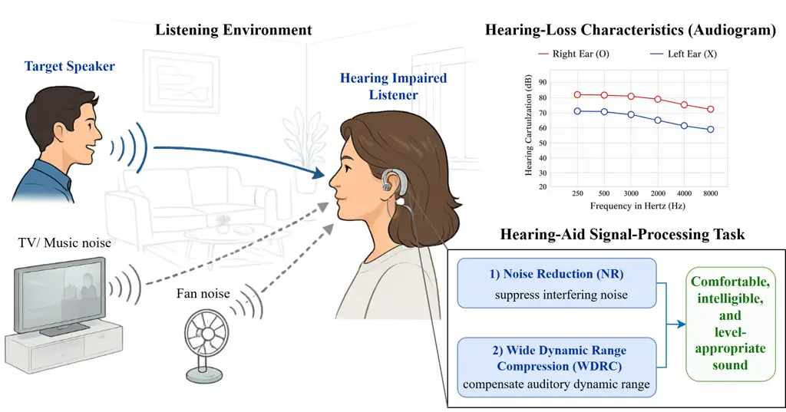
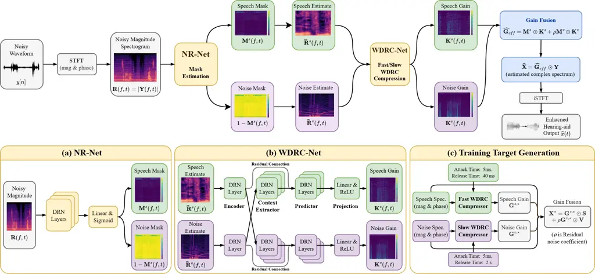
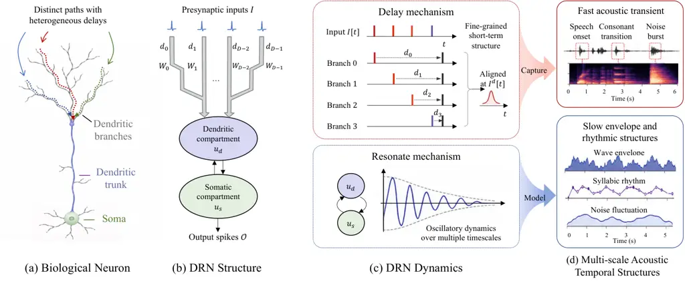
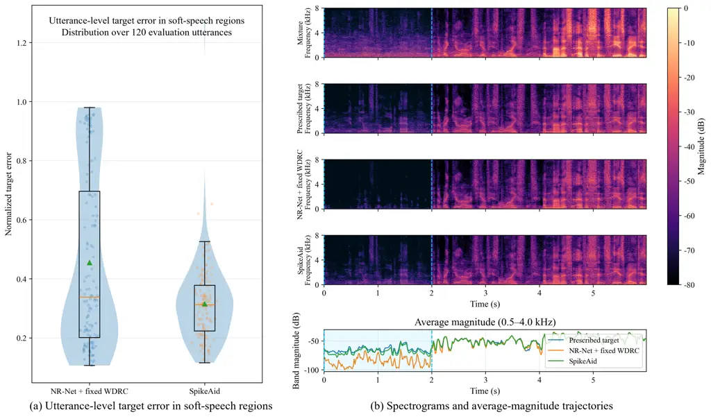
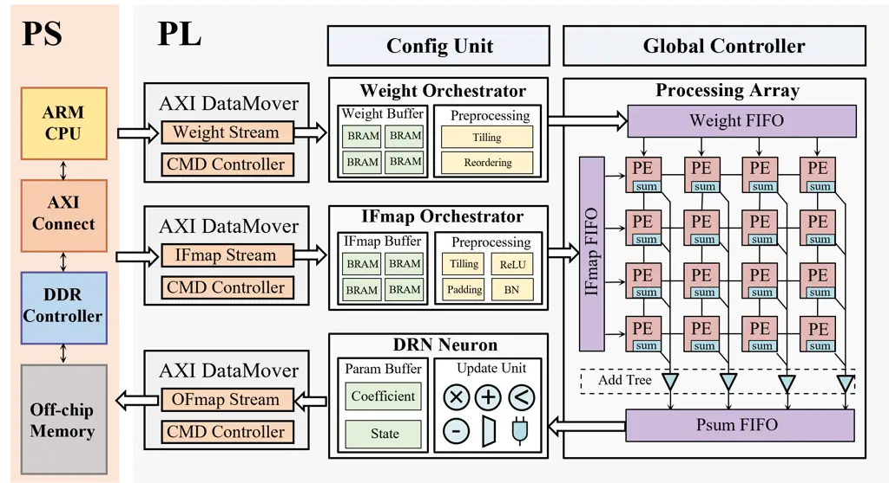

# SpikeAid: A Streaming Spiking Hearing Aid Framework for Joint Noise Reduction and Wide Dynamic Range Compression

Xiang Hao    Xinyi Chen    Hanwen Liu    Richard Hau Yue So   
Kay Chen Tan    Jibin Wu ^(†)^(†)thanks: Xiang Hao, Xinyi Chen, Jibin
Wu, and Kay Chen Tan are with The Hong Kong Polytechnic University, Hong
Kong SAR, China. ^(†)^(†)thanks: Hanwen Liu is with the University of
Electronic Science and Technology of China, Chengdu, China.
^(†)^(†)thanks: Richard Hau Yue So is with The Hong Kong University of
Science and Technology, Hong Kong SAR, China. ^(†)^(†)thanks:
Corresponding author: Xinyi Chen (e-mail:
xinyi-97.chen@connect.polyu.hk).

###### Abstract

Modern hearing aids combine noise reduction (NR) with wide dynamic range
compression (WDRC) to suppress background interference while
compensating for the reduced auditory dynamic range associated with
hearing loss. Conventional systems typically process NR and WDRC as
separate stages, although the output of NR directly affects the signal
levels and envelopes that determine subsequent compression. Recent
end-to-end neural approaches can jointly optimize these processes, but
their dense computation remains challenging for always-on hearing aids.
In this work, we propose SpikeAid, a causal end-to-end spiking neural
network (SNN) framework for joint NR and WDRC. SpikeAid consists of an
NR-Net that constructs complementary speech and noise representations
and a WDRC-Net that estimates the corresponding branch gains, with both
components jointly optimized according to the final hearing aid
objective. To capture the multiscale temporal structures required by
joint NR and WDRC in a computationally efficient manner, we further
introduce the Delayed Resonate-and-fire Neuron (DRN), which incorporates
bio-inspired heterogeneous dendritic delays and resonating dynamics.
Experimental results on the hearing aid task show that SpikeAid improves
key objective metrics over cascaded processing and outperforms existing
spiking speech-processing baselines. Evaluation on the public Intel
Neuromorphic Deep Noise Suppression (N-DNS) Challenge further
demonstrates state-of-the-art neuromorphic speech-denoising performance
with DRN. Finally, we designed an FPGA-based neuromorphic hardware
system for efficient deployment of SpikeAid, where it achieves over two
orders of magnitude higher energy efficiency than conventional CPU/GPU
implementations, demonstrating its potential for energy-efficient
hearing aid applications.

###### Index Terms: 

Hearing Aids, Spiking Neural Networks, Noise Reduction, Wide Dynamic
Range Compression, Neuromorphic Computing.

## I Introduction

Hearing loss presents a growing global public-health challenge. The
World Health Organization estimates that by 2050, nearly 2.5 billion
people will experience some degree of hearing loss, with more than 700
million requiring hearing rehabilitation \[1\]. For many individuals
with permanent sensorineural hearing loss, damaged cochlear sensory
cells cannot be restored through routine clinical treatment. Hearing
aids therefore remain the principal non-surgical means of improving
speech audibility and everyday communication \[2\]. This creates a
fundamental need for hearing aid processing methods that improve speech
intelligibility while supporting efficient always-on streaming
operation.

To support effective speech communication in everyday acoustic
environments, hearing aids must address two different problems:
background interference and the reduced auditory dynamic range caused by
sensorineural hearing loss, as illustrated in Fig. 1. Noise reduction
(NR) suppresses interfering sounds to improve speech perception and
listening comfort, but it does not compensate for the listener’s hearing
loss. This compensation is commonly determined from an audiogram, which
describes the listener’s frequency-dependent hearing loss. A hearing aid
fitting prescription then uses the audiogram to define a prescribed wide
dynamic range compression (WDRC) profile, specifying the desired
amplification at different frequencies and input levels. In particular,
WDRC provides greater gain to low-level sounds and progressively reduces
the gain as the input level increases, thereby mapping the wide range of
environmental sound levels into the listener’s narrower residual
auditory dynamic range \[3, 4\]. Conventional hearing aids therefore
typically arrange NR and WDRC in a cascade, with NR followed by
WDRC \[5, 6, 7\].



Fig. 1: Illustration of the hearing aid signal-processing task. The
hearing aid receives target speech mixed with environmental interference
in a noisy listening environment. An audiogram depicts the listener’s
frequency-dependent hearing loss. Within the hearing aid, NR suppresses
background interference, whereas WDRC applies level-dependent
amplification to accommodate the reduced auditory dynamic range
associated with hearing loss. Together, these processes aim to produce
an output that is intelligible, comfortable, and at an appropriate
level.

Although this cascaded design is simple and modular, NR and WDRC do not
operate independently. NR changes which speech and noise components
remain in the signal, as well as their levels and temporal envelopes.
Because the subsequent WDRC gain is determined from these signal
characteristics, the output of NR directly affects the compression
behavior. WDRC then further modifies both the preserved speech and any
residual interference. As a result, low-energy speech components
suppressed by NR cannot be recovered by WDRC, while residual noise may
be amplified together with the desired speech. WDRC can also further
reshape the output signal-to-noise ratio (SNR) and speech-envelope
characteristics. SNR-aware and source-aware compression strategies
partially account for these interactions by adapting compression
according to speech or noise information \[8, 6\], but generally retain
separately designed processing stages. More recently, neural approaches
such as Neural-WDRC have demonstrated the potential of jointly
optimizing noise suppression and compression within a unified
model \[7\].

Joint optimization addresses the interaction between NR and WDRC, but it
does not by itself resolve the deployment constraints of practical
hearing aids. To support continuous use in a compact wearable device,
hearing aid signal-processing algorithms must operate in real time under
stringent latency, memory, and energy constraints. Existing neural
joint-processing approaches rely on dense, frame-wise artificial neural
network (ANN) computation, where multiply-accumulate (MAC) operations
are continuously performed regardless of the instantaneous acoustic
activity. This leads to a challenging quality–latency–power trade-off
for real-time deployment \[9\]. These constraints motivate efficient
alternatives that are better aligned with low-power hearing aid
hardware.

Spiking neural networks (SNNs) provide a promising computing paradigm
inspired by the computational principles of biological neural systems.
Instead of using continuous activations, SNNs transmit and process
information through discrete spike events \[10\]. This spike-based
representation naturally supports sparse and asynchronous computation,
allowing neurons to remain inactive unless informative events arrive or
spikes are generated. As a result, SNNs can reduce unnecessary
computation and memory access, making them attractive for low-power
streaming applications \[11, 12, 13, 14, 15, 16\]. Beyond efficiency,
SNNs also possess rich neuronal dynamics: their internal states evolve
over time in response to incoming spikes, enabling temporal information
to be integrated and retained across successive time steps \[17, 18, 19,
20, 21, 22\]. These properties make SNNs particularly suitable for
hearing aid processing, which requires continuous tracking of speech and
noise envelope dynamics. Recent SNN-based speech enhancement studies
have shown that spiking architectures can achieve competitive denoising
performance while targeting low-power or low-latency operation. For
example, Spiking-FullSubNet uses full-band and sub-band spiking modeling
for ultralow-power neuromorphic speech enhancement \[23\], and Dual-Path
Spiking Neural Network (DPSNN) develops a streaming time-domain SNN for
low-latency speech enhancement \[24\]. These studies show that sparse
spiking computation can achieve competitive speech enhancement
performance.

Despite recent progress in neural hearing aid processing and SNN-based
speech enhancement, several challenges remain before SNNs can support
joint NR-WDRC processing in practical hearing aids. First, existing SNN
speech enhancement systems are primarily designed for standalone
denoising, with the objective of reconstructing clean speech. To the
best of our knowledge, no end-to-end SNN framework has yet been
developed to produce a hearing aid output jointly determined by noise
reduction and a prescribed WDRC profile. Second, joint NR and WDRC
require modeling temporal structures across multiple timescales. NR
relies on both short-term spectro-temporal structures and longer
contextual information about speech and interference, whereas WDRC must
track level trajectories to provide responsive yet stable gain control.
Capturing these heterogeneous temporal structures while retaining
efficient training and causal streaming inference remains challenging
for existing spiking models. Third, the practical hardware efficiency of
such a neuromorphic hearing aid system remains insufficiently
demonstrated. It remains unclear whether such a system can be deployed
to achieve low-power and low-latency streaming inference.

To address these challenges, we propose SpikeAid, a causal end-to-end
SNN framework for joint NR and WDRC. SpikeAid jointly optimizes NR-Net
and WDRC-Net according to the final hearing aid objective. To model the
temporal structures required by joint NR and WDRC, we introduce a
spiking neuron model tailored for streaming speech enhancement, termed
Delayed Resonate-and-fire Neuron (DRN), which combines bio-inspired
heterogeneous dendritic delays with resonating dynamics. We further
implement SpikeAid on FPGA-based neuromorphic hardware to evaluate its
practical deployment and streaming-inference efficiency.

The main contributions of this work are summarized as follows:

- •
  We propose SpikeAid, the first causal end-to-end SNN framework that
  jointly integrates NR and WDRC into a unified streaming model,
  directly transforming noisy speech into hearing-compensated output.
- •
  We introduce DRN, a bio-inspired spiking neuron model underlying both
  NR-Net and WDRC-Net. It effectively models temporal structures across
  multiple timescales while supporting efficient parallel training and
  causal streaming inference.
- •
  Experiments on the hearing aid task show that SpikeAid achieves the
  best overall performance among the evaluated SNN baselines, with a
  favorable trade-off among speech quality, hearing-aid-oriented
  perceptual performance, and computational efficiency. Evaluation on
  the public Intel N-DNS Challenge further demonstrates the
  effectiveness of DRN, achieving state-of-the-art speech-denoising
  performance.
- •
  We implement SpikeAid on FPGA-based neuromorphic hardware, achieving
  over 100$`\times`$ and 800$`\times`$ higher energy efficiency than CPU
  and GPU implementations, respectively, demonstrating its practical
  potential for hearing aid devices that require operations under
  stringent energy constraints.

## II Related Work

### II-A Joint NR and WDRC for Hearing Aids

Early studies coordinated NR and WDRC through shared speech-presence or
signal-to-noise-ratio information. Ngo et al. coupled multichannel
Wiener-filter NR with WDRC to mitigate the output-SNR degradation of
conventional cascaded processing \[5\]. SNR-aware WDRC subsequently
employed different compression speeds in speech- and noise-dominated
regions, providing perceptual advantages over fixed-speed compression
\[8, 4\]. Later investigations further showed that applying NR before
WDRC does not necessarily prevent compression-induced degradation of the
output SNR, highlighting the need to consider the two stages jointly
\[6, 25\]. These approaches improve the coordination between NR and
WDRC, but generally rely on separately designed modules or predefined
compression policies. They therefore do not provide an end-to-end
framework whose output is jointly determined by NR and a prescribed WDRC
profile.

Neural hearing-loss compensation instead learns listener-dependent
processing from audiograms, fitting prescriptions, or differentiable
auditory models. Representative systems include differentiable hearing
aid fitting \[26\], auditory-model-based individualized compensation
\[27\], and interpretable neural dynamic processors that approximate
multiband compression \[28, 29\]. More closely related to the present
work, several methods jointly perform speech enhancement and
hearing-loss compensation using cascaded neural modules \[30\],
audiogram-conditioned enhancement networks \[31, 32\], or
source-dependent neural compression \[7, 33\]. Neural-WDRC, in
particular, estimates speech and noise components and applies
source-specific compression, demonstrating perceptual advantages over
conventional and SNR-aware WDRC in nonstationary noise \[7\]. However,
these systems primarily depend on continuously active dense ANN
inference, while the effectiveness and efficiency of the complete joint
NR-WDRC chain have rarely been validated at the hardware level.

### II-B SNN-based Speech Enhancement

SNNs provide an event-driven neural computing paradigm in which
information is represented and transmitted through discrete spike events
\[10\]. With surrogate-gradient learning, SNNs can be trained for
complex sequence-processing tasks while retaining sparse spike-based
activity \[34, 35, 36, 37, 38\]. This property has motivated the use of
SNNs for low-power audio and speech processing, especially in scenarios
where real-time operation and energy efficiency are important. The Intel
Neuromorphic Deep Noise Suppression (N-DNS) Challenge established a
common benchmark for neuromorphic speech enhancement, including an
algorithmic track and a Loihi 2 hardware track evaluated in terms of
output quality, latency, energy, and resource consumption \[39\]. Riahi
and Plourde trained a U-Net SNN with surrogate gradients and reported
performance above the challenge baseline and competitive with an
analogous ANN \[40\]. Spiking Structured State Space Model (Spiking-S4)
combined spiking computation with a structured state-space model to
capture long-range dependencies, achieving competitive enhancement with
fewer parameters and FLOPs than representative ANN systems \[41\].
Spiking-FullSubNet combines full-band and sub-band modeling with
frequency partitioning and adaptive spiking dynamics, and won the
algorithmic track of the Intel N-DNS Challenge \[23\]. Other studies
explored spiking-transformer bottlenecks \[42\] and hybrid ANN-to-SNN
fine-tuning \[43\]. Collectively, these methods address long-context
modeling, spectral representation, low-latency streaming, and
computational efficiency. However, they are formulated primarily as
standalone denoisers that reconstruct clean speech or estimate
enhancement masks. They neither produce a listener-dependent output
governed by a prescribed WDRC profile nor optimize how compression
reshapes enhanced speech and residual interference. In addition, their
temporal mechanisms are designed mainly for speech denoising, rather
than for jointly modeling the multiscale acoustic dynamics required by
NR and the level-dependent gain trajectories introduced by WDRC.
Moreover, although the N-DNS hardware track has established the
feasibility of neuromorphic SNN-based speech enhancement, a complete
causal spiking system for joint NR and prescribed WDRC has not yet been
validated on neuromorphic hardware.

### II-C Dendritic-inspired Spiking Neuron Models

Recent studies have explored biologically inspired spiking neurons with
richer internal dynamics to improve temporal processing beyond
conventional Leaky Integrate-and-Fire (LIF) neurons \[44\]. One line of
research focuses on resonate-and-fire dynamics \[45, 46\], where
intrinsic oscillatory behaviors are introduced into spiking neurons to
capture temporal structures across different timescales. Another line of
research investigates dendritic-inspired mechanisms to enrich temporal
representation through structural heterogeneity. The Dendritic
Heterogeneity Spiking Neural Network (DH-SNN) \[47\] introduces multiple
dendritic branches with different temporal constants, enabling
heterogeneous temporal integration across branches. The Parallel
Multi-compartment Spiking Neuron (PMSN) \[48\] models dendritic dynamics
based on cable theory. The Multi-branch Multi-compartment
Dendritic-inspired spiking neuron (MMDend) \[49\] further explores
dendritic structures with multiple branches and compartments to enhance
temporal representation through richer neuronal dynamics.

Although these approaches significantly improve the temporal modeling
capability of spiking neurons, streaming hearing aid processing imposes
more specific challenges. Acoustic signals contain both rapidly varying
transient structures, such as speech onsets, consonant transitions, and
noise bursts. Existing neuron models do not explicitly model
heterogeneous temporal delays caused by different dendritic pathways,
limiting their ability to construct diverse short-term temporal
receptive fields for fine-grained acoustic structures. Meanwhile,
several studies have investigated fast Fourier transform (FFT)-based
parallel training strategies for these dendritic-inspired spiking
neurons \[48, 49, 46\]. These FFT-based approaches accelerate temporal
computation by approximating recurrent dynamics as convolution in the
frequency domain. However, this approximation can lead to a mismatch
between the neuronal dynamics used during parallel training and those
realized during streaming inference. Such a mismatch is particularly
concerning in streaming hearing-aid applications, where models must
process continuous input sequences far longer than the segments used for
training.

## III Proposed SpikeAid Framework



Fig. 2: Overview of SpikeAid. NR-Net estimates complementary speech and
noise masks from the noisy magnitude spectrum and uses them to construct
the corresponding branch representations. WDRC-Net uses information from
both branches to estimate nonnegative branch gains. The gain fusion
stage combines the masks and branch gains into the effective gain, which
is applied to the noisy complex spectrum before inverse STFT
reconstruction.

This section introduces SpikeAid from the task formulation to its
implementation. We first define the task and summarize the end-to-end
processing pipeline. We then introduce the DRN, which serves as the
basic temporal processing unit in SpikeAid. Next, we describe the two
neural components, NR-Net and WDRC-Net, and explain how their outputs
are combined to compute the effective gain and reconstruct the output
waveform. We subsequently describe how the training target is generated
using a source-independent WDRC procedure, where speech and noise are
processed separately by their respective WDRC operators before
recombination, and define the end-to-end loss function. Finally, we
present the causal streaming implementation of the complete framework.

### III-A Problem Formulation and Framework Overview

We consider a monaural mixture $`y[n]=s[n]+v[n]`$, where $`s[n]`$ and
$`v[n]`$ denote the target speech and additive noise, respectively. Let
$`L`$ denote the number of time-domain samples and
$`n\in\{0,\ldots,L-1\}`$ denote the sample index. Let
$`\mathbf{Y}=\operatorname{STFT}(y)`$,
$`\mathbf{S}=\operatorname{STFT}(s)`$, and
$`\mathbf{V}=\operatorname{STFT}(v)`$ denote their complex short-time
Fourier transform (STFT) spectra. By linearity of the STFT,
$`\mathbf{Y}=\mathbf{S}+\mathbf{V}`$, where
$`\mathbf{Y},\mathbf{S},\mathbf{V}\in\mathbb{C}^{F\times T}`$. Here,
$`F`$ and $`T`$ are the numbers of frequency bins and time frames,
respectively; $`f\in\{0,\ldots,F-1\}`$ and $`t\in\{0,\ldots,T-1\}`$
index frequency and time; and $`\odot`$ denotes element-wise
multiplication.

Unlike conventional denoising, the desired hearing aid output must
reflect both NR and a prescribed WDRC profile. Following the
source-independent WDRC formulation in \[7\], in which speech and noise
are compressed separately before recombination, we define the training
target $`\mathbf{X}^{\star}\in\mathbb{C}^{F\times T}`$ as

```math
\mathbf{X}^{\star}=\mathbf{G}^{s,\star}\odot\mathbf{S}+\rho\mathbf{G}^{v,\star}\odot\mathbf{V},\qquad\rho=10^{-\eta_{\mathrm{NR}}/20}, \tag{1}
```

where
$`\mathbf{G}^{s,\star},\mathbf{G}^{v,\star}\in\mathbb{R}_{+}^{F\times T}`$
are the gains for speech and noise, respectively, as specified by the
prescribed WDRC profile. Each element of these prescribed WDRC gains
specifies the multiplicative gain applied at a particular frequency bin
and time frame: low-level components generally receive greater gain,
whereas high-level components receive less gain, thereby compressing the
acoustic dynamic range. The parameter $`\eta_{\mathrm{NR}}`$ specifies
the residual-noise attenuation in decibels, and $`\rho`$ is its
linear-amplitude equivalent. The superscript $`\star`$ identifies
variables associated with the training target. The prescribed WDRC gains
are generated offline from the clean speech and noise spectra, as
detailed in Section III-D.

In this work, we propose the SpikeAid framework shown in Fig. 2.
SpikeAid contains two neural components, NR-Net and WDRC-Net. The
framework takes the noisy magnitude spectrum
$`\mathbf{R}=|\mathbf{Y}|\in\mathbb{R}_{+}^{F\times T}`$ as input.
NR-Net estimates complementary speech and noise masks,
$`\mathbf{M}^{s}`$ and $`\mathbf{M}^{v}`$, and uses them to construct
the corresponding branch representations, $`\widetilde{\mathbf{R}}^{s}`$
and $`\widetilde{\mathbf{R}}^{v}`$. WDRC-Net then processes these two
branch representations, exchanges temporal context between the branches,
and estimates the nonnegative branch gains $`\mathbf{K}^{s}`$ and
$`\mathbf{K}^{v}`$. After the two neural components, a gain fusion stage
combines the masks and branch gains to obtain the effective gain. The
reconstruction stage applies the effective gain to the noisy complex
spectrum $`\mathbf{Y}`$ and uses an inverse STFT to reconstruct the
output waveform. The complete system is trained end to end to
approximate the training target defined in Eq. (1).

Having outlined the overall architecture and signal flow of SpikeAid, we
next introduce the spiking neuron model underlying both NR-Net and
WDRC-Net.

### III-B Delayed Resonate-and-fire Neuron (DRN)



Fig. 3: Illustration of the Delayed Resonate-and-fire Neuron (DRN).
Heterogeneously delayed inputs are aggregated by the dendritic
compartment, while coupled dendritic–somatic dynamics produce damped
resonating states. Together, these mechanisms capture local acoustic
transients and longer-term envelope dynamics.

#### III-B1 Design Motivation and Neuronal Dynamics

Streaming hearing aid processing requires models to simultaneously
capture temporal structures across multiple timescales. Short-term
temporal variations, such as speech onsets, consonant transitions, and
noise bursts, contain fine-grained acoustic information, whereas
long-term temporal evolution, including speech envelopes and WDRC gain
trajectories, requires persistent temporal memory. Motivated by these
temporal requirements, we introduce the DRN, a spiking neuron model
tailored for streaming speech enhancement, which integrates
heterogeneous dendritic delays with resonating dendrite–soma dynamics to
achieve multi-timescale temporal modeling.

As illustrated in Fig. 3, biological neurons contain rich internal
structures, including dendritic branches, dendritic trunk, and the soma,
that support temporal processing beyond simple membrane integration and
threshold-based firing. When a presynaptic input arrives, it is first
transmitted through dendritic branches before reaching the dendritic
trunk. Since different branches correspond to different
distal-to-proximal transmission paths, the incoming signals may arrive
with heterogeneous delays, allowing the neuron to detect and retain
fine-grained temporal information within a local time window. The
dendritic compartment subsequently interacts with the soma through
bidirectional coupling. Dendritic activity drives the somatic response,
while the somatic state feeds back to modulate the dendritic
compartment. This interaction can produce damped subthreshold
oscillations, enabling the neuron to model temporal structures over
extended timescales.

Inspired by these biological observations, we propose the DRN model,
which is designed to incorporate two key components: First, the delay
mechanism enables the neuron to model intricate transient temporal
structures in speech and noise signals, such as speech onsets, consonant
transitions, and noise bursts. Second, the resonate mechanism introduces
oscillatory subthreshold dynamics, allowing the neuron to model temporal
structures over extended timescales, such as envelope modulations,
syllabic rhythms, and slowly varying noise fluctuations. By combining
these two mechanisms, DRN can capture both fast acoustic transients and
longer-range envelope dynamics, providing a suitable spiking unit for
joint NR-WDRC processing.

Given a presynaptic input current $`I(t)`$, the delayed dendritic input
is obtained by aggregating $`D`$ dendritic branches:

```math
\displaystyle I^{d}(t)=\sum_{k=0}^{D-1}W_{k}I(t-d_{k}), \tag{2}
```

where $`d_{k}`$ and $`W_{k}`$ denote the delay and learnable weight of
the $`k`$th dendritic branch pathway, respectively. This delayed
aggregation allows the dendritic compartment to receive temporally
dispersed presynaptic information rather than only the instantaneous
input.

Let $`u_{d}(t)`$ and $`u_{s}(t)`$ denote the dendritic and somatic
membrane potentials, respectively. Their coupled subthreshold dynamics
are defined as

```math
\frac{du_{d}(t)}{dt}=\alpha u_{d}(t)-\beta u_{s}(t)+I^{d}(t), \tag{3}
```

```math
\frac{du_{s}(t)}{dt}=\alpha u_{s}(t)+\beta u_{d}(t),\hskip 28.45274pt \tag{4}
```

where parameter $`\alpha<0`$ controls the decay rate of both membrane
potentials and $`\beta>0`$ controls the coupling strength between the
dendritic and somatic compartments. Eq. (3) describes the integration of
delayed inputs and somatic feedback in the dendritic compartment,
whereas Eq. (4) describes the response of the soma to dendritic
activity. Their bidirectional coupling gives rise to damped resonating
dynamics.

This property can be seen more directly by defining the complex state

```math
z(t)=u_{d}(t)+\boldsymbol{i}u_{s}(t), \tag{5}
```

where $`\boldsymbol{i}`$ is the imaginary unit. Eqs. (3)–(4) can then be
written compactly as

```math
\frac{dz(t)}{dt}=(\alpha+\boldsymbol{i}\beta)z(t)+I^{d}(t). \tag{6}
```

This form is analogous to the classical resonate-and-fire neuron\[50\].
Specifically, $`\alpha`$ acts as a damping factor that exponentially
decays the oscillation amplitude, while $`\beta`$ determines the
intrinsic oscillatory frequency.

The somatic potential is then integrated over time for spike generation:

```math
\displaystyle\frac{dm(t)}{dt}=u_{s}(t), \tag{7}
```

where $`m(t)`$ denotes the firing membrane potential. An output spike is
generated when it reaches the firing threshold:

```math
\displaystyle\mathcal{O}(t)=H\big(m(t)-\theta\big), \tag{8}
```

where $`H(\cdot)`$ is the Heaviside step function and $`\theta`$ is the
firing threshold. After firing, the membrane potential is reset as

```math
m(t)\leftarrow m(t)-r(t)\theta, \tag{9}
```

where $`r(t)=\lfloor m(t)/\theta\rfloor`$ denotes the integer reset
factor.

#### III-B2 Stable Discretization and Multiscale Temporal Modeling

The continuous-time formulation above defines the temporal dynamics of
DRN. To support practical training and inference, we next derive a
stable discrete-time realization and characterize how it enables
temporal modeling over multiple timescales.

For the $`j`$th DRN, let $`\lambda_{j}=\alpha_{j}+\mathrm{i}\beta_{j}`$
denote its complex coefficient. Applying zero-order-hold discretization
to Eq. (6) with step size $`\Delta_{j}>0`$ gives

```math
z_{j}[t]=A_{j}z_{j}[t-1]+B_{j}I_{j}^{d}[t], \tag{10}
```

where

```math
A_{j}=\exp(\Delta_{j}\lambda_{j}),\qquad B_{j}=\frac{\exp(\Delta_{j}\lambda_{j})-1}{\lambda_{j}}. \tag{11}
```

To keep the resonant dynamics stable during optimization, we
parameterize the real part of $`\alpha_{j}`$ using an unconstrained
learnable parameter $`a_{j}`$ as

```math
\alpha_{j}=-\exp(a_{j}). \tag{12}
```

This guarantees $`|A_{j}|=\exp(\Delta_{j}\alpha_{j})<1`$ for any
$`\Delta_{j}>0`$ and therefore prevents divergent resonating states.

Beyond stability, DRN captures temporal structures through two
complementary mechanisms. First, the delay mechanism provides
neuron-specific temporal filtering within a short causal window. The
$`D`$ transmission delays are initialized as

```math
d_{k}=k,\qquad k=0,1,\ldots,D-1, \tag{13}
```

and the delayed input of the $`j`$th neuron is therefore

```math
I_{j}^{d}[t]=\sum_{k=0}^{D-1}W_{j,k}I[t-k]. \tag{14}
```

Each neuron has an independent delay kernel $`\{W_{j,k}\}_{k=0}^{D-1}`$
and can consequently learn a distinct local temporal filter. These
filters enable the DRN population to capture fine-grained acoustic
structures within a short time window.

Second, the resonate mechanism provides temporal selectivity over
extended timescales. Under the stable parameterization in Eq. (12), the
state-transition coefficient can be written as

```math
A_{j}=\exp\!\left[-\Delta_{j}\exp(a_{j})\right]\exp\!\left(\mathrm{i}\Delta_{j}\beta_{j}\right), \tag{15}
```

where the term $`\Delta_{j}\exp(a_{j})`$ controls the decay speed and
effective memory length, whereas $`\Delta_{j}\beta_{j}`$ determines the
preferred temporal frequency. Heterogeneous resonating parameters across
the DRN population therefore provide a diverse set of damped temporal
filters across multiple timescales. Together with the delay mechanism,
the DRN layer is able to capture temporal structures across multiple
timescales. Further derivations of the stability condition and the
frequency-response analysis of the resonating dynamics are provided in
Supplementary Materials.

#### III-B3 Parallel Training and Streaming Inference

Hearing aid processing requires efficient training on long audio
sequences while ultimately being implemented on an always-on streaming
device. To this end, DRN is designed to support parallel computation
during training and recurrent streaming inference without changing the
underlying state transition.

First, the delay operation in Eq. (14) is a neuron-wise causal
time-invariant convolution. The delayed inputs of all neurons and
timesteps can therefore be computed in parallel using a grouped
one-dimensional convolution.

Second, we adapt a dedicated associative-scan kernel \[51, 52\] to the
resonating dynamics in Eq. (10). Let $`u_{j}[t]=B_{j}I_{j}^{d}[t]`$ and
represent each transition as $`(A_{j},u_{j}[t])`$. Two consecutive
transitions can be composed as

```math
(A_{2},u_{2})\circ(A_{1},u_{1})=(A_{2}A_{1},\;A_{2}u_{1}+u_{2}), \tag{16}
```

which is associative. Compared with FFT-based parallel methods that
approximate dynamics through full-sequence convolution in the frequency
domain \[48, 49, 46\], the proposed scan-based implementation preserves
the recurrent state transition, thereby avoiding approximation errors
that lead to inconsistent neuronal dynamics between parallel training
and streaming inference. This consistency is particularly important for
streaming hearing-aid processing, where inference sequences can be
substantially longer than training clips.

We next describe the overall spiking architecture, which consists of two
neural components, NR-Net and WDRC-Net, both built upon the proposed DRN
temporal unit.

### III-C SpikeAid Architecture

The following subsections describe the SpikeAid architecture in three
parts. We first introduce NR-Net, then present WDRC-Net, and finally
describe the gain fusion and reconstruction stages. For notational
convenience, the batch dimension is omitted and the spectral tensors are
arranged in an $`F\times T`$ layout. Because all DRN layers are causal,
the same mappings can be evaluated frame by frame during streaming
inference. Let $`\mathcal{Q}=\{s,v\}`$ denote the speech and noise
branches, and let $`\bar{q}`$ denote the branch complementary to $`q`$,
i.e., $`\bar{s}=v`$ and $`\bar{v}=s`$.

#### III-C1 NR-Net

NR-Net takes the noisy magnitude spectrum $`\mathbf{R}=|\mathbf{Y}|`$ as
input and estimates complementary speech and noise masks. The masks and
the corresponding branch representations are defined as

```math
\displaystyle\mathbf{M}^{s} \displaystyle=\operatorname{sigmoid}\left[\mathcal{P}_{\mathrm{NR}}\left(\mathcal{D}_{\mathrm{NR}}(\mathbf{R})\right)\right], \displaystyle\mathbf{M}^{v} \displaystyle=\mathbf{1}-\mathbf{M}^{s}, \tag{17}
```

```math
\displaystyle\widetilde{\mathbf{R}}^{q} \displaystyle=\mathbf{M}^{q}\odot\mathbf{R}, \displaystyle q\in\mathcal{Q},
```

where $`\mathcal{D}_{\mathrm{NR}}`$ is a stack of DRN layers and
$`\mathcal{P}_{\mathrm{NR}}`$ is a linear projection from the hidden
dimension to the $`F`$ STFT bins. The resulting masks satisfy
$`\mathbf{M}^{q}\in[0,1]^{F\times T}`$ and
$`\mathbf{M}^{s}+\mathbf{M}^{v}=\mathbf{1}`$. Consequently, the branch
representations satisfy
$`\widetilde{\mathbf{R}}^{s}+\widetilde{\mathbf{R}}^{v}=\mathbf{R}`$.
The superscript $`q`$ indicates the intended role of each branch and
does not imply an exact decomposition into clean speech and noise. In
particular, $`\widetilde{\mathbf{R}}^{s}`$ and
$`\widetilde{\mathbf{R}}^{v}`$ are not directly supervised to match
$`|\mathbf{S}|`$ and $`|\mathbf{V}|`$. Because supervision is applied
only to the final output, errors in the intermediate branch
representations may be compensated by the downstream gain estimation and
gain fusion stages during end-to-end training.

#### III-C2 WDRC-Net

WDRC-Net takes the two branch representations produced by NR-Net as
input. For each branch $`q\in\mathcal{Q}`$, its representation is
encoded as binary hidden features. Temporal context extracted from the
other branch is then added to these features, and the resulting
representation is used to estimate the nonnegative branch gain
$`\mathbf{K}^{q}`$:

```math
\displaystyle\mathbf{H}^{q} \displaystyle=\mathcal{E}_{q}\left(\widetilde{\mathbf{R}}^{q}\right), \tag{18}
```

```math
\displaystyle\mathbf{U}^{q} \displaystyle=\mathbf{H}^{q}+\mathcal{C}_{\bar{q}\rightarrow q}\left(\mathbf{H}^{\bar{q}}\right),
```

```math
\displaystyle\mathbf{K}^{q} \displaystyle=\operatorname{ReLU}\left[\mathcal{P}_{q}\left(\mathcal{D}_{q}(\mathbf{U}^{q})\right)\right],\qquad q\in\mathcal{Q}.
```

Here, $`\mathcal{E}_{q}`$ is the encoder for branch $`q`$ and is
implemented as a single DRN layer. The context extractor
$`\mathcal{C}_{\bar{q}\rightarrow q}`$ is implemented as a stack of DRN
layers and extracts temporal context from the other branch. The gain
predictor $`\mathcal{D}_{q}`$ is implemented as another stack of DRN
layers, and $`\mathcal{P}_{q}`$ linearly projects its output to the
$`F`$ frequency bins. By using temporal context from the other branch,
WDRC-Net estimates each branch gain using information from both
branches. The branch gains satisfy
$`\mathbf{K}^{q}\in\mathbb{R}_{+}^{F\times T}`$. Because no intermediate
loss directly supervises them against the prescribed WDRC gains
$`\mathbf{G}^{q,\star}`$, $`\mathbf{K}^{q}`$ should not be interpreted
as a direct estimate of $`\mathbf{G}^{q,\star}`$. Instead, the branch
gains are optimized according to their contribution to the final gain
used for reconstruction.

#### III-C3 Gain Fusion and Reconstruction Stages

The gain fusion stage combines the complementary masks produced by
NR-Net with the branch gains produced by WDRC-Net to obtain a single
gain for output reconstruction:

```math
\widehat{\mathbf{G}}_{\mathrm{eff}}=\mathbf{M}^{s}\odot\mathbf{K}^{s}+\rho\,\mathbf{M}^{v}\odot\mathbf{K}^{v}, \tag{19}
```

where $`\rho`$ is the residual-noise attenuation factor defined in
Eq. (1). We refer to $`\widehat{\mathbf{G}}_{\mathrm{eff}}`$ as the
effective gain.

The output spectrum and waveform are reconstructed as

```math
\displaystyle\widehat{\mathbf{X}} \displaystyle=\widehat{\mathbf{G}}_{\mathrm{eff}}\odot\mathbf{Y}, \tag{20}
```

```math
\displaystyle\widehat{x}[n] \displaystyle=\operatorname{iSTFT}\left(\widehat{\mathbf{X}}\right).
```

Because the effective gain is real-valued, applying it to $`\mathbf{Y}`$
preserves the phase of the noisy mixture spectrum. SpikeAid can
therefore approximate the training target in Eq. (1) without explicitly
estimating and recombining separate complex speech and noise spectra.
Reconstruction requires only one element-wise multiplication and one
inverse STFT. The complete architecture is trained end to end using a
loss applied to the reconstructed spectrum. The next subsection
describes the offline generation of the training target and the loss
function used for training.

### III-D Training Target and Loss Function

#### III-D1 Training Target

The training target in Eq. (1) is generated offline from the clean
speech and noise spectra, as illustrated in Fig. 2 (c). Following the
source-independent WDRC formulation in \[7\], WDRC is applied separately
to speech and noise before the two processed spectra are recombined.
Here, “source-independent” refers to the separate processing of the two
sources; the corresponding WDRC operators may still use different
temporal parameters.

For training target construction, we use $`q\in\mathcal{Q}`$ to index
the clean speech and noise spectra, with $`\mathbf{Q}^{s}=\mathbf{S}`$
and $`\mathbf{Q}^{v}=\mathbf{V}`$. The prescribed WDRC gains are
expressed as

```math
\mathbf{G}^{q,\star}=\mathcal{W}_{\Theta_{q}}\left(\mathbf{Q}^{q}\right),\qquad q\in\mathcal{Q}, \tag{21}
```

where
$`\mathcal{W}_{\Theta_{q}}:\mathbb{C}^{F\times T}\rightarrow\mathbb{R}_{+}^{F\times T}`$
is a causal multiband WDRC operator that maps a source spectrum to its
time-frequency gains. The parameter set $`\Theta_{q}`$ specifies the
WDRC configuration for source $`q`$.

Following established source-independent WDRC designs \[7, 53\], each
operator first estimates calibrated short-time levels within the
compression bands, tracks the temporal envelopes using the prescribed
attack and release time constants, applies the compression curve, and
interpolates the resulting band gains to the STFT frequency bins. The
speech and noise WDRC operators share the same compression bands, attack
time, compression threshold, and compression ratio, but use different
release times. A shorter release time is used for speech to restore the
gain more quickly after high-level speech events, whereas a longer
release time is used for noise to reduce rapid gain fluctuations in the
residual background.

The WDRC configuration is reported in Section IV-A2. Details of the
level calibration, compression-band construction, envelope recursion,
numerical stabilization, and frequency interpolation are provided in
Supplementary Materials. Together, the prescribed WDRC gains define the
training target in Eq. (1).

The WDRC operators are used only to generate the training target
offline. Neither the clean source spectra nor the prescribed WDRC gains
are available during inference. Moreover, the present work uses a fixed
WDRC profile to isolate the joint NR-WDRC learning problem; it does not
incorporate listener-specific fitting through insertion-gain targets or
audiogram conditioning.

#### III-D2 Loss Function

The loss function is applied only to the final output. Given the
reconstructed spectrum $`\widehat{\mathbf{X}}`$ and the training target
$`\mathbf{X}^{\star}`$, the loss function combines complex-domain and
magnitude-domain reconstruction errors:

```math
\mathcal{L}=\frac{\mu\left\|\widehat{\mathbf{X}}-\mathbf{X}^{\star}\right\|_{F}^{2}+(1-\mu)\left\|\left|\widehat{\mathbf{X}}\right|-\left|\mathbf{X}^{\star}\right|\right\|_{F}^{2}}{\left\|\mathbf{X}^{\star}\right\|_{F}^{2}+\epsilon_{E}}, \tag{22}
```

where $`\mu\in[0,1]`$ balances the two reconstruction terms and
$`\epsilon_{E}>0`$ prevents numerical instability for low-energy
utterances. The complex-domain term penalizes the real and imaginary
reconstruction errors, whereas the magnitude-domain term directly
penalizes the output-magnitude error and therefore places additional
emphasis on the output-level trajectory. The loss is computed
independently for each utterance and then averaged over the minibatch.

Because the loss is applied only after gain fusion and reconstruction,
NR-Net and WDRC-Net are jointly optimized according to their
contribution to the final hearing aid output. Consequently, the
intermediate masks and branch gains are not directly supervised to match
the clean source spectra or the prescribed WDRC gains.

## IV Experiments and Results

### IV-A Experimental Setup

This subsection describes the experimental setup for the joint NR-WDRC
hearing aid task. Unless otherwise stated, the hearing aid systems use
the same data-generation procedure, acoustic frontend, training-target
generation, loss function, and optimization settings. In all result
tables, bold and underlined values denote the best and second-best
results, respectively.

#### IV-A1 Data Simulation and Evaluation Sets

Clean speech and environmental noise are drawn from LibriSpeech \[54\]
and the DNS-Challenge full-band noise corpus \[55\], respectively. All
signals are converted to monaural waveforms sampled at 16 kHz. Training
samples are generated online by cropping or zero-padding each clean
utterance to 3.072 s and mixing it with a randomly selected noise
segment of the same duration.

The clean-speech level is uniformly sampled from
$`\{55,60,65,70,75\}`$ dB SPL. Following Neural-WDRC \[7\], we use a
digital-to-SPL calibration in which a signal with RMS value 1
corresponds to 95 dB SPL. This calibration provides a consistent mapping
between digital signal amplitude and the SPL values used by the
level-dependent WDRC procedure. The input SNR is uniformly sampled from
the integers in $`\{0,1,\ldots,20\}`$ dB. If the maximum absolute
amplitude of the clean speech, noise, or mixture exceeds 0.99, all three
signals are rescaled by the same factor to prevent clipping without
changing the SNR. Each epoch contains 150,000 independently generated
mixtures.

We generate fixed validation and evaluation sets offline. Each set
contains 120 mixtures spanning input SNRs of $`-6`$, 0, 6, and 12 dB.
The clean utterances used in the two sets are mutually disjoint. Speaker
gender was not explicitly balanced or used as a selection criterion
during set construction. The validation set is used for model selection
and early stopping, whereas the evaluation set is reserved for final
evaluation.

#### IV-A2 Acoustic Frontend and Training Target

The acoustic frontend uses a 512-point STFT with a 512-sample Hann
window and a 256-sample hop. At 16 kHz, these settings correspond to a
32-ms window, a 16-ms frame shift, and $`F=257`$ one-sided frequency
bins.

The training target is generated using the source-independent WDRC
procedure described in Section III-D1. Separate speech and noise WDRC
operators process frequency bands centered at 125, 250, 500, 1000, 2000,
4000, and 8000 Hz. Both operators use a 5-ms attack time, a 40-dB-SPL
compression threshold, and a 2:1 compression ratio. The release times
are 40 ms for speech and 2 s for noise. The resulting band gains are
interpolated to the STFT frequency bins using natural cubic splines.
Before recombination, the compressed noise is attenuated by
$`\eta_{\mathrm{NR}}=15`$ dB, corresponding to $`\rho=10^{-15/20}`$.
This fixed WDRC profile is used to study joint NR-WDRC learning rather
than listener-specific fitting.

#### IV-A3 Network Configuration

In our implementation, each DRN layer consists of a linear projection,
batch normalization, and DRN neurons applied sequentially. Unless
otherwise specified, the number of dendritic delay branches is set to
$`D=7`$. NR-Net comprises four DRN layers with a hidden dimension of
128, followed by a linear projection and sigmoid activation that
estimate the speech mask; the noise mask is its complement. WDRC-Net
uses a hidden dimension of 192. Each branch contains a one-layer
encoder, a four-layer context extractor, and a four-layer gain predictor
whose output is projected to the $`F=257`$ frequency bins to estimate
the branch gains. Detailed optimization, model-selection, and
training-hardware settings are provided in Supplementary Materials.

#### IV-A4 Evaluation Metrics

Perceptual Evaluation of Speech Quality (PESQ) \[56\] and Short-Time
Objective Intelligibility (STOI) \[57\] are computed between the system
output waveform and the waveform reconstructed from the complex training
target. Hearing-Aid Speech Perception Index (HASPI) version 2 and
Hearing-Aid Speech Quality Index (HASQI) version 2 \[58\] are computed
following the evaluation configuration of Neural-WDRC \[7\]. A flat
40-dB HL audiogram is used for the simulated hearing-impaired listener,
and an RMS value of 1 is calibrated to 95 dB sound pressure level (SPL).
For HASQI v2, National Acoustic Laboratories–Revised (NAL-R)
equalization is applied to the clean reference according to the metric
definition. The system outputs are evaluated without post-hoc level
normalization. The same configuration is used for all systems.
Computational efficiency is reported using the Power Proxy in MOp/s, the
power–delay-product (PDP) Proxy in MOp, and the estimated Energy Cost in
$`\mu\mathrm{J}`$. Their definitions and operation-cost assumptions
follow the Intel N-DNS Challenge methodology \[39\].

|                               |               |                    |              |            |                   |                   |                    |                    |
| ----------------------------- | ------------- | ------------------ | ------------ | ---------- | ----------------- | ----------------- | ------------------ | ------------------ |
| System                        | NR Processing | WDRC Processing    | Optimization | Params (k) | PESQ $`\uparrow`$ | STOI $`\uparrow`$ | HASPI $`\uparrow`$ | HASQI $`\uparrow`$ |
| Noisy mixture + fixed WDRC    | None          | Fixed              | –            | –          | 1.648             | 0.7799            | 0.3866             | 0.1808             |
| Wiener filtering + fixed WDRC | Wiener filter | Fixed              | NR only      | –          | 1.579             | 0.7761            | 0.3667             | 0.1724             |
| NR-Net + fixed WDRC           | NR-Net        | Fixed              | NR only      | 987        | 2.091             | 0.8103            | 0.4254             | 0.1819             |
| SpikeAid (stage-wise)         | NR-Net        | Learnable WDRC-Net | Stage-wise   | 994        | 2.040             | 0.8278            | 0.4185             | 0.1792             |
| SpikeAid                      | NR-Net        | Learnable WDRC-Net | Joint        | 994        | 2.214             | 0.8412            | 0.4365             | 0.1812             |

TABLE I: Effect of joint optimization on the hearing aid task. The
compared systems vary the NR processing, WDRC processing, and
optimization strategy.

### IV-B Effective Hearing Aid Processing through Joint NR-WDRC Optimization

First, we compare SpikeAid against a series of NR-WDRC baselines in
Table I, which differ from SpikeAid in the NR processing, WDRC
processing, and optimization strategy. PESQ and STOI measure agreement
with the prescribed NR-WDRC target, whereas HASPI and HASQI evaluate
hearing-aid-oriented perceptual performance. Among all evaluated
systems, SpikeAid achieves the strongest overall hearing aid processing
results, obtaining the best PESQ, STOI, and HASPI scores while
maintaining competitive HASQI performance.

The first group of baselines follows the conventional cascaded NR-WDRC
paradigm, in which the WDRC stage is fixed and only the preceding NR
processing is varied. “NR-Net + fixed WDRC” substantially outperforms
both “Noisy mixture + fixed WDRC” and “Wiener filtering + fixed WDRC” on
most metrics, showing that a stronger learned NR frontend can
significantly improve cascaded hearing aid processing.

Compared with the strong “NR-Net + fixed WDRC” cascade, SpikeAid
achieves higher PESQ, STOI, and HASPI, although its HASQI is slightly
lower. This result suggests that the advantage of SpikeAid cannot be
attributed solely to stronger standalone denoising, and that
coordinating NR and WDRC within a unified learnable framework can
improve the final hearing aid output. Notably, “SpikeAid (stage-wise)”
obtains a lower PESQ than “NR-Net + fixed WDRC.” These two systems,
however, allocate their learnable capacity differently. The fixed-WDRC
baseline concentrates essentially all learnable parameters in NR-Net,
whereas stage-wise SpikeAid distributes a comparable total parameter
budget across NR-Net and WDRC-Net. Therefore, this comparison does not
isolate the effect of making WDRC learnable.

The effect of joint optimization is more directly isolated by comparing
SpikeAid with “SpikeAid (stage-wise)”, which uses the same network
architecture and parameter allocation but optimizes NR-Net and WDRC-Net
separately. Joint optimization improves all four objective metrics,
demonstrating that end-to-end coordination between NR-Net and WDRC-Net
is a key contributor to the performance of SpikeAid.

### IV-C Improved Target Matching in Soft-Speech Regions

The results in Table I show the overall benefit of joint NR-WDRC
optimization, but do not indicate where this benefit arises. We
therefore examine soft-speech regions, which are particularly vulnerable
in cascaded processing. When NR is optimized independently, low-energy
but target-relevant speech components may be attenuated before
compression. Once these components are suppressed, the subsequent WDRC
stage can only adjust the gain of the remaining signal and cannot
reconstruct such lost speech information.

We define soft-speech regions relative to the level range within each
utterance. Specifically, the RMS level is computed for each time frame,
and frames that are 20–40 dB weaker than the strongest frame in the same
utterance are selected as soft-speech frames. We then restrict the
analysis to the 0.5–4 kHz frequency range within these frames and denote
the resulting time-frequency region by $`\mathcal{A}_{i}`$:

```math
e_{i}^{(m)}=\frac{\displaystyle\sum_{(f,t)\in\mathcal{A}_{i}}\left|\left|\widehat{X}_{i,f,t}^{(m)}\right|-\left|X_{i,f,t}^{\star}\right|\right|}{\displaystyle\sum_{(f,t)\in\mathcal{A}_{i}}\left|X_{i,f,t}^{\star}\right|+\varepsilon_{\mathrm{a}}}. \tag{23}
```

The numerator measures the accumulated magnitude mismatch within the
selected soft-speech region, while the denominator normalizes it by the
target magnitude. Thus, each utterance contributes one relative error
value, with a lower value indicating closer agreement with the desired
output.

Fig. 4(a) compares this error between “NR-Net + fixed WDRC” and SpikeAid
over the 120 evaluation utterances. SpikeAid shows a lower error
distribution and substantially fewer high-error cases, indicating more
consistent preservation of the prescribed soft-speech content.

Fig. 4(b) provides an illustrative example for one utterance. During the
highlighted 0–2 s interval, “NR-Net + fixed WDRC” strongly attenuates
weak speech structures that remain present in the prescribed target.
Consequently, its 0.5–4 kHz magnitude trajectory stays below the target,
whereas SpikeAid follows both the target spectrogram and the
corresponding magnitude trajectory more closely. In the subsequent
higher-level speech region, the outputs of the two systems become more
similar.

These results provide a direct example of how joint optimization
improves the final hearing aid output: by considering the downstream
compression during NR learning, SpikeAid is better able to preserve
low-energy speech components that would otherwise be excessively
suppressed by independently optimized cascaded processing.



Fig. 4: Target matching in soft-speech regions. (a) Utterance-level
relative magnitude errors over the 120 evaluation utterances, computed
within 0.5–4 kHz for frames whose clean-speech levels are 20–40 dB below
the utterance-level maximum. Points denote utterances, boxes show
interquartile ranges, horizontal lines show medians, and triangles show
means. (b) Spectrograms and 0.5–4 kHz average-magnitude trajectories for
an illustrative utterance. The shaded interval marks the analyzed
soft-speech region.

|                                                                                     |              |                           |                       |                   |                    |                    |                                    |                                |                                       |
| ----------------------------------------------------------------------------------- | ------------ | ------------------------- | --------------------- | ----------------- | ------------------ | ------------------ | ---------------------------------- | ------------------------------ | ------------------------------------- |
| Architecture                                                                        | Neuron Model | Params (k) $`\downarrow`$ | Objective Performance |                   |                    |                    | Computational Cost Proxies         |                                |                                       |
|                                                                                     |              |                           | PESQ $`\uparrow`$     | STOI $`\uparrow`$ | HASPI $`\uparrow`$ | HASQI $`\uparrow`$ | Power Proxy (MOp/s) $`\downarrow`$ | PDP Proxy (MOp) $`\downarrow`$ | Energy Cost ($`\mu`$J) $`\downarrow`$ |
| Existing SNN architectures developed for temporal processing or speech enhancement. |              |                           |                       |                   |                    |                    |                                    |                                |                                       |
| SFNN                                                                                | LIF          | 990                       | 1.946                 | 0.8021            | 0.3679             | 0.1589             | 36.02                              | 1.15                           | 1.04                                  |
| SRNN \[59\]                                                                         | LIF          | 972                       | 2.093                 | 0.8224            | 0.4108             | 0.1775             | 41.16                              | 1.32                           | 1.19                                  |
| Spike-Driven Transformer \[60\]                                                     | LIF          | 975                       | 2.119                 | 0.8271            | 0.3493             | 0.1449             | 196.61                             | 6.30                           | 5.67                                  |
| Binary S4D \[61\]                                                                   | STA          | 960                       | 2.098                 | 0.8365            | 0.4290             | 0.1800             | 183.31                             | 5.87                           | 5.28                                  |
| Spiking-FullSubNet \[23\]                                                           | GSN          | 1000                      | 2.159                 | 0.8397            | 0.4053             | 0.1667             | 868.25                             | 27.81                          | 25.03                                 |
| Controlled neuron comparison under the same SpikeAid architecture.                  |              |                           |                       |                   |                    |                    |                                    |                                |                                       |
| SpikeAid-LIF                                                                        | LIF          | 911                       | 1.989                 | 0.8071            | 0.3827             | 0.1643             | 35.23                              | 1.13                           | 1.02                                  |
| SpikeAid-GSN                                                                        | GSN \[23\]   | 962                       | 2.119                 | 0.8339            | 0.4189             | 0.1782             | 59.01                              | 1.89                           | 1.70                                  |
| SpikeAid-D-RF                                                                       | D-RF \[46\]  | 998                       | 1.936                 | 0.8124            | 0.4004             | 0.1805             | 34.89                              | 1.12                           | 1.01                                  |
| SpikeAid-PMSN                                                                       | PMSN \[48\]  | 1014                      | 2.062                 | 0.8202            | 0.4120             | 0.1737             | 34.09                              | 1.09                           | 0.98                                  |
| SpikeAid                                                                            | DRN          | 994                       | 2.214                 | 0.8412            | 0.4365             | 0.1812             | 30.39                              | 0.97                           | 0.88                                  |

TABLE II: Comparison with SNN baselines on the hearing aid joint NR-WDRC
task.

### IV-D Superior Performance and Efficiency over SNN Baselines

Table II compares SpikeAid with representative SNN baselines at both the
architecture and spiking neuron levels.

#### IV-D1 Comparison with Existing SNN Architectures

We first benchmark the complete SpikeAid system against representative
advanced SNN architectures developed for temporal processing or speech
enhancement. These baselines include a basic spiking feedforward neural
network (SFNN), a spiking recurrent neural network (SRNN) with
within-layer recurrent connections \[59\], the Spike-Driven Transformer
\[60\], Binary S4D \[61\] with a signed ternary activation (STA), and
Spiking-FullSubNet \[23\]. Each baseline is reproduced and adapted to
the joint NR-WDRC task using identical data-preprocessing, training, and
evaluation settings.

The evaluated SNN baselines exhibit markedly different trade-offs
between objective performance and computational cost. Among them,
Spiking-FullSubNet achieves the strongest PESQ and STOI scores,
reflecting its effectiveness as a dedicated spiking speech enhancement
architecture. Binary S4D obtains the best HASPI and HASQI results among
the baselines. However, these stronger baseline models incur
substantially higher computational costs. In contrast, SFNN and SRNN
require considerably fewer operations but achieve lower objective
performance.

SpikeAid-DRN achieves the best performance across all four evaluated
metrics. Compared with the strongest SNN baseline for each metric, it
improves PESQ from 2.159 to 2.214 and HASPI from 0.4290 to 0.4365, while
also yielding higher STOI and HASQI scores. These gains are achieved
with an estimated energy cost of only 0.88 $`\mu`$J, which is less than
one-twentieth of that required by Spiking-FullSubNet. Therefore,
SpikeAid-DRN provides a more favorable balance among enhancement
quality, hearing-aid-oriented perceptual performance, and computational
efficiency.

#### IV-D2 Effect of the Spiking Neuron Model

We further assess the effectiveness of DRN through controlled
neuron-level comparisons. Specifically, we replace DRN in SpikeAid with
the LIF neuron, Gated Spiking Neuron (GSN) \[23\], Dendritic
Resonate-and-Fire (D-RF) neuron \[46\], and PMSN \[48\], while keeping
the network architecture, training procedure, and evaluation protocol
unchanged. These neuron models represent different temporal processing
mechanisms, including membrane integration, temporal gating, resonant
dynamics, and multi-compartment dynamics.

DRN achieves the best results across all four objective metrics.
Compared with the best competing score for each metric, it improves PESQ
from 2.119 to 2.214, STOI from 0.8339 to 0.8412, HASPI from 0.4189 to
0.4365, and HASQI from 0.1805 to 0.1812. It also achieves the lowest
values across all three computational-cost proxies. These consistent
improvements support the effectiveness of combining heterogeneous
dendritic delays with resonant dynamics in DRN for capturing the
temporal acoustic information essential for joint NR–WDRC processing.

|                                                                                                                                    |                          |                           |                  |                  |                  |                             |                                    |                                |                                       |                           |
| ---------------------------------------------------------------------------------------------------------------------------------- | ------------------------ | ------------------------- | ---------------- | ---------------- | ---------------- | --------------------------- | ---------------------------------- | ------------------------------ | ------------------------------------- | ------------------------- |
| Method                                                                                                                             | SI-SNR (dB) $`\uparrow`$ | SI-SNRi (dB) $`\uparrow`$ | DNSMOS           |                  |                  | Latency (ms) $`\downarrow`$ | Computational Cost Proxies         |                                |                                       | Params (k) $`\downarrow`$ |
|                                                                                                                                    |                          |                           | OVR $`\uparrow`$ | SIG $`\uparrow`$ | BAK $`\uparrow`$ |                             | Power Proxy (MOp/s) $`\downarrow`$ | PDP Proxy (MOp) $`\downarrow`$ | Energy Cost ($`\mu`$J) $`\downarrow`$ |                           |
| Noisy (Unprocessed)                                                                                                                | 7.37                     | –                         | 2.43             | 3.16             | 2.69             | –                           | –                                  | –                              | –                                     | –                         |
| Representative speech enhancement systems. Results are cited from the Intel N-DNS repository \[39\] and Spiking-FullSubNet \[23\]. |                          |                           |                  |                  |                  |                             |                                    |                                |                                       |                           |
| Microsoft NsNet2 \[55\]                                                                                                            | 11.63                    | 4.26                      | 2.95             | 3.26             | 3.93             | 20.02                       | 136.13                             | 2.72                           | 12.51                                 | 2681                      |
| DCCRN \[62\]                                                                                                                       | 12.46                    | 5.09                      | 2.85             | 3.11             | 3.77             | 20.02                       | 5070                               | 100                            | 460                                   | 1247                      |
| FullSubNet \[63\]                                                                                                                  | 13.55                    | 6.18                      | 2.93             | 3.22             | 3.84             | 32.03                       | 3650                               | 120                            | 550                                   | 1141                      |
| Fast FullSubNet \[64\]                                                                                                             | 13.88                    | 6.51                      | 2.91             | 3.24             | 3.82             | 32.03                       | 490                                | 20                             | 90                                    | 1141                      |
| CMGAN \[65\]                                                                                                                       | 14.01                    | 6.64                      | 2.81             | 3.23             | 3.84             | 20.02                       | 15940                              | 320                            | 1470                                  | 1413                      |
| Intel N-DNS Challenge submissions. Results and rankings are obtained from the official challenge repository \[39\].                |                          |                           |                  |                  |                  |                             |                                    |                                |                                       |                           |
| CTDNN-LAVADL^(†(2))                                                                                                                | 13.52                    | 6.59                      | 2.97             | 3.32             | 3.86             | 32.00                       | 61.37                              | 1.96                           | 1.76                                  | 905                       |
| Sparsity-SDNN^(†(3))                                                                                                               | 12.16                    | 4.80                      | 2.70             | 3.19             | 3.46             | 32.01                       | 9.32                               | 0.30                           | 0.27                                  | 344                       |
| PSNN^(†(4))                                                                                                                        | 12.32                    | 4.96                      | 2.68             | 2.91             | 3.96             | 32.00                       | 57.24                              | 1.83                           | 1.65                                  | 724                       |
| Recent SNN-based speech enhancement systems. Results are reported from their original papers.                                      |                          |                           |                  |                  |                  |                             |                                    |                                |                                       |                           |
| Spiking-S4 \[41\]                                                                                                                  | 14.58                    | 7.21                      | 2.85             | 3.21             | 3.74             | –                           | –                                  | –                              | –                                     | 530                       |
| DPSNN \[24\]                                                                                                                       | 14.70                    | 7.34                      | 2.90             | 3.27             | 3.77             | 10.00                       | 87.47                              | 0.87                           | 0.78                                  | 1320                      |
| Controlled comparison using the identical Spiking-FullSubNet backbone.                                                             |                          |                           |                  |                  |                  |                             |                                    |                                |                                       |                           |
| Spiking-FullSubNet^(†(1))                                                                                                          | 15.20                    | 7.83                      | 3.03             | 3.35             | 3.94             | 32.02                       | 51.30                              | 1.64                           | 1.48                                  | 965                       |
| DRN-DNS (Ours)                                                                                                                     | 15.73                    | 8.36                      | 3.07             | 3.37             | 3.98             | 32.02                       | 47.49                              | 1.52                           | 1.37                                  | 922                       |

TABLE III: Comparison of speech enhancement performance on the Intel
N-DNS Challenge benchmark. Superscripts $`\dagger(1)`$–$`\dagger(4)`$
indicate the official Intel N-DNS Challenge rankings. DRN-DNS adopts the
Spiking-FullSubNet backbone with GSN neurons replaced by the proposed
DRN neurons, providing a controlled comparison under the same
architecture.

### IV-E Enhanced Neuromorphic Speech Denoising with DRN

The preceding experiments evaluate DRN primarily within the
task-specific SpikeAid framework. To examine whether its temporal
modeling capability extends beyond the proposed joint NR-WDRC
formulation, we further evaluate DRN on the Intel N-DNS
Challenge \[39\]. The Intel N-DNS Challenge provides a public benchmark
for real-time neuromorphic speech denoising, together with established
ANN and SNN results and evaluation criteria covering speech quality and
computational efficiency. Following the official Intel N-DNS Challenge
evaluation protocol \[39\], we use the benchmark-defined metrics without
modification. SI-SNR denotes the scale-invariant signal-to-noise ratio,
and SI-SNRi denotes its improvement relative to the unprocessed noisy
input. Deep Noise Suppression Mean Opinion Score (DNSMOS) reports three
sub-metrics: OVR for overall quality, SIG for speech-signal quality, and
BAK for background-noise quality.

This evaluation serves two purposes. First, it tests whether the
temporal modeling advantage of DRN transfers from joint enhancement and
compression to a conventional speech-denoising task without the WDRC
target. Second, it enables comparison against recognized neuromorphic
speech enhancement systems under a benchmark that is independent of our
custom experimental setting. Consistent improvements on both tasks would
indicate that DRN is not merely specialized to SpikeAid, but captures
temporal structures that are broadly useful for streaming audio
processing.

For this evaluation, we construct DRN-DNS based on the
Spiking-FullSubNet backbone \[23\]. The original GSN neurons are
replaced with DRN neurons, while the remaining denoising architecture is
retained. The direct comparison between DRN-DNS and Spiking-FullSubNet
therefore examines the effect of the neuron model independently of the
surrounding network design. Table III also includes the official Intel
N-DNS baselines, representative real-time ANN models, top-ranking
challenge entries, and recent SNN-based speech enhancement methods to
place the results within the broader benchmark context.

As shown in Table III, DRN-DNS achieves the strongest overall
performance among the evaluated SNN systems. In particular, compared
with Spiking-FullSubNet, replacing the original GSN neurons with DRN
improves SI-SNR by 0.53 dB, while increasing the DNSMOS OVR score from
3.03 to 3.07. Meanwhile, the power, PDP, and energy proxies are reduced
by approximately 7.4%. DRN-DNS also remains competitive with the ANN and
challenge entries reported on the benchmark. These results demonstrate
that the advantage of DRN is not confined to the SpikeAid formulation,
as it improves both enhancement quality and computational efficiency
when incorporated into an independent speech-denoising architecture.

### IV-F Neuromorphic Hardware Implementation and Efficiency Evaluation

|          |                       |                       |                     |                   |        |           |
| -------- | --------------------- | --------------------- | ------------------- | ----------------- | ------ | --------- |
| Platform | LUTs                  | FFs                   | BRAM                | DSP48             | Power  | Frequency |
| AXU5EV   | 8092 / 117120 (6.90%) | 7400 / 234240 (3.16%) | 38.5 / 144 (26.74%) | 96 / 1248 (7.69%) | 2.81 W | 250 MHz   |

TABLE IV: Hardware resource utilization and power consumption of the
FPGA-based SpikeAid implementation.

|              |                                     |                          |                                            |                      |
| ------------ | ----------------------------------- | ------------------------ | ------------------------------------------ | -------------------- |
| Device       | Throughput (Samples/s) $`\uparrow`$ | Power (W) $`\downarrow`$ | Energy Efficiency (Samples/J) $`\uparrow`$ | Ratio $`\downarrow`$ |
| CPU          | 9.175                               | 19.015                   | 0.483                                      | 101.9$`\times`$      |
| GPU          | 6.312                               | 111.166                  | 0.057                                      | 865.6$`\times`$      |
| Neuromorphic | 138.12                              | 2.81                     | 49.15                                      | 1$`\times`$          |

TABLE V: Comparison of throughput, power, and energy efficiency of
SpikeAid implementations across CPU/GPU and FPGA-based neuromorphic
hardware. Ratio = Neuromorphic Energy Efficiency / Corresponding
Platform Energy Efficiency.



Fig. 5: Overall architecture of the FPGA-based neuromorphic accelerator
for SpikeAid.

|                   |       |       |                       |                   |                    |                    |
| ----------------- | ----- | ----- | --------------------- | ----------------- | ------------------ | ------------------ |
| DRN Configuration |       |       | Objective Performance |                   |                    |                    |
| Resonance         | Delay | $`D`$ | PESQ $`\uparrow`$     | STOI $`\uparrow`$ | HASPI $`\uparrow`$ | HASQI $`\uparrow`$ |
| ✗                 | ✓     | 7     | 2.157                 | 0.8357            | 0.4278             | 0.1799             |
| ✓                 | ✗     | –     | 2.143                 | 0.8364            | 0.4247             | 0.1807             |
| ✓                 | ✓     | 3     | 2.189                 | 0.8404            | 0.4273             | 0.1802             |
| ✓                 | ✓     | 5     | 2.196                 | 0.8411            | 0.4295             | 0.1809             |
| ✓                 | ✓     | 7     | 2.214                 | 0.8412            | 0.4365             | 0.1812             |
| ✓                 | ✓     | 9     | 2.207                 | 0.8432            | 0.4303             | 0.1819             |
| ✓                 | ✓     | 11    | 2.213                 | 0.8414            | 0.4301             | 0.1818             |

TABLE VI: Ablation study of the delay and resonate mechanisms in DRN.
The gray-shaded row indicates the default configuration.

SpikeAid also offers practical potential for energy-efficient inference,
which is critical for hearing aids that operate continuously under
stringent power constraints. To evaluate its hardware efficiency, we
develop a dedicated FPGA-based neuromorphic accelerator for SpikeAid, as
illustrated in Fig. 5. The accelerator is implemented on an AXU5EV FPGA
platform using the Xilinx Zynq UltraScale+ XCZU5EV device and operates
at 250 MHz. The processing system (PS) handles system-level control and
external-memory access, while the programmable logic (PL) performs
SpikeAid inference. The PL integrates dedicated weight and input-feature
orchestrators, a processing array for matrix operations, a DRN neuron
unit for neuronal-state updates and spike generation, and configuration
and global-control units for coordinating data transfer and layer-wise
execution. Input features and weights are transferred through the
Advanced eXtensible Interface (AXI) DataMover interface and processed
sequentially through the computation array and DRN neuron unit, enabling
causal layer-by-layer inference of SpikeAid. The accelerator is
implemented at the register-transfer level using Verilog and synthesized
with Xilinx Vivado 2021.1. The resulting hardware resource utilization,
operating frequency, and power consumption are reported in Table IV.

Based on this FPGA-based neuromorphic implementation, we further
evaluate its streaming inference efficiency against corresponding CPU
and GPU implementations in terms of throughput, power consumption, and
energy efficiency, as reported in Table V. Specifically, the CPU
implementation is evaluated on an Intel Xeon Platinum 8338C processor
using PyTorch 2.5.1, while the GPU implementation runs on an NVIDIA RTX
3090 with PyTorch 2.5.1 and CUDA 11.8. To reflect the operating
condition of a real hearing aid device, all platforms perform causal
single-stream inference by processing the input frame by frame. The
average power consumption of the CPU and GPU implementations is measured
during inference using platform-specific power-monitoring tools, and
energy efficiency is computed as the ratio of throughput to average
power consumption. The neuromorphic implementation achieves
101.9$`\times`$ and 865.6$`\times`$ higher energy efficiency than the
CPU and GPU implementations, respectively. This improvement of
approximately two orders of magnitude demonstrates the effectiveness of
dedicated neuromorphic acceleration for energy-efficient streaming
inference of SpikeAid.

### IV-G Ablation Study of DRN Components

We further investigate the contributions of different components in DRN,
as summarized in Table VI. First, either the delay mechanism or the
resonate mechanism is removed from the DRN model to assess its
individual contribution. Second, the number of delay branches $`D`$ is
varied to examine how the number of temporally delayed input pathways
affects local temporal integration.

Removing the delay mechanism, which reduces DRN to a resonate-and-fire
neuron, degrades all four objective metrics. This comparison shows that
resonance dynamics alone are insufficient for effective hearing-aid
processing. Although such oscillatory dynamics support multi-timescale
temporal modeling \[50, 45\], without heterogeneous dendritic delays
they are less effective at capturing fine-grained transient acoustic
structures. A similar degradation is observed when the resonant
mechanism is removed, confirming that both components contribute to
effective temporal modeling. Increasing $`D`$ from 3 to 7 leads to
consistent improvements across the evaluated metrics, indicating that a
richer set of delayed pathways helps the neuron capture more diverse
local temporal structures. However, when $`D`$ is further increased to 9
or 11, the four metrics no longer exhibit consistent improvements,
suggesting that the benefit of additional delay branches begins to
saturate. This may be attributed to the resonating dynamics already
capturing longer-range temporal dependencies, making additional delayed
pathways increasingly redundant. Accordingly, $`D=7`$ is adopted as the
default setting, providing a favorable balance between temporal modeling
capability and model complexity.

## V Conclusion

In this work, we proposed SpikeAid, a causal end-to-end SNN framework
for joint NR and WDRC in hearing aid signal processing. SpikeAid builds
both NR-Net and WDRC-Net upon the proposed DRN model, which combines
delayed input integration with resonating dynamics to capture temporal
structures over different timescales while maintaining efficient spiking
computation. The two components are further jointly optimized according
to a unified hearing aid objective, allowing enhancement and compression
to adapt cooperatively rather than operating as independently optimized
cascaded stages.

Experimental results show that joint optimization provides clear gains
over cascaded processing and improves the preservation of
target-relevant speech components. Comparisons with existing SNN
baselines demonstrate a favorable balance between hearing aid output
quality and computational efficiency. At the neuron level, comparisons
with other spiking neuron models verify the superior temporal modeling
capability and efficiency of DRN. Evaluation on the public Intel N-DNS
benchmark further shows that DRN achieves state-of-the-art
speech-denoising performance among existing neuromorphic denoising
systems with comparable computational cost.

Finally, we implement SpikeAid on FPGA-based neuromorphic hardware and
evaluate its streaming inference efficiency across different hardware
platforms. It achieves over 100$`\times`$ and 800$`\times`$ higher
energy efficiency than the CPU and GPU implementations, respectively,
demonstrating the effectiveness of dedicated neuromorphic acceleration
for energy-efficient streaming inference. Future work will further
integrate SpikeAid into a wearable hearing aid prototype to evaluate its
real-time performance, energy efficiency, and practical robustness under
realistic listening and on-device operating conditions.

## Appendix A Stability and Temporal-Response Analysis of DRN

For the $`j`$th DRN, the continuous-time resonating dynamics can be
written as

```math
\frac{\mathrm{d}z_{j}(t)}{\mathrm{d}t}=\lambda_{j}z_{j}(t)+I_{j}^{d}(t),\qquad\lambda_{j}=\alpha_{j}+\mathrm{i}\beta_{j}. \tag{24}
```

Under zero-order hold, the input is assumed to remain constant within
each discretization interval of duration $`\Delta_{j}`$. The exact state
transition is therefore

```math
\displaystyle z_{j}[t] \displaystyle=\exp(\Delta_{j}\lambda_{j})z_{j}[t-1]
```

```math
\displaystyle\quad+\int_{0}^{\Delta_{j}}\exp\!\left[(\Delta_{j}-\tau)\lambda_{j}\right]\mathrm{d}\tau\,I_{j}^{d}[t]
```

```math
\displaystyle=A_{j}z_{j}[t-1]+B_{j}I_{j}^{d}[t], \tag{25}
```

where

```math
A_{j}=\exp(\Delta_{j}\lambda_{j}),\qquad B_{j}=\frac{\exp(\Delta_{j}\lambda_{j})-1}{\lambda_{j}}. \tag{26}
```

The magnitude of the state-transition coefficient is

```math
\displaystyle|A_{j}| \displaystyle=\left|\exp\!\left[\Delta_{j}(\alpha_{j}+\mathrm{i}\beta_{j})\right]\right|
```

```math
\displaystyle=\exp(\Delta_{j}\alpha_{j}). \tag{27}
```

With the parameterization $`\alpha_{j}=-\exp(a_{j})`$ and
$`\Delta_{j}>0`$, we obtain

```math
|A_{j}|=\exp\!\left[-\Delta_{j}\exp(a_{j})\right]<1. \tag{28}
```

The reset-free resonating state is therefore asymptotically stable in
the absence of input. Under a zero initial state, the recurrence can be
unfolded as

```math
z_{j}[t]=\sum_{i=0}^{t}A_{j}^{t-i}B_{j}I_{j}^{d}[i]. \tag{29}
```

Thus, the resonating dynamics are equivalent to a causal convolution
with impulse response

```math
h_{j}^{r}[n]=B_{j}A_{j}^{n},\qquad n\geq 0. \tag{30}
```

Substituting the stable parameterization gives

```math
h_{j}^{r}[n]=B_{j}\exp\!\left[-n\Delta_{j}\exp(a_{j})\right]\exp\!\left(\mathrm{i}n\Delta_{j}\beta_{j}\right), \tag{31}
```

where the term $`\Delta_{j}\exp(a_{j})`$ controls the exponential decay
rate and effective memory length, whereas $`\Delta_{j}\beta_{j}`$
determines the phase progression of the oscillation. The corresponding
discrete-frequency response is

```math
H_{j}^{r}(e^{\mathrm{i}\omega})=\frac{B_{j}}{1-A_{j}e^{-\mathrm{i}\omega}}. \tag{32}
```

Its response is concentrated around the phase of $`A_{j}`$, giving the
approximate preferred temporal frequency

```math
\Omega_{j}\approx\Delta_{j}\beta_{j}. \tag{33}
```

The DRN population with heterogeneous $`a_{j}`$, $`\beta_{j}`$, and
$`\Delta_{j}`$ therefore realizes a set of damped temporal filters with
different decay rates and preferred frequencies.

## Appendix B Implementation of the Reference WDRC Operator

This section specifies the deterministic WDRC operator
$`\mathcal{W}_{\Theta_{q}}`$ used to generate the source-specific
reference gains. Let $`q\in\{s,v\}`$ index speech and noise, with
$`\mathbf{Q}^{s}=\mathbf{S}`$ and $`\mathbf{Q}^{v}=\mathbf{V}`$.

### B-A Calibrated Band-Level Estimation

For an $`N_{\mathrm{FFT}}`$-point one-sided STFT computed using analysis
window $`w[n]`$, the normalized power at frequency bin $`f`$ and frame
$`t`$ is

```math
P^{q}_{f,t}=\frac{\kappa_{f}\left|Q^{q}_{f,t}\right|^{2}}{N_{\mathrm{FFT}}\sum_{n}w^{2}[n]},\qquad\kappa_{f}=\begin{cases}1,&f\in\{0,F-1\},\\
2,&\text{otherwise}.\end{cases} \tag{34}
```

The factor $`\kappa_{f}`$ compensates for the omitted negative-frequency
bins. The STFT bins are assigned to $`N_{b}`$ nonoverlapping compression
bands. For a band with center frequency $`f_{b}`$, the nominal passband
is $`[f_{b}/\sqrt{2},f_{b}\sqrt{2})`$; the outer bands are extended to
direct current and the Nyquist frequency.

Let $`\mathcal{F}_{b}`$ denote the set of STFT bins assigned to band
$`b`$. The calibrated short-time band level is

```math
L^{q}_{b,t}=10\log_{10}\left[\max\left(\sum_{f\in\mathcal{F}_{b}}P^{q}_{f,t},\epsilon_{P}\right)\right]+L_{\mathrm{cal}}, \tag{35}
```

where $`L_{\mathrm{cal}}`$ is the waveform-amplitude-to-SPL calibration
offset and $`\epsilon_{P}>0`$ is a numerical power floor.

### B-B Asymmetric Envelope Tracking

Let $`\Delta_{\mathrm{frm}}=N_{\mathrm{hop}}/f_{s}`$ denote the frame
interval. The attack and source-dependent release coefficients are

```math
\gamma_{\mathrm{atk}}=\exp\left(-\frac{\Delta_{\mathrm{frm}}}{\tau_{\mathrm{atk}}}\right),\qquad\gamma_{\mathrm{rel}}^{q}=\exp\left(-\frac{\Delta_{\mathrm{frm}}}{\tau_{\mathrm{rel}}^{q}}\right). \tag{36}
```

With $`\overline{L}^{q}_{b,0}=L^{q}_{b,0}`$, the causal envelope
recursion is

```math
\displaystyle\overline{L}^{q}_{b,t} \displaystyle=\gamma^{q}_{b,t}\overline{L}^{q}_{b,t-1}+\left(1-\gamma^{q}_{b,t}\right)L^{q}_{b,t}, \tag{37}
```

```math
\displaystyle\gamma^{q}_{b,t} \displaystyle=\begin{cases}\gamma_{\mathrm{atk}},&L^{q}_{b,t}>\overline{L}^{q}_{b,t-1},\\
\gamma_{\mathrm{rel}}^{q},&\text{otherwise}.\end{cases}
```

### B-C Compression Curve and Frequency Interpolation

A broken-stick compression curve converts the smoothed band level into a
gain in decibels:

```math
g^{q,\star}_{b,t}=\left(\frac{1}{\mathrm{CR}}-1\right)\left[\overline{L}^{q}_{b,t}-\mathrm{CT}\right]_{+},\qquad[z]_{+}=\max(z,0), \tag{38}
```

where $`\mathrm{CT}`$ and $`\mathrm{CR}`$ denote the compression
threshold and compression ratio, respectively.

The band-domain gains are interpolated over the STFT frequency bins
using a natural cubic spline. The lowest and highest band gains are
extended to the direct-current and Nyquist bins before interpolation. If
$`\mathcal{I}`$ denotes this interpolation operator, the final linear
reference gain map is

```math
G^{q,\star}_{f,t}=10^{\mathcal{I}\left(g^{q,\star}_{b,t}\right)_{f}/20}. \tag{39}
```

All parameters used in the experiments, including the compression-band
center frequencies, attack and release times, compression threshold,
compression ratio, calibration convention, and numerical floors, are
reported in the main manuscript and the accompanying configuration
files.

## Appendix C Computational Cost Evaluation

### C-A Official Evaluation Framework

We calculate the Power Proxy and power–delay-product (PDP) Proxy
according to the official algorithmic-track evaluation methodology of
the Intel Neuromorphic DNS Challenge \[39\]. This methodology
characterizes computation through two neuromorphic primitives: synaptic
operations and neuron updates. Specifically,

```math
P_{\mathrm{proxy}}=\mathrm{SynOPS}+10\,\mathrm{NeuronOPS}, \tag{40}
```

where $`\mathrm{SynOPS}`$ and $`\mathrm{NeuronOPS}`$ denote the average
numbers of synaptic operations and neuron updates per second of
processed audio, respectively. The factor of 10 reflects the approximate
relative energy cost of a neuron update and a synaptic operation
underlying the challenge’s Loihi-based proxy model \[39\].

### C-B Layer-Wise Firing Activity

We measure the firing activity of each spiking layer during inference.
Let $`s_{u,t,i}^{(l)}\in\{0,1\}`$ denote the output of neuron $`i`$ in
layer $`l`$ at timestep $`t`$ for evaluation utterance $`u`$. Let
$`N_{l}`$ denote the number of neurons in layer $`l`$, and let
$`T_{u,l}`$ denote the number of valid timesteps evaluated for that
layer. The average firing probability is

```math
r_{l}=\frac{\displaystyle\sum_{u}\sum_{t=1}^{T_{u,l}}\sum_{i=1}^{N_{l}}s_{u,t,i}^{(l)}}{\displaystyle N_{l}\sum_{u}T_{u,l}}. \tag{41}
```

This quantity is expressed in spikes per neuron per timestep. For a
fixed timestep duration $`\Delta t_{l}`$, the corresponding average
firing rate in spikes per neuron per second is

```math
f_{l}=\frac{r_{l}}{\Delta t_{l}}. \tag{42}
```

Only valid timesteps are included in these statistics; padding
introduced solely for batching is excluded.

### C-C Synaptic-Operation Counting

For a fully connected projection with $`N_{\mathrm{in},p}`$ inputs and
$`N_{\mathrm{out},p}`$ outputs, this expression becomes

```math
C_{\mathrm{syn},p}=\left(\sum_{u}T_{u,p}\right)r_{\mathrm{in},p}N_{\mathrm{in},p}N_{\mathrm{out},p}, \tag{43}
```

where $`r_{\mathrm{in},p}`$ is the average presynaptic firing
probability. Each projection is counted separately, including
projections to distinct branches and recurrent projections where
applicable.

Let $`T_{\mathrm{audio}}`$ denote the total duration, in seconds, of the
evaluated audio. The synaptic-operation rate is

```math
\mathrm{SynOPS}=\frac{\displaystyle\sum_{p}C_{\mathrm{syn},p}}{T_{\mathrm{audio}}}. \tag{44}
```

### C-D Neuron-Update Counting

Each neuron update at a valid timestep is counted as one NeuronOP,
irrespective of whether the neuron emits a spike. The total
neuron-update count is

```math
C_{\mathrm{neuron}}=\sum_{u}\sum_{l}T_{u,l}N_{l}, \tag{45}
```

and the corresponding rate is

```math
\mathrm{NeuronOPS}=\frac{C_{\mathrm{neuron}}}{T_{\mathrm{audio}}}. \tag{46}
```

Consequently, under identical neuron counts and update schedules, the
NeuronOPS contribution is unchanged across neuron variants. Differences
in the Power Proxy then arise from activity-dependent synaptic
computation. A lower proxy does not imply a lower arithmetic cost for an
individual neuron update.

### C-E Batch-Normalization Folding

During deployment, batch normalization (BN) uses fixed running
statistics and is folded into the preceding linear projection through
standard BN folding \[66\]. The resulting linear projection is included
in the operation count. No separate BN operation is counted because its
scaling and shifting have been absorbed into the projection weights and
biases.

### C-F PDP Proxy and Reference Energy Conversion

Following the official Intel N-DNS Challenge definition \[39\], the PDP
Proxy is

```math
\mathrm{PDP}_{\mathrm{proxy}}=P_{\mathrm{proxy}}L, \tag{47}
```

where $`L`$ is the system latency in seconds. Power Proxy and PDP Proxy
are reported in MOp/s and MOp, respectively. The latency $`L`$ is
distinct from the timestep duration used to determine the neuron-update
rate.

In addition to these official challenge metrics, we express the PDP
Proxy as an estimated energy cost using a reference accumulate-operation
energy of $`0.9`$ pJ under 45-nm CMOS technology \[23\]. We assign this
reference energy to each effective operation:

```math
E_{\mathrm{proxy}}=\mathrm{PDP}_{\mathrm{proxy}}e_{\mathrm{op}},\qquad e_{\mathrm{op}}=0.9~\mathrm{pJ/op}. \tag{48}
```

Equivalently,

```math
E_{\mathrm{proxy}}\,[\mu\mathrm{J}]=0.9\,\mathrm{PDP}_{\mathrm{proxy}}\,[\mathrm{MOp}]. \tag{49}
```

## Appendix D Optimization and Model Selection

All models are trained using the end-to-end loss in Eq. (24), with equal
complex- and magnitude-domain weights, i.e., $`\mu=0.5`$. AdamW is used
with a learning rate of $`10^{-3}`$, weight decay of $`10^{-3}`$,
$`\beta_{1}=0.9`$, $`\beta_{2}=0.999`$, and $`\epsilon=10^{-8}`$. A
global learning rate of $`10^{-3}`$ is applied to the network-level
parameters, and a neuronal learning rate of $`5\times 10^{-5}`$ is used
for the DRN-specific parameters governing its internal dynamics. The
per-device batch size is 64, and gradients are clipped to an
$`\ell_{2}`$-norm of 10. Training is performed for at most 1000 epochs.
Validation is conducted every 20 epochs, and training is terminated
early if the validation criterion does not improve for five consecutive
validation evaluations. All models are trained on four NVIDIA RTX 3090
GPUs. Under this setup, training SpikeAid requires approximately 100
hours.

## References

- \[1\] World Health Organization (2021) World report on hearing.
  Technical report World Health Organization, Geneva, Switzerland.
  External Links:
  [Link](https://www.who.int/publications/i/item/world-report-on-hearing)
  Cited by: §I.
- \[2\] L. L. Cunningham and D. L. Tucci (2017) Hearing loss in adults.
  New England Journal of Medicine 377 (25), pp. 2465–2473. Cited by: §I.
- \[3\] R. Plomp (1978) Auditory handicap of hearing impairment and the
  limited benefit of hearing aids. The Journal of the Acoustical Society
  of America 63 (2), pp. 533–549. External Links:
  [Document](https://dx.doi.org/10.1121/1.381753) Cited by: §I.
- \[4\] B. Kowalewski, T. Dau, and T. May (2020) Perceptual evaluation
  of signal-to-noise-ratio-aware dynamic range compression in hearing
  aids. Trends in Hearing 24, pp. 2331216520930531. External Links:
  [Document](https://dx.doi.org/10.1177/2331216520930531) Cited by: §I,
  §II-A.
- \[5\] K. Ngo, A. Spriet, M. Moonen, J. Wouters, and S. H.
  Jensen (2012) A combined multi-channel wiener filter-based noise
  reduction and dynamic range compression in hearing aids. Signal
  Processing 92 (2), pp. 417–426. External Links:
  [Document](https://dx.doi.org/10.1016/j.sigpro.2011.08.006) Cited by:
  §I, §II-A.
- \[6\] D. Yun, J. Lentz, and Y. Shen (2024) The noise reduction
  algorithm may not compensate for the degradation in output
  signal-to-noise ratio caused by wide dynamic range compression.
  American Journal of Audiology 33 (3), pp. 793–809. External Links:
  [Document](https://dx.doi.org/10.1044/2024%5FAJA-24-00011) Cited by:
  §I, §I, §II-A.
- \[7\] H. Zhang, B. C. J. Moore, F. Jiang, M. Diao, F. Ji, X. Li,
  and C. Zheng (2025) Neural-WDRC: a deep learning wide dynamic range
  compression method combined with controllable noise reduction for
  hearing aids. Trends in Hearing 29, pp. 23312165241309301. External
  Links: [Document](https://dx.doi.org/10.1177/23312165241309301) Cited
  by: §I, §I, §II-A, §III-A, §III-D1, §III-D1, §IV-A1, §IV-A4.
- \[8\] T. May, B. Kowalewski, and T. Dau (2018)
  Signal-to-noise-ratio-aware dynamic range compression in hearing aids.
  Trends in Hearing 22, pp. 2331216518790903. External Links:
  [Document](https://dx.doi.org/10.1177/2331216518790903) Cited by: §I,
  §II-A.
- \[9\] S. Drgas (2023) A survey on low-latency DNN-based speech
  enhancement. Sensors 23 (3), pp. 1380. External Links:
  [Document](https://dx.doi.org/10.3390/s23031380) Cited by: §I.
- \[10\] W. Maass (1997) Networks of spiking neurons: the third
  generation of neural network models. Neural Networks 10 (9),
  pp. 1659–1671. Cited by: §I, §II-B.
- \[11\] D. Ma, J. Shen, Z. Gu, M. Zhang, X. Zhu, X. Xu, Q. Xu, Y. Shen,
  and G. Pan (2017) Darwin: a neuromorphic hardware co-processor based
  on spiking neural networks. Journal of Systems Architecture 77,
  pp. 43–51. Cited by: §I.
- \[12\] A. Balaji, A. Das, Y. Wu, K. Huynh, F. G. Dell’Anna, G.
  Indiveri, J. L. Krichmar, N. D. Dutt, S. Schaafsma, and F.
  Catthoor (2019) Mapping spiking neural networks to neuromorphic
  hardware. IEEE Transactions on Very Large Scale Integration (VLSI)
  Systems 28 (1), pp. 76–86. Cited by: §I.
- \[13\] N. Rathi, I. Chakraborty, A. Kosta, A. Sengupta, A. Ankit, P.
  Panda, and K. Roy (2023) Exploring neuromorphic computing based on
  spiking neural networks: algorithms to hardware. ACM Computing Surveys
  55 (12), pp. 1–49. Cited by: §I.
- \[14\] X. Chen, Q. Yang, J. Wu, H. Li, and K. C. Tan (2024) A hybrid
  neural coding approach for pattern recognition with spiking neural
  networks. IEEE transactions on pattern analysis and machine
  intelligence 46 (5), pp. 3064–3078. Cited by: §I.
- \[15\] W. Fang, Z. Yu, Y. Chen, T. Masquelier, T. Huang, and Y.
  Tian (2021) Incorporating learnable membrane time constant to enhance
  learning of spiking neural networks. In 2021 IEEE/CVF International
  Conference on Computer Vision, pp. 2641–2651. Cited by: §I.
- \[16\] H. Liu, K. Shi, J. Zhang, Y. Shan, J. Wu, W. Chen, and M.
  Zhang (2026) HardF-snn: hardware-friendly quantization for spiking
  neural networks with efficient integer-arithmetic-only inference.
  AAAI’26/IAAI’26/EAAI’26. External Links: ISBN 978-1-57735-906-7,
  [Document](https://dx.doi.org/10.1609/aaai.v40i3.37174) Cited by: §I.
- \[17\] C. Ma, X. Chen, Y. Li, Q. Yang, Y. Wu, G. Li, G. Pan, H.
  Tang, K. C. Tan, and J. Wu (2025) Spiking neural networks for temporal
  processing: status quo and future prospects. arXiv preprint
  arXiv:2502.09449. Cited by: §I.
- \[18\] X. Chen, C. Ma, Y. Wu, K. C. Tan, and J. Wu (2025) Neuromorphic
  sequential arena: a benchmark for neuromorphic temporal processing. In
  Proceedings of the Thirty-Fourth International Joint Conference on
  Artificial Intelligence, IJCAI ’25. External Links:
  [Document](https://dx.doi.org/10.24963/ijcai.2025/544) Cited by: §I.
- \[19\] A. Bittar and P. N. Garner (2022) A surrogate gradient spiking
  baseline for speech command recognition. Frontiers in Neuroscience 16,
  pp. 865897. Cited by: §I.
- \[20\] H. Zheng, Z. Zheng, R. Hu, B. Xiao, Y. Wu, F. Yu, X. Liu, G.
  Li, and L. Deng (2024) Temporal dendritic heterogeneity incorporated
  with spiking neural networks for learning multi-timescale dynamics.
  Nature Communications 15 (1), pp. 277. Cited by: §I.
- \[21\] W. Fang, Z. Yu, Z. Zhou, D. Chen, Y. Chen, Z. Ma, T.
  Masquelier, and Y. Tian (2023) Parallel spiking neurons with high
  efficiency and ability to learn long-term dependencies. In Advances in
  Neural Information Processing Systems, Vol. 36, pp. 53674–53687. Cited
  by: §I.
- \[22\] X. Chen, Y. Yan, H. Liu, M. Zhang, Y. Wu, Q. Ren, H.
  Tang, K. C. Tan, and J. Wu (2026) Temporal structure encoding drives
  accurate and robust temporal processing in spiking neural networks.
  IEEE Computational Intelligence Magazine. Cited by: §I.
- \[23\] X. Hao, C. Ma, Q. Yang, J. Wu, and K. C. Tan (2025) Toward
  ultralow-power neuromorphic speech enhancement with
  Spiking-FullSubNet. IEEE Transactions on Neural Networks and Learning
  Systems 36 (9), pp. 17350–17364. External Links:
  [Document](https://dx.doi.org/10.1109/TNNLS.2025.3566021) Cited by:
  §C-F, §I, §II-B, §IV-D1, §IV-D2, §IV-E, TABLE II, TABLE II, TABLE III.
- \[24\] T. Sun and S. Bohté (2024) DPSNN: spiking neural network for
  low-latency streaming speech enhancement. Neuromorphic Computing and
  Engineering 4 (4), pp. 044008. External Links:
  [Document](https://dx.doi.org/10.1088/2634-4386/ad93f9) Cited by: §I,
  TABLE III.
- \[25\] N. Overby, T. Dau, P. Zahorik, O. Strelcyk, and T. May (2025)
  Preference and similarity of combined noise reduction and dynamic
  range compression in hearing-impaired listeners. The Journal of the
  Acoustical Society of America 158 (2), pp. 1334–1343. External Links:
  [Document](https://dx.doi.org/10.1121/10.0037231) Cited by: §II-A.
- \[26\] Z. Tu, N. Ma, and J. Barker (2021) DHASP: differentiable
  hearing aid speech processing. In Proc. IEEE ICASSP, pp. 296–300.
  External Links:
  [Document](https://dx.doi.org/10.1109/ICASSP39728.2021.9414571) Cited
  by: §II-A.
- \[27\] F. Drakopoulos and S. Verhulst (2023) A neural-network
  framework for the design of individualised hearing-loss compensation.
  IEEE/ACM Transactions on Audio, Speech, and Language Processing 31,
  pp. 2395–2409. External Links:
  [Document](https://dx.doi.org/10.1109/TASLP.2023.3282093) Cited by:
  §II-A.
- \[28\] S. Drgas, L. Bramsløw, A. Politis, G. Naithani, and T.
  Virtanen (2024) Dynamic processing neural network architecture for
  hearing loss compensation. IEEE/ACM Transactions on Audio, Speech, and
  Language Processing 32, pp. 203–214. External Links:
  [Document](https://dx.doi.org/10.1109/TASLP.2023.3328285) Cited by:
  §II-A.
- \[29\] P. Leer, J. Jensen, L. H. Carney, Z.-H. Tan, J. Østergaard,
  and L. Bramsløw (2025) Hearing-loss compensation using deep neural
  networks: a framework and results from a listening test. IEEE
  Transactions on Audio, Speech and Language Processing 33, pp. 828–841.
  External Links:
  [Document](https://dx.doi.org/10.1109/TASLPRO.2025.3536183) Cited by:
  §II-A.
- \[30\] Z. Tu, J. Zhang, N. Ma, and J. Barker (2021) A two-stage
  end-to-end system for speech-in-noise hearing aid processing. In Proc.
  Clarity Workshop, pp. 19–23. External Links:
  [Document](https://dx.doi.org/10.21437/Clarity.2021-5) Cited by:
  §II-A.
- \[31\] J. Cheng, R. Liang, L. Zhao, C. Huang, and B. W.
  Schuller (2023) Speech denoising and compensation for hearing aids
  using an FTCRN-based metric GAN. IEEE Signal Processing Letters 30,
  pp. 374–378. External Links:
  [Document](https://dx.doi.org/10.1109/LSP.2023.3263788) Cited by:
  §II-A.
- \[32\] Y. Ni, R. Liang, X. Hao, J. Cheng, Q. Wang, C. Huang, C.
  Zou, W. Zhou, W. Ding, and B. W. Schuller (2026) Affine
  modulation-based audiogram fusion network for joint noise reduction
  and hearing loss compensation. Information Fusion 127, pp. 103726.
  External Links:
  [Document](https://dx.doi.org/10.1016/j.inffus.2025.103726) Cited by:
  §II-A.
- \[33\] H. Zhang, B. C. J. Moore, L. Dai, F. Hao, X. Li, and C.
  Zheng (2025) Audiogram-informed end-to-end noise reduction and wide
  dynamic range compression for hearing aids. In Proc. IEEE ICASSP,
  pp. 1–5. External Links:
  [Document](https://dx.doi.org/10.1109/ICASSP49660.2025.10889182) Cited
  by: §II-A.
- \[34\] E. O. Neftci, H. Mostafa, and F. Zenke (2019) Surrogate
  gradient learning in spiking neural networks: bringing the power of
  gradient-based optimization to spiking neural networks. IEEE Signal
  Processing Magazine 36 (6), pp. 51–63. External Links:
  [Document](https://dx.doi.org/10.1109/MSP.2019.2931595) Cited by:
  §II-B.
- \[35\] Y. Li, Y. Guo, S. Zhang, S. Deng, Y. Hai, and S. Gu (2021)
  Differentiable spike: rethinking gradient-descent for training spiking
  neural networks. Advances in Neural Information Processing Systems 34,
  pp. 23426–23439. Cited by: §II-B.
- \[36\] Q. Xu, Y. Li, J. Shen, J. K. Liu, H. Tang, and G. Pan (2023)
  Constructing deep spiking neural networks from artificial neural
  networks with knowledge distillation. In 2023 IEEE/CVF Conference on
  Computer Vision and Pattern Recognition, pp. 7886–7895. Cited by:
  §II-B.
- \[37\] P. He, R. Xiao, C. Tang, S. Huang, J. Lv, and H. Tang (2025)
  STSF: spiking time sparse feedback learning for spiking neural
  networks. IEEE Transactions on Neural Networks and Learning Systems 36
  (6), pp. 11479–11492. External Links:
  [Document](https://dx.doi.org/10.1109/TNNLS.2025.3527700) Cited by:
  §II-B.
- \[38\] C. Ma, X. Chen, K. C. Tan, and J. Wu (2026) Spatiotemporal
  decoupled learning for spiking neural networks. IEEE Transactions on
  Neural Networks and Learning Systems, pp. 1–15. External Links:
  [Document](https://dx.doi.org/10.1109/TNNLS.2026.3671461) Cited by:
  §II-B.
- \[39\] J. Timcheck, S. B. Shrestha, D. B. D. Rubin, A. Kupryjanow, G.
  Orchard, L. Pindor, T. Shea, and M. Davies (2023) The Intel
  neuromorphic DNS challenge. Neuromorphic Computing and Engineering 3
  (3), pp. 034005. External Links:
  [Document](https://dx.doi.org/10.1088/2634-4386/ace737), 2303.09503
  Cited by: §C-A, §C-A, §C-F, §II-B, §IV-A4, §IV-E, §IV-E, TABLE III,
  TABLE III.
- \[40\] A. Riahi and É. Plourde (2023) Single channel speech
  enhancement using U-Net spiking neural networks. In Proc. IEEE CCECE,
  pp. 111–116. External Links:
  [Document](https://dx.doi.org/10.1109/CCECE58730.2023.10288830) Cited
  by: §II-B.
- \[41\] Y. Du, X. Liu, and Y. Chua (2024) Spiking structured state
  space model for monaural speech enhancement. In Proc. IEEE ICASSP
  2024, pp. 766–770. External Links:
  [Document](https://dx.doi.org/10.1109/ICASSP48485.2024.10446396) Cited
  by: §II-B, TABLE III.
- \[42\] M. A. Alohali, N. Saleem, D. Rhouma, M. Medani, H. Elmannai,
  and S. Bourouis (2024) Temporally dynamic spiking transformer network
  for speech enhancement. IEEE Access 12, pp. 146513–146526. External
  Links: [Document](https://dx.doi.org/10.1109/ACCESS.2024.3444596)
  Cited by: §II-B.
- \[43\] N. Abuhajar, Z. Wang, M. Baltes, Y. Yue, L. Xu, A.
  Karanth, C. D. Smith, and J. Liu (2025) Three-stage hybrid spiking
  neural networks fine-tuning for speech enhancement. Frontiers in
  Neuroscience 19, pp. 1567347. External Links:
  [Document](https://dx.doi.org/10.3389/fnins.2025.1567347) Cited by:
  §II-B.
- \[44\] A. N. Burkitt (2006) A review of the integrate-and-fire neuron
  model: i. homogeneous synaptic input. Biological cybernetics 95,
  pp. 1–19. Cited by: §II-C.
- \[45\] S. Higuchi, S. Kairat, S. Bohte, and S. Otte (2024) Balanced
  resonate-and-fire neurons. In Proceedings of the 41st International
  Conference on Machine Learning, R. Salakhutdinov, Z. Kolter, K.
  Heller, A. Weller, N. Oliver, J. Scarlett, and F. Berkenkamp (Eds.),
  Proceedings of Machine Learning Research, Vol. 235, pp. 18305–18323.
  Cited by: §II-C, §IV-G.
- \[46\] D. Zhang, M. Zhang, S. Wang, J. Wang, W. Wei, Z. Ma, G.
  Wang, Y. Yang, and H. Li (2025) Dendritic resonate-and-fire neuron for
  effective and efficient long sequence modeling. Advances in Neural
  Information Processing Systems 38, pp. 119063–119089. Cited by: §II-C,
  §II-C, §III-B3, §IV-D2, TABLE II.
- \[47\] H. Zheng, Z. Zheng, R. Hu, B. Xiao, Y. Wu, F. Yu, X. Liu, G.
  Li, and L. Deng (2024) Temporal dendritic heterogeneity incorporated
  with spiking neural networks for learning multi-timescale dynamics.
  Nature Communications 15 (1), pp. 277. Cited by: §II-C.
- \[48\] X. Chen, J. Wu, C. Ma, Y. Yan, H. Liu, Y. Wu, and K. C.
  Tan (2026) PMSN: a parallel multi-compartment spiking neuron for
  multiscale temporal processing. IEEE Transactions on Neural Networks
  and Learning Systems, pp. 1–15. External Links:
  [Document](https://dx.doi.org/10.1109/TNNLS.2026.3708510) Cited by:
  §II-C, §II-C, §III-B3, §IV-D2, TABLE II.
- \[49\] K. Wang, Y. Chou, D. Shang, S. Mei, J. Zhang, Y. Huang, M.
  Yao, B. Xu, and G. Li (2025) Mmdend: dendrite-inspired multi-branch
  multi-compartment parallel spiking neuron for sequence modeling. In
  Proceedings of the 63rd Annual Meeting of the Association for
  Computational Linguistics (Volume 1: Long Papers), pp. 27459–27470.
  Cited by: §II-C, §II-C, §III-B3.
- \[50\] E. M. Izhikevich (2001) Resonate-and-fire neurons. Neural
  Networks 14 (6-7), pp. 883–894. Cited by: §III-B1, §IV-G.
- \[51\] G. E. Blelloch (1990) Prefix sums and their applications.
  Technical report School of Computer Science, Carnegie Mellon
  University. Cited by: §III-B3.
- \[52\] M. Harris, S. Sengupta, and J. D. Owens (2007) Parallel prefix
  sum (scan) with CUDA. In GPU Gems 3, H. Nguyen (Ed.), pp. 851–876.
  Cited by: §III-B3.
- \[53\] N. Overby, T. Dau, and T. May (2023) A data-driven distance
  metric for evaluating the effects of dynamic range compression in
  adverse conditions. Trends in Hearing 27, pp. 1–12. External Links:
  [Document](https://dx.doi.org/10.1177/23312165231192302) Cited by:
  §III-D1.
- \[54\] V. Panayotov, G. Chen, D. Povey, and S. Khudanpur (2015)
  LibriSpeech: an ASR corpus based on public domain audio books. In
  Proc. IEEE ICASSP 2015, pp. 5206–5210. External Links:
  [Document](https://dx.doi.org/10.1109/ICASSP.2015.7178964) Cited by:
  §IV-A1.
- \[55\] H. Dubey, V. Gopal, R. Cutler, A. Aazami, S. Matusevych, S.
  Braun, S. E. Eskimez, M. Thakker, T. Yoshioka, H. Gamper, and R.
  Aichner (2022) ICASSP 2022 deep noise suppression challenge. In Proc.
  IEEE ICASSP, pp. 9271–9275. External Links:
  [Document](https://dx.doi.org/10.1109/ICASSP43922.2022.9747230) Cited
  by: §IV-A1, TABLE III.
- \[56\] ITU-T (2005) Wideband extension to recommendation P.862 for the
  assessment of wideband telephone networks and speech codecs. ITU-T
  Recommendation Technical Report P.862.2, International
  Telecommunication Union. External Links:
  [Link](https://www.itu.int/rec/T-REC-P.862.2-200511-S/en) Cited by:
  §IV-A4.
- \[57\] C. H. Taal, R. C. Hendriks, R. Heusdens, and J. Jensen (2010) A
  short-time objective intelligibility measure for time-frequency
  weighted noisy speech. In Proc. IEEE ICASSP 2010, pp. 4214–4217.
  External Links:
  [Document](https://dx.doi.org/10.1109/ICASSP.2010.5495701) Cited by:
  §IV-A4.
- \[58\] J. M. Kates and K. H. Arehart (2022) An overview of the HASPI
  and HASQI metrics for predicting speech intelligibility and speech
  quality for normal hearing, hearing loss, and hearing aids. Hearing
  Research 426, pp. 108608. External Links:
  [Document](https://dx.doi.org/10.1016/j.heares.2022.108608) Cited by:
  §IV-A4.
- \[59\] G. Bellec, D. Salaj, A. Subramoney, R. Legenstein, and W.
  Maass (2018) Long short-term memory and learning-to-learn in networks
  of spiking neurons. Advances in neural information processing systems 31. Cited by: §IV-D1, TABLE II.
- \[60\] M. Yao, J. Hu, Z. Zhou, L. Yuan, Y. Tian, B. Xu, and G.
  Li (2023) Spike-driven transformer. Advances in neural information
  processing systems 36. Cited by: §IV-D1, TABLE II.
- \[61\] M. Stan and O. Rhodes (2024) Learning long sequences in spiking
  neural networks. Scientific Reports 14 (1), pp. 21957. Cited by:
  §IV-D1, TABLE II.
- \[62\] Y. Hu, Y. Liu, S. Lv, M. Xing, S. Zhang, Y. Xu, et al. (2020)
  DCCRN: deep complex convolution recurrent network for phase-aware
  speech enhancement. In Proc. Interspeech 2020, External Links:
  [Document](https://dx.doi.org/10.21437/Interspeech.2020-2537),
  2008.00264 Cited by: TABLE III.
- \[63\] X. Hao, X. Su, R. Horaud, and X. Li (2021) FullSubNet: a
  full-band and sub-band fusion model for real-time single-channel
  speech enhancement. In Proc. IEEE ICASSP, pp. 6633–6637. External
  Links: [Document](https://dx.doi.org/10.1109/ICASSP39728.2021.9414177)
  Cited by: TABLE III.
- \[64\] X. Hao and X. Li (2023) Fast fullsubnet: accelerate full-band
  and sub-band fusion model for single-channel speech enhancement. arXiv
  preprint:2212.09019. Cited by: TABLE III.
- \[65\] S. Abdulatif, R. Cao, and B. Yang (2024) CMGAN: conformer-based
  metric-GAN for monaural speech enhancement. IEEE/ACM Transactions on
  Audio, Speech, and Language Processing 32, pp. 2626–2638. External
  Links: [Document](https://dx.doi.org/10.1109/TASLP.2024.3393718) Cited
  by: TABLE III.
- \[66\] B. Jacob, S. Kligys, B. Chen, M. Zhu, M. Tang, A. Howard, H.
  Adam, and D. Kalenichenko (2018) Quantization and training of neural
  networks for efficient integer-arithmetic-only inference. In 2018
  IEEE/CVF conference on computer vision and pattern recognition,
  pp. 2704–2713. Cited by: §C-E.
