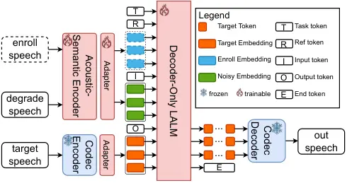
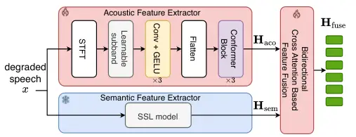

# XINGCHEN-UNIFE: A UNIFIED GENERATIVE SPEECH FRONT-END VIA COMPLEMENTARY ACOUSTIC-SEMANTIC MODELING

Kelan Kuang \sthanksE-mail: kuangkl@chinatelecom.cn    Qihan Hu    Jian
Kang    Jie Li    Yongxiang Li    Yi Liu\sthanksCorresponding author: Yi
Liu (e-mail: liuyi@chinatelecom.cn)

###### Abstract

This paper presents XingChen-UniFE, a unified large audio language model
(LALM) for general speech restoration (GSR) and target speaker
extraction (TSE). The proposed model employs complementary semantic and
acoustic representations through a dual-stream encoder, where a
self-supervised learning model provides hierarchical semantic features
and a learnable acoustic branch captures fine-grained structures from
complex spectra. A bidirectional cross-attention module further
facilitates information exchange between the two representations. The
fused representation conditions the LALM for discrete speech token
generation with task and speaker information. Experiments demonstrate
strong performance on both GSR and TSE and robust generalization to
unseen degradation conditions.

###### Index Terms: 

LALM, General Speech Restoration, Target Speaker Extraction,
Acoustic-Semantic Fusion

^(†)^(†)address: China Telecom Artificial Intelligence Technology
(Beijing) Co., Ltd.

## 1 INTRODUCTION

Real-world speech is often degraded by noise, reverberation,
transmission distortion, and interfering speakers, which reduces speech
quality and intelligibility. Existing systems typically use separate
models for different speech restoration tasks and target speaker
extraction, increasing training and deployment costs. This motivates
general speech restoration with a single model.

Most general speech restoration (GSR) methods follow discriminative
paradigms by predicting waveforms, spectrograms, or time-frequency masks
\[1, 2, 3\]. Although effective for specific tasks, they usually rely on
task-specific architectures and objectives, making heterogeneous
restoration tasks difficult to handle within a unified framework. Severe
degradation further requires modeling acoustic details, linguistic
content, and speaker characteristics beyond signal reconstruction alone.

Recent advances in large audio language models (LALMs) and neural audio
codecs enable speech processing to be formulated as conditional discrete
token generation \[4\]. However, LALM-based restoration requires input
representations that preserve robust semantic information and
fine-grained acoustic cues. Self-supervised learning (SSL) models, such
as wav2vec 2.0 \[5\], HuBERT \[6\], and WavLM \[7\], provide
hierarchical speech representations but are not optimized for waveform
reconstruction and may lose fine acoustic details. Recent SR studies
therefore explore joint acoustic-semantic modeling to reduce linguistic
and acoustic hallucinations. PASE \[8\] projects low-level SSL
representations into the space of high-level phonetic representations
and combines them by addition, while L3-SE \[9\] jointly distills
acoustic and semantic representations from WavLM and uses them as
continuous LM conditions. However, their acoustic representations remain
largely derived from SSL features and thus lack explicit modeling of the
frequency and phase structure of degraded speech. Complex spectrogram,
by contrast, retains both a physically meaningful frequency axis and
phase information, providing a natural representation for
frequency-aware acoustic modeling. Moreover, existing acoustic and
semantic representations are typically fused by simple addition or
concatenation, without explicit interaction.

In this work, we propose XingChen-UniFE, a unified LALM-based model for
GSR and TSE that integrates complementary acoustic and semantic
representations. The proposed model employs a dual-stream encoder
consisting of an SSL-based semantic branch and an acoustic branch,
followed by a bidirectional cross-attention module to explicitly model
the interaction between the two representations. The resulting fused
representation provides the LALM with both robust linguistic cues and
fine-grained acoustic details for discrete speech token generation. With
task and speaker conditions, XingChen-UniFE can handle diverse speech
restoration and target speaker extraction tasks in a single model.



Figure 1: Overall architecture of XingChen-UniFE. Enrollment speech is
used only for TSE.

The contributions of this work are summarized as follows: 1) We propose
XingChen-UniFE, a unified LALM-based model that supports speech
restoration and TSE under diverse degradation conditions. 2) We design a
dual-stream acoustic-semantic encoder that combines SSL representations
with complex spectral features to capture complementary linguistic and
acoustic information. 3) We introduce a bidirectional cross-attention
module to explicitly model interactions between acoustic and semantic
representations.

## 2 Proposed Method

### 2.1 Overall Architecture

XingChen-UniFE formulates GSR and TSE as conditional discrete speech
generation. Given degraded speech $`x`$, a task control token, and
enrollment speech $`r`$ for TSE, the model predicts acoustic and
semantic tokens of the target speech.

As shown in Fig. 1, the model comprises a complementary
acoustic-semantic encoder, an LALM backbone, and a neural audio codec.
The encoder produces the conditional representation, which guides the
LALM to generate interleaved delayed tokens in an autoregressive manner.
The generated tokens are then rearranged and decoded by the codec
decoder.

### 2.2 Complementary Representation Learning



(a)

(b)

Figure 2: Overview of the complementary acoustic-semantic encoder. (a)
Semantic and acoustic feature encoding; (b) bidirectional feature
fusion.

As shown in Fig. 2, the complementary encoder consists of parallel
semantic and acoustic branches followed by a bidirectional feature
fusion module.

#### 2.2.1 Semantic and Acoustic Feature Encoding

The semantic branch employs a pre-trained SSL model to extract speech
representations. Given the input waveform $`x`$, we average the hidden
representations from all layers of the SSL model:

```math
\mathbf{H}_{\mathrm{sem}}=\frac{1}{N_{w}}\sum_{\ell=1}^{N_{w}}\operatorname{SSL}_{\ell}(x), \tag{1}
```

where $`N_{w}`$ denotes the number of Transformer layers in the SSL
model. To complement SSL features with fine-grained acoustic details, we
introduce a learnable acoustic branch. The input waveform is transformed
into a complex STFT spectrogram
$`\mathbf{X}\in\mathbb{C}^{T\times 321}`$, whose real and imaginary
components are stacked and mapped through a sub-band projection. The
resulting features are processed by three 2D convolutional blocks and
three Conformer \[10\] blocks to obtain the acoustic representation
$`\mathbf{H}_{\mathrm{aco}}`$. The convolutional blocks reduce the
frequency dimension while preserving temporal resolution.

#### 2.2.2 Bidirectional Feature Fusion

To facilitate information exchange between the acoustic and semantic
representations, we propose a two-layer bidirectional cross-attention
fusion module. As shown in Fig. 2(b), the semantic representation
$`\mathbf{H}_{\mathrm{sem}}`$ and acoustic representation
$`\mathbf{H}_{\mathrm{aco}}`$ are first mapped into a shared embedding
space through separate linear projections.

In each fusion layer, one branch serves as Query and the other as Key
and Value, with the roles exchanged for bidirectional cross-attention.
Each output is followed by a residual connection and Layer
Normalization, and then by a shared FFN with another residual connection
and Layer Normalization. After two fusion layers, the two outputs are
concatenated and linearly projected to obtain
$`\mathbf{H}_{\mathrm{fuse}}`$.

|          |         |       |      |      |       |       |      |      |             |       |      |      |
| -------- | ------- | ----- | ---- | ---- | ----- | ----- | ---- | ---- | ----------- | ----- | ---- | ---- |
|          | Denoise |       |      |      | TSE   |       |      |      | TSE&Denoise |       |      |      |
|          | PESQ    | STOI  | SBS  | LPS  | PESQ  | STOI  | SBS  | LPS  | PESQ        | STOI  | SBS  | LPS  |
| LLaSE-G1 | 1.218   | 74.23 | .835 | .823 | 1.127 | 66.81 | .774 | .654 | 1.091       | 61.04 | .708 | .456 |
| UniSE    | 1.683   | 87.47 | .884 | .869 | 1.666 | 84.18 | .882 | .814 | 1.377       | 76.63 | .815 | .620 |
| UniTok   | 2.100   | 90.14 | .904 | .894 | 2.015 | 83.71 | .887 | .797 | 1.640       | 79.22 | .845 | .678 |
| Proposed | 2.137   | 90.56 | .916 | .930 | 2.093 | 81.74 | .888 | .786 | 1.703       | 78.55 | .852 | .714 |

Table 1: Performance on Libri2Mix for Denoise, TSE, and TSE&Denoise
using the mix-single, mix-clean, and mix-both subsets, respectively.
Best and second-best results are bold and underlined.

### 2.3 Conditional Token Generation

During training, the target speech $`s`$ is encoded by a frozen Codec
encoder into acoustic tokens $`\mathbf{A}=\{A_{t,k}\}`$ and semantic
tokens $`\mathbf{S}=\{S_{t,k}\}`$, where $`t`$ is the temporal index and
$`k=0,\ldots,K-1`$ is the codebook index.

To jointly model the two token types, acoustic and semantic tokens at
the same temporal position are first interleaved:

```math
C_{2t,k}=A_{t,k},\qquad C_{2t+1,k}=S_{t,k}. \tag{2}
```

The interleaved sequence is then rearranged using the delayed
pattern \[11\] to form the autoregressive target sequence:

```math
\widetilde{C}_{u+k,k}=C_{u,k},\qquad k=0,\ldots,K-1, \tag{3}
```

where $`u`$ denotes the position in the interleaved sequence.

The fused representation $`\mathbf{H}_{\mathrm{fuse}}`$ is mapped to the
LALM input space through a linear adapter to obtain the conditional
representation $`\mathbf{H}_{X}`$. For TSE, the enrollment speech $`r`$
is processed by the same encoder and projection pipeline to obtain
$`\mathbf{H}_{R}`$. Conditioned on $`\mathbf{H}_{X}`$,
$`\mathbf{H}_{R}`$, the task control token $`\mathcal{S}`$, and
previously generated tokens, the LALM backbone performs conditional
next-token prediction,

```math
\mathbf{H}_{u}=f_{\theta}\left(\widetilde{\mathbf{C}}_{<u},\mathbf{H}_{X},\mathbf{H}_{R},\mathcal{S}\right), \tag{4}
```

where $`\widetilde{\mathbf{C}}_{<u}`$ denotes the tokens preceding
generation step $`u`$. Based on $`\mathbf{H}_{u}`$, $`K`$ parallel
output heads predict the token distributions over the corresponding
codebooks, with greedy decoding used during inference. The generated
sequence is rearranged into time-aligned acoustic and semantic tokens
and decoded by the codec decoder.

## 3 EXPERIMENTAL SETUP

### 3.1 Implementation Details

The proposed XingChen-UniFE adopts a decoder-only Transformer as the
LALM backbone, which comprises 28 layers with a hidden dimension of 1024
and grouped-query attention \[12\] with 16 query heads and 8 key-value
heads. The dual-stream encoder consists of a frozen semantic branch
based on WavLM-Base-Plus \[7\] and a trainable acoustic branch, while
H-Codec \[13\] serves as the speech codec. The LALM backbone is trained
from scratch, while WavLM and H-Codec remain frozen, resulting in
approximately 502 M trainable parameters. The model is optimized for
400k steps with a batch size of 64 using AdamW optimizer \[14\] and a
Noam schedule with a 4k-step warm-up \[15\].

### 3.2 Training Data

Degraded speech is simulated on the fly. Each sample is randomly
corrupted by one or more degradations, including additive noise,
reverberation, interfering speech, clipping, packet loss, and bandwidth
limitation. Target speech is sampled from DNS Challenge \[16\], Emilia
\[17\], LibriSpeech \[18\], LibriHeavy \[19\], and AISHELL-3 \[20\].
Interfering speech is collected from WenetSpeech4TTS \[21\], VoxCeleb2
\[22\], and CN-Celeb \[23\], while noise samples are obtained from
DEMAND \[24\], WHAM! \[25\], DNS Challenge, RealMAN \[26\], ESC-50
\[27\], and DESED \[28\]. RIRs are randomly sampled from SLR26 and SLR28
\[29\]. Utterances from Emilia and LibriHeavy with DNSMOS scores below
3.5 are discarded. The resulting training pool comprises approximately
10k hours of target speech, 405k hours of noise, and 4640 hours of
interfering speech. All audio samples are resampled to 16 kHz and
segmented into clips ranging from 3 to 15 seconds in duration.

|          |           |           |          |           |          |           |           |           |
| -------- | --------- | --------- | -------- | --------- | -------- | --------- | --------- | --------- |
| Model    | Noise     | Rev.      | Interf.  | BW        | Clip     | Loss      | Mixed     | Avg.      |
| UniSE    | .754/21.8 | .833/11.1 | .884/7.1 | .846/10.2 | .873/6.4 | .814/13.4 | .335/89.1 | .763/22.7 |
| UniTok   | .805/15.4 | .836/6.7  | .897/5.7 | .853/7.8  | .892/4.3 | .828/10.3 | .472/68.5 | .798/17.0 |
| Proposed | .840/10.8 | .859/5.1  | .903/5.2 | .881/4.8  | .899/3.5 | .852/8.8  | .548/55.4 | .826/13.4 |

Table 2: GSR subtask performance measured by LPS$`\uparrow`$ / WER
(%)$`\downarrow`$. Mixed denotes samples containing all listed
distortion types.

Figure 3: Task-wise ablation of the fusion and acoustic representations.
Bars and lines denote $`\Delta`$SBS and $`\Delta`$WER relative to
XingChen-UniFE, respectively; downward displacement indicates
performance degradation.

## 4 RESULTS

We evaluate XingChen-UniFE and the baselines on GSR and TSE using PESQ
\[30\], STOI \[31\], SpeechBERTScore (SBS) \[32\], WER, and Levenshtein
Phoneme Similarity (LPS) \[33\]. Higher values are better except for
WER.

### 4.1 Comparison Experiment

XingChen-UniFE is compared with three generative multi-task baselines:
LLaSE-G1 \[34\], UniSE \[35\] and UniTok \[36\] for GSR and TSE.
LLaSE-G1 and UniSE use the publicly released checkpoints provided by the
original authors, whereas UniTok is reproduced by us and trained under
the same conditions as the proposed model.

Table 1 compares the models on Libri2Mix. XingChen-UniFE achieves the
best results on all metrics for the denoising task, and leads in PESQ
and SBS for TSE. Under the more challenging TSE&Denoise condition, it
achieves the best PESQ, SBS, and LPS, demonstrating strong performance
across different restoration tasks.

Table 2 further compares individual GSR subtasks. XingChen-UniFE
consistently achieves the best LPS and WER, with a larger margin under
the Mixed condition, indicating improved robustness to multiple
degradations.

We further evaluate generalization to two unseen degradation types
excluded from training, codec distortion and wind noise, as shown in
Table 3. XingChen-UniFE achieves the best SBS and WER for codec
distortion and the best LPS, SBS, and WER for wind noise, demonstrating
strong generalization to unseen conditions.

|          |       |      |      |            |      |      |
| -------- | ----- | ---- | ---- | ---------- | ---- | ---- |
|          | Codec |      |      | Wind Noise |      |      |
|          | LPS   | SBS  | WER  | LPS        | SBS  | WER  |
| LLaSE-G1 | .824  | .855 | 8.70 | .834       | .852 | 8.16 |
| UniSE    | .900  | .909 | 5.45 | .896       | .903 | 3.91 |
| UniTok   | .896  | .937 | 3.29 | .880       | .920 | 3.80 |
| Proposed | .896  | .938 | 3.25 | .900       | .927 | 3.20 |

Table 3: Performance under unseen degradation.

### 4.2 Ablation Study

|             |      |      |      |      |       |
| ----------- | ---- | ---- | ---- | ---- | ----- |
|             | PESQ | STOI | SBS  | LPS  | WER   |
| Proposed    | 2.14 | 90.6 | .916 | .930 | 7.74  |
|    w/o Sem. | 2.09 | 90.2 | .902 | .892 | 13.01 |
|    w/o Aco. | 1.84 | 89.1 | .911 | .917 | 9.03  |

Table 4: Ablation of the acoustic and semantic branches on Libri2Mix
mix-single.

Table 4 examines the contributions of the two branches. Removing the
semantic branch causes larger degradation in SBS, LPS, and WER, whereas
removing the acoustic branch mainly affects PESQ and STOI. As the former
metrics emphasize linguistic consistency and the latter reflect
perceptual quality and intelligibility, these results demonstrate the
complementary roles of the semantic and acoustic branches.

Fig. 3 shows task-wise ablations of feature fusion and acoustic
representation. Both simple concatenation (cat Fusion) and removal of
cross-attention (w/o C.A.) degrade performance, validating explicit
bidirectional interaction. Moreover, the acoustic-only variant using
real and imaginary components (w/ RI) clearly outperforms its
magnitude-only counterpart (w/ Mag), highlighting the importance of
phase information, particularly under mixed degradations.

## 5 CONCLUSION

This paper presents XingChen-UniFE, a discrete speech generation model
for GSR and TSE. The model integrates complementary acoustic and
semantic representations through a dual-stream encoder and bidirectional
cross-attention. This design jointly models fine-grained acoustic
structure and semantic information. The results demonstrate the
effectiveness of the proposed model and further validate the proposed
acoustic-semantic modeling and fusion strategy.

## References

- \[1\] C. Zheng, H. Zhang, W. Liu, X. Luo, A. Li, X. Li, and B. C.
  Moore (2023) Sixty years of frequency-domain monaural speech
  enhancement: from traditional to deep learning methods. Trends in
  Hearing 27, pp. 23312165231209913. Cited by: §1.
- \[2\] D. Wang and J. Chen (2018) Supervised speech separation based on
  deep learning: an overview. IEEE/ACM Trans. Audio, Speech, Lang.
  Process. 26 (10), pp. 1702–1726. Cited by: §1.
- \[3\] P. Ochieng (2023) Deep neural network techniques for monaural
  speech enhancement and separation: state of the art analysis: p.
  ochieng. Artif. Intell. Rev. 56 (Suppl 3), pp. 3651–3703. Cited by:
  §1.
- \[4\] Z. Borsos, R. Marinier, D. Vincent, E. Kharitonov, O.
  Pietquin, M. Sharifi, D. Roblek, O. Teboul, D. Grangier, M.
  Tagliasacchi, et al. (2023) AudioLM: a language modeling approach to
  audio generation. IEEE/ACM Trans. Audio, Speech, Lang. Process. 31,
  pp. 2523–2533. Cited by: §1.
- \[5\] A. Baevski, Y. Zhou, A. Mohamed, and M. Auli (2020) Wav2vec 2.0:
  a framework for self-supervised learning of speech representations.
  Vol. 33, pp. 12449–12460. Cited by: §1.
- \[6\] W. Hsu, B. Bolte, Y. H. Tsai, K. Lakhotia, R. Salakhutdinov,
  and A. Mohamed (2021) HuBERT: self-supervised speech representation
  learning by masked prediction of hidden units. IEEE/ACM Trans. Audio,
  Speech, Lang. Process. 29, pp. 3451–3460. Cited by: §1.
- \[7\] S. Chen, C. Wang, Z. Chen, Y. Wu, S. Liu, Z. Chen, J. Li, N.
  Kanda, T. Yoshioka, X. Xiao, J. Wu, L. Zhou, S. Ren, Y. Qian, Y.
  Qian, J. Wu, M. Zeng, X. Yu, and F. Wei (2022) WavLM: large-scale
  self-supervised pre-training for full stack speech processing. IEEE J.
  Sel. Topics Signal Process. 16 (6), pp. 1505–1518. External Links:
  [Document](https://dx.doi.org/10.1109/JSTSP.2022.3188113) Cited by:
  §1, §3.1.
- \[8\] X. Rong, Q. Hu, M. Yesilbursa, K. Wojcicki, and J. Lu (2026)
  PASE: leveraging the phonological prior of wavlm for low-hallucination
  generative speech enhancement. In Proc. AAAI Conf. Artif. Intell.,
  Vol. 40, pp. 32826–32834. Cited by: §1.
- \[9\] Z. Wang, X. Rong, H. Su, T. Tan, J. Wu, L. Fan, Z. Luo, J. Luan,
  and J. Lu (2026) Reducing linguistic hallucination in lm-based speech
  enhancement via noise-invariant acoustic-semantic distillation. arXiv
  preprint arXiv:2605.08608. Cited by: §1.
- \[10\] A. Gulati, J. Qin, C. Chiu, N. Parmar, Y. Zhang, J. Yu, W.
  Han, S. Wang, Z. Zhang, Y. Wu, et al. (2020) Conformer:
  convolution-augmented transformer for speech recognition. arXiv
  preprint arXiv:2005.08100. Cited by: §2.2.1.
- \[11\] J. Copet, F. Kreuk, I. Gat, T. Remez, D. Kant, G. Synnaeve, Y.
  Adi, and A. Défossez (2023) Simple and controllable music generation.
  Adv. Neural Inf. Process. Syst. 36, pp. 47704–47720. Cited by: §2.3.
- \[12\] J. Ainslie, J. Lee-Thorp, M. De Jong, Y. Zemlyanskiy, F.
  Lebrón, and S. Sanghai (2023) Gqa: training generalized multi-query
  transformer models from multi-head checkpoints. In Proc. Conf.
  Empirical Methods Natural Lang. Process., pp. 4895–4901. Cited by:
  §3.1.
- \[13\] L. Chengwei, Y. Haoyin, X. Shaofei, L. Xiaotao, C. Xiaofu, G.
  Bin, X. Zheng, and S. Gang (2025) QuarkAudio technical report. arXiv
  preprint arXiv:2512.20151. Cited by: §3.1.
- \[14\] I. Loshchilov and F. Hutter (2019) Decoupled weight decay
  regularization. In Proc. Int. Conf. Learn. Represent., Cited by: §3.1.
- \[15\] A. Vaswani, N. Shazeer, N. Parmar, J. Uszkoreit, L.
  Jones, A. N. Gomez, L. Kaiser, and I. Polosukhin (2017) Attention is
  all you need. In Adv. Neural Inf. Process. Syst., Vol. 30,
  pp. 5998–6008. Cited by: §3.1.
- \[16\] H. Dubey, A. Aazami, V. Gopal, B. Naderi, S. Braun, R.
  Cutler, A. Ju, M. Zohourian, M. Tang, M. Golestaneh, et al. (2024)
  ICASSP 2023 deep noise suppression challenge. IEEE Open J. Signal
  Process. 5, pp. 725–737. Cited by: §3.2.
- \[17\] H. He, Z. Shang, C. Wang, X. Li, Y. Gu, H. Hua, L. Liu, C.
  Yang, J. Li, P. Shi, et al. (2024) Emilia: an extensive, multilingual,
  and diverse speech dataset for large-scale speech generation. In Proc.
  IEEE Spoken Lang. Technol. Workshop, pp. 885–890. Cited by: §3.2.
- \[18\] V. Panayotov, G. Chen, D. Povey, and S. Khudanpur (2015)
  Librispeech: an asr corpus based on public domain audio books. In
  Proc. IEEE Int. Conf. Acoust., Speech Signal Process., pp. 5206–5210.
  Cited by: §3.2.
- \[19\] W. Kang, X. Yang, Z. Yao, F. Kuang, Y. Yang, L. Guo, L. Lin,
  and D. Povey (2024) Libriheavy: a 50,000 hours asr corpus with
  punctuation casing and context. In Proc. IEEE Int. Conf. Acoust.,
  Speech Signal Process., pp. 10991–10995. Cited by: §3.2.
- \[20\] Y. Shi, H. Bu, X. Xu, S. Zhang, and M. Li (2020) Aishell-3: a
  multi-speaker mandarin tts corpus and the baselines. arXiv preprint
  arXiv:2010.11567. Cited by: §3.2.
- \[21\] L. Ma, D. Guo, K. Song, Y. Jiang, S. Wang, L. Xue, W. Xu, H.
  Zhao, B. Zhang, and L. Xie (2024) WenetSpeech4TTS: a 12,800-hour
  mandarin tts corpus for large speech generation model benchmark. arXiv
  preprint arXiv:2406.05763. Cited by: §3.2.
- \[22\] J. S. Chung, A. Nagrani, and A. Zisserman (2018) VoxCeleb2:
  deep speaker recognition. arXiv preprint arXiv:1806.05622. Cited by:
  §3.2.
- \[23\] Y. Fan, J. Kang, L. Li, K. Li, H. Chen, S. Cheng, P. Zhang, Z.
  Zhou, Y. Cai, and D. Wang (2020) Cn-Celeb: a challenging chinese
  speaker recognition dataset. In Proc. IEEE Int. Conf. Acoust., Speech
  Signal Process., pp. 7604–7608. Cited by: §3.2.
- \[24\] J. Thiemann, N. Ito, and E. Vincent (2013) The diverse
  environments multi-channel acoustic noise database (demand): a
  database of multichannel environmental noise recordings. In Proc.
  Meet. Acoust., Vol. 19, pp. 035081. Cited by: §3.2.
- \[25\] G. Wichern, J. Antognini, M. Flynn, L. R. Zhu, E. McQuinn, D.
  Crow, E. Manilow, and J. L. Roux (2019) Wham!: extending speech
  separation to noisy environments. arXiv preprint arXiv:1907.01160.
  Cited by: §3.2.
- \[26\] B. Yang, C. Quan, Y. Wang, P. Wang, Y. Yang, Y. Fang, N.
  Shao, H. Bu, X. Xu, and X. Li (2024) RealMAN: a real-recorded and
  annotated microphone array dataset for dynamic speech enhancement and
  localization. Vol. 37, pp. 105997–106019. Cited by: §3.2.
- \[27\] K. J. Piczak (2015) ESC: dataset for environmental sound
  classification. In Proc. ACM Int. Conf. Multimedia, pp. 1015–1018.
  Cited by: §3.2.
- \[28\] N. Turpault, R. Serizel, A. P. Shah, and J. Salamon (2019)
  Sound event detection in domestic environments with weakly labeled
  data and soundscape synthesis. In Proc. Detection Classification
  Acoust. Scenes Events Workshop, Cited by: §3.2.
- \[29\] T. Ko, V. Peddinti, D. Povey, M. L. Seltzer, and S.
  Khudanpur (2017) A study on data augmentation of reverberant speech
  for robust speech recognition. In Proc. IEEE Int. Conf. Acoust.,
  Speech Signal Process., Vol. , pp. 5220–5224. External Links:
  [Document](https://dx.doi.org/10.1109/ICASSP.2017.7953152) Cited by:
  §3.2.
- \[30\] A. W. Rix, J. G. Beerends, M. P. Hollier, and A. P.
  Hekstra (2001) Perceptual evaluation of speech quality (PESQ)—a new
  method for speech quality assessment of telephone networks and codecs.
  In Proc. IEEE Int. Conf. Acoust., Speech Signal Process., Vol. 2,
  pp. 749–752. Cited by: §4.
- \[31\] C. H. Taal, R. C. Hendriks, R. Heusdens, and J. Jensen (2011)
  An algorithm for intelligibility prediction of time–frequency weighted
  noisy speech. IEEE Trans. Audio, Speech, Lang. Process. 19 (7),
  pp. 2125–2136. Cited by: §4.
- \[32\] T. Saeki, S. Maiti, S. Takamichi, S. Watanabe, and H.
  Saruwatari (2024) SpeechBERTScore: Reference-Aware Automatic
  Evaluation of Speech Generation Leveraging NLP Evaluation Metrics. In
  Proc. Interspeech 2024, pp. 4943–4947. External Links:
  [Document](https://dx.doi.org/10.21437/Interspeech.2024-1508) Cited
  by: §4.
- \[33\] J. Pirklbauer, M. Sach, K. Fluyt, W. Tirry, W. Wardah, S.
  Moeller, and T. Fingscheidt (2023) Evaluation metrics for generative
  speech enhancement methods: issues and perspectives. In Proc. 15th ITG
  Conf. Speech Commun., Aachen, Germany, pp. 265–269. Cited by: §4.
- \[34\] B. Kang, X. Zhu, Z. Zhang, Z. Ye, M. Liu, Z. Wang, Y. Zhu, G.
  Ma, J. Chen, L. Xiao, et al. (2025) LLaSE-G1: incentivizing
  generalization capability for llama-based speech enhancement. In Proc.
  63rd Annu. Meeting Assoc. Comput. Linguistics, pp. 13292–13305. Cited
  by: §4.1.
- \[35\] H. Yan, C. Liu, S. Xue, X. Liang, Y. Liu, Y. Kong, and Z.
  Xue (2025) UniSE: a unified framework for decoder-only autoregressive
  lm-based speech enhancement. arXiv preprint arXiv:2510.20441. Cited
  by: §4.1.
- \[36\] C. Liu, H. Yan, S. Xue, X. Liang, Y. Liu, Z. Xue, G. Song,
  and B. Zhou (2025) Unitok-Audio: a unified audio generation framework
  via generative modeling on discrete codec tokens. arXiv preprint
  arXiv:2510.26372. Cited by: §4.1.
