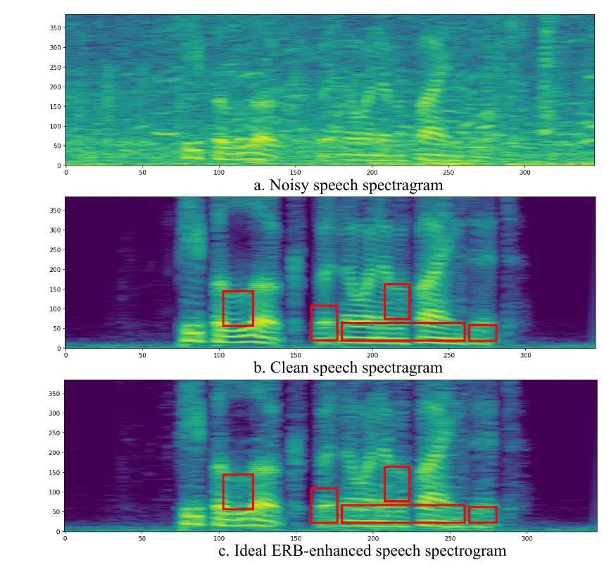
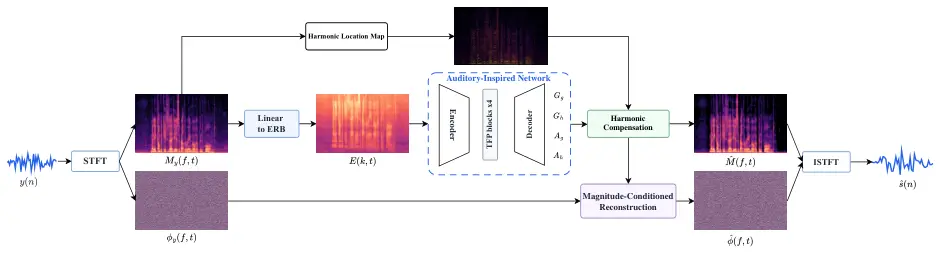
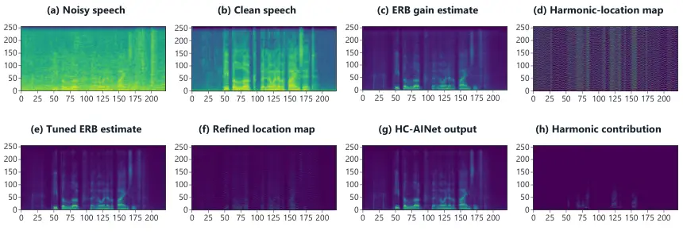

# HC-AINet: An Auditory-Inspired Network with Harmonic Compensation for Low-Complexity Speech Enhancement

Nan Li    Xiaoxiong Wu    Huawei Liu    Ziping Zhao ^(†)^(†)thanks: The
authors are with the School of Computer and Information Engineering,
Tianjin Normal University, Tianjin, China.

###### Abstract

Speech enhancement on resource-constrained devices requires noise
suppression with limited computation and minimal loss of spectral
detail. Auditory-inspired subband processing reduces computation, but
its smooth gains have limited ability to distinguish harmonic peaks from
neighboring noise. We propose a harmonic-compensated auditory-inspired
network (HC-AINet) for low-complexity speech enhancement. A triangular
equivalent rectangular bandwidth (ERB) filterbank supplies compact
features to a lightweight network comprising inverted-residual units,
temporal Conformer layers, and parallel frequency-gated convolutions.
The network predicts global and harmonic gains together with fusion
weights. A harmonic-location map derived from the noisy spectrum
confines the harmonic contribution to selected bins on the original
frequency grid, while the global branch controls the broader spectral
envelope. The compensated magnitude, noisy phase, and a
magnitude-derived minimum-phase cue jointly condition a compact phase
estimator for waveform reconstruction. On VoiceBank-DEMAND, the 64-band
model achieves a PESQ of 3.20 and a STOI of 0.95 with approximately 0.27
million parameters.

###### Index Terms: 

Speech enhancement, auditory-inspired networks, ERB subbands, harmonic
compensation, low-complexity processing.

## I Introduction

Speech enhancement is an important component of hearing aids, smart
speakers, and smartphones operating in noisy environments. It aims to
suppress acoustic interference while preserving speech information for
communication and subsequent processing \[1, 2\]. On
resource-constrained devices, enhancement quality must be balanced
against model size and computation. This trade-off motivates
architectures that retain spectral selectivity within a compact
representation.

Neural speech enhancement methods differ in their processing
representation. Magnitude-domain methods estimate clean amplitudes or
gains applied to the noisy magnitude \[3, 4\]. Complex-domain methods
additionally account for phase \[5, 6, 7, 8\], whereas time-domain
methods estimate waveforms through learned analysis and synthesis \[9,
10, 11\]. Across these approaches, the dimensionality of intermediate
features affects computational cost. Compact representations can reduce
this cost, provided that the reconstruction stage retains sufficient
spectral detail.

Auditory-inspired subband processing exploits the nonuniform frequency
resolution of human hearing to construct compact spectral features.
RNNoise, PercepNet, and PercepNet+ combine learned subband gains with
signal-processing operations \[12, 13, 14\]. Their gain predictors
operate at reduced frequency resolution, while the original
linear-frequency spectrum remains available for reconstruction. In this
work, auditory inspiration refers to the ERB-based nonuniform frequency
representation. The resulting reduction in feature dimensionality also
limits the frequency resolution of the predicted gains.



Fig. 1: Comparison of (a) noisy speech, (b) clean speech, and (c) speech
reconstructed with oracle 32-band ERB gains. The highlighted regions
show residual differences in narrowband spectral structure.

A single auditory band may contain both speech harmonics and
inter-harmonic noise, which cannot be adjusted independently by a shared
gain. Fig. 1 shows residual narrowband differences after reconstruction
with oracle 32-band ERB gains; Table I reports the corresponding quality
measures. These observations motivate selective compensation on the
retained linear-frequency spectrum. The oracle comparison characterizes
the evaluated gain and synthesis settings; it does not establish a
universal performance ceiling for auditory subband methods.

| Method | PESQ | CSIG | CBAK | COVL | STOI |
| ------ | ---- | ---- | ---- | ---- | ---- |
| Noisy  | 1.97 | 3.35 | 2.44 | 2.63 | 0.92 |
| Clean  | 4.50 | 5.00 | 5.00 | 5.00 | 1.00 |
| Rec    | 2.94 | 4.22 | 3.22 | 3.57 | 0.96 |
| Bark   | 3.49 | 4.66 | 3.82 | 4.12 | 0.98 |
| Mel    | 3.47 | 4.63 | 3.79 | 4.08 | 0.98 |
| ERB    | 3.58 | 4.69 | 3.92 | 4.18 | 0.98 |

- Clean denotes the reference signal.

TABLE I: Oracle gain comparison for four 32-band representations under
the evaluated synthesis configuration.

Previous studies use harmonic information or spectral filtering to
refine coarse speech estimates. HGCN employs a harmonic integral
representation and gated compensation \[15\], while our earlier HC-APNet
combines auditory processing with harmonic compensation \[16\].
DeepFilterNet supplements ERB-domain gains with complex multi-frame
filtering \[17\]. These approaches motivate allocating additional
processing to spectral details that compact gain prediction cannot
resolve. Here, a harmonic-location map derived from the noisy input
controls where a learned harmonic contribution supplements the global
magnitude estimate.

Waveform reconstruction also depends on phase. Reusing noisy phase
leaves phase errors unaddressed even when magnitude estimation improves
\[5, 8\]; PercepNet+ likewise incorporates phase processing within an
auditory enhancement framework \[14\]. We therefore condition a compact
phase estimator on the compensated magnitude, noisy phase, and a
magnitude-derived minimum-phase cue. This cue supplies an auxiliary
reference for reconstruction and is not assumed to recover clean phase
by itself.

We propose a harmonic-compensated auditory-inspired network (HC-AINet)
that combines ERB-domain gain prediction with selective compensation on
the original frequency grid. A global branch controls the spectral
envelope, and a location-conditioned harmonic branch supplements it at
candidate harmonic bins. This arrangement separates the resolution of
learned gain prediction from the selectivity of gain application. The
fused magnitude subsequently guides phase estimation and waveform
synthesis.

The gain predictor comprises an inverted-residual encoder,
temporal–frequency perception (TFP) modules, and a four-head decoder.
Each TFP module combines a temporal Conformer with parallel
frequency-gated (PFG) convolutions to model temporal context and
spectral structure. The decoder predicts global and harmonic gains and
their fusion weights from compact ERB features. These outputs are
expanded to the original frequency grid before harmonic selection and
weighted fusion.

Building on our earlier HC-APNet \[16\], HC-AINet adopts an STFT/ERB
formulation and a revised temporal–frequency backbone, with
magnitude-conditioned reconstruction following harmonic compensation.
The main contributions are as follows:

1.  1.  We propose HC-AINet, which combines ERB-domain gain prediction with
        harmonic compensation on the retained linear-frequency spectrum. An
        inverted-residual and temporal–frequency backbone provides compact
        features for gain prediction.
2.  2.  We formulate a location-conditioned harmonic branch with learned
        gain fusion to increase within-band spectral selectivity. The
        compensated magnitude conditions a compact phase estimator for
        waveform reconstruction.
3.  3.  We evaluate the quality–complexity trade-off through representation
        comparisons, backbone ablations, and ablations of harmonic
        compensation and reconstruction. VoiceBank-DEMAND and DNS Challenge
        evaluations assess the complete system under complementary test
        conditions.

The remainder of this paper is organized as follows. Section II
formulates the problem and outlines the system. Section III details the
proposed method, and Section IV describes the experimental settings.
Section V analyzes the results, Section VI discusses limitations, and
Section VII concludes the paper.



Fig. 2: Overview of HC-AINet. The auditory-inspired gain network (AINet)
predicts global and harmonic gains and their fusion weights from ERB
features. A noisy-input harmonic-location map guides selective
compensation on the original frequency grid. The compensated magnitude
then conditions waveform reconstruction.

## II System Overview

HC-AINet integrates auditory-inspired gain prediction, selective
harmonic compensation, and magnitude-conditioned waveform
reconstruction. We first formulate the enhancement task and then
summarize the signal flow.

### II-A Problem Formulation

Let $`s(n)`$ and $`d(n)`$ denote the target speech and additive noise
signals, respectively. The noisy speech signal is modeled as

```math
y(n)=s(n)+d(n), \tag{1}
```

where $`n`$ is the discrete-time sample index. Applying the short-time
Fourier transform (STFT) yields the corresponding time–frequency
representation:

```math
Y(f,t)=S(f,t)+D(f,t). \tag{2}
```

Here, $`f`$ and $`t`$ index frequency bins and frames, respectively. The
noisy magnitude and phase are denoted by $`M_{y}=|Y|`$ and
$`\phi_{y}=\angle Y`$, and the clean magnitude by $`M=|S|`$. HC-AINet
estimates a compensated magnitude $`\hat{M}`$ and uses it to guide
estimation of the synthesis phase $`\hat{\phi}`$. The enhanced complex
spectrum is

```math
\hat{S}(f,t)=\hat{M}(f,t)\exp\!\left(j\hat{\phi}(f,t)\right), \tag{3}
```

The enhanced waveform is obtained by inverse STFT,
$`\hat{s}=\operatorname{ISTFT}(\hat{S})`$. Batch and channel dimensions
are omitted from the signal formulation and included explicitly in the
network description.

### II-B Overview of the Proposed Method

As illustrated in Fig. 2, HC-AINet predicts global and harmonic gains
and their fusion weights from ERB features. After expansion to the
original frequency grid, the global gain modulates the noisy magnitude,
while the harmonic gain contributes only at selected locations. Their
weighted sum yields the compensated magnitude. A compact network then
estimates the synthesis phase from this magnitude, noisy phase, and a
deterministic magnitude-derived cue. The estimated phase and compensated
magnitude form the enhanced complex spectrum in (3).

Temporal processing is designed around masked attention and
convolutional context from past frames, while frequency processing
operates within each frame. End-to-end causality also depends on
normalization, temporal aggregation, and STFT/ISTFT buffering. The
present evaluation establishes objective enhancement scores and reported
computational costs; streaming behavior and latency remain to be
validated at the implementation level.

## III HC-AINet Framework

The framework first compresses the frequency representation for gain
prediction, then applies harmonic compensation and reconstructs the
waveform on the original frequency grid. The following subsections
describe these stages and the joint training objective.

### III-A Auditory-Inspired Subband Representation

A fixed triangular ERB filterbank reduces the input to the gain
predictor from $`F`$ linear-frequency bins to $`K_{\mathrm{ERB}}`$
subbands. The compact model uses $`K_{\mathrm{ERB}}=32`$, and a 64-band
configuration evaluates the effect of finer subband resolution. Let
$`W_{\mathrm{ERB}}\in\mathbb{R}_{\geq 0}^{K_{\mathrm{ERB}}\times F}`$
denote the filterbank matrix. The feature at band $`k`$ and frame $`t`$
is

```math
E(k,t)=\sum_{f=0}^{F-1}W_{\mathrm{ERB}}(k,f)M_{y}(f,t). \tag{4}
```

Filter centers are uniformly spaced on the ERB scale and mapped to the
linear-frequency grid. The resulting nonuniform bands allocate finer
frequency resolution to lower frequencies while reducing the dimension
presented to the gain network.

The network outputs are expanded to the original frequency grid before
application to the noisy spectrum. For a predicted subband gain or
fusion weight $`Q`$, the expansion is

```math
\mathcal{U}_{\mathrm{ERB}}\{Q\}(f,t)=\sum_{k=1}^{K_{\mathrm{ERB}}}W_{\mathrm{ERB}}(k,f)Q(k,t). \tag{5}
```

This operation expands predicted gains and weights; it is not an inverse
of the dimension-reducing analysis. Applying the expanded controls to
the retained noisy magnitude preserves access to individual frequency
bins, where the harmonic-location map supplies finer selectivity.

### III-B Auditory-Inspired Gain Network

Fig. 3: Auditory-inspired gain network (AINet). Panels (a)–(c) show the
encoder, TFP module, and decoder. Panels (d)–(f) detail the
inverted-residual unit, Conformer functions, and PFG module. The two PFG
modules are sequential, while the convolution branches within each PFG
module are parallel. Panel (e) summarizes functions rather than the
complete Conformer sublayer order.

AINet is the ERB-domain gain predictor within the complete HC-AINet
system. It comprises an encoder, stacked TFP modules, and a four-head
decoder (Fig. 3). The encoder extracts subband features, the TFP modules
model temporal and frequency dependencies, and the decoder predicts the
gains and fusion weights used for magnitude reconstruction.

#### III-B1 Encoder

The encoder extracts compact subband features through pointwise and
depthwise operations. Given
$`E\in\mathbb{R}^{B\times 1\times T\times K_{\mathrm{ERB}}}`$, where
$`B`$ is the batch size, the initial projection applies a pointwise
convolution, batch normalization, and PReLU:

```math
F_{0}=\sigma\!\left(\operatorname{BN}\!\left(\operatorname{Conv}_{1\times 1}(E)\right)\right), \tag{6}
```

Here, BN denotes batch normalization and $`\sigma`$ denotes PReLU.
Inverted-residual units then refine the features \[18\]. Each unit uses
pointwise expansion, depthwise convolution, and pointwise projection:

```math
\displaystyle U_{l} \displaystyle=\rho\!\left(\operatorname{BN}\!\left(\operatorname{PW}^{\uparrow}(F_{l-1})\right)\right), \tag{7}
```

```math
\displaystyle V_{l} \displaystyle=\rho\!\left(\operatorname{BN}\!\left(\operatorname{DW}_{3\times 3}(U_{l})\right)\right), \tag{8}
```

```math
\displaystyle\widetilde{F}_{l} \displaystyle=\operatorname{BN}\!\left(\operatorname{PW}^{\downarrow}(V_{l})\right), \tag{9}
```

Here, $`\rho`$ is ReLU6, DW denotes depthwise convolution, and
$`\operatorname{PW}^{\uparrow}`$ and $`\operatorname{PW}^{\downarrow}`$
denote pointwise expansion and projection. When dimensions agree,
residual addition gives $`F_{l}=F_{l-1}+\widetilde{F}_{l}`$. Four units
are followed by frequency downsampling:

```math
F_{e}=\sigma\!\left(\operatorname{BN}\!\left(\operatorname{Conv}_{1\times 3}^{(1,2)}(F_{4})\right)\right). \tag{10}
```

The stride $`(1,2)`$ reduces the frequency dimension while preserving
temporal resolution. The output is
$`F_{e}\in\mathbb{R}^{B\times C\times T\times F^{\prime}}`$, where $`C`$
is the channel count and $`F^{\prime}`$ is the reduced subband
dimension.

#### III-B2 Temporal–Frequency Perception

Each TFP module models temporal context and spectral relationships in
the compressed representation. Following the separate treatment of time
and frequency in \[19\], it applies a temporal Conformer followed by two
sequential frequency-axis PFG modules. Gated convolutions provide
frequency modeling without joint attention over all time–frequency
locations.

Temporal processing treats the features at each reduced frequency
location as a sequence. An outer residual connection adds the Conformer
output to the input:

```math
\displaystyle X_{t} \displaystyle=\operatorname{Reshape}_{t}(F_{e})\in\mathbb{R}^{(BF^{\prime})\times T\times C}, \tag{11}
```

```math
\displaystyle Y_{t} \displaystyle=\operatorname{Conformer}_{t}(X_{t})+X_{t}. \tag{12}
```

The Conformer combines self-attention, convolution, and feed-forward
operations \[20\]. A temporal mask is intended to prevent attention to
future frames. The outer residual connection above supplements the
residual paths within the Conformer.

The output is rearranged for frequency processing within each frame:

```math
X_{f}=\operatorname{Reshape}_{f}(Y_{t})\in\mathbb{R}^{(BT)\times F^{\prime}\times C}. \tag{13}
```

Each PFG module uses three parallel depthwise convolutions to capture
spectral patterns at different frequency scales:

```math
P_{i}=\operatorname{DWConv}_{k_{i}}(X_{f}),\qquad(k_{1},k_{2},k_{3})=(3,5,7). \tag{14}
```

Frequency-axis average pooling produces a frame-level descriptor. A
pointwise projection and softmax then determine the convolution-branch
weights:

```math
[\alpha_{1},\alpha_{2},\alpha_{3}]=\operatorname{Softmax}\!\left(\operatorname{PW}(\operatorname{GAP}_{f}(X_{f}))\right), \tag{15}
```

Here, $`\operatorname{GAP}_{f}`$ denotes frequency-axis pooling and PW
denotes pointwise projection. The weights are broadcast along frequency
to combine the branch outputs. Pointwise projection and residual
addition give

```math
\operatorname{PFG}(X_{f})=X_{f}+\operatorname{PW}\!\left(\sum_{i=1}^{3}\alpha_{i}P_{i}\right). \tag{16}
```

Two PFG modules are applied consecutively, and the output is returned to
the original feature layout:

```math
F_{c}=\operatorname{Reshape}_{f}^{-1}\!\left(\operatorname{PFG}_{2}(\operatorname{PFG}_{1}(X_{f}))\right). \tag{17}
```

The branches within a PFG module operate in parallel, and the two PFG
modules operate sequentially. For a fixed channel count and fixed kernel
widths, the frequency-convolution cost grows linearly with
$`F^{\prime}`$. The total workload also includes temporal attention.

#### III-B3 Decoder and Output Heads

The decoder maps the contextualized features to subband gains and fusion
weights. Inverted-residual units refine the TFP output, and a transposed
convolution restores the subband resolution:

```math
\displaystyle F_{d} \displaystyle=\operatorname{DecIRUnits}(F_{c}), \tag{18}
```

```math
\displaystyle U_{d} \displaystyle=\operatorname{ConvTranspose}_{1\times 3}^{(1,2)}(F_{d}), \tag{19}
```

```math
\displaystyle Z_{d} \displaystyle=\operatorname{PW}_{2}\!\left(\sigma\!\left(\operatorname{IN}(\operatorname{PW}_{1}(U_{d}))\right)\right). \tag{20}
```

Here, IN denotes instance normalization. The output is divided into four
heads, each followed by an independent learnable sigmoid:

```math
\displaystyle[G_{g},G_{h},A_{g},A_{h}] \displaystyle=[\sigma_{g}(Z_{g}),\sigma_{h}(Z_{h}),
```

```math
\displaystyle\hskip 45.5244pt\sigma_{w_{g}}(Z_{w_{g}}),\sigma_{w_{h}}(Z_{w_{h}})]. \tag{21}
```

The outputs $`G_{g}`$ and $`G_{h}`$ are the global and harmonic gains,
respectively, and $`A_{g}`$ and $`A_{h}`$ weight their contributions.
The four heads use independent activations, so the fusion weights are
not constrained to sum to one.

All four outputs are expanded using (5):

```math
\bar{Q}=\mathcal{U}_{\mathrm{ERB}}\{Q\},\qquad Q\in\{G_{g},G_{h},A_{g},A_{h}\}. \tag{22}
```

The global estimate is obtained by multiplying the expanded global gain
with the noisy magnitude:

```math
M_{g}=\bar{G}_{g}\odot M_{y}, \tag{23}
```

where $`\odot`$ denotes element-wise multiplication.

### III-C Harmonic Compensation and Reconstruction

Harmonic compensation increases spectral selectivity by adding a
location-dependent contribution to the global magnitude estimate
(Fig. 4). A fixed prior identifies candidate harmonic bins, and learned
gains and fusion weights determine their contribution. The fused
magnitude then conditions waveform reconstruction.

Fig. 4: Harmonic magnitude compensation. A template prior derived from
noisy speech selects candidate harmonic bins. Learned gains and fusion
weights combine the global estimate with a location-conditioned harmonic
contribution. The compensated magnitude is passed to waveform
reconstruction.

#### III-C1 Harmonic-Location Estimation

Following the harmonic-integral principle in \[15\], we project the
noisy log magnitude onto fixed harmonic templates to identify candidate
locations. Let $`J`$ denote the number of templates and
$`\mathbf{I}_{\rm hc}\in\mathbb{R}^{J\times F}`$ the harmonic integral
matrix. The template scores are

```math
H(j,t)=\sum_{f}\mathbf{I}_{\rm hc}(j,f)\log(M_{y}(f,t)+\epsilon), \tag{24}
```

Here, $`\epsilon>0`$ provides numerical stability. For each frame, the
$`K_{h}`$ highest-scoring template indices are selected:

```math
\mathcal{P}_{h}(t)=\operatorname{TopKIndices}(H(:,t),K_{h}). \tag{25}
```

The current and preceding candidates are then combined using a temporal
aggregation operator:

```math
\widetilde{\mathcal{P}}_{h}(t)=\mathcal{C}\!\left(\{\mathcal{P}_{h}(\tau):\tau\leq t\}\right), \tag{26}
```

A fixed lookup table maps the aggregated template indices to a binary
harmonic-location map $`H_{\rm loc}\in\{0,1\}^{F\times T}`$. The compact
model uses $`K_{h}=1`$. This procedure supplies pitch-related location
information without a separate pYIN estimator or speech/voicing gate.

#### III-C2 Harmonic Magnitude Compensation

The expanded harmonic gain is applied to the noisy magnitude at
locations selected by $`H_{\rm loc}`$. Its contribution is combined with
the global estimate using the predicted fusion weights:

```math
\displaystyle M_{h} \displaystyle=M_{y}\odot\bar{G}_{h}\odot H_{\rm loc}, \tag{27}
```

```math
\displaystyle\hat{M} \displaystyle=\bar{A}_{g}\odot M_{g}+\bar{A}_{h}\odot M_{h}. \tag{28}
```

Substituting (23) into (28) gives an equivalent expression in terms of
an effective gain:

```math
\hat{M}=M_{y}\odot\underbrace{\left(\bar{A}_{g}\odot\bar{G}_{g}+\bar{A}_{h}\odot\bar{G}_{h}\odot H_{\rm loc}\right)}_{G_{\rm eff}}. \tag{29}
```

The first term of $`G_{\rm eff}`$ controls the broader spectral
envelope, while the second adds a contribution at candidate harmonic
locations. At unselected bins, only the global branch contributes. The
location map thus introduces within-band selectivity even though the
gains are predicted in the compact ERB domain. Because the effective
gain multiplies the input magnitude, compensation redistributes
attenuation or amplification of existing spectral energy rather than
generating missing harmonics independently.

#### III-C3 Reconstruction from the Compensated Magnitude

The reconstruction stage estimates synthesis phase from the compensated
magnitude. A deterministic minimum-phase cue, $`\phi_{\min}`$, provides
a magnitude-derived reference through spectral factorization, without
linear-prediction coefficients. The network uses this cue as auxiliary
information; the cue itself is not assumed to equal clean-speech phase.

For an even FFT length $`N`$ and $`F=N/2+1`$, define the compensated log
magnitude as

```math
\ell(f,t)=\log(\hat{M}(f,t)+\epsilon),\qquad 0\leq f\leq N/2. \tag{30}
```

We first extend the one-sided log magnitude to an even full spectrum:

```math
\ell_{\rm full}(f,t)=\begin{cases}\ell(f,t),&0\leq f\leq N/2,\\
\ell(N-f,t),&N/2<f<N.\end{cases} \tag{31}
```

The inverse Fourier transform yields the real cepstrum. A minimum-phase
lifter retains the terms at $`q=0`$ and $`q=N/2`$, doubles those at
$`1\leq q<N/2`$, and sets the remaining terms to zero:

```math
c(q,t)=\operatorname{Re}\!\left\{\operatorname{IFFT}_{N}\big(\ell_{\rm full}(:,t)\big)[q]\right\}, \tag{32}
```

```math
c_{\min}(q,t)=\begin{cases}c(q,t),&q=0\ \text{or}\ q=N/2,\\
2c(q,t),&1\leq q<N/2,\\
0,&N/2<q<N.\end{cases} \tag{33}
```

Using the forward-DFT convention $`\exp(-j2\pi fq/N)`$, the imaginary
part of the transformed liftered cepstrum gives the phase cue:

```math
\phi_{\min}(f,t)=\operatorname{Im}\!\left\{\operatorname{FFT}_{N}(c_{\min}(:,t))[f]\right\}. \tag{34}
```

The first $`F`$ bins correspond to the one-sided STFT. This calculation
is performed independently for each frame, so the cue does not enforce
phase continuity across frames or STFT consistency.

The cue, noisy phase, and compensated log magnitude form the input to
the reconstruction network:

```math
X=[\phi_{\min},\phi_{y},\ell]. \tag{35}
```

A compact convolutional network predicts two coordinates that determine
the synthesis phase:

```math
R=\operatorname{CNN}_{r}(X),\qquad I=\operatorname{CNN}_{i}(X), \tag{36}
```

The estimated phase is obtained from the two coordinates using

```math
\hat{\phi}=\operatorname{atan2}(I,R). \tag{37}
```

The coordinates $`R`$ and $`I`$ specify phase direction. The synthesis
magnitude is supplied by the fused global and harmonic branches, without
a separate magnitude prediction in the reconstruction stage. Equation
(3) combines this magnitude with the estimated phase before inverse
STFT.

### III-D Training Objective

Training jointly supervises the global estimate, harmonic contribution,
compensated magnitude, and reconstructed signal. The magnitude losses
are

```math
\displaystyle L_{\rm mag}^{g} \displaystyle=\|M-M_{g}\|_{2}^{2}, \tag{38}
```

```math
\displaystyle L_{\rm harm} \displaystyle=\|M\odot H_{\rm loc}-M_{h}\|_{2}^{2}, \tag{39}
```

```math
\displaystyle L_{\rm mag}^{f} \displaystyle=\|M-\hat{M}\|_{2}^{2}, \tag{40}
```

```math
\displaystyle L_{\rm mag} \displaystyle=L_{\rm mag}^{g}+L_{\rm harm}+0.2L_{\rm mag}^{f}. \tag{41}
```

The harmonic target uses the same noisy-input location map as the
forward pass. It therefore supervises the magnitude at selected bins
without supplying oracle harmonic locations from clean speech. Because
the fixed prior is computed directly from the noisy input, no gradient
through hard template selection is required.

For the reconstruction stage, phase errors are measured with a wrapped
angular distance:

```math
\mathcal{W}(x)=|\operatorname{atan2}(\sin x,\cos x)|. \tag{42}
```

Let $`\Delta_{f}`$ and $`\Delta_{t}`$ denote differences between
adjacent frequency bins and adjacent frames, respectively, and let
$`\langle\cdot\rangle`$ denote the mean over valid entries. The
instantaneous-phase (IP), group-delay (GD), and
instantaneous-angular-frequency (IAF) losses are defined as

```math
\displaystyle L_{\rm IP} \displaystyle=\langle\mathcal{W}(\hat{\phi}-\phi)\rangle, \tag{43}
```

```math
\displaystyle L_{\rm GD} \displaystyle=\langle\mathcal{W}(\Delta_{f}\hat{\phi}-\Delta_{f}\phi)\rangle, \tag{44}
```

```math
\displaystyle L_{\rm IAF} \displaystyle=\langle\mathcal{W}(\Delta_{t}\hat{\phi}-\Delta_{t}\phi)\rangle, \tag{45}
```

Here, $`\phi=\angle S`$ is the clean phase and
$`L_{\rm pha}=L_{\rm IP}+L_{\rm GD}+L_{\rm IAF}`$. The wrapped distance
treats phases separated by integer multiples of $`2\pi`$ as equivalent.
These terms supervise reconstruction across the evaluated spectrum; they
are not restricted to the harmonic bins selected by $`H_{\rm loc}`$.

Complex-spectrum and waveform losses supervise the reconstructed signal:

```math
\displaystyle L_{\rm com} \displaystyle=2\|\hat{S}-S\|_{2}^{2}, \tag{46}
```

```math
\displaystyle L_{\rm time} \displaystyle=\|\hat{s}-s\|_{1}. \tag{47}
```

A MetricGAN-style discriminator adds a quality-oriented training signal
\[4\]:

```math
L_{\rm metric}=\|D(M,\hat{M})-1\|_{2}^{2}. \tag{48}
```

The discriminator is trained using a unit target for clean–clean
magnitude pairs and a PESQ-derived target for clean–enhanced pairs. It
is used only during training and adds no inference-time computation.

The final objective is obtained by weighting and summing the individual
losses:

```math
\displaystyle\mathcal{L}_{G}={} \displaystyle 0.9L_{\rm mag}+0.3L_{\rm pha}+0.1L_{\rm com}
```

```math
\displaystyle+0.05L_{\rm metric}+0.2L_{\rm time}. \tag{49}
```

## IV Experimental Settings

### IV-A Datasets and Evaluation Protocols

We use VoiceBank-DEMAND \[21\] as the primary benchmark. The training
set contains 11,572 noisy–clean pairs from 28 speakers, with ten noise
types at SNRs of 0, 5, 10, and 15 dB. The test set contains 824
utterances from two unseen speakers, with five unseen noise types at
SNRs of 2.5, 7.5, 12.5, and 17.5 dB. All signals are resampled to
16 kHz.

Additional evaluations use reference-based DNS Challenge data and the
DNS Challenge 2020 real-recording test set \[22\]. Clean references
enable intrusive evaluation on the former, while automatic non-intrusive
quality prediction is used for the latter. A separate ablation evaluates
harmonic compensation and reconstruction at five SNRs, including
$`-2.5`$ dB. Because this condition is outside the standard
VoiceBank-DEMAND test protocol, its aggregate scores are interpreted
separately from the main benchmark.

### IV-B Evaluation Metrics

Speech quality is evaluated using PESQ \[23\] and the composite CSIG,
CBAK, and COVL predictors \[24\]; STOI \[25\] estimates intelligibility.
Reference-based DNS results include wideband and narrowband PESQ
(WB-PESQ and NB-PESQ), STOI, and SI-SDR where available. For real
recordings without clean references, we use the non-intrusive DNSMOS
predictor \[26\]. Higher scores indicate better performance for these
measures. STOI is reported as a fraction in the VoiceBank-DEMAND tables
and as a percentage in the DNS table.

We characterize model size by trainable parameter count and workload by
multiply–accumulate operations per second of audio. These measures
describe computational requirements; deployment performance additionally
depends on device-level latency, memory use, and energy consumption.

### IV-C Comparison Methods

The comparison includes auditory-inspired and compact spectral methods
such as PercepNet, PercepNet+, and GTCRN; complex-domain methods such as
DCCRN and DeepFilterNet; and representative waveform-based systems. Our
earlier HC-APNet and HC-APNet-64 provide a reference for the development
of HC-AINet. Published scores offer broader context, while within-study
ablations assess the effects of individual design choices under the
evaluated configurations.

### IV-D Implementation and Training Details

The STFT uses a 512-point FFT, a 512-sample analysis window, and a
200-sample hop. At 16 kHz, these correspond to a 32 ms window and a
12.5 ms hop, producing $`F=257`$ one-sided frequency bins. Table II
summarizes the reported configuration of the compact HC-AINet model.

|               |                                     |           |           |
| ------------- | ----------------------------------- | --------- | --------- |
| Component     | Layer                               | Channels  | Repeats   |
| Input         | Triangular ERB features             | 1         | 1         |
| Encoder       | Initial Conv $`1\times 1`$          | 32        | 1         |
|               | IRB                                 | 32        | 4         |
|               | Downsample Conv $`1\times 3`$       | 32        | 1         |
| TF Modeling   | TFP module                          | 32        | 4         |
|               | Frequency-gated perception          | 32        | 2 per TFP |
| Decoder       | Inverted-residual units             | 32        | 4         |
|               | Transposed Conv $`2`$D              | 4         | 1         |
|               | Learnable sigmoid (gain / weight)   | 4 outputs | 4         |
| Phase Decoder | Phase feature Conv $`3\times 3`$    | 32        | 2         |
|               | Phase-coordinate Conv $`1\times 1`$ | 1 / 1     | 1         |

- IRB denotes an inverted-residual block.

TABLE II: Reported layer configuration of the compact model.

Training utterances are randomly cropped to 32,000 samples, and the
batch size is two. Power-law magnitude compression uses exponent
$`p=0.3`$.

The model is optimized with AdamW using an initial learning rate of
$`5\times 10^{-4}`$, $`\beta_{1}=0.8`$, and $`\beta_{2}=0.99`$. The
learning rate is multiplied by 0.99 after each epoch. The PyTorch
implementation uses random seed 1234 and the training objective in (49).

## V Results and Analysis

The evaluation addresses three questions: how the subband representation
affects enhancement quality, how the gain network and reconstruction
components contribute, and how quality varies with computational cost.
We first examine representation choices and benchmark performance, then
analyze component ablations, intermediate spectrograms, complexity, and
DNS results.

### V-A Effect of the Subband Representation

| Method         | PESQ | CSIG | CBAK | COVL | STOI |
| -------------- | ---- | ---- | ---- | ---- | ---- |
| Noisy          | 1.97 | 3.35 | 2.44 | 2.63 | 0.92 |
| Fullband       | 3.10 | 4.18 | 3.51 | 3.66 | 0.95 |
| Rec            | 2.64 | 3.68 | 2.99 | 3.14 | 0.93 |
| Bark           | 2.86 | 3.91 | 3.36 | 3.39 | 0.94 |
| Mel            | 2.81 | 3.82 | 3.33 | 3.32 | 0.94 |
| ERB            | 2.87 | 3.88 | 3.39 | 3.38 | 0.94 |
| ERB Triangular | 2.94 | 3.95 | 3.44 | 3.45 | 0.94 |

- ERB and ERB Triangular denote the two evaluated ERB configurations.

TABLE III: Fullband and 32-band representation comparison.

Table III compares fullband processing with compact representations for
gain prediction. All five 32-band variants improve the reported quality
and intelligibility measures over noisy speech. Among Rec, Bark, Mel,
and ERB, ERB gives the highest PESQ and CBAK, exceeding Bark by 0.01 and
0.03, respectively. Bark gives slightly higher CSIG and COVL, so no
single representation leads on every measure.

Relative to the ERB configuration, triangular ERB increases PESQ and
CSIG by 0.07, CBAK by 0.05, and COVL by 0.07; STOI remains 0.94 at the
displayed precision. This pattern supports the choice of triangular ERB
for compact gain prediction. Fullband processing nevertheless gives 0.16
higher PESQ and 0.21 higher COVL, with STOI increasing from 0.94 to
0.95. The remaining gap motivates additional spectral selectivity
through harmonic compensation while retaining a compact backbone.

The oracle comparison in Table I also favors ERB among the four
evaluated representations, although reconstructed speech remains below
the clean reference on the reported measures. Together with Fig. 1, this
result motivates selective gain application within auditory bands. The
original fine-resolution spectrum remains available throughout
compensation and reconstruction.

### V-B Comparison on VoiceBank-DEMAND

|                      |      |      |      |      |      |            |
| -------------------- | ---- | ---- | ---- | ---- | ---- | ---------- |
| Model                | PESQ | CSIG | CBAK | COVL | STOI | Params (M) |
| Noisy                | 1.97 | 3.35 | 2.44 | 2.63 | 0.92 | –          |
| Wiener \[27\]        | 2.22 | 3.23 | 2.68 | 2.67 | 0.91 | –          |
| SEGAN \[9\]          | 2.16 | 3.48 | 2.94 | 2.80 | 0.92 | 97.5       |
| CNN-GAN \[28\]       | 2.34 | 3.55 | 2.95 | 2.92 | 0.93 | –          |
| CASA-DNN \[29\]      | 2.34 | 3.14 | 2.40 | 2.70 | –    | –          |
| Wave-U-Net \[30\]    | 2.40 | 3.52 | 3.24 | 2.96 | 0.93 | 10.4       |
| PercepNet \[13\]     | 2.46 | –    | –    | –    | 0.93 | 8.0        |
| CRN \[31\]           | 2.48 | 3.59 | 3.11 | 2.71 | 0.93 | –          |
| MSE-GAN \[32\]       | 2.53 | 3.80 | 3.12 | 3.14 | 0.93 | –          |
| DCCRN \[7\]          | 2.54 | 3.74 | 3.73 | 2.75 | –    | 3.70       |
| Conv-TasNet \[10\]   | 2.57 | 3.80 | 3.29 | 3.18 | –    | 5.10       |
| PercepNet+ \[14\]    | 2.65 | –    | –    | –    | 0.95 | $`>`$8.0   |
| MDPhD \[33\]         | 2.70 | 3.85 | 3.39 | 3.27 | –    | –          |
| DCUNET-10 \[34\]     | 2.72 | 3.74 | 3.60 | 3.22 | 0.93 | 3.50       |
| TaErLite^(†) \[35\]  | 2.78 | 4.10 | 3.40 | 3.44 | –    | 2.26       |
| DeepFilterNet \[17\] | 2.81 | 4.14 | 3.31 | 3.46 | 0.94 | 1.78       |
| DCCRN+ \[36\]        | 2.84 | 3.88 | 3.18 | 3.27 | 0.94 | 3.30       |
| GTCRN \[37\]         | 2.84 | –    | –    | –    | 0.94 | 0.05       |
| MetricGAN \[4\]      | 2.86 | 3.99 | 3.18 | 3.42 | 0.92 | 2.04       |
| CompNet \[38\]       | 2.90 | 4.16 | 3.37 | 3.53 | –    | 4.26       |
| DeepMMSE \[39\]      | 2.95 | 4.28 | 3.46 | 3.64 | 0.94 | –          |
| CMGAN-mag^(†)        | 3.04 | 4.16 | 3.45 | 3.62 | 0.94 | 0.40       |
| DEMUCS \[11\]        | 3.07 | 4.31 | 3.40 | 3.64 | 0.95 | 33.5       |
| DBHN-Net \[40\]      | 3.08 | 4.32 | 3.59 | 3.74 | 0.95 | –          |
| BSDBNet \[41\]       | 3.17 | 4.32 | 3.58 | 3.71 | 0.95 | –          |
| HC-APNet \[16\]      | 2.76 | 3.50 | 2.74 | 3.11 | 0.93 | 0.18       |
| HC-APNet-64 \[16\]   | 2.86 | 3.54 | 2.83 | 3.05 | 0.93 | 0.22       |
| HC-AINet (32 ERB)    | 3.18 | 4.15 | 3.62 | 3.68 | 0.95 | 0.27       |
| HC-AINet (64 ERB)    | 3.20 | 4.27 | 3.65 | 3.74 | 0.95 | 0.27       |

- Published baseline values may use different training and evaluation
  protocols. A dagger marks a model variant or score source pending
  verification; – denotes an unavailable value.

TABLE IV: VoiceBank-DEMAND results.

Table IV compares HC-AINet with existing enhancement methods. The
64-band model achieves 3.20 PESQ, 4.27 CSIG, 3.65 CBAK, and 3.74 COVL
with approximately 0.27M parameters; its STOI is 0.95. Its PESQ is the
highest among the listed methods, whereas GTCRN uses fewer parameters
and several systems achieve higher CSIG. These results indicate a
favorable quality–size trade-off within the reported comparison. They
should be interpreted in light of differences in published training and
evaluation protocols.

Relative to HC-APNet-64, the 64-band HC-AINet increases PESQ from 2.86
to 3.20 as the reported parameter count rises from 0.22M to 0.27M. This
comparison measures the combined framework changes and cannot isolate
the effect of harmonic compensation. Within HC-AINet, increasing the
number of ERB bands from 32 to 64 improves PESQ, CSIG, CBAK, and COVL,
while STOI is unchanged at two-decimal precision. The 0.02 increase in
PESQ accompanies a computational-cost increase from 0.66 to 1.08 G
MAC/s.

### V-C Effect of the Lightweight Gain Network

|              |                |      |       |            |
| ------------ | -------------- | ---- | ----- | ---------- |
| Method       | IR Encoder     | PESQ | STOI  | Params (M) |
| TS-Conformer | $`\times`$     | 3.15 | 0.947 | 0.55       |
| TS-Conformer | $`\checkmark`$ | 3.14 | 0.946 | 0.37       |
| GRU          | $`\checkmark`$ | 2.91 | 0.943 | 0.17       |
| TFP-CRNN     | $`\checkmark`$ | 3.18 | 0.949 | 0.29       |
| TFP-PFGNet   | $`\checkmark`$ | 3.18 | 0.949 | 0.27       |

- A check mark indicates the inverted-residual encoder. The first two
  rows compare encoder designs; the remaining variants use the
  inverted-residual encoder.

TABLE V: Backbone ablation.

The first two rows of Table V isolate the encoder replacement within the
TS-Conformer configuration. The inverted-residual encoder reduces the
parameter count from 0.55M to 0.37M, or 32.7%, while PESQ changes from
3.15 to 3.14 and STOI from 0.947 to 0.946. The observed score changes
are small relative to the reduction in model size; their variability
across training runs is not measured.

With the inverted-residual encoder fixed, the GRU variant uses 0.17M
parameters and achieves 2.91 PESQ, compared with 3.18 for TFP-PFGNet.
TFP-CRNN and TFP-PFGNet have identical displayed PESQ and STOI, but PFG
reduces the parameter count from 0.29M to 0.27M, or approximately 6.9%.
Compared with the original 0.55M TS-Conformer configuration, the final
variant uses 50.9% fewer parameters with slightly higher PESQ. This
overall difference reflects both the encoder and temporal–frequency
processing changes.



Fig. 5: Intermediate representations for one utterance. Panels (a) and
(b) show noisy and clean speech; (c) and (e) show ERB-based estimates;
(d) and (f) show harmonic-location representations; (g) shows the
HC-AINet output; and (h) shows the harmonic contribution.

| SNR         | Proposed | Noisy phase | w/o harmonic | w/o harmonic and phase |
| ----------- | -------- | ----------- | ------------ | ---------------------- |
| $`-2.5`$ dB | 1.99     | 1.97        | 1.94         | 1.90                   |
| $`2.5`$ dB  | 2.43     | 2.39        | 2.35         | 2.29                   |
| $`7.5`$ dB  | 2.86     | 2.81        | 2.76         | 2.69                   |
| $`12.5`$ dB | 3.21     | 3.17        | 3.08         | 3.03                   |
| $`17.5`$ dB | 3.51     | 3.47        | 3.35         | 3.31                   |
| Avg         | 2.80     | 2.76        | 2.69         | 2.64                   |

- Noisy phase bypasses learned phase estimation; w/o harmonic removes
  the location-conditioned contribution; the last variant removes both.
  Avg is the reported aggregate. The five-SNR evaluation includes
  $`-2.5`$ dB and differs from the standard VoiceBank-DEMAND protocol.

TABLE VI: PESQ ablation of harmonic compensation and reconstruction.

| Model                 | MACs (G/s) |
| --------------------- | ---------- |
| LSTM \[42\]           | 3.69       |
| DDAEC \[43\]          | 36.85      |
| CRN \[31\]            | 2.54       |
| GaG-Net \[44\]        | 2.81       |
| GCRN \[6\]            | 2.40       |
| BSDBNet \[41\]        | 1.68       |
| FullSubNet \[45\]     | 29.83      |
| DBHN-Net \[40\]       | 1.32       |
| CTS-Net \[46\]        | 5.48       |
| FastEnhancer-M \[47\] | 2.90       |
| Conv-TasNet \[10\]    | 5.22       |
| DPRNN \[48\]          | 8.47       |
| HC-AINet (32 ERB)     | 0.66       |
| HC-AINet (64 ERB)     | 1.08       |

- MACs (G/s): billions of multiply–accumulate operations per second of
  audio. Published values may differ in operator coverage, temporal
  context, and implementation.

TABLE VII: Reported computational cost of speech enhancement models.

### V-D Effect of Harmonic Compensation and Reconstruction

Table VI examines harmonic compensation and the subsequent phase-based
reconstruction stage. The complete system gives the highest PESQ at each
tested SNR. Removing harmonic compensation reduces the reported
aggregate from 2.80 to 2.69. Retaining compensation while reusing noisy
phase gives 2.76, and removing both gives 2.64. Within this evaluation,
harmonic compensation accounts for the larger observed score difference,
with learned reconstruction providing a smaller additional improvement.

The PESQ difference associated with harmonic compensation grows from
0.05 at $`-2.5`$ dB to 0.16 at 17.5 dB. More reliable localization when
periodic structure is less obscured is one possible explanation, but the
present experiments do not measure localization accuracy. With
compensation retained, learned phase estimation improves PESQ by
0.02–0.05 across the tested SNRs. This comparison evaluates the phase
estimator and its minimum-phase cue together. It therefore supports the
reconstruction stage as a whole, without isolating the cue’s
contribution, a harmonic-specific phase benefit, or a statistically
significant interaction.

### V-E Visualization of Intermediate Spectrograms

Fig. 5 shows intermediate representations for one utterance. Panels (a),
(c), (e), and (g) follow noisy speech through ERB-based estimates to the
HC-AINet output. Panels (b), (d), (f), and (h) contain the clean
reference, harmonic-location representations, and the harmonic
contribution. These views connect the compact gain estimates to their
application on the original frequency grid.

The location map selects the bins at which the harmonic branch
contributes; the learned gains and fusion weights control the
contribution’s magnitude according to (28). This division of roles
enables selective compensation within auditory bands. The example
illustrates the processing path, while quantitative claims about
harmonic recovery or perceptual effects require additional measurements.

|                     |         |         |          |             |            |
| ------------------- | ------- | ------- | -------- | ----------- | ---------- |
| Model               | WB-PESQ | NB-PESQ | STOI (%) | SI-SDR (dB) | Params (M) |
| Noisy               | 1.58    | 2.45    | 91.52    | 9.07        | –          |
| NSNet^(†)           | 2.15    | 2.87    | 94.47    | 15.61       | –          |
| DTLN \[49\]         | 2.34    | 3.04    | 95.00    | 16.34       | –          |
| DCCRN \[7\]         | –       | 3.27    | –        | –           | 3.67       |
| FullSubNet \[45\]   | 2.78    | 3.31    | 96.11    | 17.29       | –          |
| DCCRN+ \[36\]       | –       | 3.33    | –        | –           | 3.67       |
| CTS-Net \[46\]      | 2.94    | 3.42    | 96.66    | 17.99       | –          |
| GaG-Net \[44\]      | 3.18    | 3.57    | 93.22    | 16.57       | 5.94       |
| TaylorSENet \[35\]  | 3.22    | 3.59    | 98.00    | 19.15       | 1.72       |
| IIFC-Net^(†)        | 3.37    | –       | 98.00    | 19.94       | –          |
| SICRN^(†)           | 2.62    | 3.23    | 96.00    | 15.60       | –          |
| CMGAN-Bispectra^(†) | 3.35    | –       | 98.00    | 14.72       | –          |
| TSDT-Net^(†)        | 2.68    | –       | –        | 19.55       | –          |
| DBHN-Net \[40\]     | 3.08    | 3.53    | 97.33    | –           | 1.67       |
| HGCN+ \[50\]        | 3.19    | 3.65    | 97.23    | –           | 5.29       |
| HC-AINet (32 ERB)   | 3.10    | 3.64    | 96.72    | –           | 0.27       |
| HC-AINet (64 ERB)   | 3.22    | 3.72    | 97.21    | 18.88       | 0.27       |

- A dagger marks a model-to-reference mapping pending verification; –
  denotes an unavailable value. Published baseline protocols may differ.

TABLE VIII: Reference-based DNS Challenge results.

### V-F Computational Complexity

Table VII reports 0.66 and 1.08 G MAC/s for the 32- and 64-band HC-AINet
models, respectively. Doubling the number of bands increases the
workload by approximately 63.6%, although both parameter counts round to
0.27M. This pattern is consistent with reusing shared weights at more
frequency locations: frequency resolution can increase computation
without a comparable increase in parameter count.

The 64-band operation count is 18.2% below the listed DBHN-Net value of
1.32 G MAC/s and 35.7% below the BSDBNet value of 1.68 G MAC/s. These
ratios compare reported workloads under potentially different counting
conventions. Operator coverage, input duration, and attention history
affect the results. Accounting for complete inference requires harmonic
projection, ERB expansion, the reconstruction network, cepstral
transforms, and STFT/ISTFT in addition to the gain predictor.

The 32-band model prioritizes lower workload, while the 64-band model
improves enhancement scores at greater computational cost. Establishing
real-time or low-power operation additionally requires bounded temporal
context, cache management, and measurements on the target device.

### V-G DNS Challenge Results

Table VIII extends the evaluation to reference-based DNS Challenge data.
Increasing ERB resolution from 32 to 64 bands raises WB-PESQ from 3.10
to 3.22, NB-PESQ from 3.64 to 3.72, and STOI from 96.72% to 97.21%. The
PESQ gains are 0.12 and 0.08, and the STOI gain is 0.49 percentage
points; the 64-band model also achieves 18.88 dB SI-SDR. The ordering of
the two configurations agrees with VoiceBank-DEMAND. Conclusions about
transfer between datasets require the associated training protocol.

Against the listed HGCN+ result, 64-band HC-AINet gives 0.03 higher
WB-PESQ and 0.07 higher NB-PESQ, with slightly lower STOI: 97.21% versus
97.23%. The reported parameter counts are 0.27M and 5.29M, respectively.
Since other methods achieve higher WB-PESQ, STOI, or SI-SDR, this
comparison supports the quality–size trade-off of HC-AINet without
establishing an overall performance lead.

| Method            | DNSMOS |
| ----------------- | ------ |
| Noisy             | 2.97   |
| MetricGAN         | 3.26   |
| DCCRN             | 3.48   |
| PercepNet         | 3.51   |
| HC-AINet (32 ERB) | 3.73   |
| HC-AINet (64 ERB) | 3.81   |

- Scores are automatic quality predictions, not human opinion scores.

TABLE IX: DNSMOS evaluation on DNS Challenge 2020 real recordings.

### V-H Automatic Quality Prediction on Real Recordings

Table IX reports automatic quality predictions for enhanced real
recordings. The 32- and 64-band models achieve DNSMOS scores of 3.73 and
3.81, respectively, preserving the ordering observed in the
reference-based evaluations. The 64-band score exceeds the listed
PercepNet score of 3.51 by 0.30. These results provide complementary
evidence for the complete system on recordings without clean references.

Interpretation of DNSMOS comparisons requires a common predictor
version, output definition, and test set. As automatic predictions, the
reported differences do not directly quantify changes in human listening
judgments or isolate the perceptual contribution of harmonic
compensation.

## VI Discussion

The experiments support allocating most learned gain prediction to
compact ERB features and adding spectral selectivity at the point of
gain application. The backbone ablation indicates that inverted-residual
and PFG processing can reduce model size within the evaluated
configurations. Harmonic compensation then refines within-band control
without increasing the frequency resolution throughout the backbone.

The global branch controls the broader spectral envelope, while the
harmonic branch contributes at candidate harmonic locations. Their
fusion supplies the magnitude for reconstruction. Conditioning phase
estimation on this magnitude improves the reported PESQ relative to
noisy-phase synthesis. The reconstruction ablation, however, evaluates
the estimator and minimum-phase cue jointly and does not establish which
component accounts for the improvement.

Several limitations remain. Inaccurate harmonic locations may retain
periodic interference, and multiplicative compensation cannot introduce
energy into a zero-magnitude input bin. The framewise minimum-phase cue
does not guarantee clean phase or STFT consistency. Moreover, the
evidence comprises single-seed objective evaluations and published
baselines with potentially different protocols. Repeated runs,
harmonic-specific measurements, listening tests, and matched device
evaluations are needed to characterize robustness and deployment
performance.

## VII Conclusion and Future Work

We presented HC-AINet, a harmonic-compensated auditory-inspired network
for low-complexity speech enhancement. A lightweight ERB-domain backbone
predicts gains and fusion weights, while a noisy-input harmonic-location
map enables selective compensation on the original frequency grid. The
fused global and harmonic contributions form the magnitude that
conditions phase estimation and waveform synthesis.

The 64-band model achieves 3.20 PESQ on VoiceBank-DEMAND with
approximately 0.27M parameters. Choosing the 32-band model reduces the
reported workload from 1.08 to 0.66 G MAC/s. Representation comparisons
and component ablations support the combination of compact gain
prediction, harmonic compensation, and magnitude-conditioned
reconstruction. DNS evaluations provide complementary evidence of the
resulting quality–complexity trade-off.

Future work will examine harmonic localization under challenging noise
and quantify the harmonic-specific effects of compensation and
reconstruction. Further evaluation will isolate the minimum-phase cue,
assess bounded-context streaming implementations, and measure perceptual
quality and device-level performance under matched conditions.

## References

- \[1\] P. C. Loizou, _Speech Enhancement: Theory and Practice_. CRC
  Press, 2007.
- \[2\] D. Wang and J. Chen, “Supervised speech separation based on deep
  learning: An overview,” _IEEE/ACM Transactions on Audio, Speech, and
  Language Processing_, vol. 26, no. 10, pp. 1702–1726, 2018.
- \[3\] Y. Xu, J. Du, L.-R. Dai, and C.-H. Lee, “A regression approach
  to speech enhancement based on deep neural networks,” _IEEE/ACM
  Transactions on Audio, Speech, and Language Processing_, vol. 23,
  no. 1, pp. 7–19, 2015.
- \[4\] S.-W. Fu, C.-F. Liao, Y. Tsao, and S.-D. Lin, “MetricGAN:
  Generative adversarial networks based black-box metric scores
  optimization for speech enhancement,” in _Proceedings of the 36th
  International Conference on Machine Learning (ICML)_, 2019, pp.
  2031–2041.
- \[5\] D. S. Williamson, Y. Wang, and D. Wang, “Complex ratio masking
  for monaural speech separation,” _IEEE/ACM Transactions on Audio,
  Speech, and Language Processing_, vol. 24, no. 3, pp. 483–492, 2016.
- \[6\] K. Tan and D. Wang, “Learning complex spectral mapping with
  gated convolutional recurrent networks for monaural speech
  enhancement,” _IEEE/ACM Transactions on Audio, Speech, and Language
  Processing_, vol. 28, pp. 380–390, 2020.
- \[7\] Y. Hu, Y. Liu, S. Lv, M. Xing, S. Zhang, Y. Fu, J. Wu, B. Zhang,
  and L. Xie, “DCCRN: Deep complex convolution recurrent network for
  phase-aware speech enhancement,” in _Proc. Interspeech_, 2020, pp.
  2472–2476.
- \[8\] D. Yin, C. Luo, Z. Xiong, and W. Zeng, “PHASEN: A
  phase-and-harmonics-aware speech enhancement network,” _Proceedings of
  the AAAI Conference on Artificial Intelligence_, vol. 34, no. 5, pp.
  9458–9465, 2020.
- \[9\] S. Pascual, A. Bonafonte, and J. Serrà, “SEGAN: Speech
  enhancement generative adversarial network,” in _Proc. Interspeech_,
  2017, pp. 3642–3646.
- \[10\] Y. Luo and N. Mesgarani, “Conv-TasNet: Surpassing ideal
  time-frequency magnitude masking for speech separation,” _IEEE/ACM
  Transactions on Audio, Speech, and Language Processing_, vol. 27,
  no. 8, pp. 1256–1266, 2019.
- \[11\] A. Défossez, G. Synnaeve, and Y. Adi, “Real time speech
  enhancement in the waveform domain,” in _Interspeech 2020_, 2020, pp.
  3291–3295.
- \[12\] J.-M. Valin, “A hybrid DSP/deep learning approach to real-time
  full-band speech enhancement,” in _Proc. IEEE Multimedia Signal
  Processing Workshop (MMSP)_, 2018, pp. 1–5.
- \[13\] J.-M. Valin, U. Isik, N. Phansalkar, R. Giri, K. Helwani, and
  A. Krishnaswamy, “A perceptually-motivated approach for
  low-complexity, real-time enhancement of fullband speech,” in _Proc.
  Interspeech_, 2020, pp. 2482–2486.
- \[14\] X. Ge, J. Han, Y. Long, and H. Guan, “PercepNet+: A phase and
  SNR aware PercepNet for real-time speech enhancement,” in _Proc.
  Interspeech_, 2022, pp. 916–920.
- \[15\] T. Wang, W. Zhu, Y. Gao, J. Feng, and S. Zhang, “HGCN: Harmonic
  gated compensation network for speech enhancement,” in _Proc. IEEE
  International Conference on Acoustics, Speech and Signal Processing
  (ICASSP)_, 2022, pp. 371–375.
- \[16\] N. Li, M. Ge, L. Wang, Y.-H. Zhou, and J. Dang, “HC-APNet:
  Harmonic compensation auditory perception network for low-complexity
  speech enhancement,” _Speech Communication_, vol. 167, p.
  103161, 2025.
- \[17\] H. Schröter, A. N. Escalante-B., T. Rosenkranz, and A. Maier,
  “DeepFilterNet: A low complexity speech enhancement framework for
  full-band audio based on deep filtering,” in _Proc. IEEE International
  Conference on Acoustics, Speech and Signal Processing (ICASSP)_, 2022,
  pp. 7407–7411.
- \[18\] M. Sandler, A. Howard, M. Zhu, A. Zhmoginov, and L.-C. Chen,
  “MobileNetV2: Inverted residuals and linear bottlenecks,” in _Proc.
  IEEE Conference on Computer Vision and Pattern Recognition (CVPR)_,
  2018, pp. 4510–4520.
- \[19\] N. Li, L. Wang, Q. Zhang, and J. Dang, “Dual-stream noise and
  speech information perception based speech enhancement,” _Expert
  Systems with Applications_, vol. 261, p. 125432, 2025.
- \[20\] A. Gulati, J. Qin, C.-C. Chiu, N. Parmar, Y. Zhang, J. Yu,
  W. Han, S. Wang, Z. Zhang, Y. Wu, and R. Pang, “Conformer:
  Convolution-augmented transformer for speech recognition,”
  arXiv:2005.08100, 2020.
- \[21\] C. Valentini-Botinhao, X. Wang, S. Takaki, and J. Yamagishi,
  “Investigating RNN-based speech enhancement methods for noise-robust
  text-to-speech,” in _Proc. ISCA Speech Synthesis Workshop_, 2016, pp.
  146–152.
- \[22\] C. K. A. Reddy, E. Beyrami, H. Dubey, V. Gopal, R. Cheng,
  R. Cutler, S. Matusevych, R. Aichner, A. Aazami, S. Braun, P. Rana,
  S. Srinivasan, and J. Gehrke, “The INTERSPEECH 2020 Deep Noise
  Suppression Challenge: Datasets, subjective speech quality and testing
  framework,” arXiv:2001.08662, 2020.
- \[23\] ITU-T, “Perceptual evaluation of speech quality (PESQ): An
  objective method for end-to-end speech quality assessment of
  narrow-band telephone networks and speech codecs,” ITU-T
  Recommendation P.862, 2001.
- \[24\] Y. Hu and P. C. Loizou, “Evaluation of objective quality
  measures for speech enhancement,” in _Proc. Interspeech_, 2006, pp.
  1447–1450.
- \[25\] C. H. Taal, R. C. Hendriks, R. Heusdens, and J. Jensen, “An
  algorithm for intelligibility prediction of time-frequency weighted
  noisy speech,” _IEEE Transactions on Audio, Speech, and Language
  Processing_, vol. 19, no. 7, pp. 2125–2136, 2011.
- \[26\] C. K. A. Reddy, V. Gopal, and R. Cutler, “DNSMOS: A
  non-intrusive perceptual objective speech quality metric to evaluate
  noise suppressors,” in _Proc. IEEE International Conference on
  Acoustics, Speech and Signal Processing (ICASSP)_, 2021, pp.
  6493–6497.
- \[27\] P. Scalart and J. V. Filho, “Speech enhancement based on a
  priori signal to noise estimation,” in _Proc. IEEE International
  Conference on Acoustics, Speech and Signal Processing (ICASSP)_, 1996,
  pp. 629–632.
- \[28\] N. Shah, H. A. Patil, and M. H. Soni, “Time-frequency
  mask-based speech enhancement using convolutional generative
  adversarial network,” in _2018 Asia-Pacific Signal and Information
  Processing Association Annual Summit and Conference (APSIPA ASC)_,
  2018, pp. 1246–1251.
- \[29\] Y. Wang, A. Narayanan, and D. Wang, “On training targets for
  supervised speech separation,” _IEEE/ACM Transactions on Audio,
  Speech, and Language Processing_, vol. 22, no. 12, pp.
  1849–1858, 2014.
- \[30\] D. Stoller, S. Ewert, and S. Dixon, “Wave-U-Net: A multi-scale
  neural network for end-to-end audio source separation,” in _Proc.
  International Society for Music Information Retrieval Conference
  (ISMIR)_, 2018, pp. 334–340.
- \[31\] K. Tan and D. Wang, “A convolutional recurrent neural network
  for real-time speech enhancement,” in _Proc. Interspeech_, 2018, pp.
  3229–3233.
- \[32\] M. H. Soni, N. Shah, and H. A. Patil, “Time-frequency
  masking-based speech enhancement using generative adversarial
  network,” in _Proc. IEEE International Conference on Acoustics, Speech
  and Signal Processing (ICASSP)_, 2018, pp. 5039–5043.
- \[33\] J.-H. Kim, J. Yoo, S. Chun, A. Kim, and J.-W. Ha, “Multi-domain
  processing via hybrid denoising networks for speech enhancement,”
  arXiv:1812.08914, 2018.
- \[34\] H.-S. Choi, J.-H. Kim, J. Huh, A. Kim, J.-W. Ha, and K. Lee,
  “Phase-aware speech enhancement with deep complex U-Net,” in
  _Proceedings of the International Conference on Learning
  Representations (ICLR)_, 2019, OpenReview preprint.
- \[35\] A. Li, G. Yu, C. Zheng, W. Liu, and X. Li, “A general unfolding
  speech enhancement method motivated by Taylor’s theorem,” _IEEE/ACM
  Transactions on Audio, Speech, and Language Processing_, vol. 31, pp.
  3629–3646, 2023. \[Online\]. Available:
  [https://arxiv.org/abs/2211.16764](https://arxiv.org/abs/2211.16764)
- \[36\] S. Lv, Y. Hu, S. Zhang, and L. Xie, “DCCRN+: Channel-wise
  subband DCCRN with SNR estimation for speech enhancement,” in _Proc.
  Interspeech_, 2021, pp. 2816–2820.
- \[37\] X. Rong, T. Sun, X. Zhang, Y. Hu, C. Zhu, and J. Lu, “GTCRN: A
  speech enhancement model requiring ultralow computational resources,”
  in _Proc. IEEE International Conference on Acoustics, Speech and
  Signal Processing (ICASSP)_, 2024, pp. 971–975.
- \[38\] C. Fan, H. Zhang, A. Li, W. Xiang, C. Zheng, Z. Lv, and X. Wu,
  “CompNet: Complementary network for single-channel speech
  enhancement,” _Neural Networks_, vol. 168, pp. 508–517, 2023.
- \[39\] Q. Zhang, A. Nicolson, M. Wang, K. K. Paliwal, and C. Wang,
  “DeepMMSE: A deep learning approach to MMSE-based noise power spectral
  density estimation,” _IEEE/ACM Transactions on Audio, Speech, and
  Language Processing_, vol. 28, pp. 1404–1415, 2020.
- \[40\] C. Fan, E. Liu, J. Zhou, J. Kang, J. Li, A. Li, J. Zhou, Z. Lv,
  and X. Li, “DBHN-Net: Dual-branch hybrid neural network for
  low-complexity monaural speech enhancement,” _IEEE Transactions on
  Pattern Analysis and Machine Intelligence_, 2026.
- \[41\] C. Fan, E. Liu, A. Li, J. Tao, J. Zhou, J. Li, C. Zheng, and
  Z. Lv, “BSDB-Net: Band-split dual-branch network with selective state
  spaces mechanism for monaural speech enhancement,” in _Proceedings of
  the AAAI Conference on Artificial Intelligence_, vol. 39, no. 22,
  2025, pp. 23 850–23 858.
- \[42\] F. Weninger, H. Erdogan, S. Watanabe, E. Vincent, J. Le Roux,
  J. R. Hershey, and B. Schuller, “Speech enhancement with LSTM
  recurrent neural networks and its application to noise-robust ASR,” in
  _Proc. International Conference on Latent Variable Analysis and Signal
  Separation_, 2015, pp. 91–99.
- \[43\] A. Pandey and D. Wang, “Densely connected neural network with
  dilated convolutions for real-time speech enhancement in the time
  domain,” in _Proc. IEEE International Conference on Acoustics, Speech
  and Signal Processing (ICASSP)_, 2020, pp. 6629–6633.
- \[44\] A. Li, C. Zheng, L. Zhang, and X. Li, “Glance and gaze: A
  collaborative learning framework for single-channel speech
  enhancement,” _Applied Acoustics_, vol. 187, p. 108499, 2022.
- \[45\] X. Hao, X. Su, R. Horaud, and X. Li, “FullSubNet: A full-band
  and sub-band fusion model for real-time single-channel speech
  enhancement,” in _Proc. IEEE International Conference on Acoustics,
  Speech and Signal Processing (ICASSP)_, 2021, pp. 6633–6637.
- \[46\] A. Li, W. Liu, C. Zheng, C. Fan, and X. Li, “Two heads are
  better than one: A two-stage complex spectral mapping approach for
  monaural speech enhancement,” _IEEE/ACM Transactions on Audio, Speech,
  and Language Processing_, vol. 29, pp. 1829–1843, 2021.
- \[47\] S. Ahn, J. Han, B. J. Woo, and N. S. Kim, “FastEnhancer:
  Speed-optimized streaming neural speech enhancement,” in _Proc. IEEE
  International Conference on Acoustics, Speech and Signal Processing
  (ICASSP)_, 2026, pp. 16 847–16 851.
- \[48\] Y. Luo, Z. Chen, and T. Yoshioka, “Dual-path RNN: Efficient
  long sequence modeling for time-domain single-channel speech
  separation,” in _Proc. IEEE International Conference on Acoustics,
  Speech and Signal Processing (ICASSP)_, 2020, pp. 46–50.
- \[49\] N. L. Westhausen and B. T. Meyer, “Dual-signal transformation
  LSTM network for real-time noise suppression,” in _Proc. Interspeech
  2020_, 2020, pp. 2477–2481.
- \[50\] T. Wang, W. Zhu, Y. Gao, Y. Chen, J. Feng, and S. Zhang,
  “Harmonic gated compensation network plus for ICASSP 2022 DNS
  Challenge,” arXiv:2202.12643, 2022.
