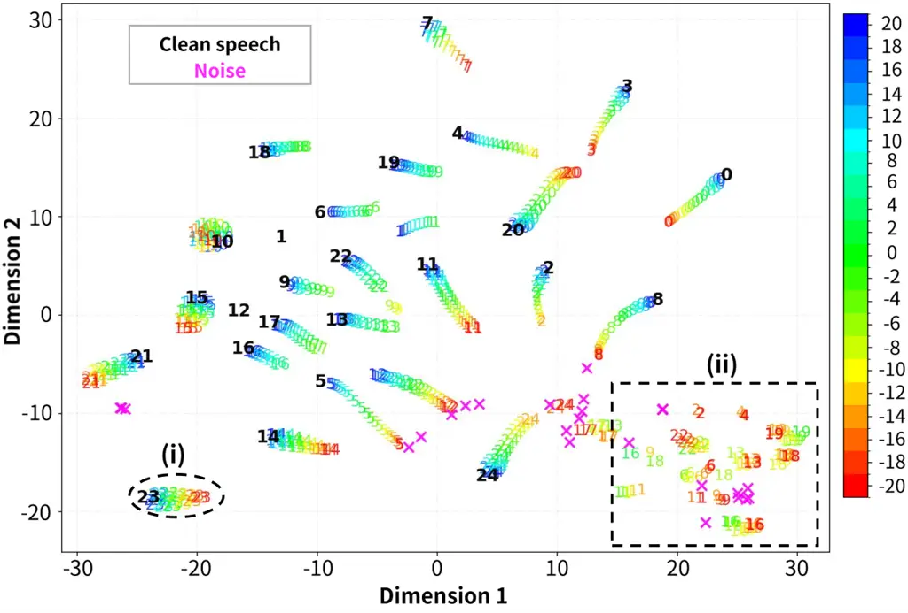
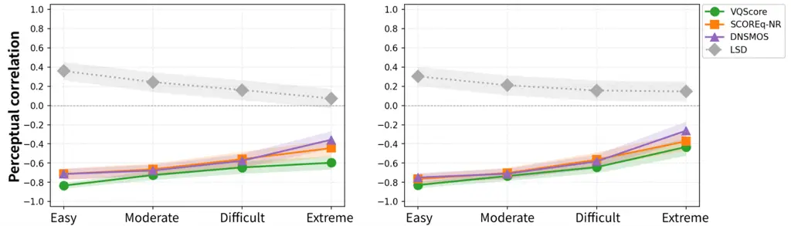
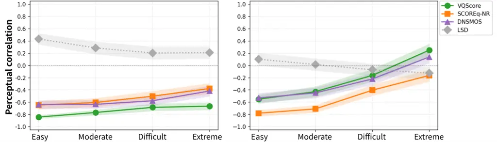
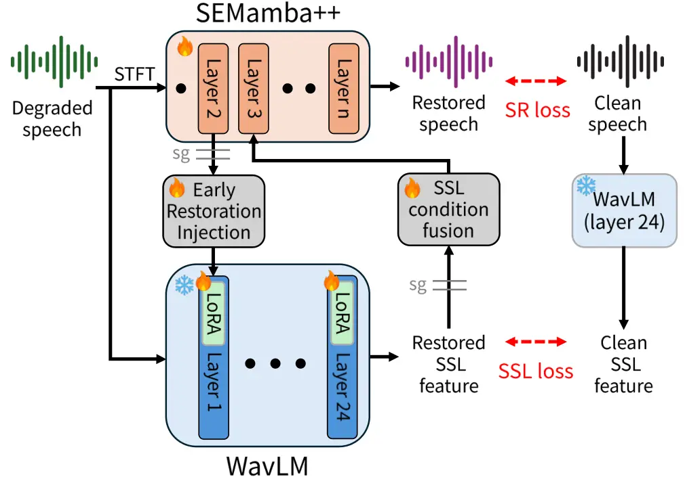
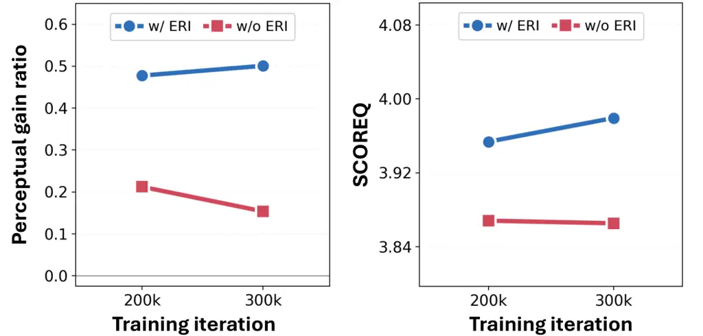

# When Do Self-Supervised Representations Help Speech Restoration?

Yongjoon Lee    Younghoo Kwon    Jung-Woo Choi ^(†)^(†)thanks:
^(\*)Corresponding author.

###### Abstract

Self-supervised learning (SSL) representations are widely used in speech
restoration (SR), and the prevailing trend is SSL feature cleansing:
fine-tuning the SSL to recover clean features from degraded speech, then
conditioning the restoration model on them. However, the
representational capability of SSL when encoding degraded speech has
been underexplored, and we ask whether cleansing always benefits SR
training. Across SSL encoders and perceptual quality proxies, we
discover perceptual correlation collapse—under severe degradation,
cleansing degraded SSL features toward clean ones misaligns with the SR
objective. We hypothesize the restoration backbone can supply the SSL
with clues to resolve this collapse, since its intermediate layers
already produce partially restored features. We therefore propose Early
Restoration Injection (ERI), which routes intermediate features from the
restoration backbone into the SSL through a lightweight conditioning
network. ERI excels over the unconditioned baseline and, on the
VoiceFixer benchmark, achieves competitive performance among multiple
baselines.

###### Index Terms: 

Speech restoration, Self-supervised learning

^(†)^(†)address: ¹School of Electrical Engineering, KAIST, Daejeon,
South Korea  
²Department of AI Systems, KAIST, Daejeon, South Korea

## 1 Introduction

Speech restoration (SR) aims to recover clean speech from degraded
speech, where the degradation may be noise, reverberation, bandwidth
limitation, clipping. Self-supervised learning (SSL)
representations \[4, 2\] have been widely used to address SR for their
rich acoustic and phonetic information, and strong alignment with
perceptual quality \[1\]. One line of research feeds both the SR output
and the clean speech into an SSL separately and minimizes the loss
between the two resulting representations, utilizing SSL as a guiding
signal in training. MaskSR2 \[16\] uses HuBERT \[7\] as a semantic
teacher to conduct knowledge distillation, improving intelligibility.
Universe++ \[29\] uses an SSL-finetuned phoneme prediction model \[36\]
to minimize the connectionist temporal classification loss \[6\] between
the predicted phonemes of the clean and restored speech. In this way,
rich SSL representations can be efficiently learned since SSL is only
required in the training phase.

Another line of research feeds the degraded speech directly to speech
SSL and then injects the resulting degraded SSL representation into the
SR model as a conditioning feature. Early efforts \[30, 3\] utilize
WavLM \[4\] as a feature encoder for speech enhancement, paving the way
for SSL-conditioned SR. FINALLY \[1\] uses WavLM features as
conditioning signals to jointly perform speech enhancement and bandwidth
extension. These methods directly integrate SSL models into the
enhancement model’s forward path, effectively leveraging the rich
representational power of SSLs.

Beyond using SSL representations as a mere guiding signal in training or
as conditioning features, recent approaches first restore the SSL
features, then use cleansed features as conditions for SR models. This
so-called SSL feature cleansing recovers clean SSL features given a
degraded speech waveform either by using language models (LM) or by
fine-tuning SSL itself. GenSE \[39\] and SenSE \[14\] are two
representative methods that use LM to generate the recovered SSL
features given noisy SSL features. Miipher \[12\], SIDON \[19\],
PASE \[27\], and StuPASE \[26\] incorporate pretraining where SSL models
are fine-tuned to restore the clean SSL features by themselves. LM-based
SSL feature cleansing requires demanding computational resources, while
fine-tuning-based SSL feature cleansing is relatively less compute- and
memory-intensive.

Though fine-tuning SSL for feature cleansing has proven effective for SR
tasks, existing approaches have mainly depended on empirical results to
show these performance gains. SSL feature distance has been studied as a
property of the representation — how a layer’s clean–degraded distance
relates to its importance for speech enhancement \[9\]. Feature
cleansing, by contrast, minimizes this distance, and in doing so
presupposes that a smaller distance implies better restored speech — an
assumption that has not been examined. We pose a fundamental question:
_is SSL feature cleansing always effective for SR?_ Across multiple SSL
encoders and perceptual quality proxies, we find perceptual correlation
collapse: the correlation between SSL feature distance and perceptual
quality holds under mild degradation but breaks past a critical
severity, so that minimizing the SSL loss no longer tracks quality
beyond this point.

One simple solution to this phenomenon is to place a preliminary
restoration model before the SSL so that the SSL _never sees_ severely
degraded speech and instead consumes the decoded waveform that model
produces; this buys clean-enough input, but at the cost of an auxiliary
model. In fact, the SR backbone we already have produces partially
restored features at its intermediate layers. This leads to our central
hypothesis: if those features are already restored enough to serve as
evidence, exposing them to the SSL should mitigate perceptual
correlation collapse, obtaining the benefit of pre-restoration without a
separate pre-restoration model. To validate this, we propose Early
Restoration Injection (ERI), a method that injects intermediate layer SR
features into the SSL via a simple conditioning network. This method
effectively resolves the perceptual correlation collapse by feeding SSL
with partially recovered speech features, converging to higher quality
than the unconditioned baseline at a matched parameter count. Our
contributions are two-fold:

- •
  We discover perceptual correlation collapse: as degradation increases,
  cleansing degraded SSL features does not fully track perceptual
  quality. We establish this with analysis across multiple SSL models
  and perceptual-quality proxies.
- •
  We propose Early Restoration Injection (ERI), a simple yet novel
  method that injects intermediate features from the SR network into SSL
  feature cleansing. Our framework achieves competitive performance on
  the VoiceFixer benchmark.

Figure 1: t-SNE plots of speech degraded with additive noise at varying
SNR level, visualized in WavLM feature space.

(a) WavLM (Left) and HuBERT (Right)

(b) SPEAR (Left) and Wav2Vec2 (Right)

Figure 2: SSL-wise plot of perceptual correlation.

## 2 When do self-supervised representations help speech restoration?

We first show how SSL represents degraded speech, using a motivating
visualization in which some SSL features lose the speech identity and
become indistinguishable from those of noise even when the speech is
audible. Then we discover perceptual correlation collapse, a phenomenon
where SSL feature cleansing does not correspond to perceptual quality
increase if speech degradation is severe.

### 2.1 Some utterances lose their identity in the SSL feature space at low SNRs, while others remain firmly anchored to their clean counterparts.

Method We design a toy visualization using t-SNE \[32\]. We sample $`m`$
speech utterances from FLEURS-R \[17\] and LibriTTS-R \[11\] and $`m`$
noise samples from WHAM! \[34\] and DNS Challenge 2020 \[23\], thus
formulating a pair $`(x_{j},n_{j})`$, where $`x`$, $`n`$, and $`j`$
represent speech data, noise data, and the data index, respectively. For
each pair, we synthesize noisy copies at SNR ranging from $`-20`$ to
$`20`$ dB in $`2`$ dB increments. Together with the clean speech and the
noise data, each data pair of index $`j`$ yields 23 conditions. The
samples are then fed individually to the SSL, and the resulting feature
representations are visualized using t-SNE. We used the final-layer
feature (time frame-pooled) of WavLM \[4\] for the visualization. We set
$`m`$ to 25.

Finding Fig. 1 shows t-SNE embeddings of WavLM features for a set of
utterances, each mixed with its own noise sample across several SNR
levels; the utterance index $`j`$ is marked at each point, with clean
speech in bold black and noise in pink. Since SNR is the only source of
variation within an utterance, a representation encoding speech content
should organize by index, with degraded samples remaining near their
clean anchor. Region (i) behaves this way: samples sharing an index stay
together, and SNR governs how far each sits from its anchor. Region (ii)
does not. Degraded samples do not simply disperse; they converge onto
the region occupied by the noise embeddings, despite each utterance
carrying a different noise sample. Most importantly, they do not arrive
together: some noisy samples reach region (ii) at around $`0`$ dB (See
$`j=11,16,19`$), where speech and noise carry similar power, while
others at the same SNR stay beside their anchors. We can see that some
utterances lose their speech features even when the speech is audible.

### 2.2 Lower SSL loss does not always translate into higher perceptual quality, especially when speech degradation is severe.

From the t-SNE visualization, we observe that some utterances lose their
utterance identity in SSL feature space when they are not supposed to
(e.g., 0 dB; even when the speech is audible). Thus, we conjecture that
in multi-degradation scenarios, the SSL feature distance would not
reflect the true perceptual quality if the degradation severity is
beyond a certain level. However, a single degradation configuration
(e.g., SNR) cannot represent the overall perceptual quality in a
multi-degradation scenario, motivating us to use perceptual quality
evaluation metrics as proxies for thorough analysis.

Method We randomly sample $`m`$ clean English utterances $`x_{1}`$,
$`x_{2}`$, $`\ldots`$,$`x_{m}`$ from LibriTTS-R \[11\]. For each clean
utterance $`x_{j}`$ where $`j=1,...,m`$, four degraded versions
$`y_{j}^{(E)},y_{j}^{(M)},y_{j}^{(D)},y_{j}^{(X)}`$, corresponding to
Easy ($`E`$), Moderate ($`M`$), Difficult ($`D`$), and Extreme ($`X`$),
respectively, are simulated. The degradation type and the application
probability are homogeneous across different degradation severities. The
degradation pipeline uses noise, bandwidth limitation, clipping, reverb,
and packet loss. Each degradation is sampled from a severity-specific
range, chosen to be harsher at every step from Easy to Extreme. Noise
SNR drops from $`[12.5,20]`$ to $`[-10,-2.5]`$ dB, the bandwidth cutoff
from $`[5750,7000]`$ to $`[2000,3250]`$ Hz, clipping thresholds tighten
inward from $`[0.00,0.02]/[0.98,1.00]`$ to $`[0.06,0.08]/[0.92,0.94]`$,
and packet loss duration grows from 5 to 20 ms.

For each degradation severity, we compute the cosine distance
$`d_{j}^{(E)},d_{j}^{(M)},d_{j}^{(D)},d_{j}^{(X)}`$ between the SSL
output features for clean and degraded speech. The perceptual quality
prediction of the degraded speech
$`q_{j}^{(E)},q_{j}^{(M)},q_{j}^{(D)},q_{j}^{(X)}`$ is computed. For a
general analysis, we select multiple SSLs and quality prediction models.
For SSL, we use WavLM \[4\], HuBERT \[7\], SPEAR \[38\], and Wav2Vec
2.0 \[2\], all in large variants. For neural quality prediction, we use
VQScore \[5\], SCOREQ \[22\], and DNSMOS \[24\]. We use the no-reference
(NR) version of SCOREQ. Finally, we use log spectral distance (LSD) for
model-free quality estimation. To quantify the correlation between the
SSL distance and quality score, we compute the Spearman correlation
$`\rho^{(\mathrm{sev})}`$ \[31\] over the $`m`$ paired observations
$`\{(d_{j},q_{j})\}^{m}_{j=1}`$, for each severity. $`\mathrm{sev}`$
represents degradation severity index, and the correlation coefficient
represents Perceptual correlation of SSL loss. For robust analysis, we
set $`m`$ to 100, and conduct bootstrapping for 1,000 times and plot
both the mean correlation and standard deviation. The SSL output feature
is computed as the time frame-wise mean of the final layer output.

Finding Fig. 2 shows that the perceptual correlation (SSL-loss/quality
correlation) is strong under mild degradation but collapses beyond a
critical severity, implying SSL feature distance between clean and
severely degraded speech does not rank-order perceptual quality well.
This has a consequence for SSL feature cleansing: minimizing SSL loss
does not always translate into higher perceptual quality when the speech
degradation is severe.

We verify that this collapse is not an artifact of any single design
choice in the analysis. First, it is not specific to a particular SSL
model: the same trend appears across all four representations,
indicating that the collapse reflects a property of the SSL loss-quality
relationship rather than a trait of one SSL feature space. Second, to
rule out sampling noise as the cause, we bootstrap each correlation
estimate and report the resulting standard deviation in Fig. 2; the
collapse persists well outside this uncertainty band, confirming that it
is a stable trend rather than a sampling artifact. Third, to check
whether the collapse is instead an artifact of the perceptual quality
metric itself, we repeat the analysis with LSD, a model-free quality
estimator computed directly from the log-spectral distance. Although LSD
may not perfectly track subjective perceptual quality, it exhibits the
same collapse beyond the critical severity, which suggests the effect is
a genuine property of the SSL representation rather than an artifact of
the particular quality metric used to measure it.

Together, these results expose a critical problem for SSL-conditioned
SR. An SSL distance objective provides less useful gradient toward
perceptual quality in the severe regime that restoration must handle. We
therefore explain our proposed method to provide the SSL encoder with
restored features in the next section.

## 3 Early Restoration Injection

Fig. 3 shows the overall framework of ERI. SEMamba++ \[13\] and
WavLM \[4\] are used as the SR and speech SSL models, respectively.
SEMamba++ comprises an encoder, bottleneck, and decoder. The encoder
encodes the degraded speech into hidden features. The bottleneck is a
4-layer sequence of time-frequency processing modules. The decoder maps
the restored features into the magnitude and phase spectrogram,
converting to the clean waveform. WavLM comprises a feature extractor
followed by 24 transformer layers.

ERI is a simple method to feed the SSL with the latent bottleneck
feature of SEMamba++. The latent bottleneck feature has a shape of
$`T,F,D`$, where $`T`$, $`F`$, and $`D`$ represent the time, frequency,
and channel dimensions of SEMamba++. ERI first reshapes the latent
bottleneck feature to $`T,FD`$, followed by a linear layer that maps the
dimension $`FD`$ to $`C`$, where $`C`$ represents the channel dimension
of WavLM. After applying Layer normalization and LeakyReLU activation,
we apply adaptive average pooling to match the time dimension to
$`T^{\prime}`$, corresponding to the time dimension of WavLM. The
resulting feature is concatenated with the WavLM feature of shape
$`T^{\prime},C`$ after the convolutional feature extractor, deriving the
feature of shape $`T^{\prime},2C`$. Then a linear layer maps the feature
into $`T^{\prime},C`$ so that the condition injection is made.

Figure 3: Model architecture and training framework.

WavLM is fine-tuned with Low-Rank Adaptation (LoRA) \[8\], where the
hyperparameters $`r`$ and $`\alpha`$ were set to 16 and 32,
respectively. After WavLM takes the degraded waveform and the ERI
condition to restore the SSL feature, the restored SSL feature is
injected back into the SR backbone via the SSL condition fusion module.
The SSL condition fusion module is an adaptive layer normalization
(AdaLN) \[35\]-based module fusing the SSL condition into SEMamba++. We
use the layer 24 output from WavLM to conduct SSL condition fusion, as
done by previous work \[27\]. We extract the ERI condition from
SEMamba++ layer 2 and fuse the cleansed SSL features back at layer 3.

We apply stop-gradient (sg) before ERI and SSL condition fusion. sg
before ERI blocks the SSL loss from reaching SEMamba++. In particular,
this prevents the SSL loss from acting as a representation
alignment \[40\] loss: SEMamba++ is trained only by the SR objective, so
any effect of ERI is gained via the forward path rather than by SSL
gradients shaping SEMamba++. sg before SSL condition fusion prevents the
spectrogram-level SR loss from reaching WavLM, keeping it focused on the
SSL feature cleansing. We found empirically that without sg before SSL
condition fusion, the SSL loss was not effectively minimized and
performance degraded.

### 3.1 Training objective

The training objective can be divided into learning SR and SSL models.
For training the SR model, we followed the LSGAN \[18\] configuration
from SEMamba++. For training the SSL feature cleansing, we utilized an
L2-normalized MSE loss of the 24th-layer features
$`\mathcal{L}_{\mathrm{SSL}}`$. We append $`\mathcal{L}_{\mathrm{SSL}}`$
to the generator loss so that the training can be conducted end-to-end,
simultaneously optimizing both the SR and SSL models. The final
generator loss is
$`\mathcal{L}_{\mathrm{total}}=\mathcal{L}_{G}+\mathcal{L}_{\mathrm{SSL}}`$.

## 4 Experimental settings

### 4.1 Training

Datasets For speech, we used VCTK-0.92 \[37\] and LibriTTS-R \[11\]. For
VCTK, we excluded speakers in p280 and p315 following \[15\]. For
LibriTTS-R, we used the train-clean-100 and -360 subsets, totaling  300
hours of speech sources. For noise data, we used WHAM! \[34\] and DNS
challenge \[23\]. For RIR, we used Arni \[21\] and the DNS
challenge \[23\]. All data were sampled at 16 kHz and split into a train
and a testset, including the noise and RIR data. Note that LibriTTS-R
already has a predetermined testset.

Degradation simulation Noise, reverberation, bandwidth limitation, and
clipping were used to simulate degradation. In training, various
distortions are randomly applied with predetermined probabilities. The
signal-to-noise ratio (SNR) ranged from -5 to 20 dB, and bandwidth
reduction was applied at various cutoff frequencies (2-7 kHz). For
clipping, we followed the official configurations \[42\].

Training configurations The segment size of 48,000 samples (3 seconds)
was used for training. For STFT, we used a Hann window with a window
length of 400 samples and a hop size of 160 samples. We set the learning
rate to 1e-4 and used the AdamW optimizer with $`\beta_{1}`$ and
$`\beta_{2}`$ set to 0.8 and 0.99, respectively. We set the batch size
to 8 and used exponential learning rate decay with $`\gamma=0.99`$. ERI
was trained in two stages. In stage 1, SEMamba++ was trained with the
same data configuration. In stage 2, we trained the full ERI framework
for an additional 300k steps.

### 4.2 Evaluation

Datasets For comparisons within our model, we used a simulated set built
from the test split in Section 4.1. For system comparison against other
methods, we used the official VoiceFixer test set \[15\], which covers
noise, reverb, bandwidth limitation, and clipping.

Baseline methods For GAN methods, we used VoiceFixer \[15\] and
SEMamba++ \[13\]. For generative methods, we used AnyEnhance \[41\]. For
SSL-based methods, we used SIDON \[19\]. Lastly, for regressive methods,
we used TF-GridNet \[33\]. For all models, we used the official
checkpoint.

|            |                                 |          |           |          |           |         |
| ---------- | ------------------------------- | -------- | --------- | -------- | --------- | ------- |
| Model      | \# Params (M) total / trainable | OVRL^(↑) | UTMOS^(↑) | PESQ^(↑) | ESTOI^(↑) | LPS^(↑) |
| Degraded   | -                               | 2.39     | 2.63      | 1.94     | 0.58      | 0.84    |
| VoiceFixer | 112 / 112                       | 3.00     | 3.44      | 2.04     | 0.56      | 0.80    |
| TF-GridNet | 14.4 / 14.4                     | 3.06     | 3.41      | 2.47     | 0.68      | 0.88    |
| AnyEnhance | 364 / 324                       | 3.14     | 3.75      | 2.45     | 0.67      | 0.88    |
| SIDON      | 250 / 57.4                      | 3.20     | 3.97      | 2.05     | 0.58      | 0.88    |
| SEMamba++  | 2.7 / 2.7                       | 3.10     | 3.75      | 2.76     | 0.70      | 0.87    |
| ERI (Ours) | 340 / 24.5                      | 3.10     | 3.86      | 2.82     | 0.71      | 0.92    |

Table 1: Performance evaluation on the VoiceFixer testset.

Evaluation Metrics We used SCOREQ \[22\], UTMOS \[28\], and OVRL \[24\]
to assess speech perceptual quality. For SCOREQ, we used the
no-reference mode with a synthetic data setup. To evaluate signal
fidelity, we used Perceptual Evaluation of Speech Quality (PESQ) \[25\].
We used extended short-time objective intelligibility (ESTOI) \[10\] to
measure intelligibility. Lastly, Levenshtein phoneme similarity
(LPS) \[20\] was used to capture phoneme similarity, which is useful in
evaluating generative SR models.

## 5 Experimental results

Table 1 illustrates the results of multiple baseline models evaluated on
the VoiceFixer testset for benchmarking SR. ERI attains the best PESQ,
ESTOI, and LPS, indicating strong signal fidelity and intelligibility in
the restored speech, while its second-best UTMOS keeps perceptual
quality competitive. Although ERI substantially increases the parameter
count due to the added SSL and conditioning modules, its real-time
factor (measured on a single RTX 4090 GPU) increases only from 0.015 for
SEMamba++ to 0.020 for ERI, showing that the inference efficiency is not
heavily compromised.

Table 2 measures the effectiveness of ERI (✓) compared to the baseline
(✗). The baseline minimizes SSL loss without ERI features. To compensate
for the parameter increase in ERI, we double the hyperparameters $`r`$
and $`\alpha`$ and attach LoRA to both feed-forward networks (FFNs)
rather than the second FFN alone (i.e., default design), resulting in a
parameter gap of less than 1M. ERI improves performance over the
baseline, showing the effectiveness of intermediate features from the SR
backbone for SSL feature cleansing. Moreover, since ERI feeds restored
intermediate features of the SR backbone, the effectiveness of ERI could
be compromised if the SR backbone is not fully converged. To test this,
we instantiate ERI with the SR backbone trained less in Stage 1 (i.e.,
300k steps). As shown in Table 2, ERI remains effective even with such a
setup, showing that ERI does not require full convergence of the SR
backbone for its success. Lastly, to show that our method could be
applied to other SSLs analyzed in Section 2, we design an ERI variant
where the SSL is HuBERT. The result shows that the ERI remains its
strengths for different SSL as well, implying the general applicability.

|     |        |                   |                              |                             |                            |                           |
| --- | ------ | ----------------- | ---------------------------- | --------------------------- | -------------------------- | ------------------------- |
| ERI | SSL    | Stage 1 steps (k) | $`\text{SCOREQ}^{\uparrow}`$ | $`\text{UTMOS}^{\uparrow}`$ | $`\text{PESQ}^{\uparrow}`$ | $`\text{LPS}^{\uparrow}`$ |
| ✓   | WavLM  | 500 (Full)        | 3.97                         | 4.06                        | 2.50                       | 0.90                      |
| ✗   |        |                   | 3.93                         | 4.03                        | 2.42                       | 0.88                      |
| ✓   | WavLM  | 300               | 3.95                         | 4.04                        | 2.41                       | 0.89                      |
| ✗   |        |                   | 3.88                         | 3.99                        | 2.41                       | 0.88                      |
| ✓   | HuBERT | 500               | 3.93                         | 4.03                        | 2.41                       | 0.87                      |
| ✗   |        |                   | 3.86                         | 3.96                        | 2.33                       | 0.83                      |

Table 2: Performance comparison on ERI.

|                             |        |                              |                             |                            |                           |
| --------------------------- | ------ | ---------------------------- | --------------------------- | -------------------------- | ------------------------- |
| Design                      | Params | $`\text{SCOREQ}^{\uparrow}`$ | $`\text{UTMOS}^{\uparrow}`$ | $`\text{PESQ}^{\uparrow}`$ | $`\text{LPS}^{\uparrow}`$ |
| Ours (default)              | 24M    | 3.95                         | 4.04                        | 2.41                       | 0.89                      |
| ERI layer 2$`\rightarrow`$1 | 24M    | 3.91                         | 4.03                        | 2.42                       | 0.88                      |
| w/o sg on SSL cond. fus.    | 24M    | 3.92                         | 4.02                        | 2.42                       | 0.88                      |
| AdaLN-based ERI             | 32M    | 3.94                         | 4.04                        | 2.43                       | 0.89                      |

Table 3: Design study. We used 300k steps for stage 1 training for this
study.

Figure 4: Perceptual gain ratio and SCOREQ value.

Fig. 4 shows that ERI enables effective translation of SSL loss
minimization into perceptual quality gain. Using SCOREQ and SSL loss
values after initial training stabilization as anchors, we define
Perceptual gain ratio as the SCOREQ increment per $`10^{-3}`$ reduction
in SSL loss. The ratio substantially favors ERI, implying that SSL loss
minimization more effectively leads to perceptual quality gain when
equipped with ERI. Note that analyzing the perceptual correlation from
Section 2.2 on a fully trained ERI is confounded, as at convergence both
w/ ERI and w/o ERI learn to cleanse SSL features. The perceptual gain
ratio instead directly measures whether ERI translates the SSL objective
to perceptual quality in training.

Design study Table 3 shows the design choice study results to measure
the component-wise contribution in the proposed method. Modifying the
ERI layer from 2 to 1 degrades perceptual quality, suggesting that
injecting more restored features into the SSL backbone improves
performance. Removing the sg on the SSL condition fusion degrades
perceptual quality, attributable to the ineffective SSL loss
minimization discussed in Section 3. Lastly, changing the ERI mechanism
from simple concatenation (i.e., default design) to more complicated
AdaLN did not result in a significant performance gain, implying that
ERI’s benefit comes from the intermediate-layer features themselves
rather than the increased capacity.

## 6 Conclusions

We discover perceptual correlation collapse: under severe degradation,
the SSL feature cleansing objective does not fully align with the
restoration objective. Though our correlation analysis relies on neural
quality proxies for human perception, the agreement we observe across
multiple proxies shows the trend is not an artifact of a single metric.
To address perceptual correlation collapse, we propose Early Restoration
Injection (ERI), which conditions SSL feature cleansing on intermediate
features from the restoration model, supplying the SSL with partially
restored evidence in place of severely degraded input. ERI adds only
simple operations, and our experiments attribute its gain to the
injected features themselves rather than to added capacity or a more
expressive fusion mechanism. ERI improves over the unconditioned
baseline at matched parameter count, and performs competitively against
multiple baseline models.

## 7 Acknowledgments

This work was supported by the National Research Foundation of Korea
(NRF) grant (No. RS-2024-00337945), the STEAM research grant (No.
RS-2024-00464269) funded by the Ministry of Science and ICT of Korea
government (MSIT), the BK21 FOUR program through the NRF grant funded by
the Ministry of Education of Korea government (MOE), and Artificial
intelligence industrial convergence cluster development project funded
by the Ministry of Science and ICT (MSIT, Korea)&Gwangju Metropolitan
City.

## References

- \[1\] N. Babaev, K. Tamogashev, A. Saginbaev, I. Shchekotov, H.
  Bae, H. Sung, W. Lee, H.-Y. Cho, and P. Andreev (2024) FINALLY: fast
  and universal speech enhancement with studio-like quality. In Advances
  in Neural Information Processing Systems, External Links: 2410.05920,
  [Link](https://arxiv.org/abs/2410.05920) Cited by: §1, §1.
- \[2\] A. Baevski, H. Zhou, A. Mohamed, and M. Auli (2020) Wav2vec 2.0:
  a framework for self-supervised learning of speech representations. In
  Advances in Neural Information Processing Systems, External Links:
  2006.11477, [Link](https://arxiv.org/abs/2006.11477) Cited by: §1,
  §2.2.
- \[3\] J. Byun, Y. Ji, S.-W. Chung, S. Choe, and M.-S. Choi (2023) An
  empirical study on speech restoration guided by self-supervised speech
  representation. In ICASSP, pp. 1–5. External Links:
  [Link](http://dx.doi.org/10.1109/ICASSP49357.2023.10095881),
  [Document](https://dx.doi.org/10.1109/icassp49357.2023.10095881) Cited
  by: §1.
- \[4\] S. Chen, C. Wang, Z. Chen, Y. Wu, S. Liu, Z. Chen, J. Li, N.
  Kanda, T. Yoshioka, X. Xiao, J. Wu, L. Zhou, S. Ren, Y. Qian, Y.
  Qian, J. Wu, M. Zeng, X. Yu, and F. Wei (2022) WavLM: large-scale
  self-supervised pre-training for full stack speech processing. IEEE
  Journal of Selected Topics in Signal Processing 16 (6), pp. 1505–1518.
  External Links: ISSN 1941-0484,
  [Link](http://dx.doi.org/10.1109/JSTSP.2022.3188113),
  [Document](https://dx.doi.org/10.1109/jstsp.2022.3188113) Cited by:
  §1, §1, §2.1, §2.2, §3.
- \[5\] S.-W. Fu, K.-H. Hung, Y. Tsao, and Y.-C. F. Wang (2024)
  Self-supervised speech quality estimation and enhancement using only
  clean speech. In International Conference on Learning Representations,
  External Links: 2402.16321, [Link](https://arxiv.org/abs/2402.16321)
  Cited by: §2.2.
- \[6\] A. Graves, S. Fernández, F. Gomez, and J. Schmidhuber (2006)
  Connectionist temporal classification: labelling unsegmented sequence
  data with recurrent neural networks. In International Conference on
  Machine Learning, External Links: ISBN 1595933832,
  [Link](https://doi.org/10.1145/1143844.1143891),
  [Document](https://dx.doi.org/10.1145/1143844.1143891) Cited by: §1.
- \[7\] W.-N. Hsu, B. Bolte, Y.-H. H. Tsai, K. Lakhotia, R.
  Salakhutdinov, and A. Mohamed (2021) HuBERT: self-supervised speech
  representation learning by masked prediction of hidden units. In
  taslp, External Links: 2106.07447,
  [Link](https://arxiv.org/abs/2106.07447) Cited by: §1, §2.2.
- \[8\] E. J. Hu, Y. Shen, P. Wallis, Z. Allen-Zhu, Y. Li, S. Wang, L.
  Wang, and W. Chen (2022) LoRA: low-rank adaptation of large language
  models. In International Conference on Learning Representations,
  External Links: 2106.09685, [Link](https://arxiv.org/abs/2106.09685)
  Cited by: §3.
- \[9\] K.-H. Hung, S.-W. Fu, H.-H. Tseng, H.-T. Chiang, Y. Tsao, and
  C.-W. Lin (2022) Boosting self-supervised embeddings for speech
  enhancement. In Interspeech, External Links: 2204.03339,
  [Link](https://arxiv.org/abs/2204.03339) Cited by: §1.
- \[10\] J. Jensen and C. H. Taal (2016) An algorithm for predicting the
  intelligibility of speech masked by modulated noise maskers. In taslp,
  Vol. 24, pp. 2009–2022. External Links:
  [Document](https://dx.doi.org/10.1109/TASLP.2016.2585878) Cited by:
  §4.2.
- \[11\] Y. Koizumi, H. Zen, S. Karita, Y. Ding, K. Yatabe, N.
  Morioka, M. Bacchiani, Y. Zhang, W. Han, and A. Bapna (2023)
  LibriTTS-r: a restored multi-speaker text-to-speech corpus. In
  Interspeech, External Links: 2305.18802,
  [Link](https://arxiv.org/abs/2305.18802) Cited by: §2.1, §2.2, §4.1.
- \[12\] Y. Koizumi, H. Zen, S. Karita, Y. Ding, K. Yatabe, N.
  Morioka, Y. Zhang, W. Han, A. Bapna, and M. Bacchiani (2023) Miipher:
  a robust speech restoration model integrating self-supervised speech
  and text representations. In Workshop on Applications of Signal
  Processing to Audio and Acoustics, External Links: 2303.01664,
  [Link](https://arxiv.org/abs/2303.01664) Cited by: §1.
- \[13\] Y. Lee and J.-W. Choi (2026) SEMamba++: a general speech
  restoration framework leveraging global, local, and periodic spectral
  patterns. In Interspeech, External Links: 2603.11669,
  [Link](https://arxiv.org/abs/2603.11669) Cited by: §3, §4.2.
- \[14\] X. Li, H. Xie, Z. Wang, Z. Zhang, L. Xiao, S. Wang, and L.
  Xie (2026) SenSE: semantic-aware high-fidelity universal speech
  enhancement. In IEEE International Conference on Multimedia and Expo,
  External Links: 2509.24708, [Link](https://arxiv.org/abs/2509.24708)
  Cited by: §1.
- \[15\] H. Liu, X. Liu, Q. Kong, Q. Tian, Y. Zhao, D. Wang, C. Huang,
  and Y. Wang (2022) VoiceFixer: a unified framework for high-fidelity
  speech restoration. In Interspeech, External Links:
  [Link](http://dx.doi.org/10.21437/Interspeech.2022-11026),
  [Document](https://dx.doi.org/10.21437/interspeech.2022-11026) Cited
  by: §4.1, §4.2, §4.2.
- \[16\] X. Liu, X. Li, J. Serrà, and S. Pascual (2025) Joint semantic
  knowledge distillation and masked acoustic modeling for full-band
  speech restoration with improved intelligibility. In ICASSP, External
  Links: 2409.09357, [Link](https://arxiv.org/abs/2409.09357) Cited by:
  §1.
- \[17\] M. Ma, Y. Koizumi, S. Karita, H. Zen, J. Riesa, H. Ishikawa,
  and M. Bacchiani (2024) FLEURS-r: a restored multilingual speech
  corpus for generation tasks. In Interspeech, External Links:
  2408.06227, [Link](https://arxiv.org/abs/2408.06227) Cited by: §2.1.
- \[18\] X. Mao, Q. Li, H. Xie, R. Y. K. Lau, Z. Wang, and S. P.
  Smolley (2017) Least squares generative adversarial networks. External
  Links: 1611.04076, [Link](https://arxiv.org/abs/1611.04076) Cited by:
  §3.1.
- \[19\] W. Nakata, Y. Saito, Y. Ueda, and H. Saruwatari (2026) Sidon:
  fast and robust open-source multilingual speech restoration for
  large-scale dataset cleansing. In ICASSP, External Links: 2509.17052,
  [Link](https://arxiv.org/abs/2509.17052) Cited by: §1, §4.2.
- \[20\] J. Pirklbauer, M. Sach, K. Fluyt, W. Tirry, W. Wardah, S.
  Moeller, and T. Fingscheidt (2023) Evaluation metrics for generative
  speech enhancement methods: issues and perspectives. In Speech
  Communication; 15th ITG Conference, Vol. , pp. 265–269. External
  Links: [Document](https://dx.doi.org/10.30420/456164052) Cited by:
  §4.2.
- \[21\] K. Prawda, S. J. Schlecht, and V. Välimäki (2022) Calibrating
  the sabine and eyring formulas. The Journal of the Acoustical Society
  of America 152 (2), pp. 1158–1169. Cited by: §4.1.
- \[22\] A. Ragano, J. Skoglund, and A. Hines (2025) SCOREQ: speech
  quality assessment with contrastive regression. In Advances in Neural
  Information Processing Systems, External Links: 2410.06675,
  [Link](https://arxiv.org/abs/2410.06675) Cited by: §2.2, §4.2.
- \[23\] C. K. A. Reddy, V. Gopal, R. Cutler, E. Beyrami, R. Cheng, H.
  Dubey, S. Matusevych, R. Aichner, A. Aazami, S. Braun, P. Rana, S.
  Srinivasan, and J. Gehrke (2020) The interspeech 2020 deep noise
  suppression challenge: datasets, subjective testing framework, and
  challenge results. In Interspeech, External Links: 2005.13981,
  [Link](https://arxiv.org/abs/2005.13981) Cited by: §2.1, §4.1.
- \[24\] C. K. A. Reddy, V. Gopal, and R. Cutler (2021) DNSMOS: a
  non-intrusive perceptual objective speech quality metric to evaluate
  noise suppressors. In ICASSP, External Links: 2010.15258,
  [Link](https://arxiv.org/abs/2010.15258) Cited by: §2.2, §4.2.
- \[25\] A. W. Rix, J. G. Beerends, M. P. Hollier, and A. P.
  Hekstra (2001) Perceptual evaluation of speech quality (pesq)-a new
  method for speech quality assessment of telephone networks and codecs.
  In ICASSPICASSP, Vol. 2, pp. 749–752. External Links:
  [Document](https://dx.doi.org/10.1109/ICASSP.2001.941023) Cited by:
  §4.2.
- \[26\] X. Rong, J. Gao, Z. Wang, M. Yesilbursa, K. Wojcicki, and J.
  Lu (2026) StuPASE: towards low-hallucination studio-quality generative
  speech enhancement. In Interspeech, External Links: 2603.09234,
  [Link](https://arxiv.org/abs/2603.09234) Cited by: §1.
- \[27\] X. Rong, Q. Hu, M. Yesilbursa, K. Wojcicki, and J. Lu (2026)
  PASE: leveraging the phonological prior of wavlm for low-hallucination
  generative speech enhancement. In Proceedings of the AAAI Conference
  on Artificial Intelligence, External Links: 2511.13300,
  [Link](https://arxiv.org/abs/2511.13300) Cited by: §1, §3.
- \[28\] T. Saeki, D. Xin, W. Nakata, T. Koriyama, S. Takamichi, and H.
  Saruwatari (2022) UTMOS: utokyo-sarulab system for voicemos challenge 2022. External Links: 2204.02152,
  [Link](https://arxiv.org/abs/2204.02152) Cited by: §4.2.
- \[29\] R. Scheibler, Y. Fujita, Y. Shirahata, and T. Komatsu (2024)
  Universal score-based speech enhancement with high content
  preservation. In Interspeech, External Links: 2406.12194,
  [Link](https://arxiv.org/abs/2406.12194) Cited by: §1.
- \[30\] H. Song, S. Chen, Z. Chen, Y. Wu, T. Yoshioka, M. Tang, J. W.
  Shin, and S. Liu (2022) Exploring wavlm on speech enhancement. In slt,
  External Links: 2211.09988, [Link](https://arxiv.org/abs/2211.09988)
  Cited by: §1.
- \[31\] C. Spearman (1904) The proof and measurement of association
  between two things. American Journal of Psychology 15, pp. 88–103.
  Cited by: §2.2.
- \[32\] L. van der Maaten and G. Hinton (2008) Visualizing data using
  t-SNE. Journal of Machine Learning Research 9, pp. 2579–2605. External
  Links: [Link](http://www.jmlr.org/papers/v9/vandermaaten08a.html)
  Cited by: §2.1.
- \[33\] Z.-Q. Wang, S. Cornell, S. Choi, Y. Lee, B.-Y. Kim, and S.
  Watanabe (2023) TF-gridnet: making time-frequency domain models great
  again for monaural speaker separation. In ICASSP, External Links:
  2209.03952, [Link](https://arxiv.org/abs/2209.03952) Cited by: §4.2.
- \[34\] G. Wichern, J. Antognini, M. Flynn, L. R. Zhu, E. McQuinn, D.
  Crow, E. Manilow, and J. Le Roux (2019) WHAM!: extending speech
  separation to noisy environments. In Interspeech, Cited by: §2.1,
  §4.1.
- \[35\] J. Xu, X. Sun, Z. Zhang, G. Zhao, and J. Lin (2019)
  Understanding and improving layer normalization. In Advances in Neural
  Information Processing Systems, External Links: 1911.07013,
  [Link](https://arxiv.org/abs/1911.07013) Cited by: §3.
- \[36\] Q. Xu, A. Baevski, and M. Auli (2021) Simple and effective
  zero-shot cross-lingual phoneme recognition. In Interspeech, External
  Links: 2109.11680, [Link](https://arxiv.org/abs/2109.11680) Cited by:
  §1.
- \[37\] J. Yamagishi, C. Veaux, and K. MacDonald (2019) CSTR vctk
  corpus: english multi-speaker corpus for cstr voice cloning toolkit.
  External Links: [Link](https://doi.org/10.7488/ds/2645) Cited by:
  §4.1.
- \[38\] X. Yang, Y. Yang, Z. Jin, Z. Cui, W. Wu, B. Li, C. Zhang,
  and P. Woodland (2026) SPEAR: a unified ssl framework for learning
  speech and audio representations. In International Conference on
  Machine Learning, External Links: 2510.25955,
  [Link](https://arxiv.org/abs/2510.25955) Cited by: §2.2.
- \[39\] J. Yao, H. Liu, C. Chen, Y. Hu, E. Chng, and L. Xie (2025)
  GenSE: generative speech enhancement via language models using
  hierarchical modeling. In International Conference on Learning
  Representations, External Links: 2502.02942,
  [Link](https://arxiv.org/abs/2502.02942) Cited by: §1.
- \[40\] S. Yu, S. Kwak, H. Jang, J. Jeong, J. Huang, J. Shin, and S.
  Xie (2025) Representation alignment for generation: training diffusion
  transformers is easier than you think. In International Conference on
  Learning Representations, External Links: 2410.06940,
  [Link](https://arxiv.org/abs/2410.06940) Cited by: §3.
- \[41\] J. Zhang, J. Yang, Z. Fang, Y. Wang, Z. Zhang, Z. Wang, F. Fan,
  and Z. Wu (2025) AnyEnhance: a unified generative model with
  prompt-guidance and self-critic for voice enhancement. IEEE
  Transactions on Audio, Speech and Language Processing 33,
  pp. 3085–3098. External Links: ISSN 2998-4173,
  [Link](http://dx.doi.org/10.1109/TASLPRO.2025.3587393),
  [Document](https://dx.doi.org/10.1109/taslpro.2025.3587393) Cited by:
  §4.2.
- \[42\] W. Zhang, R. Scheibler, K. Saijo, S. Cornell, C. Li, Z. Ni, J.
  Pirklbauer, M. Sach, S. Watanabe, T. Fingscheidt, and Y. Qian (2024)
  URGENT challenge: universality, robustness, and generalizability for
  speech enhancement. In Interspeech, pp. 4868–4872. Cited by: §4.1.
