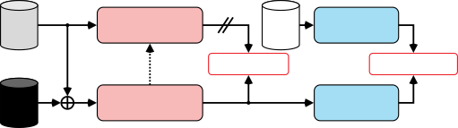

\robustify\bstctlcite

BSTcontrol

# Noisy Target Training Meets Drifting for Weakly-Supervised Speech Enhancement

Yoshiki Masuyama, Dominik Klement\sthanksThis work was done during an
internship at MERL., Christoph Boeddeker, Julius Richter, Kohei Saijo,
Gordon Wichern, Takahiro Edo, Jonathan Le Roux

###### Abstract

In speech enhancement, standard supervised training requires pairs of
noisy and clean speech. Such pairs are typically created by artificially
degrading clean speech, leading to a domain mismatch between synthetic
training data and real recordings. Noisy target training (NyTT)
mitigates this limitation by training an enhancement model to predict a
noisy recording from a noisier version generated by adding extra noise.
However, since the training target is noisy, NyTT might learn to leave
residual noise in the enhanced output. In this paper, we address this
issue in NyTT by incorporating a Sinkhorn drifting loss that matches the
distribution of the enhanced speech to that of unpaired clean speech.
The Sinkhorn drifting loss attracts enhanced speech toward high-density
regions of the clean-speech distribution while repelling it from the
current enhanced-speech distribution in latent space. This loss uses
only unpaired clean speech rather than the clean counterpart of each
degraded recording, preserving the weakly-supervised nature of NyTT.
Experimental results on VoiceBank-DEMAND and CHiME-3 real recordings
demonstrate the efficacy of the proposed combination.

###### Index Terms: 

Speech enhancement, weakly-supervised, drifting models, optimal
transport, Sinkhorn divergence

^(†)^(†)address: ¹Mitsubishi Electric Research Laboratories (MERL), USA

²Speech@FIT, Brno University of Technology, Czechia,   ³Mitsubishi
Electric Corporation, Japan

## 1 Introduction

Speech enhancement aims to suppress background noise and improve the
quality of degraded speech recordings \[1, 2\]. Modern speech
enhancement models are typically trained in a supervised manner, which
requires pairs of degraded speech and underlying clean speech. We refer
to this standard supervised training strategy as clean-target training
(CTT), following \[3\]. Since the underlying clean speech is
inaccessible in real environments, CTT relies on synthetic pairs, where
clean speech is artificially degraded, e.g., by adding a separate noise
recording. Consequently, supervised models might suffer from performance
degradation on in-the-wild recordings due to mismatches in acoustic
conditions \[4\].

To leverage real-world noisy speech recordings, various
weakly-supervised and unsupervised training paradigms have been
developed \[3, 5, 6, 7\]. Noisy target training (NyTT) is simple yet
shows promising performance \[3\]. NyTT trains an enhancement model to
predict an observed signal from a noisier version generated by adding
extra noise. Since the training target is noisy, the enhanced speech
tends to retain residual noise, limiting perceptual quality \[8, 9\].
Although NyTT variants have mitigated this issue using mean-teacher
techniques \[10, 9, 11\], their objectives still do not explicitly
encourage the distributions of clean and enhanced speech to match.



Figure 1: Overview of the proposed NyTT with unpaired drifting.

Generative speech enhancement \[12\] has gained increasing attention and
can produce perceptually convincing speech even with one or a few
inference steps \[13, 14\]. In particular, DriftSE \[15, 16\]
demonstrates promising one-step performance based on drifting
models \[17\]. Drifting models define a vector field, called a drifting
field, that encourages the model-induced enhanced-speech distribution
$`q_{\bm{\theta}}`$ to move toward the clean-speech distribution $`p`$.
In addition to its strong performance in the CTT setting, DriftSE also
shows potential for training an enhancement model using observed noisy
signals and unpaired clean speech. On VoiceBank-DEMAND (VBDM) \[18\], it
achieves a DNSMOS P.808 \[19\] score of 3.61 \[15\], indicating improved
perceptual quality. However, SI-SDR and WER are degraded even relative
to the original noisy signal \[16\]. These results suggest that unpaired
drifting alone is insufficient to preserve speech content, despite its
ability to improve the perceptual quality.

In this paper, we propose incorporating a drifting loss into NyTT to
suppress residual noise and improve the perceptual quality of enhanced
speech, as illustrated in Fig. 1. The proposed method builds on Sinkhorn
drifting \[20\], a variant of drifting models in which the
attraction–repulsion field is induced by the Sinkhorn divergence \[21\].
The drifting loss allows us to match the distribution of the enhanced
speech to that of unpaired clean speech without requiring clean
counterparts for the noisy training data. We expect the waveform-level
weak supervision provided by NyTT and the distribution-level supervision
provided by Sinkhorn drifting to complement each other. In addition, we
propose to compute the drifting field in the latent space of a speech
quality assessment (SQA) model, where distances are expected to reflect
perceptual naturalness. We validate our approach on the synthetic
mixtures from VBDM and demonstrate its efficacy on real recordings from
CHiME-3.

## 2 Related Work

### 2.1 Noisy target training (NyTT) and its variants

We model an observed signal $`\mathbf{x}\!\sim\!p_{\text{noisy}}`$ as
the sum of underlying clean speech $`\mathbf{s}\!\in\!\mathbb{R}^{L}`$
and background noise $`\mathbf{n}\!\in\!\mathbb{R}^{L}`$, where $`L`$
denotes the length of the signal. Standard supervised training for
speech enhancement, also referred to as CTT, optimizes an enhancement
model $`f_{\bm{\theta}}`$ with parameters $`\bm{\theta}`$ to minimize
the prediction error with respect to the underlying clean speech:

```math
\mathcal{L}^{\mathrm{CTT}}(\bm{\theta})=\mathbb{E}_{(\mathbf{x},\mathbf{s})}\mathcal{D}(\mathbf{s},f_{\bm{\theta}}(\mathbf{x})), \tag{1}
```

where $`\mathcal{D}`$ denotes a function measuring the prediction error,
e.g., the negative signal-to-noise ratio (SNR). This training process
requires pairs of $`(\mathbf{x},\mathbf{s})`$, but the underlying clean
speech $`\mathbf{s}`$ is not accessible in real noisy environments.
Hence, the pairs are artificially generated by adding noise
$`\mathbf{n}\!\sim\!p_{\text{noise}}`$ to pre-recorded clean speech
$`\mathbf{s}\!\sim\!p`$. However, the domain mismatch with real-world
acoustic conditions may lead to performance degradation on real
recordings \[4\].

NyTT relaxes the requirement of CTT by utilizing in-domain noisy speech
as the training target instead of the clean speech \[3\]:

```math
\mathcal{L}^{\mathrm{NyTT}}(\bm{\theta})=\mathbb{E}_{\mathbf{x},\tilde{\mathbf{n}}}\mathcal{D}(\mathbf{x},f_{\bm{\theta}}(\mathbf{x}+\tilde{\mathbf{n}})), \tag{2}
```

where $`\tilde{\mathbf{n}}\!\sim\!p_{\text{noise}}`$ is an additional
noise signal for generating a noisier model input
$`\mathbf{x}+\tilde{\mathbf{n}}`$. The model is expected to suppress
both $`{\mathbf{n}}`$ and $`\tilde{\mathbf{n}}`$ as they are not easy to
separate when both are from the same distribution. However, since the
target is noisy, NyTT often learns to leave residual noise in the
enhanced output.

Recent studies theoretically show that the optimal enhanced signal for
NyTT leaves a certain amount of observation noise and additional
noise \[9, 8\]. To mitigate this issue, NyTT variants adopt iterative
refinement \[10, 9\] and a mean-teacher framework \[11\]. In the
mean-teacher framework, the teacher parameters $`\bm{\theta}^{\prime}`$
are updated based on student parameters $`\bm{\theta}`$ using an
exponential moving average (EMA) after each optimization step. The
training target for NyTT is replaced by the output of the teacher model
for the observed signal:

```math
\mathcal{L}^{\mathrm{NyTT+}}(\bm{\theta})=\mathbb{E}_{\mathbf{x},\tilde{\mathbf{n}}}\mathcal{D}(\texttt{sg}(f_{\bm{\theta}^{\prime}}^{\mathrm{EMA}}(\mathbf{x})),f_{\bm{\theta}}(\mathbf{x}+\tilde{\mathbf{n}})), \tag{3}
```

where sg denotes the stop-gradient operation. The teacher network
suppresses the observation noise $`\mathbf{n}`$ in $`\mathbf{x}`$,
providing a clearer pseudo target \[10, 9, 11\]. These NyTT variants
have improved enhancement performance further, but these methods do not
explicitly encourage the enhanced speech to follow the clean-speech
distribution.

### 2.2 Speech enhancement training with unpaired clean speech

Another direction for weakly-supervised speech enhancement exploits
unpaired clean speech \[6, 7\] and aligns the enhanced-speech
distribution with the clean-speech one. For example, unSE \[6\] uses
adversarial training, and its enhancement-model loss contains a
regularization term for reconstructing the input itself as follows:

```math
\mathcal{L}^{\mathrm{unSE}}(\bm{\theta})=\mathbb{E}_{\mathbf{x}}\left[\mathcal{D}(\mathbf{x},f_{\bm{\theta}}(\mathbf{x}))-d_{\bm{\phi}}(f_{\bm{\theta}}(\mathbf{x}))\right], \tag{4}
```

where $`d_{\bm{\phi}}`$ is a discriminator with parameters $`\bm{\phi}`$
optimized together with the enhancement model in an adversarial way.
While adversarial training aims to match the two distributions, the
data-fidelity term constrains the output to remain close to the noisy
observation $`\mathbf{x}`$, which can hinder the denoising capability.
Recent work \[7\] partially mitigates this issue by simultaneously
predicting the noise, but the entire training becomes more complicated
with multiple discriminators. These methods aim to learn the
clean-speech distribution from unpaired data but rely on sensitive
adversarial training.

## 3 Methods

### 3.1 Speech enhancement based on drifting models

DriftSE \[15\] formulates speech enhancement as matching the
distribution of enhanced speech $`q_{\bm{\theta}}`$ to the clean-speech
distribution $`p`$, using drifting models \[17\] instead of adversarial
training. Here, $`q_{\bm{\theta}}`$ is the pushforward
distribution \[22\] induced by applying the enhancement model
$`f_{\bm{\theta}}`$ to noisy signals distributed according to
$`p_{\text{noisy}}`$:

```math
q_{\bm{\theta}}=(f_{\bm{\theta}})_{\#}p_{\text{noisy}}. \tag{5}
```

That is, for a noisy input signal
$`\mathbf{x}\!\sim\!p_{\text{noisy}}`$, the corresponding enhanced
signal $`f_{\bm{\theta}}(\mathbf{x})`$ is distributed according to
$`q_{\bm{\theta}}`$.

Then, drifting models introduce a drifting field
$`\mathbf{V}_{q_{\bm{\theta}},p}:\mathbb{R}^{D}\rightarrow\mathbb{R}^{D}`$
in the latent space of a pretrained encoder $`h`$ with feature dimension
$`D`$. The drifting field is designed to satisfy the following
equilibrium condition \[17\]:

```math
q_{\bm{\theta}}=p\quad\Longrightarrow\quad\mathbf{V}_{q_{\bm{\theta}},p}(\mathbf{z})=0,\quad\forall\mathbf{z}\in\mathbb{R}^{D}. \tag{6}
```

Hence, when $`q_{\bm{\theta}}`$ matches $`p`$, the drifting field
vanishes everywhere, reaching an equilibrium point.

In the original drifting framework \[17\], the drifting field
$`\mathbf{V}_{q_{\bm{\theta}},p}`$ is derived from the classical
mean-shift method \[23\]. Specifically, it is formulated as a
combination of an attractive term that pulls samples toward the target
distribution $`p`$ and a self-correction term that accounts for the
current model distribution $`q_{\bm{\theta}}`$ \[17\]:

```math
\mathbf{V}_{q_{\bm{\theta}},p}(\mathbf{z})=\mathbf{V}_{p}(\mathbf{z})-\mathbf{V}_{q_{\bm{\theta}}}(\mathbf{z}), \tag{7}
```

where $`\mathbf{V}_{\rho}(\mathbf{z})`$ for
$`\rho\in\{p,q_{\bm{\theta}}\}`$ is given by

```math
\mathbf{V}_{\rho}(\mathbf{z})=\frac{\mathbb{E}_{\tilde{\mathbf{z}}\sim\rho}\!\left[\tilde{\mathbf{z}}\,k(\tilde{\mathbf{z}}-\mathbf{z})\right]}{\mathbb{E}_{\tilde{\mathbf{z}}\sim\rho}\!\left[k(\tilde{\mathbf{z}}-\mathbf{z})\right]}-\mathbf{z}, \tag{8}
```

and $`k`$ is a similarity kernel.

In DriftSE \[15\], the speech enhancement model $`f_{\bm{\theta}}`$ is
then trained to minimize the following loss function:

```math
\mathcal{L}^{\mathrm{DriftSE}}(\bm{\theta})=\mathbb{E}_{(\mathbf{x},\mathbf{s}),\bm{\epsilon}}\left\|\hat{\mathbf{z}}-\texttt{sg}(\hat{\mathbf{z}}+\mathbf{V}_{q_{\bm{\theta}},p}(\hat{\mathbf{z}}))\right\|_{2}^{2}, \tag{9}
```

where the clean speech samples $`\mathbf{s}`$ are used for computing the
drifting field, $`\hat{\mathbf{z}}`$ is an enhanced-speech feature
extracted by a pre-trained speech encoder $`h`$ (e.g.,
DistillHuBERT \[24\]):

```math
\hat{\mathbf{z}}=h(f_{\bm{\theta}}(\mathbf{x}+\bm{\epsilon})), \tag{10}
```

and $`\bm{\epsilon}\!\in\!\mathbb{R}^{L}`$ is Gaussian noise to
introduce stochasticity. This training objective can be viewed as
updating the model parameters $`\bm{\theta}`$ so that the enhanced
speech samples move toward clean-speech distribution. In the unpaired
setting, the clean speech samples $`\mathbf{s}`$ in (9) are sampled
independently of $`\mathbf{x}`$, potentially from a different
dataset \[15\].

### 3.2 Drifting field induced by Sinkhorn divergence

We adopt a variant of the drifting framework called Sinkhorn
drifting \[20\]. It uses a loss function similar to the original
drifting loss in (9) but derives the drifting field from the gradient
flows induced by the Sinkhorn divergence \[21\]. This additionally
ensures that zero drift implies an exact match between the
distributions, i.e., the converse of 6, under mild assumptions \[20\].
In addition to this theoretical guarantee, Sinkhorn drifting improves
the training stability \[25\].

The debiased Sinkhorn divergence between $`p`$ and $`q_{\bm{\theta}}`$
is defined using the entropically regularized optimal transport cost
$`\mathrm{OT}_{\tau}`$ \[21\]:

```math
\!\!S_{\tau}(q_{\bm{\theta}},p)=\mathrm{OT}_{\tau}(q_{\bm{\theta}},p)-\frac{1}{2}\mathrm{OT}_{\tau}(q_{\bm{\theta}},q_{\bm{\theta}})-\frac{1}{2}\mathrm{OT}_{\tau}(p,p), \tag{11}
```

where $`\tau>0`$ controls the strength of the entropic
regularization \[26\]. Intuitively, Sinkhorn drifting defines the
drifting field using the gradient flow of 11, and then the model
parameters $`\bm{\theta}`$ are updated so that the model-induced
enhanced-speech distribution approximates one forward Euler step of the
gradient flow.

In practice, we need to approximate the distributions
$`q_{\bm{\theta}}`$ and $`p`$ by mini-batch empirical measures. Hence,
given a mini-batch of size $`B`$, the two distributions are approximated
by

```math
\hat{q}_{\bm{\theta}}=\frac{1}{B}\sum_{i=1}^{B}\delta_{\hat{\mathbf{z}}^{(i)}},\quad\hat{p}=\frac{1}{B}\sum_{j=1}^{B}\delta_{\mathbf{z}^{(j)}}, \tag{12}
```

where $`\delta_{\mathbf{z}}`$ denotes the Dirac measure,
$`\hat{\mathbf{z}}^{(i)}`$ denotes an enhanced-speech feature, and
$`\mathbf{z}^{(j)}`$ denotes a feature from clean speech. Then, the
velocity field $`\mathbf{V}_{q_{\bm{\theta}},p}(\mathbf{z})`$ is
formulated by using the optimal couplings for the entropically
regularized optimal transport problems in (11) with the quadratic cost
$`C(\mathbf{z},\mathbf{z}^{\prime})=1/2\,\|\mathbf{z}-\mathbf{z}^{\prime}\|_{2}^{2}`$.
Specifically, the optimal couplings are approximated by using Sinkhorn
algorithm with $`\ell`$ iterations followed by a row-wise scaling,
resulting in $`\pi_{\hat{q}_{\bm{\theta}},\hat{p}}^{\ell}`$ and
$`\pi_{\hat{q}_{\bm{\theta}},\hat{q}_{\bm{\theta}}}^{\ell}`$. The
Sinkhorn drifting field is obtained as

```math
\mathbf{V}_{\hat{q}_{\bm{\theta}},\hat{p}}^{\ell}(\hat{\mathbf{z}}^{(i)})=\sum_{j=1}^{B}(B\pi_{\hat{q}_{\bm{\theta}},\hat{p}}^{\ell})_{ij}\left({\mathbf{z}}^{(j)}-\hat{\mathbf{z}}^{(i)}\right)\\
-\sum_{j=1}^{B}(B\pi_{\hat{q}_{\bm{\theta}},\hat{q}_{\bm{\theta}}}^{\ell})_{ij}\left(\hat{\mathbf{z}}^{(j)}-\hat{\mathbf{z}}^{(i)}\right). \tag{13}
```

Thus, Sinkhorn drifting preserves the attraction–repulsion structure of
the original drifting field in (7), but uses globally balanced transport
weights instead of local kernel weights. Please refer to \[20, Algorithm
1\] for the entire process to compute Sinkhorn drifting field for a
mini-batch. In the next subsection, we use this drifting field to train
the enhancement model within the NyTT framework.

### 3.3 NyTT with Sinkhorn drifting loss

NyTT and its variants are typically based on signal-level reconstruction
losses with respect to either the noisy speech in 2 or speech enhanced
by a teacher model in 3. These methods encourage the model to suppress
the extra noise while preserving speech content, but the enhanced
outputs may still retain observation noise or contain artifacts. We
address this limitation by using the unpaired Sinkhorn drifting loss
that encourages the distribution of enhanced speech to move toward the
distribution of clean speech.

With the Sinkhorn drifting field from Section 3.2, we optimize the
enhancement model $`f_{\bm{\theta}}`$ using the following loss function

```math
\mathcal{L}^{\mathrm{Drift}}(\bm{\theta})=\mathbb{E}_{\mathbf{x},\mathbf{s},\tilde{\mathbf{n}}}\left\|\hat{\mathbf{z}}-\texttt{sg}\left(\hat{\mathbf{z}}+\mathbf{V}_{\hat{q}_{\bm{\theta}},\hat{p}}^{\ell}(\hat{\mathbf{z}})\right)\right\|_{2}^{2}, \tag{14}
```

where $`\tilde{\mathbf{n}}`$ denotes additional noise used in NyTT, and

```math
\hat{\mathbf{z}}=h\left(f_{\bm{\theta}}(\mathbf{x}+\tilde{\mathbf{n}})\right). \tag{15}
```

We emphasize that the clean speech $`\mathbf{s}`$ in (14) is sampled
independently of $`\mathbf{x}`$, i.e., the proposed method does not
necessarily require the pairs of $`(\mathbf{x},\mathbf{s})`$. Compared
with the original loss in 9 proposed in DriftSE \[15\], we first replace
the mean-shift-based drifting field with the Sinkhorn drifting field
$`\mathbf{V}_{\hat{q}_{\bm{\theta}},\hat{p}}^{\ell}`$. Second, the
vanilla Gaussian noise $`\bm{\epsilon}`$ in (10) is replaced by the
extra noise sampled from $`p_{\text{noise}}`$ following the formulation
of NyTT. Our final training objective combines the NyTT reconstruction
loss with the mean-teacher framework in 3 and the Sinkhorn drifting loss
in 14:

```math
\mathcal{L}^{\mathrm{Proposed}}(\bm{\theta})=\mathcal{L}^{\mathrm{NyTT+}}(\bm{\theta})+\lambda\mathcal{L}^{\mathrm{Drift}}(\bm{\theta}), \tag{16}
```

where $`\lambda`$ balances the contribution of the drifting loss. While
the first term enforces the sample-level faithfulness with respect to
the observed signal $`\mathbf{x}`$, the second unpaired Sinkhorn
drifting loss focuses on distribution-level matching between enhanced
and clean speech.

To improve speech quality and naturalness, we further propose to use a
speech quality assessment (SQA) model \[27\] as a speech encoder $`h`$
instead of self-supervised learning (SSL) models used in DriftSE \[15\].
In particular, we use UrgentMOS \[27\] as the SQA model and extract its
utterance-level embedding before the final score-prediction head. Since
clean speech is expected to obtain high scores from the SQA model, by
moving enhanced-speech features toward clean-speech features, the
Sinkhorn drifting loss should also implicitly improve the score
predicted by the SQA model. The frame-level features from the SSL models
convey phonetic information and provide high-resolution supervision in
the CTT setting, where the underlying clean speech is in the same
mini-batch. However, matching phonetic information with unpaired speech
might be unreasonable even though Sinkhorn drifting might find the
optimal frame-level couplings. We expect that using the features from an
SQA model mitigates this issue. In contrast to naïvely maximizing the
score \[28\], our unpaired Sinkhorn drifting loss can take the diversity
of clean speech into account. We leave a detailed comparison with the
naïve maximization approach for future work.

## 4 Experiments

### 4.1 Experiments on VoiceBank-DEMAND

Datasets: We use a widely-used speech enhancement dataset,
VoiceBank-DEMAND (VBDM) \[18\], to validate the efficacy of the proposed
method under a controlled setting. The 28-speaker subset is used for
training, where either the first channel of noise recordings from the
DEMAND dataset \[29\] or artificially generated noise is added to clean
utterances from the VoiceBank corpus \[30\]. We reserve the speakers
p226 and p287 for the validation set following \[31\]. All audio signals
are downsampled to 16 kHz.

For NyTT, the additional noise $`\tilde{\mathbf{n}}`$ in (2) is randomly
sampled from the DEMAND dataset and the CHiME-3 dataset \[32\] following
\[3\]. For DEMAND, we exclude all the channels of the recordings for
environment types used in the test set and the first-channel recordings
for all noise types to avoid leaking the exact same noise segment by
using it as both the observation noise $`\mathbf{n}`$ and the additional
noise $`\tilde{\mathbf{n}}`$. The additional noise is rescaled so that
SNR with respect to the observed signal $`\mathbf{x}`$ is distributed as
$`\mathcal{U}(-5,5)`$ in dB. Since VBDM is a synthetic dataset, we can
define a paired Sinkhorn drifting loss (P-Sinkhorn) using the underlying
clean speech for $`\mathbf{x}`$ to compute the drift term. Meanwhile,
for the unpaired Sinkhorn drifting loss (UP-Sinkhorn), we use clean
utterances from the EARS dataset \[33\], which ensures that the speaker
and linguistic contents are mismatched with VBDM. Note that we exclude
non-speech sounds following the URGENT challenge (2025) \[34\].

Models: We use a convolutional dual-path recurrent neural network
(DPRNN) following recent weakly-supervised speech enhancement
methods \[9\]. The model takes real and imaginary parts and magnitude of
the complex STFT coefficients as input and predicts a complex-valued
time-frequency mask. It consists of a three-layer Conv2D encoder, two
time-frequency DPRNN blocks, and a three-layer ConvTrans2D decoder,
together with a CBAM block \[35\]. The model comprises around 1.5 M
parameters, excluding the EMA teacher model and the frozen SQA model for
computing the drifting loss. We use UrgentMOS \[27\] as the encoder
$`h`$ in (15), where the feature dimension $`D`$ is 768.

Training details: We compute STFT using a 510-point discrete Fourier
transform with 128-sample window shift \[31\]. For NyTT with
self-distillation in 3, we use the standard negative SNR loss in the
time domain. For the Sinkhorn drifting, we average the drifting field
computed with multiple $`\tau`$ in $`(0.1,0.5,2.0)`$ following  \[17,
15\]. The model is trained using the AdamW optimizer up to 200 epochs
with a learning-rate warmup over 1000 steps up to $`10^{-3}`$. During
the training, each signal is segmented into two-second chunks, and the
batch size is 32. For EMA, we set the step-wise decay parameter to
$`0.8^{1/Q}`$, where $`Q`$ is the number of training steps per epoch.
The Sinkhorn algorithm is iterated 10 times to compute the loss
function, and the loss balancing parameter $`\lambda`$ in (16) is set to
0.5.

Evaluation setups: To evaluate the enhancement performance, we use two
intrusive metrics, SI-SDR and wide-band PESQ. We also report two
non-intrusive metrics, DNSMOS P.808 \[19\] and UTMOS \[36\].

|                   |               |              |              |              |
| ----------------- | ------------- | ------------ | ------------ | ------------ |
| Method            | SI-SDR        | PESQ         | DNSMOS       | UTMOS        |
| Noisy             | $`8.44`$0.38  | $`1.97`$0.05 | $`3.09`$0.03 | $`3.11`$0.05 |
| DriftSE \[15\]    | 6.60          | 2.00         | 3.61         | -            |
| unSE \[6\]        | 15.96         | 2.45         | 2.92         | -            |
| RemixIt \[5\]^(†) | 17.68         | 2.47         | -            | -            |
| SelfSE \[9\]^(†)  | 18.07         | 2.40         | -            | -            |
| NyTT+             | 18.58 0.21    | $`2.63`$0.04 | $`3.53`$0.02 | $`3.81`$0.02 |
| NyTT+ w/ UP-Drift | 18.58 0.2     | 2.69 0.04    | 3.59 0.02    | 3.93 0.02    |
| no Sinkhorn       | $`18.11`$0.2  | $`2.61`$0.04 | $`3.54`$0.02 | $`3.82`$0.02 |
| no SQA            | $`18.55`$0.21 | $`2.63`$0.04 | $`3.53`$0.02 | $`3.83`$0.02 |
| CTT               | 19.74 0.25    | $`2.7`$0.04  | $`3.53`$0.02 | $`3.79`$0.02 |
| CTT w/ P-Drift    | $`19.71`$0.25 | 2.77 0.04    | 3.55 0.02    | 3.89 0.02    |
| CTT w/ UP-Drift   | $`19.71`$0.25 | $`2.76`$0.04 | $`3.54`$0.02 | $`3.86`$0.02 |

- $`\dagger`$
  The scores are for the models trained with multi-resolution STFT and
  SI-SNR losses, i.e., without a PESQ-specific loss, from the SelfSE
  paper \[9\].

Table 1: Enhancement performance on VoiceBank-DEMAND (VBDM), shown as
mean scores with 95% confidence intervals. The CTT rows are shown in
orange, as it requires paired training data.

Results: Table 1 summarizes the enhancement performance for CTT and
NyTT, together with existing unsupervised and weakly-supervised speech
enhancement methods. First, within CTT settings, colored in orange,
incorporating the paired Sinkhorn drifting loss improves perceptually
motivated metrics, i.e., PESQ, DNSMOS, and UTMOS, compared to using only
the standard negative SNR loss. The unpaired Sinkhorn drifting loss also
improves these metrics while preserving a reasonable SI-SDR. Hence,
matching the enhanced-speech distribution with the clean-speech one is
beneficial to improve perceptual metrics.

Next, our implementation of NyTT with a mean-teacher framework \[11\]
(NyTT+) performs well compared with existing weakly-supervised and
unsupervised methods. The proposed combination, NyTT+ with the unpaired
Sinkhorn drifting, further improves the perceptual metrics as in the
case of CTT. Compared with the unpaired drifting in the original DriftSE
paper \[15\], the proposed combination substantially recovers intrusive
metrics, e.g., SI-SDR from $`6.60`$ dB to $`18.58`$ dB, while retaining
a similar DNSMOS score. This result indicates that the unpaired drifting
is effective for learning the clean-speech distribution while it is
insufficient to ensure faithfulness with respect to a given observed
signal. Our proposed method mitigates this issue owing to the
complementary nature of NyTT+.

As an ablation study, we investigate the performance of NyTT+ with the
original drifting loss in the SQA model’s latent space and with the
Sinkhorn drifting loss in the DistillHuBERT’s latent space. When using
DistillHuBERT, the Sinkhorn drifting loss is computed on each layer of
DistillHuBERT and summed up as in \[15\]. Both variants slightly improve
UTMOS from NyTT+ without any drifting loss but substantially lag behind
the proposed combination. These ablations suggest that the combination
of Sinkhorn drifting and the SQA latent representation contributes to
the improvement.

### 4.2 Experiments on CHiME-3 real recordings

Setup: To validate the efficacy of the proposed method on real
recordings, we perform a domain adaptation experiment on the CHiME-3
real recordings \[32\]. We follow the official data split, but exclude
the 7138 simulated utterances from the training set. The fifth channel
is always used following \[37\]. We fine-tune the enhancement model
pre-trained on VBDM on the real recordings using NyTT variants,
including ours. For a fair comparison, we use the model pre-trained only
with the negative SNR loss for initialization (CTT in Table 1). The
fine-tuning is performed up to 100 epochs using the AdamW optimizer as
in Section 4.1 but without learning-rate warmup. As in the previous
experiment, the additional noise is sampled from the DEMAND dataset and
the CHiME-3 dataset, and unpaired clean speech is taken from the EARS
dataset. The proposed loss function is computed with multiple $`\tau`$
in $`(0.1,0.5,2.0)`$ and $`\lambda`$ is set to $`0.5`$. Since the
underlying clean speech is not available for the real recordings, we use
the word error rates (WERs) and SI-SDR estimated by
Torchaudio-Squim \[38\] in addition to the perceptual non-intrusive
metrics. The Whisper Large v2 model is used for recognition following
\[37\].

Results: Table 2 presents the results on real recordings from the
CHiME-3 evaluation set. Compared with the CTT model trained on
out-of-domain data (VBDM), the models fine-tuned with NyTT substantially
reduce WER. The model fine-tuned only using NyTT with the mean-teacher
framework in 3 does not improve DNSMOS. On the other hand, incorporating
the proposed unpaired Sinkhorn drifting loss leads to better DNSMOS and
UTMOS. We confirm the statistical significance of these improvements
over NyTT+ under paired $`t`$-tests ($`p<10^{-10}`$). Unfortunately, the
proposed method still results in higher WER compared to the unprocessed
noisy signal. This may be because Whisper was trained to be robust
against natural background noise but might not have been exposed to
enhancement artifacts \[39\].

|                   |            |              |              |              |
| ----------------- | ---------- | ------------ | ------------ | ------------ |
| Method            | WER (%)    | SI-SDR\*     | DNSMOS       | UTMOS        |
| Noisy             | 6.7        | $`0.87`$0.23 | $`2.47`$0.01 | $`1.39`$0.01 |
| CTT^(†)           | $`16.276`$ | $`8.74`$0.26 | $`3.43`$0.02 | $`2.54`$0.03 |
| NyTT+             | $`9.281`$  | $`9.39`$0.2  | $`3.42`$0.02 | $`2.6`$0.03  |
| NyTT+ w/ UP-Drift | $`9.115`$  | 10.16 0.19   | 3.59 0.01    | 2.82 0.03    |

- \*
  ^(∗)SI-SDR is estimated by Torchaudio-Squim \[38\].
- \*
  ^(†)CTT is performed on the VBDM dataset, i.e., there is a domain
  mismatch.

Table 2: DNSMOS, UTMOS, and recognition performance on real recordings
from the CHiME-3 evaluation set.

## 5 Conclusion

In this paper, we propose to combine NyTT with unpaired Sinkhorn
drifting for weakly supervised speech enhancement. By leveraging
unpaired clean speech, we aim to align the enhanced-speech distribution
with the clean-speech distribution in the latent space of an SQA model.
In our experiments on VBDM, the proposed combination improves several
perceptual metrics over NyTT with the mean-teacher framework. We also
demonstrate the effectiveness of our method in a domain adaptation
experiment on the real recordings from CHiME-3.

## References

- \[1\] S. Gannot, E. Vincent, S. Markovich-Golan, and A. Ozerov (2017)
  A consolidated perspective on multimicrophone speech enhancement and
  source separation. IEEE/ACM Trans. Audio, Speech, Lang. Process. 25
  (4), pp. 692–730. Cited by: §1.
- \[2\] D. Wang and J. Chen (2018) Supervised speech separation based on
  deep learning: An overview. IEEE/ACM Trans. Audio, Speech, Lang.
  Process. 26 (10), pp. 1702–1726. Cited by: §1.
- \[3\] T. Fujimura, Y. Koizumi, K. Yatabe, and R. Miyazaki (2021)
  Noisy-target training: a training strategy for dnn-based speech
  enhancement without clean speech. In Proc. EUSIPCO, Vol. . External
  Links:
  [Document](https://dx.doi.org/10.23919/EUSIPCO54536.2021.9616166)
  Cited by: §1, §1, §2.1, §4.1.
- \[4\] S. Leglaive, L. Borne, E. Tzinis, M. Sadeghi, M. Fraticelli, S.
  Wisdom, M. Pariente, D. Pressnitzer, and J. R. Hershey (2023) The
  CHiME-7 UDASE task: Unsupervised domain adaptation for conversational
  speech enhancement. In Proc. CHiME, Cited by: §1, §2.1.
- \[5\] E. Tzinis, Y. Adi, V. K. Ithapu, B. Xu, P. Smaragdis, and A.
  Kumar (2022) RemixIT: continual self-training of speech enhancement
  models via bootstrapped remixing. IEEE J. Sel. Top. Signal Process. 16
  (6), pp. 1329–1341. External Links:
  [Document](https://dx.doi.org/10.1109/JSTSP.2022.3200911) Cited by:
  §1, Table 1.
- \[6\] W. Jiang, F. Wen, Y. Zhang, and K. Yu (2023) UnSE: Unsupervised
  speech enhancement using optimal transport. In Proc. Interspeech,
  External Links:
  [Document](https://dx.doi.org/10.21437/Interspeech.2023-378), ISSN
  2958-1796 Cited by: §1, §2.2, Table 1.
- \[7\] D. Klement, M. Maciejewski, S. Khudanpur, J. Černockỳ, and L.
  Burget (2025) Unsupervised speech enhancement using data-defined
  priors. arXiv preprint arXiv:2509.22942. Cited by: §1, §2.2, §2.2.
- \[8\] M. Maciejewski and S. Cornell (2026) Exploiting noise
  inseparability for weakly-supervised discriminative speech denoising
  using noisy targets. arXiv preprint arXiv:2606.02327. Cited by: §1,
  §2.1.
- \[9\] W. Jiang, F. Wen, and K. Yu (2026) SelfSE: Self-supervised
  speech enhancement via noisy speech refinement. IEEE Trans. Audio,
  Speech, Lang. Process. 34 (), pp. 2115–2127. Cited by: §1, §2.1, §2.1,
  item † , §4.1, Table 1.
- \[10\] T. Fujimura and T. Toda (2025) Analysis and extension of
  noisy-target training for unsupervised target signal enhancement.
  APSIPA Trans. Signal, Inf. Process. 14 (1), pp. 1–27. Cited by: §1,
  §2.1, §2.1.
- \[11\] S. Song, F. Wu, and Z. Wang (2026) ARTT: Augmented
  reverberant-target training for unsupervised monaural speech
  dereverberation. arXiv preprint arXiv:2603.18485. Cited by: §1, §2.1,
  §2.1, §4.1.
- \[12\] J. Lemercier, J. Richter, S. Welker, E. Moliner, V. Välimäki,
  and T. Gerkmann (2024) Diffusion models for audio restoration: a
  review. IEEE Signal Process. Mag. 41 (6), pp. 72–84. Cited by: §1.
- \[13\] B. Lay, J. Lemercier, J. Richter, and T. Gerkmann (2024) Single
  and few-step diffusion for generative speech enhancement. In Proc.
  ICASSP, Cited by: §1.
- \[14\] J. Wang, H. Wang, W. Wang, L. Yang, C. Li, W. Zhang, L. Tan,
  and Y. Qian (2026) MeanSE: Efficient generative speech enhancement
  with mean flows. In Proc. ICASSP, Cited by: §1.
- \[15\] L. Xu, D. Caviedes-Nozal, W. B. Kleijn, L. F. Yan, and R. K.
  Olsson (2026) Speech enhancement based on drifting models. arXiv
  preprint arXiv:2604.24199. Cited by: §1, §3.1, §3.1, §3.1, §3.3, §3.3,
  §4.1, §4.1, §4.1, Table 1.
- \[16\] L. Xu, D. Caviedes-Nozal, W. B. Kleijn, L. F. Yan, and R. K.
  Olsson (2026) DriftSE: Speech enhancement with generative drifting.
  arXiv preprint arXiv:2609.12252. Cited by: §1.
- \[17\] M. Deng, H. Li, T. Li, Y. Du, and K. He (2026) Generative
  modeling via drifting. arXiv preprint arXiv:2602.04770. Cited by: §1,
  §3.1, §3.1, §3.1, §4.1.
- \[18\] C. V. Botinhao, X. Wang, S. Takaki, and J. Yamagishi (2016)
  Investigating RNN-based speech enhancement methods for noise-robust
  text-to-speech. In Proc. SSW, External Links:
  [Document](https://dx.doi.org/10.21437/SSW.2016-24) Cited by: §1,
  §4.1.
- \[19\] C. K. A. Reddy, V. Gopal, and R. Cutler (2021) DNSMOS: A
  non-intrusive perceptual objective speech quality metric to evaluate
  noise suppressors. In Proc. ICASSP, Cited by: §1, §4.1.
- \[20\] P. He, O. Khangaonkar, H. Pirsiavash, Y. Bai, and S.
  Kolouri (2026) Sinkhorn-drifting generative models. arXiv preprint
  arXiv:2603.12366. Cited by: §1, §3.2, §3.2.
- \[21\] J. Feydy, T. Séjourné, F. Vialard, S. Amari, A. Trouvé, and G.
  Peyré (2019) Interpolating between optimal transport and MMD using
  Sinkhorn divergences. In Proc. AISTATS, Cited by: §1, §3.2, §3.2.
- \[22\] C. Villani (2009) Optimal transport: old and new. Vol. 338,
  Springer. Cited by: §3.1.
- \[23\] K. Fukunaga and L. D. Hostetler (1975) The estimation of the
  gradient of a density function, with applications in pattern
  recognition. IEEE Trans. Inf. Theory 21 (1), pp. 32–40. Cited by:
  §3.1.
- \[24\] H. Chang, S. Yang, and H. Lee (2022) Distilhubert: Speech
  representation learning by layer-wise distillation of hidden-unit
  bert. In Proc. ICASSP, pp. 7087–7091. Cited by: §3.1.
- \[25\] A. Gretton, L. K. Wenliang, A. Galashov, J. Thornton, V. De
  Bortoli, and A. Doucet (2026) On the wasserstein gradient flow
  interpretation of drifting models. arXiv preprint arXiv:2605.05118.
  Cited by: §3.2.
- \[26\] G. Peyré and M. Cuturi (2019) Computational optimal transport
  with applications to data science. Found. Trends Mach. Learn. 11
  (5-6), pp. 355–607. Cited by: §3.2.
- \[27\] W. Wang, W. Zhang, C. Li, J. Wang, S. Cornell, M. Sach, K.
  Saijo, Y. Fu, Z. Ni, B. Han, et al. (2026) UrgentMOS: Unified
  multi-metric and preference learning for robust speech quality
  assessment. arXiv preprint arXiv:2601.18438. Cited by: §3.3, §4.1.
- \[28\] W. Wang, W. Zhang, C. Li, J. Shi, S. Watanabe, and Y.
  Qian (2025) Improving speech enhancement with multi-metric supervision
  from learned quality assessment. In Proc. ASRU, Cited by: §3.3.
- \[29\] J. Thiemann, N. Ito, and E. Vincent (2013) The diverse
  environments multi-channel acoustic noise database (DEMAND): A
  database of multichannel environmental noise recordings. In Proc.
  Meet. Acoust., Cited by: §4.1.
- \[30\] C. Veaux, J. Yamagishi, and S. King (2013) The voice bank
  corpus: Design, collection and data analysis of a large regional
  accent speech database. In Proc. O-COCOSDA/CASLRE, Cited by: §4.1.
- \[31\] J. Richter, S. Welker, J. Lemercier, B. Lay, and T.
  Gerkmann (2023) Speech enhancement and dereverberation with
  diffusion-based generative models. IEEE/ACM Trans. Audio, Speech,
  Lang. Process. 31, pp. 2351–2364. Cited by: §4.1, §4.1.
- \[32\] J. Barker, R. Marxer, E. Vincent, and S. Watanabe (2015) The
  third ‘CHiME’ speech separation and recognition challenge: dataset,
  task and baselines. In Proc. ASRU, Cited by: §4.1, §4.2.
- \[33\] J. Richter, Y. Wu, S. Krenn, S. Welker, B. Lay, S. Watanabe, A.
  Richard, and T. Gerkmann (2024) EARS: An anechoic fullband speech
  dataset benchmarked for speech enhancement and dereverberation. In
  Proc. Interspeech, External Links:
  [Document](https://dx.doi.org/10.21437/Interspeech.2024-153), ISSN
  2958-1796 Cited by: §4.1.
- \[34\] K. Saijo, W. Zhang, S. Cornell, R. Scheibler, C. Li, Z. Ni, A.
  Kumar, M. Sach, Y. Fu, W. Wang, T. Fingscheidt, and S. Watanabe (2025)
  Interspeech 2025 URGENT speech enhancement challenge. In Proc.
  Interspeech, Cited by: §4.1.
- \[35\] S. Woo, J. Park, J. Lee, and I. S. Kweon (2018) CBAM:
  Convolutional block attention module. In Proc. ECCV, Cited by: §4.1.
- \[36\] T. Saeki, D. Xin, W. Nakata, T. Koriyama, S. Takamichi, and H.
  Saruwatari (2022) UTMOS: UTokyo-SaruLab system for VoiceMOS Challenge 2022. In Proc. Interspeech, Cited by: §4.1.
- \[37\] W. Zhang, K. Saijo, Z.-Q. Wang, S. Watanabe, and Y. Qian (2023)
  Toward universal speech enhancement for diverse input conditions. In
  Proc. ASRU, Cited by: §4.2.
- \[38\] A. Kumar, K. Tan, Z. Ni, P. Manocha, X. Zhang, E. Henderson,
  and B. Xu (2023) Torchaudio-Squim: Reference-less speech quality and
  intelligibility measures in torchaudio. In Proc. ICASSP, Cited by:
  item \*, §4.2.
- \[39\] K. Iwamoto, T. Ochiai, M. Delcroix, R. Ikeshita, H. Sato, S.
  Araki, and S. Katagiri (2022) How bad are artifacts?: Analyzing the
  impact of speech enhancement errors on ASR. In Proc. Interspeech,
  pp. 5418–5422. Cited by: §4.2.
