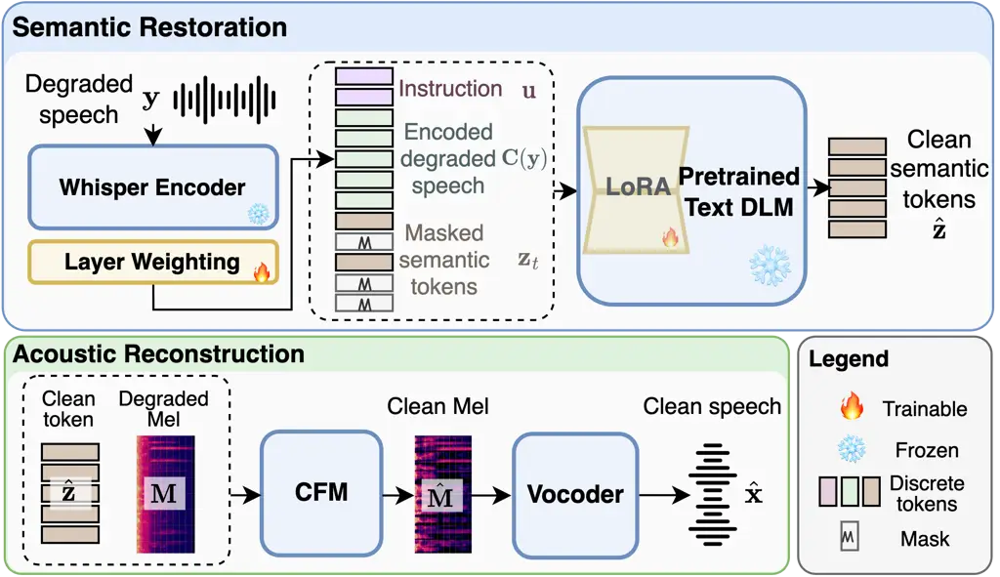

# TIMUSE: Text-Initialized Masked Semantic Token Modeling for Universal Speech EnhancementThanks: ^(∗)Corresponding authors.

Yiwei Guo    Hao Qiu    Mohan Ye    Zhijie Deng    Zehua Chen    Kai Yu

###### Abstract

Discrete-token-based universal speech enhancement (USE) enables strong
sequence modeling but often suffers from a quality–fidelity trade-off,
where perceptually plausible outputs may alter linguistic content or
speaker characteristics. We present TIMUSE, a two-stage USE framework
combining text-initialized masked semantic restoration with acoustic
reconstruction. A pretrained diffusion language model (DLM) is adapted
with LoRA to recover clean semantic tokens using masked generative
modeling, while a conditional flow matching model reconstructs clean
24 kHz speech from the recovered semantic tokens and original degraded
speech. Both system-level and controlled comparisons show that TIMUSE
achieves a better balance between perceptual quality and fidelity than
existing discrete USE models. Ablations further show that text DLM
initialization brings a targeted gain under severe degradations.

###### Index Terms: 

Universal speech enhancement, masked generative modeling, semantic
tokens, diffusion language models

^(†)^(†)address: ¹School of Computer Science, Shanghai Jiao Tong
University  
²Department of Computer Science and Technology, Tsinghua University  
³Jiangsu Key Lab of Language Computing

## 1 Introduction

Universal speech enhancement (USE) aims to recover clean speech from
diverse degradations, including noise, reverberation, bandwidth
limitation, clipping, and their mixtures \[39, 17\]. Severe degradations
may not only corrupt speech but also remove linguistic evidence, making
generative USE methods increasingly popular.

Recent generative USE methods operate in either continuous or discrete
representation spaces. Continuous-domain systems directly estimate
waveforms, spectra, or acoustic features \[18, 30\], while
discrete-token methods reformulate enhancement as sequence generation.
The latter have shown strong perceptual quality and provide a natural
interface to language-model-based unified speech processing. However,
their generative flexibility also introduces a quality–fidelity
trade-off: perceptually plausible outputs may alter linguistic content
or speaker characteristics. This problem is particularly important for
USE, where reliable restoration is required in addition to perceptual
quality.

Existing discrete USE systems have explored different token
representations and generation strategies. Acoustic-token methods \[38,
20, 36\] directly generate codec representations. Since linguistic and
acoustic information are modeled jointly, this usually leads to heavier
modeling burden. Instead, semantic tokens provide a more compact
representation of phonetic and linguistic content \[7\]. Metis-SE \[34\]
explores this property by first restoring semantic tokens, followed by
semantic-to-acoustic token generation. SenSE \[19\] instead uses a flow
matching model conditioned on the degraded Mel spectrogram and restored
semantic tokens, improving content fidelity while retaining speaker and
acoustic information from the observation. These advances highlight the
potential of using semantic tokens for USE. Nevertheless, the
quality–fidelity trade-off remains, motivating a more effective
generative model for the semantic restoration stage.

Recent progress in diffusion language models (DLMs) provides a promising
solution. In practice, mask-based DLMs are close to MaskGIT \[3\]-style
masked generative modeling (MGM) with diffusion-derived training
criterion and inference strategies. Current text DLMs have become
efficient and competitive with similarly sized autoregressive (AR)
language models while learning strong bidirectional sequence
priors \[37, 25\]. These properties are well suited to the semantic
restoration task in USE, where the complete degraded utterance is
available and missing content may need to be inferred from bidirectional
linguistic context. Moreover, text pretraining provides a linguistic
prior when acoustic evidence is severely degraded. This motivates
transferring a pretrained text DLM to semantic-token USE. More broadly,
discrete semantic tokens also provide a natural interface between
natural-language task specification and speech signal processing, making
such pretraining attractive for future unified enhancement, separation,
extraction, and editing systems.

Based on these observations, we present TIMUSE, a two-stage USE
framework combining text-initialized masked semantic restoration with
flow-matching-based acoustic reconstruction. In the semantic restoration
stage, we finetune a pretrained Dream \[37\] DLM with LoRA \[9\] to
predict clean single-codebook $`\mathcal{S}^{3}`$ semantic tokens \[4\]
from the encoded degraded speech. Then, a conditional flow matching
(CFM) model reconstructs the clean Mel spectrogram from the generated
tokens and the original degraded-speech Mel spectrogram. Figure 1 shows
the workflow of TIMUSE. On the URGENT 2026 benchmark \[17\], TIMUSE
ranks first among discrete systems on five of six metrics, achieving a
better quality--fidelity balance. Under a matched training recipe,
TIMUSE outperforms all compared baselines across all metric–benchmark
combinations, with particularly large gains in content accuracy.
Ablations show that semantic tokens and MGM provide significant gains,
while text initialization further improves content preservation,
especially under severe degradations. Code and demos are available
online.¹¹ 1 https://cantabile-kwok.github.io/timuse/

Our contributions are twofold:

- •
  We present TIMUSE, a two-stage USE framework with masked semantic
  token modeling that achieves a better quality–fidelity balance than
  previous discrete USE systems.
- •
  To the best of our knowledge, we are the first to show that
  initialization from a pretrained text DLM benefits USE, taking a step
  toward DLM-based unified speech processing models.

## 2 TIMUSE: Text-Initialized Masked Semantic Token Modeling

### 2.1 Problem Formulation and Overview

Let $`\mathbf{y}`$ and $`\mathbf{x}`$ denote a degraded utterance and
its clean counterpart. As illustrated in Figure 1, rather than
estimating the clean waveform directly, TIMUSE divides the problem into
two stages. The semantic restoration stage first predicts its clean
$`\mathcal{S}^{3}`$ semantic token sequence $`\hat{\mathbf{z}}`$ from
continuous degraded-speech features $`\mathbf{C}(\mathbf{y})`$ and an
optional text instruction $`u`$ using a text-pretrained masked
generator. The conditioning encoder $`\mathbf{C}(\cdot)`$ operates on
16 kHz resampled speech. The acoustic stage then reconstructs the final
24 kHz waveform from the recovered tokens while retaining the original
24 kHz degraded waveform as an acoustic reference.



Figure 1: Overview of TIMUSE.

### 2.2 Degraded-Speech Conditioning

We implement $`\mathbf{C}(\mathbf{y})`$ using a frozen Whisper large-v3
encoder \[28\] applied to the degraded speech resampled to 16 kHz.
Rather than using the last layer output as in \[19\], we combine all
encoder-layer hidden states using trainable softmax-normalized scalar
weights, then apply layer normalization and a linear projection to match
the hidden dimension of the subsequent semantic restoration model. This
learned mixture lets the enhancement model perceive different acoustic
and linguistic abstraction levels.

### 2.3 Text-Initialized Masked Semantic Token Modeling

In the semantic restoration stage, the target is the discrete token
sequence $`\mathbf{z}_{0}=(z_{0}^{1},\ldots,z_{0}^{N})`$, extracted from
$`\mathbf{x}`$ by a frozen $`\mathcal{S}^{3}`$ tokenizer \[4, 19\] with
a single codebook of 4096 entries at 50 tokens per second. Restoration
is thus defined as predicting this compact, explicitly clean target from
continuous evidence of the degraded observation.

We formulate the semantic restoration model as an MGM, and initialize it
from a text DLM Dream-v0-Instruct-7B \[37\]. We introduce a new
embedding table and output head for the $`\mathcal{S}^{3}`$ vocabulary.
Its input sequence comprises an optional text instruction
$`\mathbf{u}`$, the condition $`\mathbf{C}(\mathbf{y})`$, and an
embedded corrupted target sequence. In this study, the instruction
$`\mathbf{u}`$ is randomly sampled from degradation-aware restoration
templates during training and set to a fixed generic restoration
instruction for all reported inference, leaving a natural interface for
future instruction-controlled universal speech processing tasks. The
pretrained DLM backbone remains frozen and is adapted only through
LoRA \[9\]; the newly introduced speech-token embedding, output head,
and condition projector are trained for the restoration task. In this
way, text pretraining supplies the sequence-modeling initialization
without substantially increasing the trainable parameter count.

We train the model with a continuous-time, discrete diffusion-style
masking process \[2, 37\]. At each training step we sample a diffusion
timestep $`t`$ and convert it to a masking ratio through a bounded
cosine schedule with boundary constants $`\rho_{\min},\rho_{\max}`$:

```math
t\sim\mathcal{U}(0,1),\qquad\rho(t)=\rho_{\min}+(\rho_{\max}-\rho_{\min})\sin\!\left(\frac{\pi t}{2}\right). \tag{1}
```

Fully masked targets are also included during training, matching the
fully masked initial state used at inference. Given a mask set
$`\mathcal{M}\sim q_{\mathrm{mask}}(\cdot\mid\rho(t))`$, the corrupted
target is

```math
z_{t}^{i}=\begin{cases}[\mathrm{MASK}],&i\in\mathcal{M},\\
z_{0}^{i},&\text{otherwise}.\end{cases} \tag{2}
```

The corruption operator mixes random token masking and contiguous span
masking, exposing the model to both scattered errors and extended
content loss. The sampled $`t`$ controls the corruption severity through
Eq. (1).

Conditioned on the corrupted sequence, degraded-speech features, and
instruction, the model predicts the original clean tokens. We optimize a
cross-entropy loss averaged over masked positions:

```math
\mathcal{L}=-\mathbb{E}_{\mathbf{z}_{0},t,\mathbf{z}_{t}}\left[\frac{1}{|\mathcal{M}|}\sum_{i\in\mathcal{M}}\log p_{\theta}\!\left(z_{0}^{i}\mid\mathbf{z}_{t},\mathbf{C}(\mathbf{y}),\mathbf{u}\right)\right]. \tag{3}
```

At inference, semantic generation starts from a fully masked sequence.
At each iteration, the model predicts all remaining masked positions and
commits a schedule-determined subset of the most confident predictions.
Repeating this procedure progressively produces the restored sequence
$`\hat{\mathbf{z}}`$.

### 2.4 Acoustic Reconstruction with Conditional Flow Matching

Semantic tokens retain linguistic content but omit speaker and fine
acoustic details, making an acoustic reconstruction module necessary for
producing the clean speech waveform. We formulate this module as a flow
matching model in the continuous Mel domain. We initialize it from the
SenSE CFM \[19\] and finetune it on our training data to better match
our diverse degradation conditions. Specifically, we extract a Mel
spectrogram $`\mathbf{M}`$ from the original 24 kHz degraded waveform
and condition the CFM model on both this acoustic observation and the
predicted clean semantics:

```math
\mathbf{M}=\operatorname{Mel}(\mathbf{y}),\qquad\hat{\mathbf{M}}=\mathrm{CFM}(\hat{\mathbf{z}},\mathbf{M}). \tag{4}
```

Unlike SenSE, during CFM sampling, we apply token-only classifier-free
guidance (CFG) \[8\]. Let $`\mathbf{m}_{\tau}`$ denote the flow state at
time $`\tau`$. We evaluate conditional and token-null flow fields as

```math
\mathbf{v}_{\mathrm{c}}=\mathbf{v}_{\phi}(\mathbf{m}_{\tau},\tau\mid\hat{\mathbf{z}},\mathbf{M}),\qquad\mathbf{v}_{\varnothing}=\mathbf{v}_{\phi}(\mathbf{m}_{\tau},\tau\mid\varnothing,\mathbf{M}), \tag{5}
```

and use the guided field
$`\widetilde{\mathbf{v}}=\mathbf{v}_{\mathrm{c}}+\gamma(\mathbf{v}_{\mathrm{c}}-\mathbf{v}_{\varnothing})`$.
Unlike a fully unconditional CFG branch, the null-token branch removes
only the semantic-token condition and retains the noisy acoustic
observation. CFG therefore strengthens the contribution of restored
semantics while keeping both branches grounded in the input acoustics. A
frozen BigVGAN vocoder \[16\] then converts $`\hat{\mathbf{M}}`$ into
the final 24 kHz waveform. Here, $`\hat{\mathbf{z}}`$ supplies the
restored clean content, while the noisy acoustic condition provides
complementary speaker and fine-grained acoustic cues. We keep the CFM
and vocoder fixed during semantic restoration training.

## 3 Experiments

### 3.1 Dataset and Training Recipe

#### 3.1.1 Training Data

We use multilingual clean speech from LibriTTS-R \[15\], the DNS5 corpus
(read speech, emotional speech, and VocalSet) \[5\], VCTK \[33\], the
URGENT 2026 training set (only SeniorTalk and EARS subsets) \[17\],
ESD \[40\], LJSpeech \[10\], Expresso \[24\], AISHELL-3 \[31\], and MLS
(excluding English) \[27\]. Noise comes from the DNS5 noise set \[5\],
FSD50K (without human voice) \[6\], WHAM! \[35\], DEMAND \[32\], and
MusicCaps \[1\] as musical interference. Room impulse responses are the
simulated and real RIRs from OpenSLR SLR26 and SLR28 \[14\]. This
amounts to about 900 hours of clean English speech, 62 hours of clean
Mandarin speech and 6k hours of other MLS languages, with 378 hours of
additive noise. During training, we first sample English, Mandarin, or
other MLS languages with a fixed ratio of $`6`$:$`1`$:$`2`$, independent
of their corpus durations, and then sample an utterance from the
selected group. This substantially downweights the much larger MLS
corpus while keeping English and Mandarin well represented.

#### 3.1.2 Training and Inference Recipe

We train TIMUSE with a two-stage, scene-based online degradation policy.
Each sample is drawn from a realistic scenario (identity, environmental,
device, or communication), then assigned a difficulty-conditioned effect
mixture applied on the fly. The degradations in these scenarios include
additive noise, reverberation, bandwidth limitation, low-pass filtering,
dynamic equalization, packet loss, codec reconstruction, clipping, and
microphone effects. Stage 1 emphasizes balanced everyday degradations,
while Stage 2 increases the proportion of severe communication and
multi-effect compound distortions. Details of the simulation pipeline
are provided in our open-source repository. To better exploit contextual
information, we set the maximum sample length to 10 s.

We train TIMUSE with a batch size of 16 for 50k AdamW \[21\] updates in
Stage 1, then another 100k updates in Stage 2. The peak learning rate is
$`5\times 10^{-5}`$ in Stage 1 and $`1\times 10^{-5}`$ in Stage 2, with
cosine annealing. For the pretrained Dream backbone, we apply LoRA to
all linear layers with rank $`r=64`$, scaling factor $`\alpha=128`$, and
dropout $`0.05`$, with about 162M trainable parameters. The corruption
ratio follows Eq. (1) with $`\rho_{\min}=0.15`$ and
$`\rho_{\max}=0.95`$, and $`10\%`$ of the steps use a fully masked
input.

All semantic-token variants in the controlled comparisons and ablation
studies use the same adapted CFM checkpoint, ensuring that their
differences arise from semantic representation and sequence modeling
rather than acoustic reconstruction.

At inference, we use two-step iterative masked decoding with a linear
unmasking schedule and maximum-probability confidence, followed by
eight-step CFM sampling with token-only CFG at guidance strength
$`\gamma=0.5`$. Under this inference setting, the average real-time
factor (RTF) is 0.104 on an RTX 5090 GPU.

#### 3.1.3 Evaluation Data and Metrics

We evaluate all methods on two public universal speech enhancement
challenges: AATC 2025 \[39\] and URGENT 2026 \[17\]. Both benchmarks
cover diverse and potentially compound degradations beyond conventional
denoising and dereverberation. The AATC 2025 test set includes 300
English and Mandarin clean-degraded pairs. For URGENT 2026, we use the
Track 1 non-blind test set with 1023 simulated pairs in multiple
languages.

We evaluate USE systems with both perceptual quality and fidelity, since
generative USE systems may produce perceptually plausible speech while
altering linguistic content or speaker characteristics. Perceptual
metrics include DNSMOS \[29\] and NISQA \[22\]; fidelity metrics are
downstream task-derived metrics including character accuracy (CAcc,
defined as $`1-\text{CER}`$) and speaker similarity (SpkSim) between the
enhanced speech and the clean reference. Because AATC 2025 does not
provide transcripts of the clean speech, we obtain a pseudo reference by
transcribing the clean speech with the same ASR model, and report
pseudo-CAcc (pCAcc) on this benchmark. The evaluation protocol follows
the official URGENT 2026 implementation, with OWSM-v3.1-EBF \[26\] as
the ASR model and RawNet3 \[12\] for speaker similarity. In short,
perceptual metrics assess how natural and clean the enhanced speech
sounds to humans, whereas fidelity metrics assess preservation of
linguistic content and speaker identity for downstream models.

### 3.2 System-Level Comparison

|                   |                    |                 |                  |                   |                  |                    |
| ----------------- | ------------------ | --------------- | ---------------- | ----------------- | ---------------- | ------------------ |
| Method            | Perceptual quality |                 |                  |                   | Fidelity         |                    |
|                   | SIG$`\uparrow`$    | BAK$`\uparrow`$ | OVRL$`\uparrow`$ | NISQA$`\uparrow`$ | CAcc$`\uparrow`$ | SpkSim$`\uparrow`$ |
| Continuous-domain |                    |                 |                  |                   |                  |                    |
| BSRNN-Flow \[18\] | 3.268              | 3.866           | 2.931            | 3.236             | 78.91            | 0.694              |
| UniPASE \[30\]    | 3.443              | 3.991           | 3.134            | 3.952             | 86.85            | 0.720              |
| Sidon-v0.1 \[23\] | 3.351              | 3.987           | 3.051            | 3.377             | 76.33            | 0.507              |
| Discrete-domain   |                    |                 |                  |                   |                  |                    |
| AnyEnhance \[38\] | 3.162              | 3.980           | 2.877            | 3.189             | 53.51            | 0.451              |
| Metis-SE \[34\]   | 3.481              | 3.978           | 3.168            | 3.901             | 74.80            | 0.511              |
| LLaSE-G1 \[13\]   | 3.172              | 3.841           | 2.833            | 3.068             | 61.23            | 0.460              |
| UniSE \[36\]      | 3.508              | 3.991           | 3.196            | 3.730             | 59.22            | 0.508              |
| SenSE \[19\]      | 3.382              | 4.054           | 3.133            | 3.707             | 80.46            | 0.592              |
| TIMUSE (Ours)     | 3.477              | 4.093           | 3.225            | 4.042             | 80.61            | 0.640              |

Table 1: System-level comparison on URGENT 2026. SIG, BAK, and OVRL are
DNSMOS scores. Best and second-best results are in bold and underlined,
respectively.

|               | AATC 2025          |                 |                  |                   |                   |                    | URGENT 2026        |                 |                  |                   |                  |                    |
| ------------- | ------------------ | --------------- | ---------------- | ----------------- | ----------------- | ------------------ | ------------------ | --------------- | ---------------- | ----------------- | ---------------- | ------------------ |
| Method        | Perceptual quality |                 |                  |                   | Fidelity          |                    | Perceptual quality |                 |                  |                   | Fidelity         |                    |
|               | SIG$`\uparrow`$    | BAK$`\uparrow`$ | OVRL$`\uparrow`$ | NISQA$`\uparrow`$ | pCAcc$`\uparrow`$ | SpkSim$`\uparrow`$ | SIG$`\uparrow`$    | BAK$`\uparrow`$ | OVRL$`\uparrow`$ | NISQA$`\uparrow`$ | CAcc$`\uparrow`$ | SpkSim$`\uparrow`$ |
| AnyEnhance    | 3.331              | 4.069           | 3.082            | 3.696             | 71.22             | 0.538              | 3.287              | 3.947           | 2.990            | 3.237             | 63.31            | 0.463              |
| UDSE          | 3.169              | 4.001           | 2.924            | 3.300             | 71.62             | 0.509              | 3.036              | 3.835           | 2.738            | 2.736             | 61.71            | 0.428              |
| SenSE         | 3.416              | 4.067           | 3.164            | 3.981             | 66.95             | 0.543              | 3.392              | 4.010           | 3.128            | 3.860             | 74.81            | 0.523              |
| TIMUSE (Ours) | 3.513              | 4.148           | 3.285            | 4.216             | 79.08             | 0.683              | 3.477              | 4.093           | 3.225            | 4.042             | 80.61            | 0.640              |

Table 2: Controlled comparison on AATC 2025 and URGENT 2026. SIG, BAK,
and OVRL are DNSMOS scores. pCAcc denotes pseudo character accuracy on
AATC 2025. Best and second-best results in each column are in bold and
underlined, respectively.

[TABLE]

Table 3: Ablation on modeling family, token type, and language-model
pretraining.

We first present a system-level USE comparison on URGENT 2026 using
publicly released checkpoints. Because these systems differ in training
data, model scale, simulation recipe, etc., this comparison only
characterizes final system performance; we leave the modeling design
analysis to the controlled experiments later. We include baselines from
both the continuous and discrete domains. Continuous-domain baselines
include BSRNN-Flow \[18\], Sidon-v0.1 \[23\], and UniPASE \[30\]; for
discrete-domain models, we include AnyEnhance \[38\], LLaSE-G1 \[13\],
UniSE \[36\], Metis-SE \[34\], and SenSE \[19\]. We use the official
pretrained checkpoints for all models, specifically the AnyEnhance
checkpoint²² 2 https://github.com/viewfinder-annn/AnyEnhance-v1. and the
URGENT 2026 baseline for BSRNN-Flow³³ 3
https://github.com/urgent-challenge/urgent2026_challenge_track1.

As shown in Table 1, TIMUSE ranks first among discrete-domain systems on
five of the six reported metrics. Relative to the best competing
discrete-domain result for each metric, it improves BAK by 0.039, OVRL
by 0.029, NISQA by 0.141, CAcc by 0.15 percentage points, and SpkSim by
0.048. Its BAK, OVRL, and NISQA are also the best among all evaluated
systems. Although UniSE and Metis-SE obtain slightly higher SIG scores,
TIMUSE offers the strongest overall balance among discrete systems. The
controlled studies below examine the sources of these gains.

### 3.3 Controlled Experiments

We next compare models under a matched training dataset and recipe to
eliminate the effects of training-data size, quality, and simulation
strategy. We consider three discrete-domain USE methods: AnyEnhance,
UDSE \[20\], and SenSE. We adapt their official training code to our
online two-stage recipe and train all models for 150k updates with the
same batch size.

Table 2 shows that TIMUSE ranks first in all twelve metric–benchmark
combinations. Beyond CAcc gains of 7.46 percentage points on AATC 2025
and 5.80 points on URGENT 2026, improvements in perceptual quality and
speaker similarity show that stronger content recovery does not
sacrifice speaker identity. Because all systems share the training data
and recipe, these matched gains more directly reflect the model design;
the following ablations separate the contribution of each choice.

### 3.4 Ablation and Analysis

We further isolate the effect of three core design choices: generative
modeling family (MGM vs. AR), discrete token family (semantic vs.
acoustic), and text LM pretraining. To isolate the token family, we
replace the single-codebook $`\mathcal{S}^{3}`$ tokenizer with the
likewise single-codebook WavTokenizer-large \[11\] at 24 kHz. For all
no-pretrain variants, including both semantic- and acoustic-token MGM,
we use a randomly initialized Transformer with approximately 162M
trainable parameters, matching the trainable budget of our LoRA adapter
on Dream DLM. To compare MGM and AR, we hold the Transformer
architecture fixed and change only the sequence objective and decoding
procedure. These comparisons are even stricter than those in
Section 3.3, since other variables such as trainable parameter budget
and audio encoder are held fixed.

Table 3 reveals a clear hierarchy among the three design choices.
Replacing semantic tokens with acoustic tokens causes the largest loss,
particularly in content and speaker fidelity, establishing the semantic
target as a primary source of the advantage. With the token type and
parameter budget fixed, MGM also consistently outperforms AR; the final
AR row closely resembles SenSE, i.e., autoregressive semantic-token
prediction without text-LM initialization. Initializing MGM from the
text-pretrained DLM then provides a complementary gain: CAcc increases
by 1.78pp, while OVRL and SpkSim remain essentially unchanged. Thus,
semantic targets and masked modeling drive the overall improvement,
whereas text initialization more specifically strengthens content
preservation.

To examine when this targeted gain arises, we create severity-controlled
test sets by applying one degradation at a time to the clean reference
utterances of URGENT 2026. We compare TIMUSE with the parameter-matched,
randomly initialized semantic-token MGM in the third row of Table 3,
using the same corrupted utterances for both systems. Figure 2 reports
the corpus-level CER of this model minus that of TIMUSE, in percentage
points; positive values therefore favor text initialization. The
pointwise 95% confidence intervals are obtained by paired bootstrap
resampling of utterances. The gain generally increases as noise,
downsampling, clipping, and quantization become more severe, and is also
positive at high packet-loss rates. Several mild conditions remain
indistinguishable. These trends support our central hypothesis that
text-pretrained linguistic priors become increasingly valuable as
acoustic evidence is lost, establishing text DLM initialization as an
effective mechanism for content recovery under severe degradations.

Figure 2: CER gains of text initialization across degradations and
severities. Error bars denote 95% confidence intervals.

## 4 Conclusion

We presented TIMUSE, a two-stage USE framework combining
text-initialized masked semantic-token prediction with
flow-matching-based acoustic reconstruction. On URGENT 2026, it offers a
strong overall balance among discrete systems, while under matched
training it leads all metrics on AATC 2025 and URGENT 2026. Ablations
show that semantic token targets and masked modeling drive the overall
gains, whereas initialization from a text DLM selectively improves
content preservation, particularly under severe content-degrading
conditions. These results support the use of text-pretrained priors for
USE and highlight the potential of DLMs for future universal speech
signal processing.

## 5 Compliance with Ethical Standards

This study used publicly available speech data; no additional ethical
approval was required.

## References

- \[1\] A. Agostinelli, T. I. Denk, Z. Borsos, et al. (2023) MusicLM:
  generating music from text. arXiv preprint 2301.11325. Cited by:
  §3.1.1.
- \[2\] J. Austin, D. D. Johnson, J. Ho, et al. (2021) Structured
  denoising diffusion models in discrete state-spaces. In Proc. NeurIPS,
  Vol. 34, pp. 17981–17993. Cited by: §2.3.
- \[3\] H. Chang, H. Zhang, L. Jiang, et al. (2022) MaskGIT: masked
  generative image transformer. In Proc. CVPR, pp. 11315–11325. Cited
  by: §1.
- \[4\] Z. Du, Q. Chen, S. Zhang, et al. (2024) Cosyvoice: a scalable
  multilingual zero-shot text-to-speech synthesizer based on supervised
  semantic tokens. arXiv preprint 2407.05407. Cited by: §1, §2.3.
- \[5\] H. Dubey, A. Aazami, V. Gopal, et al. (2024) ICASSP 2023 deep
  noise suppression challenge. IEEE Open J. Signal Process. 5,
  pp. 725–737. Cited by: §3.1.1.
- \[6\] E. Fonseca, X. Favory, J. Pons, et al. (2022) FSD50K: an open
  dataset of human-labeled sound events. IEEE/ACM Trans. Audio, Speech,
  Lang. Process. 30, pp. 829–852. Cited by: §3.1.1.
- \[7\] Y. Guo, Z. Li, H. Wang, et al. (2026) Recent Advances in
  Discrete Speech Tokens: A Review . IEEE Trans. Pattern Anal. Mach.
  Intell. 48 (04), pp. 4184–4204. External Links: ISSN 1939-3539,
  [Document](https://dx.doi.org/10.1109/TPAMI.2025.3643619),
  [Link](https://doi.ieeecomputersociety.org/10.1109/TPAMI.2025.3643619)
  Cited by: §1.
- \[8\] J. Ho and T. Salimans (2022) Classifier-free diffusion guidance.
  arXiv preprint arXiv:2207.12598. Cited by: §2.4.
- \[9\] E. J. Hu, Y. Shen, P. Wallis, et al. (2022) LoRA: low-rank
  adaptation of large language models. In Proc. ICLR, Cited by: §1,
  §2.3.
- \[10\] K. Ito and L. Johnson (2017) The LJ speech dataset. Note:
  [https://keithito.com/LJ-Speech-Dataset/](https://keithito.com/LJ-Speech-Dataset/)
  Cited by: §3.1.1.
- \[11\] S. Ji, Z. Jiang, W. Wang, et al. (2025) WavTokenizer: an
  efficient acoustic discrete codec tokenizer for audio language
  modeling. In Proc. ICLR, Cited by: §3.4.
- \[12\] J. Jung, Y. J. Kim, H.-S. Heo, et al. (2022) Pushing the limits
  of raw waveform speaker recognition. In Proc. Interspeech,
  pp. 2228–2232. Cited by: §3.1.3.
- \[13\] B. Kang, X. Zhu, Z. Zhang, et al. (2025) LLaSE-G1:
  incentivizing generalization capability for LLaMA-based speech
  enhancement. In Proc. ACL, pp. 13292–13305. Cited by: §3.2, Table 1.
- \[14\] T. Ko, V. Peddinti, D. Povey, et al. (2017) A study on data
  augmentation of reverberant speech for robust speech recognition. In
  Proc. ICASSP, pp. 5220–5224. Cited by: §3.1.1.
- \[15\] Y. Koizumi, H. Zen, S. Karita, et al. (2023) LibriTTS-R: a
  restored multi-speaker text-to-speech corpus. In Proc. Interspeech,
  pp. 5496–5500. Cited by: §3.1.1.
- \[16\] S.-G. Lee, W. Ping, B. Ginsburg, et al. (2023) BigVGAN: a
  universal neural vocoder with large-scale training. In Proc. ICLR,
  Cited by: §2.4.
- \[17\] C. Li, W. Wang, M. Sach, et al. (2026) ICASSP 2026 URGENT
  speech enhancement challenge. arXiv preprint arXiv:2601.13531. Cited
  by: §1, §1, §3.1.1, §3.1.3.
- \[18\] C. Li, W. Zhang, W. Wang, et al. (2025) Less is more: data
  curation matters in scaling speech enhancement. In Proc. IEEE ASRU,
  pp. 1–8. Cited by: §1, §3.2, Table 1.
- \[19\] X. Li, H. Xie, Z. Wang, et al. (2025) SenSE: semantic-aware
  high-fidelity universal speech enhancement. arXiv preprint
  arXiv:2509.24708. Cited by: §1, §2.2, §2.3, §2.4, §3.2, Table 1.
- \[20\] F. Liu, Y. Ai, Y.-X. Lu, et al. (2025) Universal
  discrete-domain speech enhancement. IEEE TASLP 34, pp. 285–298. Cited
  by: §1, §3.3.
- \[21\] I. Loshchilov and F. Hutter (2019) Decoupled weight decay
  regularization. In Proc. ICLR, Cited by: §3.1.2.
- \[22\] G. Mittag, B. Naderi, A. Chehadi, et al. (2021) NISQA: a deep
  CNN-self-attention model for multidimensional speech quality
  prediction with crowdsourced datasets. In Proc. Interspeech,
  pp. 2127–2131. Cited by: §3.1.3.
- \[23\] W. Nakata, Y. Saito, Y. Ueda, et al. (2026) Sidon: fast and
  robust open-source multilingual speech restoration for large-scale
  dataset cleansing. In Proc. ICASSP, pp. 17617–17621. Cited by: §3.2,
  Table 1.
- \[24\] T. A. Nguyen, W.-N. Hsu, A. D’Avirro, et al. (2023) Expresso: a
  benchmark and analysis of discrete expressive speech resynthesis. In
  Proc. Interspeech, pp. 4823–4827. Cited by: §3.1.1.
- \[25\] S. Nie, Q. Min, S. Xu, et al. (2026) Improved large language
  diffusion models. arXiv preprint arXiv:2606.25331. Cited by: §1.
- \[26\] Y. Peng, J. Tian, W. Chen, et al. (2024) OWSM v3.1: better and
  faster open whisper-style speech models based on E-Branchformer. In
  Proc. Interspeech, pp. 352–356. Cited by: §3.1.3.
- \[27\] V. Pratap, Q. Xu, A. Sriram, et al. (2020) MLS: a large-scale
  multilingual dataset for speech research. In Proc. Interspeech,
  pp. 2757–2761. Cited by: §3.1.1.
- \[28\] A. Radford, J. W. Kim, T. Xu, et al. (2023) Robust speech
  recognition via large-scale weak supervision. In Proc. ICML,
  pp. 28492–28518. Cited by: §2.2.
- \[29\] C. K. A. Reddy, V. Gopal, and R. Cutler (2021) DNSMOS: a
  non-intrusive perceptual objective speech quality metric to evaluate
  noise suppressors. In Proc. ICASSP, pp. 6493–6497. Cited by: §3.1.3.
- \[30\] X. Rong, Z. Wang, Y. Wang, et al. (2026) UniPASE: a generative
  model for universal speech enhancement with high fidelity and low
  hallucinations. IEEE TASLP 34, pp. 3901–3915. Cited by: §1, §3.2,
  Table 1.
- \[31\] Y. Shi, H. Bu, X. Xu, et al. (2021) AISHELL-3: a multi-speaker
  Mandarin TTS corpus. In Proc. Interspeech, pp. 2756–2760. Cited by:
  §3.1.1.
- \[32\] J. Thiemann, N. Ito, and E. Vincent (2013) The diverse
  environments multi-channel acoustic noise database: a database of
  multichannel environmental noise recordings. In Proc. Meetings on
  Acoustics, Vol. 19. Cited by: §3.1.1.
- \[33\] C. Veaux, J. Yamagishi, and S. King (2013) The voice bank
  corpus: design, collection and data analysis of a large regional
  accent speech database. In Proc. Oriental COCOSDA, pp. 1–4. Cited by:
  §3.1.1.
- \[34\] Y. Wang, J. Zheng, J. Zhang, et al. (2025) Metis: a foundation
  speech generation model with masked generative pre-training. In Proc.
  NeurIPS, Cited by: §1, §3.2, Table 1.
- \[35\] G. Wichern, J. Antognini, M. Flynn, et al. (2019) WHAM!:
  extending speech separation to noisy environments. In Proc.
  Interspeech, pp. 1368–1372. Cited by: §3.1.1.
- \[36\] H. Yan, C. Liu, S. Xue, et al. (2026) UniSE: a unified
  framework for decoder-only autoregressive LM-based speech enhancement.
  In Proc. Interspeech, Cited by: §1, §3.2, Table 1.
- \[37\] J. Ye, Z. Xie, L. Zheng, et al. (2025) Dream 7B: diffusion
  large language models. arXiv preprint arXiv:2508.15487. Cited by: §1,
  §1, §2.3, §2.3.
- \[38\] J. Zhang, J. Yang, Z. Fang, et al. (2025) AnyEnhance: a unified
  generative model with prompt-guidance and self-critic for voice
  enhancement. IEEE TASLP 33, pp. 3085–3098. Cited by: §1, §3.2, Table
  1.
- \[39\] J. Zhang, M. Zhu, X. Xu, et al. (2025) The CCF AATC 2025 speech
  restoration challenge: a retrospective. arXiv preprint
  arXiv:2509.12974. Cited by: §1, §3.1.3.
- \[40\] K. Zhou, B. Sisman, R. Liu, et al. (2021) Seen and unseen
  emotional style transfer for voice conversion with a new emotional
  speech dataset. In Proc. ICASSP, pp. 920–924. Cited by: §3.1.1.
