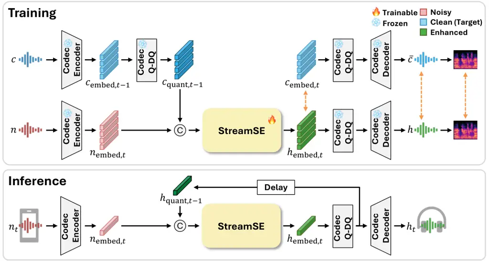

# StreamSE: Neural Audio Codec-based Streaming Speech Enhancement for On-device Inference

Hyunjin Choi    Zinu Kim    Junwon Moon    Jeongyun Chae    Seungbeom
Kim    Kyuhong Shim

###### Abstract

Recent generative speech enhancement (SE) models achieve high perceptual
quality, but their non-causal processing and expensive computation make
them difficult to use for streaming, on-device inference. We propose
StreamSE, a 20M-parameter streaming SE model that operates in the latent
space of a frozen pretrained neural audio codec. At each frame, StreamSE
directly regresses a clean continuous latent from the noisy continuous
latent while conditioning on its own predictions from previous frames.
Enhancement therefore requires a single forward pass per frame and no
iterative sampling or look-ahead. We further truncate the codec’s
residual vector quantizer (RVQ) to its coarse levels, halving the number
of tokens per frame while improving robustness to reverberation.
StreamSE is the only streaming generative model in our comparison, yet
it matches or exceeds the perceptual quality of the offline generative
baselines. Furthermore, the complete StreamSE pipeline runs in real time
on a single smartphone CPU core. Our results show that continuous latent
regression provides a practical route to generative SE under fully
causal, on-device streaming constraints.

###### Index Terms: 

streaming speech enhancement, neural audio codec, on-device inference

^(†)^(†)address: Sungkyunkwan University, Republic of Korea  
emily.choi@skku.edu, khshim@skku.edu

## 1 Introduction

Speech enhancement recovers clean speech from noisy signals and is
widely used to improve speech quality in voice communication and to
preprocess input for speech recognition. Applications such as telephony,
hearing aids, and on-device voice assistants impose two constraints
simultaneously: causality requires that the output depend only on
current and past frames, while the computational budget requires that
each frame be processed within one frame on device.

Deep learning-based speech enhancement has progressed from
discriminative methods that map noisy speech to clean speech to
generative methods that employ diffusion models and language models. In
particular, SELM \[18\] generates clean speech as discrete tokens with a
language model, achieving higher perceptual quality than discriminative
methods. However, existing generative approaches typically rely on
non-causal architectures. SELM, for instance, processes an entire
utterance at once. Diffusion-based methods further incur the
computational cost of iterative sampling at inference \[10\]. Attaining
high perceptual quality under both causal streaming and on-device
computational constraints, therefore, remains challenging.



Figure 1: Overview of StreamSE during training (top) and inference
(bottom). \scriptsizeC⃝ denotes concatenation, and Q-DQ denotes
$`\mathrm{QDQ}_{k}`$, quantization followed by dequantization, which
maps a continuous latent onto the sum of its selected RVQ codebook
vectors. Dashed orange arrows mark the training objective, which
compares the predicted latent against the clean latent
$`c_{\mathrm{embed}}`$ and the decoded waveform and its mel spectrogram
against the codec round-trip reference $`\bar{c}`$. At inference, the
delay block feeds the previous quantized-and-dequantized enhanced latent
back as conditioning; the figure draws a single previous frame, whereas
the model attends to all past frames.

To address this problem, we propose StreamSE, a lightweight streaming
speech enhancement model that operates in the latent space of a frozen
pretrained neural audio codec (Fig. 1). The entire pipeline, including
the codec encoder and decoder, is fully causal. At each frame, the codec
encoder maps noisy speech to a continuous latent, and StreamSE directly
regresses the corresponding clean latent. The codec quantizer and
decoder then reconstruct the waveform from the resulting latent. To
maintain temporal consistency, the model feeds its own quantized
predictions back as conditioning for subsequent frames. By predicting a
continuous latent rather than discrete codec tokens, StreamSE avoids
separately predicting a residual vector quantizer (RVQ) token at each
level and completes enhancement with a single forward pass per frame. We
additionally apply level truncation, which retains only the eight coarse
levels of the RVQ and halves the number of tokens per frame, discarding
fine levels that we expect to contain residual reverberation.

On the DNS Challenge 2020 test set, StreamSE achieves the best score on
7 of the 9 DNSMOS metrics, including all 6 metrics in the two synthetic
categories, despite being the only streaming generative model among the
compared systems. Measurements on a single CPU core of a Galaxy S22
mobile device further show that the full int8-quantized pipeline
operates in real time, consuming 76% of the 80 ms per-frame budget, with
StreamSE itself requiring only 5.46 ms.

## 2 Related Work

Deep learning-based speech enhancement has traditionally relied on
discriminative methods that map noisy speech to clean speech in the time
domain \[11\] or the time-frequency domain \[2\]. These methods trade
noise suppression against signal preservation under severe degradation.
Generative methods instead regenerate clean speech rather than masking
or filtering the noisy input, either with diffusion or flow matching
conditioned on the degraded input \[10, 17, 8\] or with language models
that generate clean discrete tokens \[18, 24, 23\]. They often
outperform discriminative baselines on perceptual metrics, but at the
cost of non-causal processing or iterative sampling.

A growing body of work uses a neural audio codec as the representation
and generates clean codec tokens conditioned on the degraded
input \[23\], sometimes through an intermediate semantic stage \[24\].
Recent studies report that predicting continuous latents often
outperforms predicting discrete tokens, and that vector quantization
itself contributes to robustness regardless of the prediction
target \[5\]. Work in this direction enhances the pre-quantization
embeddings of a frozen codec with an embedding-level loss \[9\], but it
is evaluated only in a non-streaming, utterance-level setting and
targets cloud deployment.

Streaming speech enhancement is predominantly discriminative and
typically uses a short look-ahead \[3\], and autoregressive conditioning
on a model’s own past output has been studied at low latency \[1\] and
in multichannel settings \[13\]. Token-based generative approaches
remain largely unexplored under streaming constraints, and the reported
work relies on a codec specifically designed for low latency \[22\]. In
addition, the cost of these approaches is usually reported as a
real-time factor on a server GPU rather than measured per frame on the
target device. Our work differs in two respects: (1) it combines
continuous latent prediction with fully causal streaming that requires
no look-ahead, and (2) it measures per-frame runtime directly on the
target device.

## 3 Method

|                               |            |                     |       |       |                     |       |       |                     |       |       |
| ----------------------------- | ---------- | ------------------- | ----- | ----- | ------------------- | ----- | ----- | ------------------- | ----- | ----- |
| System                        | Streamable | With Reverb         |       |       | Without Reverb      |       |       | Real Recordings     |       |       |
|                               |            | DNSMOS $`\uparrow`$ |       |       | DNSMOS $`\uparrow`$ |       |       | DNSMOS $`\uparrow`$ |       |       |
|                               |            | SIG                 | BAK   | OVL   | SIG                 | BAK   | OVL   | SIG                 | BAK   | OVL   |
| Noisy                         | –          | 1.760               | 1.497 | 1.392 | 3.392               | 2.618 | 2.483 | 3.053               | 2.510 | 2.255 |
| Conv-TasNet \[11\]            | ✗          | 2.415               | 2.710 | 2.010 | 3.092               | 3.341 | 3.001 | 3.102               | 2.975 | 2.410 |
| Demucs \[3\]                  | ✓          | 2.510               | 2.641 | 2.215 | 3.124               | 3.257 | 3.010 | 2.974               | 2.870 | 2.291 |
| Inter-SubNet \[2\]            | ✗          | 2.651               | 2.581 | 2.362 | 3.458               | 3.821 | 3.099 | 3.258               | 3.574 | 2.806 |
| CDiffuSE \[10\]               | ✗          | 2.541               | 2.300 | 2.190 | 3.294               | 3.641 | 3.047 | 3.201               | 3.104 | 2.781 |
| SGMSE \[19\]                  | ✗          | 2.730               | 2.741 | 2.430 | 3.501               | 3.710 | 3.137 | 3.297               | 2.894 | 2.793 |
| StoRM \[8\]                   | ✗          | 2.947               | 3.141 | 2.516 | 3.514               | 3.941 | 3.205 | 3.410               | 3.379 | 2.940 |
| SELM \[18\]                   | ✗          | 3.160               | 3.577 | 2.695 | 3.508               | 4.096 | 3.258 | 3.591               | 3.435 | 3.124 |
| StreamSE ($`\ell{=}2`$)       | ✓          | 3.505               | 4.054 | 3.207 | 3.630               | 4.138 | 3.380 | 3.432               | 3.879 | 3.075 |
| StreamSE ($`\ell{=}1`$)       | ✓          | 3.493               | 4.044 | 3.189 | 3.628               | 4.143 | 3.382 | 3.410               | 3.875 | 3.054 |
| StreamSE ($`\ell{=}0`$)       | ✓          | 3.417               | 3.990 | 3.086 | 3.617               | 4.124 | 3.361 | 3.399               | 3.830 | 3.016 |
| StreamSE ($`\ell{=}0`$, int8) | ✓          | 3.356               | 3.867 | 2.987 | 3.586               | 4.088 | 3.315 | 3.327               | 3.707 | 2.914 |

Table 1: Comparison of different systems on the DNS Challenge test set.
Streamable indicates whether the evaluated configuration supports
streaming inference (✓ yes, ✗ no). StreamSE rows differ in the number of
look-ahead frames $`\ell`$; the algorithmic latency is $`(1{+}\ell)`$
frames of 80 ms. The int8 row is the $`\ell{=}0`$ model run through the
quantized on-device pipeline of Section 4.4.

### 3.1 Architecture Overview

Given noisy speech $`n`$, streaming speech enhancement recovers clean
speech $`c`$ under a causal constraint: the output at time $`t`$ must
depend only on frames $`1,\dots,t`$ of the input. The proposed
architecture comprises the encoder, the RVQ, and the decoder of a
pretrained neural audio codec, together with a lightweight speech
enhancement module, StreamSE, placed between the encoder and the RVQ.
Only StreamSE is trained; the codec remains frozen throughout.

The full inference pipeline follows Fig. 1 and Eq. (1): the codec
encoder maps the noisy waveform $`n`$ to continuous latents
$`n_{\mathrm{embed}}`$, StreamSE predicts the enhanced latents
$`h_{\mathrm{embed}}`$, and the codec decoder reconstructs the enhanced
waveform $`h`$ from the quantized prediction $`h_{\mathrm{quant}}`$. At
time $`t`$, the pipeline is

```math
\displaystyle n_{\mathrm{embed},t} \displaystyle=\mathrm{Encoder}(n)_{t}, \tag{1}
```

```math
\displaystyle h_{\mathrm{embed},t} \displaystyle=\mathrm{StreamSE}\!\left(n_{\mathrm{embed},\leq t},\;h_{\mathrm{quant},<t}\right),
```

```math
\displaystyle h_{\mathrm{quant},t} \displaystyle=\mathrm{QDQ}_{k}(h_{\mathrm{embed},t}),
```

```math
\displaystyle h_{t} \displaystyle=\mathrm{Decoder}(h_{\mathrm{quant},\leq t})_{t}.
```

Here, $`n_{\mathrm{embed}},h_{\mathrm{embed}}\in\mathbb{R}^{T\times d}`$
denote the noisy latent and the enhanced latent, respectively, where
$`T`$ is the number of frames and $`d`$ is the latent dimension per
frame. $`\mathrm{QDQ}_{k}`$ quantizes a latent into discrete tokens
using the first $`k`$ coarse RVQ levels and then dequantizes them into a
continuous latent as the sum of the corresponding codebook vectors. For
the clean speech $`c`$, we similarly define

```math
\displaystyle c_{\mathrm{embed}} \displaystyle=\mathrm{Encoder}(c), \tag{2}
```

```math
\displaystyle c_{\mathrm{quant}} \displaystyle=\mathrm{QDQ}_{k}(c_{\mathrm{embed}}).
```

Within StreamSE the representation remains continuous; each frame is
quantized once, at the output, and this quantized latent serves both
decoding and the context of the next frame.

### 3.2 Neural Audio Codec

We employ MOSS-Audio-Tokenizer-Nano \[4\] as the neural audio codec. It
is a causal streaming codec with approximately 22M parameters, including
the quantizer, and processes a 48 kHz waveform at 12.5 Hz. Each 80-ms
frame is encoded into a $`d{=}768`$-dimensional continuous latent and
quantized using an $`L{=}16`$-level RVQ with a codebook size of 1,024.
We select this codec because it is causal and operates at a low frame
rate. Because the codec is trained with quantizer dropout \[4\], its
decoder reconstructs the waveform from only a prefix of the RVQ levels.
We exploit this property and truncate the RVQ to its $`k`$ coarse
levels, applying $`\mathrm{QDQ}_{k}`$ with the same $`k`$ in the
conditioning path, the auxiliary losses, and the decoding path.

### 3.3 StreamSE

StreamSE is a decoder-only causal Transformer with approximately 20M
trainable parameters, excluding the frozen codebook embeddings. The
module is autoregressive across frames but directly regresses a
continuous latent before quantization instead of classifying discrete
tokens. The input at time $`t`$ is the concatenation of the noisy latent
$`n_{\mathrm{embed},t}`$ and the quantized latent of the previous frame,
$`c_{\mathrm{quant},t-1}`$ during training and
$`h_{\mathrm{quant},t-1}`$ at inference; earlier frames enter through
causal self-attention, and the context of the first frame is a zero
vector. During training, we apply teacher forcing by feeding the
ground-truth quantized latents $`c_{\mathrm{quant},<t}`$ as the
previous-frame context and process the entire sequence in parallel. At
inference, the module operates autoregressively and feeds its own
quantized past predictions $`h_{\mathrm{quant},<t}`$ back as context
(Eq. (1)), so that each prediction is conditioned on the enhanced past
and consecutive frames stay temporally consistent.

Unlike our continuous regression, autoregressive classification over
discrete RVQ tokens requires repeated per-level classification, with
computational cost increasing with the number of RVQ levels. This
overhead would be undesirable under the tight per-frame budget of
on-device streaming inference. StreamSE leaves high-fidelity waveform
reconstruction to the pretrained codec and converts the enhancement task
to predicting a single continuous latent per frame.

### 3.4 Loss Function

The training objective consists of a regression loss in the latent space
and two auxiliary losses computed along the decoding path. The
regression loss $`\mathcal{L}_{\text{emb}}`$ is the L1 distance between
the predicted latent $`h_{\mathrm{embed}}`$ and the clean latent
$`c_{\mathrm{embed}}`$. The two auxiliary losses
$`\mathcal{L}_{\text{wav}}`$ and $`\mathcal{L}_{\text{mel}}`$ compare
two waveforms produced by the same quantization–decoding path: the
enhanced output $`h=\mathrm{Decoder}(h_{\mathrm{quant}})`$ and the codec
round-trip reference $`\bar{c}=\mathrm{Decoder}(c_{\mathrm{quant}})`$.
$`\mathcal{L}_{\text{wav}}`$ compares them in the waveform domain, and
$`\mathcal{L}_{\text{mel}}`$ compares them in the log-mel spectrogram
($`\mathrm{LogMel}`$) domain. Using the codec reconstruction $`\bar{c}`$
rather than the original clean waveform $`c`$ removes the reconstruction
error of the frozen codec from the auxiliary training signal, so the
losses focus on the prediction error of StreamSE:

```math
\displaystyle\mathcal{L}_{\text{emb}} \displaystyle=\lVert h_{\mathrm{embed}}-c_{\mathrm{embed}}\rVert_{1}, \tag{3}
```

```math
\displaystyle\mathcal{L}_{\text{wav}} \displaystyle=\lVert h-\bar{c}\rVert_{1},
```

```math
\displaystyle\mathcal{L}_{\text{mel}} \displaystyle=\lVert\mathrm{LogMel}(h)-\mathrm{LogMel}(\bar{c})\rVert_{1}.
```

The total loss is the weighted sum of the three terms above, with
$`\lambda_{w}{=}0.2`$ and $`\lambda_{m}{=}0.5`$:

```math
\mathcal{L}=\mathcal{L}_{\text{emb}}+\lambda_{w}\,\mathcal{L}_{\text{wav}}+\lambda_{m}\,\mathcal{L}_{\text{mel}}. \tag{4}
```

Following FlowSE \[17\], we compute the mel loss using 100-bin log-mel
spectrograms with a hop length of 512 samples (10.67 ms) and a window
length of 2,048 samples (42.67 ms) for a 48 kHz audio. To train the
model end-to-end, we use a straight-through estimator (STE) to propagate
gradients through quantization while keeping the codec parameters
frozen.

## 4 Experiments

### 4.1 Datasets and Evaluation Metrics

Training Data. We synthesize training pairs online from the clean speech
of LibriTTS-R \[7\] train-clean-100 and train-clean-360 and of the
VoiceBank-DEMAND training set \[15\]. For each pair, we mix noise from
WHAM! \[20\] or DEMAND \[14\] with probability 0.8 at a signal-to-noise
ratio (SNR) drawn from $`-5`$ to $`20`$ dB. We add reverberation with
probability 0.5 from the openSLR26 and openSLR28 room impulse responses
(RIRs) \[6\]. We rescale both signals by a common gain such that the
noisy signal has an RMS sampled uniformly from $`-35`$ to $`-15`$ dBFS.
We also band-limit both the clean and noisy signals by resampling to 8,
16, or 24 kHz and back to 48 kHz for regularization. For pairs with
added reverberation, the target is the dry signal, so the model learns
to remove reverberation rather than to reproduce it.

Test Data and Evaluation Metrics. We evaluate on the three categories of
the DNS Challenge 2020 \[12\] test set. Because generative-model outputs
are not necessarily sample-aligned with their references, we use the
reference-free DNSMOS P.835 (SIG/BAK/OVL). For the level-truncation
ablation, we additionally report speaker similarity (SIM), the cosine
similarity of WeSpeaker \[16\] embeddings, rescaled to $`[0,1]`$ as
$`(\cos+1)/2`$.

### 4.2 Training Setup and Baselines

StreamSE is a causal Transformer with 512-dimensional hidden
representations, 6 layers, and 8 attention heads. It uses rotary
position embeddings (RoPE). At inference, RoPE uses the current frame
index as the position offset. No causal mask is needed because each
query attends only to cached past keys and the current key. We set the
number of coarse RVQ levels to $`k{=}8`$ as default. We apply dropout
rate of 0.2 and weight decay of 0.1, and optimize with AdamW. The
learning rate warms up linearly to a peak of $`6{\times}10^{-4}`$ over
the first 1,000 steps and then decays linearly until the end of
training. We clip gradients to unit norm. Training uses segments of 125
codec frames, that is, 10 s, matching the KV cache width used at
inference. We train for 20 epochs on 16 GB V100 GPU with an effective
batch size of 48.

The compared systems in Table 1 fall into two families. The
discriminative family comprises Conv-TasNet \[11\], Demucs \[3\], and
Inter-SubNet \[2\], while the generative family comprises the
diffusion-based CDiffuSE \[10\], SGMSE \[19\], and StoRM \[8\] together
with the token-based language model SELM \[18\]. All baseline numbers
are quoted from the SELM paper.

### 4.3 Results

Table 1 reports the comparison on the DNS Challenge test set. Each fp32
StreamSE configuration outperforms all external baselines on seven of
the nine DNSMOS metric–category combinations, even though StreamSE is
the only causal, streamable architecture among the compared generative
systems. Unless stated otherwise, we discuss the $`\ell{=}0`$
configuration, which uses no look-ahead. This configuration is the one
measured on device in Section 4.4 and shares its checkpoint with the
$`k{=}8`$ row of Table 2. The particularly strong performance under
reverberation is examined in the level-truncation paragraph below. On
the real-recording category, StreamSE obtains the highest BAK. Overall,
StreamSE matches or exceeds the perceptual quality of the offline
generative models in our comparison while operating under a fully causal
constraint with zero look-ahead.

Look-ahead. With $`\ell`$ frames of look-ahead, the input at time $`t`$
additionally concatenates the noisy latents
$`n_{\mathrm{embed},t+1},\dots,n_{\mathrm{embed},t+\ell}`$; this widens
the input projection by $`\ell d`$ and adds about 0.39M parameters per
frame of look-ahead, while the remaining per-frame computation is
unchanged and every output is delayed by $`\ell`$ frames. One frame of
look-ahead improves every metric, with the largest gain under
reverberation. A second frame brings yields smaller additional gains on
most metrics, suggesting diminishing returns beyond $`\ell{=}2`$.

|                     |                  |                |                 |                  |                |               |               |
| ------------------- | ---------------- | -------------- | --------------- | ---------------- | -------------- | ------------- | ------------- |
| Levels              | OVL $`\uparrow`$ |                |                 | SIM $`\uparrow`$ |                | $`\Delta`$OVL | $`\Delta`$SIM |
|                     | With Reverb      | Without Reverb | Real Recordings | With Reverb      | Without Reverb |               |               |
| $`k{=}16`$          | 2.973            | 3.346          | 3.000           | 0.660            | 0.818          | –             | –             |
| $`k{=}12`$          | 3.001            | 3.364          | 3.017           | 0.667            | 0.810          | $`+0.021`$    | $`-0.001`$    |
| $`k{=}8^{\dagger}`$ | 3.086            | 3.361          | 3.016           | 0.651            | 0.779          | $`+0.048`$    | $`-0.024`$    |
| $`k{=}6`$           | 3.127            | 3.345          | 3.026           | 0.643            | 0.749          | $`+0.060`$    | $`-0.043`$    |
| $`k{=}4`$           | 3.142            | 3.340          | 3.023           | 0.605            | 0.698          | $`+0.062`$    | $`-0.088`$    |

Table 2: Level-truncation ablation on the DNS Challenge test set.
$`\Delta`$OVL and $`\Delta`$SIM are the changes from $`k{=}16`$ in OVL
averaged over the three categories and in SIM averaged over the two
synthetic categories. ^(†) marks the setting used in Table 1.

RVQ level truncation. We describe how we set the number of coarse RVQ
levels, which Section 4.2 fixes at $`k{=}8`$. We sweep
$`k\in\{4,6,8,12,16\}`$, where $`k{=}16`$ uses the full RVQ, and train
all models on the same data for the same number of epochs. Table 2
reports OVL on the three categories together with SIM on the two
synthetic categories, which have clean references. Truncation acts
mainly on the with-reverb category: OVL increases monotonically as $`k`$
decreases, by 0.169 from $`k{=}16`$ to $`k{=}4`$, whereas the spread
between the highest and lowest of the five settings is only 0.024
without reverb and 0.026 on real recordings.

This improvement under reverberation is consistent with the hypothesis
that the fine levels carry residual reverberation, which motivated level
truncation. SIM moves in the opposite direction, decreasing
monotonically as $`k`$ decreases, by 0.120 from $`k{=}16`$ to $`k{=}4`$
without reverb. The two trends are not symmetric, however: from
$`k{=}16`$ to $`k{=}8`$, a with-reverb OVL gain of 0.113 costs only
0.039 in without-reverb SIM, whereas from $`k{=}8`$ to $`k{=}4`$ a
further gain of 0.056 costs 0.081, more than tripling the SIM loss per
level. We choose $`k{=}8`$, which retains most of the with-reverb gain
while stopping short of the steep SIM loss. This choice also matches
AudioDec \[21\], a streamable 48 kHz codec whose standard configuration
likewise uses eight RVQ levels with 1,024-entry codebooks; StreamSE with
$`k{=}8`$ carries the same number of tokens per frame.

### 4.4 On-device Evaluation

We evaluate the full pipeline on a Samsung Galaxy S22 (Snapdragon
8 Gen 1), pinned to a single big core on the ONNX Runtime CPU backend,
processing one 80 ms frame at a time with all weight matrix
multiplications dynamically quantized to int8. The int8 row of Table 1
reports the DNSMOS of this pipeline, whereas the other StreamSE rows use
fp32. The KV cache spans 125 frames, matching the 10 s training segment,
and the cache and feedback state are cleared at the end of each segment.
Each run processes frames back to back for 330 s under thermal controls
(battery power, a temperature gate, and cooling between runs); we report
the p95 per-frame time, for the total and each stage independently,
after a warm-up interval, averaged over repeated runs whose totals
agreed within 0.2 ms. The total per-frame time is 61.04 ms at p95, 76%
of the 80 ms budget, and no frame exceeds the budget in any run; the
encoder, StreamSE, and the decoder require 27.72, 5.46, and 27.86 ms,
respectively, so the codec accounts for 91% of the latency and StreamSE
for 9% (Fig. 2). The system thus meets the real-time frame budget on a
single smartphone CPU core without server-side computation.

Figure 2: Per-frame runtime breakdown of the streaming pipeline on a
Galaxy S22 (single big core, ONNX Runtime CPU backend, dynamic int8
weights, $`k{=}8`$). Runtime is reported as the p95 per frame and shown
against the 80 ms frame budget.

## 5 Conclusion

We presented StreamSE, a lightweight streaming speech enhancement model
that regresses clean continuous latents in the latent space of a frozen
neural audio codec with a single causal forward pass per frame and no
iterative sampling. Truncating the RVQ to its coarse levels further
improved quality under reverberation while largely preserving speaker
identity. Without look-ahead, StreamSE matched current high-performing
offline generative models on objective perceptual metrics, and the
complete codec–StreamSE pipeline ran in real time on a single smartphone
CPU core with StreamSE accounting for under 10% of the per-frame
latency. Together, these results establish continuous latent regression
on a frozen codec as a practical route to generative enhancement under
fully causal, on-device constraints.

## 6 Compliance with Ethical Standards

This study used existing publicly available datasets, and no new data
were collected. No ethical approval was required.

## References

- \[1\] P. Andreev, N. Babaev, A. Saginbaev, I. Shchekotov, and A.
  Alanov (2023) Iterative autoregression: a novel trick to improve your
  low-latency speech enhancement model. In Interspeech 2023,
  pp. 2448–2452. External Links:
  [Document](https://dx.doi.org/10.21437/Interspeech.2023-365), ISSN
  2958-1796 Cited by: §2.
- \[2\] J. Chen, W. Rao, Z. Wang, J. Lin, Z. Wu, Y. Wang, S. Shang,
  and H. Meng (2023) Inter-subnet: speech enhancement with subband
  interaction. In ICASSP 2023-2023 IEEE International Conference on
  Acoustics, Speech and Signal Processing (ICASSP), pp. 1–5. Cited by:
  §2, Table 1, §4.2.
- \[3\] A. Défossez, G. Synnaeve, and Y. Adi (2020) Real Time Speech
  Enhancement in the Waveform Domain. In Interspeech 2020,
  pp. 3291–3295. External Links:
  [Document](https://dx.doi.org/10.21437/Interspeech.2020-2409), ISSN
  2958-1796 Cited by: §2, Table 1, §4.2.
- \[4\] Y. Gong, K. Chen, Z. Fei, X. Yang, K. Chen, Y. Wang, K.
  Huang, M. Chen, R. Li, Q. Cheng, et al. (2026) Moss-audio-tokenizer:
  scaling audio tokenizers for future audio foundation models. arXiv
  preprint arXiv:2602.10934. Cited by: §3.2.
- \[5\] S. Kammoun, X. Alameda-Pineda, and S. Leglaive (2026) Modeling
  strategies for speech enhancement in the latent space of a neural
  audio codec. In ICASSP 2026-2026 IEEE International Conference on
  Acoustics, Speech and Signal Processing (ICASSP), pp. 17407–17411.
  Cited by: §2.
- \[6\] T. Ko, V. Peddinti, D. Povey, M. L. Seltzer, and S.
  Khudanpur (2017) A study on data augmentation of reverberant speech
  for robust speech recognition. In 2017 IEEE international conference
  on acoustics, speech and signal processing (ICASSP), pp. 5220–5224.
  Cited by: §4.1.
- \[7\] Y. Koizumi, H. Zen, S. Karita, Y. Ding, K. Yatabe, N.
  Morioka, M. Bacchiani, Y. Zhang, W. Han, and A. Bapna (2023)
  LibriTTS-R: A Restored Multi-Speaker Text-to-Speech Corpus. In
  Interspeech 2023, pp. 5496–5500. External Links:
  [Document](https://dx.doi.org/10.21437/Interspeech.2023-1584), ISSN
  2958-1796 Cited by: §4.1.
- \[8\] J. Lemercier, J. Richter, S. Welker, and T. Gerkmann (2023)
  StoRM: a diffusion-based stochastic regeneration model for speech
  enhancement and dereverberation. IEEE/ACM Transactions on Audio,
  Speech, and Language Processing 31, pp. 2724–2737. Cited by: §2, Table
  1, §4.2.
- \[9\] H. Li, J. Q. Yip, T. Fan, and E. S. Chng (2025) Speech
  enhancement using continuous embeddings of neural audio codec. In
  ICASSP 2025-2025 IEEE International Conference on Acoustics, Speech
  and Signal Processing (ICASSP), pp. 1–5. Cited by: §2.
- \[10\] Y. Lu, Z. Wang, S. Watanabe, A. Richard, C. Yu, and Y.
  Tsao (2022) Conditional diffusion probabilistic model for speech
  enhancement. In ICASSP 2022-2022 IEEE International Conference on
  Acoustics, Speech and Signal Processing (ICASSP), pp. 7402–7406. Cited
  by: §1, §2, Table 1, §4.2.
- \[11\] Y. Luo and N. Mesgarani (2019) Conv-tasnet: surpassing ideal
  time–frequency magnitude masking for speech separation. IEEE/ACM
  transactions on audio, speech, and language processing 27 (8),
  pp. 1256–1266. Cited by: §2, Table 1, §4.2.
- \[12\] C. K.A. Reddy et al. (2020) The INTERSPEECH 2020 Deep Noise
  Suppression Challenge: Datasets, Subjective Testing Framework, and
  Challenge Results. In Interspeech 2020, pp. 2492–2496. External Links:
  [Document](https://dx.doi.org/10.21437/Interspeech.2020-3038), ISSN
  2958-1796 Cited by: §4.1.
- \[13\] P. Shen, X. Zhang, and Z. Wang (2025) ARiSE: Auto-Regressive
  Multi-Channel Speech Enhancement. In Interspeech 2025, pp. 1183–1187.
  External Links:
  [Document](https://dx.doi.org/10.21437/Interspeech.2025-1178), ISSN
  2958-1796 Cited by: §2.
- \[14\] J. Thiemann, N. Ito, and E. Vincent (2013) The diverse
  environments multi-channel acoustic noise database (DEMAND): a
  database of multichannel environmental noise recordings. In
  Proceedings of Meetings on Acoustics, Vol. 19, pp. 035081. Cited by:
  §4.1.
- \[15\] C. Valentini-Botinhao, X. Wang, S. Takaki, and J.
  Yamagishi (2016) Investigating RNN-based speech enhancement methods
  for noise-robust text-to-speech. In 9th ISCA Speech Synthesis Workshop
  (SSW), pp. 146–152. Cited by: §4.1.
- \[16\] H. Wang, C. Liang, S. Wang, Z. Chen, B. Zhang, X. Xiang, Y.
  Deng, and Y. Qian (2023) WeSpeaker: a research and production oriented
  speaker embedding learning toolkit. In ICASSP 2023-2023 IEEE
  international conference on acoustics, speech and signal processing
  (ICASSP), pp. 1–5. Cited by: §4.1.
- \[17\] Z. Wang, Z. Liu, X. Zhu, Y. Zhu, M. Liu, J. Chen, L. Xiao, C.
  Weng, and L. Xie (2025) FlowSE: efficient and high-quality speech
  enhancement via flow matching. In Interspeech 2025, Cited by: §2,
  §3.4.
- \[18\] Z. Wang, X. Zhu, Z. Zhang, Y. Lv, N. Jiang, G. Zhao, and L.
  Xie (2024) SELM: speech enhancement using discrete tokens and language
  models. In ICASSP 2024-2024 IEEE International Conference on
  Acoustics, Speech and Signal Processing (ICASSP), pp. 11561–11565.
  Cited by: §1, §2, Table 1, §4.2.
- \[19\] S. Welker, J. Richter, and T. Gerkmann (2022) Speech
  enhancement with score-based generative models in the complex stft
  domain. arXiv preprint arXiv:2203.17004. Cited by: Table 1, §4.2.
- \[20\] G. Wichern, J. Antognini, M. Flynn, L. R. Zhu, E. McQuinn, D.
  Crow, E. Manilow, and J. L. Roux (2019) WHAM!: Extending Speech
  Separation to Noisy Environments. In Interspeech 2019, pp. 1368–1372.
  External Links:
  [Document](https://dx.doi.org/10.21437/Interspeech.2019-2821), ISSN
  2958-1796 Cited by: §4.1.
- \[21\] Y. Wu, I. D. Gebru, D. Marković, and A. Richard (2023)
  AudioDec: an open-source streaming high-fidelity neural audio codec.
  In ICASSP 2023-2023 IEEE International Conference on Acoustics, Speech
  and Signal Processing (ICASSP), pp. 1–5. Cited by: §4.3.
- \[22\] H. Xue, X. Peng, and Y. Lu (2024) Low-latency speech
  enhancement via speech token generation. In ICASSP 2024-2024 IEEE
  International Conference on Acoustics, Speech and Signal Processing
  (ICASSP), pp. 661–665. Cited by: §2.
- \[23\] H. Yang, J. Su, M. Kim, and Z. Jin (2024) Genhancer:
  high-fidelity speech enhancement via generative modeling on discrete
  codec tokens. In Proc. Interspeech 2024, pp. 1170–1174. Cited by: §2,
  §2.
- \[24\] J. Yao, H. Liu, C. Chen, Y. Hu, E. Chng, and L. Xie (2025)
  GenSE: generative speech enhancement via language models using
  hierarchical modeling. In International Conference on Learning
  Representations, Vol. 2025, pp. 69229–69249. Cited by: §2, §2.
