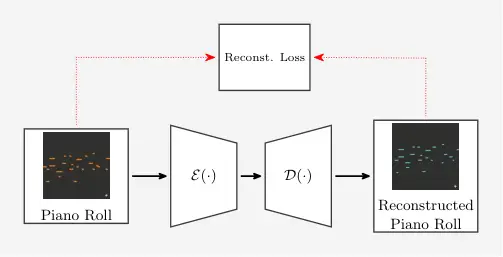
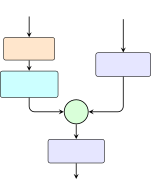
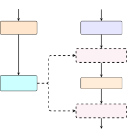
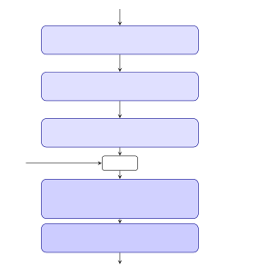
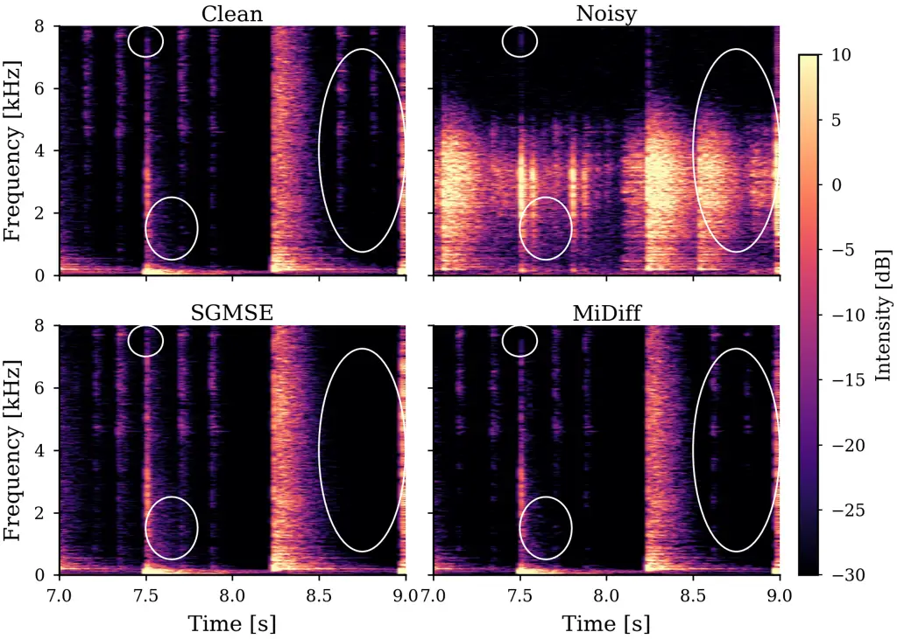
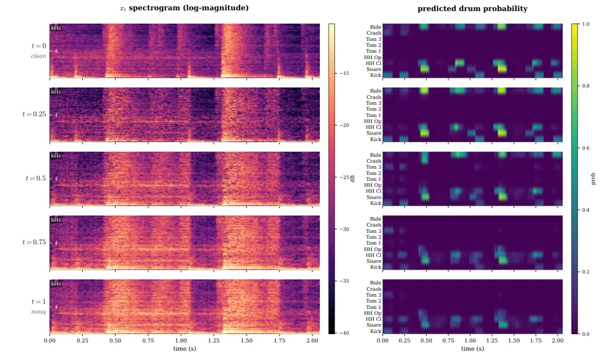

# MiDiff: MIDI-Conditioned Diffusion Models for Drum Audio Enhancement

Elad Aspis and Sharon Gannot ^(†)^(†)thanks: Elad Aspis and Sharon
Gannot are with the Faculty of Engineering, Bar-Ilan University,
Ramat-Gan 5290002, Israel (e-mail: elad.aspis@biu.ac.il,
sharon.gannot@biu.ac.il).^(†)^(†)thanks: This work has been submitted to
the IEEE for possible publication. Copyright may be transferred without
notice, after which this version may no longer be accessible.

###### Abstract

Bridging the semantic gap between perfect symbolic musical structure and
severely degraded acoustic signals offers a powerful paradigm for
high-fidelity audio restoration. In this work, we introduce MiDiff, a
diffusion-based generative model for drum audio enhancement that
conditions the reverse process on temporally aligned Musical Instrument
Digital Interface (MIDI) piano rolls. We extend the Score-Based
Generative Models for Speech Enhancement (SGMSE) framework in the
complex Short-Time Fourier Transform (STFT) domain by integrating a
pretrained MIDI encoder, multi-scale temporal alignment, and three
complementary conditioning strategies: early injection, Feature-wise
Linear Modulation (FiLM), and cross-attention. We further show that
providing the same piano roll only through classifier guidance, driven
by an Automatic Drum Transcription (ADT) model on the audio-only score,
yields no measurable gain: the symbolic prior is effective when it
conditions the score network. To relax the requirement for ground-truth
MIDI at inference, we further propose a hybrid reverse schedule that
transcribes the diffusion state online with the same noise-aware ADT
network and hands over from the audio-only score to MiDiff at a tunable
switch time, cutting test FAD by 47% relative to the audio-only baseline
without any symbolic input (switch time selected on the test set). We
train our model on the StemGMD dataset using a non-additive degradation
pipeline that simulates room reverberation with echo, electret capsule
frequency response, and soft-clipping saturation with noise. MiDiff
substantially outperforms the SGMSE baseline in terms of Fréchet Audio
Distance (FAD) on both the validation and held-out test sets. Ablation
studies demonstrate that combining all three conditioning strategies
yields superior performance and that authentic MIDI velocity dynamics
are critical for effective symbolic conditioning. Our method shows the
strong potential of leveraging symbolic priors to reconstruct
high-fidelity percussive audio. Qualitative evaluation, audio
demonstrations, and source code are available at
[https://midiff-paper.github.io/midiff-project-page/](https://midiff-paper.github.io/midiff-project-page/).

###### Index Terms: 

Audio enhancement, diffusion models, MIDI conditioning, score-based
generative models, drum audio, percussive audio restoration,
score-informed audio processing, automatic drum transcription.

## I Introduction

The quality of drum recordings plays a vital role in how modern musical
productions are perceived and how much impact they have. Achieving a
professional-grade drum sound typically requires specialized acoustic
environments, multi-microphone setups, high-end preamplifiers, and
experienced audio engineers—resources that independent musicians and
home-studio producers often cannot access. Unlike most acoustic
instruments, which act as a single point source, a drum kit is a
spatially distributed composite of distinct resonant bodies, each with
its own extreme dynamic range and spectral footprint. Capturing this
complexity creates practical challenges, including microphone bleed
between closely spaced capsules \[1\], phase-coherence problems from
different source-microphone distances, sympathetic resonances from
poorly tuned drumheads, and excessive room reflections that wash out
transient detail in untreated spaces.

Faced with these barriers, many drummers capture their performances
using a single consumer device—typically a smartphone or action
camera—resulting in mono or stereo tracks compromised by room
reverberation, clipped transients, electret microphone coloration, and
lossy codec compression. While electronic music production often uses
pristine, pre-rendered sample libraries, restoring _human-recorded_
acoustic drum performances presents a distinct, challenging problem:
live drum performances capture subtle expressive nuances, micro-timing
variations, and organic velocity dynamics that static samples cannot
easily replicate.

Aligned MIDI and a degraded acoustic capture of the same take are not
hypothetical: trigger-equipped acoustic kits and DAW drum-replacement
workflows both retain a MIDI stream recorded together with the acoustic
signal rather than derived from it. This is the setting MiDiff targets.

Traditional audio enhancement methods primarily rely on discriminative
deep learning to minimize element-wise error metrics, such as Mean
Squared Error (MSE), in the time-frequency domain \[2\]. However,
regression-based objectives suffer from the well-documented “regression
to the mean” phenomenon \[3\], which causes transient smearing, phase
inconsistency, and a loss of high-frequency detail. These flaws are
particularly detrimental when processing percussive instruments.
Generative diffusion models \[4, 5, 6\] resolve these limitations by
formulating enhancement as a stochastic reverse-time process that
samples from a clean signal prior.

Despite recent advances in score-based diffusion models for audio
enhancement \[7, 8\], existing frameworks typically rely on degraded
acoustic observations or supplementary visual cues \[9\] for
conditioning. When acoustic signals are severely degraded, pure
audio-based conditioning provides ambiguous structural guidance, leading
to spectral hallucinations or incomplete noise suppression. Fortunately,
modern music production workflows routinely generate auxiliary symbolic
data alongside raw audio. The Musical Instrument Digital Interface
(MIDI) \[10\] captures explicit temporal onset events, instrument
identity, and note velocity dynamics. Because MIDI is recorded as a
separate symbolic stream, obtained from drum triggers or electronic
pads, sequencer tracks, or DAW programming, it is unaffected by acoustic
degradation and provides a noise-free structural prior.

In this paper, we propose MiDiff, a novel MIDI-conditioned diffusion
framework for percussive audio enhancement. Our central hypothesis is
that incorporating temporally aligned MIDI as a conditioning signal into
a diffusion-based enhancement framework will improve the quality of
restored drum audio, particularly with respect to transient preservation
and instrument identity, compared to audio-only baselines. This
hypothesis rests on the observation that MIDI already encodes _when_
each hit occurs and _what_ instrument was played, so the network can
focus its capacity on recovering _how_ each hit sounds. Our key
contributions are:

1.  1.  MIDI-Conditioned Score Network. We extend the SGMSE framework \[7\]
        to accept temporally aligned MIDI piano rolls as an additional
        conditioning input via a pretrained convolutional encoder and
        multi-scale temporal alignment modules.
2.  2.  Multi-Strategy Conditioning. We investigate and compare three MIDI
        conditioning strategies: 1) early injection, 2) Feature-wise Linear
        Modulation (FiLM) \[11\], and 3) cross-attention \[12\]. We show
        that their combination yields superior enhancement quality compared
        to any single approach.
3.  3.  Classifier Guidance as a Control. We adapt an Automatic Drum
        Transcription network into a noise-aware classifier and use it to
        guide the audio-only score, showing that the piano roll supplied
        only through classifier gradients does not substitute for
        conditioning the score network on MIDI.
4.  4.  MIDI-Free Inference. We remove the ground-truth MIDI requirement at
        test time by transcribing the diffusion state online with the same
        time-conditional ADT network and handing over from the audio-only
        score to MiDiff at a switch time $`t_{\text{sw}}`$. Sweeping
        $`t_{\text{sw}}`$ reveals a clear optimum that recovers a large
        fraction of the symbolic-conditioning gain without any ground-truth
        piano roll.
5.  5.  Comprehensive Evaluation. We evaluate our method using three
        complementary metrics: 1) Fréchet Audio Distance (FAD) \[13\], 2)
        Mel Spectral Distance (MSD), and 3) Transient Timing Error (TTER).
        We demonstrate the results on the StemGMD dataset \[14\] with both
        validation and held-out test splits, and show that the gains are
        tied to the symbolic content: corrupted MIDI performs worse than the
        audio-only baseline. Ablation studies on velocity encoding and
        conditioning strategies provide further insights into the importance
        of authentic symbolic dynamics.

## II Background and Related Work

### II-A Symbolic Representation and Percussive Audio Processing

MIDI \[10\] represents music as discrete note-on and note-off events,
specifying pitch, velocity, and timing. For percussion, General MIDI
assigns a note number to each instrument (e.g., kick drum = 36, snare
drum = 38), with strike intensity encoded by a velocity value ranging
from 0 to 127. Learning-based systems commonly represent these events as
a _piano roll_, a two-dimensional grid of instrument classes and
uniformly spaced time frames \[15, 16\]. This representation is widely
used in symbolic music generation and MIDI-conditioned audio
synthesis \[17, 18\]. When temporally aligned with audio, the piano roll
provides a noise-free description of the intended musical events,
complementing the degraded audio signal.

Research on percussive audio encompasses source separation, synthesis,
transcription, and mixing. HPSS \[19\] separates percussive components
from polyphonic mixtures using median filtering. DrumGAN \[20\] and
CRASH \[21\] synthesize one-shot drum samples using timbral descriptors
and raw-waveform score-based diffusion, respectively, but generate audio
from scratch rather than enhance existing recordings. Mezza et
al. \[14\] introduced StemGMD for drum source separation, while Martinez
Ramirez et al. \[22\] investigated intelligent drum mixing. For
automatic drum transcription, Vogl et al. \[23\] and Zehren et
al. \[24\] developed convolutional recurrent approaches to multi-class
drum event detection (see Wu et al. \[25\] for a comprehensive review of
automatic drum transcription). Most closely related to our work, a Cold
Diffusion framework for percussive dereverberation \[26\] replaces
stochastic noise with deterministic degradation, but does not
incorporate symbolic conditioning.

### II-B Score-Based Diffusion and Multimodal Conditioning

Score-based diffusion \[4, 8\] has become a leading approach to
high-fidelity audio generation and enhancement. Lu et al. \[27\] were
among the first to apply diffusion models to speech enhancement.
Richter et al. \[7\] subsequently introduced SGMSE, operating in the
complex STFT domain using an Ornstein–Uhlenbeck stochastic differential
equation (SDE) and an NCSN++ U-Net backbone. This framework serves as
the foundation for MiDiff. Related approaches, including CDiffuSE \[28\]
and StoRM \[29\], further explored diffusion-based speech enhancement
and dereverberation.

For music, Moliner et al. \[30\] employed an unconditional diffusion
prior to restore full-band recordings, while Hawthorne et al. \[31\]
used spectrogram diffusion to synthesize audio from MIDI rather than
restore existing recordings. The reverse diffusion process can be
steered using classifier guidance \[32\] or classifier-free
guidance \[33\]. In this work, we investigate the former. The benefits
of incorporating complementary information into diffusion models have
also been demonstrated in related tasks. Richter et al. \[9\] showed
that visual speech embeddings extracted using AV-HuBERT \[34\]
substantially improve the robustness of generative speech enhancement
under severe degradation. LipVoicer \[35\] demonstrated that an
auxiliary ASR classifier can guide the reverse diffusion process, while
AudioLDM \[36\] established the effectiveness of semantic conditioning
in latent audio diffusion. These studies motivate the use of MIDI as an
auxiliary information source and the guided sampling strategy proposed
in MiDiff.

### II-C Informed Enhancement and the Research Gap

Score-informed source separation, pioneered by Ewert et al. \[37\] and
extended by Miron et al. \[38\], uses aligned musical scores or MIDI
transcriptions to constrain the separation of polyphonic audio.
Meseguer-Brocal and Peeters \[39\] further incorporated time-aligned
side information into a separation network using feature-wise linear
modulation (FiLM). More generally, informed source separation \[40\]
exploits side information available at the encoding stage to guide
source estimation. While these approaches aim to isolate individual
sources from clean or mildly reverberant mixtures, MiDiff addresses
informed enhancement under severe non-additive distortions. Existing
diffusion-based enhancement methods have primarily focused on speech,
whereas MIDI-conditioned diffusion models have been used for audio
_synthesis_ rather than _enhancement_. To the best of our knowledge, no
work has combined generative diffusion, MIDI conditioning, and
drum-specific audio enhancement. MiDiff addresses this gap by
incorporating symbolic information into diffusion-based restoration of
degraded drum recordings.

## III Problem Formulation

Let $`\mathbf{y}\in\mathbb{C}^{F\times T}`$ and
$`\mathbf{x}_{0}\in\mathbb{C}^{F\times T}`$ denote the complex STFT
spectrograms of degraded and clean drum audio signals, respectively,
where $`F`$ is the number of frequency bins and $`T`$ is the number of
time frames. We work in the complex STFT domain—rather than on
magnitudes alone—because the percussive transients that dominate drum
signals carry critical phase information that magnitude-only enhancement
cannot reconstruct. Following SGMSE \[7\], we apply a magnitude-warping
compression $`\mathcal{T}(s)=\beta\,|s|^{\alpha}\,e^{i\angle s}`$ with
standard default parameters $`\alpha=0.5`$ and $`\beta=0.15`$ before
feeding the spectrogram to the network; this tames the heavy-tailed
magnitude distribution of drum spectra. The inverse transform
$`\mathcal{T}^{-1}`$ is applied to the network output before the ISTFT.

The degraded observation $`\mathbf{y}`$ is generated from the clean
signal $`\mathbf{x}_{0}`$ via a non-additive degradation process,
defined formally as $`\mathbf{y}=\mathcal{G}(\mathbf{x}_{0})`$. The
operator $`\mathcal{G}`$ encompasses a sequence of non-linear
distortions, which are detailed in Section VI-B.

The auxiliary conditioning signal $`\mathbf{m}`$ is represented as a
temporally aligned MIDI piano-roll matrix
$`\mathbf{m}\in\mathbb{R}^{N_{c}\times T}`$, where $`N_{c}{=}9`$ denotes
the number of distinct drum instrument classes (Kick, Snare, Closed
Hi-Hat, Open Hi-Hat, Ride, Crash, High Tom, Low-Mid Tom, High Floor
Tom). Following the mapping convention by Mezza et al. \[14\], these 9
classes consolidate the wide variety of raw MIDI note numbers (from both
the General MIDI standard \[41\] and proprietary VST layouts \[42\])
into a standardized vocabulary. The matrix entries $`m_{k,t}\in[0,1]`$
represent 7-bit MIDI velocity values $`v\in[0,127]`$ normalized to
$`[0,1]`$ \[18\], with zero indicating absence of note onset. Under
these definitions, enhancement reduces to estimating $`\mathbf{x}_{0}`$
from $`(\mathbf{y},\mathbf{m})`$ by learning
$`p(\mathbf{x}_{0}\mid\mathbf{y},\mathbf{m})`$.

## IV SGMSE Framework

### IV-A Score-Based SDE Framework

Score-based generative models \[8\] unify DDPM \[4\] and score matching
with Langevin dynamics (SMLD) \[43\] under a continuous-time SDE
framework. The forward SDE gradually corrupts clean data
$`\mathbf{x}_{0}`$ over continuous time $`t\in[0,1]`$ \[44\] via:

```math
d\mathbf{x}_{t}=\mathbf{f}(\mathbf{x}_{t},t)\,dt+g(t)\,d\mathbf{w}, \tag{1}
```

where $`\mathbf{f}`$ is the drift, $`g(t)`$ the diffusion coefficient,
and $`\mathbf{w}`$ a standard Wiener process. Anderson’s result \[45\]
shows that the time reversal is itself an SDE:

```math
d\mathbf{x}_{t}=\bigl[\mathbf{f}(\mathbf{x}_{t},t)-g^{2}(t)\nabla_{\mathbf{x}_{t}}\log p_{t}(\mathbf{x}_{t})\bigr]\,dt+g(t)\,d\bar{\mathbf{w}}, \tag{2}
```

where the intractable marginal score
$`\nabla_{\mathbf{x}_{t}}\log p_{t}(\mathbf{x}_{t})`$ is replaced by a
network $`s_{\theta}(\mathbf{x}_{t},t)`$ trained via denoising score
matching (DSM) \[46\]:

```math
\mathcal{L}_{\text{DSM}}(\theta)=\\
\mathbb{E}_{t,\,\mathbf{x}_{0},\,\mathbf{x}_{t}\mid\mathbf{x}_{0}}\!\left[\,\lambda(t)\,\bigl\|s_{\theta}(\mathbf{x}_{t},t)-\nabla_{\mathbf{x}_{t}}\log p_{0t}(\mathbf{x}_{t}\mid\mathbf{x}_{0})\bigr\|_{2}^{2}\,\right], \tag{3}
```

where $`\lambda(t)>0`$ is a time-dependent weighting function, and
$`p_{0t}(\mathbf{x}_{t}\mid\mathbf{x}_{0})`$ is the perturbation kernel
(defined for our specific process in Section IV-B).

### IV-B SGMSE: Enhancement via Ornstein-Uhlenbeck Process

For audio enhancement, SGMSE \[7\] chooses an Ornstein-Uhlenbeck (OU)
process drift \[47, 44\] that transports the clean spectrum
$`\mathbf{x}_{0}`$ toward the degraded observation $`\mathbf{y}`$:

```math
d\mathbf{x}_{t}=\gamma(\mathbf{y}-\mathbf{x}_{t})dt+g(t)d\mathbf{w} \tag{4}
```

where $`\gamma>0`$ is the OU stiffness parameter and $`g(t)`$ is the
diffusion coefficient following the Variance Exploding (VE) exponential
schedule
$`g(t)=\sigma_{\min}(\sigma_{\max}/\sigma_{\min})^{t}\sqrt{2\log(\sigma_{\max}/\sigma_{\min})}`$.
Because the drift is affine in $`\mathbf{x}_{t}`$, the perturbation
kernel becomes Gaussian in closed form:

```math
p_{0t}(\mathbf{x}_{t}\mid\mathbf{x}_{0},\mathbf{y})=\mathcal{N}_{\mathbb{C}}\!\bigl(\mathbf{x}_{t};\,\boldsymbol{\mu}(t),\,\sigma^{2}(t)\mathbf{I}\bigr), \tag{5}
```

with mean and variance:

```math
\displaystyle\boldsymbol{\mu}(t) \displaystyle=e^{-\gamma t}\,\mathbf{x}_{0}+\bigl(1-e^{-\gamma t}\bigr)\,\mathbf{y}, \tag{6a}
```

```math
\displaystyle\sigma^{2}(t) \displaystyle=\frac{\sigma_{\min}^{2}\left[\left(\frac{\sigma_{\max}}{\sigma_{\min}}\right)^{2t}-e^{-2\gamma t}\right]\log\left(\frac{\sigma_{\max}}{\sigma_{\min}}\right)}{\gamma+\log\left(\frac{\sigma_{\max}}{\sigma_{\min}}\right)}. \tag{6b}
```

The closed-form score target is given by

```math
\nabla_{\mathbf{x}_{t}}\log p_{0t}(\mathbf{x}_{t}\mid\mathbf{x}_{0},\mathbf{y})=-\frac{\mathbf{x}_{t}-\boldsymbol{\mu}(t)}{\sigma^{2}(t)}, \tag{7}
```

so training requires no SDE simulation. To recover the enhanced spectrum
$`\mathbf{x}_{0}`$, we solve the reverse-time SDE:

```math
d\mathbf{x}_{t}=\Bigl[\gamma(\mathbf{y}-\mathbf{x}_{t})-g^{2}(t)s_{\theta}(\mathbf{x}_{t},\mathbf{y},t)\Bigr]dt+g(t)\,d\bar{\mathbf{w}}, \tag{8}
```

parametrized by an NCSN++ U-Net backbone \[8\] and integrated
numerically via a predictor-corrector sampler with $`N`$ discretization
steps.

### IV-C Numerical Solution of the Reverse-Time SDE

Drawing a clean sample amounts to integrating (8) numerically from
$`t=1`$ back to $`t=\epsilon`$. We adopt the predictor–corrector (PC)
sampler introduced by Song et al. \[8\]. The sampler alternates between
a reverse-diffusion predictor step, which integrates (8) across one
interval of the discretized time grid, and an annealed Langevin dynamics
corrector step
$`\mathbf{x}\leftarrow\mathbf{x}+\delta\,s+\sqrt{2\delta}\,\mathbf{z}`$,
which refines the state at fixed $`t`$ with
$`\delta=2\bigl(r\,\sigma(t)\bigr)^{2}`$, corrector SNR $`r`$, and
$`\mathbf{z}\sim\mathcal{N}_{\mathbb{C}}(\mathbf{0},\mathbf{I})`$. We
write these two updates as $`\textsc{Predictor}(\cdot)`$ and
$`\textsc{Corrector}(\cdot)`$ in what follows.

## V MiDiff: MIDI-Conditioned Drum Audio Enhancement

We extend the SGMSE framework to incorporate symbolic MIDI information
by modeling the joint conditional score

```math
s_{\theta}(\mathbf{x}_{t},\mathbf{y},\mathbf{m},t)\approx\nabla_{\mathbf{x}_{t}}\log p_{t}(\mathbf{x}_{t}\mid\mathbf{y},\mathbf{m}), \tag{9}
```

where $`\mathbf{m}`$ is the synchronized MIDI piano-roll matrix defined
in Section III. The central motivation is that MIDI provides an
explicit, noise-free prior on _which_ drum instruments occur, _when_,
and _how hard_, so that the score network need not infer instrument
identity and strike dynamics from the heavily distorted acoustic
observation $`\mathbf{y}`$ alone.

### V-A MIDI Encoder



Fig. 1: MIDI encoder-decoder architecture: The raw piano roll
$`\mathbf{m}`$ is encoded by $`\mathcal{E}(\cdot)`$ into a dense latent
representation $`\mathbf{z}`$, and decoded by $`\mathcal{D}(\cdot)`$ to
reconstruct $`\hat{\mathbf{m}}`$. Pretraining minimizes the squared
reconstruction error.

The raw MIDI piano roll $`\mathbf{m}\in[0,1]^{N_{c}\times T}`$ is highly
sparse and low-dimensional ($`N_{c}`$ drum classes), creating a severe
semantic gap with the high-dimensional feature maps of the NCSN++
backbone. To overcome this mismatch, we employ a dedicated convolutional
MIDI encoder $`\mathcal{E}`$ consisting of four 1D convolutional layers
with Group Normalization and SiLU activation functions that
progressively project the channel dimension from $`N_{c}`$ to latent
dimension $`C_{M}`$ (in our implementation, $`N_{c}{=}9`$ drum classes
and $`C_{M}{=}128`$).

As shown in Fig. 1, the encoder is pretrained within an autoencoder
framework minimizing reconstruction loss
$`\mathcal{L}_{\text{recon}}=\sum_{k,t}(m_{k,t}-\hat{m}_{k,t})^{2}`$
where $`\hat{\mathbf{m}}=\mathcal{D}(\mathcal{E}(\mathbf{m}))`$. Once
trained, the decoder $`\mathcal{D}`$ is discarded and the frozen encoder
$`\mathcal{E}`$ serves as a deterministic feature extractor producing
dense MIDI embeddings
$`\mathbf{M}=\mathcal{E}(\mathbf{m})\in\mathbb{R}^{C_{M}\times T}`$.
Freezing the encoder stabilizes training, since the score network can
rely on a fixed representation without contending with a co-evolving
embedding space.

### V-B Temporal Alignment

A fundamental challenge in multimodal conditioning is resolving the
temporal resolution mismatch across the network hierarchy. While the raw
STFT spectrogram and the initial MIDI embedding
$`\mathbf{M}\in\mathbb{R}^{C_{M}\times T}`$ share the same baseline
frame count $`T`$, the NCSN++ U-Net backbone progressively downsamples
intermediate acoustic representations. At depth level
$`\ell\in\{0,1,\dots,L-1\}`$, pooling and strided convolutions reduce
the acoustic feature map dimensions to
$`\mathbf{h}^{(\ell)}\in\mathbb{R}^{C_{\ell}\times F_{\ell}\times T_{\ell}}`$,
where the temporal length scales as $`T_{\ell}=T/2^{\ell}`$. To supply
temporally synchronized symbolic conditioning to every stage of the
U-Net, we introduce a dedicated set of depth-specific Temporal Alignment
modules, denoted as $`\mathrm{TA}_{\ell}(\cdot)`$. Rather than relying
on simple linear interpolation or pooling, each $`\mathrm{TA}_{\ell}`$
is parameterized by a trainable 1D convolutional pipeline:

```math
\mathbf{M}^{(\ell)}=\mathrm{TA}_{\ell}(\mathbf{M})=\mathrm{Conv1D}_{\text{refine}}\Bigl(\mathrm{SiLU}\bigl(\mathrm{Conv1D}_{\text{down}}(\mathbf{M})\bigr)\Bigr), \tag{10}
```

where:

- •
  $`\mathrm{Conv1D}_{\text{down}}`$ uses an effective stride
  $`S_{\ell}=2^{\ell}`$ and kernel size $`k_{\ell}=2^{\ell+1}`$ with
  appropriate padding to downsample the sequence length from $`T`$ to
  $`T_{\ell}`$,
- •
  $`\mathrm{SiLU}(\cdot)`$ is the sigmoid-weighted linear unit
  activation,
- •
  $`\mathrm{Conv1D}_{\text{refine}}`$ is a unit-stride ($`S=1`$)
  convolution that refines the downsampled representation into the
  level-specific conditioning embedding
  $`\mathbf{M}^{(\ell)}\in\mathbb{R}^{C_{M}\times T_{\ell}}`$.

By learning dedicated downsampling kernels for each depth $`\ell`$,
$`\mathrm{TA}_{\ell}`$ allows the network to summarize fine-grained
musical transients (e.g., drum hit onsets) into broader, context-aware
semantic features that directly align with the receptive field and
resolution of the corresponding U-Net layer.

### V-C MIDI Conditioning Methods

| Early Injection                                                | FiLM / Cross-Attention                                     |
| -------------------------------------------------------------- | ---------------------------------------------------------- |
|      |  |

Fig. 2: Left: Early Injection mechanism—encodes raw piano roll
$`\mathbf{m}`$, projects the embedding with a zero-initialized
$`1\times 1`$ convolution and adds it to the output of the first NCSN++
convolution applied to $`[\mathbf{x}_{t},\mathbf{y}]`$ (Eq. (11)).
Right: Hierarchical conditioning blocks—acoustic features $`\mathbf{h}`$
pass through residual blocks, optional FiLM modulation, self-attention,
and optional cross-attention blocks driven by scale-aligned MIDI
embeddings.

We explore three distinct conditioning strategies to integrate MIDI
priors into the NCSN++ score network (Fig. 2):

Early Injection. The four-channel input $`[\mathbf{x}_{t},\mathbf{y}]`$
(real and imaginary parts of both spectrograms) first passes through the
initial $`3\times 3`$ convolution of NCSN++, which lifts it to $`C_{0}`$
feature channels. The full-resolution MIDI embedding
$`\mathbf{M}^{(0)}`$ is mapped to the same width by a $`1\times 1`$
convolution
$`\mathbf{W}_{\text{inj}}\in\mathbb{R}^{C_{0}\times C_{M}}`$, broadcast
across the frequency axis and added to these first-layer features:

```math
\mathbf{h}^{(0)}=\mathrm{Conv}_{3\times 3}\bigl([\mathbf{x}_{t},\mathbf{y}]\bigr)+\mathbf{W}_{\text{inj}}\,\mathbf{M}^{(0)}. \tag{11}
```

Since $`\mathbf{W}_{\text{inj}}`$ and its bias are zero-initialized, the
injection starts as the identity, as in ControlNet-style zero
convolutions; adding a projection after the first linear layer is
equivalent to concatenating $`\mathbf{M}^{(0)}`$ to the network input.

FiLM (Feature-wise Linear Modulation). Following Perez et al. \[11\],
intermediate spectral-temporal feature maps
$`\mathbf{h}\in\mathbb{R}^{C\times F\times T_{\ell}}`$ at each U-Net
layer are modulated by affine parameters predicted from
$`\mathbf{M}^{(\ell)}`$, where $`F`$ is the number of STFT frequency
bins and $`T_{\ell}`$ is the temporal length of features at encoder
depth $`\ell\in\{1,2,3,4\}`$:

```math
\displaystyle[\mathbf{a},\mathbf{b}] \displaystyle=\text{Conv1D}_{1\times 1}(\mathbf{M}^{(\ell)}) \tag{12a}
```

```math
\displaystyle\text{FiLM}(\mathbf{h}) \displaystyle=(1+\mathbf{a})\odot\mathbf{h}+\mathbf{b} \tag{12b}
```

where $`\mathbf{a},\mathbf{b}\in\mathbb{R}^{C\times 1\times T_{\ell}}`$
modulate channel scale and shift across frequency bins $`F`$. The
$`(1+\mathbf{a})`$ term with zero-initialized projection weights ensures
FiLM blocks default to an identity transform at initialization,
stabilizing early training. FiLM is inserted after each NCSN++ residual
block to enable hierarchical modulation across different semantic
scales.

Cross-Attention. Following Vaswani et al. \[12\], we insert
cross-attention blocks in which the U-Net acoustic feature maps
$`\mathbf{h}\in\mathbb{R}^{C\times F\times T_{\ell}}`$ act as queries
and the level-aligned MIDI embeddings
$`\mathbf{M}^{(\ell)}\in\mathbb{R}^{C_{M}\times T_{\ell}}`$ serve as
keys and values, with $`\ell`$ denoting the U-Net encoder depth and
$`T_{\ell}`$ the corresponding temporal resolution (both as defined in
Section V-B). After reshaping to sequence form, the queries, keys, and
values are obtained via learned linear projections:

```math
\mathbf{Q}=\mathbf{h}\mathbf{W}^{Q},\quad\mathbf{K}=\mathbf{M}^{(\ell)}\mathbf{W}^{K},\quad\mathbf{V}=\mathbf{M}^{(\ell)}\mathbf{W}^{V}, \tag{13}
```

where $`\mathbf{W}^{Q}\in\mathbb{R}^{C\times d_{k}}`$,
$`\mathbf{W}^{K},\mathbf{W}^{V}\in\mathbb{R}^{C_{M}\times d_{k}}`$ and
$`d_{k}=C/N_{h}`$ for $`N_{h}`$ attention heads. Standard scaled
dot-product attention \[12\] is then applied, allowing each acoustic
location to dynamically attend over all MIDI time steps at the
downsampled U-Net depths $`\ell\in\{1,2,3,4\}`$ (omitting the
highest-resolution layer $`\ell=0`$).

Our unified architecture, MiDiff, integrates all three conditioning
strategies simultaneously within the NCSN++ backbone: the MIDI embedding
is added at the input (early injection), each residual block is
FiLM-modulated, and a cross-attention block is inserted after each
self-attention layer. The individual contribution of each pathway is
quantified via an ablation study (in Section VIII), where each strategy
is evaluated alone and in combination to assess its effect on
enhancement quality.

### V-D Training Objective

Given the closed-form perturbation kernel in (5) with parameters defined
in (6a)–(6b), we train the MIDI-conditioned score network by
solving \[7\]:

```math
\displaystyle\hat{\theta}=\argmin_{\theta}\mathbb{E}_{t,(\mathbf{x}_{0},\mathbf{y},\mathbf{m}),\mathbf{z},\mathbf{x}_{t}\mid(\mathbf{x}_{0},\mathbf{y})}\Biggl[\biggl\| \displaystyle s_{\theta}(\mathbf{x}_{t},\mathbf{y},\mathbf{m},t) \tag{14}
```

```math
\displaystyle+\frac{\mathbf{z}}{\sigma(t)}\biggr\|_{2}^{2}\Biggr].
```

This objective is directly derived from the Denoising Score Matching
(DSM) loss in (3) by substituting the analytical score
$`\nabla_{\mathbf{x}_{t}}\log p_{0t}(\mathbf{x}_{t}\mid\mathbf{x}_{0},\mathbf{y})=-{\mathbf{z}}/{\sigma(t)}`$
and setting the weighting function $`\lambda(t)=\sigma^{2}(t)`$. Here,
the expectation is over $`t`$ sampled from a uniform distribution
$`\mathcal{U}[\epsilon,1]`$, data triplets
$`(\mathbf{x}_{0},\mathbf{y},\mathbf{m})`$ sampled from the empirical
training distribution $`\mathcal{P}`$, and standard complex Gaussian
noise $`\mathbf{z}\sim\mathcal{N}_{\mathbb{C}}(\mathbf{0},\mathbf{I})`$
which parameterizes the perturbed audio as
$`\mathbf{x}_{t}=\boldsymbol{\mu}(t)+\sigma(t)\mathbf{z}`$.

MiDiff is trained with the _always present_ piano roll, without
conditioning dropout, since it is always conditioned on MIDI at
inference.

### V-E Conditioned Reverse Sampling

At test time, MiDiff reuses the predictor–corrector sampler (detailed in
Section IV-C) without altering its predictor or corrector updates. The
trajectory is initialized at the terminal distribution of the forward
SDE at time $`t=1`$, which is approximately a Gaussian centered on the
noisy observation,
i.e. $`\mathbf{x}_{1}\sim\mathcal{N}_{\mathbb{C}}(\mathbf{y},\sigma^{2}(1)\mathbf{I})`$,
and is then integrated backward down to $`t=\epsilon`$. The only change
from the base sampler is that every score evaluation is replaced by the
MIDI-conditioned score
$`s_{\theta}(\mathbf{x}_{t},\mathbf{y},\mathbf{m},t)`$, steering every
reverse step. Algorithm 1 in Section V-G states the resulting procedure
in full; setting $`t_{\text{sw}}{=}1`$ there and substituting the
ground-truth piano roll $`\mathbf{m}`$ for the online transcription
$`\hat{\mathbf{m}}`$ recovers exactly the sampler described here.

### V-F Classifier Guidance via Audio-to-MIDI



Fig. 3: Time-conditional ADT classifier architecture: convolutional
encoder, context concatenation, BiGRU stack and linear head producing
per-frame onset-probability logits $`\hat{\mathbf{m}}`$—the MIDI
_inferred_ from the noisy audio $`\mathbf{x}_{t}`$, distinct from the
ground-truth piano roll $`\mathbf{m}`$. The 128-dimensional
diffusion-time embedding vector $`\mathbf{t}_{\text{emb}}`$ is
concatenated into the recurrent input at the concat node.

Inspired by LipVoicer \[35\], which guides speech diffusion using an
auxiliary ASR classifier, we adapt the ADTOF network \[24\] into a
time-conditioned classifier that models
$`p_{\phi}(\mathbf{m}\mid\mathbf{x}_{t},t)`$. Given the noisy diffusion
state $`\mathbf{x}_{t}`$, the classifier estimates onset probabilities
$`\hat{\mathbf{m}}`$, while the ground-truth MIDI $`\mathbf{m}`$ serves
as the target condition. The gradient of the log-probability of the
ground-truth MIDI is then used to guide the diffusion process. Since
standard ADT models are trained on clean audio and lack a mechanism to
condition on diffusion time $`t`$, we extend the ADTOF backbone with a
parallel $`t`$-conditioning pathway, as detailed below.

The backbone, sketched in Fig. 3, takes the noisy diffusion state
$`\mathbf{x}_{t}`$, represented as a two-channel real/imaginary tensor.
Two convolutional blocks of $`\{32,64\}`$ channels apply
$`3\!\times\!3`$ convolutions, each followed by a max-pool of width 3
along the frequency axis only; this compresses the spectral dimension
while preserving the per-frame temporal resolution required for onset
prediction. The tensor is flattened, and a context layer concatenates a
short window of adjacent frames before the recurrent stage. Three
bidirectional GRUs of 60 hidden units model temporal structure, and a
linear head emits the per-frame logits $`\hat{\mathbf{m}}`$. Diffusion
time $`t`$ enters through a parallel MLP pathway ($`1{\to}128{\to}128`$
with SiLU), concatenated at the GRU input, allowing the network to adapt
its predictions to the current noise level.

Critically, the classifier is trained on the same OU–VE perturbed
marginals seen during score network training:
$`t\sim\mathcal{U}(\epsilon,1)`$,
$`\mathbf{x}_{t}\sim p_{0t}(\cdot\mid\mathbf{x}_{0},\mathbf{y})`$, with
per-class binary cross-entropy loss between the prediction
$`\hat{\mathbf{m}}`$ and the true MIDI $`\mathbf{m}`$. Training the
classifier explicitly on noisy samples $`\mathbf{x}_{t}`$ conditioned on
the diffusion time $`t`$ ensures that its gradient remains informative
and accurate across the entire reverse diffusion trajectory, even at
high noise levels. The guided score combines the unconditional score
with a weighted classifier gradient:

```math
\hat{\mathbf{s}}_{\psi}(\mathbf{x}_{t},\mathbf{y},\mathbf{m},t)=\mathbf{s}_{\psi}(\mathbf{x}_{t},\mathbf{y},t)+w_{\text{CG}}\cdot\nabla_{\mathbf{x}_{t}}\log p_{\phi}(\mathbf{m}\mid\mathbf{x}_{t},t), \tag{15}
```

where $`w_{\text{CG}}\geq 0`$ controls classifier guidance strength. The
guidance term is added to the _unconditional_ score
$`\mathbf{s}_{\psi}(\mathbf{x}_{t},\mathbf{y},t)`$ of the audio-only
SGMSE model (Section VI-D), which has no MIDI input. The piano roll
$`\mathbf{m}`$ therefore reaches the sampler only through the classifier
gradient, and $`w_{\text{CG}}{=}0`$ reduces Eq. (15) to plain SGMSE.
This isolates whether symbolic information introduced only at inference
time, externally to the score network, can replace explicit MIDI
conditioning of the network. Here, $`\phi`$ denotes the classifier
parameters in Fig. 3. Note that
$`\log p_{\phi}(\mathbf{m}\mid\mathbf{x}_{t},t)`$ corresponds to the
negative cross-entropy between the classifier’s prediction
$`\hat{\mathbf{m}}`$ and the target $`\mathbf{m}`$. By taking the
gradient of this term with respect to $`\mathbf{x}_{t}`$, we compute the
direction in the noisy audio space that most increases the likelihood of
the given MIDI, effectively steering the generative trajectory toward
the desired drum pattern.

### V-G Inference without Ground-Truth MIDI: Hybrid Sampling

The preceding experiments assume that a temporally aligned piano roll
$`\mathbf{m}`$ is available at test time. This assumption holds when the
performance is recorded using electronic pads or sequenced in a DAW, but
not when only an audio recording is available. In the latter case,
MiDiff must rely on MIDI transcribed from the recording itself. We
obtain this transcription _online_ using the noise-level-aware ADT
network described in Section V-F, now employed as a transcriber rather
than to provide guidance gradients.

At each reverse step, the network transcribes the current diffusion
state:

```math
\hat{\mathbf{m}}_{t}=\mathrm{ADT}_{\phi}(\mathbf{x}_{t},t), \tag{16}
```

and the resulting drum roll is used as the condition for that step. The
onset probabilities are converted to a piano roll in the format MiDiff
was trained on: per-class peak picking with class-specific thresholds
(minimum spacing of three frames), each detected onset held for 13
frames at a constant normalized velocity of $`0.43`$, since the
transcriber predicts onsets but not velocities. Because the same
$`t`$-conditioned network is already trained on the OU–VE perturbed
marginals, no additional model is required.

Two failure modes make naïve online conditioning unattractive. First,
the transcriber is least reliable at high noise levels, where
$`\mathbf{x}_{t}`$ is still close to the degraded observation
$`\mathbf{y}`$ and the onset activations collapse (Fig. 7). Second,
MiDiff is trained exclusively on ground-truth piano rolls and therefore
never saw erroneous conditioning during training, so a corrupted
$`\hat{\mathbf{m}}_{t}`$ injected early in the trajectory is propagated
through the remaining reverse steps. We therefore split the reverse
trajectory at a switch time $`t_{\text{sw}}\in[0,1]`$ and let the
audio-only SGMSE score $`s_{\psi}(\mathbf{x}_{t},\mathbf{y},t)`$, namely
the baseline model of Section VI-D, carry the high-noise portion and
hand over to MiDiff for the remainder, with the value of
$`t_{\text{sw}}`$ examined in Section VII-D:

```math
s^{\text{hyb}}(\mathbf{x}_{t},\mathbf{y},t)=\begin{cases}s_{\psi}(\mathbf{x}_{t},\mathbf{y},t),&t>t_{\text{sw}},\\
s_{\theta}(\mathbf{x}_{t},\mathbf{y},\hat{\mathbf{m}}_{t},t),&t\leq t_{\text{sw}}.\end{cases} \tag{17}
```

Both models share the same OU–VE SDE and complex STFT representation, so
the state is handed over unchanged and the same predictor–corrector
sampler is used on both sides of the switch; only the score evaluation
differs. Algorithm 1 summarizes the procedure: the transcription
$`\hat{\mathbf{m}}`$ is computed once per step and shared by the
corrector and the predictor, whereas the score is re-evaluated at the
corrected state before the predictor update. The two extremes recover
the individual models: $`t_{\text{sw}}{=}0`$ is SGMSE alone, since the
reverse process terminates at $`\epsilon>0`$ and the switch is never
reached, while $`t_{\text{sw}}{=}1`$ is MiDiff conditioned on online ADT
transcriptions at all steps. Note that $`t_{\text{sw}}`$ is a pure
inference-time knob: neither network is retrained, and the
ground-truth-MIDI results of Section V-E are unaffected.

0:  $`\mathbf{y}`$; scores $`s_{\psi}`$ (audio-only) and $`s_{\theta}`$
(MIDI-conditioned); transcriber $`\mathrm{ADT}_{\phi}`$; switch time
$`t_{\text{sw}}`$

0:  enhanced estimate $`\hat{\mathbf{x}}`$

1:
 $`\mathbf{x}\sim\mathcal{N}_{\mathbb{C}}(\mathbf{y},\,\sigma^{2}(1)\mathbf{I})`$
{OU–VE prior centered on $`\mathbf{y}`$}

2:  for $`t=t_{1},\dots,t_{N}`$ uniformly spaced in $`[1,\epsilon]`$ do

3:   if $`t>t_{\text{sw}}`$ then

4:    $`s(\cdot)\leftarrow s_{\psi}(\cdot,\mathbf{y},t)`$ {SGMSE: no
MIDI}

5:   else

6:    $`\hat{\mathbf{m}}\leftarrow\mathrm{ADT}_{\phi}(\mathbf{x},t)`$
{transcribe current state}

7:
   $`s(\cdot)\leftarrow s_{\theta}(\cdot,\mathbf{y},\hat{\mathbf{m}},t)`$
{MiDiff}

8:   end if

9:
  $`\mathbf{x}\leftarrow\textsc{Corrector}(\mathbf{x},s(\mathbf{x}),t)`$
{annealed Langevin}

10:
  $`\mathbf{x}\leftarrow\textsc{Predictor}(\mathbf{x},\mathbf{y},s(\mathbf{x}),t)`$
{score re-evaluated at corrected $`\mathbf{x}`$}

11:  end for

12:  return
$`\hat{\mathbf{x}}\leftarrow\text{ISTFT}\bigl(\mathcal{T}^{-1}(\mathbf{x})\bigr)`$

Algorithm 1 Hybrid SGMSE $`\rightarrow`$ MiDiff PC sampling with online
ADT conditioning.

## VI Experimental Setup

### VI-A StemGMD Dataset

Fig. 4: Two StemGMD examples (4 s each). From top: clean reference
$`\mathbf{x}_{0}`$, degraded input $`\mathbf{y}`$, and piano-roll
$`\mathbf{m}`$ (one row per drum class, cell intensity $`\propto`$ MIDI
velocity). Panels share their time axis—every audio transient matches a
non-zero cell in $`\mathbf{m}`$.

Training a paired enhancement model requires triplets
$`(\mathbf{x}_{0},\mathbf{y},\mathbf{m})`$ with sample-accurate
alignment. Building such a corpus from real recordings is impractical:
simultaneously capturing studio-grade and low-quality signals from the
same performance introduces unavoidable latency, level, and positional
differences. We use the StemGMD dataset \[14\], a 1224-hour corpus of
synthesized drum stems comprising expressive, microtimed human drum
performances captured by ten drummers across ten acoustic drum kit
libraries, with original velocity and microtiming preserved in MIDI.¹¹ 1
This research utilizes the open StemGMD dataset in compliance with
dataset licensing terms.

We selected StemGMD over purely algorithmic multi-instrument corpora
such as Slakh \[48\] because it contains authentic human performances
from the Groove MIDI Dataset \[49\] (captured as MIDI via electronic
drum kits) that preserve natural microtiming and mechanical-strike
dynamics. To generate the audio, these human-played MIDI performances
are mapped to a canonical 9-piece kit (Kick, Snare, Closed Hi-Hat, Open
Hi-Hat, High Tom, Low-Mid Tom, High Floor Tom, Crash, Ride) and
independently rendered as 16-bit/44.1 kHz WAV files. This rendering is
performed through ten different high-fidelity Logic Pro X acoustic drum
kit libraries, providing varied timbres, room acoustics, and
overhead-mic characteristics. The clean reference mixture
$`\mathbf{x}_{0}=\sum_{k=1}^{9}s_{k}`$ is obtained by summing the nine
isolated stems. Because these stems are synthesized directly from the
MIDI rather than being acoustically recorded together in a physical
room, $`\mathbf{x}_{0}`$ is entirely free of microphone bleed and
environmental artifacts by construction. The same construction makes the
conditioning an oracle: $`\mathbf{m}`$ is the generative cause of
$`\mathbf{x}_{0}`$, so its alignment with the target is exact, a
condition that real recordings only approximate (Section IX-B). Finally,
the noisy observation $`\mathbf{y}`$ is generated offline from
$`\mathbf{x}_{0}`$ by the degradation pipeline described below, once per
clip, so every model sees the same fixed degraded input. This synthetic
pipeline yields properties that no real corpus can offer simultaneously:
an exact, clean reference for every example (enabling FAD evaluation)
and a known, controllable degradation operator.

Fig. 4 illustrates the alignment between clean audio, degraded audio,
and MIDI piano-roll conditioning for two StemGMD examples.

| Split      | Duration | Source / Configuration                |
| ---------- | -------- | ------------------------------------- |
| Train      | 16.08 h  | drummer1/session1 (low-data setup)    |
| Validation | 6.9 min  | 10 eval_session recordings, 10 styles |
| Test       | 1.16 h   | drummer1/eval_session (100 clips)     |

TABLE I: StemGMD Dataset Splits (16 kHz Mono).

Table I summarizes the dataset splits. Training uses only the
drummer1/session1 subset (16.08 h), a deliberately data-constrained
setting in which paired data is scarce. The test split is the
drummer1/eval_session folder (100 clips, 1.16 h): recordings disjoint
from training, but by the same drummer and rendered with the same ten
kit libraries. The validation split consists of 10 eval_session
recordings, one per drum style (6.9 min), with a separately drawn
degradation, and is used for epoch-wise FAD monitoring and checkpoint
selection.

### VI-B Realistic Degradation Pipeline

To simulate a low-quality home recording, clean drum mixtures are
processed offline through a three-stage non-additive pipeline, with
every free parameter drawn independently for each clip. The ordering
follows the physical signal path (room, capsule, electronics), and no
single factor dominates, so the model cannot succeed by inverting one
filter:

1.  1.  Room Reverberation: The signal is convolved with a synthetic impulse
        response generated from Gaussian noise (mean 1, standard deviation
        0.5) modulated by an exponential envelope $`e^{-t/(0.4\,T_{d})}`$,
        where $`T_{d}\sim\mathcal{U}[0.12,0.35]`$ s denotes the response
        duration. The impulse response is normalized to unit power, and the
        reverberant signal is mixed with the dry signal at a wet ratio drawn
        from $`\mathcal{U}[0.08,0.22]`$. A single discrete echo, with a
        delay drawn from $`\mathcal{U}[25,70]`$ ms and a gain drawn from
        $`\mathcal{U}[0.12,0.35]`$, is then added to emulate a strong early
        reflection. Finally, the resulting signal is peak-normalized.
2.  2.  Electret Microphone Coloration: A three-filter model comprising a
        4th-order Butterworth high-pass (cut-on
        $`\sim\mathcal{U}[100,250]`$ Hz); a second-order resonant band-pass
        centred at $`f_{p}\sim\mathcal{U}[3,5]`$ kHz with $`Q{=}2`$ and gain
        $`1+g/10`$, $`g\sim\mathcal{U}[3,8]`$, which concentrates the signal
        in the upper midrange (the “honk” of small capsules) and strongly
        attenuates the low end; and a 4th-order Butterworth low-pass
        (cut-off $`\sim\mathcal{U}[3.2,7.5]`$ kHz).
3.  3.  Nonlinear Saturation & Noise: Preamp saturation is modeled by a soft
        $`\tanh`$ clipper $`x\mapsto\tanh(\alpha\,x)`$ with drive
        $`\alpha\sim\mathcal{U}[1.0,5.0]`$, followed by peak normalization.
        Additive pink ($`1/f`$) noise is then scaled to hit a target
        signal-to-noise ratio $`\text{SNR}\sim\mathcal{U}[45,65]`$ dB.

We deliberately focus on single-instrument drum audio restoration under
acoustic and recording-chain degradations (reverberation, microphone
coloration, clipping, and noise), rather than multi-instrument bleed or
source-separation artifacts. This allows us to isolate the contribution
of symbolic MIDI priors to percussive enhancement without confounding
errors from source separation. The combined degradations are severe:
after RMS normalization, the degraded signal is a median of $`49`$ dB
below the clean signal in the 20–60 Hz band and $`34`$ dB below it in
the 60–120 Hz band, nearly eliminating the kick fundamental. Conversely,
in the 1–8 kHz range, the degraded signal exceeds the clean signal by
$`14`$–$`16`$ dB, resulting in an input dominated by cymbals and
saturation products.

### VI-C Implementation Details

All audio signals are resampled to 16 kHz. STFT spectrograms are
computed using a 510-sample Hann window ($`\approx`$31.8 ms) and a hop
size of 128 samples ($`\approx`$8.0 ms), yielding $`F{=}256`$ complex
frequency bins matching the NCSN++ downsampling geometry while
preserving temporal resolution for transient detection.

Following the SGMSE framework \[7\], the forward OU-VE SDE is
parameterized with OU stiffness $`\gamma=1.5`$, minimum noise level
$`\sigma_{\min}=0.05`$, and maximum noise level $`\sigma_{\max}=0.5`$.
Models are trained using the Adam optimizer
($`\text{lr}=1{\times}10^{-4}`$, batch size 8) with Exponential Moving
Average (EMA, decay 0.999 \[50\]) across two NVIDIA A100 GPUs for 60
epochs. Inference uses the predictor–corrector reverse SDE sampler with
$`N{=}30`$ discretization steps, $`M{=}1`$ annealed Langevin corrector
step per predictor step, corrector SNR factor $`r{=}0.5`$, and
reverse-time truncation $`\epsilon{=}0.03`$. The hybrid sampler of
Section V-G reuses these identical settings on both sides of the switch.

### VI-D Baseline Methods

SGMSE (Audio-Only Control). An audio-only score-based diffusion baseline
following the unmodified SGMSE architecture \[7\], sharing the identical
NCSN++ backbone, complex STFT representation, training loss, and
hyperparameters as MiDiff, but operating strictly on the degraded audio
$`\mathbf{y}`$ without MIDI conditioning (65.6M parameters). Crucially,
this model is trained from scratch on the exact same StemGMD drum
dataset and under the identical degradation pipeline, serving as the
direct counterfactual to evaluate the contribution of symbolic
conditioning.

Cold Diffusion. The recently proposed Cold Diffusion framework for
percussive dereverberation \[26\] (54.7M parameters), which replaces
stochastic noise processes with deterministic degradation models using a
$`\Delta`$-normalized residual UNet architecture, retrained under the
identical percussive degradation pipeline.

### VI-E Evaluation Metrics

We evaluate the performance of the proposed algorithm with three
complementary metrics; lower is better for all three.

Fréchet Audio Distance (FAD) \[13\]. Our primary perceptual metric is
the squared Wasserstein-2 distance between multivariate Gaussian
distributions fitted to VGGish \[51\] embeddings of the enhanced and
clean reference audio. As a distributional metric, it does not penalize
sample-level differences between the enhanced and reference signals,
provided their overall acoustic distributions remain similar. This
property is particularly important when evaluating generative models
that resynthesize transients rather than reconstructing them exactly.

Mel Spectral Distance (MSD). Quantifies frame-wise spectral fidelity
between the enhanced signal $`\hat{\mathbf{x}}`$ and the clean reference
$`\mathbf{x}_{0}`$ in the log-mel domain:

```math
\mathrm{MSD}(\mathbf{x}_{0},\hat{\mathbf{x}})=\frac{1}{2\,BK}\sum_{b=1}^{B}\sum_{k=1}^{K}\bigl|L_{0}[b,k]-\hat{L}[b,k]\bigr|, \tag{18}
```

where
$`L[b,k]=10\log_{10}\bigl(P[b,k]/\max_{b^{\prime},k^{\prime}}P[b^{\prime},k^{\prime}]\bigr)`$
is the power mel spectrogram in dB, referenced to its own maximum,
$`B{=}80`$ mel bands span 0–8 kHz (1024-point FFT, hop 256), and $`K`$
is the number of frames. MSD is therefore expressed in dB. The
log-magnitude domain aligns with perceptual loudness and reduces the
dominance of high-energy bins.

Transient Timing Error (TTER) measures the mean temporal displacement
between drum onsets in the clean reference and their matched
counterparts in the enhanced output, normalized by duration (ms/s):

```math
\mathrm{TTER}(\mathbf{x}_{0},\hat{\mathbf{x}})=\frac{10^{3}}{L\cdot|\mathcal{M}|}\sum_{(t_{i},\hat{t}_{j})\in\mathcal{M}}|t_{i}-\hat{t}_{j}|, \tag{19}
```

where $`L`$ is the clip duration in seconds and $`\mathcal{M}`$ is a
one-to-one set of onset pairs. Onsets are detected in both signals with
the spectral-flux onset detector of librosa (10 ms hop, minimum spacing
20 ms), and $`\mathcal{M}`$ is built in a single pass over the two
time-sorted onset lists: the current reference and enhanced onsets are
paired if they lie within $`\tau=50\,\text{ms}`$ of each other, and
otherwise the earlier of the two is skipped. TTER is computed per clip
and averaged over clips; a clip with no matched pair would be excluded,
which did not occur for any model. Because the detector is
class-agnostic, TTER measures broadband transient timing and does not
distinguish drum classes.

We report validation FAD (10 clips, evaluated after each epoch) and test
FAD, MSD, and TTER (100 clips, evaluated using the final checkpoints).
Checkpoints and hyperparameters are selected exclusively on the
validation set. Since FAD estimates are biased for small sample sizes,
and selecting the minimum across multiple configurations introduces
additional optimism \[52\], the main comparisons are based on the test
set. The sole exception is the hybrid switch time, which is swept
directly on the test set (Fig. 9), making its reported optimum
optimistic. The classifier guidance and constant-velocity sweeps are
evaluated only on the validation set. Absolute FAD values are not
directly comparable across splits because validation uses 10 clips and
test uses 100. In particular, small-sample FAD exhibits an upward bias
that depends on the embedding statistics of each model \[52\]. We
therefore restrict model comparisons to the same split and avoid
interpreting changes in FAD for individual models across splits, such as
the increase observed for SGMSE and the decrease for MiDiff from
validation to test.

## VII Experimental Results

### VII-A Main Results

Fig. 5: Validation Fréchet Audio Distance (FAD, log scale) across
training epochs for MiDiff and the SGMSE baseline. Final-checkpoint
validation and test FAD are reported in Table II.

|                                      |        | FAD $`\downarrow`$ |       | MSD (dB) $`\downarrow`$ |      | TTER (ms/s) $`\downarrow`$ |       |
| ------------------------------------ | ------ | ------------------ | ----- | ----------------------- | ---- | -------------------------- | ----- |
| Model                                | Params | Val.               | Test  | Val.                    | Test | Val.                       | Test  |
| MiDiff (Ours)                        | 71.2M  | 0.467              | 0.233 | 1.32                    | 1.31 | 0.031                      | 0.029 |
| SGMSE \[7\]                          | 65.6M  | 0.673              | 1.268 | 1.39                    | 1.30 | 0.028                      | 0.028 |
| Cold UNet-$`\Delta`$-norm \[26\]^(†) | 54.7M  | 2.657              | 2.535 | 2.39                    | 3.78 | 0.090                      | 0.126 |

TABLE II: Results on StemGMD. All metrics: lower is better. ^(†)On test,
Cold Diffusion is run on exactly the same degraded inputs as the other
models; its validation inputs are a separately generated 44.1 kHz
version of the 10 degraded clips, resampled to 16 kHz, so its validation
column is only approximately comparable.

As shown in Table II and Fig. 5, MiDiff outperforms SGMSE and Cold
Diffusion in perceptual quality, reducing FAD relative to SGMSE by 31%
on validation and 82% on test. The two score-based models achieve
comparable spectral and timing performance. MiDiff yields lower
validation MSD (1.32 vs. 1.39 dB), while their test values differ by
less than 0.01 dB. SGMSE achieves marginally lower TTER (0.028 vs.
0.031 ms/s on validation and 0.028 vs. 0.029 ms/s on test). For the test
clips (41 s on average), these values correspond to a mean onset
displacement of approximately 1.2 ms, well below the 8 ms STFT hop.
Thus, the benefit of the MIDI prior lies primarily in the acoustic
content reconstructed at each onset rather than its timing, as reflected
in the FAD improvement. Cold Diffusion (which is the smallest model)
exhibits substantially higher timing errors, approximately three times
higher on validation (0.090 ms/s) and four times higher on test
(0.126 ms/s), consistent with its lack of stochastic temporal recovery.

The early-epoch separation in Fig. 5 is particularly informative: the
gap between MiDiff and the SGMSE baseline widens within the first ten
epochs, suggesting that symbolic conditioning reshapes the optimization
landscape from the outset rather than merely refining a near-converged
audio-only solution. We note that the SGMSE baseline curve exhibits a
slight upward drift in later epochs, consistent with mild overfitting in
the absence of the structural regularization provided by the MIDI prior.
MiDiff adds only 5.6 M parameters (71.2 M total vs. 65.6 M baseline),
introducing minimal computational overhead. The velocity ablation in
Section VIII-B, where corrupted MIDI at the same parameter count falls
below the audio-only baseline, indicates that symbolic content, not
capacity alone, drives the gain; a capacity-matched control is future
work.

Audio-only models, whether stochastic (SGMSE) or deterministic (Cold
Diffusion), must infer onsets and instrument identity from the degraded
observation alone; MiDiff’s piano-roll conditioning supplies this
structure, yielding a large FAD gain at comparable MSD and TTER.

### VII-B Qualitative Analysis



Fig. 6: Qualitative STFT spectrogram comparison on a StemGMD test
excerpt. Top-left: clean reference; top-right: degraded input;
bottom-left: SGMSE baseline; bottom-right: MiDiff. Panels span 2 s and
0–8 kHz (the full band at 16 kHz), so cymbal energy above 8 kHz is not
shown. White ellipses mark regions where MiDiff better preserves 4–8 kHz
cymbal energy and sharp onsets that SGMSE smears or attenuates.

The spectrogram comparison in Fig. 6 shows that SGMSE tends to produce
over-smoothed transients, attenuated high-frequency content, and less
distinct boundaries between drum hits. In contrast, MiDiff preserves
sharper onsets and better separation between individual drum events.
Since both models achieve comparable onset timing (Section VII-A), the
difference lies in the acoustic content reconstructed at each onset.
Guided by MIDI information on instrument identity and strike strength,
MiDiff concentrates energy within each hit rather than smearing it
across frames. These observations are limited to visual evidence.
Quantifying perceptual attributes such as “punch” using objective
measures (e.g., per-onset crest factor, attack slope, and integrated
loudness according to EBU R128), together with a formal listening study,
is left to future work.

### VII-C Classifier Guidance Analysis



Fig. 7: Effect of diffusion time $`t`$ on the SGMSE forward process and
the time-conditional ADT classifier. Each row shows $`\mathbf{x}_{t}`$
interpolating between $`\mathbf{x}_{0}`$ (top, $`t{=}0`$) and
$`\mathbf{y}`$ (bottom, $`t{=}1`$). Right column: per-class onset
probabilities $`p_{\phi}(\mathbf{m}\mid\mathbf{x}_{t},t)`$ remain sharp
for small $`t`$ and drop off sharply as $`t\to 1`$, since at high noise
levels the acoustic observation is too corrupted to carry reliable onset
structure. This loss of reliability limits online transcription at large
$`t`$ and motivates the hybrid schedule of Section V-G.

Figure 7 illustrates the trained classifier’s behavior along the
diffusion trajectory. Onset activations remain sharply localized at
small $`t`$ but diminish substantially as the signal approaches
$`\mathbf{y}`$ at $`t=1`$, as expected, since heavily corrupted
observations contain little reliable onset information.

The gradient
$`\nabla_{\mathbf{x}_{t}}\log p_{\phi}(\mathbf{m}\mid\mathbf{x}_{t},t)`$
guides the reverse process toward spectrograms with higher onset
detection probabilities. Since the classifier was trained on signals
with well-localized transients, this guidance implicitly promotes sharp,
temporally aligned energy concentrations at the onset positions
specified by $`\mathbf{m}`$.

Fig. 8: Validation FAD of classifier guidance applied to the audio-only
SGMSE score (Eq. (15)) as a function of the scale
$`w_{\text{CG}}\in\{0,1,\dots,10\}`$. The dashed and dotted lines mark
SGMSE ($`0.673`$) and MiDiff conditioned on ground-truth MIDI
($`0.467`$) from Table II.

We evaluate classifier guidance by sweeping
$`w_{\text{CG}}\in\{0,1,\dots,10\}`$, using the time-conditioned ADTOF
classifier to guide the audio-only SGMSE score (Fig. 8). Without
guidance ($`w_{\text{CG}}=0`$), validation FAD is $`0.690`$, close to
the SGMSE result in Table II ($`0.673`$), allowing for sampling
variation. Classifier guidance provides no meaningful improvement: for
$`w_{\text{CG}}\leq 6`$, FAD ranges from $`0.683`$ to $`0.711`$, with
the best result ($`0.683`$ at $`w_{\text{CG}}=2`$) improving upon the
unguided sampler by only $`1\%`$. Larger scales destabilize the reverse
process, increasing FAD to $`1.076`$ and $`1.003`$ at
$`w_{\text{CG}}=7`$ and $`8`$, respectively, before decreasing to
$`0.72`$–$`0.73`$ at $`w_{\text{CG}}\in\{9,10\}`$. None approaches
MiDiff’s FAD of $`0.467`$, despite both methods using the same
ground-truth piano roll. The classifier gradient encourages detectable
onsets at the specified positions but provides no direct information
about their timbre or energy. These results suggest that symbolic
information is more effective when incorporated into the score network
than when applied externally during inference. Since classifier guidance
provides no meaningful validation improvement, it was not evaluated on
the test set.

### VII-D Inference with Transcribed MIDI

Fig. 9: Test FAD of the hybrid SGMSE $`\rightarrow`$ MiDiff sampler
(Algorithm 1) as a function of the switch time $`t_{\text{sw}}`$, with
the conditioning piano roll transcribed online from the diffusion state
by the time-conditional ADT network. The extremes are the individual
models: $`t_{\text{sw}}{=}0`$ is audio-only SGMSE and
$`t_{\text{sw}}{=}1`$ is MiDiff conditioned on transcribed MIDI at every
reverse step. The dashed line marks MiDiff conditioned on ground-truth
MIDI ($`0.233`$, Table II); $`t_{\text{sw}}{=}0`$ is SGMSE ($`1.268`$).
FAD is minimized at $`t_{\text{sw}}{=}0.75`$ ($`0.676`$).

We evaluate the hybrid sampler of Section V-G by sweeping the switch
time over nine values in $`[0,1]`$, without retraining either score
network and using only MIDI generated by the ADT transcriber. The
resulting FAD curve (Fig. 9) is distinctly U-shaped. At
$`t_{\text{sw}}=0`$, the sampler reduces to the audio-only baseline,
yielding FAD $`1.268`$. Increasing the switch time progressively reduces
FAD to a minimum of $`0.676`$ at $`t_{\text{sw}}=0.75`$, selected on the
test set (Section VI-E). This represents a $`47\%`$ improvement over the
audio-only baseline without ground-truth MIDI. Beyond this point, FAD
increases to $`0.807`$ at $`t_{\text{sw}}=0.9`$ and $`0.816`$ at
$`t_{\text{sw}}=1`$, making the hybrid sampler $`17\%`$ better than
conditioning on transcribed MIDI throughout the trajectory. However,
neighboring switch times yield similar results ($`0.676`$ at $`0.75`$
vs. $`0.691`$ at $`0.65`$), and each point represents a single sampling
run (Section IX-B).

We attribute this improvement to MiDiff’s MIDI conditioning. At
$`t_{\text{sw}}=0.75`$, the state is sufficiently clean for the online
transcription to provide useful MIDI information, despite its
inaccuracies. Switching at higher noise levels introduces transcription
errors that propagate through the reverse process, whereas switching at
lower noise levels misses opportunities to exploit informative MIDI
conditioning. The remaining gap relative to ground-truth MIDI
conditioning ($`0.676`$ vs. $`0.233`$) suggests further improvements may
be achievable with a more accurate transcriber.

## VIII Ablation Study

### VIII-A Conditioning Strategy Ablation

We investigate the three conditioning pathways through two complementary
experiments (Table III). _Trained alone_: each pathway is trained
separately from scratch, using the same encoder, data, and training
schedule as MiDiff, and evaluated on validation at its best checkpoint.
_Disabled in MiDiff_: the trained MiDiff model is evaluated on the test
set with only one pathway active, assessing its individual contribution
within the jointly trained model.

Both experiments demonstrate that no single pathway is sufficient. When
trained alone, all pathways perform worse than the audio-only baseline
on validation (1.39–1.70 vs. 0.673) throughout training, from the second
epoch onward, whereas their combination achieves 0.467. This indicates
that the pathways complement one another during learning. When only one
pathway is retained in the trained MiDiff model, test FAD approximately
doubles relative to the full model (0.42–0.49 vs. 0.233), although it
remains substantially below the audio-only baseline (1.268). FiLM
retains the greatest benefit (0.419), followed by early injection
(0.469) and cross-attention (0.488).

|                       | Trained alone | Disabled in MiDiff |
| --------------------- | ------------- | ------------------ |
| Pathway kept          | (Val.)        | (Test)             |
| None (SGMSE baseline) | 0.673         | 1.268              |
| Early injection only  | 1.695         | 0.469              |
| FiLM only             | 1.554         | 0.419              |
| Cross-attention only  | 1.394         | 0.488              |
| All three (MiDiff)    | 0.467         | 0.233              |

TABLE III: Conditioning Strategy Ablation (FAD, lower is better).
Trained alone: a separate model per pathway, validation. Disabled in
MiDiff: the full model with the other pathways switched off at
inference, test.

A plausible account is that the mechanisms act at distinct levels: an
additive bias at the input (early injection), multiplicative gating
throughout the U-Net (FiLM), and content-based retrieval of symbolic
frames (cross-attention).

### VIII-B Impact of MIDI Velocity Representation

To assess the role of dynamic strike velocity, we compare authentic MIDI
velocities with modified configurations (Table IV and Fig. 10).
Restricting conditioning to kick, snare, and hi-hat (K/S/HH) yields
validation and test FAD values of 0.415 and 0.216, respectively,
slightly outperforming full-kit conditioning (0.467 and 0.233). This may
be attributed to the dominance of these instruments, which account for
72.7% of training onsets and exhibit characteristic high-energy
transients. The remaining instruments occur less frequently and often
produce softer, more diffuse onsets. Nevertheless, full 9-piece
conditioning remains preferable for restoring infrequent fills and
cymbal crashes with symbolic guidance. Randomizing note velocities
substantially degrades performance (FAD 2.857), as the resulting
dynamics conflict with the acoustic energy envelope. With constant
velocity, FAD decreases from 2.894 at $`v=0`$ to 0.946 at $`v=127`$,
suggesting that higher velocities provide stronger onset energy cues.
However, even $`v=127`$ performs worse than the audio-only baseline
(0.673), indicating that authentic dynamic MIDI is essential for
effective conditioning.

| Configuration            | Description                                                   |
| ------------------------ | ------------------------------------------------------------- |
| Baseline (Audio-Only)    | Standard SGMSE without MIDI conditioning.                     |
| Authentic Velocity       | Full 7-bit MIDI velocity dynamics normalized to $`[0,1]`$.    |
| Kick, Snare, Hi-Hat Only | Velocity active only for kick, snare, and hi-hats.            |
| Random Velocity          | Uniformly randomized event velocity values.                   |
| Constant Velocity        | Fixed velocity setting ($`v\in\{0,1,20,40,60,80,100,127\}`$). |

TABLE IV: Experimental MIDI Velocity Configurations.

Fig. 10: Validation FAD by velocity configuration. Baseline (SGMSE),
MiDiff (full kit authentic velocity), K/S/HH (kick/snare/hi-hat
authentic velocity), Random velocity, and constant velocities
$`v\in\{0,1,20,40,60,80,100,127\}`$.

### VIII-C Per-Class Performance Breakdown

Fig. 11: Per-class training event distribution (blue bars, % of 43,940
note onsets) versus validation FAD (red line, lower is better).
HH-C/HH-O: closed/open hi-hat; Tom-H, Tom-LM, Tom-HF: High, Low-Mid and
High Floor Tom. Core rhythmic classes (Snare, Kick, Closed Hi-Hat)
dominate training occurrences and achieve the lowest FAD scores.

To evaluate the contribution of each drum class, we condition the model
exclusively on its MIDI events, masking all other classes, and compute
the validation FAD of the full output track (Fig. 11). FAD generally
decreases with the frequency of each class in the training data, except
for cymbals with sustained decay. The three dominant rhythmic
instruments, Snare, Kick, and Closed Hi-Hat, account for 72.7% of the
43,940 training onsets and achieve the lowest FAD values (0.886, 1.307,
and 1.445, respectively). Snare performs best, benefiting from its 29.1%
share and prominent broadband transients. In contrast, infrequent
classes, including High Tom (2.9%), Low-Mid Tom (0.2%), High Floor Tom
(3.1%), and Crash (0.4%), yield substantially higher FAD values
(2.83–2.88). Sustained cymbals present an additional challenge,
regardless of their frequency of occurrence, as reflected in the FAD
values for Ride (2.93) and Open Hi-Hat (2.67). Recovering their metallic
decay tails, attenuated by the microphone low-pass filtering
(3.2–7.5 kHz cutoff), is more difficult than restoring the localized
transients of kick and snare. This limitation is further constrained by
the 8 kHz Nyquist frequency (Section IX-B).

## IX Discussion

### IX-A Why Does MIDI Help?

Timing is not where MIDI helps: both score-based models place onsets at
frame resolution (Section VII-A), and classifier guidance, which only
makes the specified onsets detectable, yields no gain (Section VII-C).
We therefore attribute the benefit to telling the score network _which_
instrument sounds at each onset and _how hard_, so that it reconstructs
the corresponding timbre and energy rather than inferring them from the
degraded audio. The velocity ablation supports this view: authentic
dynamics help, whereas randomized velocities contradict the acoustic
energy envelope.

### IX-B Limitations

Oracle conditioning. StemGMD renders its stems from the conditioning
MIDI, making results obtained with ground-truth MIDI an upper bound on
performance with MIDI obtained from triggers or transcription, which may
contain timing jitter, missed onsets, or spurious events. We examine
imperfect MIDI through three experiments: corrupted dynamics (random and
constant velocities, Section VIII-B), missing onsets (K/S/HH-only and
single-class conditioning, Section VIII-B and Section VIII-C), and
realistic transcription errors (hybrid sampling, Section VII-D). Timing
jitter and spurious onsets are not evaluated separately.

Synthetic data. The clean target is sample-library playback, while
degradation is simulated by convolving the summed mixture with a
synthetic impulse response comprising decaying noise and a single echo,
rather than a realistic room response. This assumes a point-source model
for spatially extended instruments. Codec compression is not simulated,
and no real recordings are evaluated. Moreover, training and test data
come from different sessions of the same drummer and share kit libraries
(Section VI-A), potentially yielding optimistic FAD relative to drummer-
or kit-disjoint evaluation.

Bandwidth. Two limitations apply: the microphone low-pass
($`3.2`$–$`7.5`$ kHz) removes upper-frequency cymbal content that must
be regenerated, while the $`16`$ kHz sampling rate imposes an $`8`$ kHz
Nyquist ceiling on restoration and evaluation. Both affect the cymbal
classes in Section VIII-C. Full-band restoration, as in \[30\], remains
future work.

Single runs. All results come from one stochastic sampling run, so
differences of a few percent are not resolved.

What MIDI cannot specify. Room tone, microphone character, performer
timbre and within-hit dynamics must still be recovered from the
observation.

## X Conclusions

We presented MiDiff, a MIDI-conditioned score-based diffusion framework
for drum audio enhancement. On StemGMD, MiDiff achieves validation and
test FAD values of 0.467 and 0.233, outperforming SGMSE (0.673 and
1.268) by 31% and 82%, respectively. For scenarios without ground-truth
MIDI, we introduced a hybrid reverse schedule that transcribes the
diffusion state online and switches from the audio-only score to MiDiff.
At $`t_{\text{sw}}=0.75`$, selected on the test set, it achieves a test
FAD of 0.676, a 47% improvement over the audio-only baseline. These
results demonstrate the benefits of MIDI conditioning even when only an
audio recording is available.

## AI Usage Acknowledgment

Generative AI tools were used solely for code debugging (GitHub Copilot
and Gemini) and language polishing (ChatGPT). All scientific
contributions, including experimental design, model architecture, and
result analysis, were made by the authors, who reviewed all AI-generated
suggestions and take full responsibility for the manuscript’s content.

## References

- \[1\] A. Clifford and J. D. Reiss, “Microphone interference reduction
  in live sound,” in _Int. Conf. on Digital Audio Effects (DAFx)_, 2011.
- \[2\] Y. Xu, J. Du, L.-R. Dai, and C.-H. Lee, “A regression approach
  to speech enhancement based on deep neural networks,” _IEEE/ACM
  Transactions on Audio, Speech, and Language Processing_, vol. 23,
  no. 1, pp. 7–19, 2014.
- \[3\] S. Pascual, A. Bonafonte, and J. Serrà, “SEGAN: Speech
  enhancement generative adversarial network,” in _Interspeech_, 2017,
  pp. 3642–3646.
- \[4\] J. Ho, A. Jain, and P. Abbeel, “Denoising diffusion
  probabilistic models,” in _Advances in Neural Information Processing
  Systems (NeurIPS)_, vol. 33, 2020, pp. 6840–6851.
- \[5\] Z. Kong, W. Ping, J. Huang, K. Zhao, and B. Catanzaro,
  “Diffwave: A versatile diffusion model for audio synthesis,” in _Int.
  Conf. on Learning Representations (ICLR)_, 2021.
- \[6\] N. Chen, Y. Zhang, H. Zen, R. J. Weiss, M. Norouzi, and W. Chan,
  “Wavegrad: Estimating gradients for waveform generation,” in _Int.
  Conf. on Learning Representations (ICLR)_, 2021.
- \[7\] J. Richter, S. Welker, J.-M. Lemercier, B. Lay, and T. Gerkmann,
  “Speech enhancement and dereverberation with diffusion-based
  generative models,” _IEEE/ACM Transactions on Audio, Speech, and
  Language Processing_, vol. 31, pp. 2351–2364, 2023.
- \[8\] Y. Song, J. Sohl-Dickstein, D. P. Kingma, A. Kumar, S. Ermon,
  and B. Poole, “Score-based generative modeling through stochastic
  differential equations,” in _Int. Conf. on Learning Representations
  (ICLR)_, 2021.
- \[9\] J. Richter, S. Frintrop, and T. Gerkmann, “Audio-visual speech
  enhancement with score-based generative models,” in _ITG Conf. on
  Speech Communication_, 2023, pp. 275–279.
- \[10\] MIDI Manufacturers Association, “Specification 1.0 for musical
  instrument digital interface (midi),” 1983.
- \[11\] E. Perez, F. Strub, H. D. Vries, V. Dumoulin, and A. Courville,
  “FiLM: Visual reasoning with a general conditioning layer,” in _AAAI
  Conf. on Artificial Intelligence_, vol. 32, no. 1, 2018.
- \[12\] A. Vaswani, N. Shazeer, N. Parmar, J. Uszkoreit, L. Jones,
  A. N. Gomez, Ł. Kaiser, and I. Polosukhin, “Attention is all you
  need,” in _Advances in Neural Information Processing Systems
  (NeurIPS)_, vol. 30, 2017.
- \[13\] K. Kilgour, M. Zuluaga, D. Roblek, and M. Sharifi, “Fréchet
  audio distance: A reference-free metric for evaluating music
  enhancement algorithms,” in _Interspeech_, 2019, pp. 2350–2354.
- \[14\] A. I. Mezza, R. Giampiccolo, A. Bernardini, and A. Sarti,
  “Toward deep drum source separation,” _Pattern Recognition Letters_,
  vol. 183, pp. 86–91, 2024.
- \[15\] C.-Z. A. Huang, A. Vaswani, J. Uszkoreit, I. Simon,
  C. Hawthorne, N. Shazeer, A. M. Dai, M. D. Hoffman, M. Dinculescu, and
  D. Eck, “Music transformer: Generating music with long-term
  structure,” in _Int. Conf. on Learning Representations (ICLR)_, 2019.
- \[16\] S. Oore, I. Simon, S. Dieleman, D. Eck, and K. Simonyan, “This
  time with feeling: Learning expressive musical performance,” _Neural
  Computing and Applications_, vol. 32, no. 4, pp. 955–967, 2020.
- \[17\] L. M. Ibáñez, “MIDI-AudioLDM: MIDI-conditional text-to-audio
  synthesis using ControlNet on AudioLDM,” Master’s thesis, Universidad
  Nacional de Educación a Distancia (UNED), 2023.
- \[18\] Z. He, D. Cooper, D. Huang, and R. Togneri, “Filling MIDI
  velocity using U-Net image colorizer,” in _17th Int. Symposium on
  Computer Music Multidisciplinary Research (CMMR)_, London, United
  Kingdom, 2025.
- \[19\] D. FitzGerald, “Harmonic/percussive separation using median
  filtering,” in _Int. Conf. on Digital Audio Effects (DAFx)_, 2010, pp.
  246–253.
- \[20\] J. Nistal, S. Lattner, and G. Richard, “DrumGAN: Synthesis of
  drum sounds with timbral feature conditioning using generative
  adversarial networks,” in _Int. Society for Music Information
  Retrieval Conf. (ISMIR)_, 2020.
- \[21\] S. Rouard and G. Hadjeres, “CRASH: Raw audio score-based
  generative modeling for controllable high-resolution drum sound
  synthesis,” in _Int. Society for Music Information Retrieval Conf.
  (ISMIR)_, 2021.
- \[22\] M. M. Ramirez, D. Stoller, D. Moffat, and J. D. Reiss, “A deep
  learning approach to intelligent drum mixing with the wave-u-net,”
  _Journal of the Audio Engineering Society_, vol. 69, no. 3, pp.
  142–151, 2021.
- \[23\] R. Vogl, M. Dorfer, G. Widmer, and P. Knees, “Drum
  transcription via joint beat and drum modeling using convolutional
  recurrent neural networks,” in _Int. Society for Music Information
  Retrieval Conf. (ISMIR)_, 2017, pp. 150–157.
- \[24\] M. Zehren, M. Alunno, and P. Bientinesi, “High-quality and
  reproducible automatic drum transcription from crowdsourced data,”
  _Signals_, vol. 4, pp. 768–787, 2023.
- \[25\] C.-W. Wu, C. Dittmar, C. Southall, R. Vogl, G. Widmer,
  J. Hockman, M. Müller, and A. Lerch, “A review of automatic drum
  transcription,” _IEEE/ACM Transactions on Audio, Speech, and Language
  Processing_, vol. 26, no. 9, pp. 1457–1483, 2018.
- \[26\] D. Makris, A. Barják, and M. Kaliakatsos-Papakostas, “A cold
  diffusion approach for percussive dereverberation,” in _Int. Joint
  Conf. on Neural Networks (IJCNN)_, Maastricht, Netherlands, 2026, pp.
  1–7.
- \[27\] Y.-J. Lu, Y. Tsao, and S. Watanabe, “A study on speech
  enhancement based on diffusion probabilistic model,” in _IEEE
  Asia-Pacific Signal and Information Processing Association Annual
  Summit and Conf. (APSIPA ASC)_, 2021, pp. 659–666.
- \[28\] Y.-J. Lu, Z.-Q. Wang, S. Watanabe, A. Richard, C. Yu, and
  Y. Tsao, “Conditional diffusion probabilistic model for speech
  enhancement,” in _IEEE Int. Conf. Acoust., Speech, Signal Process.
  (ICASSP)_, 2022, pp. 7402–7406.
- \[29\] J.-M. Lemercier, J. Richter, S. Welker, and T. Gerkmann,
  “StoRM: A diffusion-based stochastic regeneration model for speech
  enhancement and dereverberation,” in _IEEE/ACM Transactions on Audio,
  Speech, and Language Processing_, vol. 31, 2023, pp. 2724–2737.
- \[30\] E. Moliner, J. Lehtinen, and V. Välimäki, “Solving audio
  inverse problems with a diffusion model,” in _IEEE Int. Conf. Acoust.,
  Speech, Signal Process. (ICASSP)_, 2023.
- \[31\] C. Hawthorne, I. Simon, A. Roberts, N. Zeghidour, J. Gardner,
  E. Manilow, and J. Engel, “Multi-instrument music synthesis with
  spectrogram diffusion,” in _Int. Society for Music Information
  Retrieval Conf. (ISMIR)_, 2022.
- \[32\] P. Dhariwal and A. Q. Nichol, “Diffusion models beat GANs on
  image synthesis,” in _Advances in Neural Information Processing
  Systems (NeurIPS)_, 2021.
- \[33\] J. Ho and T. Salimans, “Classifier-free diffusion guidance,” in
  _NeurIPS Workshop on Deep Generative Models and Downstream
  Applications_, 2021.
- \[34\] B. Shi, W.-N. Hsu, K. Lakhotia, and A. Mohamed, “Learning
  audio-visual speech representation without supervision,” _IEEE/ACM
  Transactions on Audio, Speech, and Language Processing_, vol. 30, pp.
  2735–2748, 2022.
- \[35\] Y. Yemini, A. Shamsian, L. Bracha, S. Gannot, and E. Fetaya,
  “Lipvoicer: Generating speech from silent videos guided by lip
  reading,” in _Int. Conf. on Learning Representations (ICLR)_, 2024.
- \[36\] H. Liu, Z. Chen, Y. Yuan, X. Mei, X. Liu, D. Mandic, W. Wang,
  and M. D. Plumbley, “AudioLDM: Text-to-audio generation with latent
  diffusion models,” in _Int. Conf. on Machine Learning (ICML)_, 2023.
- \[37\] S. Ewert, B. Pardo, M. Müller, and M. D. Plumbley,
  “Score-informed source separation for musical audio recordings: An
  overview,” _IEEE Signal Processing Magazine_, vol. 31, no. 3, pp.
  116–124, 2014.
- \[38\] M. Miron, J. J. Carabias-Orti, J. J. Bosch, E. Gómez, and
  J. Janer, “Score-informed source separation for multichannel
  orchestral recordings,” _Journal of Electrical and Computer
  Engineering_, vol. 2016, p. 8363507, 2016.
- \[39\] G. Meseguer-Brocal and G. Peeters, “Content based singing voice
  source separation via strong conditioning using aligned phonemes,” in
  _Int. Society for Music Information Retrieval Conf. (ISMIR)_, 2020.
- \[40\] A. Liutkus, J. Pinel, R. Badeau, L. Girin, and G. Richard,
  “Informed source separation through spectrogram coding and data
  embedding,” _Signal Processing_, vol. 92, no. 8, pp. 1937–1949, 2012.
- \[41\] MIDI Manufacturers Association, _General MIDI System Level 1_,
  MIDI Manufacturers Association, 1991.
- \[42\] Steinberg Media Technologies GmbH, _Virtual Studio Technology
  (VST) Plug-in Format Specification_, Hamburg, Germany, 1999.
- \[43\] Y. Song and S. Ermon, “Generative modeling by estimating
  gradients of the data distribution,” in _Advances in Neural
  Information Processing Systems (NeurIPS)_, vol. 32, 2019.
- \[44\] C. W. Gardiner, _Handbook of Stochastic Methods for Physics,
  Chemistry and the Natural Sciences_. Berlin, Germany: Springer, 1985.
- \[45\] B. D. O. Anderson, “Reverse-time diffusion equation models,”
  _Stochastic Processes and their Applications_, vol. 12, no. 3, pp.
  313–326, 1982.
- \[46\] P. Vincent, “A connection between score matching and denoising
  autoencoders,” _Neural Computation_, vol. 23, no. 7, pp.
  1661–1674, 2011.
- \[47\] G. E. Uhlenbeck and L. S. Ornstein, “On the theory of the
  brownian motion,” _Physical Review_, vol. 36, no. 5, pp.
  823–841, 1930.
- \[48\] E. Manilow, G. Wichern, P. Seetharaman, and J. L. Roux,
  “Cutting music source separation some slack: A dataset for training
  and evaluation on real musician performances,” in _Int. Society for
  Music Information Retrieval Conf. (ISMIR)_, 2019, pp. 415–422.
- \[49\] J. Gillick, A. Roberts, J. Engel, D. Eck, and D. Bamman,
  “Learning to groove with inverse sequence transformations,” in _Int.
  Conf. on Machine Learning (ICML)_, ser. PMLR, vol. 97, 2019, pp.
  2269–2279.
- \[50\] B. T. Polyak and A. B. Juditsky, “Acceleration of stochastic
  approximation procedures,” _SIAM Journal on Control and Optimization_,
  vol. 30, no. 4, pp. 838–855, 1992.
- \[51\] S. Hershey, S. Chaudhuri, D. P. W. Ellis, J. F. Gemmeke,
  A. Jansen, R. C. Moore, M. Plakal, D. Platt, R. A. Saurous, B. Seybold
  _et al._, “CNN architectures for large-scale audio classification,” in
  _IEEE Int. Conf. Acoust., Speech, Signal Process. (ICASSP)_, 2017, pp.
  131–135.
- \[52\] A. Gui, H. Gamper, S. Braun, and D. Emmanouilidou, “Adapting
  Fréchet audio distance for generative music evaluation,” in _IEEE Int.
  Conf. Acoust., Speech, Signal Process. (ICASSP)_, 2024, pp. 1331–1335.
