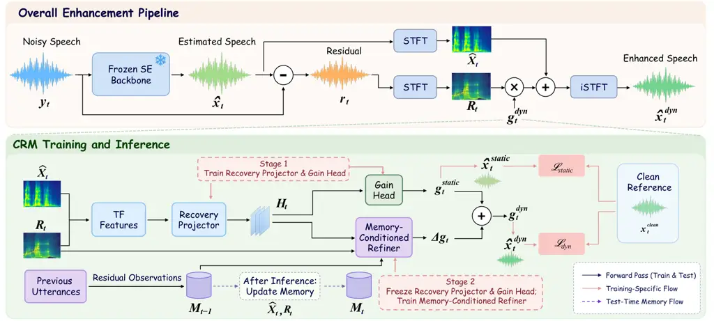
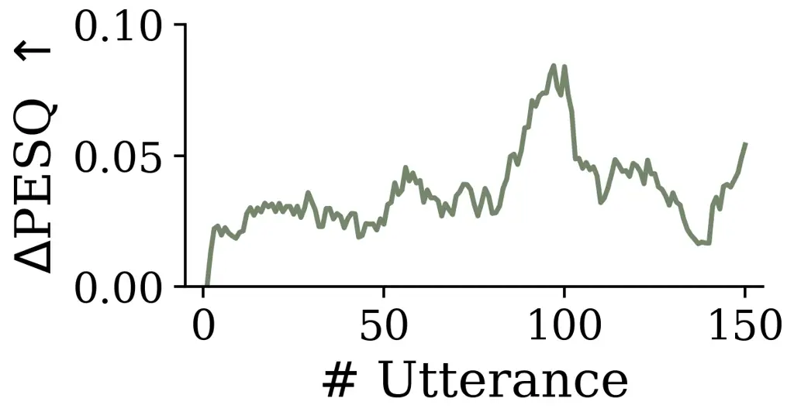
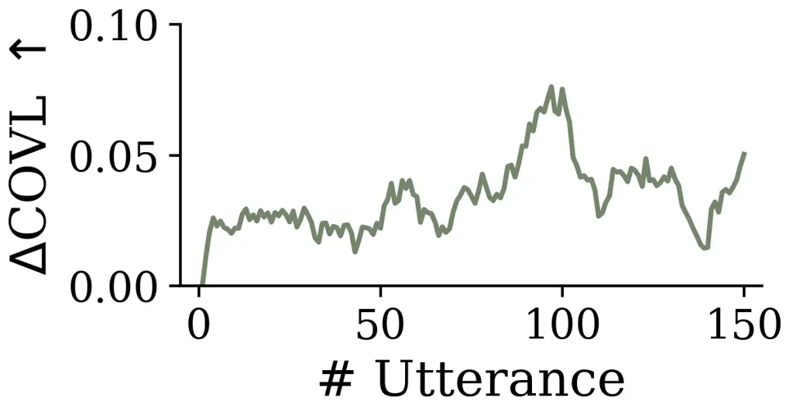

# CONTINUAL RESIDUAL MEMORY FOR GRADIENT-FREE TEST-TIME ADAPTATION IN SPEECH ENHANCEMENT

Yijia Shan    Tianrui Wang    Zixiang Wang    Sheng Wang    Yao Li    Yu
Wang    Xie Chen

###### Abstract

Offline-trained speech enhancement models can degrade under deployment
mismatch. Test-time adaptation (TTA) addresses this problem using
unlabeled test observations, but existing approaches mainly rely on
online parameter optimization and do not explicitly exploit the residual
discarded by the enhancement backbone. We propose Continual Residual
Memory (CRM), a gradient-free continual TTA framework for selective
residual recovery. CRM first estimates bounded time-frequency residual
recovery from the current utterance alone and then uses causal prototype
memory from preceding utterances to refine this estimate. During
deployment, adaptation is driven solely by the evolving memory state
while the backbone and CRM modules remain frozen. Across DNS, EARS-D,
and Libri-MUSAN, CRM improves all seven reported metrics over frozen
CMGAN and achieves the best PESQ, CSIG, and COVL on all three test sets
among the compared methods. CRM remains lightweight and shows
cross-backbone applicability on five additional backbones. Code is
available at
[https://github.com/Ada312/continual-residual-memory](https://github.com/Ada312/continual-residual-memory).

###### Index Terms: 

speech enhancement, test-time adaptation, continual learning, residual
recovery, prototype memory

^(†)^(†)address: ¹X-LANCE Lab, Shanghai Jiao Tong University, China
 ²Shanghai Jiao Tong University, China  
³SJTU Paris Elite Institute of Technology, Shanghai Jiao Tong
University, China  
⁴Tianjin University, China  ⁵School of Artificial Intelligence, Shanghai
Jiao Tong University, China  
⁶China University of Mining and Technology, China  ⁷Shanghai Aviation
Electric Co., Ltd., China

## 1 Introduction

Speech enhancement (SE) aims to recover target speech from noisy or
degraded observations. Modern neural enhancers are typically trained
offline and frozen at deployment, but mismatches in speakers, noise
types, or acoustic conditions can degrade performance. Test-time
adaptation (TTA) addresses this mismatch by using unlabeled test
observations to adapt a pretrained model without requiring target-domain
clean speech. Existing SE TTA and related methods include
self-supervised test-time training \[1\], embedding-based adaptation
such as LaDen \[2\], mask polarization such as MPol \[3\], continual
self-training \[4\], and knowledge-distillation-based personalization
\[5\]. These approaches generally rely on parameter updates during
adaptation and may depend on backbone-specific internal representations.
However, enhancement itself provides an observable test-time signal: the
discarded residual, i.e., the difference between the noisy input and the
enhanced output. This residual contains what the backbone suppresses
and, under mismatch, may include useful speech lost through
over-suppression. Existing SE TTA methods do not explicitly exploit this
residual for adaptation.

Previous studies show that reusing discarded information can reduce
processing distortion \[6, 7\], while residual remixing and
post-processing can alleviate over-suppression \[8, 9\]. These studies
show that residual information can be useful, but exploiting it requires
selective recovery because directly restoring the full residual would
also reintroduce suppressed noise. Moreover, prior methods do not use
preceding residual history to refine subsequent recovery decisions in a
continual TTA process.

In this work, we propose Continual Residual Memory (CRM), a
gradient-free continual TTA framework that combines utterance-local
residual recovery with causal prototype memory. CRM first estimates
bounded time-frequency (TF) residual recovery from the current
utterance, then refines it using residual patterns from preceding
utterances. The backbone and CRM modules remain frozen while only memory
evolves. Our contributions are: (1) TF-wise selective residual recovery
for a frozen enhancement backbone; (2) causal prototype memory that uses
preceding residual patterns to refine utterance-local residual recovery
while preserving the no-memory estimate as a bounded fallback; (3)
consistent improvements across multiple target test sets and both
generative and discriminative enhancement backbones with modest
overhead.

## 2 Method

CRM augments a frozen enhancer with utterance-local residual recovery
and memory-conditioned refinement. At test time, only memory evolves
through the read–infer–write procedure in Fig. 1.



Figure 1: CRM overview. The upper panel shows the overall enhancement
pipeline with residual recovery around a frozen backbone, while the
lower panel shows two-stage training and causal memory flow. At test
time, only memory is updated after each utterance.

### 2.1 Backbone and Residual Representation

For utterance $`t`$, let $`y_{t}`$ denote the noisy waveform and
$`\hat{x}_{t}=G_{\theta}(y_{t})`$ the output of a frozen enhancement
backbone $`G_{\theta}`$. The discarded residual is
$`r_{t}=y_{t}-\hat{x}_{t}`$, which contains both removed noise and
potentially useful speech lost through over-suppression. Restoring it
unconditionally would reintroduce noise. CRM therefore performs
selective recovery in the TF domain, allowing TF bins to receive
different recovery gains. We define
$`\hat{X}_{t}=\operatorname{STFT}(\hat{x}_{t})`$ and
$`R_{t}=\operatorname{STFT}(r_{t})`$. Using a power-compression exponent
$`p`$, we construct seven TF feature maps from the backbone estimate and
residual: power-compressed real and imaginary components of both
spectra, a stabilized log-magnitude ratio, and sine/cosine
phase-difference maps. These features capture spectral content, relative
residual strength, and local phase agreement, and are concatenated as
$`\Phi_{t}`$ for the Recovery Projector.

### 2.2 Utterance-Local Residual Recovery

Utterance-local residual recovery uses only the current backbone
estimate and discarded residual to predict a bounded recovery gain at
each TF bin, serving as CRM’s no-memory fallback.

As shown in Fig. 1, the seven-channel TF feature $`\Phi_{t}`$
constructed from $`\hat{X}_{t}`$ and $`R_{t}`$ is fed to the Recovery
Projector $`P_{s}`$. The projector lifts the input to 32 channels and
applies six gated dilated residual blocks, producing the hidden
representation $`H_{t}=P_{s}(\Phi_{t})`$. The Gain Head then predicts
the TF logit map $`\ell_{t}`$ with a $`1\times 1`$ convolution, yielding

```math
\displaystyle g_{t}^{\mathrm{static}} \displaystyle=g_{\max}\operatorname{sigmoid}(\ell_{t}), \tag{1}
```

```math
\displaystyle\hat{X}_{t}^{\mathrm{static}} \displaystyle=\hat{X}_{t}+g_{t}^{\mathrm{static}}\odot R_{t},
```

where $`\odot`$ denotes pointwise multiplication over TF bins, and
$`g_{\max}`$ bounds the maximum recovery. Here,
$`g_{t}^{\mathrm{static}}`$ is a real-valued TF-wise recovery gain that
controls how much of the discarded residual is restored at each TF bin.
This parameterization constrains the local correction to a bounded
portion of the residual already discarded by the backbone. This step
uses only current-utterance evidence, while $`H_{t}`$ is retained for
subsequent memory-conditioned refinement.

Offline training with clean references minimizes

```math
\displaystyle\mathcal{L}_{\mathrm{static}}={} \displaystyle\mathcal{L}_{\mathrm{time}}+\lambda_{\mathrm{complex}}\mathcal{L}_{\mathrm{complex}}+\lambda_{\log}\mathcal{L}_{\log\mathrm{mag}} \tag{2}
```

```math
\displaystyle+\lambda_{\mathrm{proj}}\mathcal{L}_{\mathrm{proj}}+\lambda_{\mathrm{SI}}\mathcal{L}_{\mathrm{SI\mbox{-}SDR}}+\lambda_{\mathrm{trust}}\mathcal{L}_{\mathrm{trust}}.
```

The six terms respectively denote normalized waveform $`L_{1}`$,
complex-spectrum $`L_{1}`$, log-magnitude reconstruction, gain
projection, negative zero-mean SI-SDR, and trust regularization against
excessive recovery, with the $`\lambda`$ terms as their weights. Let
$`x_{t}^{\mathrm{clean}}`$ denote the clean training reference and
$`X_{t}^{\mathrm{clean}}=\operatorname{STFT}(x_{t}^{\mathrm{clean}})`$.
The oracle TF recovery gain is obtained by projecting the desired clean
correction $`X_{t}^{\mathrm{clean}}-\hat{X}_{t}`$ onto the discarded
residual:

```math
g_{t}^{\star}=\Pi_{[0,g_{\max}]}\left(\frac{\Re\{R_{t}^{\ast}(X_{t}^{\mathrm{clean}}-\hat{X}_{t})\}}{\max(|R_{t}|^{2},\epsilon_{\mathrm{proj}})}\right). \tag{3}
```

Here $`\Re\{\cdot\}`$ and $`(\cdot)^{\ast}`$ denote real part and
complex conjugation, $`\Pi_{[0,g_{\max}]}`$ denotes projection onto the
valid recovery-gain interval, and $`\epsilon_{\mathrm{proj}}>0`$ is a
stabilizing constant. The gain projection term
$`\mathcal{L}_{\mathrm{proj}}`$ is a residual-power-weighted
Smooth-$`L_{1}`$ loss between predicted and oracle gains.

### 2.3 Causal Prototype Memory and Refinement

Utterance-local recovery provides a no-memory estimate but cannot
exploit residual patterns that recur across successive test utterances.
CRM therefore uses causal prototype memory to summarize prior residual
history and refine this estimate, allowing the recovery gain to increase
or decrease according to memory-conditioned evidence.

Prototype Memory. Before utterance $`t`$, $`M_{t-1}`$ contains at most
$`K_{\max}`$ residual log-power prototypes with frequency-wise mean
$`\mu_{m}`$, variance $`v_{m}`$, and observation count $`n_{m}`$, where
$`m`$ indexes prototypes. The current residual is summarized as

```math
u_{t}(f)=\operatorname{median}_{\tau}\log\left(\max\left(|R_{t}(f,\tau)|^{2},\epsilon_{\mathrm{mem}}\right)\right), \tag{4}
```

where $`f`$ and $`\tau`$ denote frequency bins and frames, and
$`\epsilon_{\mathrm{mem}}=10^{-8}`$ is used for numerical stability. Let
$`\bar{\mu}_{m}`$ and $`\bar{u}_{t}`$ denote frequency means, with
$`\tilde{\mu}_{m}=\mu_{m}-\bar{\mu}_{m}`$ and
$`\tilde{u}_{t}=u_{t}-\bar{u}_{t}`$ denoting mean-centered spectral
profiles.

CRM matches the current summary $`u_{t}`$ to each prototype using

```math
D_{m}(u_{t})=\operatorname{mean}_{f}\left[\frac{(\tilde{\mu}_{m}-\tilde{u}_{t})^{2}}{v_{m}+\lambda_{\mathrm{var}}}\right]+\lambda_{\mathrm{level}}(\bar{\mu}_{m}-\bar{u}_{t})^{2}, \tag{5}
```

where $`\lambda_{\mathrm{var}}>0`$ stabilizes variance normalization and
$`\lambda_{\mathrm{level}}`$ controls overall log-power mismatch.

The distances are converted to normalized weights with temperature
$`\tau_{\mathrm{mem}}`$ by
$`p_{m}\propto\exp(-D_{m}/\tau_{\mathrm{mem}})`$, and CRM sorts
prototypes by decreasing $`p_{m}`$ and retains the smallest subset whose
cumulative weight reaches the readout threshold
$`\gamma_{\mathrm{read}}`$.

The retained weights $`p_{m}`$ are renormalized and used to aggregate
the prototype means $`\mu_{m}`$ and variances $`v_{m}`$. CRM then
constructs six context maps: a frequency-centered aggregate prototype
profile from $`\sum_{m}p_{m}\mu_{m}`$; the normalized deviation of
current residual log-power $`\log|R_{t}|^{2}`$ from the aggregate mean;
stability from the aggregated variance; history confidence from
prototype counts $`n_{m}`$; query similarity
$`\exp(-\min_{m}D_{m}(u_{t}))`$; and the normalized entropy of
$`p_{m}`$. Their stack forms $`Z_{t}`$, with $`Z_{t}=0`$ for empty
memory.

Memory-Conditioned Refiner. The refiner uses two lightweight
convolutional branches to model current-utterance evidence and memory
context separately. The basis branch transforms $`H_{t}`$ through a
32-channel convolutional projection, a depthwise convolution, and an
output projection to produce $`d`$ TF basis maps
$`B_{t}=\{b_{t,k}\}_{k=1}^{d}`$, where $`d`$ is the low-rank dimension.
These maps represent candidate recovery patterns supported by the
current utterance. The coordinate branch applies an analogous
convolutional mapping to $`Z_{t}`$ and produces $`d`$ coefficient maps
$`C_{t}=\{c_{t,k}\}_{k=1}^{d}`$. These coefficients determine how
strongly memory modulates the corresponding basis patterns. This
factorization lets memory refine a compact set of current-utterance
recovery patterns rather than predict a full correction directly. A
pointwise low-rank interaction combines the two branches into a signed
correction $`\Delta g_{t}`$, which is added to
$`g_{t}^{\mathrm{static}}`$ and projected onto the valid gain range to
obtain $`g_{t}^{\mathrm{dyn}}`$:

```math
\displaystyle\Delta g_{t} \displaystyle=\alpha_{\mathrm{dyn}}\rho_{t}\tanh\!\left(\frac{1}{\sqrt{d}}\sum_{k=1}^{d}b_{t,k}\odot c_{t,k}\right), \tag{6}
```

```math
\displaystyle g_{t}^{\mathrm{dyn}} \displaystyle=\Pi_{[0,g_{\max}]}\left(g_{t}^{\mathrm{static}}+\Delta g_{t}\right),
```

```math
\displaystyle\hat{X}_{t}^{\mathrm{dyn}} \displaystyle=\hat{X}_{t}+g_{t}^{\mathrm{dyn}}\odot R_{t}.
```

The final enhanced waveform $`\hat{x}^{\mathrm{dyn}}_{t}`$ is obtained
by inverse STFT of $`\hat{X}^{\mathrm{dyn}}_{t}`$. Here
$`\alpha_{\mathrm{dyn}}`$ controls the correction magnitude, and
$`\rho_{t}=\mathbb{I}[M_{t-1}\neq\varnothing]`$ activates the correction
only when memory is available, where $`\mathbb{I}[\cdot]`$ is the
indicator function. Positive $`\Delta g_{t}`$ increases recovery, while
negative $`\Delta g_{t}`$ decreases it. For empty memory,
$`\rho_{t}=\Delta g_{t}=0`$, so CRM reduces to the no-memory estimate.

Training and Causal Memory Update. As shown in Fig. 1, training proceeds
in two stages: Stage 1 optimizes the Recovery Projector and Gain Head
with $`\mathcal{L}_{\mathrm{static}}`$; Stage 2 freezes them and
optimizes the basis and coordinate branches within the
Memory-Conditioned Refiner with $`\mathcal{L}_{\mathrm{dyn}}`$. The base
objective $`\mathcal{L}_{\mathrm{base}}`$ combines the reconstruction
and projection terms defined above with SI-SDR, segmental-SNR, trust,
and differentiable PESQ losses. To guard against unreliable history,
training uses matched, shuffled, and empty-memory conditions. Matched
memory uses the corresponding causal history, shuffled memory uses
histories from other training examples, and empty memory disables
historical context, reducing CRM to the no-memory estimate.

Using the weighted sum of the waveform, complex-spectrum, and
log-magnitude reconstruction terms defined above,
$`\mathcal{R}_{\mathrm{match}}`$ and $`\mathcal{R}_{\mathrm{shuf}}`$
penalize reconstruction degradation relative to the empty-memory
fallback under matched and shuffled history, respectively. A
shuffled-history consistency term $`\mathcal{C}_{\mathrm{shuf}}`$
further limits waveform drift under harmful shuffled history, with a
soft gate of temperature $`\tau_{\mathrm{cf}}`$ applied within
$`\mathcal{C}_{\mathrm{shuf}}`$ to increase the penalty when shuffled
history degrades reconstruction. The refinement objective is

```math
\mathcal{L}_{\mathrm{dyn}}=\mathcal{L}_{\mathrm{base}}+\lambda_{\mathrm{cf}}\left(\mathcal{R}_{\mathrm{match}}+\mathcal{R}_{\mathrm{shuf}}+\lambda_{\mathrm{cons}}\mathcal{C}_{\mathrm{shuf}}\right). \tag{7}
```

Here $`\lambda_{\mathrm{cf}}`$ controls the overall counterfactual
regularization and $`\lambda_{\mathrm{cons}}`$ weights the
shuffled-history consistency term. The objective therefore trains CRM to
exploit useful history while protecting the no-memory fallback when
memory is unreliable.

At deployment, CRM follows a causal read–infer–write procedure
initialized with $`M_{0}=\varnothing`$. Utterance $`t`$ is enhanced
using only $`M_{t-1}`$, and its residual is written to memory only after
the enhanced output has been produced. For memory writing, we measure
the fraction of frame energy contributed by the backbone output:

```math
q_{t,\tau}=\frac{\sum_{f}|\hat{X}_{t}(f,\tau)|^{2}}{\sum_{f}|\hat{X}_{t}(f,\tau)|^{2}+\sum_{f}|R_{t}(f,\tau)|^{2}+\epsilon_{\mathrm{mem}}}, \tag{8}
```

where lower values indicate more residual-dominant frames. Using
Eq. (8), we select the 30% lowest-occupancy frames and define $`o_{t}`$
as their median residual log-power profile.

Unlike the full-utterance query $`u_{t}`$ used for memory retrieval,
$`o_{t}`$ focuses memory updates on residual-dominant structure. We
evaluate $`D_{m}(o_{t})`$ using the same prototype distance in Eq. (5)
and match $`o_{t}`$ to the nearest prototype. If sufficiently novel,
$`o_{t}`$ may create a new prototype; otherwise, it updates the matched
prototype statistics $`(\mu_{m},v_{m},n_{m})`$. Redundant prototypes may
be merged, and when memory is full, only stale prototypes are eligible
for replacement. This write operation produces $`M_{t}`$ only after
inference, so utterance $`t`$ is enhanced using $`M_{t-1}`$ and cannot
influence its own output.

## 3 Experimental Setup

Datasets. CRM is trained only on EARS-WHAM, constructed from EARS \[10\]
and WHAM! \[11\]. We use 8,192 training mixtures and a source-domain
held-out set of 632 speaker-disjoint mixtures for checkpoint and
hyperparameter selection. Target-domain clean references are used only
for evaluation. The evaluation uses DNS 2020 synthetic no-reverberation
(150 utterances) \[12\], EARS-D (886 mixtures), constructed from the
EARS test split and DEMAND noise at SNRs uniformly sampled from
$`[-2.5,17.5]`$ dB \[2, 10, 13\], and Libri-MUSAN (2,620 mixtures),
constructed from LibriSpeech test-clean and MUSAN music at
$`\{-5,0,5,10\}`$ dB \[14, 15\]. Each dataset is processed independently
as a fixed-order causal stream initialized with empty memory.

Training. Audio is sampled at 16 kHz using a 512-point Hann STFT and a
128-sample hop. Both stages use 2-s crops, batch size 8, AdamW optimizer
with weight decay $`10^{-4}`$, and cosine scheduling. The Recovery
Projector and Gain Head are trained for four epochs with a learning rate
of $`3\times 10^{-4}`$ and then frozen. The Memory-Conditioned Refiner
is trained for three epochs with a learning rate of $`10^{-3}`$ using
causal EARS-WHAM histories grouped by WHAM recording location. We use
$`K_{\mathrm{train}}=2`$ and memory dropout 0.20 to expose the
refinement module to missing historical context, with
$`(\tau_{\mathrm{cf}},\lambda_{\mathrm{cf}},\lambda_{\mathrm{cons}})=(0.02,0.10,0.10)`$.
During refinement training, memory readout uses
$`\tau_{\mathrm{mem}}=0.50`$ without posterior-mass truncation. At
deployment, we retain $`\tau_{\mathrm{mem}}=0.50`$, use $`K_{\max}=64`$
as the memory capacity, and set $`\gamma_{\mathrm{read}}=0.95`$ to
select the highest-weight prototype subset. We set
$`(p,d,g_{\max},\alpha_{\mathrm{dyn}})=(0.30,4,0.10,0.08)`$. Memory
updates use a novelty threshold of 0.35 for prototype creation, a merge
threshold of 0.05, and a stale age of 20 utterances for replacement.

Baselines and Evaluation. The main backbone is CMGAN \[16\] trained on
EARS-WHAM. We compare CRM with LaDen \[2\] and MPol \[3\], two
representative gradient-based TTA methods for speech enhancement. For
controlled comparison, LaDen, MPol, and CRM all start from the same
CMGAN checkpoint released with the LaDen/MPol implementation and are
evaluated under the same test protocol. LaDen and MPol adapt selected
CMGAN parameters during testing. For CRM, both CMGAN and the CRM modules
remain frozen and adaptation occurs only through the prototype-memory
state. We report PESQ \[17\], STOI \[18\], CSIG/CBAK/COVL \[19\],
clipped segmental SNR (SSNR), and SI-SDR \[20\].

## 4 Results and Analysis

### 4.1 Main Comparison

To evaluate CRM under mismatched test conditions, Table 1 compares it
with LaDen and MPol on the three target test sets. CRM improves all
seven reported metrics over the frozen backbone, with PESQ gains of
0.11, 0.02, and 0.11 on DNS, EARS-D, and Libri-MUSAN, respectively. It
also achieves the best PESQ, CSIG, and COVL across all three datasets.
These results demonstrate CRM’s effectiveness for cross-domain
enhancement.

| Method      | PESQ$`\uparrow`$ | STOI$`\uparrow`$ | CSIG$`\uparrow`$ | CBAK$`\uparrow`$ | COVL$`\uparrow`$ | SSNR$`\uparrow`$ | SI-SDR$`\uparrow`$ |
| ----------- | ---------------- | ---------------- | ---------------- | ---------------- | ---------------- | ---------------- | ------------------ |
| DNS         |                  |                  |                  |                  |                  |                  |                    |
| CMGAN       | 3.00             | 0.967            | 4.19             | 3.47             | 3.60             | 9.00             | 15.08              |
| \+ LaDen    | 3.00             | 0.967            | 4.21             | 3.47             | 3.61             | 9.06             | 15.06              |
| \+ MPol     | 3.00             | 0.968            | 4.22             | 3.48             | 3.62             | 9.10             | 15.11              |
| \+ CRM      | 3.11             | 0.968            | 4.36             | 3.56             | 3.75             | 9.23             | 15.34              |
| EARS-D      |                  |                  |                  |                  |                  |                  |                    |
| CMGAN       | 2.62             | 0.846            | 3.76             | 2.82             | 3.17             | 2.41             | 5.06               |
| \+ LaDen    | 2.57             | 0.849            | 3.83             | 2.88             | 3.18             | 3.59             | 5.64               |
| \+ MPol     | 2.61             | 0.848            | 3.81             | 2.82             | 3.19             | 2.43             | 5.04               |
| \+ CRM      | 2.64             | 0.849            | 3.90             | 2.86             | 3.26             | 2.63             | 5.20               |
| Libri-MUSAN |                  |                  |                  |                  |                  |                  |                    |
| CMGAN       | 2.16             | 0.903            | 3.40             | 2.62             | 2.74             | 3.83             | 9.64               |
| \+ LaDen    | 2.16             | 0.903            | 3.54             | 2.67             | 2.81             | 4.42             | 9.61               |
| \+ MPol     | 2.18             | 0.905            | 3.46             | 2.65             | 2.78             | 3.92             | 9.87               |
| \+ CRM      | 2.27             | 0.904            | 3.59             | 2.73             | 2.90             | 4.07             | 9.83               |

Table 1: Comparison of test-time adaptation methods on three target test
sets, all using the same CMGAN backbone checkpoint.

### 4.2 Component Analysis of CRM

To analyze the complementary roles of the two steps in CRM’s recovery
process, Table 2 decomposes the full framework into utterance-local
residual recovery and memory-conditioned refinement. On DNS, full CRM
improves PESQ from 3.00 to 3.11: local recovery reaches 3.07, and memory
further raises it to 3.11. Memory provides additional PESQ gains on all
three datasets. On DNS, the $`+0.04`$ gain has a 95% paired
utterance-level bootstrap CI of $`[0.03,\,0.04]`$, based on 20,000
resamples.

| Method                     | DNS  | EARS-D | Libri-MUSAN |
| -------------------------- | ---- | ------ | ----------- |
| Backbone                   | 3.00 | 2.62   | 2.16        |
| + Utterance-local recovery | 3.07 | 2.61   | 2.23        |
| + Full CRM                 | 3.11 | 2.64   | 2.27        |

Table 2: Component-wise analysis of CRM in terms of PESQ ($`\uparrow`$).

Figure 2 further shows the incremental gains contributed by CRM’s
memory-conditioned refinement step beyond utterance-local recovery,
using a causal 10-utterance moving average along the ordered DNS stream.
The gain at the first utterance is zero because the memory is initially
empty, while the smoothed PESQ and COVL gains remain positive once
historical context becomes available.





Figure 2: Incremental gains from CRM’s memory-conditioned refinement
step on the ordered DNS stream.

We further examine robustness to an abrupt cross-domain transition.
Matched history uses standard causal CRM on DNS, initialized with empty
memory and updated only with preceding DNS observations. Cross-domain
history first accumulates memory over the complete Libri-MUSAN stream
and carries it into DNS without reset. The memory is then updated
causally throughout the complete DNS stream. As shown in Table 3,
cross-domain history performs comparably to matched DNS history. This
indicates CRM’s robustness to the abrupt domain transition, with
enhancement performance preserved without resetting residual memory.

| History condition    | PESQ $`\uparrow`$ | COVL $`\uparrow`$ | SI-SDR $`\uparrow`$ |
| -------------------- | ----------------- | ----------------- | ------------------- |
| Matched history      | 3.110             | 3.750             | 15.344              |
| Cross-domain history | 3.111             | 3.751             | 15.345              |

Table 3: Cross-domain transition analysis on DNS.

### 4.3 Cross-Backbone Applicability

To assess cross-backbone applicability, we evaluate CRM on five frozen
backbones spanning diffusion (StoRM-50 \[21\]), flow matching (FlowSE
\[22\]), discriminative (GTCRN \[23\]), streaming (FastEnhancer-B
\[24\]), and ultra-lightweight (UL-UNAS \[25\]) architectures. For each
backbone, its pretrained checkpoint remains frozen, and a
backbone-specific CRM is independently trained and selected using only
EARS-WHAM; DNS is used solely for evaluation. As shown in Table 4, CRM
improves PESQ, STOI, CSIG, COVL, and SI-SDR on all five backbones, with
PESQ gains up to 0.24, supporting its applicability across diverse
enhancement architectures.

| Model          | PESQ$`\uparrow`$ | STOI$`\uparrow`$ | CSIG$`\uparrow`$ | CBAK$`\uparrow`$ | COVL$`\uparrow`$ | SSNR$`\uparrow`$ | SI-SDR$`\uparrow`$ |
| -------------- | ---------------- | ---------------- | ---------------- | ---------------- | ---------------- | ---------------- | ------------------ |
| StoRM-50       | 2.69             | 0.965            | 4.09             | 3.47             | 3.40             | 11.05            | 15.90              |
| + CRM          | 2.71             | 0.966            | 4.12             | 3.47             | 3.42             | 11.00            | 16.08              |
| GTCRN          | 1.70             | 0.871            | 3.03             | 2.74             | 2.34             | 8.14             | 8.95               |
| + CRM          | 1.94             | 0.905            | 3.32             | 2.83             | 2.60             | 7.88             | 9.54               |
| FastEnhancer-B | 2.07             | 0.915            | 3.32             | 3.10             | 2.69             | 10.12            | 13.54              |
| + CRM          | 2.27             | 0.927            | 3.59             | 3.14             | 2.92             | 9.63             | 13.74              |
| FlowSE         | 2.40             | 0.956            | 3.51             | 3.31             | 2.95             | 11.33            | 15.81              |
| + CRM          | 2.58             | 0.958            | 3.92             | 3.41             | 3.25             | 11.14            | 15.97              |
| UL-UNAS        | 2.57             | 0.949            | 3.90             | 3.45             | 3.24             | 11.60            | 16.26              |
| + CRM          | 2.68             | 0.951            | 4.03             | 3.49             | 3.36             | 11.35            | 16.27              |

Table 4: Cross-backbone CRM results on the DNS test set.

### 4.4 Efficiency

CRM introduces only 37.09K parameters, corresponding to 2.02% increase
in model size and 2.20% profiler-counted FLOPs overhead over CMGAN. On
an RTX 4090, the real-time factor (RTF) increases slightly from 0.0340
to 0.0387 and remains well below 1.0. CRM therefore enables continual
adaptation with modest deployment overhead, without requiring online
parameter optimization.

## 5 Conclusion

We proposed CRM, a gradient-free continual TTA framework that combines
bounded utterance-local residual recovery with causal prototype memory.
Without historical context, CRM falls back to utterance-local recovery;
when history is available, prototype memory further refines this
estimate without online parameter updates. Experiments on three target
test sets show consistent improvements over frozen CMGAN, with
memory-conditioned refinement providing additional gains beyond
utterance-local residual recovery. Results on five additional backbones
support CRM’s cross-backbone applicability. Overall, CRM offers a
lightweight alternative to online optimization for robust test-time
speech enhancement.

## References

- \[1\] A. Behera, R.A. Easow, V. Parvathala, and K.S.R. Murty,
  “Test-time training for speech enhancement,” in Interspeech, 2025, pp.
  2375–2379.
- \[2\] T. Raichle, N. Edinger, and B. Yang, “Test-time adaptation for
  speech enhancement via domain invariant embedding transformation,”
  IEEE Open Journal of Signal Processing, vol. 7, pp. 134–143, 2026.
- \[3\] T. Raichle, E. Amini, and B. Yang, “Test-time adaptation for
  speech enhancement via mask polarization,” in IEEE International
  Conference on Acoustics, Speech and Signal Processing (ICASSP), 2026,
  pp. 18882–18886.
- \[4\] E. Tzinis, Y. Adi, V.K. Ithapu, B. Xu, P. Smaragdis, and
  A. Kumar, “RemixIT: Continual self-training of speech enhancement
  models via bootstrapped remixing,” IEEE Journal of Selected Topics in
  Signal Processing, vol. 16, no. 6, pp. 1329–1341, 2022.
- \[5\] S. Kim, M. Athi, G. Shi, M. Kim, and T. Kristjansson, “Zero-shot
  test-time adaptation via knowledge distillation for personalized
  speech denoising and dereverberation,” The Journal of the Acoustical
  Society of America, vol. 155, no. 2, pp. 1353–1367, 2024.
- \[6\] K. Iwamoto et al., “How bad are artifacts?: Analyzing the impact
  of speech enhancement errors on ASR,” in Interspeech, 2022, pp.
  5418–5422.
- \[7\] T. Ochiai et al., “Rethinking processing distortions:
  Disentangling the impact of speech enhancement errors on speech
  recognition performance,” IEEE/ACM Transactions on Audio, Speech, and
  Language Processing, vol. 32, pp. 3589–3602, 2024.
- \[8\] M. Qu, Y.-W. Chen, and J. Hirschberg, “Mitigating
  over-suppression in speech enhancement via inference-time
  rethink-and-refine correction module,” arXiv preprint
  arXiv:2608.07781, 2026.
- \[9\] L. Zhou, Y. Cao, Q. Wang, Y. Cheng, C. Zhuang, and Y. Deng,
  “Monaural speech enhancement with full-convolution attention module
  and post-processing strategy,” IEICE Transactions on Fundamentals of
  Electronics, Communications and Computer Sciences, vol. E108-A, no. 8,
  pp. 996–1004, 2025.
- \[10\] J. Richter et al., “EARS: An anechoic fullband speech dataset
  benchmarked for speech enhancement and dereverberation,” in
  Interspeech, 2024, pp. 4873–4877.
- \[11\] G. Wichern et al., “WHAM!: Extending speech separation to noisy
  environments,” in Interspeech, 2019, pp. 1368–1372.
- \[12\] C.K.A. Reddy et al., “The INTERSPEECH 2020 deep noise
  suppression challenge: Datasets, subjective testing framework, and
  challenge results,” in Interspeech, 2020, pp. 2492–2496.
- \[13\] J. Thiemann, N. Ito, and E. Vincent, “The diverse environments
  multi-channel acoustic noise database (DEMAND): A database of
  multichannel environmental noise recordings,” Proceedings of Meetings
  on Acoustics, vol. 19, no. 1, pp. 035081, 2013.
- \[14\] V. Panayotov, G. Chen, D. Povey, and S. Khudanpur,
  “LibriSpeech: An ASR corpus based on public domain audio books,” in
  IEEE International Conference on Acoustics, Speech and Signal
  Processing (ICASSP), 2015, pp. 5206–5210.
- \[15\] D. Snyder, G. Chen, and D. Povey, “MUSAN: A music, speech, and
  noise corpus,” arXiv preprint arXiv:1510.08484, 2015.
- \[16\] R. Cao, S. Abdulatif, and B. Yang, “CMGAN: Conformer-based
  metric GAN for speech enhancement,” in Interspeech, 2022, pp. 936–940.
- \[17\] A.W. Rix, J.G. Beerends, M.P. Hollier, and A.P. Hekstra,
  “Perceptual evaluation of speech quality (PESQ)—a new method for
  speech quality assessment of telephone networks and codecs,” in IEEE
  International Conference on Acoustics, Speech and Signal Processing
  (ICASSP), 2001, vol. 2, pp. 749–752.
- \[18\] C.H. Taal, R.C. Hendriks, R. Heusdens, and J. Jensen, “An
  algorithm for intelligibility prediction of time–frequency weighted
  noisy speech,” IEEE Transactions on Audio, Speech, and Language
  Processing, vol. 19, no. 7, pp. 2125–2136, 2011.
- \[19\] Y. Hu and P.C. Loizou, “Evaluation of objective quality
  measures for speech enhancement,” IEEE Transactions on Audio, Speech,
  and Language Processing, vol. 16, no. 1, pp. 229–238, 2008.
- \[20\] J. Le Roux, S. Wisdom, H. Erdogan, and J.R. Hershey,
  “SDR—half-baked or well done?,” in IEEE International Conference on
  Acoustics, Speech and Signal Processing (ICASSP), 2019, pp. 626–630.
- \[21\] J.-M. Lemercier, J. Richter, S. Welker, and T. Gerkmann,
  “StoRM: A diffusion-based stochastic regeneration model for speech
  enhancement and dereverberation,” IEEE/ACM Transactions on Audio,
  Speech, and Language Processing, vol. 31, pp. 2724–2737, 2023.
- \[22\] S. Lee, S. Cheong, S. Han, and J.W. Shin, “FlowSE: Flow
  matching-based speech enhancement,” in IEEE International Conference
  on Acoustics, Speech and Signal Processing (ICASSP), 2025, pp. 1–5.
- \[23\] X. Rong, T. Sun, X. Zhang, Y. Hu, C. Zhu, and J. Lu, “GTCRN: A
  speech enhancement model requiring ultralow computational resources,”
  in IEEE International Conference on Acoustics, Speech and Signal
  Processing (ICASSP), 2024, pp. 971–975.
- \[24\] S. Ahn, J. Han, B.J. Woo, and N.S. Kim, “FastEnhancer:
  Speed-optimized streaming neural speech enhancement,” in IEEE
  International Conference on Acoustics, Speech and Signal Processing
  (ICASSP), 2026, pp. 16847–16851.
- \[25\] X. Rong et al., “UL-UNAS: Ultra-lightweight U-Nets for
  real-time speech enhancement via network architecture search,” IEEE
  Transactions on Audio, Speech and Language Processing, vol. 34, pp.
  1085–1096, 2026.
