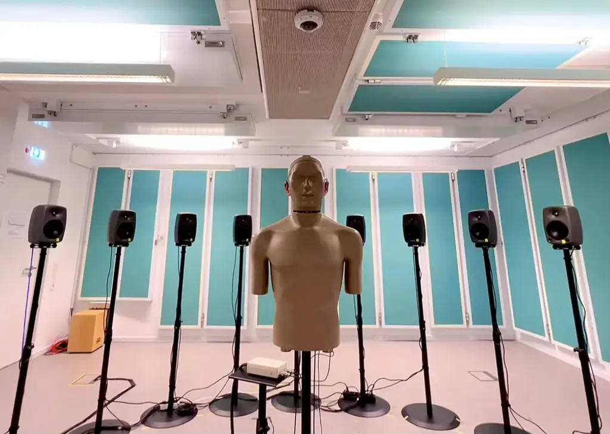
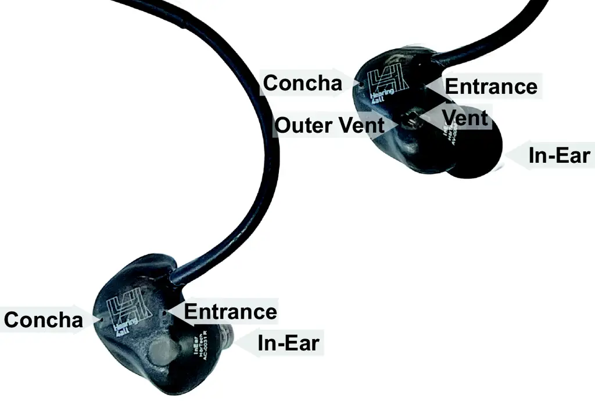
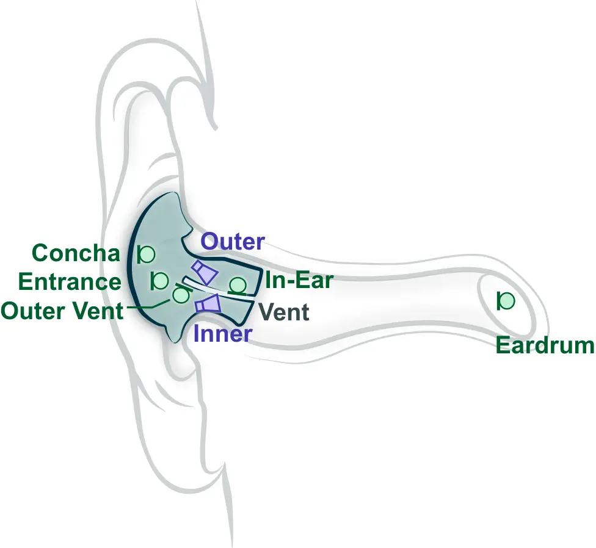
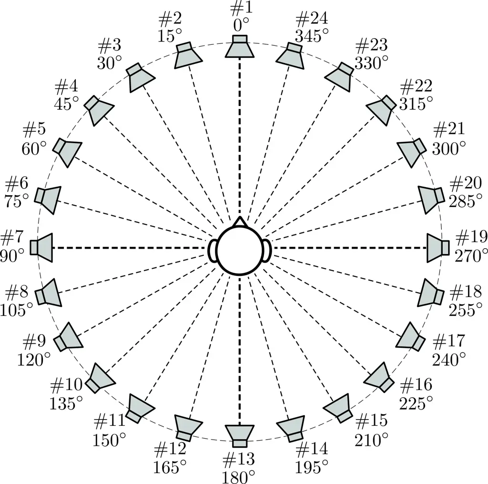
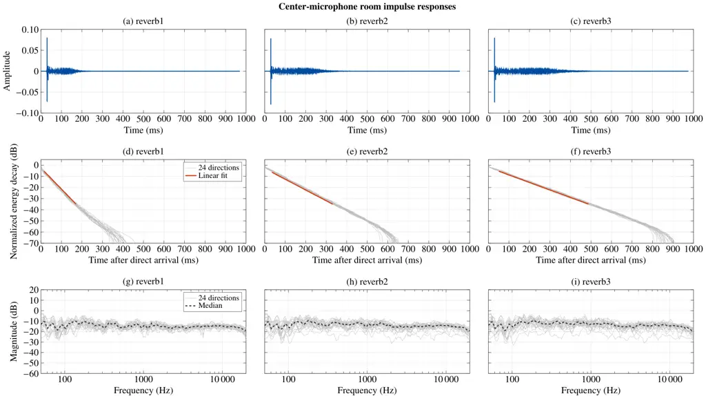

# The Hearpiece Database of Binaural Room Impulse Responses and Driver Responses on KEMAR

Tong Xiao Affiliation:  Department of Medical Physics and Acoustics and
Cluster of Excellence Hearing4allCarl von Ossietzky Universität
Oldenburg, Germany Email: [tong.xiao@uni-oldenburg.de](mailto:)   
Reinhild Roden Affiliation:  Institut für Hörtechnik und Audiologie,
Jade Hochschule, Oldenburg, Germany
Email: [reinhild.roden@jade-hs.de](mailto:)    Matthias Blau
Affiliation:  Institut für Hörtechnik und Audiologie, Jade Hochschule,
Oldenburg, Germany Email: [matthias.blau@jade-hs.de](mailto:)    Simon
Doclo Affiliation:  Department of Medical Physics and Acoustics and
Cluster of Excellence Hearing4allCarl von Ossietzky Universität
Oldenburg, Germany Email: [simon.doclo@uni-oldenburg.de](mailto:)

###### Abstract

This document describes the measurement setup, signal processing, data
organization, and MATLAB file format of a database of acoustic responses
measured on a Knowles Electronics Manikin for Acoustic Research (KEMAR)
using the Hearpiece, a multi-microphone, multi-driver in-ear research
device. The data include binaural room impulse responses (BRIRs) and
Hearpiece driver responses, together with center-microphone room impulse
responses and a loopback impulse response of the playback and recording
system. The BRIRs cover two Hearpiece configurations, three room
conditions, three independent insertions per configuration, and 24
horizontal source directions. The database supports reproducible
research on binaural and hearing-device signal processing, with
potential applications in speech enhancement, spatial filtering and
source separation, dereverberation, active noise and occlusion control,
and acoustic feedback cancellation. The database, MATLAB loading script,
and technical documentation are publicly available at
[https://doi.org/10.5281/zenodo.23667308](https://doi.org/10.5281/zenodo.23667308).

Version: 1.0 Last update: October 27, 2026

This database is published under the [Creative Commons
Attribution-ShareAlike 4.0 International (CC BY-SA 4.0)
license](https://creativecommons.org/licenses/by-sa/4.0/). You are free
to share and adapt the material, provided appropriate credit is given
and derivative works are distributed under the same license.

© Carl von Ossietzky Universität Oldenburg.

Acknowledgments. This research was funded by the Deutsche
Forschungsgemeinschaft (DFG, German Research Foundation) – Project-ID
352015383 – SFB 1330 C1, and under Germany’s Excellence Strategy – EXC
2177/2 – Project ID 390895286.

###### Contents

1.  1 Overview
    1.  1.1 Introduction and scope
    2.  1.2 Database organization
    3.  1.3 Related databases
2.  2 Measurement setup
    1.  2.1 Room conditions
    2.  2.2 KEMAR and Hearpiece
    3.  2.3 Loudspeaker array
    4.  2.4 Recording channels
    5.  2.5 Measurement signals and impulse-response estimation
    6.  2.6 Calibration and response correction
3.  3 Database contents and data format
    1.  3.1 Binaural room impulse responses
    2.  3.2 Driver responses
    3.  3.3 Center-microphone room impulse responses
    4.  3.4 Loopback measurement
4.  4 Example applications
5.  References

## 1 Overview

### 1.1 Introduction and scope

The Hearpiece is a one-size-fits-all research earpiece equipped with
multiple microphones and drivers for hearing-device research \[2\]. Its
design, transducer configuration, and electroacoustic characteristics
are described in detail by Denk et al. \[2\], while additional
information on the hardware, connections, microphones, and drivers is
provided in the Hearpiece technical documentation \[10\]. A
complementary anechoic database of individual Hearpiece acoustic
responses was published by Denk and Kollmeier \[1\]. It includes
head-related impulse responses (HRIRs) and driver responses.

Building directly on the previous Hearpiece database of Denk and
Kollmeier \[1\], the present database extends the established
KEMAR-based measurement framework from anechoic HRIRs to room-dependent
binaural room impulse responses (BRIRs), while also providing Hearpiece
driver responses. Using a common measurement setup, it provides BRIRs
and driver responses for two Hearpiece fitting configurations, closed
and vented, represented by the devices AC0031 and AV0006, respectively,
with three independent insertions for each device. The BRIRs cover three
room conditions and 24 horizontal source directions across 10 recording
channels. This combination brings together multichannel responses at the
Hearpiece microphones and Eardrum locations, controlled room variation,
configuration and insertion variability, and measured driver responses
within a single database. An overview of the measurement setup is shown
in Fig. 1.



Figure 1: Measurement setup with a KEMAR positioned at the center of the
circular loudspeaker array.

The BRIR data comprise

```math
2\;\text{configurations}\times 3\;\text{room conditions}\times 3\;\text{insertions}=18\;\text{BRIR files}. \tag{1}
```

Each BRIR file contains $`24\times 10=240`$ impulse responses,
corresponding to 24 source directions and 10 recording channels. The
BRIR part of the database therefore contains

```math
18\;\text{BRIR files}\times 24\;\text{source directions}\times 10\;\text{recording channels}=4320\;\text{impulse responses}. \tag{2}
```

The driver-response data contain

```math
2\;\text{configurations}\times 3\;\text{insertions}=6\;\text{driver-response files}. \tag{3}
```

Each driver-response file contains $`4\times 10=40`$ impulse responses,
corresponding to four Hearpiece drivers and 10 recording channels. The
driver-response portion of the database therefore contains

```math
6\;\text{driver-response files}\times 4\;\text{drivers}\times 10\;\text{recording channels}=240\;\text{impulse responses}. \tag{4}
```

In addition, the database contains center-microphone room impulse
responses (RIRs) and a loopback impulse response of the playback and
recording system. The center-microphone responses were measured at the
center of the loudspeaker array without KEMAR present and provide a
reference characterization of the three room conditions. The loopback
impulse response used to compensate the BRIR and driver-response data is
also included. All impulse responses are provided at a sampling rate of
$`48\text{\,}\mathrm{kHz}`$.

### 1.2 Database organization

The database is organized into four folders containing BRIRs, driver
responses, center-microphone RIRs, and the loopback measurement, all in
MATLAB MAT format. A MATLAB script, Load_Hearpiece_Database.m, is also
provided to load the data for a selected Hearpiece device, room
condition, and insertion into the MATLAB workspace. The complete
structure is:

Hearpiece_KEMAR_Room_Database/

\|

\|-- BRIRs_MAT/

\| \|-- BRIR_KEMAR_AC0031_reverb1_1.mat

\| \|-- BRIR_KEMAR_AC0031_reverb1_2.mat

\| \|-- BRIR_KEMAR_AC0031_reverb1_3.mat

\| \|-- BRIR_KEMAR_AC0031_reverb2_1.mat

\| \|-- BRIR_KEMAR_AC0031_reverb2_2.mat

\| \|-- BRIR_KEMAR_AC0031_reverb2_3.mat

\| \|-- BRIR_KEMAR_AC0031_reverb3_1.mat

\| \|-- BRIR_KEMAR_AC0031_reverb3_2.mat

\| \|-- BRIR_KEMAR_AC0031_reverb3_3.mat

\| \|-- BRIR_KEMAR_AV0006_reverb1_1.mat

\| \|-- BRIR_KEMAR_AV0006_reverb1_2.mat

\| \|-- BRIR_KEMAR_AV0006_reverb1_3.mat

\| \|-- BRIR_KEMAR_AV0006_reverb2_1.mat

\| \|-- BRIR_KEMAR_AV0006_reverb2_2.mat

\| \|-- BRIR_KEMAR_AV0006_reverb2_3.mat

\| \|-- BRIR_KEMAR_AV0006_reverb3_1.mat

\| \|-- BRIR_KEMAR_AV0006_reverb3_2.mat

\| ‘-- BRIR_KEMAR_AV0006_reverb3_3.mat

\|

\|-- DriverResponses_MAT/

\| \|-- DriverResponse_KEMAR_AC0031_1.mat

\| \|-- DriverResponse_KEMAR_AC0031_2.mat

\| \|-- DriverResponse_KEMAR_AC0031_3.mat

\| \|-- DriverResponse_KEMAR_AV0006_1.mat

\| \|-- DriverResponse_KEMAR_AV0006_2.mat

\| ‘-- DriverResponse_KEMAR_AV0006_3.mat

\|

\|-- CenterMic_MAT/

\| \|-- CenterMic_reverb1.mat

\| \|-- CenterMic_reverb2.mat

\| ‘-- CenterMic_reverb3.mat

\|

\|-- Calibration_MAT/

\| ‘-- Loopback.mat

\|

\|-- Load_Hearpiece_Database.m

\|

‘-- Documentation.pdf

### 1.3 Related databases

Several other publicly available acoustic databases are relevant to
hearing-device research:

- •
  The Transfer Function Measurements for Simulating Environmental Noise
  at Hearable Microphones contains impulse-response measurements for 18
  users wearing bilateral Hearpieces, using a closed fitting and eight
  horizontal source directions. The measurements are limited to the
  In-Ear and Concha microphones and do not include Hearpiece driver
  responses \[20\].
- •
  The Paths for Active Noise Cancellation Development and Research
  (PANDAR) database contains primary, secondary, and acoustic feedback
  paths measured with in-ear active noise control headphones. It
  includes measurements from human subjects and direction-dependent
  primary paths for 72 horizontal source directions on a dummy head,
  using one outer microphone, one inner microphone, and the internal
  loudspeaker \[14\].
- •
  The Database of Multichannel In-Ear and Behind-the-Ear Head-Related
  and Binaural Room Impulse Responses provides multichannel HRIRs and
  BRIRs measured on a head-and-torso simulator using bilateral
  behind-the-ear hearing aid dummies and in-ear microphones.
  Measurements are available for an anechoic chamber and several natural
  environments, with the number of source directions and available
  recording channels varying between environments \[11\].
- •
  The Binaural Room Impulse Responses with Uniformly Distributed
  External Microphones (BRUDEX) database contains acoustic impulse
  responses for a binaural hearing-aid setup together with 36 spatially
  distributed external microphones, 12 source positions, and three
  reverberation conditions. Its main emphasis is on spatially
  distributed microphone measurements for applications such as noise
  reduction, source localization, and dereverberation \[5\].
- •
  The IHTA-indHARTF – Database of Individual Behind-the-Ear
  Hearing-Aid-Related Transfer Functions with High Spatial Resolution
  provides individual hearing-aid-related transfer functions (HARTFs)
  from dual-microphone behind-the-ear hearing aids and corresponding
  in-ear head-related transfer functions (HRTFs) for 30 participants.
  The measurements were obtained in a hemi-anechoic chamber and focus on
  individual spatial transfer functions rather than room-dependent or
  driver-response measurements \[21\].

## 2 Measurement setup

### 2.1 Room conditions

Measurements were conducted in the Variable Acoustics Laboratory at the
Carl von Ossietzky Universität Oldenburg with approximate dimensions of
$`7\times 6\times 2.7`$ $`\mathrm{m}`$. Three room conditions were
measured and identified as reverb1, reverb2, and reverb3, ordered from
least to most reverberant.

The room condition was varied by changing the amount of acoustic
absorption, primarily by reconfiguring sound-absorbing panels on the
walls, as illustrated in Fig. 1. BRIRs were measured in all three room
conditions, whereas the driver responses were measured only in reverb1.
Center-microphone RIRs are provided for all three conditions.

### 2.2 KEMAR and Hearpiece

Measurements were performed using the same G.R.A.S. KEMAR 45BB-12
manikin used for the Hearpiece measurements reported by Denk and
Kollmeier \[1\]. KEMAR was positioned at the center of the circular
loudspeaker array, facing the loudspeaker at
$`0\text{\,}\mathrm{\SIUnitSymbolDegree}`$ azimuth, with its interaural
center approximately $`1.6\text{\,}\mathrm{m}`$ above the floor. The
interaural center was vertically aligned with the loudspeaker centers,
defined as the midpoints between the woofer and tweeter of each
loudspeaker. The KEMAR was equipped with G.R.A.S. 43BB-1 low-noise ear
simulators and G.R.A.S. KB5000/5001 anthropometric pinnae, which were
also used in the previous Hearpiece measurements \[2\]. For all BRIR and
driver-response measurements, medium-sized silicone domes were used.

A pair of Hearpieces was fitted bilaterally to KEMAR for the BRIR and
driver-response measurements. Two Hearpiece devices, representing the
two fitting configurations, were measured:

- •
  AC0031: closed fitting,
- •
  AV0006: vented fitting.

Each Hearpiece contains four Knowles SPH1642HT5H-1
microelectromechanical systems (MEMS) microphones \[12\]. The In-Ear and
Outer Vent microphones are located near the inner and outer ends of the
vent, respectively. The Entrance and Concha microphones are mounted on
the faceplate of the Hearpiece, with the Entrance microphone located
near the ear-canal entrance and the Concha microphone farther back in
the cavum conchae. These microphone-location names are used throughout
the database.

Each Hearpiece also contains two separately driven balanced-armature
(BA) drivers, referred to as the Inner Driver and Outer Driver according
to their positions in the device \[2\]. The Inner Driver is a Knowles
WBFK-30042 used primarily for high-frequency reproduction, while the
Outer Driver is a Knowles FK-26768 used primarily for lower-frequency
reproduction. The Hearpiece configurations and the physical arrangement
of the microphones and drivers are illustrated in Fig. 2.

For each Hearpiece configuration, three independent insertions were
measured. For each insertion, BRIRs were measured under all three room
conditions by reconfiguring the sound-absorbing panels on the walls,
without removing or repositioning the Hearpieces. The Hearpieces were
removed and reinserted between successive insertions.



(a)



(b)

Figure 2: (a) Hearpiece configurations used in the measurements: closed
fitting (AC0031) on the left and vented fitting (AV0006) on the right,
with selected microphone locations indicated. (b) Schematic layout of
the Hearpiece in the ear, showing the microphone locations, Inner and
Outer Drivers, the vent, and the KEMAR ear-simulator recording location.

### 2.3 Loudspeaker array

The playback system consisted of 24 Genelec 8030 loudspeakers arranged
in a horizontal circular array of approximately $`2\text{\,}\mathrm{m}`$
radius around the measurement position, with the loudspeaker centers at
a height of approximately $`1.6\text{\,}\mathrm{m}`$. The loudspeakers
were uniformly spaced at $`15\text{\,}\mathrm{\SIUnitSymbolDegree}`$
intervals. Playback and recording were performed using an RME MADIface
XT audio interface together with RME ADI-8 QS and RME OctaMic XTC
converters.

Each loudspeaker defines one source direction in the BRIR and
center-microphone data. As illustrated in Fig. 3, the 24 loudspeakers
are indexed from \#1 to \#24, starting with \#1 at an azimuth of
$`0\text{\,}\mathrm{\SIUnitSymbolDegree}`$ and increasing in
$`15\text{\,}\mathrm{\SIUnitSymbolDegree}`$ steps counterclockwise when
viewed from above. Thus, $`90\text{\,}\mathrm{\SIUnitSymbolDegree}`$ is
to the left, $`180\text{\,}\mathrm{\SIUnitSymbolDegree}`$ at the back,
and $`270\text{\,}\mathrm{\SIUnitSymbolDegree}`$ to the right. All
source directions have an elevation of
$`0\text{\,}\mathrm{\SIUnitSymbolDegree}`$.



Figure 3: Top view of the 24-loudspeaker array, showing the loudspeaker
indexing and corresponding source azimuths used in the database.

### 2.4 Recording channels

Both the BRIR and driver-response data contain 10 recording channels,
following the terminology of the previous Hearpiece database \[1\].
Channels 1 and 2 are the outputs of the left and right KEMAR ear
simulators and are referred to in the database as Eardrum Left and
Eardrum Right. Channels 3–10 correspond to four Hearpiece microphone
locations measured bilaterally: In-Ear, Entrance, Outer Vent, and
Concha. The locations of the Hearpiece microphones are illustrated in
Fig. 2. The recording-channel ordering is given in Table 1.

| Channel | Recording-channel name      |
| ------- | --------------------------- |
| 1       | Eardrum Left                |
| 2       | Eardrum Right               |
| 3       | In-Ear Microphone Left      |
| 4       | In-Ear Microphone Right     |
| 5       | Entrance Microphone Left    |
| 6       | Entrance Microphone Right   |
| 7       | Outer Vent Microphone Left  |
| 8       | Outer Vent Microphone Right |
| 9       | Concha Microphone Left      |
| 10      | Concha Microphone Right     |

Table 1: Recording-channel ordering used for the BRIR and
driver-response data.

### 2.5 Measurement signals and impulse-response estimation

Impulse responses were measured using the exponential swept-sine (ESS)
technique \[4, 19\] at a sampling rate of $`48\text{\,}\mathrm{kHz}`$.
The sweep had a nominal duration of $`5\text{\,}\mathrm{s}`$ and covered
the frequency range from $`20\text{\,}\mathrm{Hz}`$ to
$`24\text{\,}\mathrm{kHz}`$. The sweep was followed by
$`2\text{\,}\mathrm{s}`$ of silence.

Each measurement was repeated three times. The recorded signals from the
second and third repetitions were averaged, while the first repetition
was discarded. The averaged recorded sweep response was then convolved
with the corresponding regularized inverse sweep to obtain the impulse
response. The causal linear impulse response was separated from the
nonlinear-response components.

### 2.6 Calibration and response correction

The two Eardrum channels were corrected for the relative sensitivity
difference between the left and right KEMAR ear simulators using the
unit-specific sensitivities from their calibration certificates \[6\].
These sensitivities were used only for relative left–right scaling and
not for absolute pressure calibration. No frequency-response
equalization was applied to these channels.

The Hearpiece microphone channels were corrected for the nominal
frequency-response shape of the Knowles SPH1642HT5H-1 microphone \[12\].
The manufacturer’s normalized response was used for this correction.

The BRIR and driver-response data were additionally compensated for the
playback and recording system using the measured loopback impulse
response described in Section 3.4. No loopback compensation or
microphone-response correction was applied to the center-microphone
responses. The BRIR and driver-response amplitudes should not be
interpreted as absolute acoustic pressure, absolute electrical gain, or
sound pressure level.

## 3 Database contents and data format

The following subsections document the four data types in the database.
The BRIR files are described in Section 3.1, the driver-response files
in Section 3.2, the center-microphone RIR files in Section 3.3, and the
loopback measurement in Section 3.4. For each data type, the file
naming, organization of the impulse-response data, and metadata
variables are described, with representative plots illustrating the
contents of the files.

### 3.1 Binaural room impulse responses

The BRIR data are stored in BRIRs_MAT/. The folder contains 18 MAT files
corresponding to two Hearpiece configurations, three room conditions,
and three independent insertions. The files follow the naming convention

BRIR_KEMAR\_\<deviceID\>\_\<reverbCondition\>\_\<insertion\>.mat

where deviceID is either AC0031 or AV0006, reverbCondition is reverb1,
reverb2, or reverb3, and insertion is 1, 2, or 3.

The variables contained in each BRIR MAT file are summarized in Table 2.
Each file contains the impulse responses in M_data with dimensions
$`$48\,000$\times 24\times 10`$, corresponding to samples $`\times`$
source directions $`\times`$ recording channels. The rows of M_dirs_sph
correspond to the source-direction dimension of M_data, and the entries
of c_inchannel_names correspond to the recording-channel dimension. The
variable n_delay_common follows the timing convention used in the
previous Hearpiece database \[1\] and specifies the number of samples
preceding the nominal time origin of the stored impulse responses. In
the present database, n_delay_common is set to 0 for all BRIR files,
indicating that no samples are designated as negative-time samples.
Calibration and response corrections applied to the BRIR data are
described in Section 2.6.

| Variable          | Size/type                       | Description                                                                                              |
| ----------------- | ------------------------------- | -------------------------------------------------------------------------------------------------------- |
| M_data            | $`$48\,000$\times 24\times 10`$ | Impulse responses with dimensions of samples $`\times`$ source directions $`\times`$ recording channels. |
| M_dirs_sph        | $`24\times 2`$                  | Source directions given as azimuth and elevation in degrees.                                             |
| c_inchannel_names | $`1\times 10`$ cell array       | Recording-channel names.                                                                                 |
| n_delay_common    | scalar                          | Number of negative-time samples preceding the nominal time origin; equal to 0.                           |
| srate             | scalar                          | Sampling rate in Hz; equal to $`48\,000`$.                                                               |
| s_subjectID       | character array                 | Subject identifier; KEMAR.                                                                               |
| s_deviceID        | character array                 | Hearpiece device identifier; AC0031 or AV0006.                                                           |
| s_dataset         | character array                 | Dataset identifier.                                                                                      |
| s_reverbCondition | character array                 | Room-condition identifier; reverb1, reverb2, or reverb3.                                                 |
| s_fitting         | character array                 | Hearpiece fitting; closed or vented.                                                                     |
| n_insertion       | scalar                          | Hearpiece insertion number.                                                                              |
| c_readme          | cell array                      | Brief description of the data, measurement configuration, and processing.                                |

Table 2: Variables contained in each BRIR MAT file.

Figure 4 shows representative BRIR data from Hearpiece configuration
AV0006 in room condition reverb1, insertion 1, for source azimuths of
$`0\text{\,}\mathrm{\SIUnitSymbolDegree}`$,
$`90\text{\,}\mathrm{\SIUnitSymbolDegree}`$, and
$`270\text{\,}\mathrm{\SIUnitSymbolDegree}`$. For each source direction,
the time-domain responses of all 10 recording channels are shown above
their corresponding magnitude responses, grouped by left and right side.

Figure 4: Representative BRIR data from BRIR_KEMAR_AV0006_reverb1_1.mat
for source azimuths of $`0\text{\,}\mathrm{\SIUnitSymbolDegree}`$,
$`90\text{\,}\mathrm{\SIUnitSymbolDegree}`$, and
$`270\text{\,}\mathrm{\SIUnitSymbolDegree}`$. For each source direction,
the time-domain responses of the 10 recording channels are shown above
the corresponding magnitude responses, grouped by left and right side.
The time-domain impulse responses are vertically offset for
visualization.

### 3.2 Driver responses

The driver-response data are stored in DriverResponses_MAT/. The
directory contains six MAT files corresponding to two Hearpiece
configurations and three independent insertions. The files follow the
naming convention

DriverResponse_KEMAR\_\<deviceID\>\_\<insertion\>.mat

where deviceID is either AC0031 or AV0006, and insertion is 1, 2, or 3.

The variables contained in each driver-response MAT file are summarized
in Table 3. Each file contains the impulse responses in M_data with
dimensions $`$1536$\times 4\times 10`$, corresponding to samples
$`\times`$ drivers $`\times`$ recording channels. The entries of
c_outchannel_names correspond to the driver dimension of M_data, and the
entries of c_inchannel_names correspond to the recording-channel
dimension. The variable n_delay_common follows the timing convention
used in the previous Hearpiece database \[1\] and specifies the number
of samples preceding the nominal time origin of the stored impulse
responses. In the present database, n_delay_common is set to 0 for all
driver-response files, indicating that no samples are designated as
negative-time samples. Calibration and response corrections applied to
the driver-response data are described in Section 2.6.

| Variable           | Size/type                 | Description                                                                                    |
| ------------------ | ------------------------- | ---------------------------------------------------------------------------------------------- |
| M_data             | $`1536\times 4\times 10`$ | Impulse responses with dimensions of samples $`\times`$ drivers $`\times`$ recording channels. |
| c_inchannel_names  | $`1\times 10`$ cell array | Recording-channel names.                                                                       |
| c_outchannel_names | $`1\times 4`$ cell array  | Driver names corresponding to the second dimension of M_data.                                  |
| n_delay_common     | scalar                    | Number of negative-time samples preceding the nominal time origin; equal to 0.                 |
| srate              | scalar                    | Sampling rate in Hz; equal to $`48\,000`$.                                                     |
| s_subjectID        | character array           | Subject identifier; KEMAR.                                                                     |
| s_deviceID         | character array           | Hearpiece device identifier; AC0031 or AV0006.                                                 |
| s_dataset          | character array           | Dataset identifier.                                                                            |
| s_reverbCondition  | character array           | Room-condition identifier; reverb1.                                                            |
| s_fitting          | character array           | Hearpiece fitting; closed or vented.                                                           |
| n_insertion        | scalar                    | Hearpiece insertion number.                                                                    |
| c_readme           | cell array                | Brief description of the data, measurement configuration, and processing.                      |

Table 3: Variables contained in each driver-response MAT file.

Figure 5 shows representative driver-response data from Hearpiece
configuration AV0006, insertion 1. The time-domain panels show the
responses from each of the four drivers to the five recording locations
on the corresponding side: Eardrum, In-Ear, Entrance, Outer Vent, and
Concha. The corresponding magnitude-response panels are shown directly
below.

Figure 5: Representative driver-response data from
DriverResponse_KEMAR_AV0006_1.mat. Time-domain and corresponding
magnitude responses are shown for Inner Driver Left, Inner Driver Right,
Outer Driver Left, and Outer Driver Right. Each panel contains the five
recording locations on the corresponding side. The time-domain impulse
responses are vertically offset for visualization.

### 3.3 Center-microphone room impulse responses

Center-microphone RIRs are stored in CenterMic_MAT/. One MAT file is
provided for each of the three room conditions:

CenterMic_reverb1.mat

CenterMic_reverb2.mat

CenterMic_reverb3.mat

The measurements were performed with KEMAR and the Hearpieces removed
from the measurement position. A Sennheiser KE 4-211-2 omnidirectional
microphone was positioned at the center of the loudspeaker array,
providing a reference characterization of the three room conditions for
all 24 source directions.

The variables contained in each center-microphone MAT file are
summarized in Table 4. Each file contains the RIRs in M_data with
dimensions $`$72\,000$\times 24`$, corresponding to samples $`\times`$
source directions. The rows of M_dirs_sph correspond to the
source-direction dimension of M_data, and the entry of c_inchannel_names
identifies the recording channel. The variable n_delay_common is set to
0 for all center-microphone files, indicating that no samples are
designated as negative-time samples. Unlike the BRIR and driver-response
data, no loopback compensation or microphone-response correction was
applied to the center-microphone responses.

| Variable          | Size/type                | Description                                                                    |
| ----------------- | ------------------------ | ------------------------------------------------------------------------------ |
| M_data            | $`$72\,000$\times 24`$   | RIRs with dimensions of samples $`\times`$ source directions.                  |
| M_dirs_sph        | $`24\times 2`$           | Source directions given as azimuth and elevation in degrees.                   |
| c_inchannel_names | $`1\times 1`$ cell array | Recording-channel name.                                                        |
| n_delay_common    | scalar                   | Number of negative-time samples preceding the nominal time origin; equal to 0. |
| srate             | scalar                   | Sampling rate in Hz; equal to $`48\,000`$.                                     |
| s_dataset         | character array          | Dataset identifier.                                                            |
| s_reverbCondition | character array          | Room-condition identifier; reverb1, reverb2, or reverb3.                       |
| c_readme          | cell array               | Brief description of the data, measurement configuration, and processing.      |

Table 4: Variables contained in each center-microphone MAT file.

Figure 6 illustrates the center-microphone responses for the three room
conditions. The top row shows an example RIR for the same source
direction in each room condition. The middle row shows normalized energy
decay curves in the $`1\text{\,}\mathrm{kHz}`$ octave band for all 24
source directions. The decay curves are referenced to the detected
direct arrival, and the linear decay fit is evaluated between
$`-5\text{\,}\mathrm{dB}`$ and $`-35\text{\,}\mathrm{dB}`$. The
reverberation time is estimated by extrapolating the fitted decay slope
to a $`60\text{\,}\mathrm{dB}`$ decay. The median estimated
reverberation times across the 24 source directions are approximately
$`0.32\text{\,}\mathrm{s}`$, $`0.62\text{\,}\mathrm{s}`$, and
$`0.89\text{\,}\mathrm{s}`$ for reverb1, reverb2, and reverb3,
respectively. The bottom row shows the magnitude responses for all 24
source directions together with their median.



Figure 6: Center-microphone responses for the three room conditions.
Top: the RIR for the source direction corresponding to loudspeaker \#2
in each room condition. Middle: normalized $`1\text{\,}\mathrm{kHz}`$
energy decay curves for all 24 source directions and a linear decay fit
between $`-5\text{\,}\mathrm{dB}`$ and $`-35\text{\,}\mathrm{dB}`$.
Bottom: magnitude responses for all 24 source directions and their
median.

### 3.4 Loopback measurement

The measured loopback impulse response is stored in
Calibration_MAT/Loopback.mat. The variables contained in the loopback
MAT file are summarized in Table 5. The file contains the measured
loopback impulse response in M_data with dimensions
$`$334\,227$\times 1`$, corresponding to samples $`\times`$ recording
channels. The loopback impulse response was used to compensate the BRIR
and driver-response data for the response of the playback and recording
system. No loopback compensation was applied to the center-microphone
responses.

| Variable      | Size/type              | Description                                                               |
| ------------- | ---------------------- | ------------------------------------------------------------------------- |
| M_data        | $`$334\,227$\times 1`$ | Measured single-channel loopback impulse response.                        |
| srate         | scalar                 | Sampling rate in Hz; equal to $`48\,000`$.                                |
| s_dataset     | character array        | Dataset identifier.                                                       |
| s_calibration | character array        | Calibration-measurement identifier.                                       |
| s_dataType    | character array        | Description of the stored calibration data.                               |
| c_readme      | cell array             | Brief description of the data, measurement configuration, and processing. |

Table 5: Variables contained in the loopback MAT file.

Figure 7 shows the loopback impulse response and the corresponding
magnitude response. The time-domain panel shows the interval from
$`22\text{\,}\mathrm{ms}`$ to $`28\text{\,}\mathrm{ms}`$, containing the
main impulse response. The frequency-domain panel shows the magnitude
response computed from the full loopback impulse response over the
frequency range from $`20\text{\,}\mathrm{Hz}`$ to
$`24\text{\,}\mathrm{kHz}`$.

Figure 7: Measured loopback impulse response and corresponding magnitude
response of the playback and recording system. Top: loopback impulse
response from $`22\text{\,}\mathrm{ms}`$ to $`28\text{\,}\mathrm{ms}`$.
Bottom: magnitude response computed from the full loopback impulse
response over the frequency range from $`20\text{\,}\mathrm{Hz}`$ to
$`24\text{\,}\mathrm{kHz}`$.

## 4 Example applications

The BRIR data can be used to simulate the signals at the Eardrum
locations and Hearpiece microphones for sound arriving from different
source directions and under different room conditions. This enables
evaluation of microphone-array signal-processing algorithms such as
beamforming, source localization, and source separation, as well as
related speech-enhancement algorithms \[3, 7, 29\]. For active
sound-control applications, the BRIRs can additionally represent the
propagation paths from external sources to the Hearpiece microphones and
Eardrum locations.

The driver-response data characterize the acoustic transfer paths from
each Hearpiece driver to the Eardrum locations and Hearpiece
microphones. In active noise control (ANC), the responses from the
Hearpiece drivers to the In-Ear microphones and Eardrum locations can
serve as secondary paths for controller design, virtual sensing, and
robustness analysis \[22, 23, 9, 26, 16, 35, 17\]. Spatially selective
active noise control (SSANC) combines spatial filtering with active
control to preserve a desired source while selectively attenuating
interfering sources \[34, 30, 31, 32, 33\]. The same driver-to-In-Ear
and driver-to-Eardrum responses are also relevant to active occlusion
control (AOC) \[13, 15\]. In acoustic feedback cancellation (AFC), the
responses from the Hearpiece drivers to the Entrance, Outer Vent, and
Concha microphones can be regarded as acoustic feedback paths when these
microphones are used as device input microphones \[25, 24, 27, 18, 28,
36, 8\].

The BRIR and driver-response data can also be used jointly to construct
linear acoustic simulations that include both external-source
propagation and sound generated by the Hearpiece drivers, for example in
ANC, SSANC, and AFC applications. The two Hearpiece configurations and
three independent insertions further allow such algorithms to be
evaluated with configuration and insertion variability.

## References

- \[1\] F. Denk and B. Kollmeier (2021) The Hearpiece database of
  individual transfer functions of an in-the-ear earpiece for hearing
  device research. Acta Acustica 5, pp. 1–16. Note: Art. no. 2 External
  Links: [Document](https://dx.doi.org/10.1051/aacus/2020028) Cited by:
  §1.1, §1.1, §2.2, §2.4, §3.1, §3.2.
- \[2\] F. Denk, M. Lettau, H. Schepker, S. Doclo, R. Roden, M. Blau, J.
  Bach, J. Wellmann, and B. Kollmeier (2019) A one-size-fits-all
  earpiece with multiple microphones and drivers for hearing device
  research. In Proc. AES International Conference on Headphone
  Technology, San Francisco, CA, USA, pp. 1–9. Note: Paper 13 Cited by:
  §1.1, §2.2, §2.2.
- \[3\] S. Doclo, W. Kellermann, S. Makino, and S. E. Nordholm (2015)
  Multichannel signal enhancement algorithms for assisted listening
  devices: exploiting spatial diversity using multiple microphones. IEEE
  Signal Processing Magazine 32 (2), pp. 18–30. Cited by: §4.
- \[4\] A. Farina (2000) Simultaneous measurement of impulse response
  and distortion with a swept-sine technique. In Proc. 108th Audio
  Engineering Society Convention, Paris, France. Note: Paper 5093 Cited
  by: §2.5.
- \[5\] D. Fejgin, W. Middelberg, and S. Doclo (2023) BRUDEX database:
  binaural room impulse responses with uniformly distributed external
  microphones. In Proc. ITG Conference on Speech Communication, Aachen,
  Germany, pp. 1–5. External Links:
  [Document](https://dx.doi.org/10.30420/456164024) Cited by: 4th item.
- \[6\] G.R.A.S. Sound & Vibration (2018) Certificate of Calibration:
  45BB-12 KEMAR Head & Torso with Anthropometric Pinnae and 2-Channel
  Low Noise Ear Simulator. Note: KEMAR serial no. 318190, calibration
  date: 21 August 2018 Cited by: §2.6.
- \[7\] S. Gannot, E. Vincent, S. Markovich-Golan, and A. Ozerov (2017)
  A consolidated perspective on multi-microphone speech enhancement and
  source separation. IEEE/ACM Transactions on Audio, Speech, and
  Language Processing 25 (4), pp. 692–730. Cited by: §4.
- \[8\] F. Hao, B. C. J. Moore, H. Zhang, X. Li, and C. Zheng (2025)
  L3C-DeepMFC: low-latency low-complexity deep marginal feedback
  cancellation with closed-loop fine tuning for hearing aids. In Proc.
  Interspeech, pp. 838–842. External Links:
  [Document](https://dx.doi.org/10.21437/Interspeech.2025-1111) Cited
  by: §4.
- \[9\] F. Hilgemann, E. Chatzimoustafa, and P. Jax (2024) Data-driven
  uncertainty modeling for robust feedback active noise control in
  headphones. Journal of the Audio Engineering Society 72 (12),
  pp. 873–883. External Links:
  [Document](https://dx.doi.org/10.17743/jaes.2022.0185) Cited by: §4.
- \[10\] HörTech gGmbH, Carl von Ossietzky Universität Oldenburg, and
  InEar GmbH (2019) Technical documentation: acoustically transparent
  earpieces. External Links:
  [Link](https://api.inear.de/user/pages/04.support/03.downloads/02._group/04._downloads/InEar%20%26%20H%C3%B6rTech%20Transparent%20EarPiece.pdf)
  Cited by: §1.1.
- \[11\] H. Kayser, S. D. Ewert, J. Anemüller, T. Rohdenburg, V.
  Hohmann, and B. Kollmeier (2009) Database of multichannel in-ear and
  behind-the-ear head-related and binaural room impulse responses.
  EURASIP Journal on Advances in Signal Processing 2009, pp. 1–10. Note:
  Art. no. 298605 External Links:
  [Document](https://dx.doi.org/10.1155/2009/298605) Cited by: 3rd item.
- \[12\] Knowles Electronics (2015) SPH1642HT5H-1: Wide Bandwidth, Low
  Noise, Precision Top Port SiSonic Microphone. Knowles Electronics.
  Note: Rev. B External Links:
  [Link](https://www.digikey.com/en/products/detail/syntiant/SPH1642HT5H-1/5805540)
  Cited by: §2.2, §2.6.
- \[13\] S. Liebich, R. Brandis, J. Fabry, P. Jax, and P. Vary (2018)
  Active occlusion cancellation with hear-through equalization for
  headphones. In Proc. IEEE International Conference on Acoustics,
  Speech and Signal Processing (ICASSP), pp. 241–245. External Links:
  [Document](https://dx.doi.org/10.1109/ICASSP.2018.8461834) Cited by:
  §4.
- \[14\] S. Liebich, J. Fabry, P. Jax, and P. Vary (2019) Acoustic path
  database for ANC in-ear headphone development. In Proc. 23rd
  International Congress on Acoustics (ICA), Aachen, Germany,
  pp. 4326–4333. External Links:
  [Document](https://dx.doi.org/10.18154/RWTH-CONV-239404) Cited by: 2nd
  item.
- \[15\] S. Liebich and P. Vary (2022) Occlusion effect cancellation in
  headphones and hearing devices—the sister of active noise
  cancellation. IEEE/ACM Transactions on Audio, Speech, and Language
  Processing 30, pp. 35–48. External Links:
  [Document](https://dx.doi.org/10.1109/TASLP.2021.3130966) Cited by:
  §4.
- \[16\] Z. Luo, J. Ji, B. Wang, D. Shi, H. Ma, and W. Gan (2025) Deep
  learning-based generative fixed-filter active noise control:
  transferability and implementation. Mechanical Systems and Signal
  Processing 238, pp. 1–17. Note: Art. no. 113207 External Links:
  [Document](https://dx.doi.org/10.1016/j.ymssp.2025.113207) Cited by:
  §4.
- \[17\] Z. Luo, H. Ma, B. Wang, D. Shi, and W. Gan (2026) Reinforcement
  learning-based selective fixed-filter active noise control (RL-SFANC):
  from theory to real-time headphone implementation. Signal Processing
  248, pp. 1–12. Note: Art. no. 110695 External Links:
  [Document](https://dx.doi.org/10.1016/j.sigpro.2026.110695) Cited by:
  §4.
- \[18\] E. Lydaki, Z. Tan, J. Jensen, and M. Guo (2026) Deep feedback
  cancellation in hearing aids. IEEE Transactions on Audio, Speech and
  Language Processing 34, pp. 3159–3173. External Links:
  [Document](https://dx.doi.org/10.1109/TASLPRO.2026.3700049) Cited by:
  §4.
- \[19\] A. Novák, L. Simon, F. Kadlec, and P. Lotton (2010) Nonlinear
  system identification using exponential swept-sine signal. IEEE
  Transactions on Instrumentation and Measurement 59 (8), pp. 2220–2229.
  External Links:
  [Document](https://dx.doi.org/10.1109/TIM.2009.2031836) Cited by:
  §2.5.
- \[20\] M. Ohlenbusch, C. Rollwage, and S. Doclo (2024) Transfer
  function measurements for simulating environmental noise at hearable
  microphones. Zenodo. Note: Version 1.0 External Links:
  [Document](https://dx.doi.org/10.5281/zenodo.11196867),
  [Link](https://doi.org/10.5281/zenodo.11196867) Cited by: 1st item.
- \[21\] F. Pausch, S. Doma, and J. Fels (2022) IHTA-indHARTF – database
  of individual behind-the-ear hearing-aid-related transfer functions
  with high spatial resolution. RWTH Aachen University. External Links:
  [Document](https://dx.doi.org/10.18154/RWTH-2022-04267),
  [Link](https://doi.org/10.18154/RWTH-2022-04267) Cited by: 5th item.
- \[22\] P. Rivera Benois, R. Roden, M. Blau, and S. Doclo (2021) Sound
  pressure minimization at the ear drum for in-ear ANC headphones using
  a fixed feedforward remote microphone technique. In Proc. 27th
  International Congress on Sound and Vibration (ICSV27), Online,
  pp. 473–480. Cited by: §4.
- \[23\] P. Rivera Benois, R. Roden, M. Blau, and S. Doclo (2022)
  Optimization of a fixed virtual sensing feedback ANC controller for
  in-ear headphones with multiple loudspeakers. In Proc. IEEE
  International Conference on Acoustics, Speech and Signal Processing
  (ICASSP), pp. 8717–8721. External Links:
  [Document](https://dx.doi.org/10.1109/ICASSP43922.2022.9746327) Cited
  by: §4.
- \[24\] H. Schepker, S. Nordholm, and S. Doclo (2020) Acoustic feedback
  suppression for multi-microphone hearing devices using a
  soft-constrained null-steering beamformer. IEEE/ACM Transactions on
  Audio, Speech, and Language Processing 28, pp. 929–940. External
  Links: [Document](https://dx.doi.org/10.1109/TASLP.2020.2975390) Cited
  by: §4.
- \[25\] H. Schepker, S. E. Nordholm, L. T. T. Tran, and S. Doclo (2019)
  Null-steering beamformer-based feedback cancellation for
  multi-microphone hearing aids with incoming signal preservation.
  IEEE/ACM Transactions on Audio, Speech, and Language Processing 27
  (4), pp. 679–691. External Links:
  [Document](https://dx.doi.org/10.1109/TASLP.2019.2892234) Cited by:
  §4.
- \[26\] D. Shi, B. Lam, K. Ooi, X. Shen, and W. Gan (2022) Selective
  fixed-filter active noise control based on convolutional neural
  network. Signal Processing 190, pp. 1–7. Note: Art. no. 108317
  External Links:
  [Document](https://dx.doi.org/10.1016/j.sigpro.2021.108317) Cited by:
  §4.
- \[27\] B. Soleimani, H. Schepker, and M. Mirbagheri (2023) Neural-AFC:
  learning-based step-size control for adaptive feedback cancellation
  with closed-loop model training. In Proc. IEEE International
  Conference on Acoustics, Speech and Signal Processing (ICASSP),
  pp. 1–5. External Links:
  [Document](https://dx.doi.org/10.1109/ICASSP49357.2023.10094841) Cited
  by: §4.
- \[28\] S. Voit and S. Doclo (2026) In-the-loop training of deep
  feedback cancellation for hearing aids. In Proc. International
  Workshop on Acoustic Signal Enhancement (IWAENC), Cremona, Italy,
  pp. 1–5. Cited by: §4.
- \[29\] D. Wang and J. Chen (2018) Supervised speech separation based
  on deep learning: an overview. IEEE/ACM Transactions on Audio, Speech,
  and Language Processing 26 (10), pp. 1702–1726. External Links:
  [Document](https://dx.doi.org/10.1109/TASLP.2018.2842159) Cited by:
  §4.
- \[30\] T. Xiao and S. Doclo (2024) Effect of target signals and delays
  on spatially selective active noise control for open-fitting
  hearables. In Proc. IEEE International Conference on Acoustics, Speech
  and Signal Processing (ICASSP), pp. 1056–1060. External Links:
  [Document](https://dx.doi.org/10.1109/ICASSP48485.2024.10445843) Cited
  by: §4.
- \[31\] T. Xiao and S. Doclo (2025) Spatially selective active noise
  control for open-fitting hearables with acausal optimization. In Proc.
  Forum Acusticum/Euronoise, Málaga, Spain, pp. 117–124. External Links:
  [Document](https://dx.doi.org/10.61782/fa.2025.0817) Cited by: §4.
- \[32\] T. Xiao, R. Roden, M. Blau, and S. Doclo (2025)
  Soft-constrained spatially selective active noise control for
  open-fitting hearables. In Proc. IEEE Workshop on Applications of
  Signal Processing to Audio and Acoustics (WASPAA), pp. 1–5. External
  Links:
  [Document](https://dx.doi.org/10.1109/WASPAA66052.2025.11231002) Cited
  by: §4.
- \[33\] T. Xiao, R. Roden, M. Blau, and S. Doclo (2026) Robust
  soft-constrained spatially selective active noise control for
  hearables under secondary path variations. In Proc. International
  Workshop on Acoustic Signal Enhancement (IWAENC), Cremona, Italy,
  pp. 1–5. Cited by: §4.
- \[34\] T. Xiao, B. Xu, and C. Zhao (2023) Spatially selective active
  noise control systems. The Journal of the Acoustical Society of
  America 153 (5), pp. 2733–2744. External Links:
  [Document](https://dx.doi.org/10.1121/10.0019336) Cited by: §4.
- \[35\] Z. Yang, Z. Luo, D. Shi, J. Ji, B. Wang, H. Li, Q. Huang,
  and W. Gan (2025) Meta-learned regional initialization of control
  filters for headphone active noise control. In Proc. Asia Pacific
  Signal and Information Processing Association Annual Summit and
  Conference (APSIPA ASC), pp. 441–446. External Links:
  [Document](https://dx.doi.org/10.1109/APSIPAASC65261.2025.11249354)
  Cited by: §4.
- \[36\] X. Zhan, F. Hao, X. Li, and C. Zheng (2025) DeepPEM-AFC: an
  improved prediction-error-method-based adaptive feedback cancellation
  with deep learning for hearing aids. In Proc. IEEE International
  Conference on Acoustics, Speech and Signal Processing (ICASSP),
  pp. 1–5. External Links:
  [Document](https://dx.doi.org/10.1109/ICASSP49660.2025.10890348) Cited
  by: §4.
