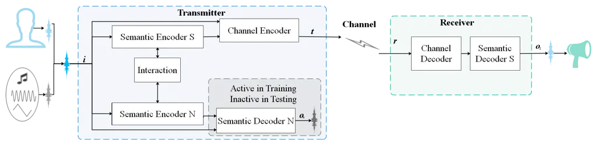
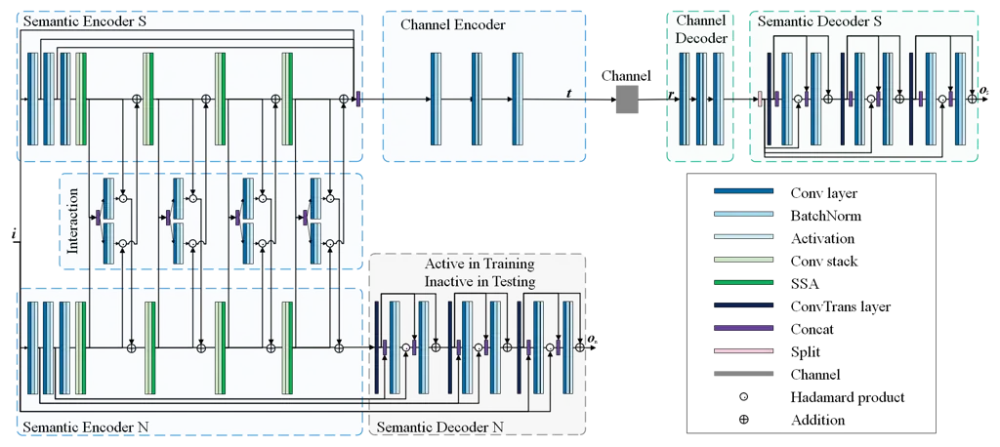
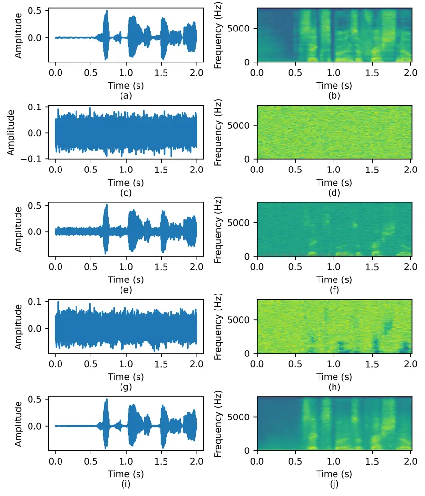
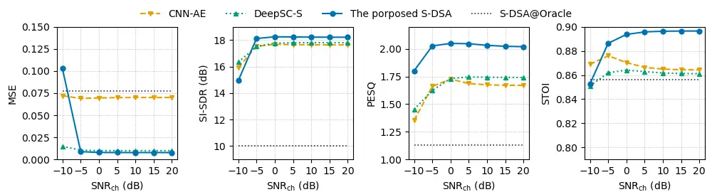
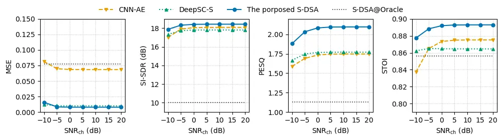
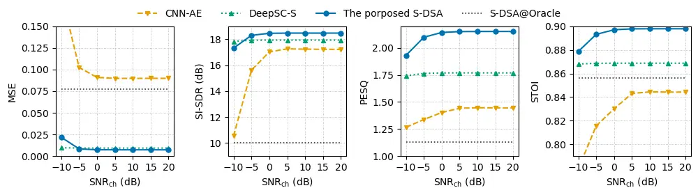
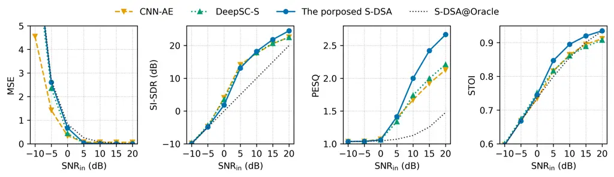
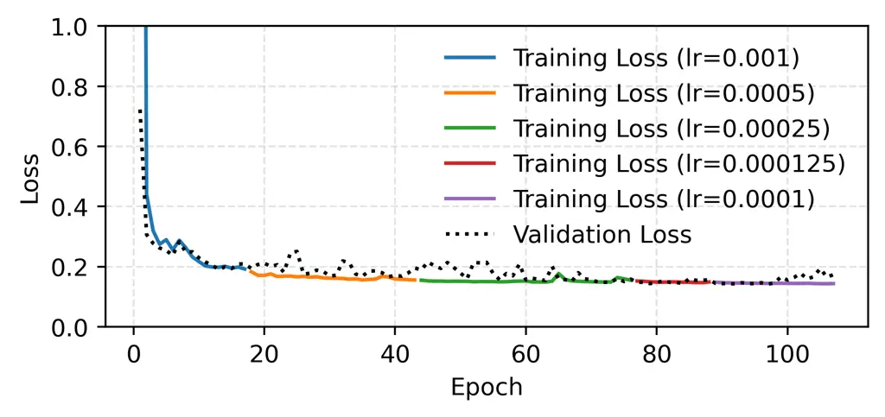
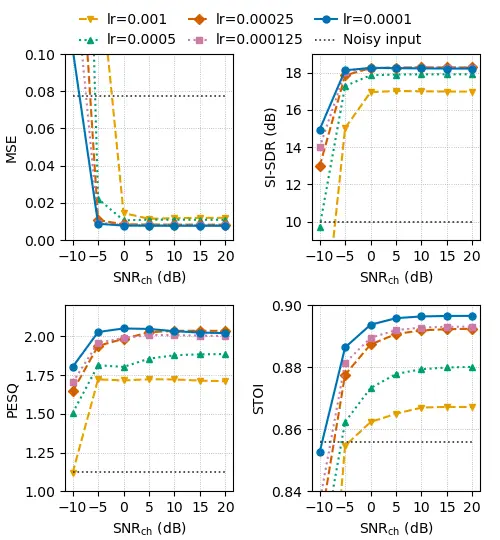

# Design of a Speech Enhancement-Based Deep Semantic Autoencoder for Wireless Communications

Xiaoling Han    Bin Lin\*    Nan Wu    Tony Q. S. Quek ^(†)^(†)thanks:
Manuscript received XXX; revised XXX; accepted XXX. Date of publication
XXX; date of current version XXX. ^(†)^(†)thanks: The work was supported
by the National Natural Science Foundation of China (No. 62371085) and
Fundamental Research Funds for the Central Universities (No.
3132023514). This paper is supported in part by the National Research
Foundation, Singapore and Infocomm Media Development Authority under its
Future Communications Research & Development Programme. This paper was
supported by the China Scholarship Council (CSC). (Corresponding author
Bin Lin.) ^(†)^(†)thanks: Xiaoling Han, Bin Lin and Nan Wu are with the
Department of Information Science and Technology of Dalian Maritime
University, Dalian, China, 116026 (email: xiaolinghan@dlmu.edu.cn,
binlin@dlmu.edu.cn, wu.nan@dlmu.edu.cn). Tony Q. S. Quek is with the
Information Systems Technology and Design Pillar, Singapore University
of Technology and Design, Singapore, 487372 (email:
tonyquek@sutd.edu.sg). ^(†)^(†)thanks: This manuscript has been accepted
by IEEE Transactions on Vehicular Technology, DOI:
10.1109/TVT.2026.3658080.

###### Abstract

Speech communication plays a crucial role in the Internet of Things and
autonomous networks. However, traditional communication systems suffer
from insufficient semantic extraction and limited noise suppression
capability. To address these issues, we propose a Speech
enhancement-based Deep Semantic Autoencoder (S-DSA) communication system
for wireless communications. It consists of a dual-branch semantic
encoder, a channel encoder, a channel decoder, and two semantic
decoders, enabling joint source–channel coding for robust transmission.
A key novelty lies in an adaptive semantic noise decoupling mechanism
that disentangles target speech semantics from noise representations
through an interaction module, thus maintaining semantic consistency
under low SNR conditions. Furthermore, a joint training strategy
optimizes speech reconstruction and noise estimation, while a
lightweight testing strategy reduces complexity by disabling the
noise-decoding path. The proposed S-DSA enables more effective
separation between speech and noise, and yields higher robustness as
well as better reconstruction quality. These findings highlight the
potential of the proposed S-DSA as a practical solution for
next-generation intelligent wireless communications.

###### Index Terms: 

Semantic communication, deep learning, joint optimization, speech
enhancement.

## I Introduction

In emerging technological paradigms such as the Internet of Things
(IoT), communication systems face increasingly stringent requirements
due to dynamic environments and heterogeneous service demands \[1, 2\].
In these scenarios, speech communication plays a particularly critical
role as a key enabler of intelligent coordination. In large-scale
networks, guaranteeing End-to-End (E2E) quality of service remains a
significant challenge \[3\]. However, traditional methodologies have
inherent limitations. Their waveform-centric design, grounded in
Shannon’s information theory, primarily ensures reliable syntactic
transmission, while their fixed signal processing frameworks lack
adaptability in noisy environments. Therefore, signal distortion and
semantic loss become severe in low-SNR scenarios \[4\]. These drawbacks
highlight the urgent need for new communication paradigms to improve
communication efficiency.

Recently, semantic communication, as an emerging paradigm, is promising
for 6G and beyond \[5\]. Many seminal studies have laid the theoretical
foundations for this transformation. Qin et al. \[6\] reviewed how
Artificial Intelligence (AI) and Deep Learning (DL) enable communication
systems to evolve from bits to semantics, highlighting semantic
communication frameworks and resource optimization. Additionally, Getu
et al. \[7\] surveyed the semantic communication landscape in the
context of 6G, introducing semantic information measures and use cases,
and outlining key challenges such as theoretical foundations and system
integration. Lu et al. \[8\] re-examined modern communication from
semantic coding to semantic transmission, providing theoretical insights
and technical directions. Wheeler and Natarajan \[9\] offered a
systematic survey on engineering aspects of semantic communication.
Gündüz et al. \[10\] discussed task-oriented communication that exploits
context and semantics to achieve communication goals. Together, these
works establish the foundations of semantic communication and inspire
its application across diverse modalities, including text, images,
speech, and so on.

Among these application scenarios, speech communication is critical
since it is the primary medium of human interaction and directly impacts
the quality of human–machine coordination. Numerous studies have
concentrated on the encoding and transmission in speech communication
scenarios. For example, Liu et al. \[11\] proposed a DL-based method
that improved the way of speech communication quality assessment. It
used large-scale invasive simulation data to improve the accuracy and
generalization of non-invasive speech quality assessment. Dong et al.
\[12\] proposed EDSep, a novel single-channel method based on fractional
matching of stochastic differential equations. It enhanced the
generative modeling of speech source separation by optimizing the
training and sampling efficiency. Nevertheless, diverse tasks under
noisy environments demand robust communication links, whereas
waveform-based speech methods often fail to preserve semantic content
\[13\].

Speech semantic communication has therefore attracted increasing
attention. Several pioneering works have demonstrated its potential. Qin
and Weng \[14\] designed the DeepSC-S, a semantic communication system.
Based on the attention mechanism and squeeze-and-excitation networks, it
improved the accuracy of speech signal recovery. Tan et al. \[15\]
proposed the emotional information-assisted semantic communication
framework EESC-S for speech transmission. It jointly extracted the
content semantics and emotional semantics of speech, improving the
speech transmission performance. Yang et al. \[16\] designed the
Deep-STS system for low-bandwidth speech communication. By extracting
the text information and timbre features in speech, it achieved
ultra-low bit rate communication. Zhou et al. \[17\] proposed the
DeepSC-TS, an E2E speech semantic communication system based on
transformer, which effectively eliminated semantic signal noise and
showed good performance in different channel environments. Chen et al.
\[18\] proposed a perception-motivated, low-complexity speech semantic
communication method. It improved the transmission efficiency and
ensured that the reconstructed speech is consistent with human auditory
perception.

Beyond speech transmission, many works have applied semantic
communication to other tasks. Han et al. \[19\] constructed a
semantic-oriented speech transmission system that transmitted
semantic-related information and reconstructed speech. Its E2E
transceiver effectively improved the accuracy of speech-to-text
transmission and the quality of speech reconstruction. Weng et al.
\[20\] proposed the SAC-ST system for Multiple-Input Multiple-Output
communication scenarios, which compresses semantic information and
ensures high-fidelity transmission. It also reduced the dependence on
channel state information through the channel estimation network,
showing significant advantages under low Signal-to-Noise Ratios (SNR).
Weng et al. \[21\] developed DeepSC-ST for low-bandwidth scenarios,
which integrates speech recognition and synthesis. This approach reduces
data transmission and outperforms traditional systems in dynamic
channels. These studies have advanced speech semantic communication in
terms of accuracy, expressiveness, bitrate reduction, and robustness.
Recent work \[22\] further illustrates the challenges of highly dynamic
environments, where environmental noise, i.e., non-speech background
interference with time-varying statistics, can severely degrade semantic
preservation. However, existing approaches generally lack mechanisms for
explicit semantic noise decoupling in noisy environments.

Based on the above analysis, we propose a Speech enhancement-based Deep
Semantic Autoencoder (S-DSA) communication system for wireless
communications. Leveraging DL, the proposed S-DSA adopts an E2E Joint
Source–Channel Coding (JSCC) framework to decouple semantics from noise
and jointly enhance, extract, and transmit speech semantic
representations. This design enables robust speech transmission in noisy
environments, improving resilience to interference and reconstruction
fidelity. The main contributions of this paper are as follows.

1.  1.  We propose a semantic communication system, named S-DSA. It is
        specifically designed for communication in noisy environments. It
        consists of a dual-branch semantic encoder, a channel encoder, a
        channel decoder, and two semantic decoders. By employing JSCC, the
        proposed S-DSA enables high-fidelity transmission of target speech
        features and restores the semantics.
2.  2.  We design an adaptive semantic noise decoupling mechanism. The
        dual-branch semantic encoder dynamically refines speech semantic
        features and noise statistical features to facilitate feature-level
        decoupling from the mixed signal. The proposed S-DSA can
        simultaneously extract the target speech and estimate the
        environmental noise.
3.  3.  We develop training and testing strategies. The training algorithm
        adopts an E2E joint optimization strategy to learn network
        parameters effectively. By using gradient descent, the weighted sum
        of the speech reconstruction loss and the noise estimation loss is
        minimized. The testing algorithm disables the noise decoding branch
        to form a lightweight inference path and reduce computational
        overhead. It evaluates the performance of speech enhancement and
        reconstruction under the simulation setting.
4.  4.  We conduct extensive simulation experiments. Results show that,
        compared with benchmarks, the proposed S-DSA operates effectively
        under different environmental noise conditions and transmission
        channels. It not only effectively separates target speech from
        environmental noise, but also supports the transmission and
        reconstruction of target speech with reduced interference. In
        addition, the architecture reduces computational overhead, providing
        a cost-effective solution for intelligent communication with limited
        resources.

The remainder of this paper is organized as follows. Section II
describes the problem and formulates the system model. Section III
develops the training and testing strategy. Section IV reports
experimental results across different settings. Section V concludes this
paper.



(a) Modular overview



(b) Detailed design

Fig. 1: Architecture of the proposed S-DSA.

## II System Model

This section describes the problem addressed, introduces the model
design rationale, formulates the model, and states the optimization
objective.

To decouple semantic noise and reliably transmit target speech, we
propose S-DSA, an end to end JSCC semantic system integrating speech
enhancement with semantic encoding and decoding. The transmitter adopts
a modular hierarchical design, including a dual-branch semantic encoder,
a semantic decoder N, and a channel encoder, enabling mixed speech
separation and efficient transmission of the target speech. The receiver
comprises a channel decoder and semantic decoder S, which reconstructs
the target speech. By employing JSCC, the proposed S-DSA enables
high-fidelity recovery of the target semantics. The overall architecture
is shown in Fig. 1. In particular, Fig. 1a presents the modular
architecture, whereas Fig. 1b depicts the detailed structural design.
The corresponding structural parameters are summarized in Tab. I.
Specifically, $`B`$, $`T`$, and $`F`$ denote the batch size, number of
frames, and number of frequency bins, respectively. $`C_{\rm in}`$ is
the input dimension, $`4D_{\rm s}`$ is the semantic feature dimension,
and $`D_{\rm c}`$ is the channel transmitted dimension.

We consider the input signal in the time domain, where the clean target
speech $`\bm{i}_{\rm s}`$ and the additive environmental noise
$`\bm{i}_{\rm n}`$ are combined to form the observed mixture. This
process can be expressed as

```math
\bm{i}=\bm{i}_{\rm s}+\bm{i}_{\rm n},\quad\bm{i}_{\rm s}\sim p(\bm{i}_{\rm s}),\;\bm{i}_{\rm n}\sim\mathcal{N}(0,\sigma_{n}^{2}), \tag{1}
```

where $`p(\bm{i}_{\rm s})`$ represents the prior distribution of
$`\bm{i}_{\rm s}`$, and $`\mathcal{N}(\bm{0},\sigma_{n}^{2}\bm{I})`$
denotes zero-mean Additive White Gaussian Noise (AWGN) with per-entry
variance $`\sigma_{n}^{2}`$. $`\bm{i}_{\rm s}`$ and $`\bm{i}_{\rm n}`$
are assumed to be independent. The time domain mixture $`\bm{i}`$ is
converted into the time frequency domain using the Short Time Fourier
Transform (STFT). The resulting complex spectrogram can be expressed as

```math
\bm{Y}=\mathcal{S}(\bm{i})\in\mathbb{R}^{B\times T\times F}, \tag{2}
```

where $`\mathcal{S}(\cdot)`$ denotes the mapping function of STFT. For
network input, we adopt a two channel representation using the real and
imaginary parts, which can be expressed as

```math
\bm{I}=\big[\Re(\bm{Y})\ \|\ \Im(\bm{Y})\big]\in\mathbb{R}^{B\times C_{\rm in}\times T\times F},\quad C_{\rm in}=2, \tag{3}
```

where $`\Re(\cdot)`$ and $`\Im(\cdot)`$ denote the real and imaginary
parts of $`\bm{Y}`$, respectively. Similarly, we define $`\bm{S}`$ and
$`\bm{N}`$ as the complex spectrograms of $`\bm{i}_{\rm s}`$ and
$`\bm{i}_{\rm n}`$, respectively.

|             |                                                                                                         |                                 |                                                    |
| ----------- | ------------------------------------------------------------------------------------------------------- | ------------------------------- | -------------------------------------------------- |
| End         | Layer Category                                                                                          | Layer Name                      | Output Dimension                                   |
| Transmitter | Dual-branch semantic encoder Only the semantic encoder S is shown; the semantic encoder N is identical. | Conv block (Semantic encoder S) | \[$`B`$, $`D_{\rm s}`$, $`T`$, $`F`$\]             |
|             |                                                                                                         | Conv block (Semantic encoder S) | \[$`B`$, $`2D_{\rm s}`$, $`T`$, $`F/2`$\]          |
|             |                                                                                                         | Conv block (Semantic encoder S) | \[$`B`$, $`4D_{\rm s}`$, $`T`$, $`F/4`$\]          |
|             |                                                                                                         | Conv stack (Semantic encoder S) | \[$`B`$, $`4D_{\rm s}`$, $`T`$, $`F/4`$\]          |
|             |                                                                                                         | Conv stack (Semantic encoder S) | \[$`B`$, $`T`$, $`F/4`$, $`4D_{\rm s}`$\]          |
|             |                                                                                                         | SSA (Semantic encoder S)        | \[$`B`$, $`T`$, $`F/4`$, $`4D_{\rm s}`$\]          |
|             |                                                                                                         | Interaction block 1             | \[$`B`$, $`4D_{\rm s}`$, $`T`$, $`F/4`$\]          |
|             |                                                                                                         | Conv stack (Semantic encoder S) | \[$`B`$, $`4D_{\rm s}`$, $`T`$, $`F/4`$\]          |
|             |                                                                                                         | Conv stack (Semantic encoder S) | \[$`B`$, $`T`$, $`F/4`$, $`4D_{\rm s}`$\]          |
|             |                                                                                                         | SSA (Semantic encoder S)        | \[$`B`$, $`T`$, $`F/4`$, $`4D_{\rm s}`$\]          |
|             |                                                                                                         | Interaction block 2             | \[$`B`$, $`4D_{\rm s}`$, $`T`$, $`F/4`$\]          |
|             |                                                                                                         | Conv stack (Semantic encoder S) | \[$`B`$, $`4D_{\rm s}`$, $`T`$, $`F/4`$\]          |
|             |                                                                                                         | Conv stack (Semantic encoder S) | \[$`B`$, $`T`$, $`F/4`$, $`4D_{\rm s}`$\]          |
|             |                                                                                                         | SSA (Semantic encoder S)        | \[$`B`$, $`T`$, $`F/4`$, $`4D_{\rm s}`$\]          |
|             |                                                                                                         | Interaction block 3             | \[$`B`$, $`4D_{\rm s}`$, $`T`$, $`F/4`$\]          |
|             |                                                                                                         | Conv stack (Semantic encoder S) | \[$`B`$, $`4D_{\rm s}`$, $`T`$, $`F/4`$\]          |
|             |                                                                                                         | Conv stack (Semantic encoder S) | \[$`B`$, $`T`$, $`F/4`$, $`4D_{\rm s}`$\]          |
|             |                                                                                                         | SSA (Semantic encoder S)        | \[$`B`$, $`T`$, $`F/4`$, $`4D_{\rm s}`$\]          |
|             |                                                                                                         | Interaction block 4             | \[$`B`$, $`4D_{\rm s}`$, $`T`$, $`F/4`$\]          |
|             | Semantic decoder N                                                                                      | ConvTrans layer                 | \[$`B`$, $`2D_{\rm s}`$, $`T`$, $`F/2`$\]          |
|             |                                                                                                         | Conv block                      | \[$`B`$, $`2D_{\rm s}`$, $`T`$, $`F/2`$\]          |
|             |                                                                                                         | Conv block                      | \[$`B`$, $`2D_{\rm s}`$, $`T`$, $`F/2`$\]          |
|             |                                                                                                         | ConvTrans layer                 | \[$`B`$, $`D_{\rm s}`$, $`T`$, $`F`$\]             |
|             |                                                                                                         | Conv block                      | \[$`B`$, $`D_{\rm s}`$, $`T`$, $`F`$\]             |
|             |                                                                                                         | Conv block                      | \[$`B`$, $`D_{\rm s}`$, $`T`$, $`F`$\]             |
|             |                                                                                                         | ConvTrans layer                 | \[$`B`$, $`C_{\rm in}`$, $`T`$, $`F`$\]            |
|             |                                                                                                         | Conv block                      | \[$`B`$, $`C_{\rm in}`$, $`T`$, $`F`$\]            |
|             |                                                                                                         | Conv block                      | \[$`B`$, $`C_{\rm in}`$, $`T`$, $`F`$\]            |
|             | Channel encoder                                                                                         | Conv block                      | \[$`B`$, $`4D_{\rm c}`$, $`T`$, $`F/4`$\]          |
|             |                                                                                                         | Conv block                      | \[$`B`$, $`2D_{\rm c}`$, $`T`$, $`F/4`$\]          |
|             |                                                                                                         | Conv block                      | \[$`B`$, $`D_{\rm c}`$, $`T`$, $`F/4`$\]           |
| Receiver    | Channel decoder                                                                                         | Conv block                      | \[$`B`$, $`2D_{\rm c}`$, $`T`$, $`F/4`$\]          |
|             |                                                                                                         | Conv block                      | \[$`B`$, $`4D_{\rm c}`$, $`T`$, $`F/4`$\]          |
|             |                                                                                                         | Conv block                      | \[$`B`$, $`7D_{\rm s}+C_{\rm in}`$, $`T`$, $`F`$\] |
|             | Semantic decoder S                                                                                      | ConvTrans layer                 | \[$`B`$, $`2D_{\rm s}`$, $`T`$, $`F/2`$\]          |
|             |                                                                                                         | Conv block                      | \[$`B`$, $`2D_{\rm s}`$, $`T`$, $`F/2`$\]          |
|             |                                                                                                         | Conv block                      | \[$`B`$, $`2D_{\rm s}`$, $`T`$, $`F/2`$\]          |
|             |                                                                                                         | ConvTrans layer                 | \[$`B`$, $`D_{\rm s}`$, $`T`$, $`F`$\]             |
|             |                                                                                                         | Conv block                      | \[$`B`$, $`D_{\rm s}`$, $`T`$, $`F`$\]             |
|             |                                                                                                         | Conv block                      | \[$`B`$, $`D_{\rm s}`$, $`T`$, $`F`$\]             |
|             |                                                                                                         | ConvTrans layer                 | \[$`B`$, $`C_{\rm in}`$, $`T`$, $`F`$\]            |
|             |                                                                                                         | Conv block                      | \[$`B`$, $`C_{\rm in}`$, $`T`$, $`F`$\]            |
|             |                                                                                                         | Conv block                      | \[$`B`$, $`C_{\rm in}`$, $`T`$, $`F`$\]            |

TABLE I: Architectural parameters of the proposed S-DSA.

### II-A Dual-branch semantic encoder

The dual-branch semantic encoder is designed to promote orthogonality
between speech and noise features via an adaptive semantic noise
decoupling mechanism. This mechanism explicitly models the distinct
characteristics of speech and noise, encouraging their separation in the
feature space. It comprises semantic encoder S, semantic encoder N, and
the interaction module. Each semantic encoder contains three
convolutional (Conv) blocks followed by a stack of four
Residual–Attention (RA) blocks. The interaction module consists of four
interaction blocks, which is a coequal component that is invoked after
each RA block.

The two semantic encoders operate in parallel. Semantic encoder S
extracts and encodes target speech semantics, while semantic encoder N
estimates and encodes environmental noise statistics. Each Conv block
consists of a Conv layer, batch normalization (BatchNorm), and a ReLU
activation. Given the input $`\bm{I}`$, after processing through three
Conv blocks in each branch, the feature maps can be expressed as

```math
\displaystyle\bm{I}^{\rm c1}_{\rm s} \displaystyle=\mathcal{E}^{\rm{s1}}_{\rm{en}}(\bm{I}), \displaystyle\bm{I}^{\rm c2}_{\rm s} \displaystyle=\mathcal{E}^{\rm{s2}}_{\rm{en}}(\bm{I}^{\rm c1}_{\rm s}), \displaystyle\bm{I}^{\rm c3}_{\rm s} \displaystyle=\mathcal{E}^{\rm{s3}}_{\rm{en}}(\bm{I}^{\rm c2}_{\rm s}), \tag{4}
```

```math
\displaystyle\bm{I}^{\rm c1}_{\rm n} \displaystyle=\mathcal{E}^{\rm{n1}}_{\rm{en}}(\bm{I}), \displaystyle\bm{I}^{\rm c2}_{\rm n} \displaystyle=\mathcal{E}^{\rm{n2}}_{\rm{en}}(\bm{I}^{\rm c1}_{\rm n}), \displaystyle\bm{I}^{\rm c3}_{\rm n} \displaystyle=\mathcal{E}^{\rm{n3}}_{\rm{en}}(\bm{I}^{\rm c2}_{\rm n}), \tag{5}
```

where $`\mathcal{E}^{(\cdot j)}_{\rm{en}}`$ denotes the mapping function
of $`j`$-th Conv block,
$`\bm{I}^{\rm c1}_{\rm s},\bm{I}^{\rm c1}_{\rm n}\in\mathbb{R}^{B\times D_{\rm s}\times T\times F}`$,
$`\bm{I}^{\rm c2}_{\rm s},\bm{I}^{\rm c2}_{\rm n}\in\mathbb{R}^{B\times 2D_{\rm s}\times T\times(F/2)}`$,
and
$`\bm{I}^{\rm c3}_{\rm s},\bm{I}^{\rm c3}_{\rm n}\in\mathbb{R}^{B\times 4D_{\rm s}\times T\times(F/4)}`$.

Each RA block consists of two residual Conv stacks and one Separable
Self-Attention (SSA). Starting from $`\bm{I}^{\rm c3}_{\rm s}`$ and
$`\bm{I}^{\rm c3}_{\rm n}`$, each branch applies four RA blocks. For
stage $`k\!=\!1,\dots,4`$, the output of the RA can be expressed as

```math
\displaystyle\bm{I}^{{\rm r}k}_{\rm s}=\mathrm{RA}^{k}_{\rm s}\!\big(\hat{\bm{I}}^{{\rm r}(k-1)}_{\rm s}\big),\qquad\bm{I}^{{\rm r}k}_{\rm n}=\mathrm{RA}^{k}_{\rm n}\!\big(\hat{\bm{I}}^{{\rm r}(k-1)}_{\rm n}\big), \tag{6}
```

with initialization
$`\hat{\bm{I}}^{{\rm r}0}_{\rm s}=\bm{I}^{\rm c3}_{\rm s}`$ and
$`\hat{\bm{I}}^{{\rm r}0}_{\rm n}=\bm{I}^{\rm c3}_{\rm n}`$. Within each
RA block, two residual Conv stacks are applied in sequence. Every Conv
stack consists of Conv layer, BatchNorm, ReLU, Conv layer, BatchNorm.
After processing through two Conv stacks in each branch, the output can
be expressed as

```math
\displaystyle\bm{I}^{{\rm r}k,\,{\rm res}1}_{\rm s} \displaystyle=\mathcal{R}^{\rm s}_{k,1}\!\big(\hat{\bm{I}}^{{\rm r}(k-1)}_{\rm s}\big), \displaystyle\bm{I}^{{\rm r}k,\,{\rm res}2}_{\rm s} \displaystyle=\mathcal{R}^{\rm s}_{k,2}\!\big(\bm{I}^{{\rm r}k,\,{\rm res}1}_{\rm s}\big), \tag{7}
```

```math
\displaystyle\bm{I}^{{\rm r}k,\,{\rm res}1}_{\rm n} \displaystyle=\mathcal{R}^{\rm n}_{k,1}\!\big(\hat{\bm{I}}^{{\rm r}(k-1)}_{\rm n}\big), \displaystyle\bm{I}^{{\rm r}k,\,{\rm res}2}_{\rm n} \displaystyle=\mathcal{R}^{\rm n}_{k,2}\!\big(\bm{I}^{{\rm r}k,\,{\rm res}1}_{\rm n}\big), \tag{8}
```

where
$`\bm{I}^{{\rm r}k,\,{\rm res}1}_{\rm s},\bm{I}^{{\rm r}k,\,{\rm res}2}_{\rm s},\bm{I}^{{\rm r}k,\,{\rm res}1}_{\rm n},\bm{I}^{{\rm r}k,\,{\rm res}2}_{\rm n}\in\mathbb{R}^{B\times 4D_{\rm s}\times T\times(F/4)}`$.
The residual outputs in channel-last can be expressed as

```math
\displaystyle\bm{F}^{(k)}_{{\rm res},\,{\rm s}}\triangleq \displaystyle\bm{I}^{{\rm r}k,{\rm res}2}_{\rm s}\in\mathbb{R}^{B\times T\times(F/4)\times 4D_{\rm s}},\qquad \tag{9}
```

```math
\displaystyle\bm{F}^{(k)}_{{\rm res},\,{\rm n}}\triangleq \displaystyle\bm{I}^{{\rm r}k,{\rm res}2}_{\rm n}\in\mathbb{R}^{B\times T\times(F/4)\times 4D_{\rm s}}. \tag{10}
```

Then, SSA models long-range dependencies along time and frequency. First
compress channels by $`\psi(\cdot)`$ from $`4D_{\rm s}`$ to
$`D_{\rm s}`$ and build temporal self-attention, which can be expressed
as

```math
\displaystyle\bm{Z}^{(k)}_{\rm s} \displaystyle=\psi\!\big(\bm{F}^{(k)}_{{\rm res},\,{\rm s}}\big)\in\mathbb{R}^{B\times T\times(F/4)\times D_{\rm s}}, \tag{11}
```

```math
\displaystyle\bm{Z}^{(k)}_{{\rm s},t} \displaystyle\in\mathbb{R}^{B\times T\times d_{t}},\quad d_{t}=D_{\rm s}\cdot(F/4), \tag{12}
```

```math
\displaystyle\bm{A}^{(k)}_{{\rm s},t} \displaystyle=\mathrm{softmax}\!\Big(\frac{\bm{Z}^{(k)}_{{\rm s},t}\,\bm{Z}^{(k)\top}_{{\rm s},t}}{\sqrt{d_{t}}}\Big)\in\mathbb{R}^{B\times T\times T}, \tag{13}
```

```math
\displaystyle\bm{F}^{(k)}_{{\rm temp},\,{\rm s}} \displaystyle=\bm{F}^{(k)}_{{\rm res},\,{\rm s}}+\varphi\!\big(\mathrm{unflatten}_{t}(\bm{A}^{(k)}_{{\rm s},t}\bm{Z}^{(k)}_{{\rm s},t})\big), \tag{14}
```

where $`\varphi(\cdot)`$ restores the channel dimension from
$`D_{\rm s}`$ back to $`4D_{\rm s}`$. Similarly, build spectral
self-attention by reshaping along $`T`$, which can be expressed as

```math
\displaystyle\bm{Z}^{(k)}_{{\rm s},f} \displaystyle\in\mathbb{R}^{B\times(F/4)\times d_{f}},\quad d_{f}=D_{\rm s}T, \tag{15}
```

```math
\displaystyle\bm{A}^{(k)}_{{\rm s},f} \displaystyle=\mathrm{softmax}\!\Big(\frac{\bm{Z}^{(k)}_{{\rm s},f}\,\bm{Z}^{(k)\top}_{{\rm s},f}}{\sqrt{d_{f}}}\Big)\in\mathbb{R}^{B\times(F/4)\times(F/4)}, \tag{16}
```

```math
\displaystyle\bm{F}^{(k)}_{{\rm freq},\,{\rm s}} \displaystyle=\bm{F}^{(k)}_{{\rm res},\,{\rm s}}+\varphi\!\big(\mathrm{unflatten}_{f}(\bm{A}^{(k)}_{{\rm s},f}\bm{Z}^{(k)}_{{\rm s},f})\big). \tag{17}
```

The residual, temporal, and frequency streams are concatenated and
projected by a $`1{\times}1`$ head to obtain the RA output, which can be
expressed as

```math
\displaystyle\bm{F}^{(k)}_{{\rm cat},\,{\rm s}} \displaystyle=\big[\bm{F}^{(k)}_{{\rm res},\,{\rm s}}\ \|\ \bm{F}^{(k)}_{{\rm temp},\,{\rm s}}\ \|\ \bm{F}^{(k)}_{{\rm freq},\,{\rm s}}\big]\in\mathbb{R}^{B\times T\times(F/4)\times 3\cdot 4D_{\rm s}}, \tag{18}
```

```math
\displaystyle\bm{I}^{\rm rk}_{\rm s} \displaystyle=\omega^{(k)}_{\rm s}\!\big(\bm{F}^{(k)}_{{\rm cat},\,{\rm s}}\big)\in\mathbb{R}^{B\times T\times(F/4)\times 4D_{\rm s}}, \tag{19}
```

where $`\omega^{(k)}_{\rm s/n}(\cdot)`$ is a $`1{\times}1`$ fusion
projection restoring the channel dimension to $`4D_{\rm s}`$. For the
noise branch, the operations are analogous,
$`\bm{I}^{{\rm r}k}_{\rm n}\in\mathbb{R}^{B\times T\times(F/4)\times 4D_{\rm s}}`$.

The interaction module performs cross-gated message passing between the
speech and noise branches. A joint context is formed by concatenating
the post-RA features, and two independent Conv projections produce
element-wise gates that modulate cross-branch messages. Given the
features
$`\bm{I}^{{\rm r}k}_{\rm s},\bm{I}^{{\rm r}k}_{\rm n}\in\mathbb{R}^{B\times T\times(F/4)\times 4D_{\rm s}}`$
for the speech and noise branches, respectively, first form a joint
context by channel-wise concatenation, which can be expressed as

```math
\bm{U}^{(k)}=\big[\bm{I}^{{\rm r}k}_{\rm n}\ \|\ \bm{I}^{{\rm r}k}_{\rm s}\big]\in\mathbb{R}^{B\times T\times(F/4)\times 2\cdot 4D_{\rm s}}. \tag{20}
```

Two independent projections generate the element-wise gates, which can
be expressed as

```math
\bm{E}_{n\rightarrow s}^{(k)}=\sigma\!\big(g_{n\rightarrow s}^{(k)}(\bm{U}^{(k)})\big),\qquad\bm{E}_{s\rightarrow n}^{(k)}=\sigma\!\big(g_{s\rightarrow n}^{(k)}(\bm{U}^{(k)})\big), \tag{21}
```

where $`g_{\cdot}^{(k)}`$ are projections with output channels
$`4D_{\rm s}`$ and $`\sigma(\cdot)`$ denotes the activation. The gates
modulate cross-branch messages as

```math
\bm{H}_{n\rightarrow s}^{(k)}=\bm{I}^{{\rm r}k}_{\rm n}\odot\bm{E}_{n\rightarrow s}^{(k)},\qquad\bm{H}_{s\rightarrow n}^{(k)}=\bm{I}^{{\rm r}k}_{\rm s}\odot\bm{E}_{s\rightarrow n}^{(k)}, \tag{22}
```

with $`\odot`$ the Hadamard product. Residual cross-updates then yield
the post-interaction features, which can be expressed as

```math
\hat{\bm{I}}^{{\rm r}(k+1)}_{\rm s}=\bm{I}^{{\rm r}k}_{\rm s}+\bm{H}_{n\rightarrow s}^{(k)},\qquad\hat{\bm{I}}^{{\rm r}(k+1)}_{\rm n}=\bm{I}^{{\rm r}k}_{\rm n}+\bm{H}_{s\rightarrow n}^{(k)}, \tag{23}
```

where
$`\hat{\bm{I}}^{{\rm r}(k+1)}_{\rm s},\hat{\bm{I}}^{{\rm r}(k+1)}_{\rm n}\in\mathbb{R}^{B\times T\times(F/4)\times 4D_{\rm s}}`$.
The interaction module outputs in channel-first can be expressed as

```math
\displaystyle\hat{\bm{I}}^{{\rm r}(k+1)}_{\rm s}\triangleq \displaystyle\hat{\bm{I}}^{{\rm r}(k+1)}_{\rm s},
```

```math
\displaystyle\hat{\bm{I}}^{{\rm r}(k+1)}_{\rm n}\triangleq \displaystyle\hat{\bm{I}}^{{\rm r}(k+1)}_{\rm n}\in\mathbb{R}^{B\times 4D_{\rm s}\times T\times(F/4)}. \tag{24}
```

Distinct parameter sets $`g_{n\rightarrow s}^{(k)}`$ and
$`g_{s\rightarrow n}^{(k)}`$ are used at every stage.

Collecting the above, the dual-branch semantic encoder realizes the
mapping

```math
(\bm{s}_{\rm s},\,\bm{s}_{\rm n})\;=\;f_{\rm dual}\!\big(\bm{I}\;;\,\bm{\epsilon}_{\rm dual}\big), \tag{25}
```

where $`f_{\rm{dual}}(\cdot)`$, $`\bm{\epsilon}_{\rm{dual}}`$ represent
the mapping function and parameters of the dual-branch semantic encoder,
respectively. For reference, the semantic vectors
$`\bm{s}_{\rm s}=\hat{\bm{I}}^{{\rm r}4}_{\rm s}`$,
$`\bm{s}_{\rm n}=\hat{\bm{I}}^{{\rm r}4}_{\rm n}`$.

The decoupling mechanism drives the two branches to learn complementary,
branch-specific embeddings, placing speech and noise in distinct
subspaces of the semantic space and thereby achieving feature
separation. Concretely, we encourage the learned speech and noise
representations to be orthogonal, which can be expressed as

```math
\displaystyle\big\langle\,\widetilde{\bm{s}}_{\rm s}\,,\,\widetilde{\bm{s}}_{\rm n}\,\big\rangle\;\approx\;0, \tag{26}
```

where $`\widetilde{(\cdot)}`$ denotes per-channel normalization and
$`\langle\cdot,\cdot\rangle`$ is the Frobenius inner product over the
spatiotemporal dimensions.

### II-B Semantic Decoder N

Semantic decoder N is used during training to provide noise
reconstruction supervision and mixture consistency. It is pruned at
inference. The core task of the semantic decoder N is to model and
analyze the features of environmental noise. It is composed of a
transposed convolutional (ConvTrans) layer and conv blocks. This
structure can effectively utilize the respective characteristics to
achieve the accurate restoration of the environmental noise. It
accurately maps the noise statistical features $`\bm{s}_{\rm{n}}`$ to
the estimated noise $`\bm{o}_{\rm{n}}`$.

We initialize the inputs as

```math
\displaystyle\bm{h}^{0}_{\rm n} \displaystyle\triangleq\bm{s}_{\rm n}\in\mathbb{R}^{B\times 4D_{\rm s}\times T\times(F/4)}.
```

```math
\displaystyle\bm{d}^{j}_{\rm n} \displaystyle=\begin{cases}\bm{I}^{\rm c2^{\prime}}_{\rm n}\triangleq\bm{I}^{\rm c2}_{\rm n}\in\mathbb{R}^{B\times 2D_{\rm s}\times T\times(F/2)},&j=1,\\[2.0pt]
\bm{I}^{\rm c1^{\prime}}_{\rm n}\triangleq\bm{I}^{\rm c1}_{\rm n}\in\mathbb{R}^{B\times D_{\rm s}\times T\times F},&j=2,\\[2.0pt]
\bm{I}^{\prime}\triangleq\pi(\bm{I})\in\mathbb{R}^{B\times C_{\rm in}\times T\times F},&j=3,\end{cases} \tag{27}
```

where $`\pi(\cdot)`$ denotes a fixed rearrangement that aligns
$`\bm{I}`$ to the decoder’s channel-first layout. For the stage-wise
update, at each decoding stage $`j\in\{1,2,3\}`$, the decoder upsamples
along the frequency axis and performs gated skip fusion with
$`\bm{d}^{j}_{\rm n}`$. The features can be expressed as

```math
\displaystyle\tilde{\bm{h}}^{j}_{\rm n} \displaystyle=\mathcal{U}^{j}\!\big(\bm{h}^{(j-1)}_{\rm n}\big), \tag{28}
```

```math
\displaystyle\bm{g}^{j}_{\rm n} \displaystyle=\sigma\Big(\mathcal{E}^{\rm nj}_{\rm de}\big([\tilde{\bm{h}}^{j}_{\rm n}\ \|\ \bm{d}^{j}_{\rm n}];\,\bm{\theta}^{j}_{\rm gate}\big)\Big), \tag{29}
```

```math
\displaystyle\bm{m}^{j}_{\rm n} \displaystyle=\bm{d}^{j}_{\rm n}\odot\bm{g}^{j}_{\rm n}, \tag{30}
```

```math
\displaystyle\bm{h}^{j}_{\rm n} \displaystyle=\mathcal{E}^{\rm nj}_{\rm de}\big([\bm{m}^{j}_{\rm n}\ \|\ \tilde{\bm{h}}^{j}_{\rm n}];\,\bm{\theta}^{j}_{\rm fuse}\big)\;+\;\tilde{\bm{h}}^{j}_{\rm n}, \tag{31}
```

where $`\mathcal{U}^{1}\!:\ (F/4)\!\mapsto\!(F/2)`$,
$`\mathcal{U}^{2}\!:\ (F/2)\!\mapsto\!F`$, and $`\mathcal{U}^{3}`$ keeps
$`F`$ unchanged. $`[\cdot\|\cdot]`$ denotes channel-wise concatenation.
$`\mathcal{E}^{\rm nj}_{\rm de}(\cdot;\bm{\theta})`$ is the mapping
function of a Conv block. Parameter sets $`\bm{\theta}^{j}_{\rm gate}`$
and $`\bm{\theta}^{j}_{\rm fuse}`$ are used for gate generation and
fusion, respectively.

The semantic decoder N outputs the complex ratio mask
$`\bm{M}_{\rm n}`$, which can be expressed as

```math
\bm{M}_{\rm n}=\bm{h}^{3}_{\rm n}=f^{\rm n}_{\rm sde}\!\big(\bm{s}_{\rm n},\,\bm{I}^{\rm c2}_{\rm n},\,\bm{I}^{\rm c1}_{\rm n},\,\bm{I}\;;\,\bm{\kappa}_{\rm n}\big), \tag{32}
```

where $`f^{\rm n}_{\rm sde}(\cdot)`$ and $`\bm{\kappa}_{\rm n}`$ denote
the mapping function and parameters of the semantic decoder N.
$`\bm{M}_{\rm n}`$ is applied to the mixture spectrum to recover the
estimated noise spectrum. This process can be expressed as

```math
\widehat{\bm{N}}=\bm{M}_{\rm n}\odot\bm{I}. \tag{33}
```

The corresponding time domain noise signal is then obtained by the
Inverse STFT (ISTFT), which can be expressed as

```math
\bm{o}_{\rm n}=\mathcal{S}^{-1}(\widehat{\bm{N}}), \tag{34}
```

where $`\mathcal{S}^{-1}(\cdot)`$ denotes the mapping function of ISTFT.

### II-C Channel Encoder

The semantic vectors $`\bm{s}_{\rm s}`$ are fed to the channel encoder.
The channel encoder greatly enhances the ability of the signal to resist
various interferences during the transmission process. According to the
characteristics of channels, it converts $`\bm{s}_{\rm{s}}`$ to a
power-constrained transmit signal $`t`$.

Before channel encoding, all tensors are first unified to the target
frequency resolution $`F`$, which can be expressed as

```math
\bar{\bm{s}}_{\rm s}=\mathrm{pad}_{F}(\bm{s}_{\rm s}),\quad\bar{\bm{I}}^{\rm c2}_{\rm s}=\mathrm{pad}_{F}(\bm{I}^{\rm c2}_{\rm s}),\quad\bar{\bm{I}}^{\rm c1}_{\rm s}=\bm{I}^{\rm c1}_{\rm s},\quad\bar{\bm{I}}=\bm{I},
```

where $`\mathrm{pad}_{F}(\cdot)`$ denotes zero-padding along the
frequency dimension. The resulting channel-first input to the channel
encoder is
$`\bm{h}^{0}_{\rm c}\;\triangleq\;\big[\;\bar{\bm{s}}_{\rm s}\ \|\ \bar{\bm{I}}^{\rm c2}_{\rm s}\ \|\ \bar{\bm{I}}^{\rm c1}_{\rm s}\ \|\ \bar{\bm{I}}\;\big]\ \in\ \mathbb{R}^{B\times(7D_{\rm s}+C_{\rm in})\times T\times F}`$.
Then, the channel encoder takes a channel-first tensor
$`\bm{h}^{0}_{\rm c}`$ and maps it to the transmit representation
through three Conv blocks. The features can be expressed as

```math
\bm{h}^{j}_{\rm c}\;=\;\mathcal{B}^{\rm cen}_{j}\!\big(\bm{h}^{(j-1)}_{\rm c};\,\bm{\zeta}^{j}\big),\quad j=1,2,3, \tag{35}
```

where $`\mathcal{B}^{\rm cen}_{j}(\cdot)`$ denotes the $`j`$-th Conv
block and $`\bm{\zeta}^{j}`$ its parameters. The transmit signal $`t`$
can be expressed as

```math
\bm{t}\;=\;\bm{h}^{3}_{\rm c}\;=\;f_{\rm cen}\!\big(\bm{h}^{0}_{\rm c};\,\bm{\zeta}\big),\qquad\bm{\zeta}\triangleq\{\bm{\zeta}^{j}\}_{j=1}^{3}, \tag{36}
```

where $`f_{\rm{cen}}(\cdot)`$, $`\bm{\zeta}`$ represent the mapping
function and parameters of the channel encoder. Power normalization
enforces the transmit constraint, which can be expressed as

```math
\bm{t}\ \leftarrow\ \sqrt{P}\;\frac{\bm{t}}{\sqrt{\mathbb{E}\!\left[\|\bm{t}\|_{2}^{2}\right]}}\quad\text{so that}\quad\mathbb{E}\!\left[\|\bm{t}\|_{2}^{2}\right]\leq P, \tag{37}
```

where $`P`$ denotes the target average transmit power budget, the
expectation $`\mathbb{E}[\cdot]`$ is taken over the training
distribution, and $`\|\cdot\|_{2}`$ is the Euclidean norm.

The transmit signal $`\bm{t}`$ is vectorized and sent over the channel.
Channel effects are a key external factor determining E2E quality. We
model the link as a flat-fading channel acting on the vectorized
baseband signal. The received signal $`r`$ can be expressed as

```math
\bm{r}\;=\;h\,\bm{t}+\bm{n},\qquad h\sim\mathcal{CN}(0,1),\ \ \bm{n}\sim\mathcal{CN}(\bm{0},\,\sigma^{2}\bm{I}), \tag{38}
```

where $`h`$ is the channel fading coefficient, which reflects the
attenuation effect of the channel on the signal strength. $`\bm{n}`$ is
the additive noise, which includes various random noise interferences.
These factors work together, causing a difference between the received
signal $`r`$ and the transmission signal $`t`$.

### II-D Channel Decoder

The channel decoder adjusts the decoding strategy according to the
characteristics of the received signal. It effectively suppresses
channel noise interference to semantic features. Moreover, it maps
$`\bm{r}`$ to the target speech semantic representation
$`\bm{x}_{\rm s}`$, which is as close as possible to the original target
speech semantic vectors and supports speech reconstruction.

It mirrors the channel encoder with three Conv blocks, thereby
preserving $`T`$ and $`F`$ while progressively refining the received
representation. Let the received code be
$`\bm{h}^{0}_{\rm d}\triangleq\bm{r}`$. The updates are

```math
\bm{h}^{j}_{\rm d}\;=\;\mathcal{B}^{\rm cde}_{j}\!\big(\bm{h}^{(j-1)}_{\rm d};\,\bm{\eta}^{j}\big),\quad j=1,2,3, \tag{39}
```

where $`\mathcal{B}^{\rm cde}_{j}(\cdot)`$ denotes the $`j`$-th decoder
Conv block with parameters $`\bm{\eta}^{j}`$. The decoded semantic
features are

```math
\bm{x}_{\rm s}\;=\;\bm{h}^{3}_{\rm d}\;=\;f_{\rm cde}\!\big(\bm{r};\,\bm{\eta}\big),\qquad\bm{\eta}\triangleq\{\bm{\eta}^{j}\}_{j=1}^{3}. \tag{40}
```

where $`f_{\rm{cde}}(\cdot)`$, $`\bm{\eta}`$ represent the mapping
function and parameters of the channel decoder.

### II-E Semantic Decoder S

The main responsibility of the semantic decoder S is to reconstruct the
semantic features $`\bm{x}_{\rm{s}}`$ with high fidelity to restore a
high-quality target speech. The semantic decoder S adopts the same
structure as the semantic decoder N and fully excavates the key
information in $`\bm{x}_{\rm{s}}`$. It converts the semantic features
$`\bm{x}_{\rm{s}}`$ into the reconstructed speech $`\bm{o}_{\rm{s}}`$
with high semantic integrity and naturalness.

We take the output of the channel decoder and split it along channels as
$`\bm{x}_{\rm s}=\big[\;\bar{\bm{s^{\prime}}}_{\rm s}\ \|\ \bar{\bm{I}}_{\rm s}^{\rm c2^{\prime}}\ \|\ \bar{\bm{I}}_{\rm s}^{\rm c1^{\prime}}\ \|\ \bar{\bm{I}^{\prime}}\;\big]`$,
where $`\bar{\cdot}`$ indicates the segments extracted from
$`\bm{x}_{\rm s}`$. We then undo the earlier zero-padding by cropping
along the frequency axis to recover the original resolutions, which can
be expressed as

```math
\displaystyle\bm{h}^{0}_{\rm s} \displaystyle\triangleq\bar{\bm{s^{\prime}}}_{\rm s}\in\mathbb{R}^{B\times 4D_{\rm s}\times T\times(F/4)}.
```

```math
\displaystyle\bm{d}^{j}_{\rm s} \displaystyle=\begin{cases}\bm{I}^{\rm c2^{\prime\prime}}_{\rm s}\triangleq\bar{\bm{I}}^{\rm c2^{\prime}}_{\rm s}\in\mathbb{R}^{B\times 2D_{\rm s}\times T\times(F/2)},&j=1,\\[2.0pt]
\bm{I}^{\rm c1^{\prime\prime}}_{\rm s}\triangleq\bar{\bm{I}}^{\rm c1^{\prime}}_{\rm s}\in\mathbb{R}^{B\times D_{\rm s}\times T\times F},&j=2,\\[2.0pt]
\bm{I}^{\prime\prime}\triangleq\pi(\bar{\bm{I^{\prime}}})\in\mathbb{R}^{B\times C_{\rm in}\times T\times F},&j=3.\end{cases} \tag{41}
```

Then, semantic decoder S follows the same three stage updates as
semantic decoder N, replacing the subscript $`{\rm n}`$ to $`{\rm s}`$,
using the same upsamplers $`\mathcal{U}^{j}`$ and gated skip-fusion
blocks $`\mathcal{E}^{\rm s\,j}_{\rm de}(\cdot)`$ for $`j=1,2,3`$. The
semantic decoder S outputs the complex ratio mask $`\bm{M}_{\rm s}`$,
which can be expressed as

```math
\bm{M}_{\rm s}=\bm{h}^{3}_{\rm s}=f^{\rm s}_{\rm sde}\!\big(\bar{\bm{s^{\prime}}}_{\rm s},\,\bar{\bm{I}}^{\rm c2^{\prime}}_{\rm s},\,\bar{\bm{I}}^{\rm c1^{\prime}}_{\rm s},\,\bar{\bm{I}^{\prime}}\;;\,\bm{\kappa}_{\rm s}\big), \tag{42}
```

where $`f^{\rm s}_{\rm sde}(\cdot)`$ and $`\bm{\kappa}_{\rm s}`$
represent the mapping function and parameters of the semantic decoder S,
respectively. $`\bm{M}_{\rm s}`$ is applied to the mixture spectrum to
obtain the estimated target speech spectrum

```math
\widehat{\bm{S}}=\bm{M}_{\rm s}\odot\bar{\bm{I}^{\prime}}. \tag{43}
```

The reconstructed target speech waveform is then obtained by the ISTFT,
which can be expressed as

```math
\bm{o}_{\rm s}=\mathcal{S}^{-1}(\widehat{\bm{S}}). \tag{44}
```

### II-F Loss Function

Guided by semantic information theory, the proposed S-DSA aims to
preserve the semantics of the target speech while suppressing noise
leakage in the learned representations. The ideal optimization objective
is

```math
\displaystyle\max\  \displaystyle I(\bm{s}_{\rm s};\bm{i}_{\rm s})-\beta\,I(\bm{s}_{\rm s};\bm{i}_{\rm n}) \tag{45}
```

```math
\displaystyle\mathbb{E}\!\big[\|\bm{t}\|_{2}^{2}\big]\leq P,
```

```math
\displaystyle I(\bm{s}_{\rm s};\bm{s}_{\rm n})\approx 0,
```

where $`I(\cdot\,;\cdot)`$ denotes mutual information, $`\bm{t}`$ is the
transmit signal with power budget $`P`$, and $`\beta\!\geq\!0`$ balances
semantic preservation and noise suppression.

Since direct optimization of (45) is intractable, we approximate it with
a weighted multi-term loss that enforces semantic fidelity, noise
decoupling, and perceptual quality. The overall training loss is

```math
L_{\rm total}=\alpha_{1}L_{\rm s}+\alpha_{2}L_{\rm n}+\alpha_{3}L_{\rm mix}+\alpha_{4}L_{\rm time}+\alpha_{5}L_{\rm mr}, \tag{46}
```

where $`\alpha_{1},\dots,\alpha_{5}`$ are non-negative coefficients. The
five loss components promote accurate semantic reconstruction, effective
noise suppression, mixture consistency, waveform fidelity, and
perceptual quality.

From a representation perspective, $`L_{\rm s}`$, $`L_{\rm n}`$, and
$`L_{\rm mix}`$ operate on the frequency domain to supervise target
speech reconstruction, noise estimation, and mixture consistency on
spectrograms. Specifically, the speech reconstruction loss $`L_{\rm s}`$
minimizes the discrepancy between the estimated and clean speech spectra

```math
L_{\rm s}=\mathbb{E}\!\left[\|\widehat{\bm{S}}-\bm{S}\|_{2}^{2}\right]. \tag{47}
```

The noise estimation loss $`L_{\rm n}`$ supervises the noise branch to
recover the noise spectrum accurately

```math
L_{\rm n}=\mathbb{E}\!\left[\|\widehat{\bm{N}}-\bm{N}\|_{2}^{2}\right]. \tag{48}
```

The mixture consistency loss $`L_{\rm mix}`$ encourages the
reconstructed speech and noise to sum to the observed mixture

```math
L_{\rm mix}=\mathbb{E}\!\left[\|\widehat{\bm{S}}+\widehat{\bm{N}}-\bm{Y}\|_{2}^{2}\right]. \tag{49}
```

In contrast, $`L_{\rm time}`$ and $`L_{\rm mr}`$ are waveform oriented
criteria. The former penalizes sample wise errors in the time domain,
while the latter matches multi resolution spectral envelopes computed
from the waveform. The time domain loss $`L_{\rm time}`$ constrains
waveform-level reconstruction quality

```math
L_{\rm time}=\mathbb{E}\!\left[\|\bm{o}_{\rm s}-\bm{i}_{\rm s}\|_{1}\right]. \tag{50}
```

The multi-resolution STFT loss $`L_{\rm mr}`$ evaluates the similarity
between $`\bm{o}_{\rm s}`$ and $`\bm{i}_{\rm s}`$ under $`M`$ different
Fast Fourier Transform (FFT) configurations. For $`m`$-th resolution

```math
\displaystyle\widehat{\bm{S}}^{(m)} \displaystyle=\mathrm{STFT}_{m}(\bm{o}_{\rm s}), \tag{51}
```

```math
\displaystyle\bm{S}^{(m)} \displaystyle=\mathrm{STFT}_{m}(\bm{i}_{\rm s}), \tag{52}
```

where $`\mathrm{STFT}_{m}(\cdot)`$ denotes the STFT computed with
$`m`$-th configuration. The spectral convergence $`\mathrm{SC}_{m}`$ and
log-magnitude $`\mathrm{Lmag}_{m}`$ are defined as

```math
\displaystyle\mathrm{SC}_{m} \displaystyle=\frac{\|\,|\widehat{\bm{S}}^{(m)}|-|\bm{S}^{(m)}|\,\|_{F}}{\|\,|\bm{S}^{(m)}|\,\|_{F}}, \tag{53}
```

```math
\displaystyle\mathrm{Lmag}_{m} \displaystyle=\|\log(|\widehat{\bm{S}}^{(m)}|+\epsilon)-\log(|\bm{S}^{(m)}|+\epsilon)\|_{1}, \tag{54}
```

where $`|\cdot|`$ is the magnitude spectrogram, $`\|\cdot\|_{F}`$ the
Frobenius norm, $`\|\cdot\|_{1}`$ the elementwise $`\ell_{1}`$ norm, and
$`\epsilon`$ a small constant for numerical stability. The overall
multi-resolution STFT loss is the average across resolutions

```math
L_{\rm mr}=\frac{1}{M}\sum_{m=1}^{M}(\mathrm{SC}_{m}+\mathrm{Lmag}_{m}). \tag{55}
```

## III Algorithm Design

1: Input: Mini-batches of $`(\bm{i}_{\rm s},\bm{i}_{\rm n})`$; optimizer
$`\mathcal{O}`$; channel SNR sampler.

2: Output: Trained parameters $`\Theta^{\star}`$.

3: Initialize network parameters $`\Theta`$.

4: while not converged do

5:   $`\bm{i}\leftarrow\bm{i}_{\rm s}+\bm{i}_{\rm n}`$
$`\triangleright`$ mixture construction

6:
  $`\bm{Y}\leftarrow\mathcal{S}(\bm{i}),\ \bm{S}\leftarrow\mathcal{S}(\bm{i}_{\rm s}),\ \bm{N}\leftarrow\mathcal{S}(\bm{i}_{\rm n})`$
$`\triangleright`$ STFT

7:   $`\bm{I}\leftarrow[\,\Re(\bm{Y})\ \|\ \Im(\bm{Y})\,]`$

8:   // Transmitter

9:
  $`(\bm{s}_{\rm s},\bm{s}_{\rm n})\leftarrow f_{\rm dual}(\bm{I};\,\bm{\epsilon}_{\rm dual})`$

10:
  $`\bm{M}_{\rm n}\leftarrow f^{\rm n}_{\rm sde}(\bm{s}_{\rm n},\,\bm{I}^{\rm c2}_{\rm n},\,\bm{I}^{\rm c1}_{\rm n},\,\bm{I};\,\bm{\kappa}_{\rm n})`$
$`\triangleright`$ noise mask

11:   $`\widehat{\bm{N}}\leftarrow\bm{M}_{\rm n}\odot\bm{I}`$,

12:   $`\bm{o}_{\rm n}\leftarrow\mathcal{S}^{-1}(\widehat{\bm{N}})`$
$`\triangleright`$ estimated noise

13:   $`\bm{t}\leftarrow f_{\rm cen}(\bm{s}_{\rm s};\,\bm{\zeta})`$;

14:   $`\bm{t}\leftarrow\mathrm{PowerNorm}(\bm{t},P)`$

15:   // Channel

16:   Sample channel condition $`h`$ and noise $`\bm{n}`$

17:   $`\bm{r}\leftarrow h\,\bm{t}+\bm{n}`$

18:   // Receiver

19:   $`\bm{x}_{\rm s}\leftarrow f_{\rm cde}(\bm{r};\,\bm{\eta})`$

20:
  $`\bm{M}_{\rm s}\leftarrow f^{\rm s}_{\rm sde}(\bar{\bm{s^{\prime}}}_{\rm s},\,\bar{\bm{I}}^{\rm c2^{\prime}}_{\rm s},\,\bar{\bm{I}}^{\rm c1^{\prime}}_{\rm s},\,\bar{\bm{I}^{\prime}};\,\bm{\kappa}_{\rm s})`$
$`\triangleright`$ speech mask

21:
  $`\widehat{\bm{S}}\leftarrow\bm{M}_{\rm s}\odot\bar{\bm{I}^{\prime}}`$,

22:   $`\bm{o}_{\rm s}\leftarrow\mathcal{S}^{-1}(\widehat{\bm{S}})`$
$`\triangleright`$ estimated speech

23:   // Loss and update

24:   Compute the total loss 46.

25:   Update
$`\Theta\leftarrow\mathcal{O}\big(\Theta,\nabla_{\Theta}L_{\rm total}\big)`$.

26:   Apply adaptive learning rate scheduling and check early stopping.

27: end while

28: return $`\Theta^{\star}`$

Algorithm 1 Training Algorithm

This section presents the training and testing algorithms. The training
algorithm jointly optimizes feature decoupling and semantic
reconstruction. The testing algorithm retains the dual-branch encoder
for robust feature decoupling, while disabling the noise decoder for
lightweight inference.

### III-A Training Algorithm

The training algorithm follows the loss in Eq. 46 and updates all
modules jointly as Algorithm 1. Specifically, the input is a batch of
$`\bm{i}_{\rm s}`$ and $`\bm{i}_{\rm n}`$. The output is the trained
parameter set
$`\Theta^{\star}=\{\bm{\epsilon}_{\rm dual},\ \bm{\kappa}_{\rm s},\ \bm{\kappa}_{\rm n},\ \bm{\zeta},\ \bm{\eta}\}`$.

For each batch, the transmitter takes $`\bm{i}_{\rm{s}}`$ and
$`\bm{i}_{\rm{n}}`$ as inputs. The dual-branch semantic encoder extracts
the features of speech and noise in parallel to perform dual-path
feature decoupling, obtaining features
$`\bm{s}_{\rm{s}},\bm{s}_{\rm{n}}`$. $`\bm{s}_{\rm{n}}`$ is used for
noise estimation through the semantic decoder N. $`\bm{s}_{\rm{s}}`$ is
encoded by the channel encoder to obtain $`t`$ and transmitted through
the channel. The receiver receives the signal $`r`$. The channel decoder
decodes it to recover the semantic features $`\bm{x}_{\rm{s}}`$ of the
target speech. The semantic decoder S reconstructs the speech
$`\bm{o}_{\rm{s}}`$ and outputs it.

The total loss $`L_{\rm total}`$ is used to update the parameters
$`\Theta`$ by backpropagation over all batches. To enhance training
stability and generalization, channel SNRs are sampled using a
dual-anchor strategy that covers both low and high channel conditions.
An adaptive learning rate scheduler accelerates convergence in the early
stage and ensures fine-grained optimization in later epochs, while early
stopping prevents overfitting when validation loss no longer improves.

1: Input: Mixed speech $`\bm{i}^{\prime}`$; trained parameters
$`\Theta^{\star}`$; channel SNRs.

2: Output: Reconstructed target speech $`\bm{o}^{\prime}_{\rm s}`$.

3: for each channel SNR do

4:   $`\bm{Y}^{\prime}\leftarrow\mathcal{S}(\bm{i}^{\prime})`$;

5:
  $`\bm{I}^{\prime}\leftarrow[\,\Re(\bm{Y}^{\prime})\ \|\ \Im(\bm{Y}^{\prime})\,]`$

6:   // Transmitter

7:
  $`(\bm{s}^{\prime}_{\rm s},\bm{s}^{\prime}_{\rm n})\leftarrow f_{\rm dual}(\bm{I}^{\prime};\,\bm{\epsilon}_{\rm dual})`$

8:
  $`\bm{t}^{\prime}\leftarrow f_{\rm cen}(\bm{s}^{\prime}_{\rm s};\,\bm{\zeta})`$;

9:   $`\bm{t}^{\prime}\leftarrow\mathrm{PowerNorm}(\bm{t}^{\prime},P)`$

10:   // Channel

11:   Sample $`h^{\prime},\bm{n}^{\prime}`$ per SNR;

12:
  $`\bm{r}^{\prime}\leftarrow h^{\prime}\,\bm{t}^{\prime}+\bm{n}^{\prime}`$

13:   // Receiver

14:
  $`\bm{x}^{\prime}_{\rm s}\leftarrow f_{\rm cde}(\bm{r}^{\prime};\,\bm{\eta})`$

15:
  $`\bm{M}^{\prime}_{\rm s}\leftarrow f^{\rm s}_{\rm sde}(\bar{\bm{s^{\prime\prime}}}_{\rm s},\,\bar{\bm{I}^{\prime}}^{\rm c2^{\prime}}_{\rm s},\,\bar{\bm{I}^{\prime}}^{\rm c1^{\prime}}_{\rm s},\,\bar{\bm{I}^{\prime\prime}};\,\bm{\kappa}_{\rm s})`$

16:
  $`\widehat{\bm{S}}^{\prime}\leftarrow\bm{M}^{\prime}_{\rm s}\odot\bar{\bm{I}^{\prime\prime}}`$,

17:
  $`\bm{o}^{\prime}_{\rm s}\leftarrow\mathcal{S}^{-1}(\widehat{\bm{S}}^{\prime})`$

18:   Output $`\bm{o}^{\prime}_{\rm s}`$

19: end for

Algorithm 2 Testing Algorithm

### III-B Testing Algorithm

The testing algorithm is shown in Algorithm 2. The semantic decoder N is
disabled to reduce latency and memory, while the dual-branch semantic
encoder with stage-wise interaction remains active to retain semantic
noise decoupling. The input is the mixed speech $`\bm{i}^{\prime}`$. The
proposed S-DSA performs E2E transmission and reconstruction of the
target speech only.

For each channel SNR, the input is the mixed speech $`\bm{i}`$ and the
trained parameters $`\Theta`$, and the output is the reconstructed
target speech $`\bm{o}^{\prime}_{s}`$. The transmitter takes the target
speech $`\bm{i}^{\prime}_{s}`$ and the environmental noise
$`\bm{i}^{\prime}_{n}`$ as inputs. The dual-branch semantic encoder
extracts the features of speech and noise in parallel, obtaining the
semantic features $`\bm{s}^{\prime}_{s},\bm{s}^{\prime}_{n}`$.
$`\bm{s}^{\prime}_{s}`$ is encoded by the channel encoder to obtain
$`t^{\prime}`$ and transmitted through the channel. The receiver
receives the signal $`r^{\prime}`$. The channel decoder decodes the
received signal to recover the semantic features $`\bm{x}^{\prime}_{s}`$
of the target speech. The semantic decoder S reconstructs the speech
$`\bm{o}^{\prime}_{s}`$ and outputs it.

Compared with training, skipping noise decoding achieves lightweight
inference and reduces computational overhead, while the encoder-side
feature decoupling ensures that robustness against environmental noise
is preserved.

## IV Simulation Experiments

In this section, we describe the simulation setup, evaluation metrics,
and benchmarks. We then compare the proposed S-DSA with benchmarks on
various channels, considering different environmental noise.

### IV-A Simulation Setup

The simulation parameter settings of the proposed S-DSA are shown in
Tab. II. The implementation uses PyTorch and the Adam optimizer.
Training is conducted for up to 120 epochs with early stopping. The
learning rate is initialized to $`10^{-3}`$ and is reduced by a
validation-driven scheduler to a minimum of $`10^{-4}`$. Audio is
sampled at 16 kHz. The STFT uses a 512-point FFT and a hop of 256
samples with a Hann window.

| Parameter                                                                 | Setting                                  |
| ------------------------------------------------------------------------- | ---------------------------------------- |
| Implementation framework                                                  | PyTorch                                  |
| Optimizer                                                                 | Adam                                     |
| Max training epochs                                                       | 120                                      |
| Learning rate                                                             | Initial $`10^{-3}`$, minimum $`10^{-4}`$ |
| Batch size                                                                | 32                                       |
| Validation split                                                          | 20%                                      |
| Audio sampling rate (kHz)                                                 | 16                                       |
| STFT FFT size                                                             | 512                                      |
| STFT hop size                                                             | 256                                      |
| Environmental noise                                                       | AWGN                                     |
| Channel model                                                             | AWGN, Rician, Rayleigh                   |
| Training $`\mathrm{SNR}_{\text{in}}`$ (dB)                                | 10                                       |
| Training $`\mathrm{SNR}_{\text{ch}}`$ (dB)                                | 3 and 15                                 |
| Testing $`\mathrm{SNR}_{\text{in}}`$ or $`\mathrm{SNR}_{\text{ch}}`$ (dB) | \[-10, -5, 0, 5, 10, 15, 20\]            |

TABLE II: Simulation parameter settings of the proposed S-DSA.

We explicitly distinguish between two SNR definitions. The input mixing
SNR, $`\mathrm{SNR}_{\text{in}}`$, controls the energy ratio between
$`\bm{i}_{\rm s}`$ and $`\bm{i}_{\rm n}`$ when forming the mixture
$`\bm{i}=\bm{i}_{\rm s}+\bm{i}_{\rm n}`$. The channel SNR,
$`\mathrm{SNR}_{\text{ch}}`$, characterizes the link quality in
$`\bm{r}=h\bm{t}+\bm{n}`$. $`\mathrm{SNR}_{\text{in}}`$ is fixed at 10
dB during training and validation. $`\mathrm{SNR}_{\text{ch}}`$ is
sampled from two anchors near 3 dB and 15 dB to cover low and high link
qualities. Environmental noise is generated as AWGN in the time domain
to match the target SNR. The physical channel is configured as AWGN,
Rician fading, or Rayleigh fading. During evaluation, both the channel
SNR and the input mixing SNR are varied across a wide range to test
system robustness.

To comprehensively evaluate the proposed S-DSA, we adopt complementary
metrics that characterize both waveform fidelity and perceptual quality.
For waveform fidelity, we report the mean squared error (MSE) between
the enhanced and clean speech, as well as the scale-invariant
signal-to-distortion ratio (SI-SDR) \[23\]. For perceptual quality, we
employ the Perceptual Evaluation of Speech Quality (PESQ) \[24\] and the
Short-Time Objective Intelligibility (STOI) \[25\], which are widely
used to assess speech quality and intelligibility.

We compare the following benchmarks, all trained under the same data
protocol and optimization settings to reconstruct the clean target
speech.

\(1\) CNN-AE: A convolutional autoencoder communication system. It
directly compresses the input mixture and reconstructs the speech signal
at the receiver, without an explicit noise branch.

\(2\) DeepSC-S: An attention enhanced semantic communication system with
squeeze and excitation modules. It reconstructs speech features from the
mixture \[14\].

\(3\) S-DSA@Oracle: The proposed S-DSA is evaluated under an ideal
noiseless, nonfading link with unit channel gain and zero noise, such
that $`\bm{r}`$ is identical to $`\bm{t}`$.

### IV-B Simulation Results

#### IV-B1 Speech Enhancement Visualization

Fig. 2 illustrates the waveforms and spectrograms produced by the
proposed S-DSA at different stages of speech processing. From top to
bottom, the panels show: (a, b) clean speech, (c, d) additive
environmental noise, (e, f) mixed input, (g, h) estimated noise, and (i,
j) enhanced target speech.



Fig. 2: Waveform and spectrogram comparisons for speech enhancement.

In the time domain, clean speech exhibits clear periodic patterns with
silent gaps, whereas environmental noise shows irregular low-amplitude
fluctuations. Once corrupted by noise, the mixed input loses regularity
and displays severe distortion. The proposed S-DSA effectively separates
the noise component, reducing its residual amplitude to a minimal level,
while the enhanced speech waveform recovers both the amplitude range and
temporal periodicity of the clean reference.



(a) AWGN



(b) Rician



(c) Rayleigh

Fig. 3: Performance metrics versus channel SNR across different
channels.



Fig. 4: Performance metrics versus environmental SNR on the AWGN
channel.

The spectrogram analysis further highlights the advantages of the
proposed S-DSA. Clean speech energy is mainly concentrated in the
500–3000 Hz region with distinct formant structures, while environmental
noise spreads energy uniformly across the spectrum. As a result, the
mixed input suffers from broadened bandwidth and blurred formant peaks.
In contrast, the proposed S-DSA output successfully restores sharp
formant structures and a concentrated energy distribution in the
speech-dominant frequency bands, while relegating noise energy to the
separated noise output.

Overall, these visual results confirm that the proposed S-DSA achieves
strong noise suppression and accurate speech reconstruction in both time
and frequency domains, significantly outperforming the mixed input.
Furthermore, the results demonstrate the effective decoupling of speech
and noise.

#### IV-B2 Adaptability Across Transmission Channels

Fig. 3 presents the performance of the proposed S-DSA, CNN-AE, and
DeepSC-S across AWGN, Rician, and Rayleigh channels. The environmental
noise of the input signal is fixed at 10 dB. This experiment is designed
to evaluate how systems adapt to diverse channel conditions.

Across all channels, the overall trend is consistent. As the channel SNR
increases, the MSE decreases steadily, while SI-SDR, PESQ, and STOI
scores improve. Although every system benefits from better channel
conditions, the proposed S-DSA provides stronger perceptual quality and
intelligibility, especially under low-SNR transmission conditions.

On the AWGN channel, the proposed S-DSA shows a faster reduction in MSE
compared with CNN-AE and maintains higher SI-SDR values across most SNR
levels. At 0 dB, the PESQ score of S-DSA reaches 2.05, which is clearly
higher than the 1.73 obtained by both CNN-AE and DeepSC-S. At the same
channel SNR, the STOI score of S-DSA rises to 0.89, demonstrating that
it can effectively preserve intelligibility under noisy conditions.

On the Rician channel, where a partial line-of-sight component is
present, the proposed S-DSA maintains competitive fidelity while
surpassing benchmarks in perceptual metrics. When the channel SNR is 0
dB, the PESQ score of S-DSA exceeds 2.08 and the STOI score approaches
0.89, both of which are higher than benchmarks. These results show that
the proposed S-DSA benefits from its decoupling mechanism, which
suppresses multipath interference more effectively.

On the Rayleigh channel, which represents severe fading without
line-of-sight, the superiority of the proposed S-DSA becomes more
pronounced. At 0 dB, the PESQ score of S-DSA rises to 2.14, while
DeepSC-S achieves 1.77 and CNN-AE only 1.40. At the same time, the STOI
score of S-DSA reaches 0.90, surpassing benchmarks. This demonstrates
that the proposed S-DSA is capable of maintaining high perceptual
quality and intelligibility even in the Rayleigh fading channel.

Overall, the proposed S-DSA demonstrates strong adaptability across
different transmission channels by explicitly decoupling speech content
from disturbances. By limiting noise leakage in the latent
representation, the proposed S-DSA curbs error propagation to the
receiver. Training under mixed channel SNR conditions further improves
robustness across scenarios. The gains are most pronounced at low
channel SNRs and under severe fading, where multipath-induced amplitude
and phase fluctuations would otherwise erode perceptual cues. In Rician
channels with a partial line-of-sight component, the proposed S-DSA also
exploits the more stable path to better preserve intelligibility.

#### IV-B3 Robustness to Environmental Noise

Fig. 4 shows the performance comparison of the communication systems on
the AWGN channel with a fixed channel SNR of 20 dB, while the input
mixing SNR varies from -10 dB to 20 dB. This experiment evaluates how
systems adapt to varying environmental noise intensity.

At an extremely low input mixing SNR of –10 dB, which rarely occurs in
practical scenarios, all systems suffer from severe degradation. Since
such extreme cases are rare, the following analysis focuses on 0 dB and
above, which better represent practical transmission environments.

For waveform fidelity, the MSE values of all systems drop rapidly once
the input mixing SNR exceeds 0 dB. At 5 dB, the proposed S-DSA achieves
an MSE of 0.039, which is much lower than CNN-AE at 0.077 and close to
DeepSC-S at 0.029. When the input mixing SNR reaches 20 dB, the proposed
S-DSA further reduces its MSE to 0.0024, outperforming CNN-AE at 0.066
and DeepSC-S at 0.0046. This demonstrates the efficiency of the proposed
S-DSA in reconstructing accurate speech waveforms when noise conditions
improve.

For signal recovery, SI-SDR values increase steadily across all systems.
At 10 dB, the proposed S-DSA reaches 18.20, higher than CNN-AE at 17.64.
At 20 dB, its SI-SDR further climbs to 24.48, establishing a clear lead
over CNN-AE at 22.58 and DeepSC-S at 22.46. These results highlight that
the proposed S-DSA restores speech signals more effectively as the
environmental noise weakens.

For perceptual quality, the improvements are even more pronounced. At 5
dB, the proposed S-DSA achieves a PESQ of 1.41, which is higher than
CNN-AE at 1.40 and DeepSC-S at 1.34. At 10 dB, the proposed S-DSA rises
to 2.00, while CNN-AE and DeepSC-S remain at 1.67 and 1.74 respectively.
At 20 dB, the proposed S-DSA reaches 2.67, outperforming CNN-AE at 2.13
and DeepSC-S at 2.21. This demonstrates that the proposed S-DSA
consistently provides the best perceived quality across the entire range
of noise conditions.

For intelligibility, the STOI results confirm the same advantage. At 5
dB, the proposed S-DSA achieves 0.847, clearly higher than CNN-AE and
DeepSC-S, both around 0.816. At 10 dB, it rises to 0.895, again above
the baselines. At 20 dB, the proposed S-DSA reaches 0.935, while CNN-AE
and DeepSC-S remain below 0.912. This shows that the proposed S-DSA
ensures intelligibility gains across both medium and high input mixing
SNR conditions.

The proposed S-DSA exhibits strong robustness against varying
environmental noise intensities. It remains competitive even in
extremely harsh conditions. Notably, within the practically relevant SNR
range of 0–20 dB, it consistently outperforms the benchmarks across
reconstruction fidelity, recovery accuracy, perceptual quality, and
intelligibility. This advantage stems from semantic-noise feature
decoupling, which suppresses noise while retaining essential speech
features. Consequently, the proposed S-DSA goes beyond waveform
reconstruction and instead optimizes perceptual speech enhancement for a
better overall listening experience.

#### IV-B4 Training Convergence



Fig. 5: Training and validation loss on the AWGN channel.



Fig. 6: Performance metrics versus channel SNR on the AWGN channel under
varying learning rates.

Fig. 5 presents the training and validation loss of the proposed S-DSA
on the AWGN channel.

At the beginning of training, with an initial learning rate of 0.001,
the loss decreases rapidly, demonstrating fast convergence in the early
stage. As the improvement slows down, the adaptive scheduler
automatically reduces the learning rate to 0.0005, under which both
training and validation loss continue to decline smoothly with reduced
oscillation. When the rate is further decreased to 0.00025 and below,
the losses gradually converge and eventually stabilize near 0.14. This
progression indicates that large learning rates facilitate fast initial
optimization, while smaller rates are essential for fine-tuning and
stable convergence.

Mechanistically, a larger learning rate promotes wide-basin exploration
and rapid alignment of feature statistics, accelerating early descent.
As the iterate moves into a flatter region of the objective, decaying
the rate reduces stochastic gradient variance and prevents overshooting,
which explains the diminished oscillation and smooth convergence.
Overall, the adaptive learning rate strategy ensures that the proposed
S-DSA achieves both rapid convergence and reliable optimization in noisy
environments, providing a solid foundation for performance evaluation.

#### IV-B5 Learning-Rate Sensitivity

Fig. 6 shows the performance comparison of the proposed S-DSA under
different learning rates across AWGN channel.

The results show that models trained with a large learning rate of 0.001
achieve only limited enhancement, as reflected by higher MSE, lower
SI-SDR, and degraded perceptual scores. When the learning rate is
reduced to 0.0005, the performance improves noticeably, yet the
enhancement remains unstable across different channel SNR levels.
Further decreasing the rate to 0.00025 yields consistently better
results, with lower reconstruction error and higher PESQ and STOI
values. The optimal performance is observed at 0.000125 and 0.0001,
where the proposed S-DSA achieves the lowest MSE, the highest SI-SDR,
and superior perceptual quality. At the channel SNR of 0 dB, the
proposed S-DSA trained with 0.00025 achieves an SI-SDR of 18.24 dB and a
PESQ of 1.98, both higher than those obtained at 0.001 and 0.0005. At 20
dB, the proposed S-DSA trained with 0.0001 further improves the SI-SDR
to 18.22 dB and the PESQ to 2.02, confirming the advantage of fine-tuned
rates in high-SNR conditions.

A larger learning rate accelerates the initial descent but tends to
compromise generalization, whereas progressively smaller rates allow the
proposed S-DSA to refine its parameters and maximize performance. This
demonstrates that the adaptive learning rate strategy not only
stabilizes training but also ensures robust performance across different
channels.

## V Conclusion

This paper has proposed a semantic communication system, named S-DSA, to
address the issues of insufficient semantic information extraction and
inadequate noise suppression ability in noisy environments. Experimental
results show that, compared with benchmarks, the proposed S-DSA
significantly improves perceptual speech quality under low channel SNR
conditions while reducing computational overhead. By constructing an E2E
architecture, orthogonal decoupling and lightweight reconstruction of
semantic–noise features are achieved. The proposed S-DSA achieves
efficient compression of semantic features and anti-interference
transmission through E2E joint training. This paper provides a
cost-effective solution for extracting and transmitting speech
semantics, enabling intelligent communication in noisy environments. In
future work, we will enhance the model’s robustness against multiple
noise types and improve its intelligent adaptation capability.

## References

- \[1\] Q. Ye, W. Shi, K. Qu, H. He, W. Zhuang, and X. Shen, “Joint RAN
  slicing and computation offloading for autonomous vehicular networks:
  A learning-assisted hierarchical approach,” _IEEE Open J. Veh.
  Technol._, vol. 2, pp. 272–288, 2021.
- \[2\] Q. Ye, W. Zhuang, S. Zhang, A.-L. Jin, X. Shen, and X. Li,
  “Dynamic radio resource slicing for a two-tier heterogeneous wireless
  network,” _IEEE Trans. Veh. Technol._, vol. 67, no. 10, pp.
  9896–9910, 2018.
- \[3\] Q. Ye, J. Li, K. Qu, W. Zhuang, X. S. Shen, and X. Li,
  “End-to-end quality of service in 5G networks: Examining the
  effectiveness of a network slicing framework,” _IEEE Veh. Technol.
  Mag._, vol. 13, no. 2, pp. 65–74, 2018.
- \[4\] P. Zhang, M. Peng, S. Cui, Z. Zhang, G. Mao, Z. Quan, T. Q.
  Quek, and B. Rong, “Theory and techniques for “intellicise” wireless
  networks,” _Front. Inf. Technol. Electron. Eng._, vol. 23, no. 1, pp.
  1–4, 2022.
- \[5\] W. Yang, H. Du, Z. Q. Liew, W. Y. B. Lim, Z. Xiong, D. Niyato,
  X. Chi, X. Shen, and C. Miao, “Semantic communications for future
  internet: Fundamentals, applications, and challenges,” _IEEE Commun.
  Surv. Tutor._, vol. 25, no. 1, pp. 213–250, 2023.
- \[6\] Z. Qin, L. Liang, Z. Wang, S. Jin, X. Tao, W. Tong, and G. Y.
  Li, “AI empowered wireless communications: From bits to semantics,”
  _Proc. IEEE_, vol. 112, no. 7, pp. 621–652, 2024.
- \[7\] T. M. Getu, G. Kaddoum, and M. Bennis, “Semantic communication:
  A survey on research landscape, challenges, and future directions,”
  _Proc. IEEE_, vol. 112, no. 11, pp. 1649–1685, 2024.
- \[8\] K. Lu, Q. Zhou, R. Li, Z. Zhao, X. Chen, J. Wu, and H. Zhang,
  “Rethinking modern communication from semantic coding to semantic
  communication,” _IEEE Wireless Commun._, vol. 30, no. 1, pp.
  158–164, 2023.
- \[9\] D. Wheeler and B. Natarajan, “Engineering semantic
  communication: A survey,” _IEEE Access_, vol. 11, pp.
  13 965–13 995, 2023.
- \[10\] D. Gündüz, Z. Qin, I. E. Aguerri, H. S. Dhillon, Z. Yang,
  A. Yener, K. K. Wong, and C.-B. Chae, “Beyond transmitting bits:
  Context, semantics, and task-oriented communications,” _IEEE J. Sel.
  Areas Commun._, vol. 41, no. 1, pp. 5–41, 2023.
- \[11\] M. Liu, J. Wang, F. Wang, F. Xiang, and J. Chen, “Non-intrusive
  speech quality assessment based on deep neural networks for speech
  communication,” _IEEE Trans. Neural Netw. Learn. Syst._, vol. 36,
  no. 1, pp. 174–187, 2025.
- \[12\] J. Dong, X. Wang, and Q. Mao, “EDSEP: An effective
  diffusion-based method for speech source separation,” in _Proc. IEEE
  Int. Conf. Acoust., Speech, Signal Process. (ICASSP)_, 2025, pp. 1–5.
- \[13\] V. Niazmand and Q. Ye, “Joint task offloading, DNN pruning, and
  computing resource allocation for fault detection with dynamic
  constraints in industrial IoT,” _IEEE Trans. Cogn. Commun. Netw._, pp.
  1–1, 2025.
- \[14\] Z. Weng and Z. Qin, “Semantic communication systems for speech
  transmission,” _IEEE J. Sel. Areas Commun._, vol. 39, no. 8, pp.
  2434–2444, 2021.
- \[15\] K. Tan, H. Zhao, Y. Zhang, K. Cao, P. Luo, Y. Zhang, and
  J. Wei, “EESC-S: An emotion-enhanced semantic communication framework
  for speech transmission,” _IEEE Trans. Cogn. Commun. Netw._, pp.
  1–1, 2025.
- \[16\] Y. Xiaoniu, Q. Liping, L. Sikai, W. Qian, and W. Wei,
  “Text-and-timbre-based speech semantic coding for ultra-low-bitrate
  communications,” _China Commun._, vol. 22, no. 1, pp. 7–24, 2025.
- \[17\] Z. Zhou, S. Zheng, J. Chen, Z. Zhao, and X. Yang, “Speech
  semantic communication based on swin transformer,” _IEEE Trans. Cogn.
  Commun. Netw._, vol. 10, no. 3, pp. 756–768, 2024.
- \[18\] X. Chen, J. Wang, L. Xu, J. Huang, and Z. Fei, “A perceptually
  motivated approach for low-complexity speech semantic communication,”
  _IEEE Internet Things J._, vol. 11, no. 12, pp. 22 054–22 065, 2024.
- \[19\] T. Han, Q. Yang, Z. Shi, S. He, and Z. Zhang,
  “Semantic-preserved communication system for highly efficient speech
  transmission,” _IEEE J. Sel. Areas Commun._, vol. 41, no. 1, pp.
  245–259, 2023.
- \[20\] Z. Weng, Z. Qin, H. Xie, X. Tao, and K. B. Letaief, “Semantic
  MIMO systems for speech-to-text transmission,” _IEEE Trans. Wireless
  Commun._, vol. 23, no. 12, pp. 18 697–18 710, 2024.
- \[21\] Z. Weng, Z. Qin, X. Tao, C. Pan, G. Liu, and G. Y. Li, “Deep
  learning enabled semantic communications with speech recognition and
  synthesis,” _IEEE Trans. Wireless Commun._, vol. 22, no. 9, pp.
  6227–6240, 2023.
- \[22\] D. Jia and Q. J. Ye, “Mobility-adaptive digital twin modeling
  for post-disaster network traffic prediction,” in _Proc. IEEE Veh.
  Technol. Conf. (VTC-Fall)_, 2024, pp. 1–7.
- \[23\] Y. Luo and N. Mesgarani, “Conv-tasnet: Surpassing ideal
  time–frequency magnitude masking for speech separation,” _IEEE/ACM
  Trans. Audio, Speech, Lang. Process._, vol. 27, no. 8, pp.
  1256–1266, 2019.
- \[24\] N. Shao, R. Zhou, P. Wang, X. Li, Y. Fang, Y. Yang, and X. Li,
  “Cleanmel: Mel-spectrogram enhancement for improving both speech
  quality and ASR,” _IEEE/ACM Trans. Audio, Speech, Lang. Process._,
  vol. 33, pp. 3202–3214, 2025.
- \[25\] C. H. Taal, R. C. Hendriks, R. Heusdens, and J. Jensen, “An
  algorithm for intelligibility prediction of time–frequency weighted
  noisy speech,” _IEEE Trans. Audio, Speech, Lang. Process._, vol. 19,
  no. 7, pp. 2125–2136, 2011.

|                                                                                 |                                                                                                                                                                                                                                                                                                                                                                                                                                                                       |
| ------------------------------------------------------------------------------- | --------------------------------------------------------------------------------------------------------------------------------------------------------------------------------------------------------------------------------------------------------------------------------------------------------------------------------------------------------------------------------------------------------------------------------------------------------------------- |
| ![[Uncaptioned image]](arxiv-2611-07361v1--871fc7f3e54a.figures/figure-10.webp) | Xiaoling Han (Student Member, IEEE) received the B.S. degree in Electronic Information Engineering from Dalian Maritime University, Dalian, China, in 2020. She is currently working toward the Ph.D. degree at the Department of Information Science and Technology, Dalian Maritime University, Dalian, China, under the supervision of Prof. B. Lin. Her research interests include maritime communications, UAV-based communications and semantic communications. |

|                                                                                 |                                                                                                                                                                                                                                                                                                                                                                                                                                                                                                                                                                                                                                                                                                                                                                                                                                                                                                                                                                                          |
| ------------------------------------------------------------------------------- | ---------------------------------------------------------------------------------------------------------------------------------------------------------------------------------------------------------------------------------------------------------------------------------------------------------------------------------------------------------------------------------------------------------------------------------------------------------------------------------------------------------------------------------------------------------------------------------------------------------------------------------------------------------------------------------------------------------------------------------------------------------------------------------------------------------------------------------------------------------------------------------------------------------------------------------------------------------------------------------------- |
| ![[Uncaptioned image]](arxiv-2611-07361v1--871fc7f3e54a.figures/figure-11.webp) | Bin Lin (Senior Member, IEEE) received the B.S. and M.S. degrees from Dalian Maritime University, Dalian, China, in 1999 and 2003 respectively, and the Ph.D. degree from the Broadband Communications Research Group, Department of Electrical and Computer Engineering, University of Waterloo, Waterloo, ON, Canada, in 2009. She is currently a Full Professor and Dean of Communication Engineering Department, School of Information Science and Technology, Dalian Maritime University. She has been a Visiting Scholar with George Washington University, Washington, DC, USA, from 2015 to 2016. Her current research interests include wireless communications, network dimensioning and optimization, resource allocation, artificial intelligence, maritime communication networks, edge/cloud computing, wireless sensor networks, and Internet of Things. Dr. Lin is an associate editor of IEEE Transactions on Vehicular Technology and IEEE Internet of Things Journal. |

|                                                                                 |                                                                                                                                                                                                                                                                                                                                                                                                                                                                                                                                                                                                                                                                                                                                                                  |
| ------------------------------------------------------------------------------- | ---------------------------------------------------------------------------------------------------------------------------------------------------------------------------------------------------------------------------------------------------------------------------------------------------------------------------------------------------------------------------------------------------------------------------------------------------------------------------------------------------------------------------------------------------------------------------------------------------------------------------------------------------------------------------------------------------------------------------------------------------------------- |
| ![[Uncaptioned image]](arxiv-2611-07361v1--871fc7f3e54a.figures/figure-12.webp) | Nan Wu (Member, IEEE) received the B.S. degree in electrical and electronics engineering from Dalian University of Technology, Dalian, China, in 2003 and the M.Sc. and Ph.D. degrees from the University of Southampton, Southampton, U.K., in 2004 and 2008, respectively. From 2008 to 2009, he was a Guest Researcher with the National Institute of Standards and Technology, Gaithersburg, MD, USA. Since 2010, he has been an Associate Professor with the School of Electrical and Information Engineering, Dalian Maritime University, Dalian. He has authored one book, more than 50 articles. He also holds two patents. His research interests include deep-learning-based communications, visible light communication, indoor positioning and MIMO. |

|     |                                                                                                                                                                                                                                                                                                                                                                                                                                                                                                                                                                                                                                                                                                                                                                                                                                                                                                                                                                                                                                                                                                                                                                                                                                                                                                                                                                                                                                                                                                                                                                                                                                                                                                                                                         |
| --- | ------------------------------------------------------------------------------------------------------------------------------------------------------------------------------------------------------------------------------------------------------------------------------------------------------------------------------------------------------------------------------------------------------------------------------------------------------------------------------------------------------------------------------------------------------------------------------------------------------------------------------------------------------------------------------------------------------------------------------------------------------------------------------------------------------------------------------------------------------------------------------------------------------------------------------------------------------------------------------------------------------------------------------------------------------------------------------------------------------------------------------------------------------------------------------------------------------------------------------------------------------------------------------------------------------------------------------------------------------------------------------------------------------------------------------------------------------------------------------------------------------------------------------------------------------------------------------------------------------------------------------------------------------------------------------------------------------------------------------------------------------- |
|     | Tony Q. S. Quek (S’98-M’08-SM’12-F’18) received the B.E. and M.E. degrees in electrical and electronics engineering from the Tokyo Institute of Technology in 1998 and 2000, respectively, and the Ph.D. degree in electrical engineering and computer science from the Massachusetts Institute of Technology in 2008. Currently, he is the Associate Provost (AI & Digital Innovation) and Cheng Tsang Man Chair Professor with Singapore University of Technology and Design (SUTD). He also serves as the Director of the Future Communications R&D Programme, and the ST Engineering Distinguished Professor. He is a co-founder of Silence Laboratories and NeuroRAN. His current research topics include wireless communications and networking, network intelligence, non-terrestrial networks, open radio access network, AI-RAN, and 6G. Dr. Quek was honored with the 2008 Philip Yeo Prize for Outstanding Achievement in Research, the 2012 IEEE William R. Bennett Prize, the 2015 SUTD Outstanding Education Awards – Excellence in Research, the 2016 IEEE Signal Processing Society Young Author Best Paper Award, the 2017 CTTC Early Achievement Award, the 2017 IEEE ComSoc AP Outstanding Paper Award, the 2020 IEEE Communications Society Young Author Best Paper Award, the 2020 IEEE Stephen O. Rice Prize, the 2020 Nokia Visiting Professor, the 2022 IEEE Signal Processing Society Best Paper Award, the 2024 IIT Bombay International Award For Excellence in Research in Engineering and Technology, the IEEE Communications Society WTC Recognition Award 2024, and the Public Administration Medal (Bronze). He is an IEEE Fellow, a WWRF Fellow, an AIIA Fellow, and a Fellow of the Academy of Engineering Singapore. |
