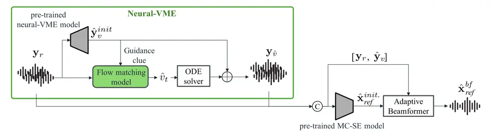
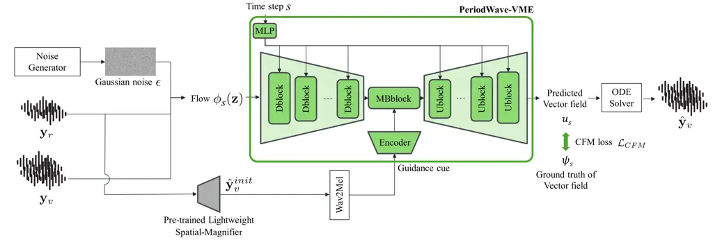
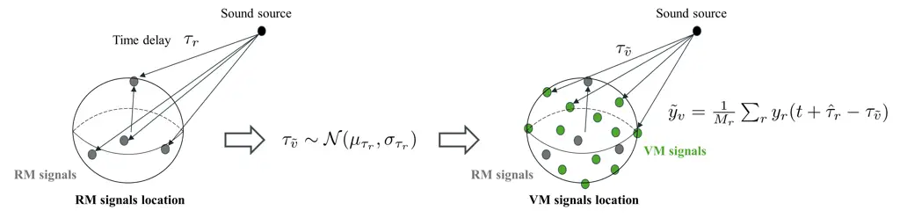
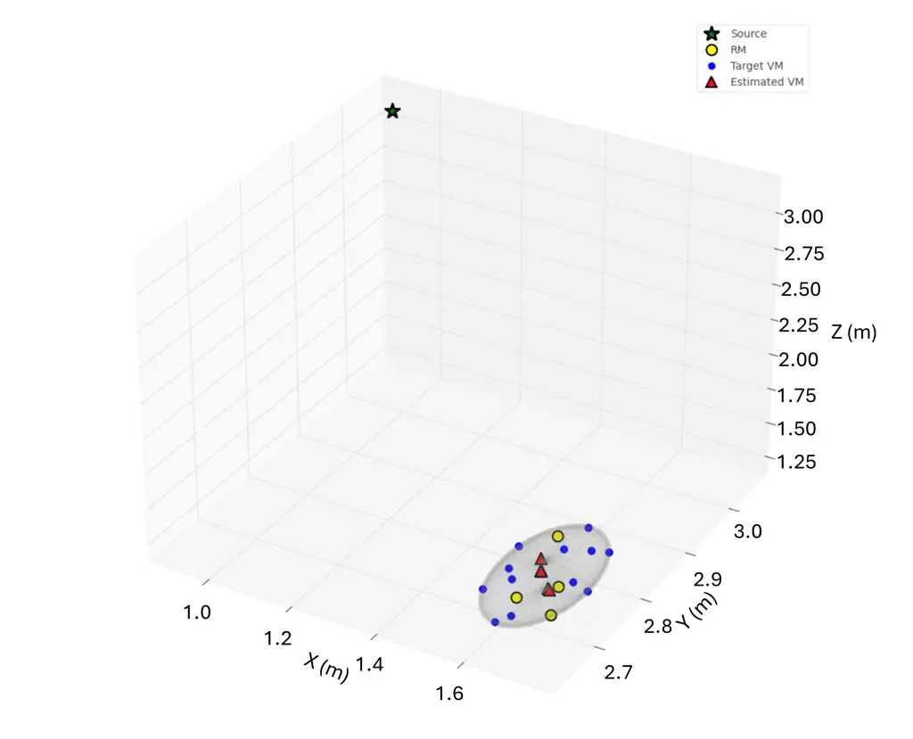
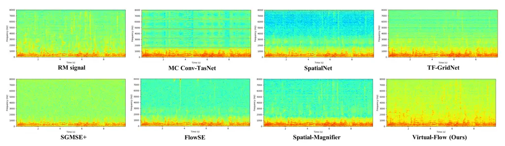
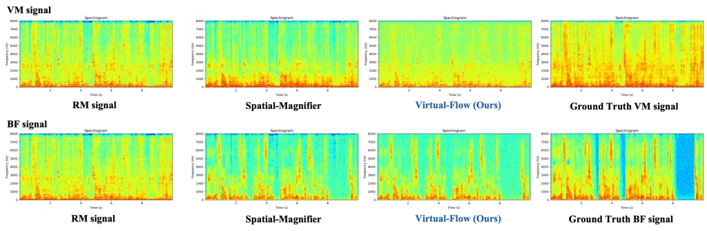

# Virtual-Flow: Virtual Microphone-based Speech Enhancement via Semi-supervised Flow Matching

Dongheon Lee Affiliation: Korea Advanced Institute of Science and
Technology (KAIST) Affiliation: Daejeon, Republic of Korea
Email: [leedh0115@pknu.ac.kr](mailto:)    Ashutosh Pandey
Affiliation: Meta Reality Labs Research Affiliation: Cambridge,
Cambridgeshire, UKRedmond, WA, USA,
Email: [jazcarretao@meta.com](mailto:)    Sanjeel Parekh
Affiliation: Meta Reality Labs Research Affiliation: Cambridge,
Cambridgeshire, UKRedmond, WA, USA,    Zhaoheng Ni Affiliation: Meta
Reality Labs Research Affiliation: Cambridge, Cambridgeshire, UKRedmond,
WA, USA,    Daniel Wong Affiliation: Meta Reality Labs Research
Affiliation: Cambridge, Cambridgeshire, UKRedmond, WA, USA,    Jacob
Donley Affiliation: Meta Reality Labs Research Affiliation: Cambridge,
Cambridgeshire, UKRedmond, WA, USA,    Buye Xu Affiliation: Meta Reality
Labs Research Affiliation: Cambridge, Cambridgeshire, UKRedmond, WA,
USA,    Juan Azcarreta ^(†)^(†)thanks: Corresponding Author
Affiliation: Meta Reality Labs Research Affiliation: Cambridge,
Cambridgeshire, UKRedmond, WA, USA,

###### Abstract

Neural network-based virtual microphone estimation (neural-VME)
synthesizes microphone signals at unobserved spatial locations from a
limited set of real microphone (RM) physical recordings. This enables
high-resolution arrays that improve spatial processing for downstream
tasks such as speech enhancement. However, existing methods rely on
supervised training with ground-truth signals captured at virtual
locations, requiring datasets that scale with the number of virtual
microphones (VM) and leaving open the question of how to design optimal
large-array configurations. We propose Virtual-Flow, a flow-matching
framework that implicitly generates VM signals conditioned on real
recordings, without requiring ground-truth VM signals. We introduce a
semi-supervised training strategy based on pseudo-VM targets constructed
from time-delayed superpositions of real recordings. Virtual-Flow shows
improved magnitude estimation in high-frequency bands, yielding richer
spatial cues for beamforming. Experiments demonstrate that the proposed
Virtual-Flow, combined with reflow distillation, outperforms existing
neural-VME baselines in VM-based beamforming and achieves competitive
end-to-end speech enhancement performance with low computational cost.

## 1 Introduction

Multichannel speech enhancement is the task of removing noise and
reverberation from multichannel noisy reverberant speech to estimate the
clean speech of the target speaker Wang and Wang (2018); Lee and Choi
(2024b); Quan and Li (2024); Pandey and Azcarreta (2025). Increasing the
number of available microphones raises spatial sampling density,
enabling finer-grained spatial cues that help distinguish competing
sources Wang and Wang (2020); Ochiai et al. (2020); Benesty et al.
(2008); Van Veen and Buckley (1988). In practice, however, consumer
devices such as AR glasses Donley et al. (2021), earbuds Bae et al.
(2024), and hearing aids Fedorov et al. (2020) are equipped with only a
handful of microphones, fundamentally limiting the spatial information
available for enhancement.

Neural network-based virtual microphone estimation (neural-VME) has been
proposed to address this constraint Ochiai et al. (2021). Neural-VME
estimates virtual microphone (VM) signals as synthesized observations at
unobserved spatial positions, given real microphone (RM) signals
measured by physical sensors. Predicting VM signals encourages the model
to learn rich spatial representations, which can then be exploited by
VM-based beamforming (VM-BF) Ochiai et al. (2021); Segawa et al. (2022),
which utilizes beamforming as the back-end of the speech enhancement
framework.

However, most existing neural-VME methods focus on estimating a single
VM signal Ochiai et al. (2021); Segawa et al. (2022); Segawa et al.
(2024); Qiu et al. (2024); Qiao et al. (2025); Chen et al. (2025), even
though leveraging a large number of VM signals can significantly enhance
spatial resolution Farmani et al. (2026); Pan et al. (2025). Scaling to
many VM channels in a supervised setting is challenging for two reasons:
it demands larger datasets with ground-truth recordings at each virtual
position, and it requires a fixed array configuration that may not be
optimal for the downstream task.

On the modeling side, previous works employ conventional discriminative
speech enhancement architectures for neural-VME Segawa et al. (2024);
Qiu et al. (2024); Qiao et al. (2025); Pan et al. (2025), despite the
inherent differences between the two tasks. The recently proposed
Spatial-Magnifier Lee et al. (2026) achieves high performance by
reformulating neural-VME as a generative task using a generative
adversarial network (GAN) Goodfellow et al. (2014). However, generating
signals across a large and variable set of virtual positions requires
both stable training over diverse target distributions and efficient
inference. Flow matching Lipman et al. (2023) offers both: stable
optimization via continuous-time probability paths and fast inference
through reflow distillation Liu et al. (2023).

Consequently, two critical gaps remain: (1) developing scalable methods
to exploit a large number of VM signals for VM-BF, and (2) establishing
a semi-supervised neural-VME framework that optimizes generated channels
for downstream enhancement without ground-truth VM signals. Here,
semi-supervised neural-VME requires no ground-truth VM signals. Clean
reference and excitation speech are used only during training for
enhancement supervision and pseudo-target construction, respectively;
inference uses only RM signals.

In this work, we propose Virtual-Flow, a flow-matching framework that
addresses both gaps by generating numerous VM signals without
ground-truth VM signals. Our key contributions are:

1\. Virtual-Flow: We design a flow-matching model that can estimate a
large number of VM signals, achieving state-of-the-art VM-BF
performance. Through reflow distillation Lipman et al. (2023); Liu et
al. (2023), the model enables single-step inference with low
computational cost.

2\. Semi-supervised neural-VME method: We propose a pseudo-VM target
generation strategy based on time-delayed superpositions of RM signals,
providing approximate supervision in delay space without requiring real
VM recordings. This enables effective semi-supervised flow matching
training through end-to-end optimization with the downstream beamforming
objective.

Even with only four RM signals, our method substantially closes the gap
to neural beamforming with sixteen physical microphones. Prior work has
estimated more than ten VM signals using acoustics-informed neural
networks in controlled array settings Zhao and Ma (2024). Our
contribution is to estimate twelve VM signals from four RMs for speech
enhancement under noisy, reverberant conditions using a flow-matching
framework. Extensive experiments demonstrate that Virtual-Flow
outperforms neural-VME baselines with and without ground-truth VM
supervision while requiring lower computational cost. We further show
that meaningful performance gains persist even without pseudo targets,
using only the beamforming objective. Additionally, we explore
extensions to end-to-end VM-based speech enhancement (VM-SE), as well as
array-agnostic and real-time variants for practical deployment.

## 2 Background and Related Work

### 2.1 Neural Network-based Virtual Microphone Estimation (Neural-VME)

Ideally, $`M`$-channel noisy reverberant speech
$`\mathbf{y}\in\mathbb{R}^{M\times N}`$, with $`N`$ time-domain samples,
can be decomposed in terms of the direct speech
$`\mathbf{x}\in\mathbb{R}^{M\times N}`$ through the following
mathematical modeling:

```math
\displaystyle\mathbf{y} \displaystyle=\mathbf{x}+\mathbf{x}_{rev}+\mathbf{n} \tag{1}
```

```math
\displaystyle=\mathbf{o}*\mathbf{h}^{d}+\mathbf{x}_{rev}+\mathbf{n}, \tag{2}
```

where
$`\mathbf{o}\in\mathbb{R}^{1\times N},\mathbf{x}_{rev},\mathbf{n}\in\mathbb{R}^{M\times N}`$,
and $`\mathbf{h}^{d}`$ denote the excitation speech, the reverberant
component of the target speech, the additive background noise recorded
by the microphones, and the impulse response of the direct-path signal,
respectively. $`*`$ denotes the convolution operation.

However, in this study, we assume a practical scenario where only
$`M_{r}`$ microphones are available on actual physical devices
$`(M_{r}<M)`$. Multichannel speech enhancement (MC-SE) aims to estimate
the direct-path target speech at a reference microphone
$`\mathbf{x}_{ref}\in\mathbb{R}^{1\times N}`$, modeled as:

```math
\displaystyle\hat{\mathbf{x}}^{se}_{ref} \displaystyle=\text{MC-SE}(\mathbf{y}_{r}), \tag{3}
```

where $`\mathbf{y}_{r}\in\mathbb{R}^{M_{r}\times N}`$ denotes measured
RM signals. Neural-VME estimates the VM signals
$`\mathbf{y}_{v}\in\mathbb{R}^{M_{v}\times N}`$ given RM signals using a
neural network:

```math
\displaystyle\begin{aligned} \hat{\mathbf{y}}_{v}&=\text{Neural-VME}(\mathbf{y}_{r}),\end{aligned} \tag{4}
```

where $`M_{v}`$ denotes the number of VM channels.

Following the VM-BF framework Ochiai et al. (2021), an augmented signal
$`\hat{\mathbf{y}}=[\mathbf{y}_{r},\hat{\mathbf{y}}_{v}]\in\mathbb{R}^{M\times N}`$
(where $`M=M_{r}+M_{v}`$) is constructed to compute spatial covariance
matrices (SCM). In our framework, the enhanced signal
$`\hat{\mathbf{x}}^{se}_{ref}`$ from a pre-trained MC-SE model is
approximated as a reference to derive the adaptive beamforming
coefficients, followed by beamforming (BF) with an augmented signal,

```math
\displaystyle\begin{aligned} \hat{\mathbf{x}}_{ref}^{bf}=\text{BF}(\hat{\mathbf{x}}^{se}_{ref},\hat{\mathbf{y}}).\end{aligned} \tag{5}
```

The beamforming output
$`\hat{\mathbf{x}}_{ref}^{bf}\in\mathbb{R}^{1\times N}`$ serves as the
estimated target signal of the reference channel. The adaptive
beamforming coefficients can be analytically determined in closed form
using classical beamforming criteria, such as the multichannel Wiener
filter (MCWF) Benesty et al. (2008) or the minimum variance
distortionless response (MVDR) beamformer Souden et al. (2009). By
jointly optimizing neural-VME and the beamforming objective, the model
learns to generate VM signals that effectively increase the numerical
rank of the SCM from $`M_{r}`$ to $`M`$, thereby improving beamforming
performance Segawa et al. (2024). The detailed procedure of adaptive
beamforming is described in Appendix A.1.

### 2.2 Spatial Audio Representation Learning (SARL)

Since conventional neural-VME utilizes the augmented noisy signal
$`\hat{\mathbf{y}}`$ only for neural beamforming, it cannot be directly
employed for end-to-end speech enhancement. To address this limitation,
Lee et al.  Lee et al. (2026) proposed Spatial Audio Representation
Learning (SARL), which optimizes the enhanced signal
$`\hat{\mathbf{x}}^{se}_{ref}`$ by augmenting real microphone (RM)
observations with virtual spatial information. In this work, we leverage
the SARL-signal (SARL-S) framework, where the neural-VME model estimates
explicit VM signals to augment the input
$`\hat{\mathbf{y}}=[\mathbf{y}_{r},\hat{\mathbf{y}}_{v}]`$ of the MC-SE
model:

```math
\displaystyle\hat{\mathbf{x}}_{ref}^{se_{\hat{\mathbf{y}}}} \displaystyle=\text{MC-SE}(\hat{\mathbf{y}}), \tag{6}
```

which enables the downstream MC-SE model to leverage enhanced spatial
cues across the expanded array geometry. The output from the enhanced
MC-SE model can either be fed into an adaptive beamformer to perform
VM-BF or be used directly as the final output for VM-SE.

## 3 Method: Virtual-Flow with Semi-supervised Learning

Supervision setting. In this paper, semi-supervised refers to VM-based
enhancement trained with clean reference speech $`\mathbf{x}_{ref}`$ for
the downstream objective, but without ground-truth VM signals
$`\mathbf{y}_{v}`$. VME therefore lacks direct VM-target supervision,
while the complete enhancement system retains clean-speech supervision.
At inference, only the observed RM signals $`\mathbf{y}_{r}`$ are
required. We apply this distinction consistently to the evaluated
baseline configurations as well as Virtual-Flow. Table 1 distinguishes
training and inference resources.

| Signal                               | Training | Inference | Role                                            |
| ------------------------------------ | -------- | --------- | ----------------------------------------------- |
| RM signals $`\mathbf{y}_{r}`$        | ✔       | ✔        | Model input                                     |
| Excitation $`\mathbf{o}`$            | ✔       | ✘         | Delay estimation for pseudo-target construction |
| Clean reference $`\mathbf{x}_{ref}`$ | ✔       | ✘         | BF-loss target                                  |
| VM signals $`\mathbf{y}_{v}`$        | ✘        | ✘         | No ground-truth VM supervision                  |

Table 1: Signal availability in semi-supervised learning of
Virtual-Flow.



Figure 1: Proposed framework for virtual microphone-based beamforming
(VM-BF). A pre-trained neural-VME model provides a guidance cue to the
flow matching model, enabling precise estimation of the vector field.
The VM-noisy speech is reconstructed during both training and inference,
thereby enhancing the MC-SE model and improving downstream neural
beamforming performance.

 Requires: pre-trained MC-SE, neural-VME model

 $`\textbf{Inputs:}\;\text{RM signals}\;\mathbf{y}_{r},\;\text{clean reference}\;\mathbf{x}_{ref},\;\text{training target}\;\mathbf{y}_{v}^{\star}=\tilde{\mathbf{y}}_{v}`$
from Algorithm 2.

 $`\hat{\mathbf{y}}_{v}^{init.}=\text{Neural-VME}(\mathbf{y}_{r})`$
initialized neural-VME output

 for $`s\sim\mathcal{U}(0,1)`$ or $`s=0`$ do

    
$`\mathbf{z}=\tilde{\mathbf{y}}_{r}+\sigma\boldsymbol{\epsilon},\quad\boldsymbol{\epsilon}\sim\mathcal{N}(\mathbf{0},\mathbf{I})`$

     $`\phi_{s}(\mathbf{z})=s\mathbf{y}_{v}^{\star}+(1-s)\mathbf{z}`$

     $`\psi_{s}=\mathbf{y}_{v}^{\star}-\mathbf{z}`$

 end for

 $`\mathcal{L}_{\mathrm{CFM}}=\mathbb{E}_{s}\Big[\Big\|\mathrm{STFT}\!\big(u_{s}(\phi_{s}(\mathbf{z})\mid\hat{\mathbf{y}}_{v}^{init.})\big)-\mathrm{STFT}(\mathbf{y}_{v}^{\star}-\mathbf{z})\Big\|_{1}\Big]`$
conditional flow matching loss

 $`\hat{\mathbf{y}}_{v}=\tilde{\mathbf{y}}_{r}+\int_{0}^{1}u_{s}(\phi_{s}(\mathbf{z})|\hat{\mathbf{y}}_{v}^{init})ds`$
vector field integration via ODE solver

 $`\hat{\mathbf{x}}_{ref}^{init.}=\text{MC-SE}([\mathbf{y}_{r},\hat{\mathbf{y}}_{v}])`$

 $`\hat{\mathbf{x}}_{ref}^{bf}=\text{BF}(\hat{\mathbf{x}}_{ref}^{init.},[\mathbf{y}_{r},\hat{\mathbf{y}}_{v}])`$
VM-BF (Details in Appendix A.1)

 $`\mathcal{L}_{\mathrm{total}}=w_{vme}\log_{10}\mathcal{L}_{\mathrm{CFM}}+w_{bf}\mathcal{L}_{\mathrm{SNR}}(\hat{\mathbf{x}}_{ref}^{bf},\mathbf{x}_{ref})`$

Algorithm 1 VM-BF training algorithm using our flow matching model

### 3.1 Conditional Flow Matching model

Our Virtual-Flow model preserves the view of neural-VME as a generation
task, while enabling high-quality generation and fast inference via flow
matching. The task definition for our flow matching-based neural-VME is
given by

```math
\displaystyle\begin{aligned} \hat{\mathbf{y}}_{v}=f_{\theta}\!\left(\mathbf{y}_{r}\mid\hat{\mathbf{y}}_{v}^{init.}\right),\end{aligned} \tag{7}
```

where $`f_{\theta},\hat{\mathbf{y}}_{v}^{init.}`$, and
$`\hat{\mathbf{y}}_{v}`$ denote the flow matching model, initialized
neural-VME output, and estimated neural-VME output using the flow
matching model, respectively. Here, $`\mathbf{y}_{v}`$ denotes the true
noisy VM signals, while $`\hat{\mathbf{y}}_{v}`$ denotes the model
estimate; they are distinct and need not coincide. We denote the
training endpoint by $`\mathbf{y}_{v}^{\star}`$: it equals
$`\mathbf{y}_{v}`$ for supervised neural-VME and the pseudo-target
$`\tilde{\mathbf{y}}_{v}`$ for semi-supervised neural-VME. Since the
input $`\mathbf{y}_{r}`$ must match the channel dimensionality
($`M_{v}`$) of the target $`\mathbf{y}_{v}^{\star}`$, we pad the number
of RM channels ($`M_{r}`$) by appending $`M_{v}-M_{r}`$ copies of the
noisy observation at the reference channel as
$`\tilde{\mathbf{y}}_{r}=[\mathbf{y}_{r};\mathbf{y}_{ref};\cdots;\mathbf{y}_{ref}]\in\mathbb{R}^{M_{v}\times N}`$,
assuming $`M_{v}>M_{r}`$. We formulate the flow matching problem using a
time-dependent flow function $`\phi_{s}(\mathbf{z})`$ defined by a
linear interpolation between $`\mathbf{y}_{v}^{\star}`$ and an auxiliary
variable $`\mathbf{z}`$ over $`s\in[0,1]`$:

```math
\displaystyle\begin{aligned} \phi_{s}(\mathbf{z})=s\mathbf{y}_{v}^{\star}+(1-s)\mathbf{z},\end{aligned} \tag{8}
```

For each fixed $`s\in[0,1]`$,
$`\phi_{s}:\mathbb{R}^{M_{v}\times N}\rightarrow\mathbb{R}^{M_{v}\times N}`$;
the subscript $`s`$ indexes the family of flow maps. Here, $`s`$ denotes
a continuous time step for the flow process, which should be
distinguished from the discrete temporal index of the audio signal.
Using the re-parameterization technique, we express $`\mathbf{z}`$ as
$`\mathbf{z}=\tilde{\mathbf{y}}_{r}+\sigma\boldsymbol{\epsilon}`$ where
$`\boldsymbol{\epsilon}\sim\mathcal{N}(\mathbf{0},\mathbf{I})`$ and
$`\sigma`$ is a scalar controlling the perturbation magnitude.
$`\mathbf{I}`$ denotes identity matrix. The probability path is

```math
\displaystyle\begin{aligned} p_{s}(\mathbf{z})=\mathcal{N}\!\left(\mathbf{z}\,\middle|\,s\mathbf{y}_{v}^{\star}+(1-s)\tilde{\mathbf{y}}_{r},\ (1-s)^{2}\sigma^{2}\mathbf{I}\right),\end{aligned} \tag{9}
```

and at $`s=0`$ it reduces to

```math
\displaystyle\begin{aligned} p_{0}(\mathbf{z})=\mathcal{N}\!\left(\mathbf{z}\,\middle|\,\tilde{\mathbf{y}}_{r},\ \sigma^{2}\mathbf{I}\right).\end{aligned} \tag{10}
```

We can derive the vector field $`\psi_{s}`$ from the following ordinary
differential equation (ODE):

```math
\displaystyle\begin{aligned} \frac{d}{ds}\phi_{s}(\mathbf{z})=\psi_{s}(\phi_{s}(\mathbf{z})).\end{aligned} \tag{11}
```

The training target vector field along the path is

```math
\displaystyle\begin{aligned} \psi_{s}(\phi_{s}(\mathbf{z}))=\mathbf{y}_{v}^{\star}-\mathbf{z},\end{aligned} \tag{12}
```

while the model predicts a conditional vector field
$`u_{s}(\phi_{s}(\mathbf{z})\mid\hat{\mathbf{y}}_{v}^{init.})`$. We
train the model using a conditional flow matching (CFM) loss defined as
an $`\ell_{1}`$ distance in the STFT domain:

```math
\displaystyle\mathcal{L}_{\mathrm{CFM}}=\mathbb{E}_{s}\Big[\Big\|\mathrm{STFT}\!\big(u_{s}(\phi_{s}(\mathbf{z})\mid\hat{\mathbf{y}}_{v}^{init.})\big)-\mathrm{STFT}(\mathbf{y}_{v}^{\star}-\mathbf{z})\Big\|_{1}\Big]. \tag{13}
```

The relationship between neural-VME and flow matching is further
detailed in Appendix A.2.

### 3.2 Model Architecture

Overall framework The overall VM-BF framework using SARL-S is shown in
Figure 1. Virtual-Flow estimates the VM signals
$`\hat{\mathbf{y}}_{v}`$, which are concatenated with the RM signals to
form the augmented input
$`\hat{\mathbf{y}}=[\mathbf{y}_{r},\hat{\mathbf{y}}_{v}]`$. This
augmented signal is then provided to a pre-trained MC-SE model that
controls an adaptive neural beamformer. The adaptive beamformer employs
linear filtering to mitigate non-linear distortions caused by MC-SE
neural network processing, a widely adopted strategy in prior work
Yamaoka et al. (2019); Segawa et al. (2022); Segawa et al. (2024); Wang
and Toda (2024); Qiu et al. (2024); Hattori et al. (2025); Qiao et al.
(2025); Farmani et al. (2026); Wang and Toda (2026).



Figure 2: Overall architecture of Virtual-Flow. The RM signals are first
passed through the pre-trained neural-VME model (lightweight
Spatial-Magnifier) to obtain a guidance cue, which the flow matching
model (PeriodWave-VME) then uses to estimate the vector field.

Flow matching training with reflow In a conventional flow matching
pipeline, the model is trained to predict the vector field at a random
time step $`s\in[0,1]`$, and generates the final sample at inference by
integrating the predicted field with an ODE solver. In our framework,
however, neural-VME serves as an intermediate module whose ultimate
objective is not signal reconstruction itself, but improved downstream
enhancement. Accordingly, we run the ODE solver during training to
obtain $`\hat{\mathbf{y}}_{v}`$ and propagate gradients through the full
VM-BF pipeline. We further adopt reflow Liu et al. (2023), which first
trains the model with random time steps $`0\leq s\leq 1`$, and then
re-trains the model to predict the straight vector field ($`s=0`$). This
enables VM signals generation with a single function evaluation
(NFE$`=1`$), yielding fast inference without significant quality loss.
Algorithm 1 provides pseudo-code for the training algorithm for the
proposed flow matching-based VM-BF.

Virtual-Flow architecture Virtual-Flow comprises two branches,
illustrated in Figure 2: a pre-trained discriminative model (lightweight
Spatial-Magnifier) and a flow matching model (PeriodWave-VME). The
lightweight Spatial-Magnifier produces initial VM signal estimates that
serve as a guidance cue for the flow matching model. Lightweight
Spatial-Magnifier is a simplified variant of Lee et al. (2026) by
compressing the channel dimension, removing the selection module and
dynamic channel allocation (DCA), and replacing all convolution
operations with group convolutions. Furthermore, to accelerate the
training process, we trained the model exclusively as a discriminative
model. In the semi-supervised setting, this guidance model is
pre-trained using only the beamforming loss with clean reference speech,
without ground-truth VM targets. At both training and inference, the
guidance cue $`\hat{\mathbf{y}}_{v}^{init.}`$ is computed solely from
$`\mathbf{y}_{r}`$; clean reference and excitation speech are never
guidance inputs.

PeriodWave-VME is derived from PeriodWave Lee et al. (2025b), which we
adopted as our backbone architecture due to its capacity for lightweight
and high-fidelity audio synthesis. The input waveform is chunked into
periodic segments and processed in parallel by a parameter-shared U-Net.
After the down (D)-blocks, latent features are compressed to a
bottleneck representation and fused with the guidance cue from the
lightweight Spatial-Magnifier via skip connections in the multi-band
(MB)-block. The up (U)-blocks then restore the features to the
vector-field dimensionality. Unlike the original PeriodWave, we provide
the guidance cue at both training and inference to avoid a domain gap
between the two stages. The output vector field is integrated via an ODE
solver to produce the final VM signals $`\hat{\mathbf{y}}_{v}`$.
Furthermore, we extend our model to be real-time and array-agnostic in
Appendix G.

### 3.3 Semi-supervised Learning Method

Semi-supervised flow matching with pseudo targets We use the term
semi-supervised because clean reference speech supervises downstream
enhancement, while no ground-truth VM signals are used to train
neural-VME. The excitation speech $`\mathbf{o}`$ is used only during
training to estimate delays and construct the pseudo-VM target
$`\tilde{\mathbf{y}}_{v}`$; it is not itself the VM target in the CFM
loss. The clean reference $`\mathbf{x}_{ref}`$ supervises the BF loss.
Specifically, we first estimate the time delay $`\tau_{r}`$ between the
excitation speech $`o[t]`$ (defined in Eq. 2) and each RM signal
$`y_{r}[t]`$ by maximizing their cross-correlation:

```math
\displaystyle\begin{aligned} \hat{\tau}_{r}=\arg\max_{\tau_{r}}\sum_{t}o[t]y_{r}[t+\tau_{r}].\end{aligned} \tag{14}
```

From the estimated delays $`\{\hat{\tau}_{r}\}`$, we compute the mean
$`\mu_{\tau_{r}}`$ and standard deviation $`\sigma_{\tau_{r}}`$, then
select $`M_{v}`$ virtual delays on an equidistant grid:

```math
\displaystyle\begin{aligned} \tau_{\tilde{v},k}=\mu_{\tau_{r}}+\left(\frac{2(k-1)}{M_{v}-1}-1\right)\left\lfloor\frac{M_{v}}{4}\right\rfloor\sigma_{\tau_{r}},\quad k=1,\ldots,M_{v}.\tau_{\tilde{v}}\sim\mathcal{N}\!\left(\mu_{\tau_{r}},\sigma_{\tau_{r}}\right).\end{aligned} \tag{15}
```

The deterministic grid spans from
$`\mu_{\tau_{r}}-\lfloor{\frac{M_{v}}{4}}\rfloor\sigma_{\tau_{r}}`$ to
$`\mu_{\tau_{r}}+\lfloor{\frac{M_{v}}{4}}\rfloor\sigma_{\tau_{r}}`$.
This provides diverse delay-conditioned training targets for the VM
channels. We draw $`M_{v}`$ virtual delays and generate the pseudo
target of the VM noisy signal by a shifted superposition of RM signals:

```math
\displaystyle\begin{aligned} \tilde{y}_{v}[t]=\frac{1}{M_{r}}\sum_{r=1}^{M_{r}}y_{r}\!\left[t+\hat{\tau}_{r}-\tau_{\tilde{v}}\right].\end{aligned} \tag{16}
```

The pseudo-target therefore supplies an approximate acoustic prior for
the target speaker’s delayed direct-path component. Reverberation and
noises need not align in this way; the pseudo-target is not an exact
reconstruction of noisy speech at a physical VM location. The BF loss
further adapts the generated channels for downstream enhancement. Unlike
position-based interpolation restricted to the segment between RMs, this
construction selects targets in delay space without imposing that
geometric constraint. A delay alone does not uniquely specify a 3D
location, so this flexibility does not establish accurate synthesis at
arbitrary physical positions. Figure 3 illustrates the pseudo-target
construction. Algorithm 2 provides pseudo-code for the proposed
semi-supervised flow matching.

 $`\textbf{Requires:}\;\text{RM noisy speech}\;\mathbf{y}_{r},\text{excitation speech}\;\mathbf{o}`$

 $`\hat{\tau}_{r}=\underset{\tau_{r}}{\operatorname{argmax}}{\sum_{t}o[t]y_{r}[t+\tau_{r}]}`$
estimation of RM time delays

 $`\{\tau_{\tilde{v}}\}=\text{Linspace}(\mu_{\tau_{r}}-\lfloor\frac{M_{v}}{4}\rfloor\sigma_{\tau_{r}},\mu_{\tau_{r}}+\lfloor\frac{M_{v}}{4}\rfloor\sigma_{\tau_{r}},M_{v})`$
sampling of VM time delays

 $`\tilde{y}_{v}[t]=\frac{1}{M_{r}}\sum_{r=1}^{M_{r}}y_{r}[t+\hat{\tau}_{r}-\tau_{\tilde{v}}]`$
pseudo-VM targets

 Return: $`\tilde{\mathbf{y}}_{v}`$

Algorithm 2 Semi-supervised learning method using pseudo-VM targets



Figure 3: Overview of semi-supervised flow matching using pseudo
targets. The pseudo-VM targets are calculated by superposing
time-shifted RM signals. The virtual time delays are selected as evenly
spaced points derived from the mean and standard deviation of the
estimated RM time delays.

Semi-supervised SARL SARL-S requires a pre-trained MC-SE model whose
input consists of $`M=M_{r}+M_{v}`$ microphone channels. However, under
the semi-supervised setting, pre-training such an MC-SE model is not
feasible because the corresponding $`M`$-channel observations are
unavailable. To address this issue, we propose semi-supervised SARL-S.
We first pre-train an MC-SE model using only the $`M_{r}`$ microphone
channels. Given that most MC-SE models typically adopt an
encoder-separator-decoder architecture Luo and Mesgarani (2018); Luo and
Mesgarani (2019); Wang et al. (2023); Quan and Li (2024); Lee and Choi
(2025), the encoder is trained from scratch with convolution kernels
that accept $`M`$ channels during neural-VME training. Meanwhile, the
separator and decoder are initialized from the pre-trained
$`M_{r}`$-channel MC-SE model and fine-tuned.

Loss function The total loss function is defined as a weighted sum of
the neural-VME loss and the beamforming (BF) loss Segawa et al. (2024).
Given the absence of ground-truth VM signals for semi-supervised
neural-VME, we employ a semi-supervised flow matching loss using pseudo
target $`\tilde{\mathbf{y}}_{v}`$. In contrast, since the clean speech
target is available, the BF loss is formulated as the signal-to-noise
ratio (SNR) loss between the estimated speech and the direct clean
speech. To align the scale with the SNR of the BF loss, we applied a
base-10 logarithm to the CFM loss.

```math
\displaystyle\begin{aligned} \mathcal{L}_{\mathrm{total}}=w_{vme}\log_{10}\mathcal{L}_{\mathrm{CFM}}(\hat{\mathbf{y}}_{v},\tilde{\mathbf{y}}_{v})+w_{bf}\mathcal{L}_{\mathrm{SNR}}(\hat{\mathbf{x}}_{ref}^{bf},\mathbf{x}_{ref}),\end{aligned} \tag{17}
```

Additionally, the loss function for the supervised learning is
formulated as described in Appendix B.

### 3.4 Inference

At inference, the trained system takes only the noisy RM signals
$`\mathbf{y}_{r}`$ as external input. Excitation speech $`\mathbf{o}`$,
clean reference speech $`\mathbf{x}_{ref}`$, ground-truth VM signals
$`\mathbf{y}_{v}`$, and pseudo-VM targets $`\tilde{\mathbf{y}}_{v}`$ are
not required. At inference, we set $`\boldsymbol{\epsilon}=\mathbf{0}`$
and initialize the flow with the padded RM signals
$`\tilde{\mathbf{y}}_{r}`$. For fixed model parameters, inference is
deterministic and follows four steps:

1.  1.  Guidance generation. The pre-trained lightweight Spatial-Magnifier
        maps $`\mathbf{y}_{r}`$ to the initial VM estimates
        $`\hat{\mathbf{y}}_{v}^{init.}`$.
2.  2.  Single-step VM estimation. The reflow-trained PeriodWave-VME
        generates
        $`\hat{\mathbf{y}}_{v}=f_{\theta}(\mathbf{y}_{r}\mid\hat{\mathbf{y}}_{v}^{init.})`$
        by a single Euler step over the flow interval $`s\in[0,1]`$
        (NFE$`=1`$). RM padding matches the VM-channel dimension as defined
        above. Delay estimation and pseudo-target construction are training
        procedures and are not performed at inference.
3.  3.  Spatial-statistics estimation. We concatenate the real and generated
        channels as
        $`\hat{\mathbf{y}}=[\mathbf{y}_{r},\hat{\mathbf{y}}_{v}]`$. The
        MC-SE model processes these augmented noisy signals to obtain the
        speech estimate used to construct the time-frequency masks and
        speech/noise covariance matrices.
4.  4.  Beamforming. The resulting statistics determine the MCWF or MVDR
        coefficients and enhanced reference-channel output
        $`\hat{\mathbf{x}}_{ref}^{bf}`$, following Appendix A.1.

The guidance cue and estimated VM signals are model outputs derived from
the RM signals, rather than additional observed inputs. In the
end-to-end VM-SE variant, the augmented noisy signals are processed by
MC-SE to produce the enhanced speech directly, without the back-end
beamformer.

## 4 Experiments

### 4.1 Dataset

We built our dataset using the Interspeech 2020 Deep Noise Suppression
(DNS) Challenge corpus for both speech and noise sources Reddy et al.
(2020). The corpus was randomly split into 50,000, 2,000, and 3,000
clips, each with a duration of 10 s for training, validation, and
testing, respectively. For room acoustics simulation, we used
Pyroomacoustics Scheibler et al. (2018) and generated room impulse
responses (RIRs) using the image-source method with an image-source
order of six. The room dimensions (length, width, height) were uniformly
sampled from $`[3,10]`$, $`[3,10]`$, and $`[2,5]`$ m, respectively,
while the absorption coefficient was drawn uniformly from $`[0.1,0.5]`$.
The resulting reverberation times (RT60), determined by the room
dimensions and sampled absorption coefficients, ranged from $`0.15`$ to
$`1.75`$ s. SNR and signal-to-interference ratio (SIR) were set in
$`[-10,5]`$ dB. All sources were placed at a distance of $`[0.5,2.5]`$ m
from the array center. We employed a 16-channel spherical microphone
array with a radius of 0.1 m. Among the 16 microphones, we designated
four channels as the RMs, forming a tetrahedral sub-array (indices
$`1,5,9,13`$), while the remaining 12 channels served as VMs. We
considered field-of-view (FoV) speech enhancement Xu et al. (2024). In
the FoV setting, the target source is constrained to the frontal
direction of the array, with the FoV defined as $`\pm 20^{\circ}`$
around the front axis in both azimuth and elevation. Up to five
additional interfering talkers were randomly positioned outside the FoV
region within $`[0.5,2.5]`$ m from the array center. The number of
interfering talkers and the level of babble noise were uniformly sampled
from $`[0,5]`$.

### 4.2 Experimental setting

We used a sampling rate of 16 kHz with an STFT window size and hop size
of 16 ms and 8 ms, respectively. As the MC-SE backbone, we adopted
SpatialNet-small Quan and Li (2024), which provides strong performance
in an end-to-end formulation, and employed the multi-channel Wiener
filter (MCWF) Benesty et al. (2008) as the mask-based beamformer. The
output of the MC-SE model is used as a proxy for the MCWF source mask.
To aggregate the temporal statistics of spatial covariance matrix
estimation, we used a windowed mean computed with a rectangular window
over 25 frames. All models were trained with SARL-S. In Virtual-Flow,
the lightweight Spatial-Magnifier used three blocks with channel
dimensions of $`[64,48,32]`$. For PeriodWave-VME, we used periods of
$`[1,2,4,8,16,32]`$ and an embedding dimension of 256. We first
pre-trained the lightweight Spatial-Magnifier without PeriodWave-VME,
and then trained PeriodWave-VME from scratch while leveraging the
pre-trained Spatial-Magnifier. Each stage was trained for 100 epochs
using the Adam optimizer with a learning rate of $`5\times 10^{-4}`$.
Training was performed on 32 NVIDIA H100 GPUs with a global batch size
of 64. The weighting coefficients for the neural-VME and BF losses are
set to a ratio of 0.3:0.7, respectively.

Evaluation metrics for neural-VME include scale-invariant
signal-to-distortion ratio (SI-SDR, dB) Le Roux et al. (2019) and SNR
(dB) as time-domain metrics, multi-resolution STFT (M-STFT) Yamamoto et
al. (2020) and log spectral distance (LSD) Gray and Markel (2003) as
STFT-domain metrics since neural-VME is a task of synthesizing noisy
speech. The performance of neural-VME was evaluated exclusively in a
supervised manner. Then, we evaluated the speech enhancement performance
using SI-SDR, SNR, perceptual evaluation of speech quality (PESQ) Rix et
al. (2001), and short-time objective intelligibility (STOI, %) Taal et
al. (2010). The model size and computational complexity were compared
using parameter size and multiply-accumulate operations per second
(MAC/s), respectively. For the model comparison, Spatial-Magnifier and
semi-supervised Virtual-Flow were each evaluated over three independent
runs with different random seeds; their VM-BF results are reported as
mean $`\pm`$ standard deviation in the corresponding table entries.

### 4.3 Results

#### 4.3.1 Ablation study

| Training        | pre-training | VM-BF              |                 |                  |                  |
| --------------- | ------------ | ------------------ | --------------- | ---------------- | ---------------- |
| method          | neural-VME   | SI-SDR$`\uparrow`$ | SNR$`\uparrow`$ | PESQ$`\uparrow`$ | STOI$`\uparrow`$ |
| Supervised      | ✘            | 10.2               | 10.8            | 2.72             | 90.1             |
|                 | ✔           | 10.1               | 10.7            | 2.74             | 90.0             |
| Semi-supervised | ✘            | 9.6                | 10.3            | 2.71             | 89.3             |
|                 | ✔           | 10.3               | 10.8            | 2.79             | 90.2             |

Table 2: Effect of pre-training neural-VME

|                                            |                    |                 |                  |                  |
| ------------------------------------------ | ------------------ | --------------- | ---------------- | ---------------- |
| Method                                     | VM-BF              |                 |                  |                  |
|                                            | SI-SDR$`\uparrow`$ | SNR$`\uparrow`$ | PESQ$`\uparrow`$ | STOI$`\uparrow`$ |
| w/o semi-supervised loss                   | 9.2                | 9.9             | 2.70             | 88.8             |
| learnable weight                           | 6.5                | 7.6             | 2.34             | 82.5             |
| PCC loss Wang and Toda (2024)              | 9.9                | 10.6            | 2.77             | 90.1             |
| $`\beta`$ divergence Yamaoka et al. (2019) | 9.9                | 10.5            | 2.75             | 89.9             |
| Fixed weight                               | 10.3               | 10.8            | 2.79             | 90.2             |

Table 3: Semi-supervised learning methods

Pre-training neural-VME We examined the effect of pre-training the
neural-VME model by comparing two training strategies: using a
pre-trained lightweight Spatial-Magnifier as a guidance cue for
PeriodWave-VME, versus training both models jointly from scratch. In the
supervised setting, the lightweight Spatial-Magnifier was trained using
a multi-task loss Segawa et al. (2024), whereas in the semi-supervised
setting, only the BF loss was used. As shown in Table 3, pre-training
improves all reported metrics in the semi-supervised setting, whereas in
the supervised setting PESQ improves slightly while SI-SDR, SNR, and
STOI decrease slightly. The larger gains under semi-supervised learning
suggest that pre-trained guidance helps compensate for the absence of
ground-truth VM targets. The guidance and beamforming-loss ablations are
reported in Appendix D.1. The other ablation studies, including changing
the beamformer, a lightweight model, reflow training, and changing the
array geometry, are described in Appendices D.3, D.5, D.2, and D.4,
respectively.

Semi-supervised learning Table 3 reports the ablation results for
semi-supervised learning. We conducted a comparative analysis to
evaluate our design choices against several alternatives: (1) omitting
the semi-supervised learning loss, (2) replacing the fixed-weight pseudo
target with a learnable extraction module, (3) substituting the flow
matching loss with a Pearson correlation coefficient (PCC) loss Wang and
Toda (2024), and (4) employing a $`\beta`$ divergence Yamaoka et al.
(2019)-based pseudo target. While a certain level of reconstruction is
still achievable even without using the semi-supervised learning loss,
the performance is substantially worse than that of the pseudo
target-based approaches. When making the pseudo-target weights
learnable, we extracted them using a Linear--SiLU--Linear--Tanh module.
However, this strategy underperforms the variant with fixed weights. In
contrast, both the $`\beta`$ divergence-based objective and the PCC loss
achieve strong performance, demonstrating that semi-supervised flow
matching training with pseudo targets is effective. However, both
methods suffer from relatively low performance because they can only
estimate VM signals located in-line between the RMs Yamaoka et al.
(2019); Wang and Toda (2024). An example plot of the synthesized VM
positions is shown in the Appendix H.

Why does VM estimation help for beamforming? We examine whether the
improvement comes from enhanced spatial filtering or from implicit
speech denoising in the generated channels. Neural-VME transforms
relationships among the observed RMs into a higher-dimensional
representation for covariance-based beamforming, without adding
independent sensor observations. Comparisons with noisy VM references,
MVDR evaluation without a Wiener post-filter, and the co-directional
experiment jointly support that generated VM signals improve enhancement
by strengthening spatial filtering (Appendix A.3).

|                        |                                     |            |                      |                   |                    |                 |                    |                 |                  |                  |              |         |
| ---------------------- | ----------------------------------- | ---------- | -------------------- | ----------------- | ------------------ | --------------- | ------------------ | --------------- | ---------------- | ---------------- | ------------ | ------- |
| Method                 | Model                               | VM targets | Neural-VME           |                   |                    |                 | VM-BF              |                 |                  |                  | Complexities |         |
|                        |                                     |            | M-STFT$`\downarrow`$ | LSD$`\downarrow`$ | SI-SDR$`\uparrow`$ | SNR$`\uparrow`$ | SI-SDR$`\uparrow`$ | SNR$`\uparrow`$ | PESQ$`\uparrow`$ | STOI$`\uparrow`$ | Param.       | MAC/s   |
| Unprocessed            |                                     | –          | –                    | –                 | –                  | –               | -11.4              | -10.3           | 1.28             | 49.6             | –            | –       |
| SpatialNet-MCWF (4ch)  |                                     | –          | –                    | –                 | –                  | –               | 5.7                | 7.0             | 2.26             | 80.4             | 1.6 M        | 23.2 G  |
| Discriminative         | Segawa et al. Segawa et al. (2024)  | ✔         | 1.78                 | 3.23              | 4.4                | 5.8             | 6.7                | 8.0             | 2.38             | 83.7             | +13.1 M      | +10.3 G |
|                        | Qiao et al. Qiao et al. (2025)      | ✔         | 1.57                 | 2.50              | 5.1                | 6.4             | 6.0                | 7.5             | 2.19             | 80.6             | +8.2 M       | +66.0 G |
|                        | Pan et al. Pan et al. (2025)        | ✔         | 1.42                 | 2.27              | 5.2                | 6.4             | 6.4                | 7.4             | 2.35             | 83.9             | +1.6 M       | +23.2 G |
| Generative             | SGMSE+ Richter et al. (2023)        | ✔         | 1.41                 | 2.46              | 3.6                | 5.2             | 6.7                | 7.9             | 2.38             | 84.5             | +65.7 M      | +4.8 T  |
|                        | FlowSE Lee et al. (2025a)           | ✔         | 1.41                 | 2.48              | 5.5                | 6.7             | 6.7                | 8.0             | 2.40             | 84.1             | +65.7 M      | +0.8 T  |
|                        | Spatial-Magnifier Lee et al. (2026) | ✔         | 1.48                 | 2.83              | 6.2                | 7.3             | 9.8$`\pm`$0.2      | 10.4$`\pm`$0.2  | 2.61$`\pm`$0.06  | 89.0$`\pm`$0.3   | +1.5 M       | +10.1 G |
|                        | Virtual-Flow                        | ✔         | 1.29                 | 2.10              | -1.3               | 1.7             | 10.1               | 10.7            | 2.74             | 90.0             | +13.1 M      | +7.8 G  |
| Semi-supervised        | ArrayDPS Xu et al. (2025)           | ✘          | \-                   | \-                | \-                 | \-              | 5.1                | 6.5             | 2.27             | 77.3             | +405.1 M     | +2.5 T  |
|                        | VM-UNSSOR He and Wang (2026)        | ✘          | \-                   | \-                | \-                 | \-              | 3.9                | 5.8             | 2.09             | 76.3             | +1.2 M       | +16.8 G |
|                        | Virtual-Flow                        | ✘          | -                    | -                 | -                  | -               | 10.3$`\pm`$0.2     | 10.8$`\pm`$0.1  | 2.79$`\pm`$0.02  | 90.2$`\pm`$0.1   | +13.1 M      | +7.8 G  |
| SpatialNet-MCWF (16ch) |                                     | –          | –                    | –                 | –                  | –               | 12.1               | 12.4            | 2.82             | 92.8             | 1.6 M        | 23.2 G  |

Table 4: Performance comparison of Virtual-Flow against various
neural-VME methods.

| Model                               | Complex STFT-SNR (dB)$`\uparrow`$ |       |      |      | Magnitude STFT-SNR (dB)$`\uparrow`$ |       |     |     | IPD (rad)$`\downarrow`$ |       |      |      |
| ----------------------------------- | --------------------------------- | ----- | ---- | ---- | ----------------------------------- | ----- | --- | --- | ----------------------- | ----- | ---- | ---- |
| Frequency range (kHz)               | 0–0.5                             | 0.5–2 | 2–4  | 4–8  | 0–0.5                               | 0.5–2 | 2–4 | 4–8 | 0–0.5                   | 0.5–2 | 2–4  | 4–8  |
| Spatial-Magnifier Lee et al. (2026) | 4.9                               | 4.7   | 1.2  | 0.3  | 7.5                                 | 7.2   | 2.8 | 1.3 | 1.11                    | 1.34  | 1.46 | 1.55 |
| Virtual-Flow                        | 7.9                               | -0.7  | -3.6 | -4.0 | 11.8                                | 5.6   | 3.3 | 2.1 | 0.47                    | 1.42  | 1.59 | 1.57 |

Table 5: Detailed neural-VME analysis in the STFT domain for
Spatial-Magnifier and Virtual-Flow

#### 4.3.2 Comparison with existing methods

Table 4 presents a comparison with existing discriminative Segawa et al.
(2024); Qiao et al. (2025); Pan et al. (2025), generative Richter et al.
(2023); Lee et al. (2025a); Lee et al. (2026), and semi-supervised
baselines without ground-truth VM supervision Xu et al. (2025); He and
Wang (2026). We additionally adapted generative speech enhancement
models (SGMSE+, FlowSE) for the neural-VME task as baselines. For
comparison with the supervised neural-VME baselines, we also trained
Virtual-Flow in a supervised setting to ensure a fair comparison. The
proposed Virtual-Flow achieves the strongest VM-BF performance among all
methods while maintaining the lowest computational complexity among
generative approaches. Notably, although Spatial-Magnifier achieves
higher neural-VME performance on time-domain metrics, this does not
translate into superior VM-BF performance; we analyze this discrepancy
in detail below. Visual comparisons of neural-VME spectrograms are
provided in Appendix I.1.

We compare semi-supervised Virtual-Flow with ArrayDPS Xu et al. (2025)
and VM-UNSSOR He and Wang (2026), which also omit ground-truth VM
supervision while retaining clean target speech for enhancement
supervision in the evaluated systems. Virtual-Flow achieves higher VM-BF
performance under this shared supervision category. These results
support the utility of pseudo target-based flow matching without
requiring observed VM signals. Furthermore, we compared Virtual-Flow
with multi-frame MCWF and an Acoustics-Informed Neural Network (AINN) in
Appendix C.

Correlation between neural-VME and VM-BF performance A notable
observation from Table 4 is that neural-VME metrics do not always
correlate with VM-BF performance. As shown in Table 5, Virtual-Flow
achieves stronger magnitude recovery across most frequency bands, while
phase estimation remains challenging, particularly at high frequencies.
Since time-domain metrics such as SI-SDR are sensitive to phase errors,
they penalize Virtual-Flow disproportionately despite its superior
magnitude reconstruction. Meanwhile, the improved high-frequency
magnitude estimation preserves the spatial cues that frequency-domain
beamforming relies on, explaining the stronger VM-BF performance. This
analysis is restricted to supervised Virtual-Flow, for which neural-VME
reconstruction metrics are reported. Our analysis shows that flow
matching-based neural-VME achieves strong magnitude estimation that
provides sufficient spatial cues for effective beamforming, even with
limited phase accuracy. Improving phase estimation remains a promising
direction for further gains. Spectrogram comparisons are provided in
Appendix I.2. The generated VMs are deterministic functions of the RMs;
their benefit is interpreted as learned spatial representation and
covariance augmentation. Appendix A.2 discusses this
information-preserving interpretation and the rationale for single-step
reflow inference.

#### 4.3.3 Integration of neural-VME with end-to-end model for VM-SE

Finally, we evaluate Virtual-Flow in the VM-SE setting, where neural-VME
is used to improve end-to-end speech enhancement without a back-end
beamformer. This experiment uses two RM input channels, rather than the
four-RM configuration used for VM-BF; the small and large SpatialNet
baselines and the VM-augmented systems share this two-RM input setting.
As shown in Table 6, augmenting SpatialNet-small (2ch) with the
supervised Spatial-Magnifier improves speech enhancement performance.
Notably, the semi-supervised Virtual-Flow achieves comparable VM-SE
performance despite being trained without VM observations, and even
outperforms the supervised Spatial-Magnifier in SI-SDR (-0.7 vs
-1.0 dB). Furthermore, SpatialNet-small with Virtual-Flow approaches the
performance of SpatialNet-large (2ch) at substantially lower
computational cost (31.0 vs 119.0 G MAC/s), demonstrating that virtual
spatial cues can serve as an efficient alternative to scaling model
capacity. The significance of this experiment lies in demonstrating the
feasibility of semi-supervised VM-SE, achieving performance gains with
marginal computational overhead. Appendix E provides real-recorded and
RIR-modeling experiments, and Appendix F documents the limitations under
delay errors, strong interference, reverberation, and speaker motion.
Also, experiments for both the real-time and array-agnostic models are
provided in Appendix G.

| Scenario         | Method                  | VM targets | VM-SE              |                 |                  |                  | Efficiency |         |
| ---------------- | ----------------------- | ---------- | ------------------ | --------------- | ---------------- | ---------------- | ---------- | ------- |
|                  |                         |            | SI-SDR$`\uparrow`$ | SNR$`\uparrow`$ | PESQ$`\uparrow`$ | STOI$`\uparrow`$ | Param.     | MAC/s   |
|                  | SpatialNet-small (2ch)  | \-         | -3.0               | 4.1             | 1.90             | 66.9             | 1.6 M      | 23.2 G  |
|                  | \+ Spatial-Magnifier    | ✔         | -1.0               | 5.6             | 2.15             | 71.1             | +1.5 M     | +10.1 G |
| End-to-end model | + Virtual-Flow          | ✘          | -0.7               | 5.3             | 2.09             | 70.6             | +13.1 M    | +7.8 G  |
|                  | SpatialNet-large (2ch)  | \-         | 0.2                | 5.7             | 2.16             | 72.7             | 7.9 M      | 119.0 G |
|                  | SpatialNet-small (16ch) | \-         | 12.8               | 13.0            | 2.91             | 93.7             | 1.6 M      | 23.2 G  |

Table 6: Comparison VM-SE results with end-to-end models

## 5 Conclusion

In this work, we presented Virtual-Flow, a semi-supervised flow
matching-based framework for neural-VME. By leveraging a pseudo
target-based training strategy, our approach generates effective virtual
spatial information without requiring ground-truth VM signals. Extensive
evaluations demonstrate that Virtual-Flow outperforms conventional
neural-VME models in VM-BF and achieves competitive VM-SE performance.
Furthermore, our method shows robustness across diverse beamforming
back-ends and microphone array geometries. Our analysis shows that
strong magnitude estimation provides sufficient spatial cues for
effective beamforming, even with limited phase accuracy.

Broader Impacts The proposed framework has significant potential to
democratize high-quality spatial audio processing for consumer
electronics. By enabling sophisticated multichannel speech enhancement
on devices with limited physical constraints, such as AR glasses and
hearing aids, Virtual-Flow can improve the accessibility of assistive
listening technologies and enhance the user experience in immersive
communication. Furthermore, the semi-supervised nature of our method
reduces the dependency on large-scale, synchronized multichannel
datasets, thereby lowering the environmental and computational costs
associated with data collection and supervised pre-training.

Limitations and Future Work Despite its effectiveness, our study has
certain limitations. While the proposed reflow training enables
single-step inference, the overall computational complexity, though
lower than most generative models, still poses a challenge for
ultra-low-power embedded processing. Additionally, the current
semi-supervised pseudo target generation assumes a relatively simplified
acoustic relationship between sources and RM signals, which may require
further refinement for extremely reverberant or dynamic environments.
Finally, while Virtual-Flow achieves strong magnitude recovery, phase
estimation remains limited, particularly at high frequencies, leaving
room for further beamforming improvements. Future research will focus on
improving phase estimation and optimizing the model architecture for
hardware-level acceleration.

## References

- \[1\] Z.-Q. Wang and D. Wang (2018) All-neural multi-channel speech
  enhancement. In Proceedings of the Annual Conference of the
  International Speech Communication Association, pp. 3234–3238. Cited
  by: §1.
- \[2\] D. Lee and J.-W. Choi (2024) DeFTAN-II: efficient multichannel
  speech enhancement with subgroup processing. IEEE/ACM Transactions on
  Audio, Speech, and Language Processing 32, pp. 4850–4866. Cited by:
  §1.
- \[3\] C. Quan and X. Li (2024) SpatialNet: extensively learning
  spatial information for multichannel joint speech separation,
  denoising and dereverberation. IEEE/ACM Transactions on Audio, Speech,
  and Language Processing 32, pp. 1310–1323. Cited by: §1, §3.3, §4.2.
- \[4\] A. Pandey and J. Azcarreta (2025) Ultra low-compute complex
  spectral masking for multichannel speech enhancement. In Proceedings
  of the International Conference on Acoustics, Speech, and Signal
  Processing, pp. 1–5. Cited by: §G.1, §1.
- \[5\] Z.-Q. Wang and D. Wang (2020) Multi-microphone complex spectral
  mapping for speech dereverberation. In Proceedings of the
  International Conference on Acoustics, Speech, and Signal Processing,
  pp. 486–490. External Links:
  [Document](https://dx.doi.org/10.1109/ICASSP40776.2020.9053610) Cited
  by: §1.
- \[6\] T. Ochiai, M. Delcroix, R. Ikeshita, K. Kinoshita, T. Nakatani,
  and S. Araki (2020) Beam-TasNet: time-domain audio separation network
  meets frequency-domain beamformer. In Proceedings of the International
  Conference on Acoustics, Speech, and Signal Processing, pp. 6384–6388.
  Cited by: §1.
- \[7\] J. Benesty, J. Chen, and Y. Huang (2008) Microphone array signal
  processing. Springer. Cited by: §1, §2.1, §4.2.
- \[8\] B. D. Van Veen and K. M. Buckley (1988) Beamforming: a versatile
  approach to spatial filtering. IEEE ASSP Magazine 5 (2), pp. 4–24.
  External Links: [Document](https://dx.doi.org/10.1109/53.665) Cited
  by: §1.
- \[9\] J. Donley, V. Tourbabin, J.-S. Lee, M. Broyles, H. Jiang, J.
  Shen, M. Pantic, V. K. Ithapu, and R. Mehra (2021) Easycom: an
  augmented reality dataset to support algorithms for easy communication
  in noisy environments. arXiv preprint arXiv:2107.04174. Cited by: §1.
- \[10\] H. Bae, P. Andreev, A. Saginbaev, N. Babaev, W. Lee, H. Sung,
  and H.-Y. Cho (2024) Speech boosting: low-latency live speech
  enhancement for tws earbuds. In Proceedings of the Annual Conference
  of the International Speech Communication Association, pp. 647–651.
  Cited by: §1.
- \[11\] I. Fedorov, M. Stamenovic, C. Jensen, L.-C. Yang, A.
  Mandell, Y. Gan, M. Mattina, and P. N. Whatmough (2020) TinyLSTMs:
  efficient neural speech enhancement for hearing aids. In Proceedings
  of the Annual Conference of the International Speech Communication
  Association, pp. 4054–4058. Cited by: §1.
- \[12\] T. Ochiai, M. Delcroix, T. Nakatani, R. Ikeshita, K. Kinoshita,
  and S. Araki (2021) Neural network-based virtual microphone estimator.
  In Proceedings of the International Conference on Acoustics, Speech,
  and Signal Processing, pp. 6114–6118. Cited by: §1, §1, §2.1.
- \[13\] H. Segawa, T. Ochiai, M. Delcroix, T. Nakatani, R. Ikeshita, S.
  Araki, T. Yamada, and S. Makino (2022) Neural virtual microphone
  estimator: application to multi-talker reverberant mixtures. In
  Proceedings of the Asia-Pacific Signal and Information Processing
  Association Annual Summit and Conference, pp. 293–299. Cited by: §1,
  §1, §3.2.
- \[14\] H. Segawa, T. Ochiai, M. Delcroix, T. Nakatani, R. Ikeshita, S.
  Araki, T. Yamada, and S. Makino (2024) Neural network-based virtual
  microphone estimation with virtual microphone and beamformer-level
  multi-task loss. In Proceedings of the International Conference on
  Acoustics, Speech, and Signal Processing, pp. 11021–11025. Cited by:
  §1, §1, §2.1, §3.2, §3.3, §4.3.1, §4.3.2, Table 4.
- \[15\] Z. Qiu, J. Wang, B. He, S. Zhang, and S. Makino (2024)
  Transformer-based virtual microphone estimator. In Proceedings of the
  IEEE International Conference on Signal Processing, Communications and
  Computing, pp. 1–5. Cited by: §1, §1, §3.2.
- \[16\] Y. Qiao, V. Kothapally, M. Yu, and D. Yu (2025) Neural
  ambisonic encoding for multi-speaker scenarios using a circular
  microphone array. In Proceedings of the International Conference on
  Acoustics, Speech, and Signal Processing, pp. 1–5. Cited by: §1, §1,
  §3.2, §4.3.2, Table 4.
- \[17\] W. Chen, J. Zhang, J. Yang, E. S. Chng, and X. Zhong (2025)
  UniArray: unified spectral-spatial modeling for
  array-geometry-agnostic speech separation. IEEE Signal Processing
  Letters. Cited by: §1.
- \[18\] M. Farmani, S. Feldt, and J. Jensen (2026) Beamforming using
  virtual microphones for hearing aid applications. In Proceedings of
  the International Conference on Acoustics, Speech, and Signal
  Processing, pp. 15552–15556. Cited by: §1, §3.2.
- \[19\] J. Pan, H. Zhang, and X. Zhang (2025) Enhancing multi-channel
  speech with limited microphones via spherical harmonic transform. In
  Proceedings of the International Conference on Acoustics, Speech, and
  Signal Processing, pp. 1–5. Cited by: §1, §1, §4.3.2, Table 4.
- \[20\] D. Lee, A. Pandey, S. Parekh, D. Wong, J. Donley, B. Xu, and J.
  Azcarreta (2026) Spatial-Magnifier: spatial upsampling for
  multichannel speech enhancement. arXiv preprint arXiv:2605.04749.
  Cited by: §D.5, Table 14, Table 14, §1, §2.2, §3.2, §4.3.2, Table 4,
  Table 5.
- \[21\] I. Goodfellow, J. Pouget-Abadie, M. Mirza, B. Xu, D.
  Warde-Farley, S. Ozair, A. Courville, and Y. Bengio (2014) Generative
  adversarial nets. Advances in Neural Information Processing Systems 27. Cited by: §1.
- \[22\] Y. Lipman, R. T. Q. Chen, H. Ben-Hamu, M. Nickel, and M.
  Le (2023) Flow matching for generative modeling. In Proceedings of the
  International Conference on Learning Representations, Cited by: §1,
  §1.
- \[23\] X. Liu C. Gong et al. (2023) Flow straight and fast: learning
  to generate and transfer data with rectified flow. In Proceedings of
  the International Conference on Learning Representations, Cited by:
  §A.2, §A.2, §1, §1, §3.2.
- \[24\] S. Zhao and F. Ma (2024) A circular microphone array with
  virtual microphones based on acoustics-informed neural networks. The
  Journal of the Acoustical Society of America 156 (1), pp. 405–415.
  External Links: [Document](https://dx.doi.org/10.1121/10.0027915)
  Cited by: Table 9, Appendix C, §1.
- \[25\] M. Souden, J. Benesty, and S. Affes (2009) On optimal
  frequency-domain multichannel linear filtering for noise reduction.
  IEEE Transactions on Audio, Speech, and Language Processing 18 (2),
  pp. 260–276. Cited by: §2.1.
- \[26\] K. Yamaoka, L. Li, N. Ono, S. Makino, and T. Yamada (2019)
  CNN-based virtual microphone signal estimation for mpdr beamforming in
  underdetermined situations. In Proceedings of the European Signal
  Processing Conference, pp. 1–5. Cited by: §3.2, §4.3.1, Table 3.
- \[27\] J. Wang and T. Toda (2024) Unsupervised training of neural
  network-based virtual microphone estimator. In Proceedings of the
  European Signal Processing Conference, pp. 256–260. Cited by: §3.2,
  §4.3.1, Table 3.
- \[28\] K. Hattori, W.-C. Huang, K. Takeda, and T. Toda (2025) An
  evaluation of supervised virtual microphone estimators in reverberant
  sound fields. In Proceedings of the Asia Pacific Signal and
  Information Processing Association Annual Summit and Conference,
  pp. 125–130. Cited by: §3.2.
- \[29\] J. Wang and T. Toda (2026) From fixed positions to free-form
  signals: virtual microphone signal estimation for general-purpose
  spatial audio processing. In Proceedings of the International
  Conference on Acoustics, Speech, and Signal Processing,
  pp. 21011–21015. Cited by: §3.2.
- \[30\] S. H. Lee, H. Y. Choi, and S. W. Lee (2025) PeriodWave:
  multi-period flow matching for high-fidelity waveform generation. In
  Proceedings of the International Conference on Learning
  Representations, pp. 82819–82849. Cited by: §3.2.
- \[31\] Y. Luo and N. Mesgarani (2018) Tasnet: time-domain audio
  separation network for real-time, single-channel speech separation. In
  Proceedings of the International Conference on Acoustics, Speech, and
  Signal Processing, pp. 696–700. Cited by: §3.3.
- \[32\] Y. Luo and N. Mesgarani (2019) Conv-TasNet: surpassing ideal
  time–frequency magnitude masking for speech separation. IEEE/ACM
  Transactions on Audio, Speech, and Language Processing 27 (8),
  pp. 1256–1266. Cited by: §3.3.
- \[33\] Z.-Q. Wang, S. Cornell, S. Choi, Y. Lee, B.-Y. Kim, and S.
  Watanabe (2023) TF-GridNet: integrating full-and sub-band modeling for
  speech separation. IEEE/ACM Transactions on Audio, Speech, and
  Language Processing 31, pp. 3221–3236. Cited by: §3.3.
- \[34\] D. Lee and J. Choi (2025) DeFT-Mamba: universal multichannel
  sound separation and polyphonic audio classification. In Proceedings
  of the International Conference on Acoustics, Speech, and Signal
  Processing, pp. 1–5. Cited by: §3.3.
- \[35\] C. K. Reddy, V. Gopal, R. Cutler, E. Beyrami, R. Cheng, H.
  Dubey, S. Matusevych, et al. (2020) The INTERSPEECH 2020 deep noise
  suppression challenge: datasets, subjective testing framework, and
  challenge results. In Proceedings of the Annual Conference of the
  International Speech Communication Association, Cited by: §4.1.
- \[36\] R. Scheibler, E. Bezzam, and I. Dokmanić (2018)
  Pyroomacoustics: a python package for audio room simulation and array
  processing algorithms. In Proceedings of the International Conference
  on Acoustics, Speech, and Signal Processing, pp. 351–355. Cited by:
  §4.1.
- \[37\] Z. Xu, A. Aroudi, K. Tan, A. Pandey, J.-S. Lee, B. Xu, and F.
  Nesta (2024) FoVNet: configurable field-of-view speech enhancement
  with low computation and distortion for smart glasses. In Proceedings
  of the Annual Conference of the International Speech Communication
  Association, Cited by: §4.1.
- \[38\] J. Le Roux, S. Wisdom, H. Erdogan, and J. R. Hershey (2019)
  SDR–half-baked or well done?. In Proceedings of the International
  Conference on Acoustics, Speech, and Signal Processing, pp. 626–630.
  Cited by: §4.2.
- \[39\] R. Yamamoto, E. Song, and J.-M. Kim (2020) Parallel WaveGAN: a
  fast waveform generation model based on generative adversarial
  networks with multi-resolution spectrogram. In Proceedings of the
  International Conference on Acoustics, Speech, and Signal Processing,
  pp. 6199–6203. Cited by: §4.2.
- \[40\] A. Gray and J. Markel (2003) Distance measures for speech
  processing. IEEE Transactions on Acoustics, Speech, and Signal
  Processing 24 (5), pp. 380–391. Cited by: §4.2.
- \[41\] A. W. Rix, J. G. Beerends, M. P. Hollier, and A. P.
  Hekstra (2001) Perceptual evaluation of speech quality (PESQ)-a new
  method for speech quality assessment of telephone networks and codecs.
  In Proceedings of the International Conference on Acoustics, Speech,
  and Signal Processing, Vol. 2, pp. 749–752. Cited by: §4.2.
- \[42\] C. H. Taal, R. C. Hendriks, R. Heusdens, and J. Jensen (2010) A
  short-time objective intelligibility measure for time-frequency
  weighted noisy speech. In Proceedings of the International Conference
  on Acoustics, Speech, and Signal Processing, pp. 4214–4217. Cited by:
  §4.2.
- \[43\] J. Richter, S. Welker, J.-M. Lemercier, B. Lay, and T.
  Gerkmann (2023) Speech enhancement and dereverberation with
  diffusion-based generative models. IEEE/ACM Transactions on Audio,
  Speech, and Language Processing 31, pp. 2351–2364. Cited by: §4.3.2,
  Table 4.
- \[44\] S. Lee, S. Cheong, S. Han, and J. W. Shin (2025) FlowSE: flow
  matching-based speech enhancement. In Proceedings of the International
  Conference on Acoustics, Speech, and Signal Processing, pp. 1–5. Cited
  by: §4.3.2, Table 4.
- \[45\] Z. Xu, X. Fan, Z.-Q. Wang, X. Jiang, and R. R. Choudhury (2025)
  ArrayDPS: unsupervised blind speech separation with a diffusion prior.
  In Proceedings of the International Conference on Machine Learning,
  Cited by: §4.3.2, §4.3.2, Table 4.
- \[46\] S. He and Z.-Q. Wang (2026) VM-UNSSOR: unsupervised neural
  speech separation enhanced by higher-snr virtual microphone arrays. In
  Proceedings of the International Conference on Acoustics, Speech, and
  Signal Processing, pp. 15642–15646. Cited by: §4.3.2, §4.3.2, Table 4.
- \[47\] Z.-Q. Wang, H. Erdogan, S. Wisdom, K. Wilson, D. Raj, S.
  Watanabe, Z. Chen, and J. R. Hershey (2021) Sequential multi-frame
  neural beamforming for speech separation and enhancement. In
  Proceedings of the IEEE Spoken Language Technology Workshop,
  pp. 905–911. External Links:
  [Document](https://dx.doi.org/10.1109/SLT48900.2021.9383522) Cited by:
  Table 9, Appendix C.
- \[48\] B. Yang et al. (2024) RealMAN: a real-recorded and annotated
  microphone array dataset for dynamic speech enhancement and
  localization. Advances in Neural Information Processing Systems 37,
  pp. 105997–106019. Cited by: §E.1.
- \[49\] Y. Luo, Z. Chen, N. Mesgarani, and T. Yoshioka (2020)
  End-to-end microphone permutation and number invariant multi-channel
  speech separation. In Proceedings of the International Conference on
  Acoustics, Speech, and Signal Processing, pp. 6394–6398. Cited by:
  §G.2.
- \[50\] T. Yoshioka, X. Wang, D. Wang, M. Tang, Z. Zhu, Z. Chen, and N.
  Kanda (2022) VarArray: array-geometry-agnostic continuous speech
  separation. In Proceedings of the International Conference on
  Acoustics, Speech, and Signal Processing, pp. 6027–6031. Cited by:
  §G.2.
- \[51\] D. Lee and J.-W. Choi (2024) DeFTAN-AA: array geometry agnostic
  multichannel speech enhancement. In Proceedings of the Annual
  Conference of the International Speech Communication Association,
  Cited by: §G.2.

## Appendix / Technical Appendices and Supplementary Material

This appendix is organized as follows:

- •
  Appendix A.1 provides detailed description of beamforming for VM-BF.
- •
  Appendix A.2 explains detail description about relations between flow
  matching and neural-VME.
- •
  Appendix A.3 analyses why generated VM signals improve enhancement and
  examines the implicit post-filtering hypothesis.
- •
  Appendix B presents supervised learning loss for Virtual-Flow.
- •
  Appendix C compares Virtual-Flow with multi-frame MCWF and
  acoustics-informed neural network.
- •
  Appendix D.1 examines the effects of guidance and beamforming
  supervision.
- •
  Appendix D.2 examines the effect of reflow training.
- •
  Appendix D.3 shows applicability to different adaptive beamformers.
- •
  Appendix D.4 shows applicability to different microphone array
  geometries.
- •
  Appendix D.5 provides experimental results with lightweight
  Spatial-Magnifier.
- •
  Appendix E presents real-world experiments and examines the effect of
  RIR modeling.
- •
  Appendix F examines sensitivity to delay estimation, interference,
  reverberation, and speaker motion.
- •
  Appendix G provides a real-time and array-agnostic variant for VM-SE
  and experimental results.
- •
  Appendix H provides analysis for estimated VM locations.
- •
  Appendix I.1 presents estimated VM spectrograms from various
  neural-VME models.
- •
  Appendix I.2 presents the spectrogram comparison between
  Spatial-Magnifier and Virtual-Flow.

## Appendix A Method details

### A.1 Explanation of beamforming procedure

In the VM-BF framework, the neural-VME model is integrated with a
frequency-domain spatial filter to produce the final enhanced speech.
The beamformed output of the reference channel
$`\hat{X}_{ref}^{bf}(t,f)\in\mathbb{C}`$ is obtained by applying the
adaptive beamforming weights
$`\mathbf{W}(t,f)\in\mathbb{C}^{M\times 1}`$ to the augmented
multi-channel input $`\hat{\mathbf{Y}}(t,f)\in\mathbb{C}^{M\times 1}`$
at each time frame $`t`$ and frequency bin $`f`$:

```math
\hat{X}_{ref}^{bf}(t,f)=\mathbf{W}^{H}(t,f)\hat{\mathbf{Y}}(t,f), \tag{18}
```

where $`M=M_{r}+M_{v}`$ is the total number of channels, including both
real and generated virtual microphones. To derive the optimal weights
$`\mathbf{W}(t,f)`$, we evaluate two representative beamforming
criteria: the Multi-Channel Wiener Filter (MCWF) and the Minimum
Variance Distortionless Response (MVDR) beamformer. The following
subsections detail their respective formulations and the spatial
statistics employed.

Multi-Channel Wiener Filter (MCWF) The objective of the MCWF is to
minimize the Mean Squared Error (MSE) between the beamformer output and
the direct-path reference clean speech. In our implementation, the
weights are derived using recursive time-average expectations of the
spatial statistics. The spatial covariance matrix of the augmented input
and the cross-covariance matrix between the input and the estimated
reference signal $`\hat{X}_{ref}`$ are computed as follows:

```math
\displaystyle\mathbb{E}[\mathbf{Y}\mathbf{Y}^{H}](t,f) \displaystyle=\frac{1}{L}\sum_{i=t-\frac{L}{2}}^{t+\frac{L}{2}}\hat{\mathbf{Y}}(i,f)\hat{\mathbf{Y}}^{H}(i,f), \tag{19}
```

```math
\displaystyle\mathbb{E}[\mathbf{Y}\hat{X}_{ref}^{H}](t,f) \displaystyle=\frac{1}{L}\sum_{i=t-\frac{L}{2}}^{t+\frac{L}{2}}\hat{\mathbf{Y}}(i,f)\hat{X}_{ref}^{H}(i,f). \tag{20}
```

For the spatial statistics, we applied a windowed mean of length $`L`$
to design a time-varying adaptive beamformer. Using these expectations,
the optimal weight vector for the MCWF is formulated as:

```math
\mathbf{W}_{\text{MCWF}}(t,f)=\mathbb{E}[\mathbf{Y}\mathbf{Y}^{H}](t,f)^{-1}\mathbb{E}[\mathbf{Y}\hat{X}_{ref}^{H}](t,f). \tag{21}
```

This formulation allows the filter to dynamically adapt to the acoustic
environment by leveraging the expanded spatial information provided by
the virtual microphones.

Minimum Variance Distortionless Response (MVDR) The MVDR beamformer aims
to minimize the residual noise variance while ensuring the target speech
remains undistorted. For this beamformer, we utilize spatial covariance
matrices (SCMs) estimated via time-frequency (T-F) masks. Using speech
and noise time-frequency masks derived from the pre-trained MC-SE
output, we estimate the target speech SCM ($`\mathbf{\Phi}_{XX}`$) and
noise SCM ($`\mathbf{\Phi}_{NN}`$) from the augmented observations:

```math
\displaystyle\mathbf{\Phi}_{XX}(t,f) \displaystyle=\frac{\sum_{i\in\mathcal{W}_{t}}m_{X}(i,f)\hat{\mathbf{Y}}(i,f)\hat{\mathbf{Y}}^{H}(i,f)}{\sum_{i\in\mathcal{W}_{t}}m_{X}(i,f)}, \tag{22}
```

```math
\displaystyle\mathbf{\Phi}_{NN}(t,f) \displaystyle=\frac{\sum_{i\in\mathcal{W}_{t}}m_{N}(i,f)\hat{\mathbf{Y}}(i,f)\hat{\mathbf{Y}}^{H}(i,f)}{\sum_{i\in\mathcal{W}_{t}}m_{N}(i,f)}, \tag{23}
```

where $`m_{X}(i,f)`$ and $`m_{N}(i,f)`$ are the nonnegative speech and
noise masks, $`\hat{\mathbf{Y}}(i,f)\in\mathbb{C}^{M\times 1}`$ is the
augmented STFT observation, and $`\mathcal{W}_{t}`$ contains the $`L`$
frames used for local covariance estimation. The masks weight the
observation outer products separately for speech and noise. Based on
these SCMs, the time-variant MVDR filter coefficients are computed as:

```math
\mathbf{W}_{\text{MVDR}}(t,f)=\frac{\mathbf{\Phi}_{NN}^{-1}(t,f)\mathbf{\Phi}_{XX}(t,f)}{\text{Tr}(\mathbf{\Phi}_{NN}^{-1}(t,f)\mathbf{\Phi}_{XX}(t,f))}\mathbf{u}_{\text{ref}}, \tag{24}
```

where $`\text{Tr}(\cdot)`$ denotes the trace operator and
$`\mathbf{u}_{\text{ref}}\in\mathbb{R}^{M\times 1}`$ is a one-hot vector
representing the reference microphone index. The high-fidelity virtual
channels generated by Virtual-Flow enhance the spectral-spatial
resolution of these SCMs, leading to superior interference suppression.

### A.2 Design motivation for flow matching in virtual microphone estimation

Conventional neural-VME methods use discriminative regression to map RM
signals to VM signals. Our conditional flow-matching formulation instead
learns a vector field along a linear training interpolation between the
padded RM-derived initial state and the selected endpoint
$`\mathbf{y}_{v}^{\star}`$. The endpoint is an observed VM signal in
supervised training and a pseudo-target in semi-supervised training.
Linear interpolation of training samples does not by itself guarantee
straight trajectories for the learned ODE. Reflow \[23\] is used to
improve single-step inference, as explained below. In the STFT domain,
the model recovers high-frequency magnitude structure that can benefit
beamforming, while phase estimation remains challenging.

The guidance cue $`\hat{\mathbf{y}}_{v}^{init.}`$ is computed from the
RM signals by the pre-trained lightweight Spatial-Magnifier. It supplies
an initial VM estimate as conditioning for the vector field, simplifying
the refinement required from the RM-derived initial state. Table 3 shows
the benefit of pre-training, and Appendix D.1 reports the performance
and training-stability effects of removing guidance. These experiments
support the usefulness of conditioning without implying that guidance
alone guarantees a straight ODE trajectory.

Finally, computing the CFM loss in the STFT domain aligns the training
objective with the downstream beamformer, which operates in the
frequency domain. The $`\ell_{1}`$ distance on the complex STFT
representation optimizes for both magnitude and phase accuracy. In
practice, the model achieves strong magnitude recovery while phase
estimation remains challenging, particularly at high frequencies.
Nevertheless, as shown in our experiments, the improved magnitude
estimation at high frequencies preserves spatial cues critical for
beamforming and proves sufficient for strong downstream VM-BF
performance (Table 4).

##### Why reflow enables single-step inference.

In Virtual-Flow, the initial state is
$`\mathbf{z}=\tilde{\mathbf{y}}_{r}+\sigma\boldsymbol{\epsilon}`$, where
$`\boldsymbol{\epsilon}\sim\mathcal{N}(\mathbf{0},\mathbf{I})`$. Thus,
for a fixed RM observation,
$`p_{0}(\mathbf{z}\mid\mathbf{y}_{r})=\mathcal{N}(\tilde{\mathbf{y}}_{r},\sigma^{2}\mathbf{I})`$:
the initial state preserves the structure of the padded RM signals, with
an additive Gaussian perturbation. The first training stage learns a
conditional vector field along interpolations from this RM-derived state
to $`\mathbf{y}_{v}^{\star}`$, which is an observed VM signal in
supervised training or a pseudo-VM target in semi-supervised training.
Both endpoints are associated with the same RM observation. In our
reflow stage, we fix $`s=0`$ and retain the original target displacement
$`\mathbf{y}_{v}^{\star}-\mathbf{z}`$, specifically
$`\tilde{\mathbf{y}}_{v}-\mathbf{z}`$ in semi-supervised training; the
endpoint is not replaced by a first-stage model output. This directly
trains the initial-time vector-field prediction for single-step
inference. Here, our use of “reflow” refers to this two-stage training
scheme, rather than the endpoint-recoupling procedure of Liu et
al. \[23\]. For an ideal trajectory with constant velocity along the
path, one Euler step reaches its endpoint exactly; finite model capacity
and training do not guarantee this ideal condition or a globally linear
input–output mapping. At inference, we set
$`\boldsymbol{\epsilon}=\mathbf{0}`$ and use the deterministic
single-step estimate
$`\hat{\mathbf{y}}_{v}=\tilde{\mathbf{y}}_{r}+u_{0}(\tilde{\mathbf{y}}_{r}\mid\hat{\mathbf{y}}_{v}^{init.})`$
over $`s\in[0,1]`$. The effectiveness of this NFE$`=1`$ approximation is
supported empirically by the reflow ablation in Appendix D.2.

##### Information-theoretic perspective on Virtual Microphone Estimation.

A Neural-VME system operating solely on observed RM signals does not
increase the absolute amount of information present in the input without
additional physical sensors. However, when examining the relationships
among RM signals in a low-resolution array with a limited number of
microphones, the spatial resolution is intrinsically low, making it
remarkably difficult for the downstream backend to directly extract the
necessary spatial cues. To address this challenge, Virtual-Flow operates
not by creating new information out of nothing, but through the
following key mechanism: Learning for explicit high-dimensional spatial
representation. Virtual-Flow trains effectively and regularizes the
model to exploit latent spatial information far more efficiently for
multichannel speech enhancement. Instead of pre-defining VM signals in a
rigid or ad-hoc manner, Virtual-Flow provides the model with greater
flexibility to autonomously learn and decide which VM signals are
optimal for capturing spatial representations. By leveraging the
relative spatial relationships among RM signals alongside a deep
generative prior, Virtual-Flow restructures implicit spatial cues latent
across RMs into an explicit high-dimensional representation that the
downstream beamforming backend can readily and optimally exploit. In
conclusion, our work does not create entirely new information; rather,
it provides a flexible regularization framework that reformulates latent
spatial relationships into an explicit high-dimensional spatial
representation.

### A.3 Why does VM estimation help?

Virtual-Flow does not create new information. Its purpose is to improve
spatial filtering by transforming spatial relationships already latent
in a small physical array into an explicit, higher-dimensional
representation for covariance-based beamforming. With few microphones,
estimating sufficiently informative spatial covariance matrices is
difficult, and the enhancement model may rely heavily on spectral
filtering. Virtual-Flow instead learns virtual channels optimized for
downstream spatial filtering.

A possible alternative explanation is that Virtual-Flow generates
cleaner speech signals and therefore acts as implicit post-processing.
We conducted three analyses to test this hypothesis.

\(a\) The generated VMs retain noisy microphone characteristics: Table 4
and Appendices I.1– I.2 compare the generated VMs with reference noisy
VM recordings and other spatial upsampling baselines. Virtual-Flow
reproduces the energy and spectrotemporal structure of the noisy
reference VMs rather than producing clean target speech.

\(b\) Virtual-Flow improves a beamformer without a post-filter: We
evaluated Virtual-Flow with a Souden-MVDR backend (Appendix D.3,
Table 12). Unlike MCWF, MVDR contains no single-channel Wiener
post-filter. With identical mask and covariance-estimation procedures,
Virtual-Flow improves SpatialNet-MVDR from 5.6 to 9.0 dB SI-SDR,
approaching the 16-channel physical-array result of 10.0 dB. Thus, the
benefit remains when post-filtering is absent.

\(c\) The Virtual-Flow advantage contracts when directional separation
is removed: We additionally evaluated MCWF when the target and
interferer have the same direction (co-directional noise):

|                                             |                     |                 |                  |                  |                    |                 |                  |                  |            |          |
| ------------------------------------------- | ------------------- | --------------- | ---------------- | ---------------- | ------------------ | --------------- | ---------------- | ---------------- | ---------- | -------- |
| Method                                      | Spatially separated |                 |                  |                  | Co-directional     |                 |                  |                  | Efficiency |          |
|                                             | SI-SDR$`\uparrow`$  | SNR$`\uparrow`$ | PESQ$`\uparrow`$ | STOI$`\uparrow`$ | SI-SDR$`\uparrow`$ | SNR$`\uparrow`$ | PESQ$`\uparrow`$ | STOI$`\uparrow`$ | Param.     | NN MAC/s |
| Unprocessed                                 | -11.4               | -10.3           | 1.28             | 49.6             | -10.6              | -10.4           | 1.24             | 48.2             | –          | –        |
| SpatialNet-MCWF (4 RM)                      | 5.7                 | 7.0             | 2.26             | 80.4             | 4.1                | 5.0             | 2.12             | 76.2             | 1.6 M      | 23.2 G   |
| Multi-frame MCWF (4 RM $`\times`$ 4 frames) | 7.2                 | 7.7             | 2.48             | 87.0             | 4.8                | 5.6             | 2.18             | 78.1             | 1.6 M      | 23.2 G   |
| Virtual-Flow (4 RM + 12 VM)                 | 10.3                | 10.8            | 2.79             | 90.2             | 5.3                | 6.2             | 2.21             | 79.4             | 14.7 M     | 31.0 G   |
| SpatialNet-MCWF (16 RM)                     | 12.1                | 12.4            | 2.82             | 92.8             | 6.8                | 7.7             | 2.42             | 84.2             | 1.6 M      | 23.2 G   |

Table 7: Effect of target–interferer direction. SI-SDR and SNR are in
dB, and STOI is in %. The separated-condition Virtual-Flow values are
the reported means from the baseline comparison; co-directional
uncertainty estimates are not available. NN MAC/s excludes beamforming
computation.

When target and noise arrive from different directions, Virtual-Flow
gains 4.6 dB over the 4-channel SpatialNet baseline and substantially
closes the gap to the physical 16-channel array. When they are
co-directional, and direct-path directional separability is greatly
reduced, the gain falls to 1.2 dB. The physical 16-channel advantage
contracts similarly. These experiments provide converging evidence that
Virtual-Flow primarily improves spatial filtering: its benefit persists
without a post-filter and diminishes when directional separation is
removed. Strong post-processing addresses the objective of suppressing
residual distortion after beamforming, whereas Virtual-Flow improves the
spatial filtering stage itself. They address distinct stages and can
therefore be combined: post-processing may still be applied after
Virtual-Flow.

## Appendix B Loss function for supervised learning

For supervised learning, we consider two training variants. The first
variant uses only the flow matching loss as the VM loss, whereas the
second additionally incorporates a discriminative VM loss. In both
variants, we further apply an SNR loss between the clean signal and the
enhanced signal to optimize either VM-BF or VM-SE.

Version 1 (FM-only VM loss) The first variant is formulated as

```math
\displaystyle\begin{aligned} \mathcal{L}_{\mathrm{total}}=w_{vme}\log_{10}\mathcal{L}_{\mathrm{CFM}}(\hat{\mathbf{y}}_{v},\mathbf{y}_{v})+w_{bf}\mathcal{L}_{\mathrm{SNR}}(\hat{\mathbf{x}}_{ref},\mathbf{x}_{ref}),\end{aligned} \tag{25}
```

where the weight ratio is set to $`w_{vme}:w_{bf}=0.3:0.7`$.

Version 2 (FM + discriminative VM loss) The proposed framework generates
VM signals via single-step flow matching even during training.
Therefore, in supervised learning, we can add an SNR-based VM loss. In
this variant, we use a skip connection from the pre-trained lightweight
Spatial-Magnifier and define the final estimated VM signal as the sum of
the Spatial-Magnifier output and the Virtual-Flow output. On this
estimated VM signal, we apply an SNR loss and a multi-resolution
(M)-STFT loss, while the flow matching loss is applied to the
Virtual-Flow output as in the first variant. The total loss is

```math
\displaystyle\begin{aligned} \mathcal{L}_{\mathrm{total}}&=w_{vme}\log_{10}\mathcal{L}_{\mathrm{CFM}}(\hat{\mathbf{y}}_{v},\mathbf{y}_{v})+w_{vme}\mathcal{L}_{\mathrm{SNR}}(\hat{\mathbf{y}}_{v},\mathbf{y}_{v})\\
&\hskip 9.24994pt+w_{vme}\log_{10}\mathcal{L}_{\mathrm{M\text{-}STFT}}(\hat{\mathbf{y}}_{v},\mathbf{y}_{v})+w_{bf}\mathcal{L}_{\mathrm{SNR}}(\hat{\mathbf{x}}_{ref},\mathbf{x}_{ref}),\end{aligned} \tag{26}
```

with $`w_{vme}:w_{bf}=0.1:0.7`$.

Experimental results The comparative analysis in Table 8 reveals that
while Virtual-Flow (Version 2) achieves the highest fidelity on
individual neural-VME metrics, such as a 4.3 dB SI-SDR, this does not
translate proportionately into superior beamforming performance. In
contrast, Version 1 yields better VM-BF results, achieving an SI-SDR of
10.1 dB, suggesting that flow-matching objectives may align more
effectively with downstream spatial filtering than traditional
discriminative losses. Notably, the semi-supervised Virtual-Flow
(semi-supervised) achieves high VM-BF performance, outperforming both
supervised variants in perceptual quality (2.79 PESQ). This underscores
the efficacy of our proposed pseudo target strategy in providing robust
spatial cues even in the absence of ground-truth VM signals.
Consequently, these results validate that our framework can successfully
bridge the performance gap between sparse 4-channel setups and dense
16-channel arrays.

|                                   |            |                      |                   |                    |                 |                    |                 |                  |                  |
| --------------------------------- | ---------- | -------------------- | ----------------- | ------------------ | --------------- | ------------------ | --------------- | ---------------- | ---------------- |
| Methods                           | VM targets | Neural-VME           |                   |                    |                 | VM-BF              |                 |                  |                  |
|                                   |            | M-STFT$`\downarrow`$ | LSD$`\downarrow`$ | SI-SDR$`\uparrow`$ | SNR$`\uparrow`$ | SI-SDR$`\uparrow`$ | SNR$`\uparrow`$ | PESQ$`\uparrow`$ | STOI$`\uparrow`$ |
| SpatialNet-MCWF (4ch)             | –          | –                    | –                 | –                  | –               | 5.7                | 7.0             | 2.26             | 80.4             |
| \+ Virtual-Flow (version 1)       | ✔         | 1.29                 | 2.10              | -1.3               | 1.7             | 10.1               | 10.7            | 2.74             | 90.0             |
| \+ Virtual-Flow (version 2)       | ✔         | 1.14                 | 2.03              | 4.3                | 5.8             | 9.5                | 10.1            | 2.62             | 88.5             |
| \+ Virtual-Flow (semi-supervised) | ✘          | –                    | –                 | –                  | –               | 10.3               | 10.8            | 2.79             | 90.2             |
| SpatialNet-MCWF (16ch)            | –          | –                    | –                 | –                  | –               | 12.1               | 12.4            | 2.82             | 92.8             |

Table 8: Performance comparison of Virtual-Flow using supervised and
semi-supervised learning

## Appendix C Comparison with multi-frame beamforming and Acoustics-Informed Neural Network (AINN)

Comparison with multi-frame MCWF Table 9 compares Virtual-Flow with
multi-frame MCWF \[47\] using the same SpatialNet-small backbone and
beamformer configuration. For a fair comparison, we adopted
SpatialNet-small (instead of the TDCN used in \[47\]) as the speech
enhancement backbone and applied MCWF with the same beamformer
configuration. Crucially, both methods operate on an identical
$`16\times 16`$ spatial covariance matrix, i.e., multi-frame stacks 4
real mics $`\times`$ 4 frames, while Virtual-Flow uses 4 real $`+`$ 12
virtual channels, so the SCM dimension is held constant across the
comparison. The only difference is how the covariance is populated:
multi-frame reuses the temporal context of the same spatial samples,
whereas Virtual-Flow injects learned estimates at new spatial locations.
Under this matched-dimension setting, the spatial-augmentation route
yields larger gains, confirming that the improvement is not merely an
artifact of enlarging the SCM.

We emphasize that multi-frame MCWF and Virtual-Flow are complementary
rather than competing: multi-frame augments the covariance along the
temporal axis, whereas Virtual-Flow utilizes a deep generative prior to
augment the SCM along the spatial axis (applying the estimated
beamformer coefficients to the real-microphone signals without using
extra temporal context), which is why our main comparisons in the paper
are against spatial VM baselines. The two are naturally combinable into
a spatio-temporally augmented SCM, a promising direction we leave for
future work.

Comparison with Acoustics-Informed Neural Network (AINN) Table 9 shows
experimental results using the Acoustically Informed Neural Network
(AINN) proposed by Zhao and Ma, implemented following their original
paper \[24\]. As noted in their paper, AINN simplistically models the
complex acoustic field, making it difficult to handle reverberation and
prone to phase distortion under realistic room environments. In
contrast, our Virtual-Flow effectively reconstructs high-frequency bands
through flow matching, thereby maintaining superior performance even in
these challenging environments.

Their coordinate-based AINN is constrained by the homogeneous Helmholtz
equation, developed under a plane-wave beamforming formulation, and
validated in a hemi-anechoic chamber. Under our noisy reverberant
setting, Zhao–Ma obtains -3.4 dB SI-SDR, 1.81 PESQ, and 74.4 STOI,
versus 10.3 dB, 2.79, and 90.2 for Virtual-Flow. AINN augmentation also
underperforms the four-RM SpatialNet-MCWF baseline without VMs (5.7 dB
SI-SDR and 80.4 STOI), showing that adding its estimated channels does
not improve enhancement under this evaluation. This result alone does
not identify the cause of the degradation. Zhao–Ma is substantially
smaller (42.8K versus 14.7M parameters). These results demonstrate that
our proposed method operates robustly with high performance even in
harsh, noisy, and reverberant environments, rather than being confined
to controlled conditions.

| Method                                             | SI-SDR$`\uparrow`$ | SNR$`\uparrow`$ | PESQ$`\uparrow`$ | STOI$`\uparrow`$ | Param. | NN MAC/s |
| -------------------------------------------------- | ------------------ | --------------- | ---------------- | ---------------- | ------ | -------- |
| SpatialNet-MCWF (4 RM)                             | 5.7                | 7.0             | 2.26             | 80.4             | 1.6 M  | 23.2 G   |
| Multi-frame MCWF (4 RM $`\times`$ 4 frames) \[47\] | 7.2                | 7.7             | 2.48             | 87.0             | 1.6 M  | 23.2 G   |
| Zhao–Ma AINN \[24\]                                | -3.4               | 2.8             | 1.81             | 74.4             | 42.8 K | 12.0 G   |
| Virtual-Flow (4 RM + 12 VM)                        | 10.3               | 10.8            | 2.79             | 90.2             | 14.7 M | 31.0 G   |
| SpatialNet-MCWF (16 RM)                            | 12.1               | 12.4            | 2.82             | 92.8             | 1.6 M  | 23.2 G   |

Table 9: VM-BF comparison with multi-frame MCWF and AINN. NN MAC/s
excludes beamforming computation.

## Appendix D Additional experiments and ablations

### D.1 Effect of guidance and beamforming loss

We ablate the Spatial-Magnifier guidance cue and downstream beamforming
loss individually in semi-supervised Virtual-Flow. Table 10 reports the
resulting VM-BF performance under the baseline MCWF configuration. As a
result, removing guidance reduces SI-SDR from 10.3 to 9.5 dB and PESQ
from 2.79 to 2.71. We also observed larger fluctuations during training
without guidance, supporting its role in stabilizing the flow-matching
model when ground-truth VM signals are unavailable. Also, removing the
beamforming loss reduces SI-SDR to 8.2 dB and PESQ to 2.63. This result
supports the role of downstream supervision in aligning generated VM
signals with enhancement performance, rather than optimizing
pseudo-target reconstruction alone.

| Method               | SI-SDR$`\uparrow`$ | SNR$`\uparrow`$ | PESQ$`\uparrow`$ | STOI$`\uparrow`$ |
| -------------------- | ------------------ | --------------- | ---------------- | ---------------- |
| w/o Guidance         | 9.5                | 10.1            | 2.71             | 89.3             |
| w/o Beamforming loss | 8.2                | 8.7             | 2.63             | 88.2             |
| Virtual-Flow         | 10.3               | 10.8            | 2.79             | 90.2             |

Table 10: Ablation of guidance and beamforming supervision in
semi-supervised Virtual-Flow

### D.2 Effect of reflow training

To isolate the contribution of reflow training, we trained the same
Virtual-Flow architecture in a supervised setting under three training
schemes: a discriminative variant, a flow matching variant, and flow
matching with reflow. The discriminative variant removes the time-step
embedding and replaces the flow matching objective with an SNR loss on
the VM signal. The flow matching variant uses time-step embedding and is
trained only with the flow matching loss, and follows PeriodWave-style
inference with $`\mathrm{NFE}=16`$. Reflow training performs
Virtual-Flow training in two stages and enables single-step inference
with $`\mathrm{NFE}=1`$. Empirically, the reflow-trained model achieves
the highest VM-BF performance. In contrast, the other two variants yield
worse Neural-VME quality, which also leads to substantially lower VM-BF
performance. Consequently, since the proposed model was designed for
reflow training, it suggests that parameter adjustment or model redesign
is necessary for conventional flow matching.

| Method         | Neural-VME           |                   |                    |                 | VM-BF              |                 |                  |                  | Training / inference |     |
| -------------- | -------------------- | ----------------- | ------------------ | --------------- | ------------------ | --------------- | ---------------- | ---------------- | -------------------- | --- |
|                | M-STFT$`\downarrow`$ | LSD$`\downarrow`$ | SI-SDR$`\uparrow`$ | SNR$`\uparrow`$ | SI-SDR$`\uparrow`$ | SNR$`\uparrow`$ | PESQ$`\uparrow`$ | STOI$`\uparrow`$ | Stages               | NFE |
| Discriminative | 2.47                 | 2.69              | -32.1              | -3.3            | 6.7                | 7.9             | 2.35             | 84.4             | \-                   | \-  |
| Flow matching  | 8.40                 | 5.12              | -30.5              | -12.3           | 7.6                | 8.5             | 2.44             | 83.4             | 1                    | 16  |
| FM+reflow      | 1.29                 | 2.10              | -1.3               | 1.7             | 10.1               | 10.7            | 2.74             | 90.0             | 2                    | 1   |

Table 11: Effect of reflow training

### D.3 Applicability to different adaptive beamformers

Tables 8 and 12 investigate the generalization of the proposed
Virtual-Flow when integrated with SpatialNet-based beamforming back-ends
under different beamformers. In Table 8 (MCWF back-end), augmenting
SpatialNet-MCWF (4ch) with Virtual-Flow (version 1) yields a substantial
improvement. This result indicates that, using only four real
microphones, the proposed approach can close a large portion of the gap
to the 16-channel upper bound (SpatialNet-MCWF (16ch)). Moreover, the
pseudo target-based semi-supervised variant attains high VM-BF
performance, demonstrating that meaningful gains are achievable even
without access to VM observations. Notably, version 2 can produce higher
Neural-VME performance while degrading VM-BF performance, suggesting
that improving neural-VME signal fidelity does not necessarily translate
into better beamforming; instead, the estimated VM signals must be
aligned with downstream VM-BF objectives.

|                                   |            |                      |                   |                    |                 |                    |                 |                  |                  |
| --------------------------------- | ---------- | -------------------- | ----------------- | ------------------ | --------------- | ------------------ | --------------- | ---------------- | ---------------- |
| Methods                           | VM targets | Neural-VME           |                   |                    |                 | VM-BF              |                 |                  |                  |
|                                   |            | M-STFT$`\downarrow`$ | LSD$`\downarrow`$ | SI-SDR$`\uparrow`$ | SNR$`\uparrow`$ | SI-SDR$`\uparrow`$ | SNR$`\uparrow`$ | PESQ$`\uparrow`$ | STOI$`\uparrow`$ |
| SpatialNet-MVDR (4ch)             | –          | –                    | –                 | –                  | –               | 5.6                | 6.9             | 2.33             | 80.4             |
| \+ Virtual-Flow (version 1)       | ✔         | 4.10                 | 3.84              | -10.8              | -7.2            | 8.7                | 9.5             | 2.66             | 87.6             |
| \+ Virtual-Flow (version 2)       | ✔         | 1.14                 | 1.98              | 3.4                | 5.1             | 8.1                | 8.9             | 2.54             | 85.6             |
| \+ Virtual-Flow (semi-supervised) | ✘          | –                    | –                 | –                  | –               | 9.0                | 9.7             | 2.67             | 87.8             |
| SpatialNet-MVDR (16ch)            | –          | –                    | –                 | –                  | –               | 10.0               | 10.5            | 2.73             | 89.8             |

Table 12: Performance comparison of Virtual-Flow with MVDR back-end

Table 12 evaluates robustness to the choice of beamformer by replacing
MCWF with MVDR. Similar to the MCWF case, SpatialNet-MVDR (4ch) with
Virtual-Flow (version 1) improves VM-BF performance. The semi-supervised
pseudo target setting also maintains strong VM-BF performance,
confirming that the VM signals generated by Virtual-Flow consistently
enhance spatial filtering beyond a specific beamforming formulation.
These observations support that the key advantage of our approach stems
from increasing effective spatial resolution via virtualization, rather
than exploiting beamformer-specific properties.

### D.4 Applicability to different microphone array geometries

Furthermore, we validated the method on a simulated 7-channel array
generated using measured Array Transfer Functions (ATFs) from an array
comprising 5 microphones mounted in smart glasses (RM) and 2 channels
representing HRTF responses (VM). Table 13 examines generalization
across array geometries using an AR-glasses-like configuration, where
only three RM channels are available. The baseline SpatialNet-MCWF (3ch)
with Virtual-Flow substantially improves recovery, with version 2
achieving the highest VM-BF performance. This result suggests that the
optimal neural-VME characteristics can vary with geometry, yet the
proposed framework remains effective under realistic, resource-limited
wearable arrays.

|                                   |            |                      |                   |                    |                 |                    |                 |                  |                  |
| --------------------------------- | ---------- | -------------------- | ----------------- | ------------------ | --------------- | ------------------ | --------------- | ---------------- | ---------------- |
| Methods                           | VM targets | Neural-VME           |                   |                    |                 | VM-BF              |                 |                  |                  |
|                                   |            | M-STFT$`\downarrow`$ | LSD$`\downarrow`$ | SI-SDR$`\uparrow`$ | SNR$`\uparrow`$ | SI-SDR$`\uparrow`$ | SNR$`\uparrow`$ | PESQ$`\uparrow`$ | STOI$`\uparrow`$ |
| SpatialNet-MCWF (3ch)             | –          | –                    | –                 | –                  | –               | 2.5                | 4.8             | 1.92             | 72.6             |
| \+ Virtual-Flow (version 1)       | ✔         | 1.69                 | 2.17              | -12.0              | -1.8            | 5.8                | 7.1             | 2.27             | 83.2             |
| \+ Virtual-Flow (version 2)       | ✔         | 1.58                 | 2.31              | -1.7               | 3.0             | 6.0                | 7.3             | 2.32             | 82.8             |
| \+ Virtual-Flow (semi-supervised) | ✘          | –                    | –                 | –                  | –               | 5.5                | 6.8             | 2.26             | 82.7             |
| SpatialNet-MCWF (7ch)             | –          | –                    | –                 | –                  | –               | 7.3                | 8.3             | 2.36             | 85.9             |

Table 13: Performance of Virtual-Flow with an AR-glasses-like array

### D.5 Lightweight model study

We next compare the Spatial-Magnifier \[20\] with the proposed
lightweight Spatial-Magnifier, and further evaluate the effect of
replacing the lightweight Spatial-Magnifier in Virtual-Flow with the
Spatial-Magnifier. From the results (Table 14), while the lightweight
Spatial-Magnifier exhibits slightly degraded performance relative to the
original Spatial-Magnifier, it provides a substantial reduction in
parameter count and computational cost. Interestingly, substituting the
Spatial-Magnifier with the lightweight Spatial-Magnifier within
Virtual-Flow improves VM-BF performance. Although the proposed
Virtual-Flow has a larger parameter size than the Spatial-Magnifier
baseline, its computational complexity is lower, suggesting that the
proposed design achieves better performance with reduced computational
complexity.

| Method            |                | Neural-VME           |                   |                    |                 | VM-BF              |                 |                  |                  | Complexities |        |
| ----------------- | -------------- | -------------------- | ----------------- | ------------------ | --------------- | ------------------ | --------------- | ---------------- | ---------------- | ------------ | ------ |
| Spatial-Magnifier | PeriodWave-VME | M-STFT$`\downarrow`$ | LSD$`\downarrow`$ | SI-SDR$`\uparrow`$ | SNR$`\uparrow`$ | SI-SDR$`\uparrow`$ | SNR$`\uparrow`$ | PESQ$`\uparrow`$ | STOI$`\uparrow`$ | Param.       | MAC/s  |
| Lee et al. \[20\] | ✘              | 1.48                 | 2.83              | 6.2                | 7.3             | 9.8$`\pm`$0.2      | 10.4$`\pm`$0.2  | 2.61$`\pm`$0.06  | 89.0$`\pm`$0.3   | 1.5 M        | 10.1 G |
| Ours              | ✘              | 1.58                 | 3.25              | 6.1                | 7.2             | 9.8                | 10.4            | 2.65             | 89.0             | 0.25 M       | 2.0 G  |
| Lee et al. \[20\] | ✔             | 1.30                 | 2.05              | -1.4               | 1.6             | 10.0               | 10.7            | 2.70             | 89.7             | 14.3 M       | 15.9 G |
| Ours              | ✔             | 1.29                 | 2.10              | -1.3               | 1.7             | 10.1               | 10.7            | 2.74             | 90.0             | 13.1 M       | 7.8 G  |

Table 14: Lightweight model study

## Appendix E Real-world experiments and RIR modeling

To evaluate Virtual-Flow beyond the simulated acoustic conditions used
in the main experiments, we examine two complementary settings: training
and evaluation on real-recorded multichannel speech, and evaluation
under more detailed room impulse response (RIR) simulations.

### E.1 Real-recorded speech enhancement

We conduct training and evaluation on RealMAN \[48\], a real-recorded
microphone array dataset that includes both static and moving speakers.
Table 15 compares the four-channel SpatialNet-MCWF baseline, its
augmentation with Virtual-Flow, and the sixteen-channel physical-array
reference. Virtual-Flow is trained without ground-truth VM recordings,
while the clean reference speech remains available for the downstream
enhancement objective. From the 32-channel RealMAN array, we selected
channels $`\{1,9,17,25\}`$ as RMs and designated channels
$`\{3,5,7,11,13,15,19,21,23,27,29,31\}`$ as VMs; the 16-channel
physical-array baseline uses all odd-numbered channels from 1 to 31
(one-based indexing).

| Method                 | SI-SDR$`\uparrow`$ | PESQ$`\uparrow`$ | STOI$`\uparrow`$ | SIG$`\uparrow`$ | BAK$`\uparrow`$ | OVL$`\uparrow`$ |
| ---------------------- | ------------------ | ---------------- | ---------------- | --------------- | --------------- | --------------- |
| \(a\) Static speakers  |                    |                  |                  |                 |                 |                 |
| Unprocessed            | -9.9               | 1.14             | 74.0             | 2.01            | 1.73            | 1.52            |
| SpatialNet-MCWF (4ch)  | 4.3                | 1.77             | 85.2             | 2.84            | 2.38            | 2.02            |
|    + Virtual-Flow      | 5.5                | 1.87             | 87.4             | 2.92            | 2.53            | 2.20            |
| SpatialNet-MCWF (16ch) | 6.6                | 1.95             | 88.9             | 3.08            | 2.61            | 2.30            |
| \(b\) Moving speakers  |                    |                  |                  |                 |                 |                 |
| Unprocessed            | -9.0               | 1.10             | 72.0             | 1.80            | 1.54            | 1.37            |
| SpatialNet-MCWF (4ch)  | 1.6                | 1.42             | 81.0             | 2.59            | 2.32            | 1.96            |
|    + Virtual-Flow      | 3.1                | 1.65             | 83.9             | 2.81            | 2.41            | 2.03            |
| SpatialNet-MCWF (16ch) | 4.1                | 1.81             | 84.8             | 2.90            | 2.52            | 2.16            |

Table 15: Speech enhancement results on RealMAN for static and moving
speakers. SIG, BAK, and OVL denote signal quality, background quality,
and overall quality scores, respectively.

Virtual-Flow improves the four-channel baseline in both conditions. For
static speakers, SI-SDR increases from 4.3 to 5.5 dB, PESQ from 1.77 to
1.87, and STOI from 85.2 to 87.4%. For moving speakers, the
corresponding scores increase from 1.6 to 3.1 dB, 1.42 to 1.65, and 81.0
to 83.9%. SIG, BAK, and OVL also improve in both settings. These results
demonstrate that the benefit of VM augmentation extends to real
recordings and natural speaker motion when real-recorded data are
included during training.

Speaker motion nevertheless presents a limitation for pseudo-target
construction: superposing time-shifted recordings can produce virtual
trajectories that are not physically realizable. Our beamformer
estimates SCMs using a windowed mean over 25 frames, which smooths
short-term temporal fluctuations. This averaging may help the downstream
filter tolerate fluctuations in the generated channels, although the
RealMAN results alone do not isolate its contribution. The findings
support the practical applicability of Virtual-Flow under real-recorded
conditions, rather than establishing that a model trained only on
simulated static scenes generalizes without adaptation.

### E.2 Effect of RIR modeling

The main simulated experiments use the image-source method (ISM) with a
maximum reflection order of six. This approximation may underrepresent
late reverberation, particularly for rooms with long reverberation
times. To assess sensitivity to this modeling choice, we evaluate the
model trained with sixth-order ISM on test data generated using
sixteenth-order ISM and hybrid ray-tracing, which provide more detailed
reverberation modeling. Table 16 reports these results alongside the
sixth-order ISM setting.

| Test RIR simulation | SI-SDR$`\uparrow`$ | SNR$`\uparrow`$ | PESQ$`\uparrow`$ | STOI$`\uparrow`$ |
| ------------------- | ------------------ | --------------- | ---------------- | ---------------- |
| Sixth-order ISM     | 10.3               | 10.8            | 2.79             | 90.2             |
| Sixteenth-order ISM | 9.4                | 10.1            | 2.71             | 89.9             |
| Hybrid ray-tracing  | 8.7                | 9.4             | 2.63             | 88.1             |

Table 16: Effect of RIR modeling on Virtual-Flow. The model is trained
using sixth-order ISM and evaluated under each simulation setting.

SI-SDR decreases from 10.3 dB under sixth-order ISM to 9.4 dB under
sixteenth-order ISM and 8.7 dB under hybrid ray-tracing. The other
metrics also decline, indicating sensitivity to the mismatch between
training and test acoustic simulations. These results motivate more
realistic reverberation modeling during training. Together with the
RealMAN experiments, they show both the limitations of the original
simulation setup and the gains obtainable when real-recorded acoustic
conditions, including moving speakers, are represented during training.

## Appendix F Sensitivity to delay estimation and acoustic conditions

We evaluate the sensitivity of Virtual-Flow to delay-estimation errors,
interference strength, reverberation time, and speaker motion. The model
is trained on the simulated dataset generated using sixth-order ISM.
Table 17 reports VM-BF performance under each condition, together with
the unprocessed input and the average Virtual-Flow performance for
reference. Moving-speaker test scenes are simulated using gpuRIR.

|                        |                                             |                    |                 |                  |                  |
| ---------------------- | ------------------------------------------- | ------------------ | --------------- | ---------------- | ---------------- |
| Factor                 | Condition                                   | SI-SDR$`\uparrow`$ | SNR$`\uparrow`$ | PESQ$`\uparrow`$ | STOI$`\uparrow`$ |
| Unprocessed            | –                                           | -11.4              | -10.3           | 1.28             | 49.6             |
| Virtual-Flow           | Average performance                         | 10.3               | 10.8            | 2.79             | 90.2             |
| Delay-estimation error | Low ($`<0.625`$ ms)                         | 10.7               | 11.3            | 2.82             | 90.9             |
|                        | High ($`\geq 0.625`$ ms)                    | 7.6                | 8.0             | 2.54             | 87.0             |
| Interference strength  | Weak interferers (SIR $`\geq 0`$ dB)        | 15.2               | 15.7            | 3.01             | 95.5             |
|                        | Strong interferers (SIR $`<0`$ dB)          | 7.0                | 7.5             | 2.67             | 87.3             |
| Reverberation time     | Low (RT60 $`<0.4`$ s)                       | 10.6               | 11.1            | 2.84             | 92.1             |
|                        | Medium ($`0.4`$ s $`\leq`$ RT60 $`<1.0`$ s) | 8.0                | 8.3             | 2.61             | 88.7             |
|                        | High (RT60 $`\geq 1.0`$ s)                  | 5.4                | 5.7             | 2.40             | 86.4             |
| Speaker motion         | Static speakers                             | 10.3               | 10.8            | 2.79             | 90.2             |
|                        | Moving speakers                             | 3.7                | 4.5             | 2.42             | 84.1             |

Table 17: Sensitivity of Virtual-Flow to delay-estimation errors and
acoustic conditions. The model is trained using sixth-order ISM. SI-SDR
and SNR are reported in dB, and STOI in %.

Delay estimation and interference strength. Pseudo-target construction
relies on estimating the delay between the excitation speech and each RM
signal. Large delay-estimation errors degrade the resulting spatial
supervision: SI-SDR falls from 10.7 dB for errors below 0.625 ms to
7.6 dB for larger errors, with corresponding decreases in PESQ and STOI.
Strong interference can corrupt the cross-correlation used for delay
estimation. Consistent with this sensitivity, SI-SDR decreases from
15.2 dB for SIR at or above 0 dB to 7.0 dB for SIR below 0 dB. Delay
errors and interference strength are related factors; these results
characterize performance under the reported conditions rather than
isolating their independent effects.

Reverberation time. The low-, medium-, and high-RT60 bins account for
approximately 90%, 8%, and 2% of the test samples, respectively.
Performance decreases as reverberation becomes stronger. SI-SDR falls
from 10.6 dB for RT60 below 0.4 s to 8.0 dB for the intermediate range
and 5.4 dB for RT60 at or above 1.0 s. PESQ and STOI exhibit the same
trend. These results identify long reverberation times as a challenging
condition for the current pseudo-target construction and training setup,
complementing the RIR-modeling analysis in Appendix E.

Speaker motion. The model trained on simulated static scenes exhibits a
substantial performance drop when evaluated on moving-speaker scenes
generated with gpuRIR: SI-SDR decreases from 10.3 to 3.7 dB, PESQ from
2.79 to 2.42, and STOI from 90.2 to 84.1%. This highlights the mismatch
between static training conditions and time-varying acoustic paths. As
shown in Appendix E, incorporating real-recorded data that include
moving speakers during training yields improvements over the
four-channel baseline in moving-speaker recordings. Together, the two
evaluations highlight the sensitivity to speaker motion and the
importance of representing dynamic acoustic conditions during training.

## Appendix G Real-time and array-agnostic variants for virtual microphone-based speech enhancement

### G.1 Real-time model

Tables 18 and 19 evaluate the proposed Virtual-Flow in the VM-SE setting
with its practicality under real-time constraints and its generalization
to array-agnostic scenarios. We enforce causality throughout the system
by replacing the convolution and layer-normalization operations with
their causal counterparts for the real-time model. In addition, applying
iSTFT to convert an STFT-based model output from the spectrogram domain
back to the time domain introduces additional latency proportional to
the windowing and overlap. To prevent this latency increase, we directly
convert the output of the pre-trained lightweight Spatial-Magnifier from
the STFT domain to the mel-scale, without performing iSTFT. Finally, in
the real-time model, we add a skip connection from the lightweight
Spatial-Magnifier output to the STFT of the PeriodWave-VME output, and
construct the final neural-VME output in the STFT domain.

Table 18 focuses on real-time VM-SE. TinyGRU \[4\] is adopted for the
baseline MC-SE model, which has ultra-low computational complexity. The
real-time lightweight Spatial-Magnifier (LW SM-RT) increases VM-SE
performance. Our Virtual-Flow-RT further improves VM-SE performance
while satisfying causality and maintaining a 16 ms algorithmic latency,
demonstrating that VM-SE can remain effective even under strict
streaming constraints. The resulting RTF is close to 1 (0.9424),
implying limited computational headroom and motivating future
optimization.

| Scenario  | Method            | VM-SE Performance  |                 |                  |                  | Efficiency |        |
| --------- | ----------------- | ------------------ | --------------- | ---------------- | ---------------- | ---------- | ------ |
|           |                   | SI-SDR$`\uparrow`$ | SNR$`\uparrow`$ | PESQ$`\uparrow`$ | STOI$`\uparrow`$ | Latency    | RTF    |
|           | TinyGRU (4ch)     | -4.2               | 1.7             | 1.57             | 59.8             | 16 ms      | 0.0478 |
|           | \+ LW SM-RT       | -2.3               | 2.4             | 1.69             | 63.3             | 16 ms      | 0.7188 |
| Real-time | + Virtual-Flow-RT | -1.7               | 2.7             | 1.75             | 64.2             | 16 ms      | 0.9424 |
|           | TinyGRU (16ch)    | -2.0               | 2.4             | 1.80             | 67.5             | 16 ms      | 0.0478 |

Table 18: VM-SE performance of real-time Virtual-Flow

### G.2 Array-agnostic model

Array-agnostic processing refers to the setting where the number and
spatial configuration of microphones in the array vary across examples.
To support array-agnostic processing, we propose an array transform
strategy. Specifically, except for the reference microphone, we replace
all remaining RM signals with VM signals. This transformation is
intended to align the input distribution between training and inference,
since RM microphone locations can follow different and potentially
mismatched distributions across the two stages. In this setting, the
lightweight Spatial-Magnifier adopts the transform-average-concatenate
(TAC) module \[49\], which is widely used for array-agnostic processing.
Concretely, the first up-block is processed in parallel for each
microphone, and the resulting per-microphone features are averaged over
the microphone-channel dimension, as in VarArray \[50\]. The rest of the
pipeline remains identical to the original design. Finally,
PeriodWave-VME is configured to output $`M-1`$ channels. Since $`M_{r}`$
varies across inputs, we pad the RM signals by repeating the
reference-channel RM noisy signal $`M-M_{r}-1`$ times. The subsequent
steps follow the same procedure as in the baseline method.

Then, Table 19 reports array-agnostic VM-SE results. SpatialNet (Ran)
exhibits very low performance, whereas applying the proposed array
transform strategy with array-agnostic lightweight Spatial-Magnifier LW
SM-AA and Virtual-Flow-AA (array-agnostic) yields substantial
improvements across SI-SDR, SNR, PESQ, and STOI. In particular,
Virtual-Flow-AA achieves the best perceptual and intelligibility scores
(PESQ $`2.01`$, STOI $`66.5`$), verifying that our approach generalizes
to varying microphone counts and geometries. Compared with DeFTAN-AA
(Ran) \[51\], which is the state-of-the-art array geometry-agnostic
speech enhancement model, our method attains higher speech quality and
intelligibility with a favorable performance–complexity trade-off,
supporting its applicability to practical array-agnostic scenarios.

| Scenario | Method            | VM-SE Performance  |                 |                  |                  | Efficiency |        |
| -------- | ----------------- | ------------------ | --------------- | ---------------- | ---------------- | ---------- | ------ |
|          |                   | SI-SDR$`\uparrow`$ | SNR$`\uparrow`$ | PESQ$`\uparrow`$ | STOI$`\uparrow`$ | Param.     | MAC/s  |
|          | SpatialNet (Ran)  | -11.7              | 0.2             | 1.34             | 43.9             | 1.6 M      | 23.2 G |
|          | \+ LW SM-AA       | -4.7               | 3.8             | 1.90             | 63.7             | +0.25 M    | +2.0 G |
| Agnostic | + Virtual-Flow-AA | -3.7               | 4.8             | 2.01             | 66.5             | +13.1 M    | +7.8 G |
|          | DeFTAN-AA (Ran)   | -8.4               | 1.2             | 1.48             | 52.3             | 2.2 M      | 35.7 G |

Table 19: VM-SE performance of array-agnostic Virtual-Flow

## Appendix H Estimated VM location plot

Figure 4 provides a qualitative visualization of the estimated VM
locations produced by the proposed Virtual-Flow trained in the
semi-supervised setting. Although the model never observes VM noisy
signals during training, the estimated VM channels (red triangles) are
arranged with the target VM geometry (blue dots), forming a random
spatial distribution in the virtual sphere implied by the array
configuration. This observation suggests that the model effectively
injects extra spatial samples into the input space, resembling the
availability of additional microphones, even under the constraint that
VM signals are inaccessible.



Figure 4: Estimated VM location plot

## Appendix I Spectrogram analysis

### I.1 Estimated VM spectrogram comparison

The reference in Figure 5 is a noisy VM signal, rather than the clean
target speech used to supervise downstream enhancement. Neural-VME is
evaluated against the spectral structure of these noisy microphone
observations; the final enhanced clean-reference estimate is a separate
output of the VM-BF pipeline. The comparison therefore examines whether
generated channels preserve microphone-like spectrotemporal structure,
rather than whether they directly reproduce clean target speech. This
qualitative evidence should be considered jointly with the MVDR and
co-directional results, rather than as a standalone proof that all gains
are spatial.

From the spectrogram comparisons (Figure 5), the proposed Virtual-Flow
exhibits the most faithful reconstruction of the target spectral
structure, particularly in the high-frequency bands. Several baseline
estimates exhibit attenuated or oversmoothed spectral regions relative
to the noisy VM reference, particularly in the upper bands, leading to a
loss of fine spectral details that are important for spatial cue
preservation and speech clarity. In contrast, Virtual-Flow better
preserves the distribution of energy and temporal variations across
frequencies, and its spectrogram remains visually the closest to the
reference spectral pattern among the compared models. This qualitative
evidence is consistent with our quantitative findings that emphasize the
importance of high-frequency restoration for effective spatial
enhancement and downstream performance.



Figure 5: Estimated VM spectrograms compared with noisy reference VM
signals.

### I.2 Spectrogram comparison between Spatial-Magnifier and Virtual-Flow

Consistent with the quantitative results, the spectrogram comparison in
Figure 6 demonstrates that Virtual-Flow successfully captures the
detailed speech distribution in high-frequency bands, whereas
Spatial-Magnifier fails to reconstruct these critical components. This
visual evidence provides a clear rationale for the performance
trade-offs observed: while Virtual-Flow exhibits lower Neural-VME
performance in time-domain metrics (e.g., SI-SDR, SNR), it significantly
outperforms baselines in magnitude-based metrics such as M-STFT and LSD.
The superior recovery of high-frequency magnitude information directly
mitigates spatial aliasing, thereby enhancing overall spatial
resolution. Furthermore, although the differences in the final VM-BF
signals are subtle to the naked eye, a closer inspection reveals that
Virtual-Flow more accurately restores high-frequency speech structures
compared to Spatial-Magnifier, which is fundamental for achieving robust
multichannel speech extraction.



Figure 6: Spectrogram comparison between Spatial-Magnifier and
Virtual-Flow

## NeurIPS Paper Checklist

1.  1.  Claims
2.  Question: Do the main claims made in the abstract and introduction
    accurately reflect the paper’s contributions and scope?
3.  Answer: \[Yes\]
4.  Justification: Our key contribution is a semi-supervised framework
    for VM-BF and VM-SE that uses clean reference speech during training
    without ground-truth VM recordings, and requires only RM recordings
    at inference. By estimating a large number of VM signals (more than
    10), we significantly leverage the inherent advantages of
    neural-VME. These contributions are explicitly highlighted in the
    abstract and introduction.
5.  Guidelines:
    - •
      The answer \[N/A\] means that the abstract and introduction do not
      include the claims made in the paper.
    - •
      The abstract and/or introduction should clearly state the claims
      made, including the contributions made in the paper and important
      assumptions and limitations. A \[No\] or \[N/A\] answer to this
      question will not be perceived well by the reviewers.
    - •
      The claims made should match theoretical and experimental results,
      and reflect how much the results can be expected to generalize to
      other settings.
    - •
      It is fine to include aspirational goals as motivation as long as
      it is clear that these goals are not attained by the paper.

6.  2.  Limitations
7.  Question: Does the paper discuss the limitations of the work
    performed by the authors?
8.  Answer: \[Yes\]
9.  Justification: As explicitly stated in the conclusion, the proposed
    research has a few limitations. Reflow requires two training stages,
    and the computational cost remains challenging for low-power
    on-device deployment. Moving speakers are evaluated in Appendices E
    and F: a model trained on simulated static scenes degrades on
    moving-speaker tests, while training on real-recorded data that
    include motion improves performance. Pseudo-target construction and
    phase estimation also remain approximate.
10. Guidelines:
    - •
      The answer \[N/A\] means that the paper has no limitation while
      the answer \[No\] means that the paper has limitations, but those
      are not discussed in the paper.
    - •
      The authors are encouraged to create a separate “Limitations”
      section in their paper.
    - •
      The paper should point out any strong assumptions and how robust
      the results are to violations of these assumptions (e.g.,
      independence assumptions, noiseless settings, model
      well-specification, asymptotic approximations only holding
      locally). The authors should reflect on how these assumptions
      might be violated in practice and what the implications would be.
    - •
      The authors should reflect on the scope of the claims made, e.g.,
      if the approach was only tested on a few datasets or with a few
      runs. In general, empirical results often depend on implicit
      assumptions, which should be articulated.
    - •
      The authors should reflect on the factors that influence the
      performance of the approach. For example, a facial recognition
      algorithm may perform poorly when image resolution is low or
      images are taken in low lighting. Or a speech-to-text system might
      not be used reliably to provide closed captions for online
      lectures because it fails to handle technical jargon.
    - •
      The authors should discuss the computational efficiency of the
      proposed algorithms and how they scale with dataset size.
    - •
      If applicable, the authors should discuss possible limitations of
      their approach to address problems of privacy and fairness.
    - •
      While the authors might fear that complete honesty about
      limitations might be used by reviewers as grounds for rejection, a
      worse outcome might be that reviewers discover limitations that
      aren’t acknowledged in the paper. The authors should use their
      best judgment and recognize that individual actions in favor of
      transparency play an important role in developing norms that
      preserve the integrity of the community. Reviewers will be
      specifically instructed to not penalize honesty concerning
      limitations.

11. 3.  Theory assumptions and proofs
12. Question: For each theoretical result, does the paper provide the
    full set of assumptions and a complete (and correct) proof?
13. Answer: \[Yes\]
14. Justification: Detailed descriptions of the neural-VME task and flow
    matching theory, along with comprehensive experimental results
    supporting our claims, are thoroughly presented in both the main
    text and the appendix.
15. Guidelines:
    - •
      The answer \[N/A\] means that the paper does not include
      theoretical results.
    - •
      All the theorems, formulas, and proofs in the paper should be
      numbered and cross-referenced.
    - •
      All assumptions should be clearly stated or referenced in the
      statement of any theorems.
    - •
      The proofs can either appear in the main paper or the supplemental
      material, but if they appear in the supplemental material, the
      authors are encouraged to provide a short proof sketch to provide
      intuition.
    - •
      Inversely, any informal proof provided in the core of the paper
      should be complemented by formal proofs provided in appendix or
      supplemental material.
    - •
      Theorems and Lemmas that the proof relies upon should be properly
      referenced.

16. 4.  Experimental result reproducibility
17. Question: Does the paper fully disclose all the information needed
    to reproduce the main experimental results of the paper to the
    extent that it affects the main claims and/or conclusions of the
    paper (regardless of whether the code and data are provided or not)?
18. Answer: \[Yes\]
19. Justification: We detail the experimental conditions, datasets,
    model parameters, and training procedures in the Experiments
    section.
20. Guidelines:
    - •
      The answer \[N/A\] means that the paper does not include
      experiments.
    - •
      If the paper includes experiments, a \[No\] answer to this
      question will not be perceived well by the reviewers: Making the
      paper reproducible is important, regardless of whether the code
      and data are provided or not.
    - •
      If the contribution is a dataset and/or model, the authors should
      describe the steps taken to make their results reproducible or
      verifiable.
    - •
      Depending on the contribution, reproducibility can be accomplished
      in various ways. For example, if the contribution is a novel
      architecture, describing the architecture fully might suffice, or
      if the contribution is a specific model and empirical evaluation,
      it may be necessary to either make it possible for others to
      replicate the model with the same dataset, or provide access to
      the model. In general. releasing code and data is often one good
      way to accomplish this, but reproducibility can also be provided
      via detailed instructions for how to replicate the results, access
      to a hosted model (e.g., in the case of a large language model),
      releasing of a model checkpoint, or other means that are
      appropriate to the research performed.
    - •
      While NeurIPS does not require releasing code, the conference does
      require all submissions to provide some reasonable avenue for
      reproducibility, which may depend on the nature of the
      contribution. For example
      1.  (a)
          If the contribution is primarily a new algorithm, the paper
          should make it clear how to reproduce that algorithm.
      2.  (b)
          If the contribution is primarily a new model architecture, the
          paper should describe the architecture clearly and fully.
      3.  (c)
          If the contribution is a new model (e.g., a large language
          model), then there should either be a way to access this model
          for reproducing the results or a way to reproduce the model
          (e.g., with an open-source dataset or instructions for how to
          construct the dataset).
      4.  (d)
          We recognize that reproducibility may be tricky in some cases,
          in which case authors are welcome to describe the particular
          way they provide for reproducibility. In the case of
          closed-source models, it may be that access to the model is
          limited in some way (e.g., to registered users), but it should
          be possible for other researchers to have some path to
          reproducing or verifying the results.

21. 5.  Open access to data and code
22. Question: Does the paper provide open access to the data and code,
    with sufficient instructions to faithfully reproduce the main
    experimental results, as described in supplemental material?
23. Answer: \[No\]
24. Justification: We cannot release the code due to internal company
    policies.
25. Guidelines:
    - •
      The answer \[N/A\] means that paper does not include experiments
      requiring code.
    - •
      Please see the NeurIPS code and data submission guidelines
      ([https://neurips.cc/public/guides/CodeSubmissionPolicy](https://neurips.cc/public/guides/CodeSubmissionPolicy))
      for more details.
    - •
      While we encourage the release of code and data, we understand
      that this might not be possible, so \[No\] is an acceptable
      answer. Papers cannot be rejected simply for not including code,
      unless this is central to the contribution (e.g., for a new
      open-source benchmark).
    - •
      The instructions should contain the exact command and environment
      needed to run to reproduce the results. See the NeurIPS code and
      data submission guidelines
      ([https://neurips.cc/public/guides/CodeSubmissionPolicy](https://neurips.cc/public/guides/CodeSubmissionPolicy))
      for more details.
    - •
      The authors should provide instructions on data access and
      preparation, including how to access the raw data, preprocessed
      data, intermediate data, and generated data, etc.
    - •
      The authors should provide scripts to reproduce all experimental
      results for the new proposed method and baselines. If only a
      subset of experiments are reproducible, they should state which
      ones are omitted from the script and why.
    - •
      At submission time, to preserve anonymity, the authors should
      release anonymized versions (if applicable).
    - •
      Providing as much information as possible in supplemental material
      (appended to the paper) is recommended, but including URLs to data
      and code is permitted.

26. 6.  Experimental setting/details
27. Question: Does the paper specify all the training and test details
    (e.g., data splits, hyperparameters, how they were chosen, type of
    optimizer) necessary to understand the results?
28. Answer: \[Yes\]
29. Justification: We detail the experimental settings, model
    parameters, and training procedures in the Experiments section.
30. Guidelines:
    - •
      The answer \[N/A\] means that the paper does not include
      experiments.
    - •
      The experimental setting should be presented in the core of the
      paper to a level of detail that is necessary to appreciate the
      results and make sense of them.
    - •
      The full details can be provided either with the code, in
      appendix, or as supplemental material.

31. 7.  Experiment statistical significance
32. Question: Does the paper report error bars suitably and correctly
    defined or other appropriate information about the statistical
    significance of the experiments?
33. Answer: \[Yes\]
34. Justification: For the baseline MCWF comparison, supervised
    Spatial-Magnifier and semi-supervised Virtual-Flow are evaluated
    over three independent runs with different random seeds. The
    Experiments section defines the reported mean and standard
    deviation, and the corresponding existing tables report mean $`\pm`$
    standard deviation. Uncertainty estimates are not reported for all
    other experimental conditions; no formal hypothesis test is claimed.
35. Guidelines:
    - •
      The answer \[N/A\] means that the paper does not include
      experiments.
    - •
      The authors should answer \[Yes\] if the results are accompanied
      by error bars, confidence intervals, or statistical significance
      tests, at least for the experiments that support the main claims
      of the paper.
    - •
      The factors of variability that the error bars are capturing
      should be clearly stated (for example, train/test split,
      initialization, random drawing of some parameter, or overall run
      with given experimental conditions).
    - •
      The method for calculating the error bars should be explained
      (closed form formula, call to a library function, bootstrap, etc.)
    - •
      The assumptions made should be given (e.g., Normally distributed
      errors).
    - •
      It should be clear whether the error bar is the standard deviation
      or the standard error of the mean.
    - •
      It is OK to report 1-sigma error bars, but one should state it.
      The authors should preferably report a 2-sigma error bar than
      state that they have a 96% CI, if the hypothesis of Normality of
      errors is not verified.
    - •
      For asymmetric distributions, the authors should be careful not to
      show in tables or figures symmetric error bars that would yield
      results that are out of range (e.g., negative error rates).
    - •
      If error bars are reported in tables or plots, the authors should
      explain in the text how they were calculated and reference the
      corresponding figures or tables in the text.

36. 8.  Experiments compute resources
37. Question: For each experiment, does the paper provide sufficient
    information on the computer resources (type of compute workers,
    memory, time of execution) needed to reproduce the experiments?
38. Answer: \[Yes\]
39. Justification: We have specified the type and number of GPUs used
    for the experiments in the experimental setting section.
40. Guidelines:
    - •
      The answer \[N/A\] means that the paper does not include
      experiments.
    - •
      The paper should indicate the type of compute workers CPU or GPU,
      internal cluster, or cloud provider, including relevant memory and
      storage.
    - •
      The paper should provide the amount of compute required for each
      of the individual experimental runs as well as estimate the total
      compute.
    - •
      The paper should disclose whether the full research project
      required more compute than the experiments reported in the paper
      (e.g., preliminary or failed experiments that didn’t make it into
      the paper).

41. 9.  Code of ethics
42. Question: Does the research conducted in the paper conform, in every
    respect, with the NeurIPS Code of Ethics
    [https://neurips.cc/public/EthicsGuidelines](https://neurips.cc/public/EthicsGuidelines)?
43. Answer: \[Yes\]
44. Justification: we confirm that the research conducted in this paper
    strictly conforms to the NeurIPS Code of Ethics in every respect.
45. Guidelines:
    - •
      The answer \[N/A\] means that the authors have not reviewed the
      NeurIPS Code of Ethics.
    - •
      If the authors answer \[No\] , they should explain the special
      circumstances that require a deviation from the Code of Ethics.
    - •
      The authors should make sure to preserve anonymity (e.g., if there
      is a special consideration due to laws or regulations in their
      jurisdiction).

46. 10. Broader impacts
47. Question: Does the paper discuss both potential positive societal
    impacts and negative societal impacts of the work performed?
48. Answer: \[Yes\]
49. Justification: We have explicitly discussed the broader impacts of
    our proposed framework in the conclusion, emphasizing its potential
    to democratize high-quality spatial audio for physically constrained
    devices like AR glasses and hearing aids. Furthermore, we
    highlighted how our semi-supervised approach reduces the
    environmental and computational costs associated with large-scale
    data collection.
50. Guidelines:
    - •
      The answer \[N/A\] means that there is no societal impact of the
      work performed.
    - •
      If the authors answer \[N/A\] or \[No\] , they should explain why
      their work has no societal impact or why the paper does not
      address societal impact.
    - •
      Examples of negative societal impacts include potential malicious
      or unintended uses (e.g., disinformation, generating fake
      profiles, surveillance), fairness considerations (e.g., deployment
      of technologies that could make decisions that unfairly impact
      specific groups), privacy considerations, and security
      considerations.
    - •
      The conference expects that many papers will be foundational
      research and not tied to particular applications, let alone
      deployments. However, if there is a direct path to any negative
      applications, the authors should point it out. For example, it is
      legitimate to point out that an improvement in the quality of
      generative models could be used to generate Deepfakes for
      disinformation. On the other hand, it is not needed to point out
      that a generic algorithm for optimizing neural networks could
      enable people to train models that generate Deepfakes faster.
    - •
      The authors should consider possible harms that could arise when
      the technology is being used as intended and functioning
      correctly, harms that could arise when the technology is being
      used as intended but gives incorrect results, and harms following
      from (intentional or unintentional) misuse of the technology.
    - •
      If there are negative societal impacts, the authors could also
      discuss possible mitigation strategies (e.g., gated release of
      models, providing defenses in addition to attacks, mechanisms for
      monitoring misuse, mechanisms to monitor how a system learns from
      feedback over time, improving the efficiency and accessibility of
      ML).

51. 11. Safeguards
52. Question: Does the paper describe safeguards that have been put in
    place for responsible release of data or models that have a high
    risk for misuse (e.g., pre-trained language models, image
    generators, or scraped datasets)?
53. Answer: \[N/A\]
54. Justification: This work is not related to high risk for misuse.
55. Guidelines:
    - •
      The answer \[N/A\] means that the paper poses no such risks.
    - •
      Released models that have a high risk for misuse or dual-use
      should be released with necessary safeguards to allow for
      controlled use of the model, for example by requiring that users
      adhere to usage guidelines or restrictions to access the model or
      implementing safety filters.
    - •
      Datasets that have been scraped from the Internet could pose
      safety risks. The authors should describe how they avoided
      releasing unsafe images.
    - •
      We recognize that providing effective safeguards is challenging,
      and many papers do not require this, but we encourage authors to
      take this into account and make a best faith effort.

56. 12. Licenses for existing assets
57. Question: Are the creators or original owners of assets (e.g., code,
    data, models), used in the paper, properly credited and are the
    license and terms of use explicitly mentioned and properly
    respected?
58. Answer: \[Yes\]
59. Justification: We have cited all data used for training and existing
    model structures, and these are all open.
60. Guidelines:
    - •
      The answer \[N/A\] means that the paper does not use existing
      assets.
    - •
      The authors should cite the original paper that produced the code
      package or dataset.
    - •
      The authors should state which version of the asset is used and,
      if possible, include a URL.
    - •
      The name of the license (e.g., CC-BY 4.0) should be included for
      each asset.
    - •
      For scraped data from a particular source (e.g., website), the
      copyright and terms of service of that source should be provided.
    - •
      If assets are released, the license, copyright information, and
      terms of use in the package should be provided. For popular
      datasets,
      [paperswithcode.com/datasets](https://paperswithcode.com/datasets)
      has curated licenses for some datasets. Their licensing guide can
      help determine the license of a dataset.
    - •
      For existing datasets that are re-packaged, both the original
      license and the license of the derived asset (if it has changed)
      should be provided.
    - •
      If this information is not available online, the authors are
      encouraged to reach out to the asset’s creators.

61. 13. New assets
62. Question: Are new assets introduced in the paper well documented and
    is the documentation provided alongside the assets?
63. Answer: \[N/A\]
64. Justification: This work is not related to new assets
65. Guidelines:
    - •
      The answer \[N/A\] means that the paper does not release new
      assets.
    - •
      Researchers should communicate the details of the
      dataset/code/model as part of their submissions via structured
      templates. This includes details about training, license,
      limitations, etc.
    - •
      The paper should discuss whether and how consent was obtained from
      people whose asset is used.
    - •
      At submission time, remember to anonymize your assets (if
      applicable). You can either create an anonymized URL or include an
      anonymized zip file.

66. 14. Crowdsourcing and research with human subjects
67. Question: For crowdsourcing experiments and research with human
    subjects, does the paper include the full text of instructions given
    to participants and screenshots, if applicable, as well as details
    about compensation (if any)?
68. Answer: \[N/A\]
69. Justification: This work is not related to crowdsourcing
    experiments.
70. Guidelines:
    - •
      The answer \[N/A\] means that the paper does not involve
      crowdsourcing nor research with human subjects.
    - •
      Including this information in the supplemental material is fine,
      but if the main contribution of the paper involves human subjects,
      then as much detail as possible should be included in the main
      paper.
    - •
      According to the NeurIPS Code of Ethics, workers involved in data
      collection, curation, or other labor should be paid at least the
      minimum wage in the country of the data collector.

71. 15. Institutional review board (IRB) approvals or equivalent for
        research with human subjects
72. Question: Does the paper describe potential risks incurred by study
    participants, whether such risks were disclosed to the subjects, and
    whether Institutional Review Board (IRB) approvals (or an equivalent
    approval/review based on the requirements of your country or
    institution) were obtained?
73. Answer: \[N/A\]
74. Justification: This work is not related to IRB.
75. Guidelines:
    - •
      The answer \[N/A\] means that the paper does not involve
      crowdsourcing nor research with human subjects.
    - •
      Depending on the country in which research is conducted, IRB
      approval (or equivalent) may be required for any human subjects
      research. If you obtained IRB approval, you should clearly state
      this in the paper.
    - •
      We recognize that the procedures for this may vary significantly
      between institutions and locations, and we expect authors to
      adhere to the NeurIPS Code of Ethics and the guidelines for their
      institution.
    - •
      For initial submissions, do not include any information that would
      break anonymity (if applicable), such as the institution
      conducting the review.

76. 16. Declaration of LLM usage
77. Question: Does the paper describe the usage of LLMs if it is an
    important, original, or non-standard component of the core methods
    in this research? Note that if the LLM is used only for writing,
    editing, or formatting purposes and does _not_ impact the core
    methodology, scientific rigor, or originality of the research,
    declaration is not required.
78. Answer: \[N/A\]
79. Justification: In this research, LLMs were used strictly for simple
    grammar correction and polishing, and are completely unrelated to
    the core scientific content of the study.
80. Guidelines:
    - •
      The answer \[N/A\] means that the core method development in this
      research does not involve LLMs as any important, original, or
      non-standard components.
    - •
      Please refer to our LLM policy in the NeurIPS handbook for what
      should or should not be described.
