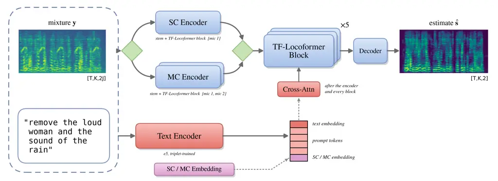
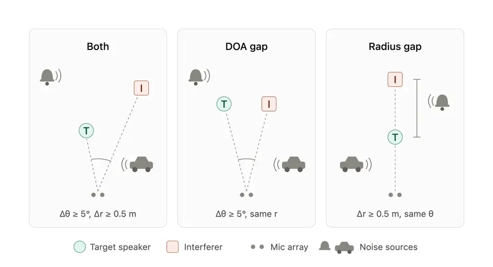
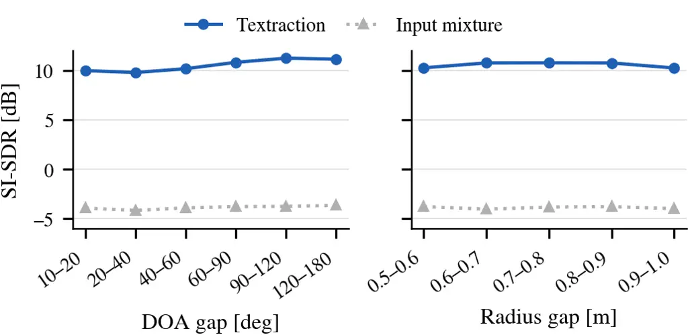
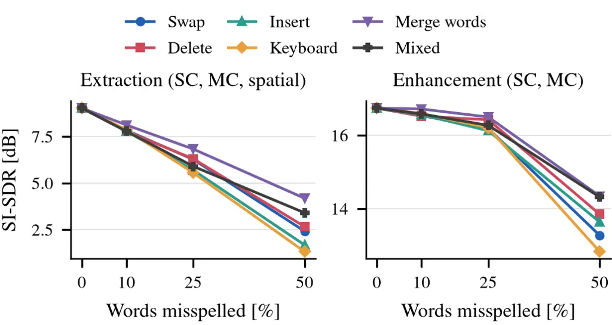

# Textraction: Unified Text-Guided Speaker Extraction and Enhancement for Single- and Multi-Channel Audio Thanks: This work was supported by…

Aviad Eisenberg    Sharon Gannot    Shlomo E. Chazan ^(†)^(†)thanks: A.
Eisenberg is with Bar-Ilan University, Israel, and with OriginAI,
Israel, aviad.eisenberg@biu.ac.il; S. Gannot is with Bar-Ilan
University, Israel, e-mail: sharon.gannot@biu.ac.il; and S.˜E.˜Chazan is
with OriginAI, e-mail: Israel, shlomi@originai.co.

###### Abstract

We present Textraction, a text-guided speaker extraction framework that
enables the selective extraction of desired speakers or noise sources
from an audio mixture using only natural-language descriptions. The
proposed method operates within a single unified model that supports
both single-channel and multi-channel inputs and it allows conditioning
on either semantic textual descriptions of the target source or on its
spatial description. Dedicated single- and multi-channel encoders feed a
shared stack of time–frequency transformer blocks, which is conditioned
on the prompt and on the recording configuration in every block through
cross-attention and estimates the target directly from the mixture in
one forward pass, without a separation stage or a source-selection
stage. The system can extract an arbitrary subset of entities from a
mixture, assuming up to two simultaneously active speakers and two noise
sources, and interprets prompts specifying which entities to _keep_,
which to _remove_, or both. In addition, we show that the framework
naturally applies to a speech-enhancement setting, in which a single
target speaker is present alongside background noise. To circumvent the
application of computationally costly large language models used in
prior work, we introduce a lightweight, task-adapted text encoder
obtained by contrastively fine-tuning a compact text-retrieval model,
which learns to be sensitive to instruction polarity (e.g., _keep_ vs.
_remove_) while remaining robust to paraphrasing. Experiments across
attribute-based extraction, spatially guided extraction, and speech
enhancement show that the proposed approach effectively isolates the
desired entities under various acoustic and spatial conditions, reaching
11.11 dB (multi-channel) and 10.83 dB (single-channel) SI-SDR (SI-SDR)
in attribute-based extraction, 10.53 dB in spatially guided extraction,
and 18.66 dB (multi-channel) and 18.15 dB (single-channel) in
enhancement, and matches or surpasses dedicated spatial-extraction and
enhancement baselines while offering substantially greater flexibility.
Audio samples are available on our demo page.¹¹ 1
[https://aviad3189.github.io/Textraction/](https://aviad3189.github.io/Textraction/)

###### Index Terms: 

Speaker extraction; Speech enhancement; Multi-microphone processing;
Text-guided conditioning; Text embedding

## I Introduction

Humans can effortlessly attend to a desired speaker in the presence of
competing talkers and background noise, a capability often referred to
as the _cocktail-party effect_. Reproducing this ability computationally
is central to many speech technologies. Classical _speech separation_
aims to decompose a mixture into all constituent sources, typically
without specifying a preferred source, whereas _speaker (or target)
extraction_ focuses on isolating a particular speaker of interest while
suppressing all other sources. Speaker extraction is especially
appealing in user-driven scenarios (e.g., teleconferencing,
hearing-assistive devices, and voice-controlled systems), where the user
either implicitly or explicitly specifies which speaker to enhance.

The literature contains extensive work on both single-channel and
multi-channel separation and extraction. Single-channel approaches have
achieved remarkable performance with deep learning architectures that
learn to disentangle sources from monaural mixtures, often under
permutation-invariant training or related objectives \[1, 2, 3, 4\]. In
parallel, multi-channel methods exploit spatial diversity offered by
microphone arrays, incorporating spatial features or
beamforming-inspired modules to improve robustness in reverberant and
noisy environments \[5, 6, 7, 8\]. For target speaker extraction \[9\],
a common paradigm is to condition the model on an auxiliary cue that
identifies the target, such as a short enrollment utterance \[10, 11,
12\], visual information \[13, 14, 15\], or spatial cues derived from an
array geometry \[16, 17, 18, 19, 20, 21\]. While effective, these cues
are not always available in practice: enrollment audio may be missing,
cameras may not exist, and multi-channel recordings are not guaranteed.

Recently, text-guided conditioning has emerged as a flexible and
powerful paradigm for speech and audio processing, enabling semantic
control over complex acoustic tasks. Instead of relying solely on
acoustic references, text prompts provide a compact and expressive
mechanism for specifying target attributes, speakers, or sound events.

Early works explored text guidance for sound extraction rather than
explicit speaker extraction. For example, Yuan et al. \[22\] proposed
extracting sounds using text prompts, where a frozen Flan-T5 model was
employed to generate text embeddings. Jiang et al. \[23\] applied text
prompts in a diarization setting; however, the method only indicates
when a speaker is active and does not perform speech extraction.

Several studies have investigated textual cues tailored to specific
application scenarios. In \[24\], dialogue history was used as a textual
cue for human–AI question answering. In \[25\], slide or poster content
was used for text enrollment without temporal alignment with the audio,
targeting meetings, presentations, lectures, and poster sessions. Both
studies adopted a pretrained Contrastive Language–Audio Pretraining
(CLAP) model \[26\] as the text encoder. Similarly, Rahimi et al. \[27\]
assumed that the exact linguistic content of the target speaker’s
utterance is known a priori and used it as enrollment information.

More recently, several text-guided speaker extraction methods have been
proposed for single-channel scenarios \[28, 29, 30, 31, 32, 33\]. Hao et
al. \[28\] introduced a free-text-guided framework in which the desired
speaker could be specified via spectral features, textual transcription,
or an auxiliary waveform. However, its mixtures contain only two
speakers, without environmental noise sources. Jiang et al. \[32\]
considered mixtures of two speech and two non-speech sources, but did
not explicitly simulate or evaluate controlled reverberant conditions.
Dai et al. \[31\] proposed the use of relative textual references (e.g.,
“older,” “second,” “louder”) to identify the target speaker.

The aforementioned text-guided methods primarily operate in
single-channel settings, relying on spectral or semantic cues for target
speaker identification. A notable exception is the work of Zhu et al.
\[34\], who proposed a multi-channel target speaker extraction framework
guided by both semantic and spatial queries. In this framework, spatial
queries specify predefined absolute regions in the microphone-array
coordinate system, while semantic text queries, embedded with a frozen
CLAP text encoder, describe speaker attributes and coarse spatial
locations. However, the framework does not model relative spatial
relations between speakers.

Despite these advances, several limitations remain. First, no existing
text-guided speaker extraction model can seamlessly operate in _both_
single-channel and multi-channel scenarios within a unified framework.
Second, most prior approaches rely on large pretrained language models
for text embedding, which are computationally expensive and typically
require parameter-efficient fine-tuning strategies such as LoRA.
Conversely, approaches using frozen text encoders lack flexibility in
handling diverse prompt formulations, such as specifying entities to
retain, remove, or both.

In this work, we propose a unified text-guided extraction framework for
both single-channel and multi-channel scenarios. Natural-language
prompts specify targets through spectral cues, spatial cues, or their
combinations. The framework is robust to high reverberation and multiple
noise sources and can extract any entity in the mixture, including noise
components, under arbitrary permutations. Free-form prompts allow users
to specify which entities to preserve, suppress, or both. We train a
lightweight text encoder tailored to the relevant prompt types,
improving efficiency and task alignment without relying on large
language models. One network, conditioned on the prompt, estimates the
target from the mixture in a single forward pass, and no separation or
selection stage is used.

Our main contributions are summarized as follows: 1) We propose a
unified model that supports both single-channel and multi-channel
text-guided extraction, effectively leveraging spectral and spatial
information within a single framework. SC and MC inputs enter through
dedicated encoders and share all subsequent blocks; the prompt and an
SC/MC embedding condition every block, and the network maps the mixture
to the target in one pass, without a separate-then-select pipeline. 2)
We introduce a lightweight text encoder based on text retrieval models,
which is significantly more efficient than large language models while
remaining expressive enough for flexible prompt-based control. 3) For
spatial extraction, we incorporate relative position cues \[35\]
expressed in free-form text, enabling the model to exploit relative
spatial relationships between speakers.

## II Problem Formulation

A scenario with $`Q`$ concurrently active speakers and $`R`$ directional
noise sources, recorded by an array of $`J`$ microphones in a
reverberant and noisy environment, is considered. The problem is
formulated in the STFT (STFT) domain, where $`k\in\{0,\ldots,K-1\}`$ and
$`t\in\{0,\ldots,T-1\}`$ denote the frequency-bin and time-frame
indices, respectively, and $`K`$ and $`T`$ are the total numbers of
frequency bins and time frames. The microphone-array observation are
then given by:

```math
\mathbf{x}(t,k)=\sum_{q=1}^{Q}s_{q}(t,k)\,\mathbf{h}_{q}(k)+\sum_{r=1}^{R}n_{r}(t,k)\,\mathbf{h}_{r}(k), \tag{1}
```

where $`s_{q}(t,k)`$ is the clean (anechoic) speech signal of the
$`q`$-th speaker, $`\mathbf{h}_{q}(k)\in\mathbb{C}^{J\times 1}`$ is the
ATF (ATF) vector between the $`q`$-th speaker and the microphone array,
$`n_{r}(t,k)`$ is the $`r`$-th noise source, and
$`\mathbf{h}_{r}(k)\in\mathbb{C}^{J\times 1}`$ is the corresponding
noise ATF vector.

We consider two main operating modes. For the _extraction_ task, we
focus on mixtures that contain two concurrently active speakers and two
directional noise sources, i.e., $`Q=R=2`$. For the _enhancement_ task,
we consider a single target speaker, $`Q=1`$, in the presence of either
one or two directional noise sources, i.e., $`R\in\{1,2\}`$. Both tasks
are studied under single- and multi-microphone recording setups.
Specifically, we consider a single-channel configuration with $`J=1`$,
as well as a two-microphone configuration with $`J=2`$, in which spatial
information provided by the microphone array is also exploited.

Given the observation $`\mathbf{x}(t,k)`$ and a natural-language prompt
$`p`$, the goal is to estimate the reference-microphone signal of the
entity (or set of entities) described by $`p`$, whether that entity is a
speaker or a directional noise source.

## III Prompt Generation

### III-A Attribute-Based Extraction

For extraction based on semantic attributes, we randomly select the
desired and interfering entities in each mixture. Each configuration is
represented by a binary selection vector

```math
\mathbf{m}=[m_{s_{1}},m_{s_{2}},m_{n_{1}},m_{n_{2}}],
```

where $`m=1`$ denotes an entity to be preserved and $`m=0`$ denotes an
entity to be removed. For example, the vector $`[1,0,1,0]`$ corresponds
to keeping the first speaker and the first noise source while removing
the second speaker and the second noise source.

For each selection vector, we construct three types of _base prompts_:
(i) prompts that contain only entities to be preserved, (ii) prompts
that contain only entities to be removed, and (iii) prompts that contain
both preserved and removed entities. Noise descriptions are taken
directly from the dataset metadata. Noise sources whose descriptions
include references to human speakers (e.g., _person_, _people_,
_speech_) are excluded to avoid semantic ambiguity. Speaker descriptions
are defined using their attributes, including gender, relative loudness
in the mixture, or a combination of both.

When speaker separation is required (i.e., configurations of the form
$`[1,0,*,*]`$ or $`[0,1,*,*]`$), the two speakers must differ in at
least one attribute. If both speakers share the same gender, one of them
is randomly assigned to be louder than the other. This attribute is
stored and later enforced during signal generation to ensure consistency
between the audio mixture and the textual prompt.

An example of a base prompt is:

> _“Remove the loud man, keep the weak woman, remove the barking dog,
> keep the sound of the engine.”_

To increase linguistic variability, the order of the prompt components
is randomly shuffled. Each base prompt is then expanded using a large
language model (LLM). In this work, we employ *Gemma 3* \[36\], which is
prompted to generate five semantically equivalent paraphrases for each
base prompt. Since this procedure is applied independently to each of
the three base-prompt types, a total of 15 distinct prompts are
generated for each mixture configuration.

For each signal, we additionally generate corresponding prompts
describing the interfering entities using the same procedure. We refer
to such a prompt as the _complementary prompt_: its target is the
complementary set of entities, given by the selection vector
$`\mathbf{1}-\mathbf{m}`$. During training, the model alternates between
conditioning on prompts describing the desired entities and prompts
describing the interference.

### III-B Spatially Guided Extraction

For extraction based on spatial attributes, the model is trained to
extract a single desired speaker from the mixture. Following \[35\], the
spatial descriptions are limited to a finite set of predefined textual
options, which are summarized in Table I. These descriptions express
_relative_ spatial relationships between the two speakers—for example,
which one is closer or more to the right—rather than absolute
coordinates in the array frame. To enable free-text conditioning, we
employ a large language model to generate $`1{,}000`$ paraphrased
prompts for each spatial description. During training, one prompt is
randomly selected from the corresponding set. Since the target in this
task is a single speaker without the noises, the complementary prompt of
a spatial scene describes the _other speaker_ (e.g., the speaker on the
left instead of the speaker on the right), not the complementary set of
all four entities.

| \#  | Base Spatial Prompts                                           |
| --- | -------------------------------------------------------------- |
| 1   | The speaker positioned on the right                            |
| 2   | The speaker positioned on the left                             |
| 3   | The speaker located farther away                               |
| 4   | The speaker located closer                                     |
| 5   | The speaker who is closer and oriented more to the left        |
| 6   | The speaker who is closer and oriented more to the right       |
| 7   | The speaker who is farther away and oriented more to the left  |
| 8   | The speaker who is farther away and oriented more to the right |

TABLE I: Base spatial prompts describing speaker position and
orientation. Each base prompt is expanded into $`1{,}000`$ free-form
paraphrases.

### III-C Speech Enhancement

For the speech enhancement task, where a single target speaker is
present alongside background noise, we again use an LLM to generate
textual prompts. Specifically, the following base sentences are used:
_“keep the talking speaker”_, _“remove the background noise”_, and
_“keep the talking speaker and remove the background noise”_. Each
sentence is rephrased $`1{,}000`$ times, and during training a single
prompt is randomly selected, following the same procedure as in the
spatially guided scenario. Complementary prompts are used only in the
extraction tasks.

## IV Proposed Model

Figure 1 presents an overview of the proposed Textraction framework. The
network receives the mixture and the prompt and estimates, in one
forward pass, the signal described by the prompt. It is built from
TF-Locoformer blocks \[37\]. To enable unified operation in both
single-channel (SC) and multi-channel (MC) settings, the input is
processed by the corresponding SC or MC encoder, while the remaining
blocks are shared between the two configurations. The prompt and a
learned SC/MC embedding, which informs the shared network of the active
recording configuration, condition the features after the encoder and
after every shared block through cross-attention. The network has no
separation stage and no source-selection stage; the prompt alone
determines which signal is extracted. The following subsections describe
the prompt representation and the network architecture in detail.



Fig. 1: Overview of the proposed Textraction model. The mixture
$`\mathbf{y}`$ is represented in the STFT real–imaginary domain and
routed, according to the recording configuration, to the SC encoder
(reference microphone) or to the MC encoder (both microphones); each
encoder is a convolutional layer followed by a TF-Locoformer block. Five
shared TF-Locoformer blocks follow. After the encoder and after every
shared block, a cross-attention layer conditions the features on the
pooled prompt embedding and the token-level states of the fine-tuned
lightweight text encoder, together with a learned SC/MC embedding. A
decoder outputs the target estimate $`\hat{\mathbf{s}}`$.

### IV-A Prompt Embedding

To guide the model toward the desired output, we condition it on
free-form textual prompts. Existing approaches often rely on large
language models (LLMs) as text embedders; however, such models are
computationally heavy and may be unnecessary for the limited semantic
scope required in our task. Since the prompts mainly describe source
attributes and extraction instructions, we hypothesize that a
lightweight model capable of capturing linguistic meaning is sufficient.

Accordingly, we adopt the E5 text-retrieval model \[38\] as our text
encoder. Given an input prompt, the E5 model produces a
fixed-dimensional embedding vector. However, embeddings produced by a
generic retrieval model are not guaranteed to reflect the semantic
distinctions required for our task. For instance, prompts such as
_“remove the barking dog”_ and _“keep the barking dog”_ may be mapped to
nearby locations in the embedding space despite conveying opposite
instructions.

To address this limitation, we fine-tune the E5 model using
task-specific contrastive supervision. For each prompt in our dataset,
we construct a triplet consisting of an anchor prompt, a positive
prompt, and a negative prompt. These prompts are generated using the
_Gemma 3_ LLM. Given an anchor prompt, the positive example is a
paraphrase with equivalent semantic meaning, generated with as little
lexical overlap as possible. The negative example conveys the opposite
instruction while preserving similar wording to the anchor.

For example, given the anchor prompt _“Extract the loud man and the
audience’s applause, remove the woman and the running engine,”_ a
positive example is _“Focus on the louder male speaker and the sound of
a crowd’s cheers, while filtering out the female presence and the motor
noise,”_ and a negative example is _“Remove the loud man and the
audience’s applause, extract the woman and the running engine.”_

We fine-tune the E5 model using a triplet loss objective, encouraging
high cosine similarity between the anchor and positive embeddings while
pushing the anchor and negative embeddings farther apart. This training
explicitly enforces sensitivity to instruction polarity (e.g., _keep_
versus _remove_) while maintaining semantic robustness to paraphrasing.

Table II presents the cosine similarity scores before and after
fine-tuning. While the pre-trained E5 model assigns similarly high
similarity scores to both positive and negative prompts, the fine-tuned
model successfully distinguishes between them, demonstrating its
suitability for text-guided extraction.

|                  | Positive | Negative    |
| ---------------- | -------- | ----------- |
| E5 (pre-trained) | 0.9565   | 0.9889      |
| E5 (fine-tuned)  | 0.9911   | $`-0.5405`$ |

TABLE II: Cosine similarity between anchor prompts and their positive
and negative counterparts, before and after fine-tuning the E5 model.
After fine-tuning, opposite-polarity prompts are pushed apart while
paraphrases remain close.

The triplet-trained E5 model initializes the text encoder of
Textraction, and it is fine-tuned jointly with the extraction network at
a low learning rate. The extraction network receives two representations
of the prompt. The first is the pooled E5 embedding
$`\mathbf{e}\in\mathbb{R}^{d}`$, where $`d`$ denotes the embedding
dimension: the L2-normalized average of the token states, which is the
representation shaped by the triplet training. The second is the
sequence of token-level hidden states of E5, which lets the network
attend to individual words of the prompt.

### IV-B Architecture

The proposed SC (SC)– MC (MC) text-guided extraction network operates in
the STFT domain using a real–imaginary (RI) representation. Given a
mixture tensor $`\mathbf{X}\in\mathbb{R}^{B\times C\times F\times T}`$,
where $`B`$ is the batch size, $`C`$ is the number of input channels
($`C{=}2`$ for the RI parts of the reference microphone and $`C{=}4`$
for the RI parts of both microphones), and $`F,T`$ are the frequency-bin
and time-frame dimensions, the model outputs an estimate
$`\widehat{\mathbf{S}}\in\mathbb{R}^{B\times 2\times F\times T}`$ of the
target in RI form, which is inverted by the inverse STFT to give the
waveform estimate $`\hat{s}`$.

_SC and MC encoders._ To support both recording configurations within
one model, we use two encoders of identical topology that differ only in
their input dimensionality: an SC encoder operating on $`C{=}2`$
channels and an MC encoder operating on $`C{=}4`$ channels. Each encoder
consists of a 2-D convolutional layer, which maps every time–frequency
bin to an embedding of dimension $`D`$, followed by group normalization
and one TF-Locoformer block \[37\]. A binary indicator selects the
encoder per example: every example passes only through the encoder of
its own configuration, and the encoder outputs are merged back into one
batch. The MC encoder can therefore exploit the inter-microphone phase
and level differences, while SC examples are processed without padding
the missing microphone.

_Shared blocks._ The encoder output is processed by five shared
TF-Locoformer blocks. Each block alternates between modeling along the
frequency axis and along the time axis, and it combines multi-head
self-attention with convolutional feed-forward modules, which capture
both local and global context. A transposed-convolution decoder maps the
final features to the two RI channels of the target.

_Conditioning._ The conditioning sequence $`\mathbf{Z}`$ consists of the
projected pooled prompt embedding, the E5 token states, and a learned
SC/MC embedding that indicates whether the current example contains
multi-channel spatial information; all its elements have dimension $`d`$
and are layer-normalized. The features are conditioned after the encoder
and after each of the five shared blocks, at six locations in total. At
each location, a cross-attention layer lets every time–frequency bin of
the mixture feature map $`\mathbf{H}\in\mathbb{R}^{D\times F\times T}`$,
i.e., the output of the encoder or of the preceding shared block, act as
a query that attends to the conditioning sequence $`\mathbf{Z}`$ (the
keys and values), and the result is added residually to $`\mathbf{H}`$.
Rather than explicitly defining how the prompt and the recording
configuration interact with the audio, the attention mechanism learns
these relationships. Because the conditioning enters every block, the
network decides at every depth which parts of the mixture to keep, and
no explicit separation into sources is needed.

_Initialization._ The encoders, the shared TF-Locoformer blocks, and the
decoder are initialized from a four-source TF-Locoformer separator that
was trained with permutation-invariant training on the same data: the
block of each encoder from the separator’s first block, and the five
shared blocks from its remaining blocks. The separator is used only for
initialization and is not a stage of the model. The decoder is
initialized from the separator’s decoder by summing its weights over the
four sources, the second-microphone input channels of the MC encoder are
initialized to zero, and the output layers of all cross-attention layers
are initialized to zero, so that at initialization the conditioning
layers are the identity.

### IV-C Objective Functions

We represent all signals by the real and imaginary (RI) parts of their
STFT, which serve both as the network input and as the training target.
The time-domain estimate $`\hat{s}`$ is obtained by applying the inverse
STFT to the network output. The training objective has three terms: an
SI-SDR term, a log-magnitude term, and a CLAP (CLAP) term. The main
criterion is the SI-SDR between the target signal $`s`$ and the estimate
$`\hat{s}`$:

```math
\mathrm{SI\text{-}SDR}(s,\hat{s})=10\log_{10}\frac{\left\lVert\alpha s\right\rVert^{2}}{\left\lVert\alpha s-\hat{s}\right\rVert^{2}},\qquad\alpha=\frac{\langle\hat{s},s\rangle}{\left\lVert s\right\rVert^{2}}. \tag{2}
```

Here $`\alpha s`$ is the projection of $`\hat{s}`$ onto $`s`$, so the
scale of $`\hat{s}`$ does not change the measure. The loss is the
negative SI-SDR improvement over the unprocessed mixture $`y`$ at the
reference microphone:

```math
\mathcal{L}_{\mathrm{SI\text{-}SDR}}=\mathrm{SI\text{-}SDR}(s,y)-\mathrm{SI\text{-}SDR}(s,\hat{s}). \tag{3}
```

The first term does not depend on the network, so it has no effect on
the gradients. It only shifts the loss so that
$`\mathcal{L}_{\mathrm{SI\text{-}SDR}}=0`$ means no improvement over the
mixture.

To encourage accurate spectral envelopes and stabilize optimization, we
add an MSE loss on the log-magnitude spectra,

```math
\mathcal{L}_{\log|\cdot|}=\left\|\log_{10}\!\left(|\widehat{\mathbf{S}}|+\epsilon\right)-\log_{10}\!\left(|\mathbf{S}|+\epsilon\right)\right\|_{2}^{2}, \tag{4}
```

where $`\epsilon=e^{-6}`$.

In examples whose prompt keeps exactly one noise source, we additionally
enforce consistency between the estimate and the textual description of
that noise. We feed the estimated waveform $`\hat{s}`$, resampled to
48 kHz, to the audio encoder of a pretrained, frozen CLAP model and the
dataset caption $`c`$ of the kept noise clip to its text encoder,
obtaining the embeddings $`\mathbf{z}_{aud}(\hat{s})`$ and
$`\mathbf{z}_{txt}(c)`$, and maximize their cosine similarity:

```math
\mathcal{L}_{\mathrm{CLAP}}=-\frac{\langle\mathbf{z}_{aud}(\hat{s}),\mathbf{z}_{txt}(c)\rangle}{\|\mathbf{z}_{aud}(\hat{s})\|\;\|\mathbf{z}_{txt}(c)\|}. \tag{5}
```

The full training loss is

```math
\mathcal{L}=\mathcal{L}_{\mathrm{SI\text{-}SDR}}+\mathcal{L}_{\log|\cdot|}+\mathbbm{1}_{\mathrm{noise}}\,\mathcal{L}_{\mathrm{CLAP}}, \tag{6}
```

where $`\mathbbm{1}_{\mathrm{noise}}`$ equals $`1`$ when the target is a
single noise source and $`0`$ otherwise. STOI (STOI) is used only as an
evaluation metric.

_Prompt pairing._ In the extraction tasks, every mixture appears in the
batch twice, once with its prompt and once with its complementary prompt
(Section III). The two examples have identical audio and different
targets, which forces the network to rely on the text in order to reduce
the loss.

## V Experimental Setup

### V-A Dataset

We generate a simulated text-guided extraction dataset composed of
mixtures containing speech and environmental noise. For each mixture, we
randomly select two speech utterances from LibriSpeech and two noise
clips from VGGSound. To avoid semantic ambiguity between “noise” and
“speech,” we exclude VGGSound samples whose captions indicate human
speech activity (e.g., _person talking_, _people speaking_).

Reverberant multi-microphone recordings are synthesized using a
room-simulation framework based on the image method \[39\]. For each
simulated room, the microphone-array position and its azimuth (with
respect to the wall) are randomly selected, while enforcing a minimum
distance of $`0.5`$ m from the nearest wall. The reverberation time
($`T_{60}`$) is uniformly sampled in the range $`0.3`$–$`0.8`$ s. We use
a two-microphone array with $`8`$ cm spacing. The two speakers and the
selected noise sources are placed at random positions in the room; their
distances (radii) from the array are uniformly sampled between $`1`$ and
$`4`$ m, and the DOA (DOA) of each source is measured relative to the
array center and sampled on a $`2^{\circ}`$ grid over
$`[0^{\circ},180^{\circ}]`$.

During training, mixtures and their corresponding targets are generated
on the fly. For each mixture, we randomly sample SNR (SNR) levels in the
range $`0`$–$`10`$ dB and SIR (SIR) levels in the range $`5`$–$`10`$ dB.
When the textual prompt specifies a loudness difference between the two
speakers, the noise signals are normalized with respect to the weaker
speaker to preserve the intended loudness ordering in the mixture. In
addition to the extraction setting with two speakers and two noises, we
also generate an enhancement setting in which only a single randomly
chosen speaker is present, mixed with background noise under the same
simulation procedure. The dataset consisted of 70,000 training samples,
1,000 validation samples, and 1,000 test samples. During training, each
example is an enhancement example with probability $`0.1`$ and a
two-microphone example with probability $`0.5`$, and $`75\%`$ of the
two-microphone extraction examples use a spatial prompt.

### V-B Implementation Details

All audio signals are sampled at 8 kHz. The STFT is computed with
256-sample frames (rectangular window) and a hop size of 128 samples,
giving $`F=129`$ frequency bins. Each encoder contains one TF-Locoformer
block, followed by five shared blocks, all with embedding dimension
$`D=128`$; the cross-attention layers use four heads. Text embeddings
are generated using the e5-small-v2 encoder ($`d=384`$), which is first
contrastively fine-tuned using a triplet margin loss with a margin of
0.5 and then fine-tuned with the extraction network. The complete
extraction network contains approximately 52 million parameters, 33
million of which belong to the text encoder. The model is trained using
the AdamW optimizer with learning rates of $`5\times 10^{-5}`$ for the
acoustic layers, $`2\times 10^{-4}`$ for the conditioning layers, and
$`1\times 10^{-5}`$ for the text encoder, all with a 1,000-step linear
warm-up, and with gradient clipping at 1. Each batch contains 30
mixtures, each used with two prompts (60 examples). Training uses bf16
mixed precision and gradient checkpointing, and an exponential moving
average (EMA) of the weights with decay $`0.999`$ is kept and used for
evaluation. The model is trained on a single NVIDIA H200 GPU.

### V-C Baselines

We compare our method against established spatial-extraction systems and
strong speech-enhancement models. For spatially guided extraction, we
compare against SSF, a spatially selective nonlinear filter \[16\], and
SpatialNet \[6\], a state-of-the-art multichannel network for joint
separation, denoising, and dereverberation. SSF is conditioned on the
oracle DOA of the target. SpatialNet receives no target cue: it is used
unmodified as a two-output separator, trained from scratch on our
two-microphone spatial-extraction mixtures with a permutation-invariant
SI-SDR loss and with reverberant targets, as for Textraction. At test
time, each prompt is assigned the SpatialNet output given by the oracle
permutation, i.e., the assignment of the two outputs to the two
reference speakers that maximizes SI-SDR. Both spatial baselines
therefore use oracle information that Textraction does not have. For
speech enhancement, we compare to HDDEMUCS-TF \[40\] in the SC setting
and to TF-GridNet \[1\], a state-of-the-art multi-channel time–frequency
network, in the MC setting. TF-GridNet receives both microphones and is
trained on our MC enhancement data from scratch, and it is evaluated on
the same test items as our model. For a fair comparison, all models were
trained or fine-tuned on our dataset.

### V-D Evaluation Metrics

We report four complementary metrics. SI-SDR (in dB) measures the
fidelity of the estimated waveform to the reference and is invariant to
overall scale. STOI estimates speech intelligibility on a $`[0,1]`$
scale. DNSMOS P.835 \[41\] is a non-intrusive estimate of perceived
quality; we report its overall score (OVRL) on a $`1`$–$`5`$ scale. The
word error rate (WER, in %, lower is better) is obtained with the
Whisper large-v3 recognizer \[42\] after Whisper’s English text
normalization. The test items are crops of LibriSpeech utterances, so
the WER of the mixture and of each output is computed against the
Whisper transcript of the reference signal, and it is reported only for
targets that contain exactly one speaker (with or without noise). All
signals are sampled at 8 kHz and upsampled to 16 kHz for both measures,
which lowers the absolute DNSMOS values of all signals, including the
clean reference (OVRL of about $`2.05`$). For each comparison, we also
report the corresponding input (unprocessed mixture) values to
explicitly indicate the improvement. Each test scenario of the
extraction tasks is evaluated with both its prompt and its complementary
prompt. Every item has a fixed random seed, so all results are computed
on identical signals.

## VI Experimental Results

We evaluate the proposed Textraction framework in five settings: (i)
multi-channel (MC) attribute-based extraction, (ii) single-channel (SC)
attribute-based extraction, (iii) spatially guided extraction, (iv) MC
speech enhancement, and (v) SC speech enhancement. Table III summarizes
the overall results, and Tables IV and V provide per-configuration
breakdowns for MC and SC extraction. Table X breaks down attribute-based
extraction by prompt formulation: _All_ (retain and suppress), _Keep_
(retain-only), and _Remove_ (suppress-only).

### VI-A Attribute-Based Extraction

As shown in Table III, in MC extraction, SI-SDR improves from
approximately $`0`$ dB at the input to 11.11 dB, with STOI increasing
from 0.575 to 0.797. In SC extraction, SI-SDR reaches 10.83 dB,
demonstrating that semantic conditioning alone provides strong
separation capabilities even in the absence of spatial information. The
MC and SC configurations are within $`0.3`$ dB of each other on
attribute-based extraction. The semantic prompts in this task can be
resolved from spectral cues alone, and the second microphone contributes
mainly to the spatially guided task (Section VI-C). For targets that
contain a single speaker, the WER drops from about $`76`$% at the input
to 33.3% (MC) and 34.4% (SC). The input WER is high because the
recognizer also transcribes the competing speaker.

|                    | Input  |       |        |       | Textraction |       |        |      |
| ------------------ | ------ | ----- | ------ | ----- | ----------- | ----- | ------ | ---- |
| Task               | SI-SDR | STOI  | DNSMOS | WER   | SI-SDR      | STOI  | DNSMOS | WER  |
| MC Extraction      | -0.03  | 0.575 | 1.54   | 76.1  | 11.11       | 0.797 | 1.61   | 33.3 |
| SC Extraction      | -0.03  | 0.575 | 1.53   | 75.8  | 10.83       | 0.789 | 1.61   | 34.4 |
| Spatial Extraction | -3.83  | 0.474 | 1.41   | 100.8 | 10.53       | 0.857 | 2.36   | 29.2 |
| MC Enhancement     | 5.70   | 0.792 | 1.71   | 22.1  | 18.66       | 0.960 | 2.30   | 8.2  |
| SC Enhancement     | 5.55   | 0.790 | 1.70   | 21.1  | 18.15       | 0.955 | 2.33   | 9.7  |
| Average            | 1.47   | 0.641 | 1.58   | 59.2  | 13.86       | 0.872 | 2.04   | 22.9 |

TABLE III: Overall results across the five settings on the test items.
SI-SDR (dB), STOI, and DNSMOS OVRL: higher is better; WER (%): lower is
better. In the attribute-based extraction tasks, WER is computed over
the items whose target contains a single speaker.

The detailed breakdowns in Tables IV and V reveal how difficulty varies
across target configurations. Mixed selections such as _Target + Both
Noises_ reach 15.27 dB (MC) and 15.32 dB (SC), and extracting both
speakers reaches 12.93 dB (MC) and 12.14 dB (SC). In _Single Target_,
one speaker must be taken out of a mixture with a second speaker and two
noises; the model reaches 11.70 dB (MC) and 11.23 dB (SC), an
improvement of about $`15`$ dB over the input. As expected, extracting a
_single_ directional noise source from a heavily degraded input (input
SI-SDR $`\approx-8`$ dB) remains the hardest case; nevertheless, the
model still improves the input by more than $`11`$ dB. DNSMOS rates any
non-speech energy as a degradation, including noise that the prompt asks
to keep. It is therefore informative mainly for speech-only targets: for
_Single Target_ it rises from 1.61 to 2.30 (MC) and 2.27 (SC), and for
_Both Targets_ from 1.45 to 1.92 (MC) and from 1.42 to 1.88 (SC),
whereas outputs that correctly contain the requested noise receive low
scores (1.15–1.20 for noise-only targets).

|                      | Input  |       |        |      | Textraction |       |        |      |
| -------------------- | ------ | ----- | ------ | ---- | ----------- | ----- | ------ | ---- |
| Action Category      | SI-SDR | STOI  | DNSMOS | WER  | SI-SDR      | STOI  | DNSMOS | WER  |
| Both Noises          | -3.32  | 0.464 | 1.45   | –    | 9.40        | 0.730 | 1.20   | –    |
| Both Targets         | 3.28   | 0.668 | 1.45   | –    | 12.93       | 0.874 | 1.92   | –    |
| Both Targets + Noise | 7.93   | 0.813 | 1.49   | –    | 13.27       | 0.877 | 1.43   | –    |
| Single Noise         | -7.95  | 0.282 | 1.49   | –    | 3.99        | 0.491 | 1.15   | –    |
| Single Target        | -3.58  | 0.503 | 1.61   | 81.7 | 11.70       | 0.856 | 2.30   | 33.4 |
| Target + Both Noises | 3.48   | 0.709 | 1.61   | 67.6 | 15.27       | 0.917 | 1.53   | 34.8 |
| Target + Noise       | -0.03  | 0.580 | 1.57   | 77.6 | 11.47       | 0.833 | 1.68   | 32.4 |

TABLE IV: Per-configuration MC extraction results. SI-SDR (dB), STOI,
and DNSMOS OVRL: higher is better; WER (%): lower is better, reported
only when the target contains a single speaker.

|                      | Input  |       |        |      | Textraction |       |        |      |
| -------------------- | ------ | ----- | ------ | ---- | ----------- | ----- | ------ | ---- |
| Action Category      | SI-SDR | STOI  | DNSMOS | WER  | SI-SDR      | STOI  | DNSMOS | WER  |
| Both Noises          | -3.33  | 0.462 | 1.42   | –    | 9.01        | 0.723 | 1.18   | –    |
| Both Targets         | 3.29   | 0.670 | 1.42   | –    | 12.14       | 0.855 | 1.88   | –    |
| Both Targets + Noise | 7.92   | 0.813 | 1.47   | –    | 13.13       | 0.877 | 1.45   | –    |
| Single Noise         | -7.94  | 0.281 | 1.47   | –    | 3.61        | 0.480 | 1.17   | –    |
| Single Target        | -3.88  | 0.497 | 1.61   | 81.5 | 11.23       | 0.843 | 2.27   | 36.3 |
| Target + Both Noises | 3.75   | 0.713 | 1.61   | 66.9 | 15.32       | 0.916 | 1.56   | 35.6 |
| Target + Noise       | 0.00   | 0.579 | 1.57   | 77.3 | 11.24       | 0.825 | 1.66   | 32.7 |

TABLE V: Per-configuration SC extraction results. SI-SDR (dB), STOI, and
DNSMOS OVRL: higher is better; WER (%): lower is better, reported only
when the target contains a single speaker.

### VI-B Semantic Fidelity of Single-Noise Extraction

For noise targets, SI-SDR is not an adequate measure: it rewards exact
waveform reconstruction, whereas the identity of noise-like sound events
lies in their spectro-temporal envelope, so perceptually correct outputs
can still score low (about 3.8 dB here, from an input of about
$`-8`$ dB). To assess whether the extracted signal is nevertheless the
_requested sound event_, we measure its semantic similarity in the joint
text–audio embedding space of EmbeddingGemma 2 \[43\], a multimodal
embedding model that maps text and audio into a single 768-dimensional
space. This model was not used in training. We evaluate the 640
single-noise items (SC and MC extraction test sets, prompt and
complementary prompt), and, in addition, the 244 items whose prompt asks
for _both_ noise sources (_Both Noises_). Each waveform is resampled to
16 kHz and embedded without a prefix, and each noise caption is embedded
with the retrieval-query prefix. We report two measures: the cosine
similarity between the output embedding and the embedding of the
reference noise signal, and the cosine similarity between the output
embedding and the caption of the requested noise. For _Both Noises_, the
reference is the sum of the two noise signals, and the caption
similarity is averaged over the two noise captions. Table VI summarizes
the results, together with the unprocessed mixture and the clean
reference noise.

We compare with two off-the-shelf language-queried sound separation
models, AudioSep \[44\] and CLAPSep \[45\], using their released
pretrained weights without retraining. Both are single-channel models
trained at 32 kHz on general sound-event data. They receive the
first-microphone mixture resampled to 32 kHz, and their output is
resampled back to 8 kHz before scoring. Because these models are trained
with short sound-event descriptions rather than instructions, each
receives the caption of the requested noise as its text query (for _Both
Noises_, the two captions joined by “and”), whereas Textraction receives
the dataset prompt. CLAPSep also accepts a negative query; using the
removed sources as the negative query changed its cosine similarities by
at most 0.02, so we report it with the positive query only.

The model moves the output far from the mixture toward the requested
noise. In the audio embedding space, the similarity to the reference
noise rises from 0.771 for the mixture to 0.950. The caption similarity
rises from 0.629 for the mixture to 0.681, which is close to that of the
clean reference noise (0.688). The same holds when both noises are
requested: the similarity to the reference rises from 0.786 for the
mixture to 0.967, and the caption similarity of the output (0.672) is
close to that of the clean reference (0.676).

Both language-queried baselines also move the output toward the
requested noise, but much less. AudioSep, the stronger of the two,
reaches a similarity to the reference of 0.898 for a single noise and
0.908 for both noises, and CLAPSep reaches 0.854 and 0.861, compared
with 0.950 and 0.967 for Textraction. Their caption similarity is also
lower (0.677 for AudioSep and 0.660 for CLAPSep for a single noise,
versus 0.681). This gap is consistent with a domain mismatch: the test
mixtures are reverberant 8 kHz recordings that contain two competing
speakers in addition to the two noise sources, a setting that
general-purpose sound separators were not trained for.

|                 |              |       |             |       |
| --------------- | ------------ | ----- | ----------- | ----- |
|                 | Single Noise |       | Both Noises |       |
| Signal          | Ref.         | Cap.  | Ref.        | Cap.  |
| Input mixture   | 0.771        | 0.629 | 0.786       | 0.632 |
| AudioSep \[44\] | 0.898        | 0.677 | 0.908       | 0.671 |
| CLAPSep \[45\]  | 0.854        | 0.660 | 0.861       | 0.652 |
| Textraction     | 0.950        | 0.681 | 0.967       | 0.672 |
| Reference noise | 1.000        | 0.688 | 1.000       | 0.676 |

TABLE VI: Noise extraction on the SC and MC test items (640 single-noise
and 244 both-noise items): cosine similarity in the EmbeddingGemma 2
space between the output and the reference noise audio (Ref.) and the
requested noise captions (Cap.). Higher is better. AudioSep and CLAPSep
use their released weights and receive the requested noise caption as
the query.

### VI-C Spatially Guided Extraction

Table VII presents a direct comparison of the proposed methodology with
SSF and SpatialNet on the spatial extraction task. Although Textraction
is designed as a general text-guided extraction framework rather than a
spatially specialized separator, it consistently outperforms the
evaluated spatial baselines in both SI-SDR and STOI across all reported
spatial conditions.

We evaluate spatially guided extraction under three spatial
configurations, depending on the relative position of the target and
interfering speakers. “Both” denotes scenarios in which the speakers
differ in both DOA and radial distance, with gaps of at least
$`5^{\circ}`$ and $`0.5`$ m, respectively. “DOA gap” and “Radius gap”
denote scenarios in which the speakers differ only in azimuth by at
least $`5^{\circ}`$ or only in radial distance by at least $`0.5`$ m,
respectively. Fig. 2 illustrates the three configurations.



Fig. 2: The three spatial configurations of the spatially guided
extraction test set. The target speaker (T) and the interfering speaker
(I) differ in both DOA and distance (“Both”), only in DOA (“DOA gap”),
or only in distance from the two-microphone array (“Radius gap”). Two
directional noise sources are present in every scene.

Under joint azimuth and distance discrimination (“Both”), Textraction
reaches 10.67 dB, compared with $`5.70`$ dB for SpatialNet and
$`5.00`$ dB for SSF. In the azimuth-only condition (“DOA gap”), it again
achieves the strongest separation among the evaluated systems
(10.41 dB). In the distance-only scenario (“Radius gap”), which is the
most challenging condition for the baselines, Textraction reaches
10.52 dB, more than $`6.5`$ dB above SpatialNet. SSF is not evaluated in
this condition: it is conditioned on the DOA of the target, so when the
two speakers share the same DOA and differ only in distance, its cue
cannot identify the target. The performance of Textraction is nearly
uniform across the three conditions, so distance-based prompts are
resolved about as well as azimuth-based prompts. In all three
conditions, STOI reaches about $`0.86`$, compared with $`0.69`$–$`0.71`$
for SpatialNet and $`0.65`$–$`0.69`$ for SSF. The output is also more
intelligible and of higher perceived quality: its WER is 28.0–31.6%,
compared with 59.2–63.9% for SpatialNet and 57.4–66.2% for SSF, and its
DNSMOS is 2.32–2.41, compared with 1.96–1.98 and 1.75–1.79,
respectively. The input WER exceeds 100% because the recognizer
transcribes both speakers. Importantly, whereas SSF and SpatialNet are
spatially specialized architectures that rely on oracle information (SSF
on the target DOA, SpatialNet on the oracle assignment of its two
outputs), so that neither has to identify the target itself, Textraction
operates within a unified SC–MC framework, supports free-form
natural-language spatial descriptions, and simultaneously enables
semantic attribute-based conditioning. Thus, the proposed approach not
only achieves superior spatial extraction performance compared with the
other methods but also offers substantially greater flexibility.

| Method      | Action Category | SI-SDR $`\uparrow`$ | STOI $`\uparrow`$ | DNSMOS $`\uparrow`$ | WER $`\downarrow`$ |
| ----------- | --------------- | ------------------- | ----------------- | ------------------- | ------------------ |
| Input       | Both            | -3.99               | 0.466             | 1.42                | 101.3              |
|             | DOA gap         | -3.75               | 0.475             | 1.41                | 104.3              |
|             | Radius gap      | -3.75               | 0.480             | 1.41                | 96.7               |
| SSF         | Both            | 5.00                | 0.689             | 1.75                | 66.2               |
|             | DOA gap         | 3.87                | 0.650             | 1.79                | 57.4               |
| SpatialNet  | Both            | 5.70                | 0.71              | 1.98                | 62.4               |
|             | DOA gap         | 5.70                | 0.71              | 1.96                | 59.2               |
|             | Radius gap      | 3.80                | 0.69              | 1.96                | 63.9               |
| Textraction | Both            | 10.67               | 0.856             | 2.36                | 31.6               |
|             | DOA gap         | 10.41               | 0.856             | 2.32                | 28.0               |
|             | Radius gap      | 10.52               | 0.857             | 2.41                | 28.1               |

TABLE VII: Spatially guided extraction results. SI-SDR (dB), STOI, and
DNSMOS OVRL: higher is better; WER (%): lower is better. SSF is
conditioned on the oracle DOA of the target; it has no “Radius gap” row
because a DOA cue cannot distinguish speakers that differ only in
distance. SpatialNet separates both speakers without a cue, and its
outputs are assigned to the prompts by the oracle permutation.

Fig. 3 breaks the spatial results down by how far apart the two speakers
are. In DOA, Textraction reaches 9.99 dB SI-SDR for gaps of only
$`10^{\circ}`$–$`20^{\circ}`$ and 10.8–11.3 dB for gaps beyond
$`60^{\circ}`$, so speakers that are close in direction remain
separable, and a wider angular separation adds only about 1 dB. In
distance, Textraction is nearly flat at 10.3–10.8 dB over the whole
range of radius gaps ($`0.5`$–$`1.0`$ m), so prompts that refer to a
closer or farther speaker are resolved as reliably for a $`0.5`$ m
difference as for a $`1`$ m one.



Fig. 3: Spatially guided extraction SI-SDR as a function of the spatial
separation between the two speakers. Left: DOA gap, over the scenes in
which the speakers differ in DOA (“Both” and “DOA gap”); right: radius
gap, over the scenes in which they differ in distance (“Both” and
“Radius gap”). Each point is the mean over the test items (prompt and
complementary prompt) in the bin.

### VI-D Speech Enhancement

In the enhancement task (Tables VIII and IX), Textraction achieves
18.66 dB SI-SDR / 0.960 STOI in MC and 18.15 dB SI-SDR / 0.955 STOI in
SC. In the MC setting, the dedicated TF-GridNet reaches $`18.15`$ dB
SI-SDR / $`0.959`$ STOI, so Textraction surpasses a state-of-the-art
enhancement network trained for this task alone by $`0.5`$ dB SI-SDR,
with a similar STOI. In the SC setting, Textraction surpasses
HDDEMUCS-TF ($`13.72`$ dB SI-SDR / $`0.890`$ STOI) by about $`4.4`$ dB
in SI-SDR and $`0.065`$ in STOI. In MC enhancement, the DNSMOS of
Textraction is slightly higher than that of TF-GridNet (2.30 vs. 2.24),
and the two reach a similar WER (8.2% vs. 7.9%), both far below the
22.1% of the input. In SC enhancement, Textraction reduces the WER from
21.1% to 9.7%, whereas the output of HDDEMUCS-TF has a higher WER than
the input (25.9%), and Textraction also reaches a higher DNSMOS (2.33
vs. 2.24). This is notable because HDDEMUCS-TF and TF-GridNet are
dedicated enhancement models, whereas Textraction performs enhancement
as a special case of a more general text-guided extraction framework,
with the same weights that also serve the four extraction tasks.

| Method      | SI-SDR $`\uparrow`$ | STOI $`\uparrow`$ | DNSMOS $`\uparrow`$ | WER $`\downarrow`$ |
| ----------- | ------------------- | ----------------- | ------------------- | ------------------ |
| Input       | 5.70                | 0.792             | 1.71                | 22.1               |
| TF-GridNet  | 18.15               | 0.959             | 2.24                | 7.9                |
| Textraction | 18.66               | 0.960             | 2.30                | 8.2                |

TABLE VIII: MC enhancement results on the same test items. WER in %.

| Method      | SI-SDR $`\uparrow`$ | STOI $`\uparrow`$ | DNSMOS $`\uparrow`$ | WER $`\downarrow`$ |
| ----------- | ------------------- | ----------------- | ------------------- | ------------------ |
| Input       | 5.55                | 0.790             | 1.70                | 21.1               |
| HDDEMUCS-TF | 13.72               | 0.890             | 2.24                | 25.9               |
| Textraction | 18.15               | 0.955             | 2.33                | 9.7                |

TABLE IX: SC enhancement results. WER in %.

### VI-E Robustness to Prompt Formulation

Table X groups the attribute-based extraction test items by the
formulation of their prompt. The performance differences between “All,”
“Keep,” and “Remove” prompts are small: SI-SDR differences are within
$`0.55`$ dB, STOI differences are within $`0.016`$, and the WER ranges
from 32.1% to 36.7%. “All” prompts, which contain both retain and
suppress clauses, are slightly harder than the other two formulations.
This confirms that the fine-tuned E5 encoder effectively captures
instruction polarity, that the model is robust to linguistic variability
and paraphrasing, and that both positive (retain) and negative
(suppress) instructions are interpreted consistently.

| Task          | Prompt | Items | SI-SDR $`\uparrow`$ | STOI $`\uparrow`$ | DNSMOS $`\uparrow`$ | WER $`\downarrow`$ |
| ------------- | ------ | ----- | ------------------- | ----------------- | ------------------- | ------------------ |
| MC Extraction | All    | 620   | 10.83               | 0.792             | 1.63                | 35.6               |
|               | Keep   | 708   | 11.11               | 0.800             | 1.61                | 32.3               |
|               | Remove | 670   | 11.37               | 0.799             | 1.58                | 32.1               |
| SC Extraction | All    | 667   | 10.63               | 0.780             | 1.61                | 36.7               |
|               | Keep   | 642   | 11.11               | 0.796             | 1.61                | 33.2               |
|               | Remove | 689   | 10.77               | 0.792             | 1.60                | 33.4               |

TABLE X: Attribute-based extraction by prompt formulation. WER is
computed over the items whose target contains a single speaker.

Each extraction test mixture is evaluated with both its prompt and its
complementary prompt, which describe different targets in the same
mixture. To verify that the output is actually controlled by the text
and not by an acoustic prior (e.g., “return the loudest speaker”), we
swapped the prompts of each validation pair, so that every mixture was
processed with the prompt of the complementary target. The SI-SDR with
respect to the original target then dropped to $`-23.0`$ dB (SC
extraction), $`-22.4`$ dB (MC extraction), and $`-33.5`$ dB (spatial
extraction), which shows that the model switches its output to the other
sound. Appendix A evaluates the robustness to typos in the prompt.

### VI-F Discussion

The results demonstrate that Textraction consistently outperforms the
evaluated spatial baselines while simultaneously supporting semantic and
spatial text conditioning within a unified SC–MC architecture. In
addition, it surpasses the dedicated SC enhancement baseline by a wide
margin and matches or outperforms the dedicated MC enhancement network
TF-GridNet. These results come from three design choices: a single
network in which the prompt conditions every block, so that no
separation or selection stage can fail; dedicated SC and MC encoders
together with an SC/MC embedding, which let the shared blocks exploit
spatial cues whenever a microphone array is available; and a strong
time–frequency backbone initialized from a source separator. Together
with its robustness to prompt formulation, these findings highlight
text-guided conditioning as a flexible and competitive paradigm for
speaker extraction and enhancement, capable of subsuming several
specialized tasks in a single model.

## VII Limitations and Future Work

Our study has several limitations that also point to promising
directions for future work. First, all experiments are conducted on
_simulated_ reverberant mixtures; evaluating on real recordings captured
by microphone arrays in reverberant acoustic environments is an
important next step. Second, the extraction setting assumes at most two
simultaneous speakers and two directional noise sources; scaling to more
sources and to a variable, unknown number of entities remains open.
Third, single-directional noise extraction from strongly degraded inputs
remains challenging (about 3.8 dB SI-SDR), suggesting a need for
stronger semantic grounding of noise events. Fourth, the spatial
descriptions are drawn from a fixed set of relative relations;
supporting richer, quantitative spatial language (e.g., approximate
angles or distances) is a natural extension. Fifth, the TF-Locoformer
backbone operates on every time–frequency bin and is relatively slow; a
lighter backbone would reduce the inference cost. Finally, while our
lightweight text encoder is efficient and polarity-aware, jointly
modeling more compositional prompts (nested keep/remove clauses,
counting, ordering) is an interesting future research avenue.

## VIII Conclusion

We introduced Textraction, a unified text-guided framework for speaker
extraction and speech enhancement that operates across single- and
multi-channel inputs within a single model. Dedicated SC and MC encoders
feed shared TF-Locoformer blocks that are conditioned on the prompt and
on the recording configuration in every block, and the network estimates
the target in one forward pass, with no separation or selection stage.
The framework accepts free-form natural-language prompts that specify
targets by semantic attributes, by relative spatial relations, or by
both, and that instruct the model to keep, remove, or jointly
keep-and-remove arbitrary subsets of speakers and directional noise
sources. Rather than relying on a large language model, we obtain
conditioning embeddings from a lightweight text-retrieval encoder that
is contrastively fine-tuned to be sensitive to instruction polarity
while robust to paraphrasing. Across attribute-based extraction,
spatially guided extraction, and speech enhancement, Textraction
isolates the desired entities under diverse acoustic and spatial
conditions, exploits spatial information when a microphone array is
available, and matches or surpasses dedicated spatial-extraction and
enhancement baselines—while being markedly more flexible. These results
position text-guided conditioning as a practical and competitive
interface for controllable source extraction, and motivate future work
on real-array evaluation, larger and variable source counts, and richer
compositional prompting.

## Appendix A Robustness to Typos

Prompts typed by users contain typos. To measure how Textraction handles
them, we take 200 test scenes per task, each with two prompts (400 items
per task, 2,000 in total), and misspell the dataset prompt in five ways.
_Swap_ exchanges two adjacent letters, _Delete_ drops a letter, _Insert_
adds a letter from a neighboring key, _Keyboard_ replaces a letter with
a neighboring key on a QWERTY keyboard, and _Merge words_ removes the
space to the next word. _Mixed_ picks one of these five per word. Each
type is applied to 10%, 25%, or 50% of the words of at least three
letters. Two targeted conditions misspell every _instruction_ word
(e.g., _keep_, _remove_, _extract_, _isolate_) or every _description_
word (all other words, which describe the sources), with one
letter-level typo per word. Table XII shows one prompt under every
condition. Because this evaluation uses a 200-scene subset of each
task’s test set, the clean-prompt values in Table XI differ slightly
from the full-test-set values in Table III; all conditions in this
appendix are evaluated on the same subset and are directly comparable.
Besides SI-SDR and STOI, we report for the three extraction tasks how
often the output _switched_ to the complementary sound: the share of
outputs whose SI-SDR with respect to the target of the complementary
prompt of the same mixture exceeds the SI-SDR with respect to their own
target.

Fig. 4 shows SI-SDR as the share of misspelled words grows. Enhancement
is almost unaffected up to 25% of the words (16.36–17.05 dB, compared
with 17.08 dB for the clean prompt), because its prompts describe the
same target in every scene. Extraction degrades gradually: from 9.48 dB
for the clean prompt to 7.99–8.57 dB with 10% of the words misspelled
and 5.59–7.17 dB with 25% (Table XI), and the share of switched outputs
rises from 0.8% to 7.2–11.7% at 25%. With half of the words misspelled,
extraction falls to 1.11–4.04 dB and 16.0–27.8% of the outputs switch.
Merged words are the mildest typo, since both halves of a merged word
remain intact, whereas _Keyboard_ and _Insert_, which introduce letters
that are not in the word, are the most harmful.

The _Instruction words_ and _Description words_ rows of Table XI show
which words matter. A typo in every instruction word (2.2 words per
prompt on average) costs 7.23 dB in SC extraction and 6.40 dB in MC
extraction, and 12.9% of the extraction outputs switch to the
complementary sound, because the instruction words carry the polarity
(_keep_ versus _remove_) of attribute-based prompts. In spatially guided
extraction and in enhancement, the instruction word does not change the
target, and the same typos cost at most 0.79 dB. Typos in every
description word (8.8 words per prompt) are the most harmful condition:
extraction drops by 10.0–12.3 dB and 36.0% of the outputs switch, while
enhancement loses about 2 dB. Misspelled descriptions remove the
information that identifies the target, so that the model can no longer
tell which source is requested.



Fig. 4: SI-SDR as a function of the share of misspelled words in the
prompt, per typo type. Left: mean over SC, MC, and spatially guided
extraction; right: mean over SC and MC enhancement. 0% is the clean
dataset prompt.

|                   |            |       |         |             |       |       |
| ----------------- | ---------- | ----- | ------- | ----------- | ----- | ----- |
|                   | Extraction |       |         | Enhancement |       |       |
| Prompt            | SC         | MC    | Spatial | SC          | MC    | Avg.  |
| SI-SDR (dB)       |            |       |         |             |       |       |
| Clean prompt      | 9.93       | 9.84  | 8.67    | 16.90       | 17.26 | 12.52 |
| Swap              | 6.70       | 6.08  | 6.28    | 16.25       | 16.62 | 10.38 |
| Delete            | 5.94       | 6.47  | 6.21    | 16.49       | 16.92 | 10.41 |
| Insert            | 5.86       | 5.72  | 6.10    | 16.18       | 16.54 | 10.08 |
| Keyboard          | 5.85       | 5.25  | 5.67    | 16.21       | 16.58 | 9.91  |
| Merge words       | 7.32       | 6.87  | 7.31    | 16.74       | 17.11 | 11.07 |
| Mixed             | 6.15       | 5.38  | 6.29    | 16.35       | 16.69 | 10.17 |
| Instruction words | 2.70       | 3.44  | 8.46    | 16.39       | 16.46 | 9.49  |
| Description words | -2.06      | -2.43 | -1.32   | 15.24       | 15.25 | 4.94  |
| STOI              |            |       |         |             |       |       |
| Clean prompt      | 0.764      | 0.767 | 0.799   | 0.944       | 0.945 | 0.844 |
| Swap              | 0.688      | 0.680 | 0.748   | 0.936       | 0.936 | 0.798 |
| Delete            | 0.677      | 0.692 | 0.747   | 0.937       | 0.940 | 0.799 |
| Insert            | 0.679      | 0.672 | 0.743   | 0.935       | 0.935 | 0.793 |
| Keyboard          | 0.676      | 0.667 | 0.734   | 0.935       | 0.937 | 0.790 |
| Merge words       | 0.701      | 0.693 | 0.770   | 0.941       | 0.943 | 0.810 |
| Mixed             | 0.685      | 0.671 | 0.746   | 0.936       | 0.937 | 0.795 |
| Instruction words | 0.601      | 0.621 | 0.795   | 0.935       | 0.933 | 0.777 |
| Description words | 0.488      | 0.480 | 0.576   | 0.921       | 0.920 | 0.677 |

TABLE XI: SI-SDR (dB) and STOI with 25% of the words misspelled, per
typo type and task, and with every instruction word or every description
word misspelled. Avg.: mean over the five tasks.

| Condition         | Prompt                                                                                                                                            |
| ----------------- | ------------------------------------------------------------------------------------------------------------------------------------------------- |
| Clean prompt      | Maintain the loud female speaker, include the bell ringing sound, keep the soft male speaker, and exclude the running motor vehicle engine.       |
| Swap              | Maitnain the loud female spaeker, include the bell rniging sound, keep the sotf male speaker, adn exclude the rnuning motor vehicle engine.       |
| Delete            | Mintain te loud fmale speaker, include the bell ringing sound, keep the soft male speaker, and exclude the running mtor vehcle engne.             |
| Insert            | Maintain thue loud femalpe speakoer, incluide the bell ringing sokund, keep the soft male speaker, and exzclude the running motor vehicle engine. |
| Keyboard          | Maintain the loud female speaker, incluce the bell ribging sound, keep the soft male speqker, amd exclude tge running motor vdhicle engine.       |
| Merge words       | Maintainthe loud femalespeaker, includethe bell ringingsound, keep the soft male speaker, and exclude the running motor vehicle engine.           |
| Mixed             | Maintain the loud ffmale speaker, include tme bell ringing sound, keepthe soft mael speaker, and ecclude the running motor vehicle engine.        |
| Instruction words | Mainain the loud female speaker, inlude the bell ringing sound, kefep the soft male speaker, and exlude the running motor vehicle engine.         |
| Description words | Maintain thge lpud femle spaker, include teh belpl ringign soud, keep tge sft mawle sleaker, angd exclude tge runnign moitor vehikcle enginhe.    |

TABLE XII: One MC-extraction test prompt under every typo condition (25%
of the words for the six typo types).

## References

- \[1\] Z. Wang, S. Cornell, S. Choi, Y. Lee, B. Kim, and S.
  Watanabe (2023) TF-gridnet: integrating full-and sub-band modeling for
  speech separation. IEEE/ACM Transactions on Audio, Speech, and
  Language Processing 31, pp. 3221–3236. Cited by: §I, §V-C.
- \[2\] K. Li, G. Chen, R. Yang, and X. Hu (2024) Spmamba: state-space
  model is all you need in speech separation. arXiv preprint
  arXiv:2404.02063. Cited by: §I.
- \[3\] K. Liu, Z. Du, X. Wan, and H. Zhou (2023) X-sepformer:
  end-to-end speaker extraction network with explicit optimization on
  speaker confusion. In ICASSP 2023-2023 IEEE International Conference
  on Acoustics, Speech and Signal Processing (ICASSP), pp. 1–5. Cited
  by: §I.
- \[4\] X. Jiang, C. Han, and N. Mesgarani (2025) Dual-path mamba: short
  and long-term bidirectional selective structured state space models
  for speech separation. In ICASSP 2025-2025 IEEE International
  Conference on Acoustics, Speech and Signal Processing (ICASSP),
  pp. 1–5. Cited by: §I.
- \[5\] A. Bohlender, A. Spriet, W. Tirry, and N. Madhu (2023) Spatially
  selective speaker separation using a dnn with a location dependent
  feature extraction. IEEE/ACM Transactions on Audio, Speech, and
  Language Processing 32, pp. 930–945. Cited by: §I.
- \[6\] C. Quan and X. Li (2024) SpatialNet: extensively learning
  spatial information for multichannel joint speech separation,
  denoising and dereverberation. IEEE/ACM Transactions on Audio, Speech,
  and Language Processing 32, pp. 1310–1323. Cited by: §I, §V-C.
- \[7\] H. Taherian and D. Wang (2024) Multi-channel conversational
  speaker separation via neural diarization. IEEE/ACM Transactions on
  Audio, Speech, and Language Processing 32, pp. 2467–2476. Cited by:
  §I.
- \[8\] A. Cohen, D. Wong, J. Lee, and S. Gannot (2025) Explainable
  DNN-based beamformer with postfilter. taslieee 33 (), pp. 3070–3084.
  Cited by: §I.
- \[9\] K. Zmolikova, M. Delcroix, T. Ochiai, K. Kinoshita, J. Černockỳ,
  and D. Yu (2023) Neural target speech extraction: an overview. IEEE
  Signal Processing Magazine 40 (3), pp. 8–29. Cited by: §I.
- \[10\] A. Eisenberg, S. Gannot, and S. E. Chazan (2023) A two-stage
  speaker extraction algorithm under adverse acoustic conditions using a
  single-microphone. In 2023 31st European Signal Processing Conference
  (EUSIPCO), pp. 266–270. Cited by: §I.
- \[11\] T. Serre, M. Fontaine, E. Benhaim, and S. Essid (2025) MTSE:
  multi-target speaker extraction for conversation scenarios. In Proc.
  Interspeech, pp. 2970–2974. Cited by: §I.
- \[12\] A. Eisenberg, S. Gannot, and S. E. Chazan (2022) Single
  microphone speaker extraction using unified time-frequency
  Siamese-Unet. In Proc. European Signal Processing Conf. (EUSIPCO),
  pp. 762–766. Cited by: §I.
- \[13\] Z. Pan, M. Ge, and H. Li (2022) USEV: universal speaker
  extraction with visual cue. IEEE/ACM Transactions on Audio, Speech,
  and Language Processing 30, pp. 3032–3045. Cited by: §I.
- \[14\] J. Lin, X. Cai, H. Dinkel, J. Chen, Z. Yan, Y. Wang, J.
  Zhang, Z. Wu, Y. Wang, and H. Meng (2023) Av-sepformer:
  cross-attention sepformer for audio-visual target speaker extraction.
  In ICASSP 2023-2023 IEEE International Conference on Acoustics, Speech
  and Signal Processing (ICASSP), pp. 1–5. Cited by: §I.
- \[15\] R. Tao, X. Qian, Y. Jiang, J. Li, J. Wang, and H. Li (2025)
  Audio-visual target speaker extraction with selective auditory
  attention. IEEE Transactions on Audio, Speech and Language Processing.
  Cited by: §I.
- \[16\] K. Tesch and T. Gerkmann (2023) Multi-channel speech separation
  using spatially selective deep non-linear filters. IEEE/ACM
  Transactions on Audio, Speech, and Language Processing 32,
  pp. 542–553. Cited by: §I, §V-C.
- \[17\] M. Ge, C. Xu, L. Wang, E. S. Chng, J. Dang, and H. Li (2022)
  L-spex: localized target speaker extraction. In Proc. IEEE Int. Conf.
  Acoust., Speech, Signal Process. (ICASSP), pp. 7287–7291. Cited by:
  §I.
- \[18\] C. Zorilă, M. Li, and R. Doddipatla (2021) An investigation
  into the multi-channel time domain speaker extraction network. In IEEE
  Spoken Language Technology Workshop (SLT), pp. 793–800. Cited by: §I.
- \[19\] K. Jing, W. Zhang, and Y. Gao (2025) End-to-end doa-guided
  speech extraction in noisy multi-talker scenarios. arXiv preprint
  arXiv:2507.20926. Cited by: §I.
- \[20\] Y. Ellinson and S. Gannot (2026) BINAURAL target speaker
  extraction using HRTFs. In Proc. European Signal Processing Conf.
  (EUSIPCO), Note: arXiv preprint arXiv:2507.19369 Cited by: §I.
- \[21\] Y. Ellinson and S. Gannot (2026) HRTF-guided binaural target
  speaker extraction with real-world validation. In Interspeech, Cited
  by: §I.
- \[22\] Y. Yuan, X. Liu, H. Liu, M. D. Plumbley, and W. Wang (2025)
  Flowsep: language-queried sound separation with rectified flow
  matching. In ICASSP 2025-2025 IEEE International Conference on
  Acoustics, Speech and Signal Processing (ICASSP), pp. 1–5. Cited by:
  §I.
- \[23\] Y. Jiang, R. Tao, Z. Chen, Y. Qian, and H. Li (2024) Target
  speech diarization with multimodal prompts. arXiv preprint
  arXiv:2406.07198. Cited by: §I.
- \[24\] Z. Jiang, X. Chen, S. Wang, X. Qian, and H. Li (2025) TPEech:
  target speaker extraction and noise suppression with historical
  dialogue text cues. IEEE Signal Processing Letters 33, pp. 351–355.
  Cited by: §I.
- \[25\] Z. Jiang, X. Qian, J. Lei, Z. Pan, W. Xue, and X. Yin (2024)
  PTSE-t: presentation target speaker extraction using unaligned text
  cues. arXiv preprint arXiv:2411.03109. Cited by: §I.
- \[26\] B. Elizalde, S. Deshmukh, M. Al Ismail, and H. Wang (2023) Clap
  learning audio concepts from natural language supervision. In ICASSP
  2023-2023 IEEE International Conference on Acoustics, Speech and
  Signal Processing (ICASSP), pp. 1–5. Cited by: §I.
- \[27\] A. Rahimi, T. Afouras, and A. Zisserman (2022) Reading to
  listen at the cocktail party: multi-modal speech separation. In
  Proceedings of the IEEE/CVF Conference on Computer Vision and Pattern
  Recognition, pp. 10493–10502. Cited by: §I.
- \[28\] X. Hao, J. Wu, J. Yu, C. Xu, and K. C. Tan (2025) Typing to
  listen at the cocktail party: text-guided target speaker extraction.
  IEEE Transactions on Cognitive and Developmental Systems. Cited by:
  §I.
- \[29\] M. Huo, A. Jain, C. P. Huynh, F. Kong, P. Wang, Z. Liu, and V.
  Bhat (2025) Beyond speaker identity: text guided target speech
  extraction. In ICASSP 2025-2025 IEEE International Conference on
  Acoustics, Speech and Signal Processing (ICASSP), pp. 1–5. Cited by:
  §I.
- \[30\] B. Shi, A. Tjandra, J. Hoffman, H. Wang, Y. Wu, L. Gao, J.
  Richter, M. Le, A. Vyas, S. Chen, et al. (2025) SAM audio: segment
  anything in audio. arXiv preprint arXiv:2512.18099. Cited by: §I.
- \[31\] W. Dai, A. Politis, and T. Virtanen (2025) Inter-speaker
  relative cues for text-guided target speech extraction. arXiv preprint
  arXiv:2506.01483. Cited by: §I.
- \[32\] X. Jiang, C. Han, Y. A. Li, and N. Mesgarani (2024) Listen,
  chat, and remix: text-guided soundscape remixing for enhanced auditory
  experience. arXiv preprint arXiv:2402.03710. Cited by: §I.
- \[33\] A. Rahimi, T. Afouras, and A. Zisserman (2025) Say who you want
  to hear: leveraging tts style embeddings for text-guided speech
  extraction. In Proc. Clarity 2025, pp. 53–57. Cited by: §I.
- \[34\] X. Zhu, X. Qian, and D. Liang (2025) SSDQ: target speaker
  extraction via semantic and spatial dual querying. IEEE Signal
  Processing Letters. Cited by: §I.
- \[35\] A. Eisenberg, S. E. Chazan, and S. Gannot (2026)
  Spatially-guided speaker extraction based on relative position cues.
  arXiv preprint arXiv:2611.01757. External Links:
  [Document](https://dx.doi.org/10.48550/arXiv.2611.01757),
  [Link](https://arxiv.org/abs/2611.01757) Cited by: §I, §III-B.
- \[36\] G. Team, A. Kamath, J. Ferret, S. Pathak, N. Vieillard, R.
  Merhej, S. Perrin, T. Matejovicova, A. Ramé, M. Rivière, et al. (2025)
  Gemma 3 technical report. arXiv preprint arXiv:2503.19786. Cited by:
  §III-A.
- \[37\] K. Saijo, G. Wichern, F. G. Germain, Z. Pan, and J. Le
  Roux (2024) TF-locoformer: transformer with local modeling by
  convolution for speech separation and enhancement. In 2024 18th
  International Workshop on Acoustic Signal Enhancement (IWAENC),
  pp. 205–209. Cited by: §IV-B, §IV.
- \[38\] L. Wang, N. Yang, X. Huang, B. Jiao, L. Yang, D. Jiang, R.
  Majumder, and F. Wei (2022) Text embeddings by weakly-supervised
  contrastive pre-training. arXiv preprint arXiv:2212.03533. Cited by:
  §IV-A.
- \[39\] E. A. Habets (2006) Room impulse response generator. Technische
  Universiteit Eindhoven, Tech. Rep 2 (2.4), pp. 1. Cited by: §V-A.
- \[40\] TODO: author list (2024) HDDEMUCS-TF: hybrid demucs for
  time-frequency speech enhancement. Note: TODO: fill in venue/arXiv id
  Cited by: §V-C.
- \[41\] C. K. Reddy, V. Gopal, and R. Cutler (2022) DNSMOS p. 835: a
  non-intrusive perceptual objective speech quality metric to evaluate
  noise suppressors. In ICASSP 2022-2022 IEEE international conference
  on acoustics, speech and signal processing (ICASSP), pp. 886–890.
  Cited by: §V-D.
- \[42\] A. Radford, J. W. Kim, T. Xu, G. Brockman, C. McLeavey, and I.
  Sutskever (2023) Robust speech recognition via large-scale weak
  supervision. In Proceedings of the 40th International Conference on
  Machine Learning, Proceedings of Machine Learning Research, Vol. 202,
  pp. 28492–28518. Cited by: §V-D.
- \[43\] Google DeepMind (2026) EmbeddingGemma 2: model card. Note:
  [https://ai.google.dev/gemma/docs/embeddinggemma/model_card_2](https://ai.google.dev/gemma/docs/embeddinggemma/model_card_2)Accessed:
  2026-10-26 Cited by: §VI-B.
- \[44\] X. Liu, Q. Kong, Y. Zhao, H. Liu, Y. Yuan, Y. Liu, R. Xia, Y.
  Wang, M. D. Plumbley, and W. Wang (2025) Separate anything you
  describe. IEEE Transactions on Audio, Speech and Language Processing
  33, pp. 458–471. External Links:
  [Document](https://dx.doi.org/10.1109/TASLP.2024.3520017) Cited by:
  §VI-B, TABLE VI.
- \[45\] H. Ma, Z. Peng, X. Li, M. Shao, X. Wu, and J. Liu (2024)
  CLAPSep: leveraging contrastive pre-trained model for multi-modal
  query-conditioned target sound extraction. IEEE/ACM Transactions on
  Audio, Speech, and Language Processing 32, pp. 4945–4960. External
  Links: [Document](https://dx.doi.org/10.1109/TASLP.2024.3497586) Cited
  by: §VI-B, TABLE VI.
