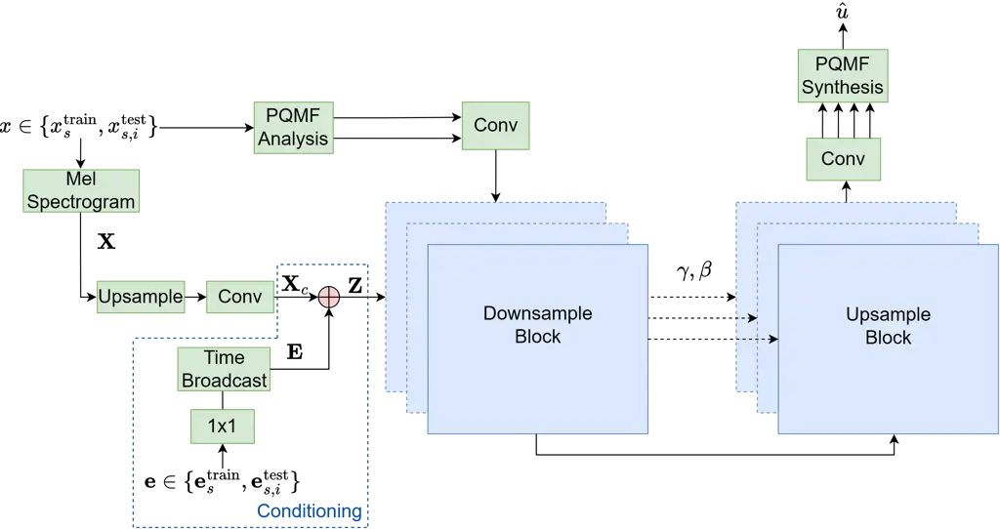
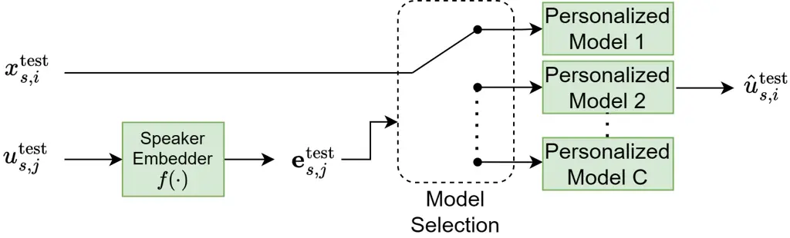

# PERSONALIZED CAUSAL LOW-BITRATE CODED SPEECH RESTORATION WITH SPEAKER EMBEDDINGS

Funded by the European Union under the Horizon Europe research and
innovation programme, Grant Agreement No. 101119297 (EASYLI).  
© 2026 IEEE. Author Accepted Manuscript. Licensed under [CC BY
4.0](https://creativecommons.org/licenses/by/4.0/) with IEEE permission.

###### Abstract

Legacy low-bitrate speech codecs such as AMR-NB remain widely used in
telephony, where they restrict speech bandwidth and degrade listening
quality. Coded speech restoration (CSR) aims to restore the speech
bandwidth while improving the overall quality of coded speech, but
typically without adapting to different speakers. In this paper, we
systematically investigate personalization for restoration of speech
coded at low bitrates, using a causal, low-complexity Universal
Bandwidth Extension Generative Adversarial Network (UBGAN) model as the
basis. We propose two personalization methods based on speaker
embeddings, which incur little additional computational cost at
inference: (i) conditioning a single CSR model on speaker embeddings,
and (ii) cluster-based model selection, where multiple personalized
models are trained on clusters of acoustically similar speakers.
Experiments are performed on AMR-NB coded speech at 4.75 kbps.
Experimental results with disjoint seen- and unseen-speaker test sets
show that cluster-based model selection does not consistently outperform
the non-personalized UBGAN baseline, whereas embedding conditioning
significantly improves ViSQOL and WB-PESQ scores for both seen and
unseen speakers.

[TABLE]

CSR  
coded speech restoration

BWE  
bandwidth extension

Index Terms—  personalization, coded speech restoration, bandwidth
extension, AMR-NB, UBGAN, speaker embeddings

## 1 Introduction

Despite recent advances in neural speech and audio coding \[15\],
low-resource telephony networks continue to rely on legacy low-bitrate
codecs such as AMR-NB \[1\], which restrict the coded speech bandwidth,
degrade listening quality, and contribute to listener fatigue \[2\].
Therefore, BWE (BWE) is typically included as part of CSR (CSR) \[25,
31, 12\]. However, BWE can also magnify existing artifacts: distortions
present in the lower band may propagate into the generated
high-frequency content, potentially reducing overall quality \[12\]. For
this reason, a target sampling rate of 16 kHz is often an appropriate
compromise between increasing speech bandwidth beyond narrowband
telephony and avoiding excessive amplification of codec artifacts at
higher target sampling rates. Nevertheless, even at 16 kHz, residual
codec artifacts and a loss of speaker-specific nuances may persist,
raising the question of whether personalized CSR can help mitigate these
effects.

Personalization for CSR is motivated by the success of personalization
in related areas such as speech enhancement \[17, 26, 27, 10, 34\], BWE
\[32\], text-to-speech synthesis \[5\], automatic speech recognition
\[6, 7\], voice activity detection and diarization \[9, 20\], and neural
speech codecs \[14\]. In these works, two main methods are commonly
explored. One line of research conditions a single model on speaker
embeddings \[10, 32, 5, 34, 6, 7, 9, 20\], allowing a single model to
adapt to different speakers. Following another research direction,
multiple models are trained for small groups (clusters) of speakers,
often combined with speaker-informed model selection at test time \[17,
26, 27, 14\]. Such clusters are typically obtained by grouping speakers
in an embedding space. Because a personalized system can, in principle,
exploit characteristic voice traits such as rhythm and timbre \[30\], it
is worth investigating whether personalization can also improve CSR.
Despite this potential, to the best of our knowledge, personalization
has not yet been systematically investigated for CSR.

This paper investigates personalization for causal low-bitrate CSR using
the Universal Bandwidth Extension Generative Adversarial Network (UBGAN)
\[12\] as a non-personalized CSR basis, aiming to restore 8 kHz AMR-NB
coded speech at 4.75 kbps to 16 kHz wideband speech. At test time, we
assume that a short clean enrollment utterance from the same speaker is
available, from which a speaker embedding is computed. We consider and
compare two alternative personalization methods for CSR: (i) embedding
conditioning, which conditions a single CSR model on speaker embeddings;
and (ii) cluster-based model selection, which trains a separate CSR
model per cluster. Both methods are designed to introduce only minimal
additional computational cost to the CSR model at test time. Whereas
\[24\] explored these personalization methods with a non-causal
HiFi-GAN+ \[28\] basis, in this paper we investigate whether they also
benefit a causal, low-delay, and low-complexity UBGAN CSR model, and
additionally evaluate a hybrid combining both methods. An experimental
comparison is provided on the VCTK dataset \[33\] for both seen speakers
included in the training set and held-out unseen speakers.

## 2 Method

### 2.1 CSR Baseline

Let $`u`$ denote a clean reference utterance and $`x`$ the corresponding
AMR-NB coded utterance. A CSR system aims to reconstruct $`u`$ from
$`x`$, yielding a restored 16 kHz estimate $`\hat{u}`$.

The CSR baseline is based on UBGAN \[12\], which is a causal,
low-complexity, low-delay model suitable for real-time processing on
low-power devices. UBGAN operates in the subband domain using
pseudo-quadrature mirror filter (PQMF) \[23\] analysis/synthesis, a
lightweight U-Net-like generator with temporal adaptive denormalization
(TADE) \[21\] residual blocks, and a multi-resolution STFT discriminator
ensemble trained with a combination of adversarial, feature-matching,
and reconstruction losses. In this paper, we follow the same
subband-domain formulation: the coded utterance is first decomposed into
PQMF subbands, a mel-spectrogram of the coded utterance $`x`$ is used as
the only conditioning input to the generator (i.e., the blind UBGAN
variant), and the processed subbands are resynthesized back to obtain
the restored utterance. We also adapt UBGAN to restore 16 kHz output
from 8 kHz AMR-NB coded speech, and allow the model not only to generate
the missing high-frequency content but also to modify the existing
lower-band subbands.

### 2.2 Speaker Embeddings and Enrollment

All personalization methods considered here use speaker embeddings
obtained from a pretrained ECAPA-TDNN \[8\] model for speaker
verification, trained on the VoxCeleb1 \[22\] and VoxCeleb2 \[4\]
datasets and kept frozen in all experiments. The classification head is
discarded and only the embedding part is used, yielding fixed-length
192-dimensional embedding vectors. Let $`\mathcal{U}`$ denote the set of
all 16 kHz clean reference utterances, and $`\mathcal{X}`$ the
corresponding set of AMR-NB coded utterances. Let
$`f:\mathcal{U}\rightarrow\mathbb{R}^{192}`$ denote the speaker
embedder, which maps a clean utterance $`u\in\mathcal{U}`$ to a speaker
embedding $`\mathbf{e}=f(u)`$.

Training-time embeddings: For each speaker $`s`$ in the training set,
let $`\mathcal{U}_{s}^{\text{train}}\subset\mathcal{U}`$ denote the set
of clean utterances that are used as training targets. For each speaker
$`s`$, a single training-time embedding is computed by averaging, i.e.

```math
\mathbf{e}_{s}^{\text{train}}=\frac{1}{\lvert\mathcal{U}_{s}^{\text{train}}\rvert}\sum_{u\in\mathcal{U}_{s}^{\text{train}}}f(u). \tag{1}
```

The training-time embedding $`\mathbf{e}_{s}^{\text{train}}`$ is used
both for embedding conditioning during training (Sec. 2.3) and for
defining the clusters in the cluster-based model selection method
(Sec. 2.4).

Test-time embeddings: For each speaker $`s`$ in the test set, let
$`\mathcal{U}_{s}^{\text{test}}\subset\mathcal{U}`$ denote the set of
clean utterances that are used as test targets, and let
$`\mathcal{X}_{s}^{\text{test}}\subset\mathcal{X}`$ be the corresponding
coded utterances. The $`i`$-th coded test utterance of speaker $`s`$ and
its clean target are denoted by
$`x_{s,i}^{\text{test}}\in\mathcal{X}_{s}^{\text{test}}`$ and
$`u_{s,i}^{\text{test}}\in\mathcal{U}_{s}^{\text{test}}`$, respectively.
For each target utterance $`u_{s,i}^{\text{test}}`$, we randomly select
a different enrollment utterance
$`u_{s,j}^{\text{test}}\in\mathcal{U}_{s}^{\text{test}}`$ from the same
speaker with $`j\neq i`$; it should be noted that the same enrollment
utterance $`u_{s,j}^{\text{test}}`$ may be used for multiple test
utterances of the same speaker. The test-time embedding used for
restoring $`x_{s,i}^{\text{test}}`$ is defined as
$`\mathbf{e}_{s,j}^{\text{test}}=f(u_{s,j}^{\text{test}})`$. In contrast
to the training-time embedding, which is a single per-speaker average,
each test-time embedding is computed from one enrollment utterance.
These test-time embeddings are used both for embedding conditioning at
test time (Sec. 2.3) and to select the cluster in the cluster-based
model selection method (Sec. 2.4).

In all cases, these embeddings are normalized to unit norm
($`\lVert\mathbf{e}\rVert_{2}=1`$).

### 2.3 Embedding Conditioning

The first proposed personalization method conditions a single CSR model
on a speaker embedding. High-level and low-level views of this method
for UBGAN are shown in Fig. 1 and Fig. 2, respectively.

In the baseline, an 80-band mel-spectrogram $`\mathbf{X}`$ of the coded
input utterance $`x`$ is computed and processed through upsampling and a
convolutional layer, resulting in $`\mathbf{X}_{c}`$. This serves as the
conditioning input for a stack of downsample blocks. In this method,
these conditioning features are augmented with a speaker embedding. The
192-dimensional embedding $`\mathbf{e}`$ (see Sec. 2.2) is adjusted to
match the dimensions of $`\mathbf{X}_{c}`$ by mapping the channels with
a learned $`1\times 1`$ convolution and repeating along the temporal
axis to obtain $`\mathbf{E}`$. Speaker conditioning is then performed by
adding this time-broadcasted embedding to the mel-based conditioning
features,

```math
\mathbf{Z}=\mathbf{X}_{c}+\mathbf{E}, \tag{2}
```

and the resulting $`\mathbf{Z}`$ is used as conditioning input to the
downsample blocks. All subsequent processing inside the downsample and
upsample blocks, as well as the PQMF analysis/synthesis and
post-convolution, remain unchanged.


Fig. 1: High-level view of embedding conditioning during training and
test: the personalized model maps the coded utterance $`x`$ and the
embedding $`\mathbf{e}`$ to the restored utterance $`\hat{u}`$.



Fig. 2: Low-level illustration of embedding conditioning in the UBGAN
CSR generator during training and test. The mel-spectrogram
$`\mathbf{X}`$ of the coded input $`x`$ is processed by the conditioning
pathway to obtain $`\mathbf{X}_{c}`$. The embedding $`\mathbf{e}`$ is
mapped with a $`1\times 1`$ convolution and repeated in time to obtain
$`\mathbf{E}`$, which is added to $`\mathbf{X}_{c}`$. The sum
$`\mathbf{Z}`$ is used as conditioning for the downsample blocks.

### 2.4 Cluster-based Model Selection

The second proposed personalization method utilizes multiple CSR models,
each trained on a cluster of speakers that are close to each other in
the speaker embedding space. The key idea is that speakers with similar
embeddings are expected to share characteristic voice traits; training a
separate model on each cluster allows it to focus on a narrower sub-task
confined to a subset of speakers, similarly to cluster-specific neural
speech codecs \[14\].

Training cluster-based models: All training-time (normalized) speaker
embeddings $`\mathbf{e}_{s}^{\text{train}}`$ in Sec. 2.2 are partitioned
into $`C`$ disjoint clusters using k-means in the embedding space; the
resulting centroids are $`\ell_{2}`$-normalized. For each cluster, we
train a separate CSR model, architecturally identical to the baseline,
using only the utterances from the speakers assigned to that cluster.

Test-time model selection: The cluster-based model selection at test
time is illustrated in Fig. 3. For each coded test utterance
$`x_{s,i}^{\text{test}}`$, the enrollment embedding
$`\mathbf{e}_{s,j}^{\text{test}}`$ from the same speaker (computed on a
different enrollment utterance $`u_{s,j}^{\text{test}}`$) is assigned to
the closest cluster centroid using cosine distance, and the
corresponding cluster-specific UBGAN model is selected.

Unlike the embedding conditioning method in Sec. 2.3, speaker embeddings
here are not used as conditioning inputs to the CSR model; they serve
only to define clusters during training and to select the appropriate
cluster-specific model at test time.

As an additional experiment, we also evaluate a hybrid combining both
methods, where each cluster-specific model is trained with embedding
conditioning.



Fig. 3: Cluster-based model selection at test time. For each coded test
utterance $`x_{s,i}^{\text{test}}`$, a different clean enrollment
utterance $`u_{s,j}^{\text{test}}`$ from the same speaker is passed
through the speaker embedder to obtain
$`\mathbf{e}_{s,j}^{\text{test}}=f(u_{s,j}^{\text{test}})`$. This
embedding is assigned to the nearest cluster centroid, and the
corresponding cluster-specific CSR model is then used to generate the
restored utterance $`\hat{u}_{s,i}^{\text{test}}`$ from
$`x_{s,i}^{\text{test}}`$.

## 3 Experimental Setup

### 3.1 Dataset and Splits

Experiments are conducted on the VCTK dataset \[33\], which comprises
110 English speakers with roughly 400 utterances per speaker (we exclude
speaker p315 due to audio recording issues reported in \[33\]). All
recordings are resampled to 16 kHz and used as clean reference signals.
The clean reference signals are downsampled to 8 kHz and are coded with
the AMR-NB codec at 4.75 kbps using ffmpeg. The coded signals serve as
input to the CSR systems, while the original 16 kHz signals are used as
targets. Although our experiments target AMR-NB as a representative of
legacy low-bitrate codecs, the proposed methods only require access to
coded and clean references during training and are therefore, in
principle, applicable to other codecs as well.

The speakers are split into three disjoint groups: 89 speakers for
training, 10 speakers for validation, and 10 speakers held out entirely
for testing on unseen speakers. For the 89 training speakers, we perform
a per-speaker utterance split: for each training speaker, 80% of their
utterances are used for training and the remaining 20% are held out for
testing. The held-out utterances from these 89 speakers form the
seen-speaker test set, while the utterances from the 10 held-out
speakers form the unseen-speaker test set.

For the cluster-based model selection method (see Sec. 2.4), we
follow \[14\] and set the number of speaker clusters to $`C=4`$.
Applying k-means to the training-time embeddings of the 89 training
speakers yields clusters of 16, 17, 22, and 34 speakers, respectively.
Each of these clusters is used to train one personalized CSR model.

### 3.2 Training Configuration

The architectural and training differences between the methods and the
baseline are described in Secs. 2.3 and 2.4. Despite the distribution
mismatch between per-speaker averaged training-time embeddings and
single-utterance test-time embeddings (see Sec. 2.2), preliminary
findings show that averaging outperforms single-utterance training-time
embeddings, likely due to a more robust speaker representation.

Training is performed on randomly cropped 1 s segments with a batch size
of 64. The generator operates in the PQMF subband domain with a 2-band
analysis frontend and a 4-band synthesis backend. Mel-spectrogram
conditioning is computed directly from the coded input using 80 mel
bands, an FFT size of 256, a Hann window length of 240 samples, a hop
size of 160 samples, and a padding of 80 samples. The generator uses 6
down/up-sample blocks with factors $`[1,2,2,2,2.5,2]`$, 48 channels
throughout, causal depthwise-separable convolutions with kernel size 7,
and TADE-based residual modulation blocks.

For adversarial training, we use a multi-resolution STFT discriminator
ensemble with four sub-discriminators operating at FFT sizes 2048, 1024,
512, and 256, with corresponding hop sizes 512, 256, 128, and 64 and
window lengths equal to the FFT sizes. The training objective combines a
least-squares generative adversarial network (LSGAN) loss \[19\], a
discriminator feature-matching loss, and reconstruction losses. The
reconstruction term consists of a multi-resolution STFT loss with the
same four STFT resolutions as above, together with an additional
waveform-domain MSE loss. The feature-matching term is weighted by 10,
while both the adversarial and reconstruction terms are weighted by 1.

We train the generator with the AdamW \[18\] optimizer and the
discriminator with the Adam \[16\] optimizer. The generator is trained
with an initial learning rate of $`5\times 10^{-4}`$,
$`(\beta_{1},\beta_{2})=(0.5,0.9)`$, where $`\beta_{1}`$ and
$`\beta_{2}`$ are the exponential decay rates for the first- and
second-moment estimates of the optimizer, respectively,
$`\epsilon=10^{-5}`$, and weight decay 0.01. The discriminator is
trained with a learning rate of $`2\times 10^{-4}`$ with the same
$`\beta`$ and $`\epsilon`$ values as for training the generator. The
generator learning rate is decayed with an exponential scheduler with
factor 0.99 once per epoch. Adversarial, feature-matching, and
reconstruction losses are enabled from the start of training. In each
training iteration, the discriminator is updated first and the generator
is updated immediately afterwards. All models are trained for a maximum
of 200,000 batch optimization steps.

### 3.3 Performance Metrics

Testing is performed on both seen- and unseen-speaker sets by comparing
the restored 16 kHz output signals with their corresponding 16 kHz clean
reference signals. We consider three intrusive objective performance
metrics: LSD \[11\], which quantifies spectral distortion (lower is
better); WB-PESQ \[13\], computed using the Python pesq package
(version 0.0.4); and ViSQOL \[3\] (version 3.3.3) in speech mode at
16 kHz. ViSQOL and WB-PESQ are perceptual similarity measures between
reference and degraded speech (higher is better).

### 3.4 Model Size and Complexity

|           |              |                   |       | Seen speakers     |                   |                   | Unseen speakers   |                   |                   |
| --------- | ------------ | ----------------- | ----- | ----------------- | ----------------- | ----------------- | ----------------- | ----------------- | ----------------- |
| Baseline  | Method       | Params            | GMACs | LSD               | ViSQOL            | WB-PESQ           | LSD               | ViSQOL            | WB-PESQ           |
| UBGAN     | —            | 309 K             | 0.253 | 0.98 $`\pm`$ 0.04 | 2.80 $`\pm`$ 0.50 | 2.36 $`\pm`$ 0.35 | 0.97 $`\pm`$ 0.04 | 2.92 $`\pm`$ 0.52 | 2.28 $`\pm`$ 0.36 |
|           | Emb. cond.   | 318 K             | 0.253 | 0.98 $`\pm`$ 0.04 | 2.92 $`\pm`$ 0.50 | 2.47 $`\pm`$ 0.35 | 0.99 $`\pm`$ 0.05 | 2.97 $`\pm`$ 0.53 | 2.34 $`\pm`$ 0.35 |
|           | Cluster sel. | 4$`\times`$309 K  | 0.253 | 0.97 $`\pm`$ 0.04 | 2.85 $`\pm`$ 0.50 | 2.33 $`\pm`$ 0.36 | 0.99 $`\pm`$ 0.05 | 2.86 $`\pm`$ 0.48 | 2.22 $`\pm`$ 0.34 |
|           | Hybrid       | 4$`\times`$318 K  | 0.253 | 0.98 $`\pm`$ 0.05 | 2.88 $`\pm`$ 0.51 | 2.36 $`\pm`$ 0.35 | 1.00 $`\pm`$ 0.04 | 2.86 $`\pm`$ 0.50 | 2.24 $`\pm`$ 0.35 |
| HiFi-GAN+ | —            | 1.06 M            | 30.54 | 0.95 $`\pm`$ 0.03 | 2.76 $`\pm`$ 0.49 | 2.21 $`\pm`$ 0.32 | 0.94 $`\pm`$ 0.03 | 2.90 $`\pm`$ 0.53 | 2.18 $`\pm`$ 0.34 |
|           | Emb. cond.   | 1.46 M            | 30.54 | 0.95 $`\pm`$ 0.03 | 2.95 $`\pm`$ 0.51 | 2.22 $`\pm`$ 0.31 | 0.95 $`\pm`$ 0.03 | 3.01 $`\pm`$ 0.52 | 2.15 $`\pm`$ 0.32 |
|           | Cluster sel. | 4$`\times`$1.06 M | 30.54 | 0.92 $`\pm`$ 0.03 | 3.00 $`\pm`$ 0.48 | 2.39 $`\pm`$ 0.33 | 0.92 $`\pm`$ 0.03 | 3.06 $`\pm`$ 0.47 | 2.34 $`\pm`$ 0.33 |
|           | Hybrid       | 4$`\times`$1.46 M | 30.54 | 0.91 $`\pm`$ 0.03 | 2.99 $`\pm`$ 0.48 | 2.45 $`\pm`$ 0.32 | 0.93 $`\pm`$ 0.03 | 2.96 $`\pm`$ 0.48 | 2.37 $`\pm`$ 0.33 |

Table 1: Model complexity and results for seen and unseen speakers (mean
$`\pm`$ std). Boldface indicates the best score for each metric within
each baseline group.

Table 1 includes the number of trainable generator parameters and
multiply–accumulate operations (GMACs) per 1 s segment of 8 kHz
narrowband input (8,000 samples). These figures exclude the ECAPA-TDNN
speaker embedder, which in practice would need to be evaluated only once
per speaker during an offline enrollment phase; the resulting embedding
could then be stored and reused for all subsequent utterances, adding no
computational cost to test-time CSR inference. The embedding
conditioning method introduces one additional $`1\times 1`$
convolutional layer into the conditioning pathway, increasing complexity
by only $`0.028`$ MMACs ($`{\sim}0.01\%`$ additional computation). For
cluster-based model selection, each cluster-specific model shares the
same architecture as the baseline; at test time only one model is
evaluated, and cluster assignment requires computing the cosine distance
between the enrollment embedding and $`C`$ centroids, which is
negligible compared to the generator’s inference cost. Both methods thus
preserve the computational efficiency and low algorithmic delay of
UBGAN \[12\].

As an additional reference, Table 1 includes results from non-causal
HiFi-GAN+-based CSR systems reprinted from \[24\] using identical data
splits and evaluation pipeline, except for the hybrid method, which is
newly evaluated here. HiFi-GAN+ is a WaveNet-based \[29\] model with
substantially higher complexity than the causal UBGAN baseline used
here. For HiFi-GAN+, the embedding conditioning layer adds a larger
relative overhead (1.46 M vs. 1.06 M parameters), and the hybrid
requires storing $`4\times 1.46`$ M parameters in total.

## 4 Results

Results for all methods are shown in Table 1. For UBGAN, embedding
conditioning consistently improves ViSQOL and WB-PESQ scores for both
seen and unseen speakers, with LSD scores equal to the baseline for seen
speakers but slightly worse for unseen speakers. Speaker-level paired
Wilcoxon signed-rank tests confirm that the ViSQOL and WB-PESQ score
improvements from embedding conditioning are significant for both seen
($`p<0.001`$, $`N=89`$) and unseen ($`p<0.02`$, $`N=10`$) speakers,
suggesting that the model generalizes from the averaged training-time
embeddings rather than memorizing them, while the LSD score differences
are not significant in either condition ($`p>0.05`$). Cluster-based
model selection, in contrast, shows mixed results: for seen speakers it
slightly improves LSD and ViSQOL scores but reduces WB-PESQ scores,
whereas for unseen speakers it is slightly worse than the baseline on
all three metrics. One possible explanation is that UBGAN already
handles speaker variability effectively with the full training set,
leaving little room for cluster specialization to help, while the
narrower speaker coverage per cluster may reduce generalization to
unseen speakers. The hybrid method, which applies embedding conditioning
within cluster-specific models, does not improve over embedding
conditioning alone for UBGAN on any metric and, for unseen speakers,
even falls below the non-personalized baseline on all three metrics.

Despite its substantially smaller size and lower complexity (see
Sec. 3.4), the UBGAN baseline already yields higher WB-PESQ and ViSQOL
scores than the HiFi-GAN+ \[28\] baseline from \[24\], albeit with
slightly worse LSD scores. Notably, the best personalization method
differs across baselines: with HiFi-GAN+, the hybrid and cluster-based
model selection provide the largest gains, whereas with UBGAN, embedding
conditioning is the most effective method. Since the two baselines
differ in architecture, causality, and capacity, the relative benefit of
each personalization method appears to depend on the underlying CSR
model.

Across both baselines, the three metrics do not always agree, as LSD
scores measure spectral distortion while ViSQOL and WB-PESQ scores
assess perceptual quality. On average, ViSQOL scores are higher for
unseen than for seen speakers for most systems, including the baselines.
As ViSQOL is sensitive to the specific speech material \[3\], we
hypothesize that this mainly reflects differences in the speakers and
utterances across the two test sets rather than genuinely better
performance on unseen speakers.

## 5 Conclusion

This paper investigated personalization for causal low-bitrate CSR of
AMR-NB coded speech using a UBGAN baseline with ECAPA-TDNN speaker
embeddings, evaluated on the VCTK dataset. Cluster-based model selection
yields mixed results and requires storing $`C=4`$ models, and combining
it with embedding conditioning in a hybrid approach does not improve
over embedding conditioning alone for UBGAN. Embedding conditioning
consistently improves ViSQOL and WB-PESQ scores for both seen and unseen
speakers, maintaining low computational complexity. A comparison with a
non-causal HiFi-GAN+ baseline further suggests that the most effective
personalization method depends on the underlying CSR model. Notably, the
causal UBGAN with embedding conditioning achieves WB-PESQ scores
exceeding all HiFi-GAN+ configurations for seen speakers and ViSQOL
scores surpassing the HiFi-GAN+ baseline, while requiring over
$`120\times`$ fewer multiply–accumulate operations and enabling
low-latency processing suitable for real-time deployment.

## References

- \[1\] 3rd Generation Partnership Project (3GPP) (1999) Mandatory
  Speech Codec Speech Processing Functions; Adaptive Multi-Rate (AMR)
  Speech Codec; Transcoding Functions. Technical report Technical Report
  TS 26.071, 3rd Generation Partnership Project (3GPP). Cited by: §1.
- \[2\] J. Büthe and J. Valin (2025) A Lightweight and Robust Method for
  Blind Wideband-to-Fullband Extension of Speech. In Proc. IEEE Workshop
  on Applications of Signal Processing to Audio and Acoustics (WASPAA),
  Tahoe City, CA, USA. Cited by: §1.
- \[3\] M. Chinen, F. S. C. Lim, J. Skoglund, N. Gureev, F. O’Gorman,
  and A. Hines (2020) ViSQOL v3: An Open Source Production Ready
  Objective Speech and Audio Metric. In Proc. Quality of Multimedia
  Experience (QoMEX), Athlone, Ireland. Cited by: §3.3, §4.
- \[4\] J. S. Chung, A. Nagrani, and A. Zisserman (2018) VoxCeleb2: Deep
  Speaker Recognition. In Proc. Interspeech 2018, Hyderabad, India,
  pp. 1086–1090. Cited by: §2.2.
- \[5\] E. Cooper, C. Lai, Y. Yasuda, F. Fang, X. Wang, N. Chen, and J.
  Yamagishi (2020) Zero-Shot Multi-Speaker Text-to-Speech With
  State-of-the-Art Neural Speaker Embeddings. In Proc. IEEE
  International Conference on Acoustics, Speech and Signal Processing
  (ICASSP), Barcelona, Spain, pp. 6184–6188. Cited by: §1.
- \[6\] M. Delcroix, K. Žmolíková, K. Kinoshita, A. Ogawa, and T.
  Nakatani (2018) Single-Channel Target Speaker Extraction and
  Recognition With SpeakerBeam. In Proc. IEEE International Conference
  on Acoustics, Speech and Signal Processing (ICASSP), Calgary, AB,
  Canada, pp. 5554–5558. Cited by: §1.
- \[7\] P. Denisov and T. Vu (2019) End-to-End Multi-Speaker Speech
  Recognition Using Speaker Embeddings and Transfer Learning. In Proc.
  Interspeech, Graz, Austria, pp. 4425–4429. External Links:
  [Document](https://dx.doi.org/10.21437/Interspeech.2019-1130) Cited
  by: §1.
- \[8\] B. Desplanques, J. Thienpondt, and K. Demuynck (2020)
  ECAPA-TDNN: Emphasized Channel Attention, Propagation and Aggregation
  in TDNN-Based Speaker Verification. In Proc. Interspeech, Shanghai,
  China, pp. 3830–3834. Cited by: §2.2.
- \[9\] S. Ding, Q. Wang, S. Chang, L. Wan, and I. L. Moreno (2020)
  Personal VAD: Speaker-Conditioned Voice Activity Detection. In Proc.
  Odyssey 2020: The Speaker and Language Recognition Workshop, Tokyo,
  Japan, pp. 433–439. Cited by: §1.
- \[10\] Ş. E. Eskimez, T. Yoshioka, H. Wang, X. Wang, Z. Chen, and X.
  Huang (2022) Personalized Speech Enhancement: New Models and
  Comprehensive Evaluation. In Proc. IEEE International Conference on
  Acoustics, Speech and Signal Processing (ICASSP), Singapore,
  pp. 356–360. Cited by: §1.
- \[11\] A. Gray and J. Markel (1976) Distance measures for speech
  processing. IEEE Transactions on Acoustics, Speech, and Signal
  Processing 24 (5), pp. 380–391. Cited by: §3.3.
- \[12\] K. Gupta, S. Korse, A. Brendel, N. Pia, and G. Fuchs (2025)
  UBGAN: Enhancing Coded Speech With Blind and Guided Bandwidth
  Extension. In Proc. IEEE Workshop on Applications of Signal Processing
  to Audio and Acoustics (WASPAA), Tahoe City, CA, USA. Cited by: §1,
  §1, §2.1, §3.4.
- \[13\] ITU-T (2005) Wideband Extension to Recommendation P.862 for the
  Assessment of Wideband Telephone Networks and Speech Codecs. ITU-T
  Rec. Technical Report P.862.2, International Telecommunication Union,
  Geneva, Switzerland. Cited by: §3.3.
- \[14\] I. Jang, H. Yang, W. Lim, S. Beack, and M. Kim (2024)
  Personalized Neural Speech Codec. In Proc. IEEE International
  Conference on Acoustics, Speech and Signal Processing (ICASSP), Seoul,
  South Korea, pp. 991–995. Cited by: §1, §2.4, §3.1.
- \[15\] M. Kim and J. Skoglund (2024) Neural Speech and Audio Coding:
  Modern AI technology meets traditional codecs. IEEE Signal Processing
  Magazine 41 (6), pp. 85–93. Cited by: §1.
- \[16\] D. P. Kingma and J. Ba (2015) Adam: A Method for Stochastic
  Optimization. In Proc. 3rd Int. Conf. Learn. Representations (ICLR),
  San Diego, CA, USA. Cited by: §3.2.
- \[17\] M. Kolbæk, Z. Tan, and J. Jensen (2017) Speech Intelligibility
  Potential of General and Specialized Deep Neural Network Based Speech
  Enhancement Systems. IEEE/ACM Trans. on Audio, Speech, and Language
  Processing 25 (1), pp. 153–167. Cited by: §1.
- \[18\] I. Loshchilov and F. Hutter (2019) Decoupled weight decay
  regularization. In Proc. International Conference on Learning
  Representations (ICLR), New Orleans, LA, USA. Cited by: §3.2.
- \[19\] X. Mao, Q. Li, H. Xie, R. Y.K. Lau, Z. Wang, and S. P.
  Smolley (2017) Least squares generative adversarial networks. In Proc.
  IEEE International Conference on Computer Vision (ICCV), Venice,
  Italy. Cited by: §3.2.
- \[20\] I. Medennikov, M. Korenevsky, T. Prisyach, Y. Khokhlov, M.
  Korenevskaya, I. Sorokin, T. Timofeeva, A. Mitrofanov, A.
  Andrusenko, I. Podluzhny, et al. (2020) Target-Speaker Voice Activity
  Detection: A Novel Approach for Multi-Speaker Diarization in a Dinner
  Party Scenario. In Proc. Interspeech, Shanghai, China, pp. 274–278.
  Cited by: §1.
- \[21\] A. Mustafa, N. Pia, and G. Fuchs (2021) StyleMelGAN: An
  Efficient High-Fidelity Adversarial Vocoder with Temporal Adaptive
  Normalization. In Proc. IEEE ICASSP, Toronto, ON, Canada,
  pp. 6034–6038. Cited by: §2.1.
- \[22\] A. Nagrani, J. S. Chung, and A. Zisserman (2017) VoxCeleb: A
  Large-Scale Speaker Identification Dataset. In Proc. Interspeech,
  Stockholm, Sweden, pp. 2616–2620. Cited by: §2.2.
- \[23\] T. Q. Nguyen (1994) Near-perfect-reconstruction pseudo-QMF
  banks. IEEE Transactions on Signal Processing 42 (1), pp. 65–76. Cited
  by: §2.1.
- \[24\] E. Özgünay, C. Rollwage, J. Rennies, X. Domont, M. Ohlenbusch,
  and S. Doclo (2026) Personalized Low-Bitrate Coded Speech Restoration
  via Embedding Conditioning and Cluster-Based Model Selection. Note:
  presented at the Workshop on Low-Resource Audio Coding (LRAC) at IEEE
  ICASSP, Barcelona, SpainAvailable:
  [https://crowdsourcing.cisco.com/lrac-workshop/2026/assets/files/2026-LRAC-NAS-1-Paper-Ozgunay-Personalized-Low-Bitrate-Coded-Speech-Restoration-Via-Embedding-Conditioning-And-Cluster-Based-Model-Selection.pdf](https://crowdsourcing.cisco.com/lrac-workshop/2026/assets/files/2026-LRAC-NAS-1-Paper-Ozgunay-Personalized-Low-Bitrate-Coded-Speech-Restoration-Via-Embedding-Conditioning-And-Cluster-Based-Model-Selection.pdf)
  Cited by: §1, §3.4, §4.
- \[25\] K. Schmidt, B. Edler, A. M. Mahmoud, and G. Fuchs (2023)
  LPC-GAN for Speech Super-Resolution. In Proc. European Signal
  Processing Conference (EUSIPCO), Helsinki, Finland, pp. 346–350. Cited
  by: §1.
- \[26\] A. Sivaraman and M. Kim (2020) Sparse Mixture of Local Experts
  for Efficient Speech Enhancement. In Proc. Interspeech, Shanghai,
  China, pp. 4526–4530. External Links: ISSN 2958-1796 Cited by: §1.
- \[27\] A. Sivaraman and M. Kim (2021) Zero-Shot Personalized Speech
  Enhancement Through Speaker-Informed Model Selection. In Proc. IEEE
  Workshop on Applications of Signal Processing to Audio and Acoustics
  (WASPAA), New Paltz, NY, USA, pp. 171–175. Cited by: §1.
- \[28\] J. Su, Y. Wang, A. Finkelstein, and Z. Jin (2021) Bandwidth
  Extension Is All You Need. In Proc. IEEE International Conference on
  Acoustics, Speech and Signal Processing (ICASSP), Toronto, ON, Canada,
  pp. 696–700. Cited by: §1, §4.
- \[29\] A. van den Oord, S. Dieleman, H. Zen, K. Simonyan, O.
  Vinyals, A. Graves, N. Kalchbrenner, A. Senior, and K.
  Kavukçuoğlu (2016) WaveNet: A Generative Model for Raw Audio. In Proc.
  ISCA Speech Synthesis Workshop (SSW 9), Sunnyvale, CA, USA, pp. 125.
  Cited by: §3.4.
- \[30\] W. Wang, Y. Song, and S. Jha (2024) USAT: A Universal
  Speaker-Adaptive Text-to-Speech Approach. IEEE/ACM Trans. on Audio,
  Speech, and Language Processing 32, pp. 2590–2604. Cited by: §1.
- \[31\] L. Wen, L. Wang, Y. Zheng, W. Shi, and K. P. Choi (2024)
  FT-CSR: Cascaded Frequency-Time Method for Coded Speech Restoration.
  In Proc. IEEE International Conference on Multimedia and Expo (ICME),
  Niagara Falls, ON, Canada. Cited by: §1.
- \[32\] P. Xu, Z. Zhang, and Z. Fu (2025) Personalized Bone-Conduction
  Bandwidth Extension With Speaker Characteristics. In Proc. Asia
  Pacific Signal and Information Processing Association Annual Summit
  and Conference (APSIPA ASC), Singapore, pp. 1128–1133. Cited by: §1.
- \[33\] J. Yamagishi, C. Veaux, and K. MacDonald (2019) CSTR VCTK
  Corpus: English Multi-Speaker Corpus for CSTR Voice Cloning Toolkit
  (Version 0.92). Note: Centre for Speech Technology Research (CSTR),
  University of Edinburgh Cited by: §1, §3.1.
- \[34\] K. Žmolíková, M. Delcroix, T. Ochiai, K. Kinoshita, J.
  Černocký, and D. Yu (2023) Neural Target Speech Extraction: An
  Overview. IEEE Signal Process. Mag. 40 (3), pp. 8–29. Cited by: §1.
